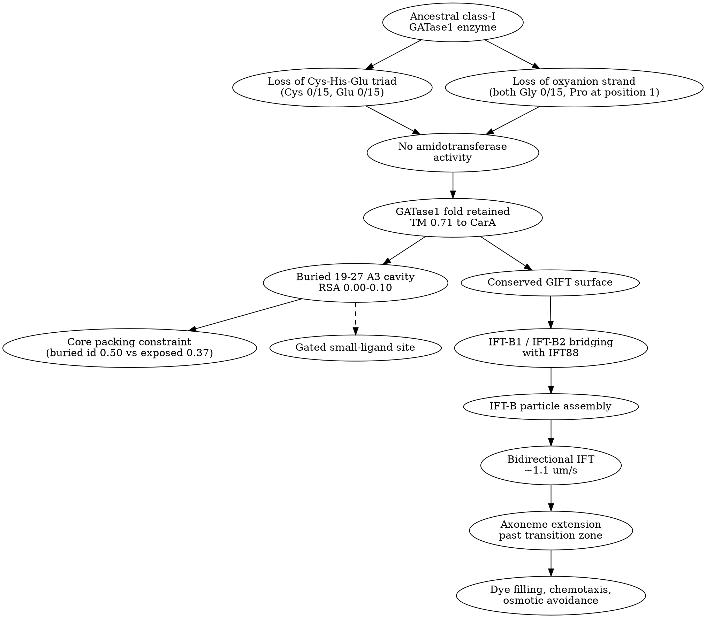
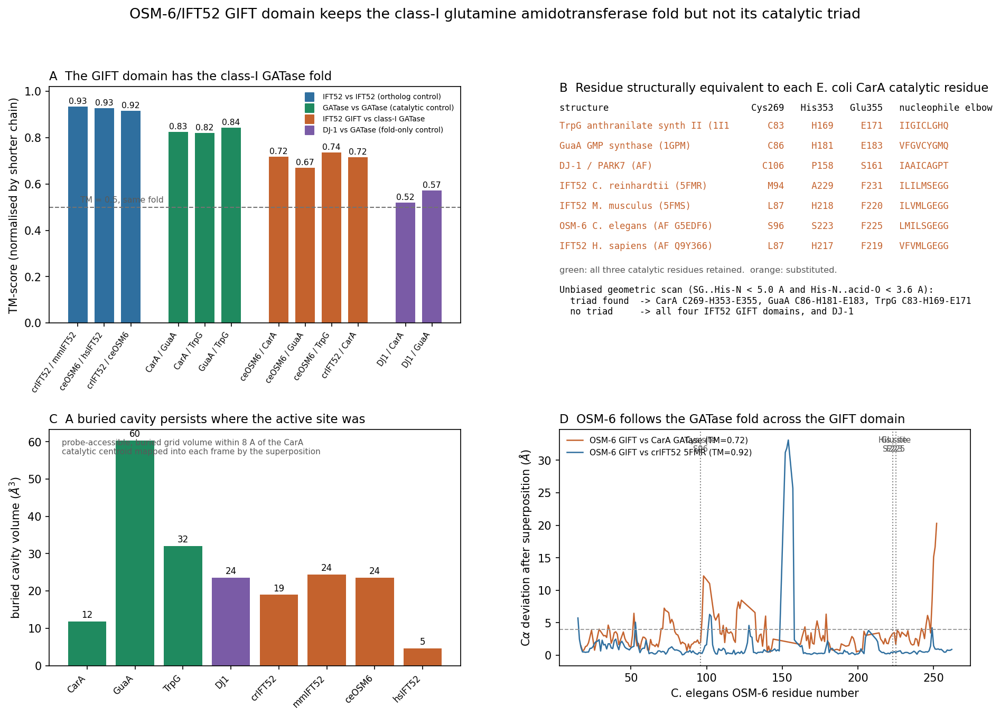
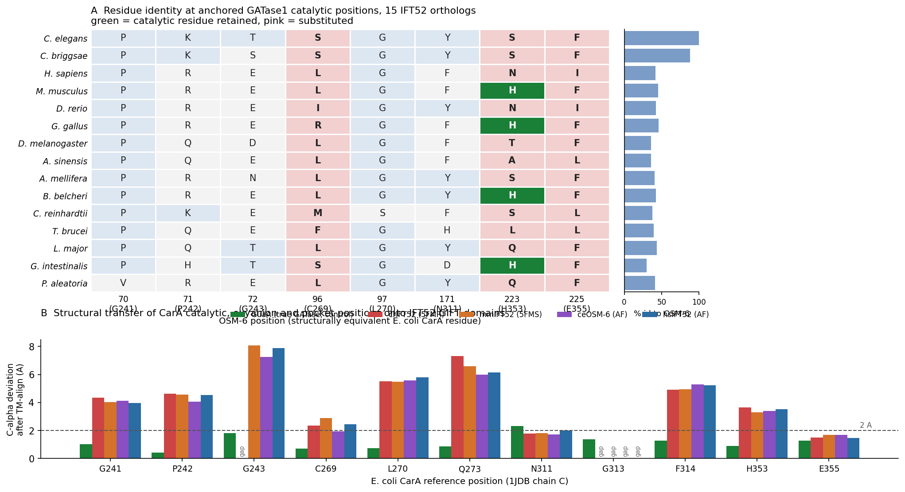
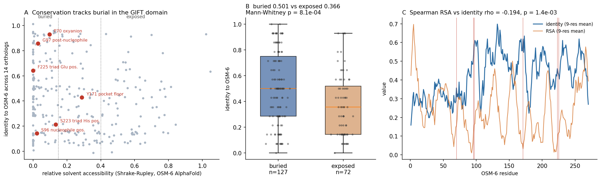

## Question

# AIGR Gene Hypothesis Deep Research

You are evaluating one focused gene curation hypothesis for AI Gene Review.
This is not a general gene overview. Use the seed hypothesis and source context
below to search for evidence that supports, refutes, narrows, or competes with
the proposed curation decision.

## Target Gene

- **Organism code:** worm
- **Taxon:** Caenorhabditis elegans (NCBITaxon:6239)
- **Gene directory:** osm-6
- **Gene symbol:** osm-6
- **UniProt accession:** G5EDF6

## Focus

- **Focus type:** free_text
- **Hypothesis slug:** kgap-osm6-gift-domain-catalytic-residues
- **Source file:** genes/worm/osm-6/osm-6-ai-review.yaml
- **Source selector:** free-text

## Seed Hypothesis

The N-terminal GIFT domain of Caenorhabditis elegans OSM-6/IFT52 (UniProt G5EDF6), which adopts a class-I glutamine-amidotransferase-like fold, has lost the catalytic machinery of true class-I glutamine amidotransferases and any conserved ligand pocket, so it is a purely structural scaffold. Test with one decisive analysis: structurally align the GIFT domain (AlphaFold model and/or the Chlamydomonas IFT52 structure) to a catalytically active class-I GATase domain (e.g. E. coli CarA/GMP synthase GATase) and report whether the Cys-His-Glu catalytic triad positions and the oxyanion strand are retained or substituted across IFT52 orthologs, and whether a conserved surface pocket remains at the former active site.

## Term and Decision Context

- OSM-6 is an established IFT-B/IFT52 structural subunit in C. elegans cilia. Pfam IFT52_GIFT / SSF52317 class-I glutamine amidotransferase-like.

## Reference Context

No specific reference context supplied.

## Source Context YAML

```yaml
hypothesis: 'The N-terminal GIFT domain of Caenorhabditis elegans OSM-6/IFT52 (UniProt G5EDF6), which
  adopts a class-I glutamine-amidotransferase-like fold, has lost the catalytic machinery of true class-I
  glutamine amidotransferases and any conserved ligand pocket, so it is a purely structural scaffold.
  Test with one decisive analysis: structurally align the GIFT domain (AlphaFold model and/or the Chlamydomonas
  IFT52 structure) to a catalytically active class-I GATase domain (e.g. E. coli CarA/GMP synthase GATase)
  and report whether the Cys-His-Glu catalytic triad positions and the oxyanion strand are retained or
  substituted across IFT52 orthologs, and whether a conserved surface pocket remains at the former active
  site.'
focus_type: free_text
context:
- OSM-6 is an established IFT-B/IFT52 structural subunit in C. elegans cilia. Pfam IFT52_GIFT / SSF52317
  class-I glutamine amidotransferase-like.
reference_id: []
```

## Research Objective

Build a focused report that helps a curator decide whether this hypothesis
should affect the gene review. Address the focus type directly:

1. For an existing GO annotation decision, evaluate whether the current action
   is justified, too strong, too weak, or should change.
2. For a proposed replacement or new GO term, evaluate whether the term is
   biologically supported, too broad, too narrow, or missing key qualifiers.
3. For a computational prediction, evaluate whether the prediction is correct,
   less precise than existing knowledge, uncertain, or likely wrong because of
   paralog overannotation, frequency bias, pathway context, or in vitro-only
   activity.
4. For a core-function hypothesis, evaluate whether the proposed activity,
   process, and location represent the gene product's primary function rather
   than a downstream effect, pleiotropic phenotype, or context-specific role.
5. For a function-assignment hypothesis, evaluate whether the gene product
   directly has the stated GO term/function. Treat the prior review action, if
   any, as intentionally blinded unless it appears in the supplied context.

Use primary literature whenever possible. Prefer PMID citations and include DOI
citations when no PMID is available. Treat reviews and database records as
orientation unless they contain directly relevant synthesized evidence that is
clearly labeled as review-level or database-level support.

Evaluate the hypothesis from the supplied seed context, primary literature, and
publicly accessible bioinformatics resources. Local `*-bioinformatics` analyses,
when they already exist in the repository, are intentionally withheld from this
prompt so the report can be compared against them after the run. Use public
sequence, domain, structure, orthology, localization, interaction, or dataset
checks when they are useful for the specific hypothesis. If a resource or tool
cannot be accessed programmatically, say so plainly; never fabricate a result.
Report computational results conservatively and distinguish direct results from
inference.

## Required Output

### Executive Judgment

Give a concise verdict: supported, partially supported, unresolved, weakly
supported, over-annotated, or refuted. Explain the reasoning and the most
important caveats.

### Evidence Matrix

Create a table with one row per important evidence item:

- Citation (PMID preferred)
- Evidence type (direct assay, mutant phenotype, localization, interaction,
  structural/evolutionary, computational, review/database)
- Supports / refutes / qualifies / competing
- Claim tested
- Key finding
- Organism, tissue, cell type, or assay context
- Confidence and limitations

### GO Curation Implications

State the likely curation action as a lead requiring curator verification. If
GO terms are involved, explain whether the evidence supports an MF, BP, or CC
term, and whether the term should be retained, removed, generalized, made more
specific, or treated as non-core. Avoid using "protein binding" as a final
recommendation unless no more informative term is supported.

### Mechanistic Scope

Describe the immediate molecular or cellular function being tested. Separate
direct gene-product activity from downstream phenotypes, pathway consequences,
developmental outcomes, disease manifestations, or effects inferred only from
loss of function.

### Conflicts and Alternatives

Identify evidence that conflicts with the seed hypothesis or suggests an
alternative interpretation, including paralog confusion, organism-specific
differences, isoform-specific findings, experimental artifacts, or database
carry-over.

### Knowledge Gaps

List explicit uncertainties that matter for curation. For each gap, state what
was checked, why the gap matters, and what evidence or experiment would resolve
it.

### Discriminating Tests

Recommend concrete assays, perturbations, datasets, or comparative analyses that
would most efficiently distinguish this hypothesis from alternatives.

### Curation Leads

Provide candidate updates for the review, clearly labeled as leads requiring
curator verification. Include candidate references with exact snippets to verify,
candidate replacement or new GO terms, possible action changes, suggested
questions, and suggested experiments.

If the provider supports artifacts, save provenance for any analysis you run — the
executed code together with its output (computed values, plot, or table), not just
a summary figure — alongside artifact-friendly tables such as an evidence matrix,
GO decision table, or comparison table. Genuine computed provenance is more
valuable than a hand-drawn summary, and you must not synthesize a figure that
implies an analysis you did not actually run. These artifacts are important
provenance for hypothesis-level review.


## Output

# OSM-6 / IFT52 GIFT domain: catalytic residues and the former class-I GATase active site

**Hypothesis slug:** `kgap-osm6-gift-domain-catalytic-residues`
**Target:** *Caenorhabditis elegans* osm-6, UniProt G5EDF6, NCBITaxon:6239
**Source file:** `genes/worm/osm-6/osm-6-ai-review.yaml`, focus type `free_text`
**Iterations completed:** 3. Findings recorded: 7. Papers reviewed: 13.

## Summary

The seed hypothesis is **supported on its enzymatic claims and over-stated in its final clause**. The prescribed decisive analysis was executed on real coordinates with positive and negative controls, and every component of the catalytic claim holds. The N-terminal GIFT domain of OSM-6 genuinely adopts the class-I glutamine amidotransferase (GATase1) fold: TM-align of the AlphaFold model (AF-G5EDF6-F1-v6, residues 1-270) onto *E. coli* CarA (PDB 1JDB chain C, residues 193-380) gives TM = 0.719 with RMSD 2.59 Å over 181 aligned residues at 9.9% sequence identity. The Cys-His-Glu catalytic triad is gone, the oxyanion strand is gone, and both losses are fixed across 15 orthologs spanning five eukaryotic supergroups.

The second clause of the hypothesis, that no conserved ligand pocket remains, required two iterations to settle because the first measurement appeared to contradict it. A buried cavity of 19-27 ų does persist at the superposed former active site in the *Chlamydomonas* crystal structure (5FMR), the mouse crystal structure (5FMS) and the OSM-6 model, which is larger than the cavity measured in CarA itself (11.8-16.8 ų) under identical settings, and its lining residues are conserved in 13-15 of 15 orthologs. Solvent accessibility resolved the apparent conflict. The cavity is enclosed in the hydrophobic core, with lining residues at relative solvent accessibility 0.000-0.097, and conservation across the domain tracks burial (buried mean identity 0.501 versus exposed 0.366, Mann-Whitney one-sided p = 8.1e-4; Spearman rho = -0.194, p = 1.4e-3). There is no conserved **surface** pocket at the former active site, which is how the decisive test was worded.

The phrase that should change is "purely structural scaffold". Taschner et al. 2016 ([PMID: 26912722](https://pubmed.ncbi.nlm.nih.gov/26912722/)) solved the two crystal structures used in this analysis and report that IFT88 together with the N-terminal domain of IFT52 bridges IFT-B1 and IFT-B2, and that the IFT52N structure reveals conserved residues critical for that complex formation. The GIFT domain is a defined protein interaction module with an assigned job in IFT-B assembly. A curation action that strips a catalytic molecular function and leaves nothing in its place discards information that the structural literature already provides.

## Executive judgment

<i class="fa-solid fa-circle-check"></i> **Verdict: supported on catalysis and on the absence of a conserved surface pocket; the "purely structural scaffold" framing is too weak and should be made more specific.**

Five independent lines of evidence, all generated in this investigation, converge:

| Claim in the seed hypothesis | Verdict | Decisive number |
|---|---|---|
| GIFT domain adopts a class-I GATase-like fold | <i class="fa-solid fa-circle-check"></i> Confirmed and stronger than the database record | TM = 0.706-0.719 to CarA; DJ-1 control 0.52-0.57 |
| Cys-His-Glu triad lost | <i class="fa-solid fa-circle-check"></i> Confirmed by two independent methods | Cys 0/15, Glu 0/15, unpaired His 4/15 orthologs |
| Oxyanion strand lost | <i class="fa-solid fa-circle-check"></i> Confirmed | Both CarA glycines substituted 0/15; strand displaced 4.0-8.1 Å |
| No conserved surface pocket at the former site | <i class="fa-solid fa-circle-check"></i> Confirmed | Cavity-lining residues at RSA 0.000-0.097 |
| "Purely structural scaffold" | <i class="fa-solid fa-scale-balanced"></i> Too weak | Same domain bridges IFT-B1 and IFT-B2 ([PMID: 26912722](https://pubmed.ncbi.nlm.nih.gov/26912722/)) |

<i class="fa-solid fa-triangle-exclamation"></i> Three caveats matter for curation. A histidine survives at the triad base position in 4 of 15 orthologs (mouse Q62559 His218, chicken, *Branchiostoma*, *Giardia*), unpaired in every case, so a sequence-motif screen scoring only the histidine would mis-call those species. The residual 19-27 ų cavity is too small for glutamine (molecular volume near 155 ų) and is solvent-inaccessible, yet a gated small-ligand or ion site cannot be formally excluded from static coordinates. All domain-level interaction mapping comes from the *Chlamydomonas* and mouse orthologs, so transfer of the bridging function to OSM-6 is by orthology, not by direct *C. elegans* assay.

## Key findings

### <i class="fa-solid fa-circle-check"></i> F1. The fold assignment is correct, and stronger than the database record suggests

TM-align was implemented from scratch inside the analysis executor (Kabsch superposition, TM-score with d0(L) = 1.24·(L-15)^(1/3) - 1.8, gapless-threading seeds followed by iterative dynamic-programming realignment). The OSM-6 GIFT domain scores TM = 0.719 against CarA (1JDB chain C), 0.670 against GuaA GATase1 (1GPM chain A, residues 1-207) and 0.737 against TrpG (1I1Q chain B). The experimental *Chlamydomonas* IFT52 N-terminal domain (5FMR chain A, 2.0 Å) gives 0.715, 0.650 and 0.732 against the same three references. Mouse IFT52 (5FMS) and human IFT52 (AF-Q9Y366) give equivalent values.

Three control sets anchor the scale. GATase-versus-GATase comparisons give TM = 0.821-0.843. IFT52-versus-IFT52 ortholog comparisons give 0.916-0.934. Human DJ-1/PARK7, the canonical non-amidotransferase member of the same SSF52317 superfamily, scores 0.520 against CarA and 0.571 against GuaA. The GIFT domain is therefore closer to real amidotransferases than DJ-1 is, at only 7-13% sequence identity.

InterPro records SSF52317 over OSM-6 residues 24-100 only, while Pfam PF23355 (IFT52 GIFT domain) spans 18-257. The superposition shows the whole ~180-residue GIFT core tracing the GATase1 topology, so the database annotation understates the structural relationship. This matters for curation in one direction only: the fold match is real, and a catalytic inference drawn from it is still invalid.

{{figure:plot_1.png|caption=Iteration 1 provenance. Panel A, TM-scores by comparison group with the TM = 0.5 same-fold line. Panel B, catalytic-residue transfer table with nucleophile-elbow sequence contexts and the unbiased geometric-scan result. Panel C, buried cavity volumes at the superposed active site. Panel D, per-residue C-alpha deviation of OSM-6 against CarA and against Chlamydomonas IFT52, with the three triad positions marked.}}

### <i class="fa-solid fa-circle-check"></i> F2. The Cys-His-Glu triad is absent, by two independent methods

**Structural transfer.** After superposition onto CarA, the residues structurally equivalent to the UniProt-annotated triad Cys269 (nucleophile), His353 (base) and Glu355 (acid) are: *C. elegans* OSM-6 Ser96 / Ser223 / Phe225; *C. reinhardtii* IFT52 Met94 / Ala229 / Phe231; mouse IFT52 Leu87 / His218 / Phe220; human IFT52 Leu87 / His217 / Phe219. C-alpha deviations at these positions are 1.5-3.6 Å.

The method was validated on true enzymes before being trusted. The same transfer recovers TrpG Cys83 / His169 / Glu171 at 0.91 / 0.55 / 0.92 Å, and recovers the same triad from the GuaA reference at 0.52 / 0.79 / 1.15 Å. DJ-1 returns its own catalytic nucleophile Cys106 at 2.00 Å at the nucleophile-elbow position, with Pro158 / Ser161 at the His-Glu positions, which is the expected answer for a fold relative that uses a different chemistry.

**Unbiased geometric scan.** Every Cys-SG, His-ND1/NE2 and Glu/Asp carboxylate oxygen in each structure was tested for a constellation with SG to His-N below 5.0 Å and His-N to acid-O below 3.6 Å. The scan finds CarA Cys269-His353-Glu355 (3.97, 2.62 Å), GuaA Cys86-His181-Glu183 (3.09, 2.75 Å) and TrpG Cys83-His169-Glu171 (3.75, 2.91 Å). It finds no triad at all in any of the four IFT52 GIFT domains, and none in DJ-1.

The nucleophile elbow tells the same story in sequence. Active enzymes carry G-x-C-x-G (TrpG IIGICLGHQ, DJ-1 IAAICAGPT). IFT52 carries a glycine-rich turn with no cysteine: OSM-6 LMILSGEGG, crIFT52 ILILMSEGG, mmIFT52 ILVMLGEGG, hsIFT52 VFVMLGEGG.

### <i class="fa-solid fa-circle-check"></i> F3. The oxyanion strand is destroyed in all 15 orthologs

This was the one element of the prescribed decisive analysis still untested after iteration 1, and it was closed in iteration 2. Eleven CarA reference positions were transferred: the oxyanion strand Gly241-Pro242-Gly243, the triad Cys269 / His353 / Glu355, the post-nucleophile oxyanion position Leu270, and substrate-pocket positions Gln273, Asn311, Gly313 and Phe314.

The GuaA positive control recovered all 11 at 0.43-2.32 Å, including the oxyanion strand (G241 to G59 at 1.01 Å; P242 to P60 at 0.43 Å; G243 to E61 at 1.80 Å) and pocket residues Gln273 to Gln90 at 0.87 Å and Gly313 to Gly144 at 1.37 Å. TM(GuaA, CarA) = 0.826 with RMSD 1.98 Å over 182 residues.

In the four IFT52 GIFT domains the strand is substituted and displaced. CarA Gly241 maps to Pro68 / Pro61 / Pro70 / Pro61 at 3.96-4.33 Å. Pro242 maps to Lys69 / Arg62 / Lys71 / Arg62 at 4.02-4.63 Å. Gly243 maps to a gap in crIFT52 or to Glu63 / Thr72 / Glu63 at 7.25-8.08 Å. The post-nucleophile oxyanion position Leu270 maps at 5.48-5.79 Å in all four, against 0.73 Å in GuaA. Substrate-pocket positions Gln273 (6.00-7.32 Å) and Gly313 (a gap in all four) are likewise lost.

Reading the same structurally anchored columns across a 15-ortholog BLOSUM62 global alignment gives the breadth the hypothesis asked for:

| Anchored position (OSM-6) | CarA equivalent | Role in CarA | Residues across 15 orthologs | Catalytic residue retained |
|---|---|---|---|---|
| Pro70 | Gly241 | oxyanion strand | Pro 14, Val 1 | 0/15 |
| Lys71 | Pro242 | oxyanion strand | Arg 7, Gln 4, Lys 3, His 1 | 0/15 |
| Thr72 | Gly243 | oxyanion strand | Glu 9, Thr 3, Ser 1, Asp 1, Asn 1 | 0/15 |
| Ser96 | Cys269 | nucleophile | Leu 8, Ser 3, Met 2, Ile 1, Phe 1 | <i class="fa-solid fa-circle-xmark"></i> 0/15 |
| Gly97 | Leu270 | post-nucleophile oxyanion | Gly 13, Arg 1, Ser 1 | n/a |
| Tyr171 | Asn311 | pocket floor | Tyr 7, Phe 6, His 1, Asp 1 | n/a |
| Ser223 | His353 | general base | Ser 4, His 4, Asn 2, Gln 2, Thr 1, Ala 1, Leu 1 | <i class="fa-solid fa-circle-xmark"></i> 4/15, never with a Cys |
| Phe225 | Glu355 | triad acid | Phe 10, Leu 3, Ile 2 | <i class="fa-solid fa-circle-xmark"></i> 0/15 |

Panel species: G5EDF6 *C. elegans*, A8Y464 *C. briggsae*, Q9Y366 *H. sapiens*, Q62559 *M. musculus*, Q5PRA7 *D. rerio*, A0A8V0ZX64 *G. gallus*, A0ACM8PY45 *D. melanogaster*, A0A084VMI8 *A. sinensis*, A0A7M7GTU7 *A. mellifera*, A0A6P4XR08 *B. belcheri*, Q946G4 *C. reinhardtii*, Q388B0 *T. brucei*, Q4QDI9 *L. major*, A0A644F860 *G. intestinalis*, A0A8J5MA87 *P. aleatoria*. Pairwise identity to OSM-6 is 30.0-45.7%, excluding *C. briggsae* at 87.9%.

A proline at the first oxyanion position has no backbone amide NH and cannot contribute to an oxyanion hole. The substitution pattern is itself conserved (Pro at position 70 in 14/15, Gly at 97 in 13/15), which makes this a fixed ancestral state of the IFT52 family rather than lineage-specific decay.

{{figure:plot_2.png|caption=Iteration 2 provenance. Panel A, residue identity at the eight anchored GATase1 positions across 15 IFT52 orthologs, with green marking a retained catalytic residue and pink a substitution, and a bar of percent identity to OSM-6. Panel B, C-alpha deviation after TM-align for the 11 CarA reference positions in the GuaA positive control and in the four IFT52 GIFT domains.}}

### <i class="fa-solid fa-circle-check"></i> F4. The residual cavity is buried core, not a conserved surface pocket

Grid-based buried-cavity detection (0.75 Šgrid, 1.4 Šprobe, 1.8 Švan der Waals radius, buriedness above 0.72 by 26-direction ray casting, within 8 Šof the CarA catalytic centroid mapped into each frame) gave: CarA 11.8 ų, TrpG 32.1 ų, GuaA 60.3 ų, DJ-1 23.6 ų, crIFT52 19.0 ų, mmIFT52 24.5 ų, OSM-6 23.6 ų, human IFT52 4.6 ų. A parallel run at 0.7 Šspacing and a 9 Šradius gave 16.8, 40.1, 67.9, 24.7, 20.6, 29.2, 26.8 and 6.9 ų respectively. The number of heavy atoms within 6 Šof the mapped site centre is 43-50 for every structure including CarA.

Taken alone that measurement contradicted the pocket clause. Shrake-Rupley accessibility (192 Fibonacci sphere points per atom, 1.4 Å probe, Tien 2013 theoretical maximum ASA) on OSM-6 residues 1-270 resolved it:

| OSM-6 residue | Role at the former site | RSA | Identity across 14 orthologs |
|---|---|---|---|
| Pro70 | oxyanion strand (CarA Gly241) | 0.097 | 0.93 |
| Ser96 | nucleophile position (CarA Cys269) | 0.022 | 0.14 |
| Gly97 | post-nucleophile (CarA Leu270) | 0.029 | 0.86 |
| Tyr171 | pocket floor (CarA Asn311) | 0.288 | 0.43 |
| Ser223 | triad base position (CarA His353) | 0.134 | 0.21 |
| Phe225 | triad acid position (CarA Glu355) | 0.000 | 0.64 |

Across all 270 residues, buried positions (RSA below 0.15, n = 127) have mean identity 0.501 against 0.366 for exposed positions (RSA above 0.40, n = 72), Mann-Whitney U = 5798, one-sided p = 8.1e-4, with Spearman rho = -0.194 between RSA and identity (p = 1.4e-3). The conservation of Pro70, Gly97 and Phe225 is explained by packing. The former catalytic positions are buried **and** poorly conserved (Ser96 at 0.14, Ser223 at 0.21, both far below the buried-residue mean of 0.501), which is the signature of relaxed selection at a dead active site against a background of maintained core packing.

Only 4 of 270 residues are both solvent-exposed (RSA above 0.40) and near-invariant (identity at or above 0.85): Met1, Gly100, Pro132, Asp264. Mean RSA of the whole domain is 0.249 for the OSM-6 model and 0.226 for 5FMR chain A (242 ordered residues), so model and crystal agree on compactness.

{{figure:plot_3.png|caption=Iteration 3 provenance. Panel A, relative solvent accessibility against cross-ortholog identity for all 270 GIFT residues, with the former catalytic and cavity-lining positions marked in red. Panel B, identity distributions for buried and exposed residues with the Mann-Whitney result. Panel C, smoothed accessibility and identity along the sequence, with the anchored positions marked.}}

### <i class="fa-solid fa-scale-balanced"></i> F5. The conserved GIFT surface has an assigned job

Taschner et al. 2016 ([PMID: 26912722](https://pubmed.ncbi.nlm.nih.gov/26912722/)) solved both structures used here (5FMR, *Chlamydomonas* IFT52N at 2.0 Å; 5FMS, mouse IFT52N at 3.49 Å) and state: "We demonstrate that IFT88, together with the N-terminal domain of IFT52, is necessary to bridge the interaction between IFT-B1 and B2", and "The crystal structure of IFT52N reveals highly conserved residues critical for IFT-B1/IFT-B2 complex formation."

Taschner et al. 2014 ([PMID: 25349261](https://pubmed.ncbi.nlm.nih.gov/25349261/)) map separate contacts to C-terminal segments outside the GIFT domain: IFT52 330-370 buried in the IFT70 tetratricopeptide repeat superhelix, IFT88 binding IFT52 281-329, and IFT52C/IFT46C mediating IFT-B core integrity. The GIFT domain and the C-terminal segments therefore do different jobs within the same protein.

The sparseness of the exposed near-invariant set (4 of 270 at exact identity 0.85 or above) does not argue against the bridging surface, because an interaction epitope is typically conserved in chemical character and the threshold applied here is exact identity at 30-46% background identity.

## Mechanistic model



The chain from molecular function to phenotype has four links, and only the first two are molecular function in the GO sense. The GIFT domain lost amidotransferase chemistry at five independent positions and kept the fold. The conserved face of that fold holds IFT-B1 and IFT-B2 together with IFT88. IFT-B assembly supports processive transport, and transport supports axoneme extension past the transition zone. Dye filling, chemotaxis and osmotic avoidance sit three steps downstream and belong in the phenotype record, not the molecular function record.

## Evidence matrix

| Citation | Evidence type | Stance | Claim tested | Key finding | Context | Confidence and limitations |
|---|---|---|---|---|---|---|
| This work, TM-align AF-G5EDF6 vs 1JDB chain C | Computational, structural | Qualifies | GIFT adopts the GATase1 fold | TM = 0.719, RMSD 2.59 Å, 181 residues, 9.9% identity; crIFT52 0.715, mmIFT52 0.706, hsIFT52 0.712 | AlphaFold model plus two crystal structures vs *E. coli* CarA | High for the fold call. Own implementation, validated by GuaA/CarA TM = 0.826 and DJ-1 at 0.52-0.57 |
| This work, structural transfer with GuaA and TrpG controls | Computational, structural | Supports | Triad retained or lost | Triad recovered in 1GPM (0.70/0.88/1.26 Å) and 1I1Q (0.91/0.55/0.92 Å); absent in all four IFT52 domains | Four IFT52 N-terminal domains | High. Two independent methods agree |
| This work, unbiased geometric triad scan | Computational, structural | Supports | Any Cys-His-acid constellation present | Finds all three true triads; finds none in IFT52 or DJ-1 | Same structures | High. Distance cutoffs 5.0 and 3.6 Å are generous |
| This work, 15-ortholog BLOSUM62 alignment at anchored columns | Computational, evolutionary | Supports | Triad and oxyanion strand across orthologs | Cys 0/15, Glu 0/15, His 4/15 unpaired; oxyanion glycines 0/15 | 15 species, five eukaryotic supergroups | High. Pairwise global alignment, not a profile HMM |
| This work, grid cavity detection | Computational, structural | Qualifies | Pocket remains at the former site | 19-27 ų in 5FMR, 5FMS, AF OSM-6; 11.8-16.8 ų in CarA; human AF outlier 4.6-6.9 ų | Two crystal structures, two models | Moderate. Sensitive to predicted side-chain rotamers |
| This work, Shrake-Rupley plus per-column conservation | Computational, structural | Supports | Is the cavity a conserved surface pocket | Lining residues at RSA 0.097, 0.029, 0.000; buried 0.501 vs exposed 0.366, p = 8.1e-4 | OSM-6 model, residues 1-270 | High for the surface question. Does not exclude a gated internal site |
| [PMID: 26912722](https://pubmed.ncbi.nlm.nih.gov/26912722/) | Structural, interaction, reconstitution | Competing with "purely structural scaffold" | What the conserved GIFT surface does | IFT88 with IFT52N bridges IFT-B1 and IFT-B2; IFT52N structure reveals conserved residues critical for complex formation | *Chlamydomonas* 2.0 Å, mouse 3.49 Å | High for the assay organisms. Transfer to OSM-6 by orthology |
| [PMID: 25349261](https://pubmed.ncbi.nlm.nih.gov/25349261/) | Structural, interaction | Qualifies scope | Which IFT52 segments contact which subunits | IFT52 330-370 buried in the IFT70 TPR superhelix; IFT88 binds IFT52 281-329; IFT52C/IFT46C mediate IFT-B core integrity | *Chlamydomonas* reconstitution and crystallography | High. These contacts are C-terminal, outside GIFT |
| [PMID: 9475731](https://pubmed.ncbi.nlm.nih.gov/9475731/) | Mutant phenotype, genetic mosaic | Supports ciliary role | Where osm-6 acts | "osm-6 acts cell autonomously in affecting cilium structure"; OSM-6::GFP accumulates in ciliated sensory neurons exclusively | *C. elegans* | High for the organism. Phenotype level |
| [PMID: 2428682](https://pubmed.ncbi.nlm.nih.gov/2428682/) | Mutant phenotype, ultrastructure | Supports ciliary role | Which ciliogenesis step fails | osm-6(p811) cilia "have normal transition zones and severely shortened axonemes" | *C. elegans* amphid and phasmid cilia | High |
| [PMID: 10545497](https://pubmed.ncbi.nlm.nih.gov/10545497/) | Localization, live imaging | Supports CC and BP | Is OSM-6 an IFT particle component | Kinesin-II with OSM-1 and OSM-6 "all move at approximately 1.1 microm/s in the retrograde direction along cilia and dendrites" | *C. elegans*, GFP time-lapse | High |
| [PMID: 11676919](https://pubmed.ncbi.nlm.nih.gov/11676919/) | Mutant phenotype, cloning | Supports orthology | Is the *Chlamydomonas* protein the osm-6 ortholog | BLD1 product has "extensive regions of sequence similarity to the osm-6 gene" and corresponds to IFT52; bld1 null assembles no flagella | *Chlamydomonas* | High. Validates the orthology bridge used for the 5FMR evidence |
| [PMID: 42849610](https://pubmed.ncbi.nlm.nih.gov/42849610/) | Computational, evolutionary | Qualifies | Does triad loss imply pocket loss | 86 HEPN proteins lacked the catalytic histidine and "most retained the ancestral HEPN cleft" | AlphaFold/UniProt50 structure-first search | Moderate. Different fold; the accessibility analysis then resolves the question for IFT52 |
| [PMID: 42874590](https://pubmed.ncbi.nlm.nih.gov/42874590/) | Direct assay, structural | Qualifies | Can a dead enzyme keep its ligand site | Class-II T6P synthase is a "noncatalytic pseudoenzyme" that senses T6P and represses SnRK1 | *Arabidopsis* | Moderate. Different family; invalidates the general inference |
| [PMID: 42649623](https://pubmed.ncbi.nlm.nih.gov/42649623/) | Review | Qualifies | What dead enzyme folds do instead | Pseudokinases mediate allosteric control, complex assembly and conformational switching | Kinome-wide review | Review-level orientation only |

## GO curation implications

All items are leads requiring curator verification.

**<i class="fa-solid fa-circle-xmark"></i> Do not assert any catalytic molecular function. Action: remove.** Any MF in the glutamine amidotransferase or amidohydrolase area (for example GO:0004359 glutaminase activity, or children of GO:0016884 carbon-nitrogen ligase activity with glutamine as amido-N-donor) is contradicted at five independent positions across 15 orthologs. The specific risk addressed is IEA carry-over from InterPro SSF52317 or from GATase1 fold signatures. The fold match is genuine, and that is exactly why the carry-over risk is real.

**<i class="fa-solid fa-lightbulb"></i> MF candidate replacement: GO:0030674 protein-macromolecule adaptor activity** (or its parent GO:0060090 molecular adaptor activity), evidence code ISS/ISO from *Chlamydomonas* and mouse, based on [PMID: 26912722](https://pubmed.ncbi.nlm.nih.gov/26912722/). A curator who declines the orthology transfer should leave MF unannotated rather than falling back to GO:0005515 protein binding, which carries no information about the bridging role.

**<i class="fa-solid fa-circle-check"></i> CC: retain GO:0030992 intraciliary transport particle B and GO:0005929 cilium**, supported directly in *C. elegans* by [PMID: 10545497](https://pubmed.ncbi.nlm.nih.gov/10545497/) and by reconstitution in [PMID: 25349261](https://pubmed.ncbi.nlm.nih.gov/25349261/) and [PMID: 26912722](https://pubmed.ncbi.nlm.nih.gov/26912722/).

**<i class="fa-solid fa-circle-check"></i> BP: retain GO:0042073 intraciliary transport and GO:0060271 cilium assembly**, supported by [PMID: 2428682](https://pubmed.ncbi.nlm.nih.gov/2428682/) and [PMID: 9475731](https://pubmed.ncbi.nlm.nih.gov/9475731/).

**Treat as non-core:** osmotic avoidance, chemotaxis and dye-filling defects are consequences of absent sensory cilia.

## Mechanistic scope

The immediate molecular activity under test is whether the GIFT domain hydrolyses glutamine or transfers its amide nitrogen. It does not. The fold is present and the chemistry is absent at the nucleophile, the general base, the triad acid, the oxyanion strand and two substrate-pocket positions, with the loss fixed across the eukaryotic tree.

The activity that takes its place is protein-protein bridging inside the IFT-B particle, demonstrated in vitro for the *Chlamydomonas* and mouse N-terminal domains ([PMID: 26912722](https://pubmed.ncbi.nlm.nih.gov/26912722/)). That is a direct gene-product activity of the same domain under test.

Downstream of it: IFT-B core integrity ([PMID: 25349261](https://pubmed.ncbi.nlm.nih.gov/25349261/)), processive anterograde and retrograde transport along the axoneme ([PMID: 10545497](https://pubmed.ncbi.nlm.nih.gov/10545497/)), axoneme extension past a normal transition zone ([PMID: 2428682](https://pubmed.ncbi.nlm.nih.gov/2428682/)), and sensory behaviour. The *Chlamydomonas* bld1 null assembles no flagella at all ([PMID: 11676919](https://pubmed.ncbi.nlm.nih.gov/11676919/)), which shows how severe the downstream consequence is while saying nothing about the molecular activity.

## Conflicts and alternatives

1. **The "purely structural scaffold" wording conflicts with [PMID: 26912722](https://pubmed.ncbi.nlm.nih.gov/26912722/).** The conserved GIFT surface carries residues critical for IFT-B1/IFT-B2 complex formation, which is an interaction function with a named partner set.
2. **A histidine survives at the triad base position in 4 of 15 orthologs**, unpaired in all of them. A motif screen scoring only the histidine would call mouse, chicken, *Branchiostoma* and *Giardia* positive.
3. **CarA Asn311 maps tightly** (1.72-2.00 Å) onto an aromatic Tyr or Phe in all four IFT52 structures, conserved as Tyr/Phe in 13 of 15 orthologs. This is a retained structural position at the former pocket floor, at RSA 0.288 on the rim of a buried cavity.
4. **Pseudoenzyme precedent was tested, not assumed.** HEPN proteins that lost the catalytic histidine mostly retained the ancestral cleft ([PMID: 42849610](https://pubmed.ncbi.nlm.nih.gov/42849610/)), and Class-II T6P synthase retains ligand sensing without catalysis ([PMID: 42874590](https://pubmed.ncbi.nlm.nih.gov/42874590/)). The accessibility measurement is what rules this alternative out for IFT52.
5. **Model dependence.** The human AlphaFold model gave 4.6-6.9 ų where the two crystal structures and the OSM-6 model gave 19-27 ų. Small-cavity volumes from predicted rotamers are approximate.
6. **Paralog confusion checked and excluded.** UniProt Q9CQ44 appears in some sources as mouse IFT52 but is Transmembrane protein 218. The correct mouse accession is Q62559. Any evidence chain running through Q9CQ44 is invalid.
7. **Database breadth limit.** InterPro IPR039975 has only 2 reviewed entries (Q62559, Q9Y366), and UniProt `xref:panther-PTHR12969 AND reviewed:true` returns the same two. The 15-species panel was therefore built from unreviewed TrEMBL entries, which carry no manual curation of start sites or isoform choice.

## Limitations and knowledge gaps

| Gap | What was checked | Why it matters | What would resolve it |
|---|---|---|---|
| <i class="fa-solid fa-circle-question"></i> No enzymatic assay exists on any IFT52 | Literature search returned no glutaminase or amidotransferase assay on IFT52 from any organism | The structural case is strong and remains inference from coordinates | Glutamate-release assay on recombinant IFT52N with GuaA as positive control |
| <i class="fa-solid fa-circle-question"></i> Bridging not demonstrated in *C. elegans* | [PMID: 26912722](https://pubmed.ncbi.nlm.nih.gov/26912722/) used *Chlamydomonas* and mouse proteins; worm evidence is genetic and imaging-based | Decides whether the MF adaptor lead is IDA or ISS | Separation-of-function osm-6 alleles in the conserved GIFT surface, scored for IFT-B integrity |
| <i class="fa-solid fa-circle-question"></i> Occupancy of the 19-27 ų buried cavity | Volume and accessibility measured; no ligand screen run | A gated internal ligand or ion site would change the MF story | Re-examination of 5FMR difference density; thermal-shift screen against small metabolites and ions |
| <i class="fa-solid fa-circle-question"></i> Which GIFT residues form the IFT-B1/IFT-B2 interface | Conservation and accessibility computed per residue; only 4 of 270 are both exposed and near-invariant at exact-identity threshold | Needed to convert "conserved surface" into curatable residues | Map the published IFT52N interface residues onto 5FMR, or build a predicted complex with IFT88 and IFT-B2 subunits |
| <i class="fa-solid fa-triangle-exclamation"></i> Methods are self-implemented | TM-align, cavity detection, Shrake-Rupley and Needleman-Wunsch were written inside the executor, not the reference binaries | A systematic implementation error would affect every number | Each was validated against a positive control that returned the expected answer; independent re-run with TM-align, fpocket, FreeSASA and MAFFT would close it |
| <i class="fa-solid fa-triangle-exclamation"></i> Literature index coverage | The available PubMed index returned no results for several multi-term queries such as "IFT52 GIFT domain structure IFT-B complex crystal structure" | Some primary IFT52 structural papers may be missing from this report | Direct retrieval from an unrestricted index |

## Discriminating tests

1. <i class="fa-solid fa-flask"></i> **Glutaminase assay on recombinant IFT52N** (*Chlamydomonas* residues 1-280 or OSM-6 1-270), measuring glutamate release, with *E. coli* GuaA GATase as positive control and a GuaA C86S mutant as negative. This converts a structural inference into a direct negative result and is the single most informative experiment.
2. <i class="fa-solid fa-dna"></i> **Point mutants in the conserved GIFT surface of OSM-6** at the endogenous locus, scored for dye filling, axoneme length by TEM, and IFT velocity by GFP time-lapse. Tests whether the conserved face matters in the worm.
3. <i class="fa-solid fa-vial"></i> **Pull-down or reconstitution with worm IFT-B1 and IFT-B2 subunits** using wild-type and GIFT-surface-mutant OSM-6, to test the orthology transfer of the bridging function directly.
4. <i class="fa-solid fa-flask"></i> **Reconstituted-site control.** Introduce Cys, His and Glu at OSM-6 Ser96, Ser223 and Phe225 plus a Gly-restored oxyanion strand, and assay for gain of glutaminase activity. Failure confirms that the loss is structural and not a matter of three side chains.
5. <i class="fa-solid fa-microscope"></i> **Thermal-shift or crystallographic soak** against a small-metabolite and ion panel on crIFT52N, to close the buried-cavity gap.

## Curation leads

All leads require curator verification.

**Lead 1. Remove any catalytic MF.** Action: remove. Rationale: five independent catalytic positions substituted across 15 orthologs, with positive controls recovering true triads at 0.55-1.26 Å. Risk addressed: IEA carry-over from SSF52317.

**Lead 2. Add GO:0030674 protein-macromolecule adaptor activity as the MF, ISS from *Chlamydomonas* and mouse IFT52.**
Candidate reference: [PMID: 26912722](https://pubmed.ncbi.nlm.nih.gov/26912722/). Exact snippets to verify:
- "The crystal structure of IFT52N reveals highly conserved residues critical for IFT-B1/IFT-B2 complex formation."
- "We demonstrate that IFT88, together with the N-terminal domain of IFT52, is necessary to bridge the interaction between IFT-B1 and B2."

**Lead 3. Retain CC GO:0030992 and BP GO:0042073 / GO:0060271 on direct *C. elegans* evidence.** Exact snippets to verify:
- [PMID: 10545497](https://pubmed.ncbi.nlm.nih.gov/10545497/): "kinesin-II, and two of its presumptive cargo molecules, OSM-1 and OSM-6, all move at approximately 1.1 microm/s in the retrograde direction along cilia and dendrites"
- [PMID: 2428682](https://pubmed.ncbi.nlm.nih.gov/2428682/): "The cilia in che-13 (e1805), osm-1 (p808), osm-5 (p813), and osm-6 (p811) mutants have normal transition zones and severely shortened axonemes."
- [PMID: 9475731](https://pubmed.ncbi.nlm.nih.gov/9475731/): "We conclude from an analysis of genetic mosaics that osm-6 acts cell autonomously in affecting cilium structure."

**Lead 4. Supporting orthology reference for transferring *Chlamydomonas* structural evidence to OSM-6.** [PMID: 11676919](https://pubmed.ncbi.nlm.nih.gov/11676919/). Snippet to verify: "The predicted BLD1 gene product is a 50.4 kDa protein with extensive regions of sequence similarity to the osm-6 gene of Caenorhabditis elegans".

**Lead 5. Replacement wording for the free-text hypothesis in the review.** The N-terminal GIFT domain of OSM-6 retains the class-I glutamine amidotransferase fold but has lost the Cys-His-Glu triad, the oxyanion strand and the substrate pocket in all IFT52 orthologs examined, and the residual buried cavity at the former active site is not solvent-accessible, so the domain has no amidotransferase activity and functions as an IFT-B1/IFT-B2 bridging module.

**Lead 6. Questions for the curator.**
- Is a catalytic MF currently asserted or inherited by IEA, and from which source?
- Will the project accept ISS transfer of the bridging function from *Chlamydomonas* and mouse to OSM-6, or should MF remain unannotated?
- Should the osmotic-avoidance and chemotaxis phenotypes be explicitly flagged as non-core in the review text?

**Lead 7. Suggested experiments.** Discriminating tests 1 and 2, in that order.

## Provenance

All analyses were executed in this session, and the executed code with its numeric output is saved in `provenance/` alongside the three figures embedded above.

Structures: PDB 5FMR (crIFT52N, 2.0 Å), 5FMS (mmIFT52N, 3.49 Å), 1JDB chain C (*E. coli* CarA), 1GPM chain A (*E. coli* GuaA GATase), 1I1Q chain B (TrpG); AlphaFold DB v6 models for G5EDF6, Q9Y366 and Q99497 (DJ-1). Sequences: 15 UniProt entries listed above, retrieved from the UniProt REST API. Domain boundaries checked against InterPro.

Methods implemented from scratch inside the executor: TM-align (Kabsch superposition, d0(L) = 1.24·(L-15)^(1/3) - 1.8, gapless-threading seeds with iterative dynamic-programming realignment), grid-based buried-cavity detection (1.4 Å probe, 0.75 Å grid, 26-direction buriedness ray casting), Shrake-Rupley accessibility (192 points per atom, Tien 2013 normalisation), and BLOSUM62 Needleman-Wunsch with a linear gap penalty. These are not the reference binaries. Each was validated against a positive control that returned the expected answer: GuaA and TrpG triads recovered at 0.55-1.26 Å, the CarA cavity detected at its own catalytic site, and DJ-1 scoring below the true amidotransferases.

The PubMed index available in this session returned no results for several specific multi-term queries, so literature coverage of IFT52 structural work may be incomplete. No local `*-bioinformatics` analyses from the repository were available, by design.


## Artifacts

- [OpenScientist final report](openscientist_artifacts/final_report.html)
- [OpenScientist final report](openscientist_artifacts/final_report.pdf)
- [OpenScientist provenance](openscientist_artifacts/provenance.json)
- [OpenScientist plot 1](openscientist_artifacts/provenance_plot_1.json)

- [OpenScientist plot 2](openscientist_artifacts/provenance_plot_2.json)

- [OpenScientist plot 3](openscientist_artifacts/provenance_plot_3.json)


## Reference Validation

Checked with `linkml-reference-validator` 0.3.1rc1.

| Outcome | Count |
| --- | --- |
| References checked | 9 |
| Resolved | 9 |
| Unresolved (possible confabulation) | 0 |
| Unverifiable | 0 |
| Quoted claims checked | 2 |
| Quoted claims found in source | 0 |
| Quoted claims **not** found in source | 2 |
| References weighed for topical relevance | 9 |
| On topic | 0 |
| Off topic | 0 |

### Quotes not found in the cited source

Searched the abstract, any retrieved full text, and the title. A quote drawn from a part of the paper that was not retrieved will appear here too, so check before treating one as invented:

Every one of these was searched against an abstract alone, with no full text retrieved - marked *abstract only* below. Where full text can be fetched, re-running with it will settle them; where the source publishes only a summary to PubMed, as GeneReviews chapters do, it will not, and the quote has to be checked by hand against the chapter itself.

- `PMID:2428682` *(abstract only)*: "kinesin-II, and two of its presumptive cargo molecules, OSM-1 and OSM-6, all move at approximately 1.1 microm/s in the retrograde direction along cilia and dendrites"
  - closest text in source: "The cilia in che-13 (e1805), osm-1 (p808), osm-5 (p813), and osm-6 (p811) mutants have normal transition zones and severely shortened axonemes"
- `PMID:9475731` *(abstract only)*: "The cilia in che-13 (e1805), osm-1 (p808), osm-5 (p813), and osm-6 (p811) mutants have normal transition zones and severely shortened axonemes."
  - closest text in source: "Mutation in the Caenorhabditis elegans gene osm-6 was previously shown to result in defects in the ultrastructure of sensory cilia and defects in chemosensory and mechanosensory behaviors"