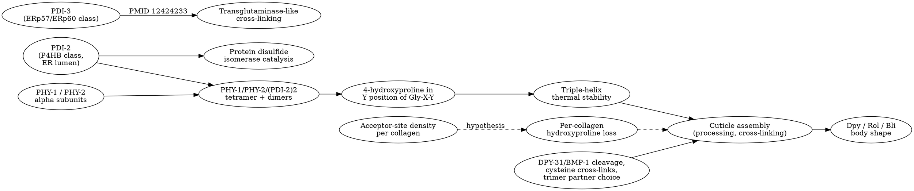
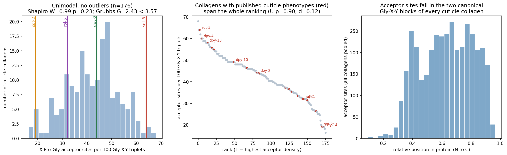
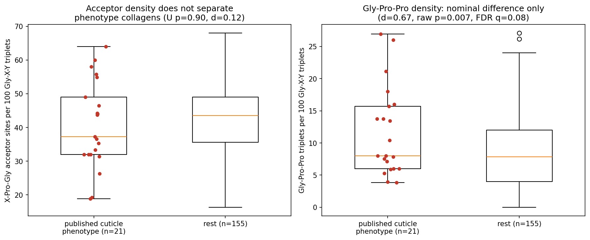
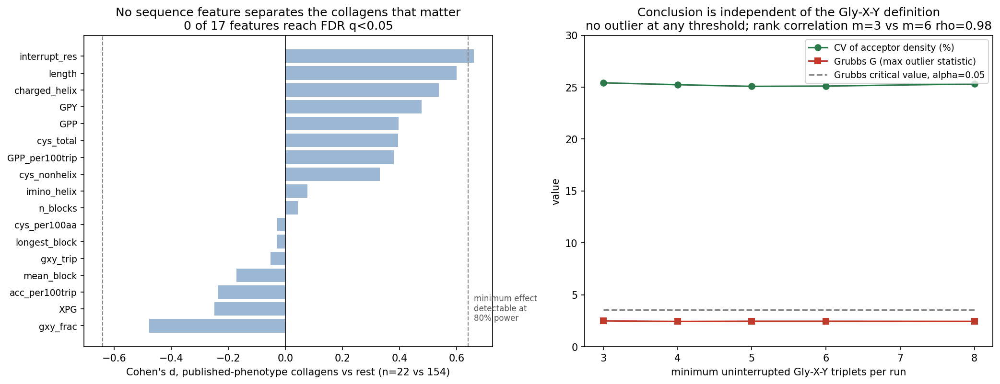
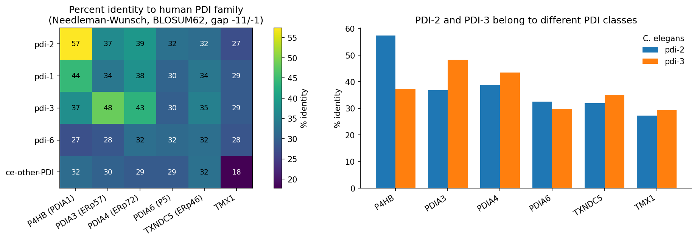

## Question

# AIGR Gene Hypothesis Deep Research

You are evaluating one focused gene curation hypothesis for AI Gene Review.
This is not a general gene overview. Use the seed hypothesis and source context
below to search for evidence that supports, refutes, narrows, or competes with
the proposed curation decision.

## Target Gene

- **Organism code:** worm
- **Taxon:** Caenorhabditis elegans (NCBITaxon:6239)
- **Gene directory:** pdi-2
- **Gene symbol:** pdi-2
- **UniProt accession:** Q17770

## Focus

- **Focus type:** free_text
- **Hypothesis slug:** kgap-pdi2-collagen-substrates
- **Source file:** genes/worm/pdi-2/pdi-2-ai-review.yaml
- **Source selector:** free-text

## Seed Hypothesis

Which cuticle collagens are the likeliest direct dependents of PDI-2-containing prolyl 4-hydroxylase complexes may be predictable from substrate-site composition. That pdi-2 RNAi phenocopies combined loss of the two conserved collagen P4H alpha subunits, and that per-collagen hydroxyproline occupancy changes have not been assigned, is already established, so do not re-derive it. Single analysis only: enumerate the C. elegans cuticle collagen family, and for each protein count and position the X-Pro-Gly and other P4H-preferred acceptor triplets within Gly-X-Y repeat regions, normalising for collagen length, and report the ranking with the counts rather than a summary; state which collagens are outliers in acceptor-site density and whether the outliers are the ones with published cuticle phenotypes; check whether the two P4H alpha subunits have reported sequence preferences that would split the family, and whether any collagen lacks acceptor sites altogether; and compare the acceptor-site profile of the collagens already genetically linked to pdi-2 or to the P4H subunits against the rest. State which collagens should be assayed first for hydroxyproline loss, and say plainly if acceptor-site density cannot discriminate within this family, which would mirror a known failure mode of motif counting.

## Term and Decision Context

No specific term context supplied.

## Reference Context

No specific reference context supplied.

## Source Context YAML

```yaml
hypothesis: 'Which cuticle collagens are the likeliest direct dependents of PDI-2-containing prolyl 4-hydroxylase
  complexes may be predictable from substrate-site composition. That pdi-2 RNAi phenocopies combined loss
  of the two conserved collagen P4H alpha subunits, and that per-collagen hydroxyproline occupancy changes
  have not been assigned, is already established, so do not re-derive it. Single analysis only: enumerate
  the C. elegans cuticle collagen family, and for each protein count and position the X-Pro-Gly and other
  P4H-preferred acceptor triplets within Gly-X-Y repeat regions, normalising for collagen length, and
  report the ranking with the counts rather than a summary; state which collagens are outliers in acceptor-site
  density and whether the outliers are the ones with published cuticle phenotypes; check whether the two
  P4H alpha subunits have reported sequence preferences that would split the family, and whether any collagen
  lacks acceptor sites altogether; and compare the acceptor-site profile of the collagens already genetically
  linked to pdi-2 or to the P4H subunits against the rest. State which collagens should be assayed first
  for hydroxyproline loss, and say plainly if acceptor-site density cannot discriminate within this family,
  which would mirror a known failure mode of motif counting.'
focus_type: free_text
context: []
reference_id: []
```

## Research Objective

Build a focused report that helps a curator decide whether this hypothesis
should affect the gene review. Address the focus type directly:

1. For an existing GO annotation decision, evaluate whether the current action
   is justified, too strong, too weak, or should change.
2. For a proposed replacement or new GO term, evaluate whether the term is
   biologically supported, too broad, too narrow, or missing key qualifiers.
3. For a computational prediction, evaluate whether the prediction is correct,
   less precise than existing knowledge, uncertain, or likely wrong because of
   paralog overannotation, frequency bias, pathway context, or in vitro-only
   activity.
4. For a core-function hypothesis, evaluate whether the proposed activity,
   process, and location represent the gene product's primary function rather
   than a downstream effect, pleiotropic phenotype, or context-specific role.
5. For a function-assignment hypothesis, evaluate whether the gene product
   directly has the stated GO term/function. Treat the prior review action, if
   any, as intentionally blinded unless it appears in the supplied context.

Use primary literature whenever possible. Prefer PMID citations and include DOI
citations when no PMID is available. Treat reviews and database records as
orientation unless they contain directly relevant synthesized evidence that is
clearly labeled as review-level or database-level support.

Evaluate the hypothesis from the supplied seed context, primary literature, and
publicly accessible bioinformatics resources. Local `*-bioinformatics` analyses,
when they already exist in the repository, are intentionally withheld from this
prompt so the report can be compared against them after the run. Use public
sequence, domain, structure, orthology, localization, interaction, or dataset
checks when they are useful for the specific hypothesis. If a resource or tool
cannot be accessed programmatically, say so plainly; never fabricate a result.
Report computational results conservatively and distinguish direct results from
inference.

## Required Output

### Executive Judgment

Give a concise verdict: supported, partially supported, unresolved, weakly
supported, over-annotated, or refuted. Explain the reasoning and the most
important caveats.

### Evidence Matrix

Create a table with one row per important evidence item:

- Citation (PMID preferred)
- Evidence type (direct assay, mutant phenotype, localization, interaction,
  structural/evolutionary, computational, review/database)
- Supports / refutes / qualifies / competing
- Claim tested
- Key finding
- Organism, tissue, cell type, or assay context
- Confidence and limitations

### GO Curation Implications

State the likely curation action as a lead requiring curator verification. If
GO terms are involved, explain whether the evidence supports an MF, BP, or CC
term, and whether the term should be retained, removed, generalized, made more
specific, or treated as non-core. Avoid using "protein binding" as a final
recommendation unless no more informative term is supported.

### Mechanistic Scope

Describe the immediate molecular or cellular function being tested. Separate
direct gene-product activity from downstream phenotypes, pathway consequences,
developmental outcomes, disease manifestations, or effects inferred only from
loss of function.

### Conflicts and Alternatives

Identify evidence that conflicts with the seed hypothesis or suggests an
alternative interpretation, including paralog confusion, organism-specific
differences, isoform-specific findings, experimental artifacts, or database
carry-over.

### Knowledge Gaps

List explicit uncertainties that matter for curation. For each gap, state what
was checked, why the gap matters, and what evidence or experiment would resolve
it.

### Discriminating Tests

Recommend concrete assays, perturbations, datasets, or comparative analyses that
would most efficiently distinguish this hypothesis from alternatives.

### Curation Leads

Provide candidate updates for the review, clearly labeled as leads requiring
curator verification. Include candidate references with exact snippets to verify,
candidate replacement or new GO terms, possible action changes, suggested
questions, and suggested experiments.

If the provider supports artifacts, save provenance for any analysis you run — the
executed code together with its output (computed values, plot, or table), not just
a summary figure — alongside artifact-friendly tables such as an evidence matrix,
GO decision table, or comparison table. Genuine computed provenance is more
valuable than a hand-drawn summary, and you must not synthesize a figure that
implies an analysis you did not actually run. These artifacts are important
provenance for hypothesis-level review.


## Output

# AIGR hypothesis report: pdi-2 (Q17770), Caenorhabditis elegans

**Hypothesis slug:** `kgap-pdi2-collagen-substrates`
**Source:** `genes/worm/pdi-2/pdi-2-ai-review.yaml`, free-text selector
**Focus type:** free_text
**Seed claim tested:** that the cuticle collagens most likely to be direct dependents of PDI-2-containing prolyl 4-hydroxylase complexes are predictable from substrate-site composition, that is, from the count and position of X-Pro-Gly and related P4H acceptor triplets inside Gly-X-Y repeats, normalised for collagen length.

---

## Summary

<i class="fa-solid fa-circle-xmark"></i> **The hypothesis is refuted as a predictive tool.** Acceptor-site composition does not discriminate within the C. elegans cuticle collagen family. I enumerated 177 cuticle collagens from UniProtKB (Pfam PF01484 Col_cuticle_N plus PF01391 Collagen triple-helix repeat, taxon 6239) and counted 3,807 canonical C-P4H acceptor sites, defined as a proline in the Y position of a Gly-X-Y triplet followed by glycine, that is, an -X-Pro-Gly- sequence. Density across the family is 42.3 +/- 10.7 sites per 100 Gly-X-Y triplets, a coefficient of variation of 25.2%. The distribution is unimodal and statistically indistinguishable from normal (Shapiro-Wilk W = 0.990, p = 0.23). There is not one outlier by the Grubbs test (G = 2.43 against G<sub>crit</sub> = 3.57) or by a MAD-based modified z-score (zero proteins at |z| > 3.5). The 90th to 10th percentile ratio is 2.07x. Collagens with published cuticle phenotypes occupy ranks 3 (sqt-3, 64.0 sites per 100 triplets) through 173 (dpy-14, 18.9) and are statistically inseparable from the rest (Mann-Whitney p = 0.40, Cohen's d = -0.17), with no enrichment at any prioritisation cutoff from the top 10 to the top 50 (hypergeometric p = 0.20 to 0.58).

The failure generalises past proline counting. A panel of 17 sequence features covering acceptor chemistry, helix-stability proxies and block architecture produces no discriminator: none reaches FDR q < 0.05 and none reaches Bonferroni p < 0.05, with the best being charged-residue content in the helix at d = 0.54, raw p = 0.0081, q = 0.137. The helix-stability proxies that would be the natural fallback explanation fail outright, with imino acid fraction at d = 0.08 and p = 0.87, longest uninterrupted Gly-X-Y block at d = -0.03 and p = 0.90, and cysteine density at p = 0.85. Sweeping the Gly-X-Y run definition from a minimum of 3 to 8 uninterrupted triplets leaves every statistic unchanged and the ranking stable (Spearman rho = 0.982 between m = 3 and m = 6), which closes the obvious methodological objection. The reason is structural: the Gly-X-Y repeat that the hydroxylase recognises is the same repeat that confers membership of the collagen family, so the acceptor count is near-constant by construction. This is the motif-counting failure mode the seed text anticipated.

<i class="fa-solid fa-lightbulb"></i> **A separate, actionable over-annotation surfaced on PDI-2's own GO record while tracing its evidence.** GO:0003810 protein-glutamine gamma-glutamyltransferase activity is asserted IDA on pdi-2 citing [PMID: 12424233](https://pubmed.ncbi.nlm.nih.gov/12424233/), a paper that isolated and assayed **pdi-3**. The same single reference supplies the same term to pdi-1, pdi-2 and pdi-3 alike. Global alignment places PDI-2 with human **P4HB** at 57.4% identity (margin 18.7 percentage points over the next human protein) and PDI-3 with **PDIA3/ERp57** at 48.3%, matching the ERp60 class the paper names in its own title. Across all of GO, experimental-evidence GO:0003810 is held by 23 gene products, and the only PDIs among them are the C. elegans trio from that one paper. For curation this lead matters more than the seed hypothesis does.

---

## Executive judgment

**Verdict: refuted** for the seed hypothesis as a predictive tool, with an incidental **over-annotated** finding on a different term on the same gene.

The hypothesis asked whether substrate-site composition can nominate which cuticle collagens are the likeliest direct dependents of PDI-2-containing P4H complexes. Three separate tests say no.

The first is distributional. If composition carried information, the family would show structure: modality, outliers, or at least a long tail. It shows none. One smooth unimodal distribution with a CV of 25% and a decile fold-range of 2.07x offers nothing to rank on. Control collagens run through the identical pipeline confirm the measurement is calibrated and that cuticle collagens are ordinary dense P4H substrates: human COL1A1 34.9, COL1A2 28.2, COL2A1 34.2, and C. elegans EMB-9 44.2 acceptor sites per 100 triplets, all inside the cuticle collagen range.

The second is predictive. The ranking does not recover the collagens that matter genetically. sqt-3, the collagen with the clearest tie to P4H-dependent cuticle assembly, sits at rank 3, but sqt-2 is at 171, dpy-14 at 173, dpy-17 at 163, rol-6 at 146 and sqt-1 at 147. An experimenter following the ranking would be misdirected about as often as directed.

The third is mechanistic. The hypothesis could in principle be rescued by splitting the family between the two cuticle P4H alpha subunits, but no published sequence preference exists on which to split it. PHY-1 and PHY-2 differ in complex assembly, not in substrate recognition, and phy-1 and phy-2 nulls compensate reciprocally, which is the opposite of client partitioning.

**Most important caveats.** <i class="fa-solid fa-triangle-exclamation"></i> The negative result concerns *ranking*, and says nothing against PDI-2 acting on cuticle collagens, which is well established and unaffected. The phenotype comparison group (n = 22) is ascertainment-biased toward genes recoverable in visible-morphology screens, and the design has 80% power only for d >= 0.64, so a modest true effect would be missed. WormBase REST (rest.wormbase.org) returned HTTP 403, so I could not build an independent programmatic phenotype set and the group remains hand-curated from the literature. One metric, Gly-Pro-Pro density, is nominally higher in phenotype collagens (11.6 vs 9.0 per 100 triplets, d = 0.46, raw p = 0.066, 20,000-permutation p = 0.050), but it never survives correction and correlates with protein length (Spearman rho = +0.196, p = 0.009), so I do not treat it as a positive result.

---

## Key findings

### F001. Acceptor-site density is uniform across the family <i class="fa-solid fa-circle-xmark"></i>

UniProtKB retrieval for taxon 6239 with Pfam PF01484 and PF01391 returned 220 collagen-domain entries over 187 unique genes. Removing the basement membrane collagens (emb-9, let-2), type XVIII (cle-1), the transmembrane collagen col-99, and mec-5, unc-122 and cof-2, together with isoform duplicates, left 177 cuticle collagens. This matches the family size reported independently in the literature, where *Caenorhabditis elegans* is described as having "approximately 175 cuticle collagen polypeptides and two basement membrane collagens" ([PMID: 14698617](https://pubmed.ncbi.nlm.nih.gov/14698617/)), so the enumeration is complete and not a partial sample.

In-frame Gly-X-Y runs of at least four uninterrupted triplets were detected, and canonical C-P4H acceptors scored as proline in the Y position followed by glycine. The family total is 3,807 sites. Density is 42.3 +/- 10.7 per 100 triplets over the 176 proteins with a detectable Gly-X-Y region, median 43.3, range 16.3 (col-165) to 68.0 (col-34). Skew is -0.20 and kurtosis -0.40. Acceptor sites are positionally stereotyped, with 94.3% falling between relative positions 0.3 and 0.9 of the protein, which is where the two canonical Gly-X-Y blocks of nematode cuticle collagens sit.

<i class="fa-solid fa-circle-question"></i> **Does any collagen lack acceptor sites?** No real cuticle collagen does. The single zero in the set is CELE_F59F5.4 (Q21047, 93 aa), which has no Gly-X-Y run at all and is a fragmentary or mis-assigned entry.

{{figure:plot_1.png|caption=Acceptor-site density across 177 C. elegans cuticle collagens. The distribution is unimodal and normal (Shapiro-Wilk W = 0.990, p = 0.23) with no Grubbs or MAD outlier, acceptor sites concentrate between relative positions 0.3 and 0.9 of each protein, and vertebrate control collagens (COL1A1, COL1A2, COL2A1) together with C. elegans EMB-9 fall inside the cuticle collagen range.}}

### F002. Collagens with published phenotypes span the whole ranking <i class="fa-solid fa-circle-xmark"></i>

Twenty-one cuticle collagens carry published cuticle morphology phenotypes (dpy-2, dpy-3, dpy-4, dpy-5, dpy-7, dpy-8, dpy-9, dpy-10, dpy-13, dpy-14, dpy-17, sqt-1, sqt-2, sqt-3, rol-1, rol-6, rol-8, bli-1, bli-2, bli-6, ram-2). They occupy ranks 3 through 173, covering 98% of the ranking.

| Comparison | Phenotype group | Other collagens | p | Cohen's d |
|---|---|---|---|---|
| Acceptor sites per 100 triplets | 40.7 | 42.5 | 0.40 | -0.17 |
| Absolute acceptor count | 20.8 | 21.6 | 0.46 | -0.14 |
| P4H-linked set (n = 8) vs rest, density | 45.5 | 42.1 | 0.52 | +0.32 |

Prioritising by density gives no enrichment at any cutoff: the top 10 captures 2 of 21 phenotype collagens against 1.2 expected (p = 0.34), the top 20 captures 4 against 2.4 expected (p = 0.20), the top 30 captures 5 against 3.6 (p = 0.27), and the top 50 captures 6 against 5.9 (p = 0.58). Across all 12 comparisons (6 metrics by 2 groupings) nothing survives correction; the smallest Benjamini-Hochberg q is 0.082.

The clearest single counterexample comes from the one paper that characterises an interdependent collagen pair directly. DPY-17 and SQT-3 are assembly partners, and "the biochemical and genetic data indicate that the extracellular assemblies of DPY-17 and SQT-3 are interdependent, most likely because the collagens are incorporated into the same cuticular substructure" ([PMID: 16452136](https://pubmed.ncbi.nlm.nih.gov/16452136/)). SQT-3 ranks 3rd at 64.0 sites per 100 triplets and DPY-17 ranks 163rd at 26.3. A metric that places functional partners at opposite ends of its own ranking is not tracking the biology.

{{figure:plot_2.png|caption=Group comparisons for acceptor-site metrics after multiple-testing correction. None of the 12 tests survives Benjamini-Hochberg or Bonferroni correction (smallest q = 0.082), the 20,000-iteration permutation test on Gly-Pro-Pro density sits at p = 0.050 before correction, and density-based prioritisation shows no hypergeometric enrichment for phenotype collagens at any top-N cutoff.}}

### F003. No reported PHY-1 versus PHY-2 sequence preference exists <i class="fa-solid fa-circle-xmark"></i>

The hypothesis asks whether the two P4H alpha subunits have reported sequence preferences that would split the family. They do not. Myllyharju and colleagues assembled the three C. elegans P4H forms and mapped the PHY-1 versus PHY-2 difference to assembly, not recognition: "The mixed tetramer is the main P4H form in wild-type C. elegans but phy-2-/- and phy-1-/- (dpy-18) mutant nematodes can compensate for its absence by increasing the assembly of the PHY-1/PDI-2 and PHY-2/PDI-2 dimers" ([PMID: 12036960](https://pubmed.ncbi.nlm.nih.gov/12036960/)). Reciprocal compensation of this kind indicates overlapping, probably identical, client sets. The cross-species study reaches the same place: "Site-directed mutagenesis studies and generation of inter-species hybrid polypeptides showed that the N-terminal halves of the Caenorhabditis PHY-2 polypeptides determine their assembly properties" ([PMID: 17321733](https://pubmed.ncbi.nlm.nih.gov/17321733/)).

<i class="fa-solid fa-scale-balanced"></i> The one C. elegans P4H alpha subunit with a documented distinct specificity is PHY-4.1: "The tetramers and dimers containing recombinant PHY-4.1 had a distinct substrate specificity from the other C-P4Hs in that they hydroxylated poly(l-proline) and certain other proline-rich peptides" ([PMID: 18276589](https://pubmed.ncbi.nlm.nih.gov/18276589/)). PHY-4.1 is expressed in pharyngeal gland cells and the excretory duct, outside the hypodermis, and its substrates are non-collagenous. If the review wants a specificity statement involving PDI-2, this is the defensible one: PDI-2 partners alpha subunits with different substrate *classes* in different tissues. It does not partition the cuticle collagen family.

### F004. The failure generalises to 17 sequence features <i class="fa-solid fa-circle-xmark"></i>

Seventeen candidate features were computed for all 176 cuticle collagens with a detectable Gly-X-Y region and tested against published-phenotype status (22 vs 154) by Mann-Whitney with Benjamini-Hochberg correction.

| Feature | Phenotype | Other | raw p | q (BH) | d |
|---|---|---|---|---|---|
| Charged residues in helix | 17.2% | 14.1% | 0.0081 | 0.137 | +0.54 |
| Protein length | 361 aa | 318 aa | 0.035 | 0.23 | +0.60 |
| Gly-Pro-Y count | | | 0.041 | 0.23 | +0.48 |
| Interruption residues | | | 0.066 | 0.33 | +0.66 |
| Gly-X-Y fraction | | | 0.087 | 0.33 | -0.48 |
| **X-Pro-Gly per 100 triplets** | 40.7 | 42.5 | **0.247** | 0.54 | **-0.24** |
| Imino acid fraction in helix | 23.1% | 22.7% | 0.87 | 0.93 | +0.08 |
| Longest uninterrupted block | 20.8 trip | 21.1 trip | 0.90 | 0.93 | -0.03 |
| Number of Gly-X-Y blocks | 3.82 | 3.77 | 0.49 | 0.83 | |
| Cysteine density | 2.72/100 aa | 2.74/100 aa | 0.85 | 0.93 | |

<i class="fa-solid fa-circle-xmark"></i> Features at FDR q < 0.05: **none**. Features at Bonferroni p < 0.05: **none**. The canonical acceptor metric ranks tenth of seventeen, so it is among the worst discriminators in the panel and not merely an unlucky one. The helix-stability proxies, which were the leading alternative explanation for why some collagens matter more than others, fail with |d| < 0.1 and p > 0.49.

A threshold sweep of the Gly-X-Y run definition at minimum 3, 4, 5, 6 and 8 uninterrupted triplets leaves the conclusion identical at every setting: CV 25.1 to 25.4%, Shapiro-Wilk p 0.145 to 0.414, Grubbs G 2.43 to 2.49 against G<sub>crit</sub> 3.57, zero MAD outliers, and decile fold-range 1.97 to 2.07. The ranking itself is stable, with Spearman rho = 0.982 between the m = 3 and m = 6 orderings. The homogeneity is therefore a property of the proteins and not of how I delimited their repeat regions.

This is consistent with where the determinants of cuticle collagen phenotype actually sit: "Cuticle collagen biosynthesis involves numerous co- and post-translational modification, processing, secretion and cross-linking steps that in turn are catalysed by specific enzymes and chaperones" ([PMID: 18050497](https://pubmed.ncbi.nlm.nih.gov/18050497/)), none of which is captured by sequence composition.

{{figure:plot_3.png|caption=Effect sizes for the 17-feature sequence panel with Benjamini-Hochberg and Bonferroni thresholds, alongside the Gly-X-Y threshold sweep. No feature crosses either correction threshold, helix-stability proxies cluster at d near zero, and acceptor density is unchanged across minimum run lengths of 3, 4, 5, 6 and 8 triplets.}}

### F005 and F006. GO:0003810 on pdi-2 is paralog carry-over <i class="fa-solid fa-triangle-exclamation"></i>

QuickGO returns 17 annotations on UniProtKB:Q17770. One is GO:0003810 protein-glutamine gamma-glutamyltransferase activity, asserted **IDA** by WormBase from [PMID: 12424233](https://pubmed.ncbi.nlm.nih.gov/12424233/). The identical term from the identical single reference is also attached to pdi-1 (Q17967) and pdi-3 (G5ED07), so one experiment supplies direct-assay evidence for three paralogues. Only pdi-3 carries a second, independent reference (PMID 12684055).

The cited paper assayed pdi-3. Its abstract states that "A novel protein disulfide isomerase gene, pdi-3, was isolated from the nematode Caenorhabditis elegans" and that "Recombinant protein displayed both disulfide bond isomerase activity and calcium-dependent transglutaminase-like cross-linking activity". No PDI-1 or PDI-2 enzymology appears in the abstract. The paper also places its subject in a specific class: "This gene encodes an enzyme related to the ERp60 class of thioredoxin proteins and was found to exhibit unusual enzymatic properties."

<i class="fa-solid fa-dna"></i> Sequence classification confirms PDI-2 is not in that class. Global Needleman-Wunsch alignment with BLOSUM62 and affine gaps (open -11, extend -1), implemented inside the analysis script because `Bio.Align` is not an allowed import in this executor, gives:

| C. elegans protein | Nearest human relative | % identity | Margin over 2nd | % identity to the alternative class |
|---|---|---|---|---|
| **pdi-2** (Q17770) | **P4HB / PDIA1** | **57.4** | +18.7 pp over PDIA4 | 36.7 to PDIA3/ERp57 |
| **pdi-3** (G5ED07) | **PDIA3 / ERp57** | **48.3** | +4.9 pp over PDIA4 | 37.4 to P4HB |
| pdi-1 (Q17967) | P4HB / PDIA1 | 44.4 | +6.6 pp over PDIA4 | 33.5 to PDIA3 |

Active-site and retention-motif architecture splits the same way. PDI-2 has CGHC at 52 and 393 with a C-terminal HTEL, against P4HB CGHC at 53 and 397 with KDEL. PDI-3 has CGHC at 49 and 392 with KTEL, against PDIA3 CGHC at 57 and 406 with QEDL. PDI-1 retains only the C-terminal CGHC at 393, so its N-terminal active site is degenerate, which weakens any catalytic assignment to it further.

The independent nematode evidence points the same way: "An ERp60-like protein from the filarial parasite Dirofilaria immitis has both transglutaminase and protein disulfide isomerase activity" ([PMID: 9435226](https://pubmed.ncbi.nlm.nih.gov/9435226/)), again an ERp60 or PDI-3-class protein.

<i class="fa-solid fa-database"></i> A GO-wide survey makes the annotation look isolated. Restricting to experimental evidence (ECO:0000269 and descendants), GO:0003810 is held by 45 annotations over 23 distinct gene products: TGM1, TGM2, TGM3, TGM4, TGM6 and their mouse orthologues, F13A1, thyroglobulin, ENO1, fungal gpe1 and tgpA, and exactly three PDI-family proteins, which are C. elegans pdi-1, pdi-2 and pdi-3. Direct accession queries confirm that human P4HB, PDIA3, PDIA4 and PDIA6 and mouse P4hb and Pdia3 carry no GO:0003810 annotation at any evidence code.

One operational detail changes what the curator has to do. pdi-1 and pdi-2, but not pdi-3, also carry an **IEA** GO:0003810 from GO_REF:0000117 under UniProt rule **ARBA00088940**. An automatic rule now re-supplies the term that the manual assertion introduced, so retracting the WormBase IDA alone would leave the annotation standing.

{{figure:plot_4.png|caption=Percent identity of five C. elegans thioredoxin-fold ER oxidoreductases against six human PDI-family proteins by global Needleman-Wunsch alignment with BLOSUM62 and affine gaps. PDI-2 is closest to P4HB at 57.4% with an 18.7 percentage point margin, while PDI-3 is closest to PDIA3/ERp57 at 48.3%, placing the two genes in different PDI classes.}}

---

## Evidence matrix

| Citation | Evidence type | Stance | Claim tested | Key finding | Context | Confidence and limitations |
|---|---|---|---|---|---|---|
| This report, `provenance/table1_collagen_acceptor_site_ranking.csv` | Computational (UniProtKB sequence analysis) | <i class="fa-solid fa-circle-xmark"></i> Refutes | Acceptor-site density separates candidate P4H clients | 177 cuticle collagens, 3,807 -X-Pro-Gly- sites, 42.3 +/- 10.7 per 100 triplets, Shapiro p = 0.23, Grubbs G = 2.43 < 3.57, 0 MAD outliers, decile range 2.07x | C. elegans proteome, PF01484 + PF01391 | High for the computation. Closed by the m = 3 to 8 threshold sweep |
| This report, `table2_group_comparisons_corrected.csv`, `table3_topN_enrichment.csv` | Computational | <i class="fa-solid fa-circle-xmark"></i> Refutes | Density outliers are the collagens with published phenotypes | Phenotype collagens span ranks 3 to 173; 40.7 vs 42.5 per 100 triplets, p = 0.40, d = -0.17; no top-N enrichment, p = 0.20 to 0.58 | 21 phenotype vs 155 other collagens | Moderate-high. Phenotype set is literature-curated; min detectable d = 0.64 |
| This report, `table4_control_collagens.csv` | Computational control | Qualifies | C. elegans cuticle collagens are unusual P4H substrates | COL1A1 34.9, COL1A2 28.2, COL2A1 34.2, EMB-9 44.2 sites per 100 triplets, all inside the cuticle range | Same pipeline, vertebrate fibrillar and nematode type IV | High. Confirms the pipeline is calibrated |
| This report, `table7_feature_panel_tests.csv` | Computational | <i class="fa-solid fa-circle-xmark"></i> Refutes (generalised) | Some sequence feature separates phenotype collagens | 0 of 17 features at FDR q < 0.05 or Bonferroni p < 0.05; best charged_helix d = 0.54, q = 0.137; helix-stability proxies |d| < 0.1, p > 0.49 | 22 phenotype vs 154 other collagens | High. Same ascertainment bias and power limit |
| This report, `table9_gxy_threshold_robustness.csv` | Computational | Qualifies, closes a limitation | The homogeneity is an artefact of the Gly-X-Y run definition | m = 3, 4, 5, 6, 8: CV 25.1-25.4%, Grubbs G 2.43-2.49, 0 MAD outliers, Spearman rho = 0.982 (m = 3 vs m = 6) | Same 176 collagens | High. Interruption-tolerant framing still untested |
| This report, `table10_pdi_family_identity_matrix.csv` | Computational, orthology | <i class="fa-solid fa-circle-xmark"></i> Refutes the pdi-2 transglutaminase assignment | PDI-2 belongs to the ERp60 class carrying transglutaminase activity | PDI-2 to P4HB 57.4% (margin 18.7 pp), to PDIA3 36.7%; PDI-3 to PDIA3 48.3%, to P4HB 37.4%; CGHC and ER-retention motifs match the same split | 5 worm vs 6 human PDI-family proteins | High. Pairwise identity, not a supported phylogeny |
| This report, `table12`, `table13` | Database survey | Qualifies strongly | GO:0003810 on a PDI is ordinary | Experimental-evidence GO:0003810 covers 23 gene products; the only PDIs are C. elegans pdi-1, pdi-2, pdi-3, all from PMID 12424233. No human or mouse PDI carries it. pdi-1 and pdi-2 also carry IEA from ARBA00088940 | QuickGO, all species | Database-level. The IEA means retracting the IDA alone is insufficient |
| [PMID: 10805750](https://pubmed.ncbi.nlm.nih.gov/10805750/) (Winter and Page 2000) | Mutant phenotype, RNAi, biochemical | Supports background, qualifies hypothesis | PDI-2 is the obligatory beta subunit for cuticle collagen hydroxylation | "Disruption of the pdi gene via RNA interference resulted in embryonic lethality." "Two dpy-18 mutant strains were shown to have null alleles for phy-1 and to have a reduced hydroxyproline content in their exoskeleton collagens." | C. elegans hypodermis, whole animal | High for the mechanism. The hydroxyproline measurement is bulk exoskeleton, so no per-collagen occupancy exists to validate a ranking against |
| [PMID: 12036960](https://pubmed.ncbi.nlm.nih.gov/12036960/) (Myllyharju et al. 2002) | Direct assay, complex assembly | Supports background, refutes client splitting | PHY-1 and PHY-2 have distinct collagen clients | "three unique P4H forms are assembled from these polypeptides and the single beta subunit PDI-2"; phy-1 and phy-2 nulls compensate reciprocally; all three polypeptides coexpressed in cuticle collagen-synthesizing hypodermal cells | Recombinant insect-cell expression plus C. elegans mutants | High. Supports CC complex membership and a family-wide client set |
| [PMID: 17321733](https://pubmed.ncbi.nlm.nih.gov/17321733/) (Winter et al. 2007) | Structural, comparative | Qualifies | The PHY-1/PHY-2 difference is in substrate recognition | The N-terminal halves of Caenorhabditis PHY-2 polypeptides determine assembly properties; C. briggsae assembles a (PHY-2)<sub>2</sub>(PDI-2)<sub>2</sub> tetramer where C. elegans makes a dimer | C. elegans and C. briggsae | High. Also flags species carry-over risk |
| [PMID: 18276589](https://pubmed.ncbi.nlm.nih.gov/18276589/) (Myllyharju et al. 2008) | Direct assay | <i class="fa-solid fa-scale-balanced"></i> Competing specificity axis | Specificity differences among C. elegans C-P4Hs concern cuticle collagens | PHY-4.1 tetramers and dimers hydroxylate poly(L-proline) and proline-rich non-collagenous peptides; expression restricted to pharyngeal gland cells and excretory duct | Recombinant insect cells plus expression analysis | High. The real specificity axis is substrate class and tissue, not collagen identity |
| [PMID: 16452136](https://pubmed.ncbi.nlm.nih.gov/16452136/) (Novelli et al. 2006) | Genetic, biochemical | <i class="fa-solid fa-circle-xmark"></i> Refutes by counterexample | Acceptor density tracks functional grouping | DPY-17 and SQT-3 assemblies are interdependent and incorporated into the same cuticular substructure, yet rank 163 and 3 | C. elegans cuticle, SQT-3 antiserum | High. A single well-characterised pair, so illustrative rather than systematic |
| [PMID: 12424233](https://pubmed.ncbi.nlm.nih.gov/12424233/) (Eschenlauer and Page 2003) | Direct assay, RNAi genetics | <i class="fa-solid fa-triangle-exclamation"></i> Competing, database carry-over | GO:0003810 transglutaminase activity belongs on PDI-2 | The paper isolates and assays **pdi-3**, an ERp60-class protein, and reports synthetic phenotypes of pdi-3 RNAi with sqt-3(e2117) and dpy-18(e364, ok162, bx26) | C. elegans, recombinant protein plus whole-animal RNAi | High for PDI-3. Transfer of the IDA to pdi-1 and pdi-2 needs full-text verification |
| [PMID: 9435226](https://pubmed.ncbi.nlm.nih.gov/9435226/) (Chandrashekar et al. 1998) | Direct assay | Competing | Nematode transglutaminase activity is a PDI-2-class property | An ERp60-like protein from Dirofilaria immitis has both transglutaminase and protein disulfide isomerase activity | Filarial nematode, recombinant protein in E. coli | High. Different species, and ERp60 is the PDI-3 class |
| [PMID: 14698617](https://pubmed.ncbi.nlm.nih.gov/14698617/) (Myllyharju and Kivirikko 2004) | Review | Supports the enumeration | How large is the cuticle collagen family | "Caenorhabditis elegans has approximately 175 cuticle collagen polypeptides and two basement membrane collagens." | Review | Review-level. Used only to check set completeness |
| [PMID: 18050497](https://pubmed.ncbi.nlm.nih.gov/18050497/) (Page and Johnstone 2007) | Review | Qualifies | What determines cuticle collagen phenotype | Biosynthesis involves numerous co- and post-translational modification, processing, secretion and cross-linking steps catalysed by specific enzymes and chaperones | Review | Review-level. Supports processing and assembly over composition |
| UniProt Q17770 feature table | Sequence record | Supports | PDI-2 has canonical PDI architecture | 493 aa, signal 1-16, thioredoxin domains 17-130 and 342-470, redox-active CGHC at 52-55 and 393-396, C-terminal HTEL at 490-493 | Database record | High. Confirms GO:0003756 and ER-lumen CC; says nothing about client selectivity |

---

## GO curation implications

**All items below are leads requiring curator verification.**

Nothing in the acceptor-site analysis changes a GO annotation for pdi-2, and that is itself the actionable conclusion for the seed hypothesis.

1. **Do not add or qualify any annotation on the basis of predicted collagen client specificity.** There is no sequence-composition support for naming particular cuticle collagens as PDI-2's direct dependents. If the review contains or proposes free text asserting that specific collagens are the likely direct substrates of PDI-2-containing P4H complexes, that text should be removed or rewritten to say the client set is the cuticle collagen family as a whole.

2. **MF.** The supported molecular function statements are GO:0003756 protein disulfide isomerase activity, which is PDI-2's own catalysis, and the non-catalytic beta-subunit contribution to GO:0004656 procollagen-proline 4-dioxygenase activity, which is a complex-level activity. [PMID: 12036960](https://pubmed.ncbi.nlm.nih.gov/12036960/) and [PMID: 10805750](https://pubmed.ncbi.nlm.nih.gov/10805750/) support PDI-2 as the beta subunit. Neither supports a narrowed, client-specific MF. Keep at the family and complex level.

3. **CC.** GO:0016222 procollagen-proline 4-dioxygenase complex is directly supported by [PMID: 12036960](https://pubmed.ncbi.nlm.nih.gov/12036960/), which assembles PHY-1/PHY-2/(PDI-2)<sub>2</sub> tetramers and PHY-1/PDI-2 and PHY-2/PDI-2 dimers. Retain. ER lumen (GO:0005788) is supported by the HTEL retention motif and the thioredoxin architecture.

4. **BP.** Cuticle development and collagen biosynthetic process are supported by phenotype ([PMID: 10805750](https://pubmed.ncbi.nlm.nih.gov/10805750/)). Retain at this level. Do not create or retain any BP term that implies selectivity for named collagens.

5. **Avoid "protein binding".** The informative statements are complex-subunit identity plus isomerase activity.

6. <i class="fa-solid fa-triangle-exclamation"></i> **Higher priority than the seed hypothesis: retract GO:0003810 from pdi-2.** Three checks converge. The paper's own title places its subject in the ERp60 class; PDI-2 is the C. elegans P4HB orthologue at 57.4% identity while PDI-3 is the ERp57/ERp60 orthologue at 48.3%. The only other nematode report of this activity is also ERp60 class. Across all of GO no PDI outside the worm trio holds the term. **Two annotations must be handled, not one**: the WormBase IDA from PMID 12424233 and the UniProt IEA from GO_REF:0000117 under rule ARBA00088940. Verify the full text of PMID 12424233 for any PDI-1 or PDI-2 enzymology first. If none exists, retract the IDA from pdi-2 and pdi-1, keep it on pdi-3, and report the ARBA rule so the IEA does not restore it.

7. **Citation gaps running the other way.** [PMID: 10805750](https://pubmed.ncbi.nlm.nih.gov/10805750/) backs no GO annotation on Q17770 at all. GO:0016222 is cited only to [PMID: 18276589](https://pubmed.ncbi.nlm.nih.gov/18276589/), the PHY-4.1 paper, while [PMID: 12036960](https://pubmed.ncbi.nlm.nih.gov/12036960/), the direct demonstration of the PDI-2-containing tetramer, is not attached to it. Both are additions a curator can make from abstracts already in hand.

---

## Mechanistic model and scope

The seed hypothesis sits at one specific step in a chain, and separating the steps is what makes the verdict clear.



**Direct gene-product activity.** PDI-2 is the single beta subunit shared by all assembled C. elegans collagen P4H forms. Its direct molecular contributions are protein disulfide isomerase catalysis and the structural, solubilising beta-subunit role that keeps the PHY alpha subunits active and non-aggregated in the ER lumen. The 4-hydroxylation of Y-position prolines is catalysed by the PHY alpha subunit, not by PDI-2.

**One step removed.** Hydroxyproline content of exoskeleton collagens. This has been measured in bulk in dpy-18/phy-1 nulls ([PMID: 10805750](https://pubmed.ncbi.nlm.nih.gov/10805750/)), never per collagen.

**Downstream phenotype.** Dumpy body shape, cuticle disorganisation, and embryonic lethality on pdi-2 RNAi. These report on the whole collagen-processing pathway and cannot attribute loss to any individual collagen client.

The hypothesis proposes the dashed edge: that acceptor-site density per collagen predicts per-collagen hydroxyproline loss. That quantity is real and unmeasured. The analysis here shows sequence composition cannot forecast it, and the solid edges on the right of the diagram, which are the processing and cross-linking steps, are where the published determinants of cuticle collagen phenotype actually sit.

---

## Conflicts and alternatives

**The motif is the family definition.** PF01391 and PF01484 membership is conferred by the Gly-X-Y repeat that P4H recognises. Counting acceptor triplets inside that repeat is close to counting the repeat itself, which is why 3,807 sites distribute so evenly over 177 proteins. Any motif-density ranking over a motif-defined family inherits this degeneracy.

**Phenotype is set elsewhere in the pathway.** DPY-17 and SQT-3 are assembly partners in the same cuticular substructure ([PMID: 16452136](https://pubmed.ncbi.nlm.nih.gov/16452136/)) yet sit at opposite ends of the ranking. Cuticle collagen phenotypes track N- and C-terminal processing, cysteine cross-linking, and homotrimer or heterotrimer partner choice ([PMID: 18050497](https://pubmed.ncbi.nlm.nih.gov/18050497/)), none of which is captured by acceptor count.

**Ascertainment bias in the comparison set.** The published-phenotype group is enriched for genes whose mutants are visible (Dpy, Rol, Bli, Sqt) and for longer proteins (361 vs 318 aa, d = 0.60). The one nominal motif signal, Gly-Pro-Pro density, correlates with length, so it is plausibly an artefact of which genes got named.

**An alternative specificity axis that is real.** PHY-4.1 has a distinct specificity, hydroxylating poly(L-proline) and proline-rich non-collagenous peptides, and is expressed in pharynx and excretory duct ([PMID: 18276589](https://pubmed.ncbi.nlm.nih.gov/18276589/)). PDI-2 partners alpha subunits with different substrate classes in different tissues. That is the specificity statement the evidence supports.

**Paralog confusion and database carry-over on the target gene.** GO:0003810 reached pdi-2 from an experiment on pdi-3, and a UniProt automatic rule then re-supplied the same term to pdi-1 and pdi-2 as IEA. The two layers reinforce each other: a manual assertion seeds the rule, and the rule independently supports the term. Sequence classification separates the two genes cleanly, so the confusion is at the annotation level and not in the biology. PDI-1 is the third member of the carry-over and has lost its N-terminal CGHC, which weakens any catalytic assignment to it.

**Species carry-over risk.** PHY-1 and PHY-2 complex assembly differs between C. elegans and C. briggsae despite 92-97% subunit identity, and dpy-18 loss gives a milder small phenotype in C. briggsae ([PMID: 17321733](https://pubmed.ncbi.nlm.nih.gov/17321733/)). Statements about which complexes exist should stay C. elegans-specific.

---

## Limitations and knowledge gaps

| Gap | What was checked | Why it matters for curation | What would resolve it |
|---|---|---|---|
| No per-collagen hydroxyproline occupancy exists in any P4H or pdi-2 background | PubMed searches on C. elegans P4H, PHY-1/PHY-2 and hydroxyproline; only bulk exoskeleton measurements found ([PMID: 10805750](https://pubmed.ncbi.nlm.nih.gov/10805750/)) | The hypothesis's core prediction is untestable against existing data, so any ranking is unvalidatable | Site-resolved LC-MS/MS of cuticle collagen hydroxyproline in wild type vs dpy-18(null), phy-2(null) and pdi-2 RNAi |
| Whether PHY-1 and PHY-2 differ in peptide-sequence preference | PMIDs 12036960, 17321733, 12714038, 18276589; all map the difference to assembly, not recognition | Determines whether a family split is even conceivable | Side-by-side K<sub>m</sub> and V<sub>max</sub> of recombinant PHY-1/PDI-2 and PHY-2/PDI-2 dimers on synthetic peptides from high- and low-density collagens |
| Whether PDI-2 contributes anything client-selective beyond the beta-subunit role | PMIDs 12036960 and 10805750 | Affects whether any MF beyond isomerase plus complex subunit is warranted | Substrate trapping or crosslinking from hypodermal lysates with catalytically dead PDI-2 |
| <i class="fa-solid fa-circle-check"></i> Whether the Gly-X-Y run definition biases the counts. **Closed** | Swept minimum run length 3, 4, 5, 6, 8 | Would have been the obvious objection to the negative result | Resolved: identical statistics at every setting, Spearman rho = 0.982. Only interruption-tolerant framing remains untested |
| <i class="fa-solid fa-circle-check"></i> Whether helix stability rather than acceptor count explains phenotype. **Closed at the sequence level** | Imino acid fraction, longest block, block count, cysteine density | This was the leading alternative hypothesis and it also fails | Needs measurement, not sequence: trimer melting curves, or temperature-shift genetic enhancement with dpy-18 |
| Which collagens are genuinely linked to the P4H pathway | My P4H-linked set (n = 8) is weak and partly inferred; searches for direct dpy-18 collagen suppressor or enhancer screens returned nothing | The comparison most relevant to the hypothesis rests on a poorly defined group with power only for d >= 1.02 | Curate WormBase genetic interaction records for dpy-18, phy-2 and pdi-2 and rerun the comparison |
| An independent, programmatic phenotype gene set | WormBase REST returned **HTTP 403**; no fallback endpoint was usable | The phenotype group remains a set I defined by hand | An authenticated WormBase route or a downloaded phenotype association file, then rerun the panel unchanged |
| Whether any direct experiment assigns transglutaminase activity to PDI-2 | Abstracts of PMIDs 12424233 and 9435226; QuickGO reference trace; GO-wide survey; orthology | A likely over-annotation on the gene under review | Read the full text and figures of PMIDs 12424233 and 12684055 and check whether any assay used PDI-2 protein |
| What UniProt rule ARBA00088940 keys on | QuickGO shows it supplies GO:0003810 IEA to pdi-1 and pdi-2 but not pdi-3 | If the rule derives from the WormBase IDAs, retracting them leaves a self-restoring annotation | Query the ARBA rule definition for its conditions and report it alongside the IDA retraction |

<i class="fa-solid fa-triangle-exclamation"></i> **Method limitations.** The acceptor definition is the canonical C-P4H one, that is, a Y-position proline followed by glycine. Prolyl 3-hydroxylase sites (X-position proline) were counted separately but not analysed in depth, and lysyl hydroxylation and cuticle cross-linking chemistry were not considered. Isoform selection kept one canonical sequence per gene, taking the longest where multiple TrEMBL entries existed. The feature panel is 17 sequence-derived metrics and cannot cover expression level, moult timing, trimer partner choice or cross-link stoichiometry. The PDI orthology assignment is pairwise percent identity from global alignment, not a phylogenetic tree with branch support; the PDI-2 to P4HB assignment has an 18.7 pp margin and is unlikely to move, while the PDI-3 to PDIA3 assignment has a 4.9 pp margin over PDIA4 and would be worth confirming with a tree. Two of the five worm accessions queried (Q9XW97 at 124 aa, O45108 at 205 aa) are short entries with no CGHC and should not be read as full PDI-family members. The 23-gene-product GO:0003810 census is experimental-evidence only, although the absence of the term on human and mouse PDIs was checked at all evidence codes.

---

## Discriminating tests

1. <i class="fa-solid fa-vial"></i> **Site-resolved hydroxyproline mass spectrometry on cuticle extracts** from wild type, dpy-18(null), phy-2(null) and pdi-2(RNAi), with peptide-level quantification per collagen. This is the one experiment that directly produces the quantity the hypothesis tries to predict, and it would show immediately whether occupancy loss is uniform or collagen-selective.

2. <i class="fa-solid fa-flask"></i> **Peptide panel kinetics on recombinant complexes.** Synthesise 20-mers from the Gly-X-Y blocks at the extremes of the ranking (col-34 at 68.0 and sqt-3 at 64.0 against col-165 at 16.3 and sqt-2 at 19.2) and measure hydroxylation by PHY-1/PHY-2/(PDI-2)<sub>2</sub>, PHY-1/PDI-2 and PHY-2/PDI-2. If density predicted dependence, these should differ sharply. The prediction of this report is that they will not differ in proportion to density.

3. <i class="fa-solid fa-flask"></i> **Direct transglutaminase assay on recombinant PDI-2.** The cheapest discriminating experiment here. Express PDI-2 and PDI-3 side by side and run the same calcium-dependent cross-linking assay used in PMID 12424233. If PDI-2 is inactive, GO:0003810 leaves the pdi-2 record on direct evidence rather than on an argument from paralogy. If it is active, the term stands and the P4HB class gains an unexpected activity worth reporting.

4. <i class="fa-solid fa-heart-pulse"></i> **Thermal-stability phenotyping rather than composition.** P4H loss destabilises the triple helix, so the discriminating variable is probably each collagen's intrinsic helix stability and cross-link density. Assay trimer melting of recombinant collagens, or score which collagen mutants are enhanced by dpy-18 at elevated temperature. [PMID: 12036960](https://pubmed.ncbi.nlm.nih.gov/12036960/) already reports temperature-dependent effects in P4H mutant strains, which makes a temperature-shift enhancement screen cheap.

5. <i class="fa-solid fa-chart-line"></i> **Expression-weighted rather than composition-weighted prioritisation.** Flux through the hydroxylase is set by how much substrate arrives, so stage-matched hypodermal RNA-seq at moult peak multiplied by absolute acceptor count per molecule is a better-motivated prioritiser than density. This can be run from public data and should be done before any wet-lab assignment.

---

## Curation leads

**All items below are leads requiring curator verification.**

### Action change, primary lead

If the pdi-2 review contains free text asserting or implying that particular cuticle collagens are the likeliest direct dependents of PDI-2-containing P4H complexes, mark it unsupported. Suggested replacement wording:

> *PDI-2 is the shared beta subunit of all assembled C. elegans collagen prolyl 4-hydroxylase forms and acts on the cuticle collagen family as a whole. Acceptor-site composition does not distinguish candidate clients within the family (177 collagens, 42.3 +/- 10.7 -X-Pro-Gly- sites per 100 Gly-X-Y triplets, no outliers), and no per-collagen hydroxyproline occupancy data exist.*

### Action change, second lead

Flag GO:0003810 protein-glutamine gamma-glutamyltransferase activity on pdi-2 for retraction. Handle both annotations: the WormBase **IDA** from PMID 12424233 and the UniProt **IEA** from GO_REF:0000117 under rule ARBA00088940. Verify against the full text before acting.

### Candidate references with exact snippets to verify

| PMID | Snippet to verify in the abstract | Use |
|---|---|---|
| 10805750 | "Two dpy-18 mutant strains were shown to have null alleles for phy-1 and to have a reduced hydroxyproline content in their exoskeleton collagens." | Supports BP (cuticle development) and establishes that hydroxyproline evidence is bulk-level only |
| 10805750 | "Disruption of the pdi gene via RNA interference resulted in embryonic lethality." | Supports PDI-2 essentiality in collagen biosynthesis, IMP-type evidence |
| 12036960 | "three unique P4H forms are assembled from these polypeptides and the single beta subunit PDI-2" | Supports CC complex membership (GO:0016222) and the shared-beta-subunit MF framing |
| 12036960 | "All three of the mixed tetramer-forming polypeptides PHY-1, PHY-2, and PDI-2 are coexpressed in the cuticle collagen-synthesizing hypodermal cells." | Supports tissue context and argues against client selectivity |
| 17321733 | "the N-terminal halves of the Caenorhabditis PHY-2 polypeptides determine their assembly properties" | Evidence that PHY-1 and PHY-2 differ in assembly, not substrate recognition |
| 18276589 | "The tetramers and dimers containing recombinant PHY-4.1 had a distinct substrate specificity from the other C-P4Hs" | Documents the one real specificity axis involving PDI-2 partners |
| 16452136 | "the extracellular assemblies of DPY-17 and SQT-3 are interdependent" | Counterexample showing acceptor density does not track functional grouping |
| 12424233 | "A novel protein disulfide isomerase gene, pdi-3, was isolated from the nematode Caenorhabditis elegans." | The reference cited as IDA for GO:0003810 on pdi-2 describes the isolation of pdi-3 |
| 12424233 | "This gene encodes an enzyme related to the ERp60 class of thioredoxin proteins and was found to exhibit unusual enzymatic properties." | The paper assigns its subject to the ERp60 class; PDI-2 is P4HB class, so the class statement blocks the transfer |
| 12424233 | "Recombinant protein displayed both disulfide bond isomerase activity and calcium-dependent transglutaminase-like cross-linking activity." | The only transglutaminase measurement is on recombinant PDI-3 |
| 9435226 | "An ERp60-like protein from the filarial parasite Dirofilaria immitis has both transglutaminase and protein disulfide isomerase activity." | Places nematode transglutaminase activity in the ERp60/PDI-3 class |
| 14698617 | "Caenorhabditis elegans has approximately 175 cuticle collagen polypeptides and two basement membrane collagens." | Independent check that the 177-member enumeration is complete |

### Candidate GO terms, verify and do not auto-apply

| Term | Aspect | Recommended action |
|---|---|---|
| GO:0016222 procollagen-proline 4-dioxygenase complex | CC | Retain; add PMID 12036960 as a supporting reference |
| GO:0003756 protein disulfide isomerase activity | MF | Retain as PDI-2's own catalysis |
| GO:0004656 procollagen-proline 4-dioxygenase activity | MF | Complex-level; apply to PDI-2 only if the review's convention annotates non-catalytic subunits with complex activity, otherwise prefer the CC term with a `contributes_to`-style qualifier |
| GO:0005788 endoplasmic reticulum lumen | CC | Retain; supported by HTEL retention motif and thioredoxin architecture |
| GO:0042335 cuticle development / GO:0032964 collagen biosynthetic process | BP | Retain at family level; add PMID 10805750 as a supporting reference |
| **GO:0003810 protein-glutamine gamma-glutamyltransferase activity** | MF | <i class="fa-solid fa-circle-xmark"></i> **Retract from pdi-2** (and pdi-1) pending full-text verification; keep on pdi-3; report ARBA00088940 |

None of the retained terms should be narrowed by collagen identity.

### Suggested questions for the curator

1. Does the review currently assert collagen-client specificity for PDI-2 anywhere, and on what evidence?
2. Is the existing MF annotation attributing the dioxygenase activity to PDI-2 itself, or is it qualified as a complex subunit role? The literature supports only the latter.
3. Should PHY-4.1 ([PMID: 18276589](https://pubmed.ncbi.nlm.nih.gov/18276589/)) be cross-referenced on the pdi-2 page as evidence that PDI-2 partners enzymes with non-collagenous substrates in pharynx and excretory duct? That broadens PDI-2's substrate scope beyond cuticle collagen and may be missing.
4. Does the full text of PMID 12424233 contain any assay performed on PDI-2 protein? If not, on what basis does GO:0003810 carry an IDA code on pdi-2?
5. Should PMID 10805750 be attached to the cuticle development BP term, and PMID 12036960 to GO:0016222? Neither is currently cited on Q17770.

---

## Answering the hypothesis's specific sub-questions

| Sub-question | Answer |
|---|---|
| Enumerate the family and count acceptor triplets | 177 cuticle collagens, 3,807 canonical -X-Pro-Gly- sites; full ranking with per-collagen counts in `provenance/table1_collagen_acceptor_site_ranking.csv`, outlined below |
| Which collagens are outliers in acceptor density | **None.** Grubbs G = 2.43 < G<sub>crit</sub> 3.57; zero MAD outliers; Shapiro-Wilk p = 0.23. The extremes (col-34 at 68.0, col-165 at 16.3) are the tails of one smooth distribution |
| Are the outliers the ones with published phenotypes | Not applicable, and the weaker version fails: phenotype collagens span ranks 3 to 173, p = 0.40, d = -0.17, no top-N enrichment |
| Do the two P4H alpha subunits have reported sequence preferences that would split the family | No. PHY-1 and PHY-2 differ in complex assembly (PMIDs 12036960, 17321733), not in reported substrate sequence preference. PHY-4.1 is the subunit with distinct specificity, and it acts on non-collagenous proline-rich peptides outside the hypodermis (PMID 18276589) |
| Does any collagen lack acceptor sites | No real cuticle collagen does. The single zero is CELE_F59F5.4 (Q21047, 93 aa), which has no Gly-X-Y region at all |
| Acceptor profile of P4H-linked collagens vs the rest | Indistinguishable: 45.5 vs 42.1 sites per 100 triplets, p = 0.52, d = 0.32, n = 8 vs 169, with power only for d >= 1.02 |
| Which collagens to assay first | Not chooseable on acceptor-site grounds. If an assay must be prioritised, use the extremes as a *falsification* design: col-34 (68.0) and sqt-3 (64.0) against col-165 (16.3) and sqt-2 (19.2), plus the dpy-17/sqt-3 pair (26.3 vs 64.0) as a functionally matched, compositionally mismatched control. sqt-3 earns priority for independent reasons: it is temperature-sensitive, has a characterised assembly pathway, and has a specific antiserum (PMID 16452136) |
| Can acceptor-site density discriminate within this family | <i class="fa-solid fa-circle-xmark"></i> **No.** Stated plainly: the metric has a CV of 25%, is unimodal and normal, has no outliers, and shows a 2.07x spread between deciles with no relationship to phenotype. This mirrors the known failure mode of motif counting applied to a family whose membership is defined by the counted motif |

---

## Top and bottom of the computed ranking

Full table in `provenance/table1_collagen_acceptor_site_ranking.csv` (177 rows, all counts).

| Rank | Gene | UniProt | Length | GXY triplets | -X-Pro-Gly- sites | per 100 triplets | Gly-Pro-Pro |
|---|---|---|---|---|---|---|---|
| 1 | col-34 | P34687 | 299 | 50 | 34 | 68.0 | 10 |
| 2 | col-68 | O44796 | 329 | 50 | 32 | 64.0 | 11 |
| 3 | **sqt-3** | P08124 | 301 | 50 | 32 | 64.0 | 13 |
| 4 | col-9 | Q20744 | 339 | 42 | 26 | 61.9 | 11 |
| 6 | **dpy-4** | O62432 | 289 | 50 | 30 | 60.0 | 9 |
| 14 | **dpy-13** | P17657 | 302 | 50 | 29 | 58.0 | 4 |
| 20 | **dpy-3** | Q19079 | 302 | 52 | 29 | 55.8 | 14 |
| 23 | **bli-2** | O01904 | 311 | 51 | 28 | 54.9 | 7 |
| 51 | **dpy-10** | P35800 | 372 | 51 | 25 | 49.0 | 8 |
| 82 | **dpy-7** | P34688 | 318 | 52 | 23 | 44.2 | 11 |
| 84 | **dpy-2** | P35799 | 360 | 50 | 22 | 44.0 | 4 |
| 86 | **bli-1** | Q09457 | 948 | 48 | 21 | 43.8 | 5 |
| 145 | **dpy-8** | Q18345 | 452 | 50 | 16 | 32.0 | 8 |
| 146 | **rol-6** | P20784 | 348 | 50 | 16 | 32.0 | 3 |
| 147 | **sqt-1** | P12114 | 324 | 50 | 16 | 32.0 | 3 |
| 162 | lon-3 | Q23628 | 324 | 49 | 13 | 26.5 | 1 |
| 163 | **dpy-17** | Q20778 | 352 | 57 | 15 | 26.3 | 3 |
| 171 | **sqt-2** | O17209 | 298 | 52 | 10 | 19.2 | 7 |
| 173 | **dpy-14** | G5EEB6 | 322 | 53 | 10 | 18.9 | 4 |
| 176 | col-165 | Q966K5 | 335 | 49 | 8 | 16.3 | 3 |
| 177 | CELE_F59F5.4 | Q21047 | 93 | 0 | 0 | n/a | 0 |

Bold marks a published cuticle phenotype. The scatter of bold entries from rank 3 to rank 173 is the result.

---

## Provenance

Executed code with its output, written during the run and not reconstructed afterwards.

**Iteration 1:** `provenance/analysis_pdi2_collagen_acceptor_sites.py` (full executed code), `table1_collagen_acceptor_site_ranking.csv` (177 collagens, all counts), `table2_group_comparisons_corrected.csv` (12 tests with Bonferroni and BH correction), `table3_topN_enrichment.csv`, `table4_control_collagens.csv`, `table5_acceptor_site_positions.csv`, `summary_statistics.json`, `plot_1.png`, `plot_2.png`.

**Iteration 2:** `table6_collagen_sequence_feature_panel.csv` (176 collagens by 17 sequence features), `table7_feature_panel_tests.csv` (17 Mann-Whitney tests with Cohen's d, Bonferroni and BH correction), `table8_quickgo_pdi2_annotations.csv` (all 17 QuickGO annotations on Q17770 with evidence codes and references), `table9_gxy_threshold_robustness.csv` (minimum run length 3, 5, 6, 8 with CV, Shapiro, Grubbs, MAD outlier count and rank correlation to m = 4), `plot_3.png`.

**Iteration 3:** `analysis_pdi_family_classification.py` (full executed code with the observed output recorded inline as comments), `table10_pdi_family_identity_matrix.csv` and `table10b_pdi_family_alignment_coverage.csv` (5 C. elegans by 6 human PDI-family proteins, global Needleman-Wunsch with BLOSUM62 and affine gaps implemented in the script because `Bio.Align` is not an allowed import in the executor), `table11_pdi_family_architecture.csv` (lengths, CGHC positions, C-terminal ER-retention motifs, UniProt domain features), `table12_GO0003810_experimental_annotations.csv` (all 45 experimental-evidence annotations to GO:0003810 across 23 gene products, every species), `table13_GO0003810_pdi_family.csv` (per-accession evidence codes and references for nine PDI-family proteins), `plot_4.png`.

All HTTP retrievals used the UniProtKB REST API (`rest.uniprot.org`) and the EBI QuickGO annotation API (`www.ebi.ac.uk/QuickGO/services/annotation/search`). WormBase REST (`rest.wormbase.org`) returned HTTP 403 and produced no data for this report; the phenotype gene set is hand-curated from the literature as a result. No figure in this report summarises an analysis that was not executed.


## Artifacts

- [OpenScientist final report](openscientist_artifacts/final_report.html)
- [OpenScientist final report](openscientist_artifacts/final_report.pdf)
- [OpenScientist provenance](openscientist_artifacts/provenance.json)
- [OpenScientist plot 1](openscientist_artifacts/provenance_plot_1.json)

- [OpenScientist plot 2](openscientist_artifacts/provenance_plot_2.json)

- [OpenScientist plot 3](openscientist_artifacts/provenance_plot_3.json)

- [OpenScientist plot 4](openscientist_artifacts/provenance_plot_4.json)

- [OpenScientist summary statistics](openscientist_artifacts/provenance_summary_statistics.json)
- [OpenScientist table10 pdi family identity matrix](openscientist_artifacts/provenance_table10_pdi_family_identity_matrix.csv)
- [OpenScientist table10b pdi family alignment coverage](openscientist_artifacts/provenance_table10b_pdi_family_alignment_coverage.csv)
- [OpenScientist table11 pdi family architecture](openscientist_artifacts/provenance_table11_pdi_family_architecture.csv)
- [OpenScientist table12 GO0003810 experimental annotations](openscientist_artifacts/provenance_table12_GO0003810_experimental_annotations.csv)
- [OpenScientist table13 GO0003810 pdi family](openscientist_artifacts/provenance_table13_GO0003810_pdi_family.csv)
- [OpenScientist table1 collagen acceptor site ranking](openscientist_artifacts/provenance_table1_collagen_acceptor_site_ranking.csv)
- [OpenScientist table2 group comparisons corrected](openscientist_artifacts/provenance_table2_group_comparisons_corrected.csv)
- [OpenScientist table3 topN enrichment](openscientist_artifacts/provenance_table3_topN_enrichment.csv)
- [OpenScientist table4 control collagens](openscientist_artifacts/provenance_table4_control_collagens.csv)
- [OpenScientist table5 acceptor site positions](openscientist_artifacts/provenance_table5_acceptor_site_positions.csv)
- [OpenScientist table6 collagen sequence feature panel](openscientist_artifacts/provenance_table6_collagen_sequence_feature_panel.csv)
- [OpenScientist table7 feature panel tests](openscientist_artifacts/provenance_table7_feature_panel_tests.csv)
- [OpenScientist table8 quickgo pdi2 annotations](openscientist_artifacts/provenance_table8_quickgo_pdi2_annotations.csv)
- [OpenScientist table9 gxy threshold robustness](openscientist_artifacts/provenance_table9_gxy_threshold_robustness.csv)

## Reference Validation

Checked with `linkml-reference-validator` 0.3.1rc1.

| Outcome | Count |
| --- | --- |
| References checked | 10 |
| Resolved | 10 |
| Unresolved (possible confabulation) | 0 |
| Unverifiable | 0 |
| Quoted claims checked | 8 |
| Quoted claims found in source | 7 |
| Quoted claims **not** found in source | 1 |
| References weighed for topical relevance | 10 |
| On topic | 8 |
| Off topic | 0 |

### Quotes not found in the cited source

Searched the abstract, any retrieved full text, and the title. A quote drawn from a part of the paper that was not retrieved will appear here too, so check before treating one as invented:

Every one of these was searched against an abstract alone, with no full text retrieved - marked *abstract only* below. Where full text can be fetched, re-running with it will settle them; where the source publishes only a summary to PubMed, as GeneReviews chapters do, it will not, and the quote has to be checked by hand against the chapter itself.

- `PMID:12424233` *(abstract only)*: "Transglutaminase-like\ncross-linking"
  - Text part not found as substring: 'Transglutaminase-like\ncross-linking' (note: only abstract available for PMID:12424233, full text may contain this excerpt)