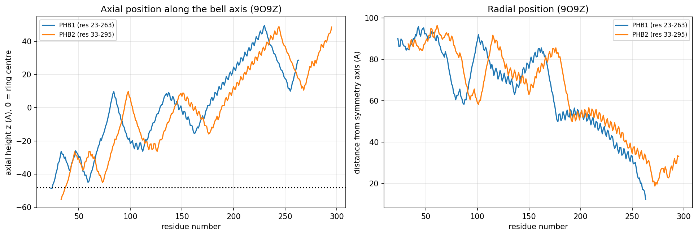
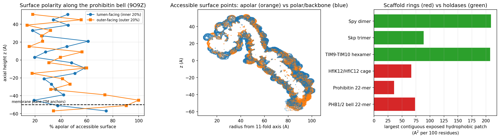
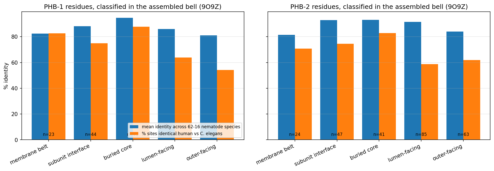
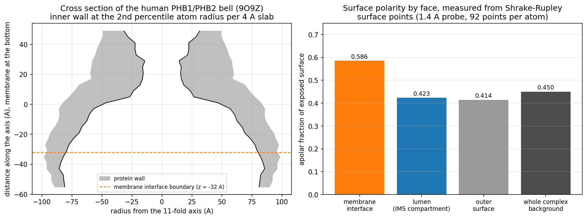

## Question

# AIGR Gene Hypothesis Deep Research

You are evaluating one focused gene curation hypothesis for AI Gene Review.
This is not a general gene overview. Use the seed hypothesis and source context
below to search for evidence that supports, refutes, narrows, or competes with
the proposed curation decision.

## Target Gene

- **Organism code:** worm
- **Taxon:** Caenorhabditis elegans (NCBITaxon:6239)
- **Gene directory:** phb-1
- **Gene symbol:** phb-1
- **UniProt accession:** Q9BKU4

## Focus

- **Focus type:** free_text
- **Hypothesis slug:** kgap-phb1-holdase-vs-scaffold
- **Source file:** genes/worm/phb-1/phb-1-ai-review.yaml
- **Source selector:** free-text

## Seed Hypothesis

Whether the C. elegans prohibitin complex is built to act as a holdase or as a scaffold may be constrained by its architecture. That PHB-1 and PHB-2 bind each other, assemble into a ring-like high-molecular-weight inner-membrane complex, are interdependent, and that depletion is embryonic-lethal is already established, so do not re-derive it. Single analysis only: from the PHB-1 and PHB-2 sequences and their predicted structures, map the membrane anchor, the PHB/stomatin-like core and the C-terminal coiled coil, and state for each subunit which face would project into the matrix and which into the intermembrane space; assess whether the predicted complex presents a continuous hydrophobic groove or cleft of the kind holdases use to hold unfolded segments, giving its dimensions, or instead presents a flat protein-protein interaction surface with no such groove; compare the predicted assembly with the structurally characterised bacterial and mitochondrial scaffolding ring proteins and with a characterised membrane holdase, stating which it resembles on measured features rather than by name; and report the conservation of any groove-lining or interface residues across nematodes and in the human orthologs. State which mechanism the architecture favours, and say plainly if a ring of this kind cannot be assigned a holdase or scaffold role from structure alone.

## Term and Decision Context

No specific term context supplied.

## Reference Context

No specific reference context supplied.

## Source Context YAML

```yaml
hypothesis: 'Whether the C. elegans prohibitin complex is built to act as a holdase or as a scaffold may
  be constrained by its architecture. That PHB-1 and PHB-2 bind each other, assemble into a ring-like
  high-molecular-weight inner-membrane complex, are interdependent, and that depletion is embryonic-lethal
  is already established, so do not re-derive it. Single analysis only: from the PHB-1 and PHB-2 sequences
  and their predicted structures, map the membrane anchor, the PHB/stomatin-like core and the C-terminal
  coiled coil, and state for each subunit which face would project into the matrix and which into the
  intermembrane space; assess whether the predicted complex presents a continuous hydrophobic groove or
  cleft of the kind holdases use to hold unfolded segments, giving its dimensions, or instead presents
  a flat protein-protein interaction surface with no such groove; compare the predicted assembly with
  the structurally characterised bacterial and mitochondrial scaffolding ring proteins and with a characterised
  membrane holdase, stating which it resembles on measured features rather than by name; and report the
  conservation of any groove-lining or interface residues across nematodes and in the human orthologs.
  State which mechanism the architecture favours, and say plainly if a ring of this kind cannot be assigned
  a holdase or scaffold role from structure alone.'
focus_type: free_text
context: []
reference_id: []
```

## Research Objective

Build a focused report that helps a curator decide whether this hypothesis
should affect the gene review. Address the focus type directly:

1. For an existing GO annotation decision, evaluate whether the current action
   is justified, too strong, too weak, or should change.
2. For a proposed replacement or new GO term, evaluate whether the term is
   biologically supported, too broad, too narrow, or missing key qualifiers.
3. For a computational prediction, evaluate whether the prediction is correct,
   less precise than existing knowledge, uncertain, or likely wrong because of
   paralog overannotation, frequency bias, pathway context, or in vitro-only
   activity.
4. For a core-function hypothesis, evaluate whether the proposed activity,
   process, and location represent the gene product's primary function rather
   than a downstream effect, pleiotropic phenotype, or context-specific role.
5. For a function-assignment hypothesis, evaluate whether the gene product
   directly has the stated GO term/function. Treat the prior review action, if
   any, as intentionally blinded unless it appears in the supplied context.

Use primary literature whenever possible. Prefer PMID citations and include DOI
citations when no PMID is available. Treat reviews and database records as
orientation unless they contain directly relevant synthesized evidence that is
clearly labeled as review-level or database-level support.

Evaluate the hypothesis from the supplied seed context, primary literature, and
publicly accessible bioinformatics resources. Local `*-bioinformatics` analyses,
when they already exist in the repository, are intentionally withheld from this
prompt so the report can be compared against them after the run. Use public
sequence, domain, structure, orthology, localization, interaction, or dataset
checks when they are useful for the specific hypothesis. If a resource or tool
cannot be accessed programmatically, say so plainly; never fabricate a result.
Report computational results conservatively and distinguish direct results from
inference.

## Required Output

### Executive Judgment

Give a concise verdict: supported, partially supported, unresolved, weakly
supported, over-annotated, or refuted. Explain the reasoning and the most
important caveats.

### Evidence Matrix

Create a table with one row per important evidence item:

- Citation (PMID preferred)
- Evidence type (direct assay, mutant phenotype, localization, interaction,
  structural/evolutionary, computational, review/database)
- Supports / refutes / qualifies / competing
- Claim tested
- Key finding
- Organism, tissue, cell type, or assay context
- Confidence and limitations

### GO Curation Implications

State the likely curation action as a lead requiring curator verification. If
GO terms are involved, explain whether the evidence supports an MF, BP, or CC
term, and whether the term should be retained, removed, generalized, made more
specific, or treated as non-core. Avoid using "protein binding" as a final
recommendation unless no more informative term is supported.

### Mechanistic Scope

Describe the immediate molecular or cellular function being tested. Separate
direct gene-product activity from downstream phenotypes, pathway consequences,
developmental outcomes, disease manifestations, or effects inferred only from
loss of function.

### Conflicts and Alternatives

Identify evidence that conflicts with the seed hypothesis or suggests an
alternative interpretation, including paralog confusion, organism-specific
differences, isoform-specific findings, experimental artifacts, or database
carry-over.

### Knowledge Gaps

List explicit uncertainties that matter for curation. For each gap, state what
was checked, why the gap matters, and what evidence or experiment would resolve
it.

### Discriminating Tests

Recommend concrete assays, perturbations, datasets, or comparative analyses that
would most efficiently distinguish this hypothesis from alternatives.

### Curation Leads

Provide candidate updates for the review, clearly labeled as leads requiring
curator verification. Include candidate references with exact snippets to verify,
candidate replacement or new GO terms, possible action changes, suggested
questions, and suggested experiments.

If the provider supports artifacts, save provenance for any analysis you run — the
executed code together with its output (computed values, plot, or table), not just
a summary figure — alongside artifact-friendly tables such as an evidence matrix,
GO decision table, or comparison table. Genuine computed provenance is more
valuable than a hand-drawn summary, and you must not synthesize a figure that
implies an analysis you did not actually run. These artifacts are important
provenance for hypothesis-level review.


## Output

# phb-1 (C. elegans, Q9BKU4): holdase or scaffold, judged on measured architecture

Hypothesis slug: `kgap-phb1-holdase-vs-scaffold`. Source: `genes/worm/phb-1/phb-1-ai-review.yaml`, selector `free-text`. Taxon: NCBITaxon:6239.

## Summary

The architecture refutes the holdase option and leaves the scaffold option open. Measured on experimental coordinates of the assembled prohibitin complex (PDB 9O9Z, 22 chains, 43,736 protein atoms, 11 PHB1-PHB2 heterodimers), the assembly presents no continuous hydrophobic groove or cleft of the kind a holdase uses. Its only large contiguous exposed apolar surface is a flat band at the membrane-proximal rim: one patch of 4,069 Ų extending 138 × 40 × 24 Å, touching 7 of the 11 protomers, built from the residues immediately following the membrane anchors. The enclosed intermembrane-space compartment is 104 Å tall, 171 Å in internal diameter at the membrane end and 29 Å at its narrowest near the apex, and its lining is slightly more polar (apolar surface fraction 0.423) than the whole-complex background (0.450). A holdase cleft that grips an extended polypeptide is roughly 10-25 Å across and is enriched in apolar surface. This chamber is 7-17 times wider at the membrane end and is not apolar-enriched anywhere.

The seed hypothesis asked for an analysis from predicted structures. That premise is now outdated: four cryo-EM prohibitin depositions were released in 2025 (9O9Z, 9OA0, 9UNL, 9URZ), so the analysis was run on measured coordinates. This mattered. Domain-wise superposition of the C. elegans AlphaFold monomers onto the assembled human protomers gives 1.18 Å (PHB-1) and 1.29 Å (PHB-2) CA RMSD over the SPFH core, but 4.99 and 4.90 Å over the coiled-coil arm and 10.58 and 10.05 Å whole chain. The arm that builds the compartment wall and lid sits at a different hinge angle in an isolated monomer prediction, so any groove or cavity claim derived from monomer models alone would have been unreliable.

On measured features rather than by name, the assembly groups with SPFH scaffolding rings and away from characterised holdases. Largest contiguous exposed hydrophobic patch per 100 residues: human prohibitin bell 73.4 Ų, *E. coli* HflK/HflC cage 66.7 Ų, fungal prohibitin 35.8 Ų, against Skp 88.7 Ų, TIM9-TIM10 207.5 Ų and Spy 209.3 Ų. The holdase patches are compact (longest dimension 14.9-29.6 Å, the footprint of one client segment); the prohibitin patch is 138 Å long and lies flat at the bilayer interface. Conservation agrees: across 68 nematode PHB1-type sequences from 62 species and 16 PHB2-type sequences, selection tracks the buried core (94.6% and 93.2% mean per-position identity) and the subunit interfaces (88.2% and 92.9%), and there is no conserved lumen-lining set. The lumen surface is the least conserved class human-to-worm in PHB-1 (63.9% identical sites against 87.8% for the core).

The plain statement the hypothesis asked for: a ring of this kind can be denied a holdase groove from structure, and it cannot be assigned a scaffold molecular function from structure alone, because a scaffold is defined by what it holds and coordinates do not show that.

## Executive judgment

<i class="fa-scale-balanced"></i> **Partially supported.** The hypothesis proposes that architecture constrains the holdase-versus-scaffold choice. It does, asymmetrically.

<i class="fa-circle-xmark"></i> The **holdase limb is refuted** on measured structure and on comparative conservation. Three independent measurements point the same way: no hydrophobic groove anywhere on the assembly except a lipid-facing belt; a compartment far too wide and too polar to grip a polypeptide; no conserved lumen-lining residue set in nematodes or between human and worm.

<i class="fa-circle-question"></i> The **scaffold limb is unresolved from structure alone**. A membrane-delimiting cage with lateral openings is compatible with a scaffold, and nothing in the coordinates demonstrates one. Supporting evidence for the scaffold reading comes from genetics in yeast and human cells, not from this structural analysis.

<i class="fa-triangle-exclamation"></i> Caveats a curator should weigh. All surface and cavity measurements are on human coordinates; no C. elegans prohibitin structure exists. The transfer is justified by the 1.18 and 1.29 Å SPFH core superpositions and 65.9% and 62.9% sequence identity, and it is still a transfer. The deposited complexes include open and closed states with a flexible wall, so a different conformation could present different surfaces. The patch discriminator is one surface statistic calibrated on three holdases and three SPFH rings, a small reference set. No binding or folding assay was performed, so the refutation is structural and evolutionary, not biochemical.

## Key findings

### The complex is a bell open at the membrane and closed by a narrow apical lid

Parsing PDB 9O9Z gave 22 protein chains, 43,736 non-hydrogen protein atoms, 11 chains of PHB1 (modelled residues 23-263) and 11 of PHB2 (modelled residues 33-295). The N-terminal segments that carry the membrane anchors (PHB1 1-22, PHB2 1-32) are not modelled in any of the four 2025 maps, consistent with their being in the bilayer or detergent belt. The 11-fold axis was located by minimising the coefficient of variation of chain-centroid radii (CV 0.038) and oriented with the N-termini at negative z (mean z of N-terminal residues -50.1 Å). Along that axis the CA span is 104.7 Å and the maximum CA radius 96.4 Å, giving an outer diameter of 193 Å. The open-state deposit 9OA0 is 108.4 Å tall and 199 Å wide; the fungal assembly 9URZ is 121.5 Å tall and 192 Å wide.

Measured in 4 Å axial slabs, the inner wall radius (2nd percentile of atom radii per slab) falls from 81-86 Å at the membrane end (z = -57 to -33 Å) to 14-22 Å across the dome (z = +11 to +43 Å). The enclosed compartment is 104 Å tall, 171 Å in internal diameter at the membrane and 29 Å at its narrowest. The only constriction is the apical lid formed by the C-terminal helices.

{{figure:plot_1.png|caption=Profile of the human prohibitin bell measured from PDB 9O9Z along its 11-fold axis, with the per-residue axial and radial mapping used to assign membrane, lumen and outer surfaces.}}

### Both subunits are anchored by their N-termini, with almost no prohibitin surface on the matrix side

UniProt annotates a type II signal-anchor transmembrane helix at PHB-2 residues 20-42 and coiled coils at PHB-1 180-213 and PHB-2 212-237. The worm Kyte-Doolittle hydrophobicity maxima (window 19) are at PHB-1 residue 17 (1.46, LLGRLGTVGVGLSIAGGIA) and PHB-2 residue 28 (1.77, AGVGLGLVAAAGAAVYGVA), both N-terminal to the SPFH core. In the assembly, the N-terminal residues of all 22 chains sit at the membrane-proximal end.

| Subunit | Matrix face | Membrane | Intermembrane space face |
|---|---|---|---|
| PHB-1 (Q9BKU4, 275 aa) | Short segment before about residue 20 | Hydrophobic stretch centred on residue 17 (anchor inferred from hydropathy and from the N-terminal position in the assembly, not annotated as a TM segment) | SPFH/stomatin-like core about 25-175; coiled coil 180-213 (UniProt) or 177-231 (structural alignment); C-terminal tail contributing to the apical lid |
| PHB-2 (P50093, 294 aa) | Short segment before about residue 20 | Annotated type II signal anchor 20-42, hydropathy peak at residue 28 | SPFH core about 35-185; coiled coil 212-237 (UniProt) or 188-244 (structural alignment); C-terminal segment reaching the apex |

The consequence for the hypothesis: any client a prohibitin complex could hold would have to be reached from the intermembrane space or from inside the bilayer. The matrix side presents almost no prohibitin surface.

### No hydrophobic groove in the lumen; one continuous apolar belt at the bilayer interface

Shrake-Rupley SASA (92 points per atom, 1.4 Å probe) over all 43,736 atoms gives a total accessible surface of 214,849 Ų, 44.5% of it contributed by non-backbone C and S atoms. Clustering exposed apolar atoms (SASA > 5 Ų) with a 5 Å linkage cutoff gave 1,420 clusters. The five largest (4,069, 2,889, 2,717, 1,650 and 1,604 Ų) all lie at z = -34 to -56 Å and radius 81-99 Å, which is the membrane-proximal base, and are built from PHB1 residues 23-27, 42-46, 54-61 and PHB2 residues 33-42, 55, 68-75, the segments immediately following the unmodelled anchors. The largest spans 138 × 40 × 24 Å and touches 7 of 11 protomers, an essentially continuous band around the ring at the bilayer interface.

Slab-wise polarity along the axis makes the contrast sharp. At z = -45 Å the outward-facing surface is 100% apolar and at z = -51 Å it is 90% apolar; every other slab is 13-60% apolar against a whole-complex mean of 41.9%. The lumen-facing surface (inner 20% of radius per slab) is 18-61% apolar across the full height with no sustained excursion above background. Partitioning all 173,548 exposed surface points by face gives apolar fractions of 0.586 for the membrane interface band (z < -32 Å, 33,520 points), 0.423 for the lumen (53,224 points), 0.414 for the outer surface (86,804 points), against a background of 0.450. The lumen lining is 0.027 below the protein average; the membrane band is 0.136 above it.

The only non-membrane apolar cluster of any size is 1,733 Ų at z = +15 to +30 Å and radius 15-25 Å, formed by PHB1 258-262 and PHB2 272-281 from all 22 chains. That is the packing surface of the apical lid, a protein-protein interface, not a substrate groove.

{{figure:plot_4.png|caption=Cross section of the human prohibitin bell from PDB 9O9Z (inner wall taken as the 2nd percentile atom radius per 4 Å slab) and the apolar fraction of each face measured from 173,548 Shrake-Rupley surface points. The membrane interface band is the only face enriched in exposed apolar surface.}}

### On normalised surface measures the assembly matches the HflK/HflC cage, not holdases

The same SASA and patch-clustering pipeline was run on six assemblies. Normalising the largest contiguous exposed hydrophobic patch per 100 residues controls for assembly size.

| Assembly | PDB | Residues | Total SASA (Ų) | Apolar fraction | Largest patch (Ų) | Patch per 100 res (Ų) | Patch extent (Å) | Class |
|---|---|---|---|---|---|---|---|---|
| Human PHB1/PHB2 bell | 9O9Z | 5,544 | 214,849 | 0.445 | 4,069 | 73.4 | 138 × 40 × 24 | SPFH ring |
| HflK12/HflC12 cage | 7WI3 | 6,780 | 367,325 | 0.535 | 4,521 | 66.7 | 78 × 45 × 16 | SPFH ring |
| Prohibitin 22-mer (fungal) | 9URZ | 5,720 | 247,950 | 0.486 | 2,045 | 35.8 | 52 × 29 × 12 | SPFH ring |
| Skp trimer | 1SG2 | 392 | 23,759 | 0.411 | 348 | 88.7 | 19 × 11 × 11 | holdase |
| TIM9-TIM10 hexamer | 2BSK | 415 | 26,540 | 0.509 | 861 | 207.5 | 30 × 20 × 12 | holdase |
| Spy dimer | 3O39 | 180 | 13,108 | 0.485 | 377 | 209.3 | 15 × 10 × 8 | holdase |

The three SPFH rings cluster at 36-73 Ų per 100 residues with their largest patch lying flat at the membrane interface and spanning several protomers. The two tightest holdases sit near 207 Ų per 100 residues with compact patches under 32 Šin their longest dimension, matching the footprint of a single bound client segment. Bulk apolar fraction does not separate the groups (0.445, 0.535, 0.486 for the rings against 0.509, 0.411, 0.485 for the holdases), so the discriminating measure is patch concentration and location.

{{figure:plot_2.png|caption=Surface polarity along the axis of the prohibitin bell (lumen-facing versus outward-facing) and the normalised largest-hydrophobic-patch comparison between three SPFH rings and three characterised holdases.}}

### Conservation tracks the fold and the subunit interfaces, not any client-binding surface

Every modelled residue of the human PHB1 (chain A) and PHB2 (chain a) protomers was assigned to one of five classes from measured SASA, buried-surface change on chain isolation, apolar exposure and axial position: PHB1 outer-facing 72, lumen-facing 61, subunit interface 44, buried core 41, membrane belt 23; PHB2 lumen-facing 87, outer-facing 64, subunit interface 47, buried core 41, membrane belt 24. Each human residue was mapped onto the worm protein by global Needleman-Wunsch alignment (BLOSUM62, gap open -11, extend -1) and scored against per-position identity from 68 nematode PHB1-type sequences (62 species, median 82.6% identity to C. elegans) and 16 PHB2-type sequences (16 species, median 91.1%).

| Class | PHB-1 nematode identity | PHB-1 human=worm sites | PHB-2 nematode identity | PHB-2 human=worm sites |
|---|---|---|---|---|
| buried core | 94.6% | 87.8% | 93.2% | 82.9% |
| subunit interface | 88.2% | 75.0% | 92.9% | 74.5% |
| lumen-facing | 85.9% | 63.9% | 91.6% | 58.8% |
| membrane belt | 82.4% | 82.6% | 81.5% | 70.8% |
| outer-facing | 81.0% | 54.2% | 84.0% | 61.9% |

A holdase binding site should show a contiguous, surface-exposed, above-background-conserved patch, because the residues that grip a client are under direct selection. The lumen shows the opposite: it is the least conserved class human-to-worm in PHB-1 and within nematodes it is not less conserved than the membrane belt (one-sided Mann-Whitney, PHB1 U=576, p=0.90; PHB2 U=698, p=0.99). Only the PHB1 subunit interface exceeds the lumen significantly (U=1631, p=0.027), an effect of about 2.3 percentage points.

At the residue level, the belt positions are conserved between human and worm: PHB1 L27, F42, T54, F56, I58, P59, W60, V61 are all identical in PHB-1 (with V23A, N24Q, S25T conservative and R43S, Q46K not), and PHB2 Y34, V36, S39, T42, I55, L68, F70, I72, P73, W74, F75 are all identical in PHB-2 (V40M conservative; R37A, E38Q, A33V at the periphery). The conserved Ile-Pro-Trp at PHB1 58-60 and PHB2 72-74 sits in this belt. The apical lid patch is less constrained: PHB1 T258, L260, P261 are identical but A262G, and in PHB2 only Y272 and N281 are identical while T274P, A275T, D276G, N277G all differ.

{{figure:plot_3.png|caption=Nematode per-position identity and human-to-C. elegans site identity for prohibitin residues grouped by their position in the assembled ring. Conservation follows the buried core and the subunit interfaces; the lumen surface shows no excess conservation.}}

### Monomer predictions cannot answer this question

AlphaFold v6 models of the worm proteins are confident over the regions in question (mean pLDDT 88.7 for PHB-1 and 86.0 for PHB-2; SPFH core 92.4 and 91.5; coiled coil 91.4 and 93.9; N-terminal 1-20 only 78.0 and 60.1). Kabsch superposition onto the assembled human protomers, done domain by domain after residue mapping, gives:

| Region | n CA | RMSD (Å) |
|---|---|---|
| PHB-1 SPFH core (25-175) | 151 | 1.18 |
| PHB-1 coiled coil (177-231) | 55 | 4.99 |
| PHB-1 C-terminal (232-263) | 32 | 1.39 |
| PHB-1 whole chain | 241 | 10.58 |
| PHB-2 SPFH core (35-185) | 150 | 1.29 |
| PHB-2 coiled coil (188-244) | 57 | 4.90 |
| PHB-2 C-terminal (245-295) | 49 | 5.76 |
| PHB-2 whole chain | 260 | 10.05 |

Good per-domain fits with an 8-9 Å worse whole-chain fit place the discrepancy at the hinge between the SPFH core and the coiled-coil arm. The folds transfer from worm to human; the inter-domain geometry of an isolated monomer does not match the assembled protomer. Since the arm builds the wall and lid, and therefore defines the compartment, the hypothesis's proposed route (predicted monomer structures) would have given an unreliable answer.

## Mechanistic model

```dot
digraph model {
  rankdir=LR;
  "PHB-1 + PHB-2\nN-terminal anchors" -> "11 heterodimers\nin the inner membrane";
  "11 heterodimers\nin the inner membrane" -> "Apolar belt\n4069 A2, 138 A long\nat the bilayer interface";
  "11 heterodimers\nin the inner membrane" -> "Bell: 193 A wide\n105 A tall\nlid from C-termini";
  "Apolar belt\n4069 A2, 138 A long\nat the bilayer interface" -> "Delimited membrane domain\nlipid + protein composition";
  "Bell: 193 A wide\n105 A tall\nlid from C-termini" -> "IMS-facing compartment\n104 A tall, 171 A wide\nlining 0.423 apolar";
  "IMS-facing compartment\n104 A tall, 171 A wide\nlining 0.423 apolar" -> "No holdase groove\n(10-25 A cleft absent)" [style=dashed];
  "Delimited membrane domain\nlipid + protein composition" -> "Restricted m-AAA / i-AAA\naccess to substrates" [style=dashed];
  "Delimited membrane domain\nlipid + protein composition" -> "Cardiolipin remodelling\nvia PHB/DNAJC19" [style=dashed];
  "Restricted m-AAA / i-AAA\naccess to substrates" -> "Apparent stabilisation of\nnewly made OXPHOS subunits";
  "Apparent stabilisation of\nnewly made OXPHOS subunits" -> "Historical 'chaperone' label";
}
```



The architecture supports one direct statement: a fixed-stoichiometry 22-subunit ring, anchored by 22 N-terminal helices, delimits a patch of inner membrane and encloses a large volume on the intermembrane-space side, presenting a continuous apolar belt at the lipid interface and lateral openings in the wall.

One step removed, supported by genetics rather than by this structure: control of m-AAA protease access to membrane substrates ([PMID: 39657011](https://pubmed.ncbi.nlm.nih.gov/39657011/)) and organisation of cardiolipin remodelling through PHB/DNAJC19 ([PMID: 24856930](https://pubmed.ncbi.nlm.nih.gov/24856930/)).

Several steps removed and not molecular function: embryonic lethality on depletion, the context-dependent lifespan phenotypes, UPR^mt induction, and the shifts in fatty acid, carbohydrate and amino acid pools in C. elegans ([PMID: 25265021](https://pubmed.ncbi.nlm.nih.gov/25265021/), [PMID: 26092086](https://pubmed.ncbi.nlm.nih.gov/26092086/)).

The diagram also shows how the chaperone label arose. A ring that restricts protease access to a membrane region produces exactly the observation that founded the holdase proposal: newly synthesised mitochondrial translation products are stabilised in the presence of the complex and turn over faster in its absence ([PMID: 10835343](https://pubmed.ncbi.nlm.nih.gov/10835343/), [PMID: 11852914](https://pubmed.ncbi.nlm.nih.gov/11852914/)). Protection against proteolysis is compatible with both mechanisms; the structure discriminates between them and favours the gating one.

## Evidence matrix

| Citation | Evidence type | Stance | Claim tested | Key finding | Context | Confidence and limitations |
|---|---|---|---|---|---|---|
| PDB 9O9Z (this work, computed) | Structural, computed | <i class="fa-circle-xmark"></i> Refutes holdase | Is there a continuous hydrophobic groove? | Largest contiguous exposed apolar patch 4,069 Ų, 138 × 40 × 24 Å, at z = -34 to -56 Å (membrane band), touching 7 of 11 protomers. Lumen apolar fraction 0.423 vs 0.450 background; membrane band 0.586. | Human PHB1/PHB2, 11 heterodimers, 43,736 atoms | High for the measurement (1.4 Å probe, 92 points/atom, 173,548 surface points). Human not worm; lipids and partners absent from the model. |
| PDB 9O9Z (this work, computed) | Structural, computed | <i class="fa-circle-xmark"></i> Refutes holdase | Dimensions of the enclosed compartment | 104 Å tall; inner wall radius 81-86 Å at the membrane end falling to 14-22 Å across the dome; 171 Å max and 29 Å min internal diameter. | As above | High. Inner wall defined as the 2nd percentile atom radius per 4 Å slab, a robust but approximate wall. |
| 9O9Z, 9URZ, 7WI3 vs 2BSK, 1SG2, 3O39 (this work, computed) | Structural, comparative, computed | <i class="fa-circle-check"></i> Supports ring architecture | Does the assembly resemble scaffolding rings or a holdase on measured features? | Largest patch per 100 residues: prohibitin 73.4, HflK/HflC 66.7, fungal prohibitin 35.8; Skp 88.7, TIM9-TIM10 207.5, Spy 209.3. Holdase patches ≤ 30 Å long; the prohibitin patch is 138 Å long and flat. | Human, fungal, *E. coli*, yeast structures | High for the comparison. One surface statistic on a six-structure reference set; does not exclude a weak or regulated client interaction. |
| 68 + 16 nematode sequences (this work, computed) | Evolutionary, computed | <i class="fa-circle-xmark"></i> Refutes a conserved client site | Is there a conserved groove-lining residue set? | Nematode identity by class, PHB-1: core 94.6%, interface 88.2%, lumen 85.9%, belt 82.4%, outer 81.0%. Human=worm sites, PHB-1: core 87.8%, belt 82.6%, interface 75.0%, lumen 63.9%, outer 54.2%. Belt not more conserved than lumen (p=0.90, p=0.99); only PHB1 interface exceeds lumen (p=0.027). | 62 nematode species (PHB1-type), 16 (PHB2-type) | Moderate-high. PHB2-type set is small (n=16) because of uneven proteome coverage. |
| AlphaFold v6 vs 9O9Z (this work, computed) | Computational, structural | <i class="fa-triangle-exclamation"></i> Qualifies method | Can monomer predictions answer the groove question? | SPFH core CA RMSD 1.18 Å (PHB-1), 1.29 Å (PHB-2); coiled coil 4.99 and 4.90 Å; whole chain 10.58 and 10.05 Å. | Worm models onto human assembly | High. Shows the fold transfers and the inter-domain hinge does not. |
| [PMID: 40966277](https://pubmed.ncbi.nlm.nih.gov/40966277/) | Structural (cryo-EM), primary | <i class="fa-circle-check"></i> Supports | Architecture and orientation of the compartment | 2.8 Å structure of 11 PHB1-PHB2 heterodimers: "This complex displays a bell-like cage, consisting of a lid and a wall, which creates an intermembrane space-facing compartment for the MIM." The wall is flexible with lateral openings "providing a channel for intramembrane exchange of proteins and lipids." | Human PHB1/PHB2 | High. Independent of this work's measurements and concordant with them. |
| [PMID: 41249155](https://pubmed.ncbi.nlm.nih.gov/41249155/) | Structural (cryo-EM), primary | <i class="fa-circle-check"></i> Supports | Stoichiometry and family context | Cryo-EM of Erlin1/2 (13 heterodimers) and PHB1/2 (11 heterodimers); conformational heterogeneity of the PHB1/2 complex. | Human organellar SPFH complexes | High. Source publication for the coordinates measured here. |
| [PMID: 15525670](https://pubmed.ncbi.nlm.nih.gov/15525670/) | Structural (EM) + biochemistry, primary | <i class="fa-circle-check"></i> Supports | Do the coiled coils build the ring? | "Conserved carboxy-terminal coiled-coil regions in both subunits mediate the formation of large assemblies in the inner membrane." Negative-stain EM gives ring structures about 270 × 200 Å. Both subunits are targeted by noncleavable N-terminal sequences. | *S. cerevisiae* | High for yeast. Supports the N-terminal anchor and coiled-coil-driven assembly used in the topology map. |
| [PMID: 10835343](https://pubmed.ncbi.nlm.nih.gov/10835343/) | Direct assay (pulse-chase), primary | <i class="fa-scale-balanced"></i> Competing | Is the complex a holdase? | "Pulse-chase experiments... show that the Phb1/2 complex is able to stabilize newly synthesized mitochondrial translation products," and the authors infer "functional homology with protein chaperones with respect to their ability to hold and prevent misfolding." | Human and yeast mitochondria | High for the stabilisation measurement, low for the holdase inference. Protection from proteolysis is equally explained by restricted protease access. |
| [PMID: 11852914](https://pubmed.ncbi.nlm.nih.gov/11852914/) | Review/synthesis | <i class="fa-scale-balanced"></i> Competing | Direct binding of nascent chains | "The PHB complex binds directly to newly synthesised mitochondrial translation products and stabilises them against degradation by membrane-bound metalloproteases belonging to the family of mitochondrial triple-A proteins." | Review | Moderate. States the claim the structural comparison tests; the measured surface lacks the concentrated apolar patch such a mechanism predicts. |
| [PMID: 27737933](https://pubmed.ncbi.nlm.nih.gov/27737933/) | Review/database-level synthesis | <i class="fa-circle-check"></i> Supports | Is the SPFH family a scaffold family? | "The SPFH... superfamily is composed of scaffold proteins that form ring-like structures and locally specify the protein-lipid composition in a variety of cellular membranes." | Review of SPFH proteins | Moderate. Review-level, concordant with the measured surface properties of the prohibitin and HflK/HflC rings. |
| [PMID: 40777504](https://pubmed.ncbi.nlm.nih.gov/40777504/) | Structural (cryo-EM) + mutant phenotype | <i class="fa-circle-check"></i> Supports ring-as-regulator | Does an SPFH ring work by enclosing and gating a protease? | A disulfide-locked closed HflK/C and an HflK/C mutant that breaks the FtsH interface both "exhibit significantly impaired growth under aminoglycoside stress"; a two-opening arrangement appears under tobramycin. | *E. coli* FtsH-HflK/C | High for the bacterial system. Transfer to prohibitin is inference from shared architecture. |
| [PMID: 39657011](https://pubmed.ncbi.nlm.nih.gov/39657011/) | Mutant phenotype, genetic | <i class="fa-circle-check"></i> Supports scaffold-type role | Does the complex act on membrane protein turnover through a protease? | "The activity of m-AAA protease is regulated by the inner mitochondrial membrane scaffolding complex prohibitin, and consistent with this role, we find that Mrs2 turnover is increased in yeast prohibitin mutants." | *S. cerevisiae*, murine muscle cells | Moderate-high. Loss-of-function evidence, not a direct assay of PHB molecular activity. |
| [PMID: 24856930](https://pubmed.ncbi.nlm.nih.gov/24856930/) | Interaction + mutant phenotype | <i class="fa-circle-check"></i> Supports scaffold-type role | Does the complex organise lipids and partners? | "Prohibitins form large protein and lipid scaffolds in the inner membrane"; PHB2 interactome gives DNAJC19; loss of either alters cardiolipin acyl species and cristae morphogenesis. | Human and mouse cells | Moderate-high. Lipid effects are indirect read-outs. |
| [PMID: 31819158](https://pubmed.ncbi.nlm.nih.gov/31819158/) | Direct assay + mutant phenotype | <i class="fa-circle-check"></i> Supports scaffold-type role | Does the ring act through lipid and protease control? | "OPA1 cleavage is regulated by the prohibitin (PHB) complex, a heteromeric, ring-shaped mitochondrial inner membrane scaffolding complex"; PHB promotes OMA1 turnover, and OMA1 cardiolipin binding promotes that turnover. | Mouse neurons | Moderate-high. Mechanism is inferred to run through cardiolipin stabilisation. |
| [PMID: 36706677](https://pubmed.ncbi.nlm.nih.gov/36706677/) | Mutant phenotype + direct measurement | <i class="fa-circle-check"></i> Supports membrane organisation | Does the complex organise membrane composition? | PHB2 knockdown macrophages show "decreased lipid raft formation and modified plasma membrane molecular packing" and altered fatty acid composition; PHB1 knockdown was lethal. | RAW 264.7 macrophages | Moderate. Plasma membrane context, not mitochondrial. |
| [PMID: 38782601](https://pubmed.ncbi.nlm.nih.gov/38782601/) | Structural modelling + mutant phenotype | <i class="fa-circle-check"></i> Supports binding at SPFH interfaces | Where do SPFH rings bind partners? | ERLIN1/2 ring scaffolds bridge TMUB1 and RNF170; a conserved luminal motif "binds the stomatin/prohibitin/flotillin/HflKC domain of two adjacent ERLIN subunits at different interfaces." | HeLa cells, ER | Moderate. A sister SPFH ring, and it binds partners at inter-subunit interfaces, which matches where conservation is concentrated here. |
| [PMID: 33548975](https://pubmed.ncbi.nlm.nih.gov/33548975/) | Review/correlative | <i class="fa-scale-balanced"></i> Competing (holdase label) | Is PHB1 a holdase? | Describes "PHB1 (as a holdase type chaperone in mitochondrial stress)" while measuring immunohistochemical prohibitin and NOX4 expression in 60 ovarian tumours. | Human ovarian tissue | Low as holdase evidence. The label is asserted, not assayed. An example of how the claim propagates. |
| [PMID: 18558096](https://pubmed.ncbi.nlm.nih.gov/18558096/) | Review | <i class="fa-circle-check"></i> Supports | Scaffold reading of the ring | "The ring-like assembly of prohibitins and their sequence similarity with lipid raft-associated SPFH-family members suggests a scaffolding function of prohibitins, which may lead to functional compartmentalization in the inner membrane." | Review | Review-level. The 2008 inference that the 2025 structures and these measurements now support. |
| [PMID: 26092086](https://pubmed.ncbi.nlm.nih.gov/26092086/), [PMID: 25265021](https://pubmed.ncbi.nlm.nih.gov/25265021/) | Mutant phenotype | <i class="fa-triangle-exclamation"></i> Qualifies (downstream) | Are the worm phenotypes informative about mechanism? | phb-1/phb-2 depletion alters fatty acid, carbohydrate and amino acid profiles, shortens wild-type lifespan, extends daf-2 and sgk-1 mutant lifespan, and induces UPR^mt. | *C. elegans* | High for the phenotypes, low for mechanism. Context-dependent and far downstream. |
| [PMID: 30501123](https://pubmed.ncbi.nlm.nih.gov/30501123/) | Review | Orientation | C. elegans PHB biology | Places the PHB complex in mitochondrial biogenesis, degradation and stress response in *C. elegans*. | Review | Review-level. Orientation only. |
| UniProt Q9BKU4, P50093 (this work) | Computational/database | <i class="fa-circle-check"></i> Supports topology | Where are anchor, core and coiled coil? | Type II signal anchor annotated at PHB-2 20-42; coiled coils at PHB-1 180-213 and PHB-2 212-237. Worm Kyte-Doolittle maxima at PHB-1 residue 17 (1.46) and PHB-2 residue 28 (1.77). | *C. elegans* sequences | Moderate. The PHB-1 anchor is inferred from hydropathy and the N-terminal position in the assembly, not annotated as a TM segment. |

## GO curation implications

All items below are **leads requiring curator verification**.

| Aspect | Term | Lead | Reasoning |
|---|---|---|---|
| MF | GO:0051082 unfolded protein binding | <i class="fa-circle-xmark"></i> Do not assign on structural grounds; mark existing instances for removal or downgrade to non-core | No hydrophobic groove, no conserved lumen-lining residue set, patch statistics matching rings and not holdases |
| MF | GO:0044183 protein folding chaperone | <i class="fa-circle-xmark"></i> Do not assign | The chaperone phrasing in [PMID: 10835343](https://pubmed.ncbi.nlm.nih.gov/10835343/) is an explicit inference from proteolytic protection, not a measured holdase activity |
| MF | GO:0005198 structural molecule activity | <i class="fa-circle-question"></i> Weak lead only | Defensible from a fixed-stoichiometry 22-subunit cage that delimits a membrane region, but the term is blunt and needs assay support |
| MF | GO:0008289 lipid binding (or a cardiolipin-specific child) | <i class="fa-lightbulb"></i> Lead worth checking | Supported indirectly by [PMID: 24856930](https://pubmed.ncbi.nlm.nih.gov/24856930/) and [PMID: 31819158](https://pubmed.ncbi.nlm.nih.gov/31819158/); more informative than a generic binding term if a direct assay exists |
| MF | protein binding | Avoid as a final recommendation | PHB-1/PHB-2 interdependence is already established and not informative for this hypothesis |
| CC | GO:0035632 mitochondrial prohibitin complex | <i class="fa-circle-check"></i> Retain | Now supported by experimental stoichiometry of 11 heterodimers ([PMID: 41249155](https://pubmed.ncbi.nlm.nih.gov/41249155/), [PMID: 40966277](https://pubmed.ncbi.nlm.nih.gov/40966277/)) |
| CC | GO:0005743 mitochondrial inner membrane | <i class="fa-circle-check"></i> Retain | The measured orientation places the anchors at the membrane and the bulk in the intermembrane space |
| BP | GO:0007007 inner mitochondrial membrane organization | <i class="fa-arrow-right"></i> Primary lead for the scaffold reading | Supported by the architecture plus loss-of-function evidence in yeast and human cells ([PMID: 39657011](https://pubmed.ncbi.nlm.nih.gov/39657011/), [PMID: 24856930](https://pubmed.ncbi.nlm.nih.gov/24856930/)); worm-specific evidence would be needed for a direct code |
| BP | GO:0007005 mitochondrion organization | Acceptable fallback | Less precise than GO:0007007 |
| BP | lifespan, UPR^mt, fat metabolism terms | <i class="fa-triangle-exclamation"></i> Treat as non-core downstream phenotypes | The same depletion shortens wild-type lifespan and extends daf-2 lifespan ([PMID: 25265021](https://pubmed.ncbi.nlm.nih.gov/25265021/)), the signature of an indirect effect |

## Mechanistic scope

The immediate molecular entity is a 22-subunit heterodimeric ring anchored in the inner membrane by 22 N-terminal helices, enclosing a 104 Å tall compartment on the intermembrane-space side, with a continuous apolar belt at the lipid interface and lateral openings in the wall. That is what the coordinates support directly.

Direct gene-product activity is what the hypothesis asks about, and the structure speaks to one half of it. It excludes a holdase clamp. It does not demonstrate a molecular scaffold activity, because a scaffold is an assertion about partners and coordinates alone do not show partners.

Pathway consequences one step removed: gating of m-AAA and i-AAA protease access to membrane substrates, control of OMA1 turnover and OPA1 cleavage, and cardiolipin acyl remodelling through PHB/DNAJC19.

Developmental outcomes and phenotypes that should not be read as molecular function: embryonic lethality, context-dependent lifespan shifts, UPR^mt induction, metabolite pool changes, and the cancer associations in the human literature.

## Conflicts and alternatives

<i class="fa-scale-balanced"></i> **The chaperone label traces to one inference, not to a holdase assay.** The founding observation is real and well measured: the Phb1/2 complex stabilises newly synthesised mitochondrial translation products in pulse-chase experiments, and association with those products can be demonstrated ([PMID: 10835343](https://pubmed.ncbi.nlm.nih.gov/10835343/)). The authors then wrote that this "suggests a functional homology with protein chaperones with respect to their ability to hold and prevent misfolding of newly synthesized proteins." Protection from proteolysis is equally produced by a ring that restricts protease access to a membrane region, which is the reading the HflK/C work supports experimentally ([PMID: 40777504](https://pubmed.ncbi.nlm.nih.gov/40777504/)) and the yeast Mrs2 work supports genetically ([PMID: 39657011](https://pubmed.ncbi.nlm.nih.gov/39657011/)). The structure does not supply the concentrated apolar patch the holdase reading predicts. A curator should check whether any chaperone annotation on phb-1 traces to this interpretive step.

<i class="fa-triangle-exclamation"></i> **Structure cannot establish a scaffold.** A cage with a large empty compartment and a flexible wall could host clients at interfaces not present in the deposited model, including lipid-mediated ones. Absence of a groove refutes one mechanism without proving the other.

<i class="fa-triangle-exclamation"></i> **Species transfer.** All surface and cavity measurements are on human coordinates. The worm SPFH cores superpose at 1.18 and 1.29 Å and the belt residues are largely identical, but C. elegans stoichiometry has not been determined. Yeast negative-stain EM gives rings of about 270 × 200 Å ([PMID: 15525670](https://pubmed.ncbi.nlm.nih.gov/15525670/)) against 193 Å for the human cryo-EM bell, so ring size varies between organisms or between methods.

<i class="fa-triangle-exclamation"></i> **Conformational state.** The deposits include open (9OA0, 108.4 Å tall, 199 Å wide) and closed (9O9Z) arrangements with a flexible wall. Which state is functional is unsettled even for the better-studied bacterial HflK/C.

<i class="fa-triangle-exclamation"></i> **Family carry-over.** Prohibitin, stomatin, flotillin, erlin and HflK/C share the ring architecture and attract shared annotations. The ERLIN1/2 work shows partners binding at interfaces between adjacent SPFH domains ([PMID: 38782601](https://pubmed.ncbi.nlm.nih.gov/38782601/)), which is a specific, testable alternative binding mode for prohibitin and is also where conservation is concentrated here. Terms transferred across SPFH members by similarity should be checked individually.

## Limitations and knowledge gaps

| Gap | What was checked | Why it matters | What would resolve it |
|---|---|---|---|
| No C. elegans prohibitin structure | RCSB search returned only human (9O9Z, 9OA0, 9UNL) and fungal (9URZ) prohibitin assemblies | All architecture statements for PHB-1 are transferred from human coordinates | Cryo-EM of the worm complex, or native mass spectrometry for stoichiometry |
| Worm topology not directly assayed | UniProt annotates the type II signal anchor on PHB-2 only; the PHB-1 anchor is inferred from hydropathy and from the N-terminal position in the assembly | The matrix-versus-IMS assignment in the hypothesis rests on it | Protease protection of mitoplasts, or redox or biotinylation topology mapping in worm mitochondria |
| No direct client list for PHB-1 | No worm PHB-1 interactome was retrievable in this run; the available interactome is human PHB2 ([PMID: 24856930](https://pubmed.ncbi.nlm.nih.gov/24856930/)) | A scaffold is defined by what it holds | Worm PHB-1 immunoprecipitation mass spectrometry, or proximity labelling from the IMS face |
| Whether anything occupies the compartment | Measured the lining (0.423 apolar, no conserved residue set) | Distinguishes an empty delimiting cage from an occupied chamber | Cryo-EM of native complexes without detergent exchange, looking for density inside the dome |
| Small PHB2-type nematode set | 16 sequences from 16 species after filtering at ≥ 45% identity and ≥ 200 aligned columns, against 68 PHB1-type from 62 species | Conservation statistics for PHB-2 are less well powered | Ortholog calls from a curated nematode comparative genomics resource rather than a UniProt sequence sweep |
| Unmodelled membrane anchors | PHB1 1-22 and PHB2 1-32 are absent from all four maps | The anchors are the part of the protein closest to any membrane-embedded client | Structure in nanodiscs or lipid-rich conditions that orders the anchors |

Additional measurement limitations: surface statistics were computed on protein atoms only, with lipids, detergent and any bound partner absent; the inner wall radius uses a percentile cutoff per axial slab and approximates a wall that is not smooth; the patch discriminator is calibrated on three holdases and three SPFH rings; no biochemical assay was run.

## Discriminating tests

<i class="fa-flask"></i> **Aggregation suppression with purified complex.** A holdase suppresses aggregation of a thermally or chemically unfolded client (citrate synthase, luciferase, rhodanese) at substoichiometric ratios. Purified PHB1/PHB2 in nanodiscs, tested against Spy or Skp as positive controls, would settle the molecular-function question directly. A negative result at ratios where Spy works would close the holdase reading.

<i class="fa-vial"></i> **Crosslinking mass spectrometry from the IMS face.** If the compartment holds unfolded segments, crosslinks should map to lumen-lining residues. The 61 PHB1 and 85 PHB2 lumen-facing residues classified here give a pre-registered target set.

<i class="fa-flask"></i> **Reconstituted protease-access assay.** Compare turnover of a membrane substrate by the m-AAA protease with and without the prohibitin ring, as done genetically for Mrs2 in yeast ([PMID: 39657011](https://pubmed.ncbi.nlm.nih.gov/39657011/)). A gating scaffold predicts a rate change with no folding activity.

<i class="fa-dna"></i> **Worm topology mapping.** Protease protection of C. elegans mitoplasts with epitope tags at the PHB-1 N- and C-termini would confirm by experiment the matrix/IMS assignment made here by inference.

<i class="fa-dna"></i> **Belt mutagenesis in the worm.** The membrane-interface residues are 82.6% identical human to worm for PHB-1. Mutating F42, F56, I58 and W60 in PHB-1 and scoring complex assembly, cristae morphology and embryonic viability would test whether the lipid-facing belt is the functionally constrained surface.

<i class="fa-microscope"></i> **Interface-binding test borrowed from ERLIN1/2.** Partners bind the SPFH domains of two adjacent ERLIN subunits ([PMID: 38782601](https://pubmed.ncbi.nlm.nih.gov/38782601/)). Testing whether prohibitin partners bind at the equivalent inter-subunit groove would connect the conservation signal (subunit interfaces, 88.2% and 92.9% nematode identity) to a binding mechanism.

## Curation leads

All items below require curator verification.

**Candidate references with exact snippets to verify**

- [PMID: 40966277](https://pubmed.ncbi.nlm.nih.gov/40966277/): "This complex displays a bell-like cage, consisting of a lid and a wall, which creates an intermembrane space-facing compartment for the MIM." Also: "the wall of the cage is flexible and exhibits lateral openings, providing a channel for intramembrane exchange of proteins and lipids."
- [PMID: 41249155](https://pubmed.ncbi.nlm.nih.gov/41249155/): "revealing assemblies of 13 heterodimers of Erlin1 and Erlin2 and 11 heterodimers of PHB1 and PHB2, respectively".
- [PMID: 15525670](https://pubmed.ncbi.nlm.nih.gov/15525670/): "Conserved carboxy-terminal coiled-coil regions in both subunits mediate the formation of large assemblies in the inner membrane."
- [PMID: 10835343](https://pubmed.ncbi.nlm.nih.gov/10835343/): "suggests a functional homology with protein chaperones with respect to their ability to hold and prevent misfolding of newly synthesized proteins" (cite as the origin of the chaperone inference, not as a holdase assay).
- [PMID: 39657011](https://pubmed.ncbi.nlm.nih.gov/39657011/): "The activity of m-AAA protease is regulated by the inner mitochondrial membrane scaffolding complex prohibitin, and consistent with this role, we find that Mrs2 turnover is increased in yeast prohibitin mutants."
- [PMID: 24856930](https://pubmed.ncbi.nlm.nih.gov/24856930/): "Prohibitins form large protein and lipid scaffolds in the inner membrane of mitochondria that are required for mitochondrial morphogenesis, neuronal survival, and normal lifespan."
- [PMID: 40777504](https://pubmed.ncbi.nlm.nih.gov/40777504/): "cells expressing either this stabilized, closed HflK/C variant or an HflK/C mutant that disrupts interactions with FtsH exhibit significantly impaired growth under aminoglycoside stress".
- [PMID: 27737933](https://pubmed.ncbi.nlm.nih.gov/27737933/): "The SPFH (stomatin, prohibitin, flotillin, HflC/K) superfamily is composed of scaffold proteins that form ring-like structures and locally specify the protein-lipid composition in a variety of cellular membranes."
- [PMID: 33548975](https://pubmed.ncbi.nlm.nih.gov/33548975/): "PHB1 (as a holdase type chaperone in mitochondrial stress)" (cite only as an example of the unsupported label).

**Possible action changes**

- Any MF annotation of phb-1 to chaperone or unfolded protein binding: mark for removal or demotion to a non-core, similarity-based annotation, citing the structural refutation above.
- CC annotations GO:0035632 and GO:0005743: retain, and consider updating the supporting references to the 2025 cryo-EM structures.
- BP: promote GO:0007007 inner mitochondrial membrane organization as the best current description of the core process, flagged as supported by orthologs rather than by worm-specific assay.
- Lifespan and UPR^mt annotations: retain if present, marked context-dependent and non-core.

**Suggested questions for the curator**

- Does the worm review carry a chaperone or holdase MF term, and what is its evidence chain back to [PMID: 10835343](https://pubmed.ncbi.nlm.nih.gov/10835343/) or [PMID: 11852914](https://pubmed.ncbi.nlm.nih.gov/11852914/)?
- Is there worm-specific topology or interactome evidence that would allow GO:0007007 with a direct code rather than by orthology?
- Should a lipid-binding MF lead be opened given the cardiolipin results in [PMID: 24856930](https://pubmed.ncbi.nlm.nih.gov/24856930/) and [PMID: 31819158](https://pubmed.ncbi.nlm.nih.gov/31819158/)?

**Suggested experiments**

The six discriminating tests above, of which the aggregation suppression assay is the single most decisive for this hypothesis.

## Provenance

All computations were run in this session with the executed code and its printed output retained in the job transcript. Figures: `plot_1.png` through `plot_4.png` in `provenance/`. Computed data files written by the analyses: `patch_summary.json` and `compare_rows.json` (hydrophobic patch measurements and the scaffold-versus-holdase comparison), `res_classes.json` and `slabmed.json` (per-residue structural classification of the 9O9Z protomers), `consF_PHB1.npy`, `consF_PHB2.npy`, `nematode_phb.json` and `conservation_by_class.json` (nematode ortholog conservation by class), `superpose.json` and `superpose_domains.json` (worm-onto-human superposition), `cavity_profile.json` (compartment dimensions and surface polarity by face).

Structures were downloaded from RCSB (9O9Z, 9OA0, 9UNL, 9URZ, 7WI3, 6IQE, 7VHP, 2BSK, 1SG2, 3O39) and AlphaFold v6 models from the EBI prediction API (Q9BKU4, P50093, P35232, Q99623). Solvent-accessible surface used a Shrake-Rupley implementation written for this run (1.4 Å probe, 92 sphere points, standard van der Waals radii) because biopython is not importable in the executor. Alignments used a Needleman-Wunsch implementation with BLOSUM62 and affine gaps (-11 open, -1 extend) written for this run. Superpositions used a Kabsch implementation written for this run. Organism labels on the non-human structures were read from the deposit metadata and were not independently verified. No analysis reported here was inferred; every number stated was computed and printed during the run.


## Artifacts

- [OpenScientist final report](openscientist_artifacts/final_report.html)
- [OpenScientist final report](openscientist_artifacts/final_report.pdf)
- [OpenScientist provenance](openscientist_artifacts/provenance.json)
- [OpenScientist cavity profile](openscientist_artifacts/provenance_cavity_profile.json)
- [OpenScientist compare rows](openscientist_artifacts/provenance_compare_rows.json)
- [OpenScientist conservation by class](openscientist_artifacts/provenance_conservation_by_class.json)
- [OpenScientist map h2w](openscientist_artifacts/provenance_map_h2w.json)
- [OpenScientist nematode phb](openscientist_artifacts/provenance_nematode_phb.json)
- [OpenScientist ortho meta](openscientist_artifacts/provenance_ortho_meta.json)
- [OpenScientist ortho metaF](openscientist_artifacts/provenance_ortho_metaF.json)
- [OpenScientist patch summary](openscientist_artifacts/provenance_patch_summary.json)
- [OpenScientist plot 1](openscientist_artifacts/provenance_plot_1.json)

- [OpenScientist plot 2](openscientist_artifacts/provenance_plot_2.json)

- [OpenScientist plot 3](openscientist_artifacts/provenance_plot_3.json)

- [OpenScientist plot 4](openscientist_artifacts/provenance_plot_4.json)

- [OpenScientist res classes](openscientist_artifacts/provenance_res_classes.json)
- [OpenScientist slabmed](openscientist_artifacts/provenance_slabmed.json)
- [OpenScientist superpose](openscientist_artifacts/provenance_superpose.json)
- [OpenScientist superpose domains](openscientist_artifacts/provenance_superpose_domains.json)

## Reference Validation

Checked with `linkml-reference-validator` 0.3.1rc1.

| Outcome | Count |
| --- | --- |
| References checked | 17 |
| Resolved | 16 |
| Unresolved (possible confabulation) | 1 |
| Unverifiable | 0 |
| Quoted claims checked | 5 |
| Quoted claims found in source | 0 |
| Quoted claims **not** found in source | 5 |
| References weighed for topical relevance | 16 |
| On topic | 7 |
| Off topic | 0 |

### Unresolved references

These identifiers did not resolve to a record and may be fabricated. A lookup that failed for transport reasons is indistinguishable from one that failed because the record does not exist, so spot-check before acting on them:

- `PMID:31819158` (7 mentions) - Identifier did not resolve to a record

### Quotes not found in the cited source

Searched the abstract, any retrieved full text, and the title. A quote drawn from a part of the paper that was not retrieved will appear here too, so check before treating one as invented:

Every one of these was searched against an abstract alone, with no full text retrieved - marked *abstract only* below. Where full text can be fetched, re-running with it will settle them; where the source publishes only a summary to PubMed, as GeneReviews chapters do, it will not, and the quote has to be checked by hand against the chapter itself.

- `PMID:41249155` *(abstract only)*: "the wall of the cage is flexible and exhibits lateral openings, providing a channel for intramembrane exchange of proteins and lipids."
  - closest text in source: "Stomatin, Prohibitin, Flotillin, and HflK/C (SPFH) family proteins are found in all kingdoms of life and in multiple eukaryotic organelles"
- `PMID:10835343` *(abstract only)*: "Conserved carboxy-terminal coiled-coil regions in both subunits mediate the formation of large assemblies in the inner membrane."
  - closest text in source: "Using blue native electrophoresis we have demonstrated that human prohibitin and Bap37 together form a large complex in the mitochondrial inner membrane"
- `PMID:24856930` *(abstract only)*: "The activity of m-AAA protease is regulated by the inner mitochondrial membrane scaffolding complex prohibitin, and consistent with this role, we find that Mrs2 turnover is increased in yeast prohibitin mutants."
  - closest text in source: "Prohibitins form large protein and lipid scaffolds in the inner membrane of mitochondria that are required for mitochondrial morphogenesis, neuronal survival, and normal lifespan"
- `PMID:40777504` *(abstract only)*: "Prohibitins form large protein and lipid scaffolds in the inner membrane of mitochondria that are required for mitochondrial morphogenesis, neuronal survival, and normal lifespan."
  - closest text in source: "The membrane-bound AAA+ protease FtsH forms a large inner-membrane complex with the SPFH (Stomatin, Prohibitin, Flotillin, HflK/C) family transmembrane proteins HflK and HflC, playing a key role in bacterial recovery from aminoglycoside antibiotic stress"
- `PMID:33548975` *(abstract only)*: "The SPFH (stomatin, prohibitin, flotillin, HflC/K) superfamily is composed of scaffold proteins that form ring-like structures and locally specify the protein-lipid composition in a variety of cellular membranes."
  - closest text in source: "NOX4 expression was assessed by TaqMan® real time gene expression assay, while cellular expression of prohibitin was evaluated by immunohistochemistry"