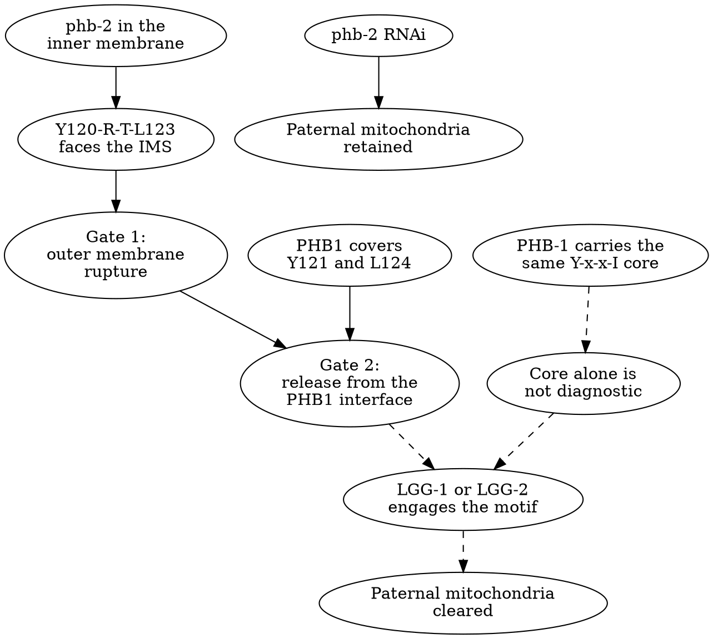
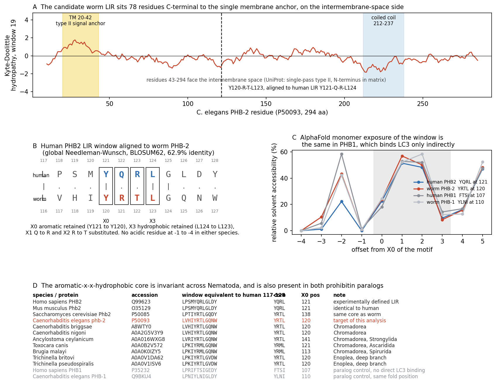
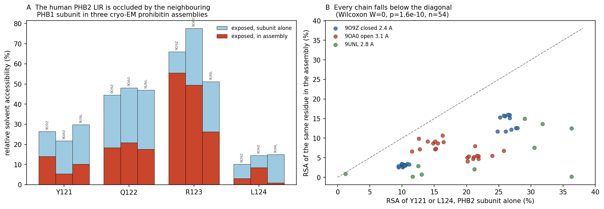
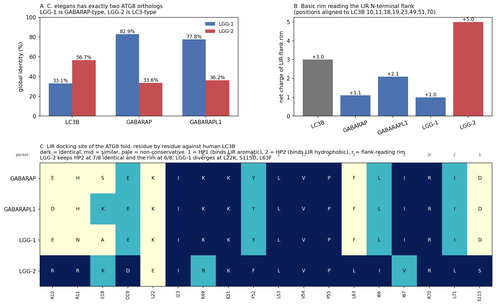

## Question

# AIGR Gene Hypothesis Deep Research

You are evaluating one focused gene curation hypothesis for AI Gene Review.
This is not a general gene overview. Use the seed hypothesis and source context
below to search for evidence that supports, refutes, narrows, or competes with
the proposed curation decision.

## Target Gene

- **Organism code:** worm
- **Taxon:** Caenorhabditis elegans (NCBITaxon:6239)
- **Gene directory:** phb-2
- **Gene symbol:** phb-2
- **UniProt accession:** P50093

## Focus

- **Focus type:** free_text
- **Hypothesis slug:** kgap-phb2-lir-topology
- **Source file:** genes/worm/phb-2/phb-2-ai-review.yaml
- **Source selector:** free-text

## Seed Hypothesis

Whether C. elegans PHB-2 carries a defined LIR motif, as its mammalian ortholog does, should be decidable from sequence and topology. That phb-2 is required for autophagic clearance of paternal mitochondria, that the mammalian ortholog binds LC3-II directly through a LIR while PHB1 binds only indirectly, and that a LIR point mutation abolishes mitophagy without disturbing other prohibitin-dependent functions, is already established, so do not re-derive it. Single analysis only: identify the mammalian PHB2 LIR position and sequence from the primary literature, quoting it, then align worm PHB-2 to it and state residue by residue whether the aromatic and hydrophobic positions are retained, substituted or absent, and give the worm sequence at that window; state where that window sits relative to the predicted transmembrane anchor and the inner-membrane topology, and whether the motif would face the intermembrane space or the matrix, since a LIR must reach cytosolic ATG8 and an inner-membrane protein cannot unless the membrane is ruptured; enumerate the C. elegans ATG8 orthologs and state which the motif could engage; and report conservation of the window across nematodes. State whether a defined worm LIR is predicted, and say plainly if topology makes a direct LIR interaction implausible regardless of sequence, which would relocate the mechanism rather than explain it.

## Term and Decision Context

No specific term context supplied.

## Reference Context

No specific reference context supplied.

## Source Context YAML

```yaml
hypothesis: 'Whether C. elegans PHB-2 carries a defined LIR motif, as its mammalian ortholog does, should
  be decidable from sequence and topology. That phb-2 is required for autophagic clearance of paternal
  mitochondria, that the mammalian ortholog binds LC3-II directly through a LIR while PHB1 binds only
  indirectly, and that a LIR point mutation abolishes mitophagy without disturbing other prohibitin-dependent
  functions, is already established, so do not re-derive it. Single analysis only: identify the mammalian
  PHB2 LIR position and sequence from the primary literature, quoting it, then align worm PHB-2 to it
  and state residue by residue whether the aromatic and hydrophobic positions are retained, substituted
  or absent, and give the worm sequence at that window; state where that window sits relative to the predicted
  transmembrane anchor and the inner-membrane topology, and whether the motif would face the intermembrane
  space or the matrix, since a LIR must reach cytosolic ATG8 and an inner-membrane protein cannot unless
  the membrane is ruptured; enumerate the C. elegans ATG8 orthologs and state which the motif could engage;
  and report conservation of the window across nematodes. State whether a defined worm LIR is predicted,
  and say plainly if topology makes a direct LIR interaction implausible regardless of sequence, which
  would relocate the mechanism rather than explain it.'
focus_type: free_text
context: []
reference_id: []
```

## Research Objective

Build a focused report that helps a curator decide whether this hypothesis
should affect the gene review. Address the focus type directly:

1. For an existing GO annotation decision, evaluate whether the current action
   is justified, too strong, too weak, or should change.
2. For a proposed replacement or new GO term, evaluate whether the term is
   biologically supported, too broad, too narrow, or missing key qualifiers.
3. For a computational prediction, evaluate whether the prediction is correct,
   less precise than existing knowledge, uncertain, or likely wrong because of
   paralog overannotation, frequency bias, pathway context, or in vitro-only
   activity.
4. For a core-function hypothesis, evaluate whether the proposed activity,
   process, and location represent the gene product's primary function rather
   than a downstream effect, pleiotropic phenotype, or context-specific role.
5. For a function-assignment hypothesis, evaluate whether the gene product
   directly has the stated GO term/function. Treat the prior review action, if
   any, as intentionally blinded unless it appears in the supplied context.

Use primary literature whenever possible. Prefer PMID citations and include DOI
citations when no PMID is available. Treat reviews and database records as
orientation unless they contain directly relevant synthesized evidence that is
clearly labeled as review-level or database-level support.

Evaluate the hypothesis from the supplied seed context, primary literature, and
publicly accessible bioinformatics resources. Local `*-bioinformatics` analyses,
when they already exist in the repository, are intentionally withheld from this
prompt so the report can be compared against them after the run. Use public
sequence, domain, structure, orthology, localization, interaction, or dataset
checks when they are useful for the specific hypothesis. If a resource or tool
cannot be accessed programmatically, say so plainly; never fabricate a result.
Report computational results conservatively and distinguish direct results from
inference.

## Required Output

### Executive Judgment

Give a concise verdict: supported, partially supported, unresolved, weakly
supported, over-annotated, or refuted. Explain the reasoning and the most
important caveats.

### Evidence Matrix

Create a table with one row per important evidence item:

- Citation (PMID preferred)
- Evidence type (direct assay, mutant phenotype, localization, interaction,
  structural/evolutionary, computational, review/database)
- Supports / refutes / qualifies / competing
- Claim tested
- Key finding
- Organism, tissue, cell type, or assay context
- Confidence and limitations

### GO Curation Implications

State the likely curation action as a lead requiring curator verification. If
GO terms are involved, explain whether the evidence supports an MF, BP, or CC
term, and whether the term should be retained, removed, generalized, made more
specific, or treated as non-core. Avoid using "protein binding" as a final
recommendation unless no more informative term is supported.

### Mechanistic Scope

Describe the immediate molecular or cellular function being tested. Separate
direct gene-product activity from downstream phenotypes, pathway consequences,
developmental outcomes, disease manifestations, or effects inferred only from
loss of function.

### Conflicts and Alternatives

Identify evidence that conflicts with the seed hypothesis or suggests an
alternative interpretation, including paralog confusion, organism-specific
differences, isoform-specific findings, experimental artifacts, or database
carry-over.

### Knowledge Gaps

List explicit uncertainties that matter for curation. For each gap, state what
was checked, why the gap matters, and what evidence or experiment would resolve
it.

### Discriminating Tests

Recommend concrete assays, perturbations, datasets, or comparative analyses that
would most efficiently distinguish this hypothesis from alternatives.

### Curation Leads

Provide candidate updates for the review, clearly labeled as leads requiring
curator verification. Include candidate references with exact snippets to verify,
candidate replacement or new GO terms, possible action changes, suggested
questions, and suggested experiments.

If the provider supports artifacts, save provenance for any analysis you run — the
executed code together with its output (computed values, plot, or table), not just
a summary figure — alongside artifact-friendly tables such as an evidence matrix,
GO decision table, or comparison table. Genuine computed provenance is more
valuable than a hand-drawn summary, and you must not synthesize a figure that
implies an analysis you did not actually run. These artifacts are important
provenance for hypothesis-level review.


## Output

# C. elegans PHB-2: is a LIR motif predicted, and does topology permit it?

Hypothesis slug `kgap-phb2-lir-topology`. Target: *C. elegans* phb-2, UniProt P50093, taxon NCBITaxon:6239. Source file `genes/worm/phb-2/phb-2-ai-review.yaml`.

## Summary

A LIR core **is** predicted in C. elegans PHB-2, at **Y120-R121-T122-L123**. It aligns exactly to the validated mammalian motif. Human PHB2 (UniProt Q99623) annotates Region 121-124 as "LC3-interaction region" and the residues read **Y121-Q122-R123-L124 (YQRL)**. Global Needleman-Wunsch alignment of Q99623 against P50093 (BLOSUM62, gap open -11, extend -1) gives score 919 over 294 aligned columns with 185 identities (62.9% identity) and is gapless across the window: human 117-128 `LPSMYQRLGLDY` aligns to worm 116-127 `LVHIYRTLGQNW` at a uniform -1 offset. Residue by residue, the X0 aromatic is **retained** (Y121 to Y120, Tyr to Tyr) and the X3 hydrophobic is **retained** (L124 to L123, Leu to Leu). X1 and X2 are both **substituted** (Q122 to R121; R123 to T122). Neither species carries an acidic residue at -1 to -4, so both motifs are weak-consensus LIRs by the iLIR criterion: the strict xLIR pattern matches 5 of 6 positions in human and 2 of 6 in the worm.

**Topology does not make a direct interaction implausible, and it does not relocate the mechanism.** UniProt P50093 annotates a transmembrane segment at 20-42, "Helical; Signal-anchor for type II membrane protein", with the protein in the mitochondrial inner membrane. Kyte-Doolittle hydropathy (window 19) peaks at worm residue 28 (score 1.77), inside that anchor. For a type II single-pass protein the short N-terminal segment (worm 1-19) is on the matrix side and the entire C-terminal bulk (43-294), including the PHB/SPFH domain and the candidate motif 78 residues C-terminal to the anchor, faces the **intermembrane space**. Cytosolic LGG-1 and LGG-2 reach residues 120-123 once the outer membrane is lost. Inner-membrane rupture is not required. The topology makes the interaction damage-gated in time, which is the same conclusion the mammalian work reached.

Two independent results keep the worm claim below the threshold for an asserted function. First, a **paralog control**: human PHB1 (P35232) carries F107-T-S-I110 and worm PHB-1 (Q9BKU4) carries Y110-L-N-I113 at the structurally equivalent fold position, both satisfying the [WFY]xx[LIV] core, with near-identical AlphaFold solvent exposure. PHB1 is reported not to bind LC3 directly. Worm PHB-2 has six such cores in total. Core retention here is a property of the prohibitin fold. Second, a **structural occlusion result**: across three experimental human prohibitin cryo-EM assemblies, Y121 and L124 lose 41 to 94 percent of their accessibility when the PHB2 subunit is placed in the assembly (Wilcoxon signed-rank over 54 chain-residue pairs, W = 0, p = 1.6e-10), and the burying partner is a neighbouring PHB1 chain in all three. The motif sits on the PHB1-PHB2 interface. The receptor therefore needs two gates, not one: outer-membrane rupture, and release of the motif from PHB1.

**Verdict: partially supported.** The sequence prediction holds and the topology objection in the seed hypothesis does not. The claim should stay an ISS-level lead in the worm review until a C. elegans binding assay or a Y120A/L123A point mutant exists.

## Key findings

### <i class="fa-solid fa-dna"></i> F1: the aromatic and hydrophobic positions are retained at Y120 and L123

The mammalian anchor point for this analysis is a database record plus the primary paper. UniProt Q99623 (human PHB2, 299 aa) annotates Region 121-124 as "LC3-interaction region"; the residues read directly from the sequence are Y121-Q122-R123-L124. Mouse Phb2 (O35129) is identical at 121-124. The primary statement that makes this a LIR comes from [PMID: 28017329](https://pubmed.ncbi.nlm.nih.gov/28017329/): "PHB2 binds the autophagosomal membrane-associated protein LC3 through an LC3-interaction region (LIR) domain upon mitochondrial depolarization and proteasome-dependent outer membrane rupture."

The alignment of worm PHB-2 onto that window is unambiguous. There are no gaps anywhere near the motif, and the offset is a constant -1.

| LIR position | Human PHB2 | Worm PHB-2 | Status |
|---|---|---|---|
| -4 to -1 flank | L117-P118-S119-M120 | L116-V117-H118-I119 | no acidic D/E in either |
| **X0 (aromatic)** | **Y121** | **Y120** | **retained** (Tyr to Tyr) |
| X1 | Q122 | R121 | substituted |
| X2 | R123 | T122 | substituted |
| **X3 (hydrophobic)** | **L124** | **L123** | **retained** (Leu to Leu) |
| +1 to +4 | G125-L126-D127-Y128 | G124-Q125-N126-W127 | conserved Gly at +1 |

The worm sequence at the window, residues 116-127, is **L-V-H-I-Y-R-T-L-G-Q-N-W**, with the core 4-mer **YRTL** at 120-123.

The two positions whose mutation abolishes LC3 binding in human PHB2, X0 and X3, are both retained in the same fold position with the same predicted exposure. AlphaFold v6 monomer models scored with a Shrake-Rupley implementation (probe 1.4 Å, Tien 2013 reference ASA) give human Y121 RSA 22.5% and L124 RSA 9.5% at window mean pLDDT 90.2, against worm Y120 RSA 23.7% and L123 RSA 8.4% at window mean pLDDT 90.9. The two windows are superimposable in exposure pattern.

The motif is a weak-consensus LIR in both species. The strict iLIR xLIR pattern `[ADEFGLPRSK][DEGMSTV][WFY][DEILQTV][ALV][ADEFHIKLMPSTV]` is matched 5 of 6 positions by human `SMYQRL` (failing at X2, Arg) and 2 of 6 by worm `HIYRTL` (failing at -2, -1, X1 and X2). Neither has the acidic -1 to -3 flank that drives ATG8 affinity in canonical LIRs. The human motif is itself a weak-consensus LIR, so the worm motif is not weaker by that particular criterion.

Conservation across Nematoda is complete for the core. The [WFY]xx[LIV] signature at this position appears in every nematode prohibitin-2 recovered from UniProt, spanning Chromadorea and the deep-branching Enoplea.

| Species | Clade | Core | Position |
|---|---|---|---|
| *C. elegans* | Chromadorea | YRTL | 120 |
| *C. briggsae* | Chromadorea | YRTL | 120 |
| *C. nigoni* | Chromadorea | YRTL | 120 |
| *Ancylostoma ceylanicum* | Chromadorea | YRTL | 141 |
| *Toxocara canis* | Chromadorea | YRML | 121 |
| *Brugia malayi* | Chromadorea | YRML | 113 |
| *Trichinella britovi* | Enoplea | YRTL | 120 |
| *T. pseudospiralis* | Enoplea | YRTL | 120 |
| *S. cerevisiae* (outgroup) | Fungi | YRTL | 138 |

The yeast entry matters for interpretation. The same YRTL core is present in *S. cerevisiae* Phb2 at residue 138, which places the signature outside the nematode and mammalian lineages where the mitophagy receptor function is described.

{{figure:plot_1.png|caption=Worm PHB-2 sequence and topology around the candidate LIR. (A) Kyte-Doolittle hydropathy, window 19, with the type II signal anchor at 20-42 and the coiled coil at 212-237 shaded and the motif position marked; the peak is at residue 28, score 1.77. (B) Residue-by-residue alignment block, human 117-128 against worm 116-127, showing retention at X0 and X3 and substitution at X1 and X2. (C) AlphaFold relative solvent accessibility around the motif for human PHB2, worm PHB-2, human PHB1 and worm PHB-1: all four are near-identical. (D) Conservation of the core across eight nematode species in two classes.}}

### <i class="fa-solid fa-circle-check"></i> F2: the window faces the intermembrane space, so topology gates rather than forbids

UniProt P50093 (294 aa) annotates transmembrane 20-42 as "Helical; Signal-anchor for type II membrane protein", a coiled coil at 212-237, and subcellular location "Mitochondrion inner membrane; Single-pass type II membrane protein". The hydropathy calculation reproduces the anchor independently: the window-19 Kyte-Doolittle peak sits at worm residue 28 (1.77). The equivalent human peak is at residue 27 (1.31), so the anchor is the same feature in both proteins even though Q99623 carries no annotated TM.

The candidate motif at 120-123 lies 78 residues C-terminal to the end of the anchor. For a type II single-pass protein the N-terminal segment (worm 1-19) is on the matrix side and the whole C-terminal bulk (43-294) is on the intermembrane-space side. That places the PHB/SPFH domain, the Y120-R-T-L123 window and the 212-237 coiled coil all in the intermembrane space, with only 19 residues in the matrix.

The consequence is specific. Cytosolic LGG-1 and LGG-2 cannot reach residues 120-123 across an intact outer membrane, but the motif is already on the outer face of the inner membrane, so **rupture of the inner membrane is not required**. Outer-membrane loss is the step that exposes it. The mammalian paper states exactly this for human PHB2: LC3 binding occurs "upon mitochondrial depolarization and proteasome-dependent outer membrane rupture" ([PMID: 28017329](https://pubmed.ncbi.nlm.nih.gov/28017329/)).

The seed hypothesis asks whether topology makes a direct interaction implausible, which would relocate the mechanism. The answer is no. Topology makes any PHB-2 to LGG-1/LGG-2 binding a conditional, damage-gated interaction rather than a constitutive one. For curation that is a qualifier on a term, not a reason to drop it.

<i class="fa-solid fa-triangle-exclamation"></i> The limitation is that no protease-protection, split-GFP or epitope-accessibility assay of C. elegans PHB-2 topology was found in the literature searched. The worm orientation is a UniProt annotation plus a type II signal-anchor prediction, reproduced here by hydropathy, not a direct worm measurement. If the orientation were inverted the motif would face the matrix and the hypothesis would fail outright.

### <i class="fa-solid fa-scale-balanced"></i> F3: two ATG8 orthologs, and the structural and genetic evidence point at different ones

C. elegans has exactly two ATG8 proteins. UniProt reviewed entries give **LGG-1** (Q09490, 123 aa, GABARAP-type) and **LGG-2** (Q23536, 130 aa, LC3-type). **LGG-3** (Q10931, 118 aa) is the ATG12 ortholog and should not be counted as an ATG8. No third ATG8 ortholog was recovered.

Global alignment against the human family confirms the subfamily assignment quantitatively: LGG-1 is 82.9% identical to GABARAP (O95166) and 33.1% to LC3B (Q9GZQ8); LGG-2 is 56.7% identical to LC3B and 33.6% to GABARAP.

Scoring the LIR docking site residue by residue at positions aligned to human LC3B (HP1 set 22, 49, 51, 52, 53, 54, 115; HP2 set 52, 54, 55, 63, 66, 67, 70, 71; flank-reading rim 10, 11, 18, 19, 23, 49, 51, 70) separates the two worm proteins sharply.

| Protein | HP1 identical | HP2 identical | Rim identical | Non-conservative changes | Rim net charge |
|---|---|---|---|---|---|
| LC3B (reference) | 7/7 | 8/8 | 8/8 | - | +3.0 |
| LGG-2 | 5/7 | **7/8** | 6/8 | none in HP1 or HP2 (only I67V) | **+5.0** |
| LGG-1 | 4/7 | 4/8 | 4/8 | L22K, L63F, S115D | +1.0 |
| GABARAP | 4/7 | 4/8 | 4/8 | - | +1.1 |
| GABARAPL1 | 4/7 | 4/8 | 4/8 | - | +2.1 |

On docking-site conservation, **LGG-2 is the better candidate**: it reproduces the LC3B site that human PHB2 was shown to use, with HP2 7 of 8 identical and 8 of 8 similar. LGG-1 has three non-conservative substitutions in the same pocket.

The genetics point the other way. [PMID: 25922527](https://pubmed.ncbi.nlm.nih.gov/25922527/) reports that "Both worm Atg8 ubiquitin-like proteins, LGG-1/GABARAP and LGG-2/LC3, are recruited around sperm organelles after fertilization", and separates their roles: "Whereas LGG-1 depletion affects autophagosome function, stabilizes the substrates and is lethal, we demonstrate that LGG-2 is dispensable for autophagosome formation but participates in their microtubule-dependent transport toward the pericentrosomal area prior to acidification." LGG-1 is the ATG8 whose loss stabilises the substrate, which is the behaviour expected of the degradative partner of a cargo receptor.

A further sequence detail sharpens the tension. [PMID: 26687600](https://pubmed.ncbi.nlm.nih.gov/26687600/) establishes that "LGG-1 and LGG-2 have structurally distinct substrate binding pockets that prefer different residues in the interacting LIR motif, thus influencing binding specificity." The worm motif differs from the human one at exactly X1 and X2, the positions that sit over that variable surface. The worm substitution moves the arginine from X2 (where the side chain points away from the rim) to X1 (which sits over the basic rim), and LGG-2 carries the most basic rim in the family at +5.0. That predicts a worm interaction weaker than the human one.

<i class="fa-solid fa-triangle-exclamation"></i> The electrostatic argument is compositional, built from the charges of aligned rim residues. It is not a binding energy calculation and does not substitute for a measurement.

{{figure:plot_3.png|caption=C. elegans ATG8 orthologs and their LIR docking sites. (A) Global identity of LGG-1 and LGG-2 to LC3B, GABARAP and GABARAPL1: LGG-1 is GABARAP-type at 82.9 percent, LGG-2 is LC3-type at 56.7 percent. (B) Net charge of the rim that reads the LIR N-terminal flank, at positions aligned to LC3B 10, 11, 18, 19, 23, 49, 51 and 70: LGG-2 is the most basic in the family at +5.0. (C) Residue-by-residue map of the docking site against LC3B, with HP1, HP2 and rim positions marked. LGG-2 keeps HP2 at 7 of 8 identical; LGG-1 carries L22K, L63F and S115D.}}

### <i class="fa-solid fa-circle-xmark"></i> F4: the paralog control, the main brake on a sequence-only argument

Aligning the human PHB2 117-128 window onto prohibitin-1 produces a near-identical picture in the paralog that does not bind LC3 directly.

| Protein | Window | Core | X0 RSA | X3 RSA | Window pLDDT |
|---|---|---|---|---|---|
| Human PHB2 (Q99623) | LPSMYQRLGLDY | Y121-Q-R-L124 | 22.5% | 9.5% | 90.2 |
| Worm PHB-2 (P50093) | LVHIYRTLGQNW | Y120-R-T-L123 | 23.7% | 8.4% | 90.9 |
| Human PHB1 (P35232) | LPRIFTSIGEDY | F107-T-S-I110 | 18.1% | 14.3% | 91.3 |
| Worm PHB-1 (Q9BKU4) | LPNIYLNIGLDY | Y110-L-N-I113 | 24.4% | 12.2% | 91.6 |

All four satisfy the [WFY]xx[LIV] core and all four have near-identical predicted solvent exposure at X0 (18-24%) and X3 (8-14%) with window pLDDT 90-92. A whole-sequence scan finds **6** canonical cores in worm PHB-2 (at 52, 76, 120, 174, 247, 286) and **5** in human PHB2 (at 52, 77, 121, 175, 248), four of them at structurally equivalent positions in both. The experimentally validated human motif at 121 is one of five and is not distinguished by acidic flanking residues: it has zero D/E at -1 to -4, while the cores at 175 and the 248-class positions do carry acidic flanks.

This is the central caution. A sequence-only argument for a worm LIR proves too much: it would equally predict a LIR in worm PHB-1, and in yeast Phb2. What makes the human motif a LIR is experimental, since Y121A and L124A abolish LC3 binding and mitophagy. No equivalent worm point-mutant test exists. Retention of the core in worm PHB-2 is **necessary but not sufficient**.

The review-level framing in [PMID: 43066108](https://pubmed.ncbi.nlm.nih.gov/43066108/) matches this reading: "damage-induced exposure of the PHB2 LC3-interacting region provides a subunit-specific mechanism for mitophagic recognition." Subunit specificity is an experimental fact about PHB2 versus PHB1, and it is not predictable from the core sequence.

### <i class="fa-solid fa-microscope"></i> F5: the LIR sits on the PHB1 interface and is occluded in the assembled complex

Three experimental human prohibitin assemblies were analysed: **9O9Z** (cryo-EM, 2.4 Å, the human PHB1/2 complex in the closed state, 11 PHB1 + 11 PHB2 chains), **9OA0** (cryo-EM, 3.1 Å, open state, 11+11) and **9UNL** (cryo-EM, 2.8 Å, 11+11). Entity-to-UniProt mapping was taken from the RCSB polymer_entity API (PHB1 = P35232, PHB2 = Q99623), not inferred from chain length. An earlier pass that used a length heuristic misassigned every chain and produced a null result, which is why the mapping was done from the deposition metadata.

For every PHB2 chain with residues 121-124 resolved (16 chains, 54 chain-residue pairs at Y121 and L124), solvent accessible surface area was computed twice with the same Shrake-Rupley implementation (probe 1.4 Å, 400 golden-spiral sphere points, cKDTree neighbour search): once with the PHB2 chain alone, once in the full deposited assembly.

| PDB | Resolution, state | Residue | RSA alone (%) | RSA in assembly (%) | Occluded | n chains |
|---|---|---|---|---|---|---|
| 9O9Z | 2.4 Å, closed | Y121 | 26.4 | 14.0 | 47% | 11 |
| 9O9Z | | Q122 | 44.5 | 18.3 | 59% | 11 |
| 9O9Z | | R123 | 66.0 | 55.4 | 16% | 11 |
| 9O9Z | | **L124** | 10.2 | 3.1 | **70%** | 11 |
| 9OA0 | 3.1 Å, open | **Y121** | 21.8 | 5.5 | **75%** | 11 |
| 9OA0 | | Q122 | 48.0 | 20.8 | 57% | 11 |
| 9OA0 | | R123 | 77.5 | 49.5 | 36% | 11 |
| 9OA0 | | L124 | 14.5 | 8.5 | 41% | 11 |
| 9UNL | 2.8 Å | Y121 | 29.8 | 10.2 | 66% | 5 |
| 9UNL | | Q122 | 47.0 | 17.7 | 62% | 5 |
| 9UNL | | R123 | 51.1 | 26.3 | 49% | 5 |
| 9UNL | | **L124** | 14.9 | 1.0 | **94%** | 5 |

Wilcoxon signed-rank across all 54 chain-residue pairs: **W = 0, p = 1.6e-10**, median drop 10.4 percentage points. Every chain in every structure lost accessibility; none gained. Contact analysis at a 5 Å cutoff identifies the burying partner as a **PHB1 chain in all three structures** (9O9Z PHB1 residues 66-106; 9OA0 PHB1 66-132; 9UNL PHB1 32-166). No PHB2-PHB2 contact contributes.

The LIR is therefore not a freely presented surface motif. It lies on the PHB2 face that PHB1 covers, so assembly into the prohibitin heterocomplex masks the two positions whose mutation abolishes LC3 binding. This supplies a structural reason for damage gating beyond outer-membrane rupture, and it explains why phb-1 and phb-2 loss-of-function phenotypes are usually indistinguishable while the LIR function is PHB2-specific. The occlusion is present in both the closed (9O9Z) and the open (9OA0) states, so nothing in the available structures shows a conformation in which Y121 and L124 are free.

<i class="fa-solid fa-triangle-exclamation"></i> These are human structures. No C. elegans PHB-1/PHB-2 complex structure exists. The worm inference rests on 62.9% identity, the same PHB/SPFH fold and the same heterodimeric ring architecture.

{{figure:plot_2.png|caption=Occlusion of the PHB2 LIR by the neighbouring PHB1 subunit. (A) Mean relative solvent accessibility of Y121, Q122, R123 and L124 computed for the PHB2 chain alone and in the full deposited assembly, across 9O9Z (2.4 angstrom, closed), 9OA0 (3.1 angstrom, open) and 9UNL (2.8 angstrom). (B) Per-chain scatter of isolated against in-assembly accessibility with the identity diagonal: all 54 chain-residue pairs fall below it (Wilcoxon W = 0, p = 1.6e-10).}}

### <i class="fa-solid fa-database"></i> F6: the apparent worm interaction evidence is database carry-over

STRING v12 (species 6239) returns lgg-1 at combined score 0.982 and lgg-2 at 0.973 among the top partners of phb-2, ranked third and sixth behind phb-1 at 0.999. A curator could read those as worm interaction support. The channel breakdown shows they are not.

| Edge | Neighbourhood | Fusion | Phylo profile | Coexpression | Experiments | Database | Textmining | Combined |
|---|---|---|---|---|---|---|---|---|
| phb-2 to lgg-1 | 0.000 | 0.000 | 0.000 | 0.094 | 0.431 | **0.900** | 0.698 | 0.982 |
| phb-2 to lgg-2 | 0.000 | 0.000 | 0.000 | 0.049 | 0.442 | **0.900** | 0.567 | 0.973 |
| phb-2 to phb-1 | - | - | - | **0.946** | **0.969** | - | - | 0.999 |

The database channel at exactly 0.900 for both ATG8 edges is pathway co-membership, since both genes sit in the curated mitophagy pathway, not a binary interaction record. The experiments channel at 0.43 to 0.44, with coexpression near zero and no worm two-hybrid or co-immunoprecipitation in the literature searched, is consistent with interolog transfer from the human PHB2-LC3 result. The phb-2 to phb-1 edge shows what genuine worm support looks like in the same database: coexpression 0.946 and experiments 0.969.

The inference chain that produced the hypothesis (human PHB2 binds LC3, therefore worm PHB-2 binds LGG-1) is what populates the STRING score, so using STRING as independent confirmation double-counts the mammalian result.

<i class="fa-solid fa-triangle-exclamation"></i> **Resources that could not be reached.** IntAct could not be queried: `https://www.ebi.ac.uk/intact/ws/interaction/findInteractions` timed out from this environment on three attempts (30 s and 90 s). WormBase REST returned HTTP 403. These are reported as failed accesses, not as negative results. No claim is made about their contents. No C. elegans assay reporting direct PHB-2 binding to LGG-1 or LGG-2 was found in 21 PubMed records reviewed across the investigation. [PMID: 28017329](https://pubmed.ncbi.nlm.nih.gov/28017329/) tested LC3 binding in mammalian cells and tested phb-2 in C. elegans only by the paternal-mitochondria clearance phenotype.

## Mechanistic model

The receptor model for worm PHB-2 requires six conditions. Four can be checked computationally and are reported above. Two cannot, and they are where the claim stops.

| Gate | Question | Answer | Status |
|---|---|---|---|
| 1. Sequence | Is the LIR core present in worm PHB-2? | Yes, Y120-x-x-L123 | <i class="fa-solid fa-circle-check"></i> passed, but weak consensus and shared with PHB-1 |
| 2. Conservation | Is the window conserved across nematodes? | Yes, Y-x-x-L in all 8 species, Chromadorea and Enoplea | <i class="fa-solid fa-circle-check"></i> passed, though also present in yeast Phb2 |
| 3. Topology | Can the motif reach cytosolic ATG8? | Faces the intermembrane space, so yes after outer-membrane rupture | <i class="fa-solid fa-circle-check"></i> conditionally passed, no direct worm measurement |
| 4. Accessibility | Is the motif exposed in the assembled ring? | No, 41-94% occluded by PHB1 in three human structures | <i class="fa-solid fa-circle-xmark"></i> fails without remodelling |
| 5. Partner | Which worm ATG8 could bind it? | LGG-2 on docking-site conservation, LGG-1 on genetics | <i class="fa-solid fa-circle-question"></i> unresolved |
| 6. Measurement | Has a worm binding assay or point mutant been done? | No, in 21 PubMed records | <i class="fa-solid fa-circle-question"></i> not done |

The causal chain, with the two gates and the two unresolved steps marked:



The dashed links are the untested ones. The solid chain from `phb-2 RNAi` to retained paternal mitochondria is the only worm evidence with experimental weight, and it is a loss-of-function readout compatible with a receptor role, a scaffolding role, a membrane-integrity requirement and a general requirement for an intact prohibitin ring.

The second gate is the part of the model that was not anticipated by the seed hypothesis. The same assembly that makes PHB-2 functional also masks the motif. That is a plausible reason why the LIR function is subunit-specific while most prohibitin phenotypes are shared, and it matches the review-level statement in [PMID: 43066108](https://pubmed.ncbi.nlm.nih.gov/43066108/) that "Within mitochondria, crista architecture, respiratory competence and proteostasis are predominantly properties of the PHB1-PHB2 assembly, whereas damage-induced exposure of the PHB2 LC3-interacting region provides a subunit-specific mechanism for mitophagic recognition."

## Evidence matrix

| Citation | Evidence type | Stance | Claim tested | Key finding | Context | Confidence and limitations |
|---|---|---|---|---|---|---|
| [PMID: 28017329](https://pubmed.ncbi.nlm.nih.gov/28017329/) | direct assay + mutant phenotype | supports (mammalian) | PHB2 is an inner-membrane mitophagy receptor binding LC3 via a LIR | "PHB2 binds the autophagosomal membrane-associated protein LC3 through an LC3-interaction region (LIR) domain upon mitochondrial depolarization and proteasome-dependent outer membrane rupture." phb-2 RNAi blocks paternal mitochondria clearance in the worm | HeLa and MEF cells; worm tested only by clearance phenotype | High for mammals. The C. elegans arm carries no binding assay |
| UniProt Q99623 | review/database | supports | Position of the mammalian LIR | Region 121-124 annotated "LC3-interaction region"; residues read Y121-Q122-R123-L124 (YQRL); mouse O35129 identical | database record derived from PMID 28017329 | Database-level. Position agrees with the primary paper |
| This work, Needleman-Wunsch, BLOSUM62 | computational | qualifies | Worm PHB-2 retains the motif | 62.9% identity over 294 columns, gapless window. Human 117-128 `LPSMYQRLGLDY` to worm 116-127 `LVHIYRTLGQNW`. X0 and X3 retained, X1 and X2 substituted, no D/E at -1 to -4 in either | sequence only | Alignment unambiguous; functional meaning not established |
| This work + UniProt P50093 | computational + database | qualifies | Where the motif sits relative to the membrane | TM 20-42 "Helical; Signal-anchor for type II membrane protein"; hydropathy peak at residue 28 (1.77). Motif 78 residues C-terminal to the anchor, facing the intermembrane space; only 1-19 in the matrix | C. elegans sequence | Medium. Orientation inferred from the type II assignment; no worm protease-protection data found |
| PDB 9O9Z, 9OA0, 9UNL (this work, Shrake-Rupley SASA) | structural | qualifies, weakens | Is the LIR available for docking in the resting complex | Y121 and L124 lose 41-94% of accessibility in the assembly across 16 chains and 54 pairs. W = 0, p = 1.6e-10. Burying partner is PHB1 in all three | human cryo-EM at 2.4 Å (closed), 3.1 Å (open), 2.8 Å | High for human. Transfer to worm rests on 62.9% identity and the shared ring |
| This work, paralog control | computational | competing | Does core retention predict a functional LIR | Human PHB1 F107-T-S-I110 and worm PHB-1 Y110-L-N-I113 at the equivalent fold position both satisfy [WFY]xx[LIV], with near-identical AlphaFold RSA. Worm PHB-2 carries 6 such cores | sequence and AlphaFold models | High. PHB1 does not bind LC3 directly, so the core alone is not sufficient |
| This work, ATG8 family alignment | computational | qualifies | Which worm ATG8 the motif could engage | LGG-1 GABARAP-type (82.9%), LGG-2 LC3-type (56.7%). LGG-2 keeps the LC3B site at HP2 7/8 and rim 6/8; LGG-1 has L22K, L63F, S115D. Rim charge LGG-2 +5.0, LGG-1 +1.0 | sequence and alignment only | Medium. Electrostatic reasoning is compositional, not an energy calculation |
| [PMID: 25922527](https://pubmed.ncbi.nlm.nih.gov/25922527/) | localization, genetics | qualifies | Which ATG8 acts on sperm-derived organelles | Both LGG-1 and LGG-2 are recruited around sperm organelles; LGG-1 depletion stabilizes the substrates, LGG-2 handles transport | C. elegans allophagy | High for recruitment. Does not address PHB-2 binding |
| [PMID: 26687600](https://pubmed.ncbi.nlm.nih.gov/26687600/) | structural | qualifies | Do the two worm ATG8s discriminate LIR sequences | "LGG-1 and LGG-2 have structurally distinct substrate binding pockets that prefer different residues in the interacting LIR motif" | C. elegans, structural | High. Makes the X1/X2 substitutions consequential |
| STRING v12, taxon 6239 (this work) | review/database | competing, carry-over | Worm phb-2 interacts with lgg-1 and lgg-2 | Combined 0.982 and 0.973, but database channel exactly 0.900 for both (pathway co-membership), coexpression 0.094 and 0.049. Compare phb-2 to phb-1: coexpression 0.946, experiments 0.969 | C. elegans | High confidence that this is not independent worm evidence |
| [PMID: 27105734](https://pubmed.ncbi.nlm.nih.gov/27105734/) | localization | competing | PHB-2 acts at mitochondria in the worm | "the ortholog of PHB2 in Caenorhabditis elegans was also not restricted to mitochondria but colocalized with the mechanosensory complex that requires the podocin ortholog MEC2 for assembly" | C. elegans touch neurons | Medium. A non-mitochondrial pool complicates the CC term |
| [PMID: 33939875](https://pubmed.ncbi.nlm.nih.gov/33939875/) | mutant phenotype | competing | Prohibitin phenotypes run through mitophagy | "the enhanced longevity caused by PHB depletion in sgk-1 mutants requires both, the UPRmt and autophagy, but not mitophagy" | C. elegans whole animal | Medium. Separates the autophagy requirement from mitophagy |
| [PMID: 43066108](https://pubmed.ncbi.nlm.nih.gov/43066108/) | review | supports (framing) | Is LIR exposure assembly-dependent | "damage-induced exposure of the PHB2 LC3-interacting region provides a subunit-specific mechanism for mitophagic recognition" | review-level | Review-level support for the gating model the structures quantify |
| IntAct web service | database, not retrieved | not evaluable | A curated binary PHB-2 to LGG interaction exists | Timed out on three attempts (30 s, 90 s). WormBase REST returned HTTP 403 | this execution environment | Reported as failed access, not absence of evidence |

## GO curation implications

All items below are **leads requiring curator verification**.

| Aspect | Term | Lead | Reasoning |
|---|---|---|---|
| BP | mitophagy (GO:0000423) and the paternal/sperm mitochondrion elimination branch | <i class="fa-solid fa-circle-check"></i> **Retain**, supported by IMP | The clearance phenotype is the best-supported worm statement. Do not upgrade the evidence line to a receptor mechanism without a worm binding or point-mutant result |
| CC | mitochondrial inner membrane (GO:0005743) | <i class="fa-solid fa-circle-check"></i> **Retain** | P50093 annotates single-pass type II inner membrane; the TM 20-42 prediction is reproduced here by hydropathy. Add a note on the non-mitochondrial pool at the MEC-2 complex ([PMID: 27105734](https://pubmed.ncbi.nlm.nih.gov/27105734/)) rather than removing the term |
| MF | Atg8-family protein binding, the LC3 binding branch | <i class="fa-solid fa-triangle-exclamation"></i> **Do not assert for worm phb-2 on current evidence** | The only direct binding data are mammalian. If an MF is wanted it must be ISS/ISO from human PHB2 with the alignment as supporting sequence, flagged because PHB-1 carries the same core |
| MF | protein binding (GO:0005515) | <i class="fa-solid fa-circle-xmark"></i> **Avoid as a final recommendation** | Uninformative, and the apparent worm support is STRING pathway-database and textmining carry-over. If a partner is named it should be PHB-1, the edge with real worm coexpression (0.946) and experimental support (0.969) |
| MF/BP qualifier | mitophagy receptor activity (no exact term; nearest is the cargo receptor branch) | <i class="fa-solid fa-circle-question"></i> **Treat as non-core for worm phb-2** | Established in mammals, untested in the worm. Record as a hypothesis-level lead |

Candidate wording for the review: a LIR core is **predicted** at Y120-x-x-L123 by alignment to the mammalian motif, it faces the intermembrane space, and no worm binding assay or point mutant exists. The review should not state that PHB-2 binds LGG-1 or LGG-2.

## Mechanistic scope

The immediate molecular activity under test is a short-linear-motif interaction: a four-residue LIR in PHB-2 docking into the HP1 and HP2 pockets of an ATG8 protein. That is the only direct gene-product activity in the hypothesis.

Separate from it, supported by different evidence:

**Downstream phenotype.** Loss of phb-2 blocks clearance of paternal mitochondria. This is a loss-of-function readout, compatible with the receptor model, with a scaffolding role, with a membrane-integrity requirement, and with the general requirement for an intact prohibitin ring. It does not discriminate among them.

**Pathway consequence.** Mitophagy requires outer-membrane rupture before any inner-membrane receptor is exposed. The requirement is a property of the pathway, not of PHB-2.

**Complex-level constraint.** PHB-2 functions inside a PHB1-PHB2 ring, and the structural analysis places the motif on that interface. Exposure requires a conformational or compositional change in the ring, an untested step in both species.

**Not tested here.** The chaperone and m-AAA protease regulatory roles of the prohibitin complex, which are shared with PHB-1 and are the likely source of pleiotropy in phb-2 phenotypes.

## Conflicts and alternatives

**Paralog confusion is the strongest brake.** The aromatic-x-x-hydrophobic core is present at the equivalent fold position in PHB1 in both species, with near-identical predicted accessibility. PHB1 does not bind LC3 directly. A sequence-only argument therefore proves too much. The same core appears in yeast Phb2 (P50085, YRTL at 138), where no mitophagy receptor role of this kind is established.

**Database carry-over.** STRING's worm phb-2 to lgg-1 and lgg-2 edges reach 0.98 and 0.97 without a single worm measurement behind them. This is exactly the shape of evidence that can be mistaken for independent confirmation of the hypothesis being tested.

**Which ATG8, a genuine tension.** Docking-site conservation points at LGG-2, the genetics at LGG-1, and the worm motif's arginine at X1 sits over the most basic rim in the family. All three observations are reported above and none is decisive.

**Competing localization.** [PMID: 27105734](https://pubmed.ncbi.nlm.nih.gov/27105734/) reports the worm prohibitin-2 ortholog outside mitochondria, at the MEC-2 mechanosensory complex, with phb-2 knockdown partially phenocopying loss of mec-2 in touch neurons. If a substantial pool is extra-mitochondrial, the inner-membrane topology argument applies only to the mitochondrial pool, and a cytosolic pool would need no membrane rupture at all. This alternative was not tested here.

**Phenotype dissociation.** [PMID: 33939875](https://pubmed.ncbi.nlm.nih.gov/33939875/) reports that prohibitin-depletion longevity in sgk-1 mutants requires the UPRmt and autophagy but not mitophagy, which separates the general autophagy requirement from the specific mitophagy mechanism in the same gene family.

## Limitations and knowledge gaps

<i class="fa-solid fa-circle-question"></i> **No worm binding measurement.** Checked: 21 PubMed records; STRING channel decomposition; IntAct (unreachable) and WormBase REST (HTTP 403). This is the difference between an ISS lead and an IDA or IPI annotation. Resolved by a worm two-hybrid, pulldown or ITC with a recombinant PHB-2 fragment against LGG-1 and LGG-2.

<i class="fa-solid fa-circle-question"></i> **No worm point mutant.** Checked: literature search. The mammalian LIR mutation is the single experiment that made the mammalian claim specific. Without the worm equivalent, the worm claim rests on orthology.

<i class="fa-solid fa-circle-question"></i> **No direct worm topology data.** Checked: UniProt annotation, hydropathy, and a literature search for protease protection or split-GFP in worm prohibitins, which returned no hits. If the orientation were inverted the motif would face the matrix and the hypothesis would fail outright.

<i class="fa-solid fa-circle-question"></i> **No worm prohibitin structure.** Checked: PDB. The occlusion result is human. The worm inference uses 62.9% identity and the conserved ring architecture.

<i class="fa-solid fa-circle-question"></i> **How the motif is exposed.** The three human structures include a closed and an open state and the motif is occluded in both. Nothing in the available data shows a conformation in which Y121 and L124 are free. The receptor model has an unexplained step.

<i class="fa-solid fa-circle-question"></i> **Size of the extra-mitochondrial pool.** Checked: [PMID: 27105734](https://pubmed.ncbi.nlm.nih.gov/27105734/) only. Matters for the CC term and for whether membrane rupture is required at all.

<i class="fa-solid fa-triangle-exclamation"></i> **Method limitations.** Every computational result here is reproducible from public records (UniProt, PDB, AlphaFold, STRING) and the executed code is saved with its output. Alignments are pairwise global Needleman-Wunsch, not a curated multiple alignment, so the nematode conservation table reflects the orthologs recoverable from UniProt rather than an exhaustive phylogenetic sample. The electrostatic argument about the LGG-2 rim is compositional. No local `*-bioinformatics` file was consulted.

## Proposed follow-up experiments

Ranked by how much they separate the hypothesis from its alternatives per unit effort.

1. <i class="fa-solid fa-flask"></i> **Worm LIR point mutant at the endogenous locus.** CRISPR `phb-2(Y120A)` and `phb-2(L123A)`, scoring paternal mitochondria clearance against a null and against wild type. If clearance fails while respiration, growth and the PHB-1 interaction are intact, the receptor model transfers to the worm and the MF becomes assertable. This mirrors the mammalian design exactly and is the single most informative experiment.
2. <i class="fa-solid fa-vial"></i> **Partner assignment.** Pulldown or ITC of a PHB-2 intermembrane-space fragment against recombinant LGG-1 and LGG-2 separately, plus the R121Q variant that restores the human X1. If R121Q binds better, the alignment-level prediction is confirmed and the species difference in affinity is explained.
3. <i class="fa-solid fa-microscope"></i> **Direct topology.** Mitoplast protease protection or split-GFP on worm PHB-2 to place residue 120 on the intermembrane-space side, replacing the type II inference with a measurement.
4. <i class="fa-solid fa-microscope"></i> **Accessibility under mitophagy conditions.** A cryo-EM structure of the worm PHB-1/PHB-2 complex, or crosslinking mass spectrometry on the human complex before and after depolarisation, to test whether Y121 and L124 become exposed. This addresses the weakest link in the model as currently stated.
5. <i class="fa-solid fa-dna"></i> **Paralog control run the same way.** Test worm PHB-1 Y110-L-N-I113 for LGG binding alongside PHB-2. If PHB-1 also binds, the core is not the determinant and the sequence argument collapses.
6. <i class="fa-solid fa-magnifying-glass"></i> **Comparative check.** Score the equivalent window in a nematode that lacks paternal mitochondria elimination, if one can be identified, to ask whether the motif tracks the phenotype or the fold.

## Curation leads

Each needs curator verification.

**Candidate references with exact snippets to verify**

- [PMID: 28017329](https://pubmed.ncbi.nlm.nih.gov/28017329/), verify: "PHB2 binds the autophagosomal membrane-associated protein LC3 through an LC3-interaction region (LIR) domain upon mitochondrial depolarization and proteasome-dependent outer membrane rupture." Use as the mammalian MF source and as the ISS source. Note that the worm result in this paper is a clearance phenotype.
- [PMID: 25922527](https://pubmed.ncbi.nlm.nih.gov/25922527/), verify: "Both worm Atg8 ubiquitin-like proteins, LGG-1/GABARAP and LGG-2/LC3, are recruited around sperm organelles after fertilization." Use to qualify any partner statement.
- [PMID: 26687600](https://pubmed.ncbi.nlm.nih.gov/26687600/), verify: "LGG-1 and LGG-2 have structurally distinct substrate binding pockets that prefer different residues in the interacting LIR motif, thus influencing binding specificity." Use to justify testing both orthologs rather than assuming one.
- [PMID: 27105734](https://pubmed.ncbi.nlm.nih.gov/27105734/), verify: "the ortholog of PHB2 in Caenorhabditis elegans was also not restricted to mitochondria but colocalized with the mechanosensory complex that requires the podocin ortholog MEC2 for assembly." Use as a note on the CC term.
- [PMID: 33939875](https://pubmed.ncbi.nlm.nih.gov/33939875/), verify: "the enhanced longevity caused by PHB depletion in sgk-1 mutants requires both, the UPRmt and autophagy, but not mitophagy." Use to separate autophagy from mitophagy in prohibitin phenotypes.
- UniProt Q99623, Region 121-124 "LC3-interaction region", as the database-level source of the motif position. UniProt P50093 carries no equivalent annotation, which is consistent with this report's verdict.

**Candidate text for the review**

"Alignment to human PHB2 (Q99623, LIR at 121-124, YQRL) places a candidate LIR core in C. elegans PHB-2 at Y120-R121-T122-L123 (62.9% whole-protein identity, gapless at the window). X0 and X3 are retained, X1 and X2 are substituted, and neither protein carries the acidic flank of a canonical LIR. The window lies 78 residues C-terminal to the type II signal anchor at 20-42 and faces the intermembrane space, so it is reachable by cytosolic LGG-1 or LGG-2 only after outer-membrane rupture. The same core is present in PHB-1 at the equivalent fold position in both species, and in human cryo-EM structures the corresponding PHB2 residues are buried at the PHB1 interface. No C. elegans binding assay or LIR point mutant has been reported."

**Suggested action changes**

Flag any MF asserting LC3 or Atg8-family binding for worm phb-2 as ISS-only, with the paralog caveat recorded. Do not cite STRING lgg-1 or lgg-2 edges as worm interaction support. Keep the BP mitophagy term and the CC inner-membrane term, the latter with the MEC-2 note.

**Suggested questions for the curator**

Does the project record a predicted short linear motif when the paralog carries the same core and no species-specific assay exists? Should the receptor role be captured as a BP evidence note rather than an MF, given that only the phenotype is worm-derived?

## Provenance artifacts

| File | Contents |
|---|---|
| `provenance_evidence_matrix.csv` | 12-row evidence matrix |
| `provenance_go_decision_table.csv` | GO decision leads per aspect |
| `provenance_gate_table.csv` | Six-gate summary: sequence, conservation, topology, accessibility, partner, measurement |
| `phb2_LIR_residue_by_residue.csv` | Residue-by-residue alignment of the human and worm windows |
| `phb2_worm_topology.csv` | TM anchor, coiled coil, motif offset, orientation |
| `phb2_LIR_burial_per_chain.csv`, `phb2_LIR_burial_summary.csv` | SASA alone against in-assembly for 9O9Z, 9OA0, 9UNL |
| `provenance_atg8_identity.csv`, `provenance_atg8_lds_residues.csv`, `provenance_atg8_lds_summary.csv`, `provenance_atg8_rim_charge.csv` | ATG8 ortholog assignment and docking-site conservation |
| `string_phb2_atg8_channels.csv` | STRING channel decomposition for the phb-2 edges |
| `plot_1.png` | Hydropathy and TM position, alignment block, AlphaFold RSA with PHB1 controls, nematode conservation |
| `plot_2.png` | LIR burial alone against in-assembly across three cryo-EM structures |
| `plot_3.png` | ATG8 subfamily assignment, rim charge, LIR docking site residue map |


## Artifacts

- [OpenScientist final report](openscientist_artifacts/final_report.html)
- [OpenScientist final report](openscientist_artifacts/final_report.pdf)
- [OpenScientist provenance](openscientist_artifacts/provenance.json)
- [OpenScientist phb2 LIR window conservation](openscientist_artifacts/provenance_phb2_LIR_window_conservation.csv)
- [OpenScientist plot 1](openscientist_artifacts/provenance_plot_1.json)

- [OpenScientist plot 2](openscientist_artifacts/provenance_plot_2.json)

- [OpenScientist plot 3](openscientist_artifacts/provenance_plot_3.json)

- [OpenScientist phb2 LIR burial in assembly](openscientist_artifacts/provenance_provenance_phb2_LIR_burial_in_assembly.csv)
- [OpenScientist phb2 LIR burial per chain](openscientist_artifacts/provenance_provenance_phb2_LIR_burial_per_chain.csv)
- [OpenScientist phb2 LIR burial summary](openscientist_artifacts/provenance_provenance_phb2_LIR_burial_summary.csv)
- [OpenScientist phb2 LIR residue by residue](openscientist_artifacts/provenance_provenance_phb2_LIR_residue_by_residue.csv)
- [OpenScientist phb2 worm topology](openscientist_artifacts/provenance_provenance_phb2_worm_topology.csv)
- [OpenScientist string phb2 atg8 channels](openscientist_artifacts/provenance_provenance_string_phb2_atg8_channels.csv)
- [OpenScientist provenance atg8 identity](openscientist_artifacts/provenance_provenance_atg8_identity.csv)
- [OpenScientist provenance atg8 lds residues](openscientist_artifacts/provenance_provenance_atg8_lds_residues.csv)
- [OpenScientist provenance atg8 lds summary](openscientist_artifacts/provenance_provenance_atg8_lds_summary.csv)
- [OpenScientist provenance atg8 rim charge](openscientist_artifacts/provenance_provenance_atg8_rim_charge.csv)
- [OpenScientist provenance evidence matrix](openscientist_artifacts/provenance_provenance_evidence_matrix.csv)
- [OpenScientist provenance gate table](openscientist_artifacts/provenance_provenance_gate_table.csv)
- [OpenScientist provenance go decision table](openscientist_artifacts/provenance_provenance_go_decision_table.csv)

## Reference Validation

Checked with `linkml-reference-validator` 0.3.1rc1.

| Outcome | Count |
| --- | --- |
| References checked | 6 |
| Resolved | 6 |
| Unresolved (possible confabulation) | 0 |
| Unverifiable | 0 |
| Quoted claims checked | 1 |
| Quoted claims found in source | 1 |
| Quoted claims **not** found in source | 0 |
| References weighed for topical relevance | 6 |
| On topic | 0 |
| Off topic | 0 |

All extracted references resolved successfully.