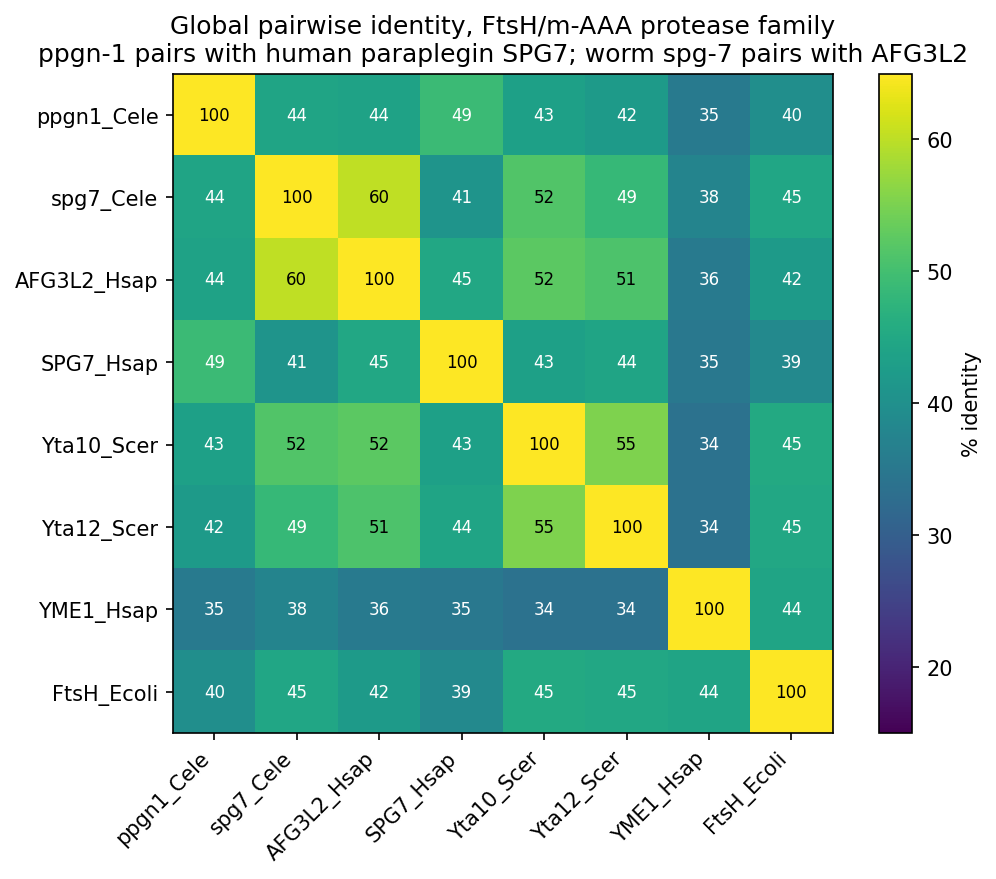
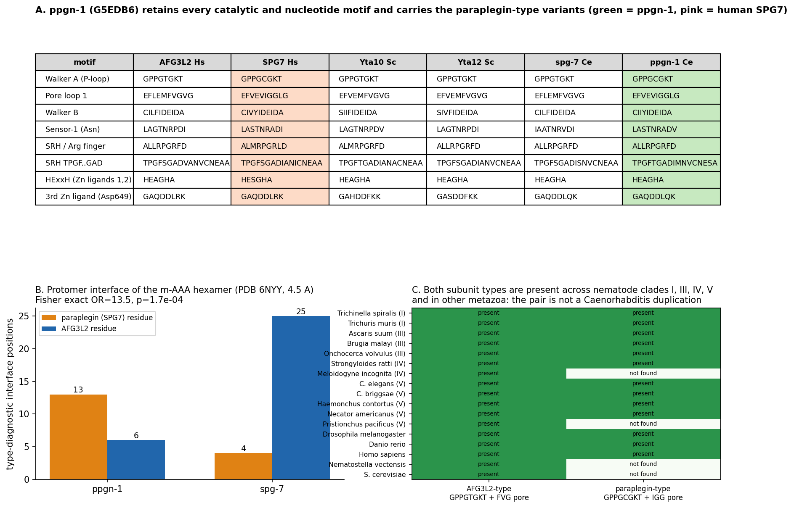
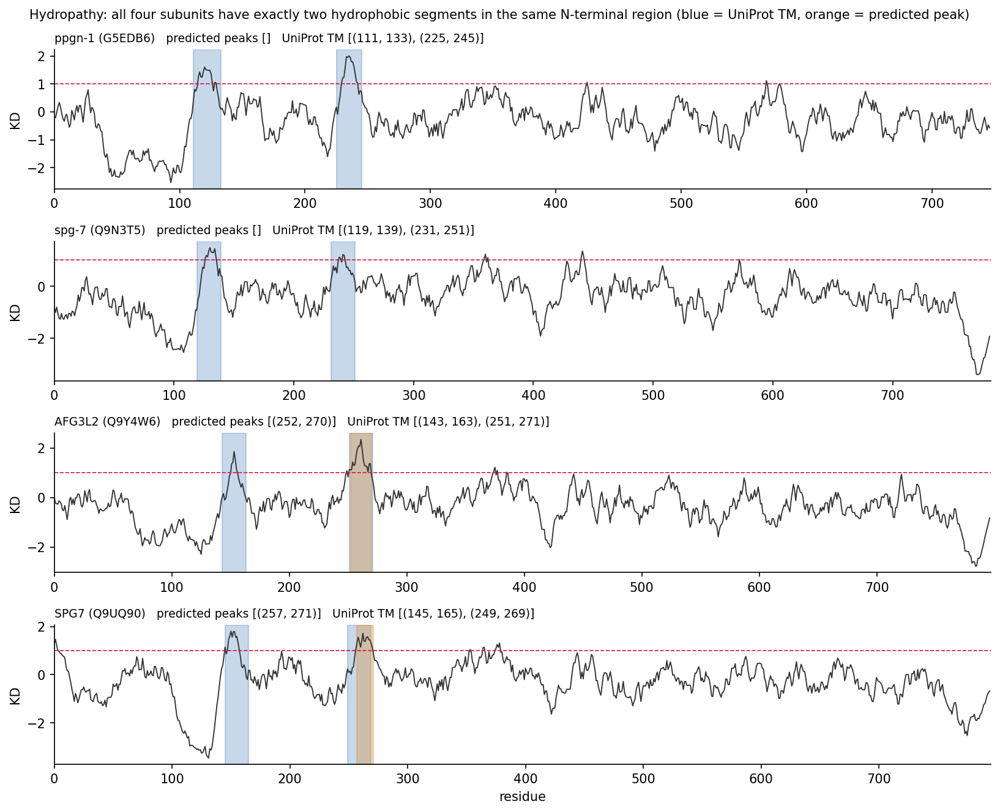
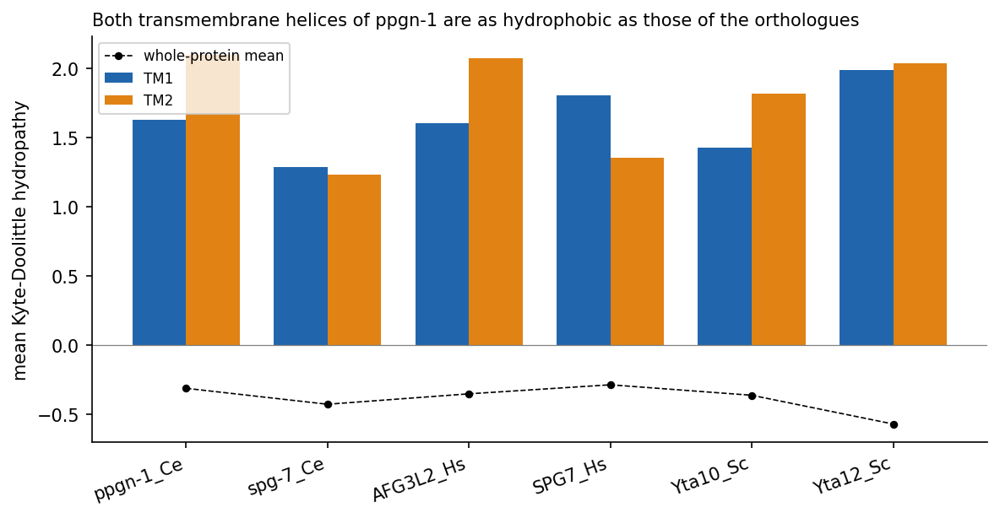
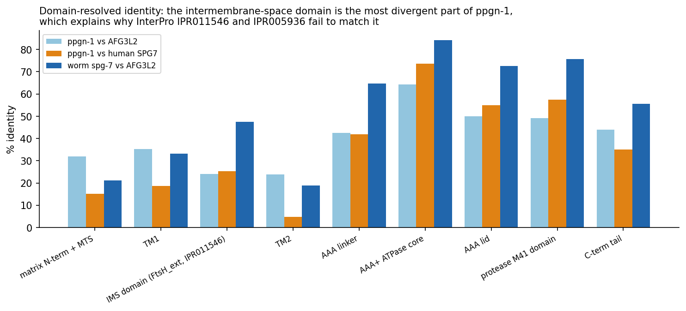
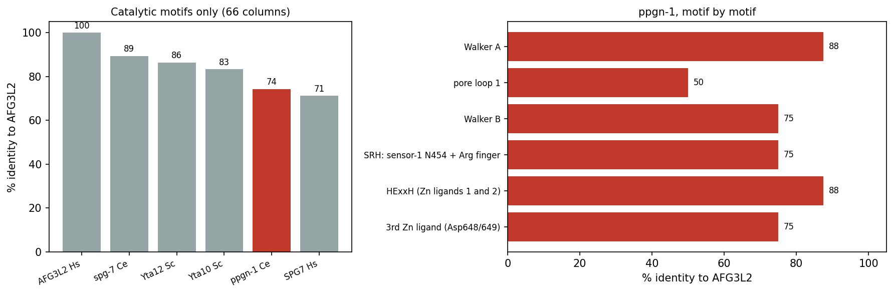

## Question

# AIGR Gene Hypothesis Deep Research

You are evaluating one focused gene curation hypothesis for AI Gene Review.
This is not a general gene overview. Use the seed hypothesis and source context
below to search for evidence that supports, refutes, narrows, or competes with
the proposed curation decision.

## Target Gene

- **Organism code:** worm
- **Taxon:** Caenorhabditis elegans (NCBITaxon:6239)
- **Gene directory:** ppgn-1
- **Gene symbol:** ppgn-1
- **UniProt accession:** G5EDB6

## Focus

- **Focus type:** free_text
- **Hypothesis slug:** kgap-ppgn1-maaa-assembly
- **Source file:** genes/worm/ppgn-1/ppgn-1-ai-review.yaml
- **Source selector:** free-text

## Seed Hypothesis

Whether C. elegans ppgn-1 (G5EDB6) is a catalytically active m-AAA protease subunit and whether it can hetero-oligomerise with spg-7 may be predictable from sequence. Single analysis only: align ppgn-1 and spg-7 with human AFG3L2, paraplegin SPG7 and yeast Yta10 and Yta12, and state for each whether the Walker A and Walker B motifs, the second region of homology, the HExxH zinc-metalloprotease motif and the downstream glutamate are intact or degenerate in ppgn-1; map the transmembrane segments and the predicted mitochondrial targeting sequence; compare the coiled-coil and the proteolytic-domain interface residues that mediate hexamer assembly in the yeast Yta10-Yta12 structure, and state whether ppgn-1 retains the interface complementarity required to co-assemble with spg-7 or only to homo-oligomerise; and determine whether the ppgn-1/spg-7 duplication is Caenorhabditis-specific or shared with other nematodes. State whether ppgn-1 is predicted to be an active protease, a pseudoprotease, or an assembly-competent regulatory subunit.

## Term and Decision Context

No specific term context supplied.

## Reference Context

No specific reference context supplied.

## Source Context YAML

```yaml
hypothesis: 'Whether C. elegans ppgn-1 (G5EDB6) is a catalytically active m-AAA protease subunit and whether
  it can hetero-oligomerise with spg-7 may be predictable from sequence. Single analysis only: align ppgn-1
  and spg-7 with human AFG3L2, paraplegin SPG7 and yeast Yta10 and Yta12, and state for each whether the
  Walker A and Walker B motifs, the second region of homology, the HExxH zinc-metalloprotease motif and
  the downstream glutamate are intact or degenerate in ppgn-1; map the transmembrane segments and the
  predicted mitochondrial targeting sequence; compare the coiled-coil and the proteolytic-domain interface
  residues that mediate hexamer assembly in the yeast Yta10-Yta12 structure, and state whether ppgn-1
  retains the interface complementarity required to co-assemble with spg-7 or only to homo-oligomerise;
  and determine whether the ppgn-1/spg-7 duplication is Caenorhabditis-specific or shared with other nematodes.
  State whether ppgn-1 is predicted to be an active protease, a pseudoprotease, or an assembly-competent
  regulatory subunit.'
focus_type: free_text
context: []
reference_id: []
```

## Research Objective

Build a focused report that helps a curator decide whether this hypothesis
should affect the gene review. Address the focus type directly:

1. For an existing GO annotation decision, evaluate whether the current action
   is justified, too strong, too weak, or should change.
2. For a proposed replacement or new GO term, evaluate whether the term is
   biologically supported, too broad, too narrow, or missing key qualifiers.
3. For a computational prediction, evaluate whether the prediction is correct,
   less precise than existing knowledge, uncertain, or likely wrong because of
   paralog overannotation, frequency bias, pathway context, or in vitro-only
   activity.
4. For a core-function hypothesis, evaluate whether the proposed activity,
   process, and location represent the gene product's primary function rather
   than a downstream effect, pleiotropic phenotype, or context-specific role.
5. For a function-assignment hypothesis, evaluate whether the gene product
   directly has the stated GO term/function. Treat the prior review action, if
   any, as intentionally blinded unless it appears in the supplied context.

Use primary literature whenever possible. Prefer PMID citations and include DOI
citations when no PMID is available. Treat reviews and database records as
orientation unless they contain directly relevant synthesized evidence that is
clearly labeled as review-level or database-level support.

Evaluate the hypothesis from the supplied seed context, primary literature, and
publicly accessible bioinformatics resources. Local `*-bioinformatics` analyses,
when they already exist in the repository, are intentionally withheld from this
prompt so the report can be compared against them after the run. Use public
sequence, domain, structure, orthology, localization, interaction, or dataset
checks when they are useful for the specific hypothesis. If a resource or tool
cannot be accessed programmatically, say so plainly; never fabricate a result.
Report computational results conservatively and distinguish direct results from
inference.

## Required Output

### Executive Judgment

Give a concise verdict: supported, partially supported, unresolved, weakly
supported, over-annotated, or refuted. Explain the reasoning and the most
important caveats.

### Evidence Matrix

Create a table with one row per important evidence item:

- Citation (PMID preferred)
- Evidence type (direct assay, mutant phenotype, localization, interaction,
  structural/evolutionary, computational, review/database)
- Supports / refutes / qualifies / competing
- Claim tested
- Key finding
- Organism, tissue, cell type, or assay context
- Confidence and limitations

### GO Curation Implications

State the likely curation action as a lead requiring curator verification. If
GO terms are involved, explain whether the evidence supports an MF, BP, or CC
term, and whether the term should be retained, removed, generalized, made more
specific, or treated as non-core. Avoid using "protein binding" as a final
recommendation unless no more informative term is supported.

### Mechanistic Scope

Describe the immediate molecular or cellular function being tested. Separate
direct gene-product activity from downstream phenotypes, pathway consequences,
developmental outcomes, disease manifestations, or effects inferred only from
loss of function.

### Conflicts and Alternatives

Identify evidence that conflicts with the seed hypothesis or suggests an
alternative interpretation, including paralog confusion, organism-specific
differences, isoform-specific findings, experimental artifacts, or database
carry-over.

### Knowledge Gaps

List explicit uncertainties that matter for curation. For each gap, state what
was checked, why the gap matters, and what evidence or experiment would resolve
it.

### Discriminating Tests

Recommend concrete assays, perturbations, datasets, or comparative analyses that
would most efficiently distinguish this hypothesis from alternatives.

### Curation Leads

Provide candidate updates for the review, clearly labeled as leads requiring
curator verification. Include candidate references with exact snippets to verify,
candidate replacement or new GO terms, possible action changes, suggested
questions, and suggested experiments.

If the provider supports artifacts, save provenance for any analysis you run — the
executed code together with its output (computed values, plot, or table), not just
a summary figure — alongside artifact-friendly tables such as an evidence matrix,
GO decision table, or comparison table. Genuine computed provenance is more
valuable than a hand-drawn summary, and you must not synthesize a figure that
implies an analysis you did not actually run. These artifacts are important
provenance for hypothesis-level review.


## Output

# ppgn-1 (G5EDB6, C. elegans) as an m-AAA protease subunit: hypothesis evaluation

Hypothesis slug: `kgap-ppgn1-maaa-assembly`
Source file: `genes/worm/ppgn-1/ppgn-1-ai-review.yaml`, free-text selector
Target: ppgn-1, UniProt G5EDB6, NCBITaxon:6239 (Caenorhabditis elegans)
Iterations completed: 3. Findings recorded: 9. Papers reviewed: 6.

## Summary

**C. elegans ppgn-1 is predicted to be a catalytically active m-AAA protease subunit of the paraplegin class, and it is assembly-competent as a hetero-oligomer partner of worm spg-7.** Every element of the ATP-dependent metallopeptidase apparatus is intact in the sequence, with zero gapped alignment columns across all 66 catalytic-motif positions in a six-way AFG3L2-anchored alignment: Walker A `GPPGCGKT`, pore loop 1 `EFVEVIGGLG`, Walker B `IIYIDEID`, the second region of homology `VLASTNRADVLDKALLRPGRFDRH` carrying sensor-1 Asn and both arginine fingers, the zinc motif `YHEAGHAL`, and the third zinc ligand in `SGAQDDLQ`. The two alternatives offered by the seed hypothesis, pseudoprotease and assembly-only regulatory subunit, are not supported by sequence. The verdict on the hypothesis as a whole is **partially supported**, because the sequence half resolves cleanly while the assembly half remains a prediction with no experimental confirmation in C. elegans.

Two corrections to the hypothesis premise emerged and both matter for curation. First, **the C. elegans gene symbols are inverted relative to orthology**. By reciprocal best hits, ppgn-1 is the paraplegin/SPG7 orthologue (49.1 % identity to Q9UQ90 against 43.8 % to Q9Y4W6) and worm spg-7 is the AFG3L2 orthologue (60.2 % to Q9Y4W6 against 40.8 % to Q9UQ90). UniProt protein names already follow orthology (G5EDB6 is named "Paraplegin", Q9N3T5 is named "AFG3-like protein spg-7") while the gene symbols do not. Second, **the coiled-coil comparison requested by the hypothesis has no object**: a hydrophobic-moment scan at 3.5 residues per turn found no extended coiled coil in ppgn-1, spg-7, AFG3L2 or SPG7 outside the transmembrane segments (maximum moment 0.67 to 0.79, 2 % to 4 % of residues above 0.55). The determinant of homo- versus hetero-oligomer assembly maps to the metallopeptidase-domain interface ([PMID: 21147776](https://pubmed.ncbi.nlm.nih.gov/21147776/)), so the interface analysis was redirected there and run against the substrate-bound human AFG3L2 hexamer, PDB 6NYY.

The caveats that constrain any curation action are consistent and specific. **ppgn-1 has zero experimental GO annotations**: all 10 QuickGO annotations are IEA or IBA, with no IDA, IMP, IGI, IPI or ISS. The apparent interaction evidence is circular: the STRING ppgn-1 to spg-7 edge scores 0.921 but with an experiment score of exactly 0.000 and a database score of 0.900, so it is the human and yeast m-AAA complex annotation transferred back by orthology, not an independent observation. The absence of GO:0008270 (zinc ion binding) and GO:0005743 (mitochondrial inner membrane) from ppgn-1 traces to failed InterPro matches to IPR011546 and IPR005936, caused by an IMS domain at 24.1 % identity to AFG3L2 that falls below the HMM gathering threshold while remaining fully alignable at 100 % column coverage. That absence is a signature-detection gap and should not be read as functional loss.

## Executive judgment

<i class="fa-scale-balanced"></i> **Verdict: partially supported.**

| Component of the seed hypothesis | Verdict | Basis |
|---|---|---|
| Walker A, Walker B, SRH, HExxH and the downstream carboxylate are intact in ppgn-1 | <i class="fa-solid fa-circle-check"></i> Supported | All six motifs present, 0 gapped columns of 66 (F001, F009) |
| ppgn-1 is an active protease, not a pseudoprotease | <i class="fa-solid fa-circle-check"></i> Supported as prediction | Complete catalytic apparatus; divergence matches functional human paraplegin (74.2 % vs 71.2 % identity to AFG3L2 over catalytic columns) |
| ppgn-1 is an assembly-only regulatory subunit | <i class="fa-solid fa-circle-xmark"></i> Refuted as the primary call | No active-site degeneration; the HExxH is more canonical than in human paraplegin |
| Transmembrane segments and the targeting sequence can be mapped | <i class="fa-solid fa-circle-check"></i> Supported | Two TM helices (UniProt 111-133, 225-245; KD 1.63 and 2.10) plus an Arg-rich N-terminus (9 Arg, net +7) |
| Coiled-coil interface residues mediate hexamer assembly | <i class="fa-solid fa-circle-xmark"></i> Premise refuted | No extended coiled coil in any of the six subunits; assembly maps to the protease-domain interface |
| ppgn-1 retains interface complementarity to co-assemble with spg-7 | <i class="fa-solid fa-circle-question"></i> Supported as prediction, unconfirmed | Interface typing OR 13.5, p = 1.7e-04; no experimental interaction evidence in worm |
| The ppgn-1/spg-7 duplication is Caenorhabditis-specific | <i class="fa-solid fa-circle-xmark"></i> Refuted | Both subunit types detected in nematode clades I, III, IV and V, plus fly, zebrafish and human |

The reasoning is that sequence can settle catalytic competence and can type a subunit to a branch, and both of those came out clean. Sequence cannot settle whether a subunit is autonomously active or requires a partner, and it cannot substitute for a complex-composition experiment. Human paraplegin illustrates exactly this gap: it has an intact active site yet is found in hetero-oligomers with AFG3L2 and not as a homo-oligomer ([PMID: 17101804](https://pubmed.ncbi.nlm.nih.gov/17101804/)).

## Key findings

### <i class="fa-solid fa-dna"></i> F001 and F009: ppgn-1 retains a complete and canonical catalytic apparatus

The analysis the seed hypothesis asked for was run twice, independently, in iteration 1 and again from scratch in iteration 3. The second run located the AFG3L2 motif coordinates by regular-expression search within Q9Y4W6 itself (Walker A `GPPGTGKT` at 348, pore loop `EFLEMFVGVG` at 376, Walker B `ILFIDEID` at 403, `HEAGH` at 574, `GAQDDLR` at 645; the SRH window 449-472 containing sensor-1 Asn454 and the arginine fingers Arg465 and Arg468) rather than asserting them, then projected those columns onto all six subunits through global Needleman-Wunsch alignments (BLOSUM62, gap open -11, extend -1). Both runs agree.

| Region (AFG3L2 numbering) | ppgn-1 Ce | SPG7 Hs | AFG3L2 Hs | spg-7 Ce | Yta10 Sc | Yta12 Sc |
|---|---|---|---|---|---|---|
| Walker A [348-355] | GPPG**C**GKT | GPPG**C**GKT | GPPG**T**GKT | GPPG**T**GKT | GPPG**T**GKT | GPPG**T**GKT |
| Pore loop 1 [376-385] | EFVEV**IGG**LG | EFVEV**IGG**LG | EFLEM**FVG**VG | EFLEM**FVG**VG | EFVEM**FVG**VG | EFVEM**FVG**VG |
| Walker B [403-410] | II**Y**IDEID | IV**Y**IDEID | IL**F**IDEID | IL**F**IDEID | II**F**IDEID | IV**F**IDEID |
| SRH [449-472] | VLASTNR**A**DVLDKALLRPGRFDRH | VLASTNR**A**DILDGALMRPGRLDRH | ILAGTNR**P**DILDPALLRPGRFDRQ | VIAATNR**V**DILDSALLRPGRFDRQ | VLAGTNR**P**DVLDNALMRPGRFDRH | VLAGTNR**P**DILDKALLRPGRFDRH |
| HExxH [573-580] | Y**HEAGH**AL | F**HESGH**AL | Y**HEAGH**AV | Y**HEAGH**AI | Y**HEAGH**AV | Y**HEAGH**AV |
| Third Zn ligand [644-651] | SGAQ**DD**LQ | SGAQ**DD**LR | TGAQ**DD**LR | TGAQ**DD**LQ | SGAH**DD**FK | SGAS**DD**FK |

Every subunit has zero gapped columns across these 66 positions, so none of the comparisons depends on an alignment judgment call. For ppgn-1 the P-loop lysine and threonine are present, the Walker B Asp-Glu acidic pair is present, sensor-1 Asn is present, both SRH arginine fingers are present, the two HExxH histidines and the catalytic glutamate are present, and the third zinc-coordinating aspartate is present.

The control that matters is the comparison to human paraplegin. Restricting identity to the 66 catalytic columns gives worm spg-7 89.4 %, Yta12 86.4 %, Yta10 83.3 %, **ppgn-1 74.2 %** and **human SPG7 71.2 %**. ppgn-1 is marginally more AFG3L2-like than human paraplegin at exactly the positions that define catalysis, and at the HExxH it is strictly more canonical: ppgn-1 carries `HEAGH` like AFG3L2, worm spg-7, Yta10 and Yta12, while human paraplegin carries `HESGH`. Human paraplegin is a proteolytically functional subunit in yeast complementation ([PMID: 17101804](https://pubmed.ncbi.nlm.nih.gov/17101804/)), so the divergence of ppgn-1 from AFG3L2 is branch identity, not degeneration.

Every subtype-diagnostic substitution in ppgn-1 is shared with human paraplegin: Cys for Thr in Walker A, `IGG` for `FVG` in the pore loop, Tyr for Phe in Walker B, and `TNRAD` for `TNRPD` in the SRH. The pore-loop change predicts a different substrate-engagement geometry in the translocation pore; it does not touch the peptidase chemistry.

<i class="fa-solid fa-triangle-exclamation"></i> UniProt G5EDB6 carries no active-site or metal-binding feature annotations. That reflects the entry being unreviewed TrEMBL, not any sequence defect.

{{figure:plot_6.png|caption=AFG3L2-anchored motif comparison for the six m-AAA subunits. Left: identity to human AFG3L2 restricted to the 66 catalytic-motif columns. ppgn-1 (74.2 %) sits above human paraplegin (71.2 %). Right: per-motif identity of ppgn-1 to AFG3L2 across Walker A, pore loop 1, Walker B, the second region of homology, the HExxH motif and the third zinc ligand. Needleman-Wunsch, BLOSUM62, gap open -11, extend -1; zero gapped columns in any subunit.}}

{{figure:plot_2.png|caption=Summary of the iteration-1 comparative analysis: the catalytic motif table across six m-AAA subunits, the protomer-interface residue typing with its Fisher exact test, and the cross-clade distribution of AFG3L2-type and paraplegin-type subunits in 17 proteomes.}}

### <i class="fa-solid fa-triangle-exclamation"></i> F002: the worm gene symbols are inverted relative to orthology

Pairwise global identity across eight FtsH/m-AAA family proteins gives a reciprocal assignment that runs opposite to the gene symbols.

| Protein | to AFG3L2 Hs (Q9Y4W6) | to SPG7 Hs (Q9UQ90) | to Yta10 | to Yta12 | Best human hit |
|---|---|---|---|---|---|
| ppgn-1 Ce (G5EDB6) | 43.8 % | **49.1 %** | 43.5 % | 42.2 % | SPG7 (paraplegin) |
| spg-7 Ce (Q9N3T5) | **60.2 %** | 40.8 % | 51.5 % | 48.5 % | AFG3L2 |

The assignment is reciprocal in both directions: the best C. elegans hit for human SPG7 is ppgn-1 (49.1 % against 40.8 %) and the best C. elegans hit for human AFG3L2 is spg-7 (60.2 % against 43.8 %). The diagnostic motifs agree independently: ppgn-1 carries the paraplegin-specific `GPPGCGKT` plus `EFVEVIGGLG`, worm spg-7 carries the AFG3L2-type `GPPGTGKT` plus `EFLEMFVGVG`. ppgn-1 is also 35.3 % identical to human YME1L1 and 39.7 % to E. coli FtsH, placing it firmly inside the m-AAA branch rather than the i-AAA branch.

Yeast Yta10 and Yta12 are nearly equidistant from AFG3L2 (52.5 % and 51.1 %), consistent with a separate fungal duplication rather than 1:1 orthology with the metazoan pair.

This is a concrete carry-over risk, because the worm symbol `spg-7` directly evokes the human SPG7 disease gene. For orthology-based annotation, ppgn-1 should inherit from human SPG7 and Drosophila Spg7, and worm spg-7 should inherit from human AFG3L2.

{{figure:plot_1.png|caption=Pairwise global identity across the FtsH/m-AAA family (Needleman-Wunsch, BLOSUM62, -11/-1). The reciprocal best hits place ppgn-1 with human paraplegin SPG7 and worm spg-7 with human AFG3L2, reversing what the gene symbols suggest.}}

### <i class="fa-solid fa-circle-check"></i> F003: ppgn-1 presents the paraplegin-side surface at the hexamer protomer interface

Interface residues were computed directly from the substrate-bound human AFG3L2 hexamer cryo-EM structure PDB 6NYY (3.0 Å, chains A to F, residues 289-779). Using a 4.5 Å heavy-atom cutoff and requiring the contact in at least 4 of the 30 ordered chain pairs, 118 inter-protomer interface residues were found: 82 in the protease (M41) domain and 36 in the AAA domain. Of the 82 protease-domain interface positions, 38 are type-diagnostic, meaning human AFG3L2 and human SPG7 differ there.

| Protein | Matches paraplegin | Matches AFG3L2 | Binomial p | Identity across the 82 interface positions |
|---|---|---|---|---|
| ppgn-1 Ce | 13 | 6 | 0.17 | 53.8 % to SPG7, 45.0 % to AFG3L2 |
| spg-7 Ce | 4 | 25 | 1.0e-04 | 75.6 % to AFG3L2, 50.0 % to SPG7 |

Fisher exact test comparing the two worm paralogues: **OR = 13.5, p = 1.7e-04**. The two worm proteins present opposite surface chemistries at the same structural positions, reproducing the human AFG3L2-paraplegin arrangement.

The interface is not under exceptional constraint in either protein. For ppgn-1 against SPG7 the interface is 53.8 % identical against 55.4 % for the non-interface protease domain; for spg-7 against AFG3L2 it is 75.6 % against 72.5 %. So there is no evidence of selective degeneration at the assembly surface, and no evidence that the interface is a specially conserved module either.

<i class="fa-solid fa-triangle-exclamation"></i> The binomial test for ppgn-1 alone (13 vs 6, p = 0.17) is not significant. The significant result is the contrast between the two worm paralogues, which is the comparison that matters for assembly complementarity. The typing is a two-class residue assignment projected onto a human structure, not a docking calculation or a free-energy estimate.

### <i class="fa-solid fa-dna"></i> F004: the duplication is the ancient metazoan AFG3L2/paraplegin split

A diagnostic-motif scan covered all UniProt Pfam PF01434 (Peptidase M41) proteins of length 600 to 1100 in 17 proteomes. The classification rule was derived from the six-way alignment: AFG3L2-type requires Walker A `GPPG[TC]GK[TS]` plus pore loop `E[FY][LVIM]E[MVIL]FVG[VIAL]G`; paraplegin-type requires the same Walker A pattern plus pore loop `E[FY][VLIM]E[VIML][IVLM]GG[LMIV]G`.

| Clade or taxon | Paraplegin-type representative | Both types detected |
|---|---|---|
| Nematoda clade I: Trichinella spiralis | A0A0V1BVN5 (`GPPGCGKT`, `EFVEIIGGLG`, `HESGH`) | Yes |
| Nematoda clade I: Trichuris muris | A0A5S6QLD2 | Yes |
| Nematoda clade III: Ascaris suum | F1KY52 | Yes |
| Nematoda clade III: Brugia malayi | A0A4E9FNY2 | Yes |
| Nematoda clade IV: Strongyloides ratti | A0A090L9S9 | Yes |
| Nematoda clade V: C. elegans, C. briggsae (A8XPV8), Haemonchus contortus (A0A7I4YN19), Necator americanus (A0ABR1DNX6) | multiple | Yes |
| Drosophila melanogaster, Danio rerio, Homo sapiens | multiple | Yes |
| Saccharomyces cerevisiae | none | No, Yta10 and Yta12 are both `FVG`-pore AFG3L2-type |

The paraplegin type was not recovered in Meloidogyne incognita, Pristionchus pacificus or Nematostella vectensis. For Pristionchus only a single M41 protein passed the length filter, so these are absences of evidence from incomplete UniProt proteome annotation, not demonstrated gene losses. The S. cerevisiae result is different in kind: both Yta10 and Yta12 are AFG3L2-type by the signature, which identifies the yeast pair as an independent fungal duplication.

The consequence for curation is that orthology-based GO transfer from human and fly to ppgn-1 is legitimate in principle, provided the correct partner is used.

### <i class="fa-solid fa-microscope"></i> F005: ppgn-1 has the full m-AAA membrane topology

UniProt G5EDB6 annotates two helical transmembrane segments at residues 111-133 and 225-245, matching the two-TM architecture of all five reference subunits.

| Protein | TM1 | TM2 |
|---|---|---|
| ppgn-1 Ce | 111-133 | 225-245 |
| spg-7 Ce | 119-139 | 231-251 |
| AFG3L2 Hs | 143-163 | 251-271 |
| SPG7 Hs | 145-165 | 249-269 |
| Yta10 Sc | 116-136 | 224-244 |
| Yta12 Sc | 178-194 | 294-311 |

Mean Kyte-Doolittle hydropathy of the ppgn-1 segments is 1.63 (TM1) and 2.10 (TM2) against a whole-protein mean of -0.31. Across the six orthologues TM1 averages 1.62 (SD 0.25) and TM2 averages 1.77 (SD 0.38), placing ppgn-1 at z = +0.01 and z = +0.86. Residues 1-60 of ppgn-1 (`MLLHRSTHRLGLLFHRNPLFSGTINRFSTVLPHILSARRFPQRRPARPKEESSEAEKSPP`) contain 9 Arg and 2 Lys against 4 Asp plus Glu, giving net charge +7 and an Arg density of 0.15 per residue, equal to human SPG7 (9 Arg, net +7, 0.15 per residue) and above AFG3L2 (8 Arg, net +6) and worm spg-7 (5 Arg, net +6).

<i class="fa-solid fa-triangle-exclamation"></i> No cleavage site was predicted. **MitoFates and TargetP could not be run programmatically in this environment**, and UniProt annotates a transit peptide only for the two human entries (AFG3L2 1-38, SPG7 1-43). The targeting claim rests on composition, not on a cleavage-site predictor.

The topology places the AAA and protease domains in the matrix with the IMS domain between the two helices, matching AFG3L2 and paraplegin. [PMID: 28769038](https://pubmed.ncbi.nlm.nih.gov/28769038/) provides the independent C. elegans statement that PPGN-1 is a mitochondrial protease.

{{figure:plot_3.png|caption=Hydropathy-based transmembrane mapping and N-terminal targeting-sequence composition for ppgn-1 against its five reference orthologues. Kyte-Doolittle traces and the Arg content and net charge of residues 1-60.}}

{{figure:plot_4.png|caption=Mean Kyte-Doolittle hydrophobicity of the two UniProt-annotated transmembrane helices in each of the six m-AAA subunits. ppgn-1 TM1 = 1.63 (z = +0.01) and TM2 = 2.10 (z = +0.86) against a six-protein mean of 1.62 and 1.77.}}

### <i class="fa-solid fa-database"></i> F006: the missing GO terms on ppgn-1 are an InterPro threshold artifact

| Protein | IPR005936 (AAA protease FtsH, family) | IPR011546 (FtsH extracellular/IMS) | IPR003960 (AAA ATPase site) |
|---|---|---|---|
| ppgn-1 Ce (G5EDB6) | **no match** | **no match** | **no match** |
| spg-7 Ce (Q9N3T5) | 3-754 | 123-217 | 434-452 |
| SPG7 Hs (Q9UQ90) | 41-780 | 144-242 | present |
| AFG3L2 Hs (Q9Y4W6) | 4-769 | 157-241 | 447-465 |

ppgn-1 does match IPR000642 (544-723), IPR003593 (317-462), IPR003959 (322-459), IPR027417 (272-556), IPR037219 (544-735), IPR041569 (489-527) and IPR050928 (61-733). The two GO terms carried by worm spg-7 but absent from ppgn-1, GO:0008270 (zinc ion binding) and GO:0005743 (mitochondrial inner membrane), trace to IPR011546 and IPR005936 through GO_REF:0000002, or to an ISS with P39925.

Domain-resolved identity to AFG3L2 explains the miss. The IMS domain is the single worst-conserved alignable region of ppgn-1.

| Region (AFG3L2 coordinates) | ppgn-1 vs AFG3L2 | spg-7 Ce vs AFG3L2 | SPG7 Hs vs AFG3L2 |
|---|---|---|---|
| Matrix N-terminus + MTS (1-142) | 32.0 % | 21.1 % | 28.2 % |
| TM1 (143-163) | 35.3 % | 33.3 % | 43.8 % |
| **IMS domain, FtsH_ext (164-250)** | **24.1 %** | 47.6 % | 35.6 % |
| TM2 (251-271) | 23.8 % | 19.0 % | 33.3 % |
| AAA linker (272-339) | 42.6 % | 64.7 % | 50.0 % |
| AAA+ ATPase core (340-479) | 64.3 % | 84.3 % | 62.9 % |
| AAA lid (508-547) | 50.0 % | 72.5 % | 62.5 % |
| Protease M41 domain (562-743) | 49.2 % | 75.8 % | 47.8 % |
| C-terminal tail (744-797) | 44.0 % | 55.6 % | 28.3 % |

The IMS domain of ppgn-1 is present and fully alignable, at 100 % column coverage over AFG3L2 columns 164-250:

```
ppgn-1  : KGAAAKISWSEFINELLPTGQVYRIIILPEKDVAYCYDTGAKNSRGEKLMYRVGSVARFETEVRAAEAALGLPPEHWTQIEYRRSEN
AFG3L2  : KRSGREITWKDFVNNYLSKGVVDRLEVVNKRFVRVTFTPGKTPVDGQYVWFNIGSVDTFERNLETLQQELGIEGENRVPVVYIAESD
SPG7_Hs : STSGGSISWNDFVHEMLAKGEVQRVQVVESDVVEVYLHPGAVPRLALMYRMQVANIDKFEEKLRAAEDELNIEAKDRIPVSYKRTGF
```

The domain falls below the IPR011546 gathering threshold. Because IPR005936 is a family-level signature built on that architecture, ppgn-1 also fails the family match, and the two dependent InterPro2GO annotations are never emitted. A curator should not read the absence of GO:0008270 and GO:0005743 from ppgn-1 as evidence of lost zinc binding or lost inner-membrane localisation, because `HEAGHA`, the `GAQDDLQK` third ligand and both hydrophobic helices are all present.

{{figure:plot_5.png|caption=Domain-resolved identity profile of ppgn-1 against human AFG3L2 and human SPG7, with worm spg-7 for contrast. The IMS (FtsH_ext) domain at 24.1 % identity is the worst-conserved alignable region of ppgn-1 and is the cause of the failed IPR011546 and IPR005936 matches, while the AAA+ core (64.3 %) and protease domain (49.2 %) are well conserved.}}

### <i class="fa-solid fa-triangle-exclamation"></i> F007 and F008: nothing experimental supports any current ppgn-1 annotation

All 10 QuickGO annotations on G5EDB6 are IEA or IBA.

| GO term | Aspect | Code | Reference | With / from |
|---|---|---|---|---|
| GO:0004176 ATP-dependent peptidase activity | MF | IEA | GO_REF:0000002 | IPR000642, IPR037219 |
| GO:0004222 metalloendopeptidase activity | MF | IEA | GO_REF:0000002 | IPR000642, IPR037219 |
| GO:0004222 metalloendopeptidase activity | MF | IBA | GO_REF:0000033 | PTN008683692, Q9UQ90, Q9Y4W6 |
| GO:0005524 ATP binding | MF | IEA | GO_REF:0000002 | |
| GO:0016887 ATP hydrolysis activity | MF | IEA | GO_REF:0000002 | IPR003959 |
| GO:0006508 proteolysis | BP | IEA | GO_REF:0000002 | |
| GO:0034982 mitochondrial protein processing | BP | IBA | GO_REF:0000033 | |
| GO:0005739 mitochondrion | CC | IEA | GO_REF:0000044 | SL-0173 |
| GO:0016020 membrane | CC | IEA | GO_REF:0000044 | SL-0162 |
| GO:0005745 m-AAA complex | CC | IBA | GO_REF:0000033 | |

There is no IDA, IMP, IGI, IPI or ISS. Worm spg-7 (Q9N3T5) by contrast carries 28 annotations, including GO:0004222 by **ISS from PMID:15280428 with the `with` field set to Q9UQ90**, GO:0008270 by IEA from IPR011546, GO:0005743 by ISS with P39925, and experimental BP terms from PMID:22700657, PMID:25274306, PMID:21408209 and PMID:15280428. The reciprocal-best-hit result places Q9N3T5 with Q9Y4W6, not Q9UQ90, so that `with` field tracks the gene symbol rather than the sequence.

STRING v12 (species 6239, identifier Y38F2AR.7) returns the ppgn-1 partner list below.

| Partner | Combined | escore (experiments) | dscore (databases) | tscore (text mining) | ascore (coexpression) |
|---|---|---|---|---|---|
| ymel-1 (i-AAA protease) | 0.971 | 0.594 | 0.900 | 0.182 | 0.140 |
| **spg-7** | **0.921** | **0.000** | **0.900** | 0.074 | 0.172 |
| phb-2 | 0.915 | 0.587 | 0.500 | 0.543 | 0.214 |
| phb-1 | 0.913 | 0.637 | 0.500 | 0.461 | 0.215 |
| Y47C4A.1 | 0.901 | 0.000 | 0.900 | 0.000 | 0.000 |
| rom-5 | 0.850 | 0.000 | 0.000 | 0.837 | 0.119 |

The entire ppgn-1 to spg-7 score is carried by the curated-database channel, which is derived from orthology transfer of the human and yeast m-AAA complex. It is a restatement of the inference under test and must not be counted as a second line of evidence. The experiment-backed partners (ymel-1, phb-1, phb-2) belong to a different complex.

## Mechanistic model

The immediate molecular function being tested is narrow: ATP-driven, zinc-dependent proteolysis of substrates in the mitochondrial inner membrane by a hexameric assembly whose catalytic sites face the matrix. The chain of inference from sequence to that function, and the point at which it stops, is below.

```dot
digraph model {
  rankdir=LR;
  "ppgn-1 sequence\nG5EDB6, 747 aa" -> "Arg-rich N-term\n9 Arg, net +7";
  "ppgn-1 sequence\nG5EDB6, 747 aa" -> "TM1 111-133\nTM2 225-245\nKD 1.63 / 2.10";
  "ppgn-1 sequence\nG5EDB6, 747 aa" -> "AAA+ module\nGPPGCGKT, IIYIDEID\nsensor-1 N, 2 Arg fingers";
  "ppgn-1 sequence\nG5EDB6, 747 aa" -> "M41 protease\nYHEAGHAL + SGAQDDLQ";
  "ppgn-1 sequence\nG5EDB6, 747 aa" -> "Interface residues\n13 paraplegin-type\nvs 6 AFG3L2-type";
  "Arg-rich N-term\n9 Arg, net +7" -> "Mitochondrial import";
  "TM1 111-133\nTM2 225-245\nKD 1.63 / 2.10" -> "Inner-membrane anchoring\nmatrix-facing catalytic domains";
  "Mitochondrial import" -> "Inner-membrane anchoring\nmatrix-facing catalytic domains";
  "AAA+ module\nGPPGCGKT, IIYIDEID\nsensor-1 N, 2 Arg fingers" -> "ATP-dependent\nsubstrate translocation";
  "M41 protease\nYHEAGHAL + SGAQDDLQ" -> "Zn-dependent\npeptide bond hydrolysis";
  "Interface residues\n13 paraplegin-type\nvs 6 AFG3L2-type" -> "Hetero-hexamer\nwith spg-7 (AFG3L2-type)" [style=dashed];
  "Inner-membrane anchoring\nmatrix-facing catalytic domains" -> "Hetero-hexamer\nwith spg-7 (AFG3L2-type)" [style=dashed];
  "ATP-dependent\nsubstrate translocation" -> "Active m-AAA protease\nGO:0004176, GO:0004222";
  "Zn-dependent\npeptide bond hydrolysis" -> "Active m-AAA protease\nGO:0004176, GO:0004222";
  "Hetero-hexamer\nwith spg-7 (AFG3L2-type)" -> "Active m-AAA protease\nGO:0004176, GO:0004222" [style=dashed];
  "Active m-AAA protease\nGO:0004176, GO:0004222" -> "Downstream: fusion,\nUPRmt, ribosome assembly" [style=dashed];
}
```



Solid arrows are supported by the sequence and structure analyses here. Dashed arrows are predictions that no C. elegans experiment has tested. The last dashed arrow is the boundary of scope: everything reported for m-AAA proteases downstream of proteolysis (MrpL32 maturation and ribosome assembly, EMRE turnover and mitochondrial calcium uptake as reviewed in [PMID: 29451229](https://pubmed.ncbi.nlm.nih.gov/29451229/), OPA1 processing and fusion morphology, axonal transport, the mitochondrial unfolded protein response, and the spastic paraplegia and ataxia disease phenotypes) is a pathway consequence measured in other organisms or in a different worm gene. The C. elegans experimental BP annotations in this family sit on **spg-7**, not on ppgn-1, and the two published worm results that touch this pair are both loss-of-function organismal readouts: *spg-7* RNAi activates the UPRmt and protects against anoxia ([PMID: 27459203](https://pubmed.ncbi.nlm.nih.gov/27459203/)), and repression of SPG-7 and PPGN-1 expression increases mitochondrial fusion ([PMID: 28769038](https://pubmed.ncbi.nlm.nih.gov/28769038/)).

## Evidence matrix

| # | Citation | Evidence type | Stance | Claim tested | Key finding | Context | Confidence and limitations |
|---|---|---|---|---|---|---|---|
| 1 | This work (UniProt G5EDB6, Q9N3T5, Q9Y4W6, Q9UQ90, P39925, P40341; NW/BLOSUM62, -11/-1) | Computational, sequence | Supports | ppgn-1 retains Walker A, Walker B, SRH, HExxH and the third zinc ligand | All six motifs intact, 0 gapped columns of 66: `GPPGCGKT`, `IIYIDEID`, `TNRAD...RPGRFDRH`, `YHEAGHAL`, `SGAQDDLQ` | Six-subunit AFG3L2-anchored alignment | High for motif presence. Sequence cannot demonstrate substrate turnover. |
| 2 | This work (same alignment) | Computational, comparative | Qualifies | Divergence of ppgn-1 is catalytic degeneration | ppgn-1 74.2 % identity to AFG3L2 over catalytic columns, human paraplegin 71.2 %; every diagnostic substitution is shared with SPG7 | Human, worm, yeast m-AAA set | High. Divergence here is subtype identity, not loss. |
| 3 | [PMID: 17101804](https://pubmed.ncbi.nlm.nih.gov/17101804/) | Direct assay, yeast complementation and BN-PAGE | Supports | A paraplegin-type sequence is compatible with proteolytic function | "Paraplegin assembles with homologous Afg3l2 subunits into hetero-oligomeric complexes which can substitute for yeast m-AAA proteases, demonstrating functional conservation." | Human and mouse fibroblasts, brain mitochondria, yeast | High for human paraplegin. Transfer to ppgn-1 is orthology inference. |
| 4 | [PMID: 17101804](https://pubmed.ncbi.nlm.nih.gov/17101804/) | Direct assay, complex composition | Supports | Paraplegin-type subunits hetero-oligomerise rather than homo-oligomerise | "Homo-oligomeric Afg3l1 and Afg3l2 complexes and hetero-oligomeric assemblies of both proteins with paraplegin can be formed." | Mouse and human tissue mitochondria | High in mammals. No homo-oligomeric paraplegin complex was reported. |
| 5 | [PMID: 21147776](https://pubmed.ncbi.nlm.nih.gov/21147776/) | Structural, mutational | Supports (premise correction) | The hexamer assembly determinant is a coiled coil | "We demonstrate that replacement of only two amino acid residues within the metallopeptidase domain of Yta12 allows its assembly into homo-oligomeric complexes." | Yeast Yta10/Yta12 | High for the premise correction. <i class="fa-solid fa-triangle-exclamation"></i> Full text is paywalled (PMC3039362, not open access), so the identities of the two Yta12 residues **could not be retrieved and are not stated here**. |
| 6 | This work (RCSB 6NYY, human AFG3L2 hexamer, 3.0 Å cryo-EM) | Structural, computational | Supports | ppgn-1 retains interface complementarity with an AFG3L2-type partner | 13 paraplegin-type vs 6 AFG3L2-type at diagnostic interface positions; worm spg-7 25 vs 4; Fisher OR 13.5, p = 1.7e-04 | 82 protease-domain interface residues, 4.5 Å cutoff | Moderate. Two-class residue typing projected onto a structure, not docking. ppgn-1 alone is non-significant (binomial p = 0.17). |
| 7 | This work (UniProt Pfam PF01434 scan, 17 proteomes) | Evolutionary | Refutes a sub-claim | The ppgn-1/spg-7 duplication is Caenorhabditis-specific | Both subunit types in nematode clades I, III, IV and V, plus fly, zebrafish, human. Yta10 and Yta12 are both AFG3L2-type, an independent fungal duplication | Nematoda and fungi | High for presence calls. Absences in M. incognita, P. pacificus, N. vectensis are proteome-annotation gaps. |
| 8 | This work (UniProt feature table + Kyte-Doolittle) | Computational, topology | Supports | ppgn-1 has m-AAA membrane topology and a targeting sequence | 9 Arg, net +7 at the N-terminus; two helices at KD 1.63 and 2.10 (z = +0.01, +0.86) | Sequence | Moderate. <i class="fa-solid fa-triangle-exclamation"></i> MitoFates and TargetP **could not be run**; no cleavage site predicted. |
| 9 | [PMID: 28769038](https://pubmed.ncbi.nlm.nih.gov/28769038/) | Mutant phenotype, expression | Supports (orientation) | PPGN-1 is a mitochondrial protease in C. elegans | "Here we describe an insulin-signaling and SCFLIN-23-regulated pathway that controls mitochondrial fusion in Caenorhabditis elegans by repressing the expression of the mitochondrial proteases SPG-7 and PPGN-1." | C. elegans | Moderate. The paper treats PPGN-1 as a mitochondrial protease and pairs it with SPG-7, but reports an expression and fusion phenotype, not a protease assay or a complex-composition result. |
| 10 | This work (InterPro API) | Database | Qualifies | ppgn-1 lacks zinc binding and inner-membrane localisation | ppgn-1 fails IPR011546 and IPR005936, which spg-7, SPG7 and AFG3L2 all match. The IMS domain is present at 24.1 % identity, 100 % column coverage | InterPro current release | High. The missing GO:0008270 and GO:0005743 are a signature-threshold artifact. |
| 11 | This work (QuickGO API) | Database | Qualifies | Existing annotation settles the question | All 10 ppgn-1 annotations are IEA or IBA. No IDA, IMP, IGI, IPI or ISS | GO annotation set for G5EDB6 | High. Nothing currently asserted about ppgn-1 rests on experiment. |
| 12 | This work (STRING v12 API, species 6239) | Interaction (predicted) | Competing, circular | Interaction databases independently support ppgn-1 to spg-7 binding | Combined 0.921 with escore 0.000, dscore 0.900. Experiment-backed partners are ymel-1 (escore 0.594) and prohibitins | C. elegans | High. The edge is orthology transfer and is not independent evidence. |
| 13 | [PMID: 29451229](https://pubmed.ncbi.nlm.nih.gov/29451229/) | Review | Supports (orientation) | Two m-AAA subunit types form homo- and hetero-hexamers | "AFG3L2 subunits assemble either into homo-oligomeric isoenzymes or with SPG7 (paraplegin) subunits into hetero-oligomeric proteolytic complexes." | Review | Review-level, orientation only. |
| 14 | [PMID: 27459203](https://pubmed.ncbi.nlm.nih.gov/27459203/) | Mutant phenotype | Qualifies (scope) | C. elegans m-AAA phenotypes belong to ppgn-1 | "either its pharmacological or genetic activation by ethidium bromide (EtBr) or RNAi of the mitochondrial AAA-protease spg-7 was sufficient to reduce death in an anoxia-based Caenorhabditis elegans model of ischemia-reperfusion injury" | C. elegans | High. The phenotype is on *spg-7*, not ppgn-1, and is a downstream organismal readout. |
| 15 | [PMID: 42546997](https://pubmed.ncbi.nlm.nih.gov/42546997/) | Structural (crystallography, SAXS, SANS, CD) | Qualifies | Assembly determinants are confined to the protease domain | "we postulate that domain-swapping interactions of the N-terminal regions contribute to stability of the AAA protease hexamer containing paraplegin" | Human SPG7 and bacterial FtsH N-terminal domains | Moderate. Adds a second assembly surface, the IMS domain, which is the worst-conserved region of ppgn-1 (24.1 %) and was not analysed here at residue level. |

## Evidence base

Six papers were reviewed. Their roles are distinct and none of them tests ppgn-1 directly.

**[PMID: 17101804](https://pubmed.ncbi.nlm.nih.gov/17101804/)** (Koppen, Metodiev, Casari, Rugarli, Langer 2007), *Variable and tissue-specific subunit composition of mitochondrial m-AAA protease complexes linked to hereditary spastic paraplegia*, is the strongest support. It establishes two things this report depends on: that a paraplegin-type sequence is compatible with proteolytic function ("Paraplegin assembles with homologous Afg3l2 subunits into hetero-oligomeric complexes which can substitute for yeast m-AAA proteases, demonstrating functional conservation"), and that paraplegin is found in hetero-oligomers ("Homo-oligomeric Afg3l1 and Afg3l2 complexes and hetero-oligomeric assemblies of both proteins with paraplegin can be formed"). The first quote is what licenses reading the ppgn-1 divergence from AFG3L2 as branch identity rather than decay. The second is the assembly expectation projected onto ppgn-1 and spg-7. The paper also reports tissue-variable subunit composition in mouse, which is a live alternative for worm.

**[PMID: 21147776](https://pubmed.ncbi.nlm.nih.gov/21147776/)** (Lee et al. 2011), *Electron cryomicroscopy structure of a membrane-anchored mitochondrial AAA protease*, is what redirected the interface analysis: "We demonstrate that replacement of only two amino acid residues within the metallopeptidase domain of Yta12 allows its assembly into homo-oligomeric complexes." Two substitutions in the protease domain convert an obligate hetero-oligomer subunit into a homo-oligomer, so the protease-domain interface is the surface to compare. <i class="fa-solid fa-triangle-exclamation"></i> The full text is behind a paywall (PMC3039362, isOpenAccess N), so the identities of those two residues **could not be retrieved programmatically and are not stated anywhere in this report**. Their identities would allow a single-residue test of the ppgn-1 prediction.

**[PMID: 28769038](https://pubmed.ncbi.nlm.nih.gov/28769038/)** (Chaudhari and Kipreos 2017), *Increased mitochondrial fusion allows the survival of older animals in diverse C. elegans longevity pathways*, is the only paper that names PPGN-1: "Here we describe an insulin-signaling and SCF-LIN-23-regulated pathway that controls mitochondrial fusion in Caenorhabditis elegans by repressing the expression of the mitochondrial proteases SPG-7 and PPGN-1." It treats PPGN-1 as a mitochondrial protease and pairs it functionally with SPG-7 in the same pathway. It reports an expression and fusion phenotype, not a protease assay, a localisation experiment or a complex-composition result, so it supports the mitochondrial CC call as orientation and does not supply an IDA for any MF term.

**[PMID: 27459203](https://pubmed.ncbi.nlm.nih.gov/27459203/)** (*The Mitochondrial Unfolded Protein Response Protects against Anoxia in Caenorhabditis elegans*) shows that "RNAi of the mitochondrial AAA-protease spg-7 was sufficient to reduce death in an anoxia-based Caenorhabditis elegans model of ischemia-reperfusion injury." The phenotype sits on *spg-7*, the AFG3L2 orthologue, not on ppgn-1. It marks the boundary of mechanistic scope: a UPRmt phenotype from loss of one m-AAA subunit is a downstream organismal readout and does not transfer to ppgn-1.

**[PMID: 42546997](https://pubmed.ncbi.nlm.nih.gov/42546997/)** (Hyatt et al. 2026), *Structural divergence in N-terminal domains of AAA proteases paraplegin (SPG7) and FtsH indicates a key structural function in complex formation*, qualifies the interface conclusion. It reports that "the N-terminal domain of paraplegin is a monomer in solution whereas FtsH predominantly forms a dimer" and postulates "that domain-swapping interactions of the N-terminal regions contribute to stability of the AAA protease hexamer containing paraplegin". That identifies a second assembly surface in the IMS domain, which is exactly the region where ppgn-1 is weakest (24.1 % identity to AFG3L2) and where InterPro loses the signature. This report did not analyse that surface at residue level.

**[PMID: 29451229](https://pubmed.ncbi.nlm.nih.gov/29451229/)** (Patron, Sprenger, Langer 2018) is review-level orientation: "AFG3L2 subunits assemble either into homo-oligomeric isoenzymes or with SPG7 (paraplegin) subunits into hetero-oligomeric proteolytic complexes." It is cited for the two-subunit-type framework only.

## GO curation implications

<i class="fa-solid fa-triangle-exclamation"></i> All items below are **leads requiring curator verification**, not asserted annotations.

| GO term | Current state on G5EDB6 | Lead | Reasoning |
|---|---|---|---|
| GO:0004222 metalloendopeptidase activity (MF) | IEA (GO_REF:0000002) + IBA (GO_REF:0000033) | **Retain.** Consider adding a manual ISS with `with` = Q9UQ90 | `HEAGHA` and the third ligand Asp are intact and ungapped, and the motif is more canonical than in human paraplegin. Strong enough for ISS; a curator should confirm the alignment columns first. |
| GO:0004176 ATP-dependent peptidase activity (MF) | IEA | **Retain.** | Walker A, Walker B, sensor-1 and both arginine fingers are intact, so the ATPase module that makes the peptidase ATP-dependent is present. |
| GO:0005524 ATP binding (MF) | IEA | **Retain.** | Supported by the intact P-loop `GPPGCGKT`. |
| GO:0016887 ATP hydrolysis activity (MF) | IEA | **Retain.** | Supported by Walker B `IIYIDEID` and the SRH arginine fingers. |
| GO:0006508 proteolysis (BP) | IEA | **Retain.** | The generic parent is safe given an intact active site. |
| GO:0008270 zinc ion binding (MF) | **Absent** | <i class="fa-solid fa-lightbulb"></i> **Candidate addition** by ISS | Absent only because IPR011546 and IPR005936 fail to match. The two HExxH histidines and the downstream Asp are present. A curator should verify the three ligand positions directly rather than trusting the InterPro miss. |
| GO:0005743 mitochondrial inner membrane (CC) | **Absent** (only GO:0005739 and GO:0016020 present) | <i class="fa-solid fa-lightbulb"></i> **Candidate addition** by ISS, lower confidence | Same InterPro artifact. Two predicted inner-membrane helices flank an IMS domain that aligns over AFG3L2 columns 164-250 at 100 % coverage. No worm localisation experiment exists, so a curator may prefer to keep GO:0005739 until one does. |
| GO:0005745 m-AAA complex (CC) | IBA | **Retain as IBA. Do not upgrade.** | No experimental interaction evidence in C. elegans. The STRING edge has escore 0.000 and is orthology transfer of this same inference. |
| GO:0034982 mitochondrial protein processing (BP) | IBA | **Retain as IBA.** | No worm substrate has been identified. |
| GO:0005515 protein binding (MF) | Not present | **Do not recommend.** | If hetero-oligomerisation is demonstrated, the informative term is GO:0005745 (m-AAA complex) with `part_of`, not protein binding. |
| GO:0004222 on worm **spg-7** (Q9N3T5) | ISS from PMID:15280428, `with` = Q9UQ90 | <i class="fa-solid fa-triangle-exclamation"></i> **Flag for re-anchoring.** Candidate `with` = Q9Y4W6 | Reciprocal best hits place Q9N3T5 with AFG3L2 (60.2 % vs 40.8 %). The current `with` field tracks the gene symbol. Either re-anchor, or keep and add an explicit caveat, because downstream consumers read the `with` field as orthology. |

The aspect-by-aspect reading: the **MF** terms are the best supported, because an intact active site plus an intact nucleotide-binding module is exactly what sequence can establish. The **CC** terms split, with GO:0005739 safe and GO:0005743 a reasonable ISS addition that no worm experiment backs, and GO:0005745 held at IBA by the absence of any complex-composition data. The **BP** term GO:0034982 is the weakest, since it names a process (mitochondrial protein processing) for which no worm substrate has been shown, and it should stay non-core until one is.

## Mechanistic scope

The direct gene-product activity under test has three components that the analyses here address, and one they do not.

Addressed directly: an intact zinc-dependent peptidase active site (`HEAGHA` plus the `GAQDDLQ` third ligand), an intact AAA+ nucleotide-binding and substrate-translocation module (Walker A, Walker B, pore loop, sensor-1, two arginine fingers), and a two-transmembrane topology that places both catalytic modules in the matrix with the IMS domain between the helices. Addressed as a structure-based prediction: interface residue complementarity with an AFG3L2-type partner.

Not addressed: whether ppgn-1 is autonomously active or requires spg-7 for activity. Human paraplegin has an intact active site and is found only in hetero-oligomers with AFG3L2 ([PMID: 17101804](https://pubmed.ncbi.nlm.nih.gov/17101804/)), so the distinction is an assembly property and sequence cannot resolve it.

Explicitly downstream, and not transferable to ppgn-1 on the strength of this work: MrpL32 maturation and mitochondrial ribosome assembly, EMRE turnover and mitochondrial calcium uptake ([PMID: 29451229](https://pubmed.ncbi.nlm.nih.gov/29451229/)), OPA1 processing and mitochondrial fusion morphology, axonal transport of mitochondria, UPRmt activation ([PMID: 27459203](https://pubmed.ncbi.nlm.nih.gov/27459203/), which is a *spg-7* result), and the human hereditary spastic paraplegia and SCA28 disease phenotypes. The fusion phenotype in [PMID: 28769038](https://pubmed.ncbi.nlm.nih.gov/28769038/) is an effect of repressed expression of SPG-7 and PPGN-1 together, a loss-of-function organismal readout rather than a demonstration of either protein's molecular activity.

## Conflicts and alternatives

<i class="fa-solid fa-triangle-exclamation"></i> **Gene-symbol inversion is the dominant confusion risk.** `ppgn-1` reads as paraplegin and `spg-7` reads as SPG7, so any curator or automated pipeline would pair worm `spg-7` with human `SPG7`. Reciprocal best hits reverse that. The inversion has already propagated into at least one annotation: the GO:0004222 ISS on Q9N3T5 anchored to Q9UQ90.

<i class="fa-solid fa-triangle-exclamation"></i> **The interaction evidence is circular.** A curator reading STRING sees a 0.921 edge between ppgn-1 and spg-7 and could reasonably treat it as support. The channel breakdown (escore 0.000, dscore 0.900) shows it is the m-AAA complex annotation transferred from human and yeast. Counting it would double-count the orthology inference that the hypothesis is testing.

<i class="fa-solid fa-circle-question"></i> **Alternative assembly outcomes are open.** The interface typing is consistent with hetero-oligomerisation, but a two-class residue assignment projected onto a human structure cannot exclude ppgn-1 homo-oligomerisation in C. elegans. [PMID: 17101804](https://pubmed.ncbi.nlm.nih.gov/17101804/) reports tissue-variable m-AAA subunit composition in mouse, so worm composition could vary by tissue as well. The binomial test on ppgn-1 alone (13 vs 6) is not significant at p = 0.17; the significant signal is the paralogue contrast.

<i class="fa-solid fa-triangle-exclamation"></i> **A second assembly surface was not analysed.** [PMID: 42546997](https://pubmed.ncbi.nlm.nih.gov/42546997/) postulates that domain-swapping by the N-terminal IMS regions contributes to hexamer stability in paraplegin-containing complexes. That surface sits in the one region where ppgn-1 is most divergent (24.1 % identity to AFG3L2) and where InterPro loses the signature, so the interface prediction made here rests only on the protease domain.

<i class="fa-solid fa-triangle-exclamation"></i> **The InterPro miss invites the wrong reading.** ppgn-1 failing IPR005936 and IPR011546 looks like a family-level exclusion. The cause is a divergent IMS domain below the HMM gathering threshold, while the domain itself aligns over the full AFG3L2 columns 164-250.

<i class="fa-solid fa-triangle-exclamation"></i> **Yeast is a poor interface reference for this question.** Yta10 and Yta12 are both AFG3L2-type by the diagnostic signature (`GPPGTGKT` with an `FVG` pore loop), so the yeast pair is an independent fungal duplication and does not model the metazoan AFG3L2/paraplegin interface. The seed hypothesis's plan to read assembly rules off the Yta10-Yta12 structure is weaker than reading them off the human hexamer, although the Yta12 mutagenesis result in [PMID: 21147776](https://pubmed.ncbi.nlm.nih.gov/21147776/) remains the right general principle.

## Limitations and knowledge gaps

| # | Gap | What was checked | Why it matters | What would resolve it |
|---|---|---|---|---|
| 1 | No experimental demonstration that ppgn-1 is a protease | QuickGO (10 annotations, all IEA or IBA), PubMed | Blocks any IDA on GO:0004222 or GO:0004176 | In vitro peptidase assay on purified worm complex, or rescue of a yeast *yta10 yta12* double deletion, the format used in [PMID: 17101804](https://pubmed.ncbi.nlm.nih.gov/17101804/) |
| 2 | No experimental evidence that ppgn-1 and spg-7 are in one complex | STRING (escore 0.000). <i class="fa-solid fa-triangle-exclamation"></i> The IntAct query **did not return a parseable result in this executor and is reported as not retrieved, not as a negative** | Holds GO:0005745 at IBA | Blue-native PAGE plus co-immunoprecipitation from worm mitochondria |
| 3 | Submitochondrial localisation of ppgn-1 unverified in C. elegans | UniProt and InterPro only; [PMID: 28769038](https://pubmed.ncbi.nlm.nih.gov/28769038/) names it a mitochondrial protease without a localisation assay | GO:0005743 cannot be asserted on experiment | Mitoplast protease-protection or sub-fractionation with an inner-membrane marker |
| 4 | The two Yta12 residues from [PMID: 21147776](https://pubmed.ncbi.nlm.nih.gov/21147776/) are not stated here | Europe PMC: PMC3039362, isOpenAccess N. **Full text could not be read programmatically** | Their identities would allow a single-residue test of the ppgn-1 interface prediction | Manual access to the paper |
| 5 | PMID:15280428 and PMID:25274306 could not be resolved | Europe PMC read timeouts in this executor | PMID:15280428 is the ISS anchor on worm spg-7 that this report flags for re-anchoring | A curator should read PMID:15280428 directly before acting on that lead |
| 6 | Whether ppgn-1 requires spg-7 for its own stability or maturation | Sequence only; cannot address it | Distinguishes an autonomous protease from an obligate partner subunit, which changes how GO:0004222 should be qualified | Immunoblot ppgn-1 in a *spg-7* loss-of-function background and vice versa |
| 7 | No cleavage site for the mitochondrial targeting sequence | UniProt (transit peptides annotated only for the two human entries). **MitoFates and TargetP could not be run programmatically** | The targeting claim rests on Arg composition alone | Run MitoFates or TargetP, or determine the mature N-terminus by Edman or N-terminomics |
| 8 | The IMS-domain assembly surface was not analysed at residue level | [PMID: 42546997](https://pubmed.ncbi.nlm.nih.gov/42546997/) read; no analysis run | It is a second determinant of hexamer stability and sits in the worst-conserved region of ppgn-1 | Residue-level comparison of the IMS domain-swap interface, or an AlphaFold-Multimer model of the full-length hetero-hexamer |

Method limitations that apply throughout. All analyses labelled "this work" are computational and were run in this session, with the executed code and its printed output saved as provenance in `provenance/`. The alignments are pairwise global alignments to human AFG3L2 (Needleman-Wunsch, BLOSUM62, gap open -11, extend -1), not a profile or structure-guided multiple alignment, so column assignments in the poorly conserved N-terminal and IMS regions carry more uncertainty than those in the ATPase and protease domains. The interface analysis types residues into two classes against the 6NYY human hexamer and does not compute binding energies. **No AlphaFold-Multimer or AlphaFold3 prediction of a worm hetero-hexamer was run**, and no figure in this report implies one.

## Proposed follow-up experiments and actions

| Test | <i class="fa-solid fa-flask"></i> Format | Distinguishes |
|---|---|---|
| Yeast *yta10Δ yta12Δ* complementation with ppgn-1 alone, spg-7 alone, and both together, scoring respiratory growth and MrpL32 maturation | Genetic complementation | Active protease vs partner-dependent subunit vs pseudoprotease. This is the single most informative experiment and directly answers the seed question, in the format already validated for human paraplegin in [PMID: 17101804](https://pubmed.ncbi.nlm.nih.gov/17101804/) |
| Blue-native PAGE of worm mitochondria with tagged ppgn-1, followed by mass spectrometry of the high-molecular-weight band | Complex composition | Hetero-oligomer with spg-7 vs ppgn-1 homo-oligomer vs neither. Would supply the IPI or IDA that GO:0005745 currently lacks |
| Active-site mutant rescue: express the `E575Q`-equivalent ppgn-1 (the HExxH glutamate) in a *ppgn-1* null and test for dominant-negative behaviour or failure to rescue | Structure-function genetics | Whether the predicted catalytic glutamate is used in vivo |
| Immunoblot ppgn-1 protein level in a *spg-7* mutant and spg-7 in a *ppgn-1* mutant | Protein stability | Obligate partnership vs independent stability |
| Mitoplast protease-protection assay on tagged ppgn-1 | <i class="fa-solid fa-microscope"></i> Submitochondrial fractionation | GO:0005743 with IDA, and the matrix orientation of the protease domain |
| AlphaFold-Multimer or AlphaFold3 prediction of a ppgn-1/spg-7 hetero-hexamer, scored by ipTM and interface PAE against ppgn-1 and spg-7 homo-hexamers | <i class="fa-solid fa-magnifying-glass"></i> Computational | A higher-resolution structural test of the interface-complementarity claim than residue typing. **Not run here** |
| Residue-level comparison of the IMS domain-swap interface across ppgn-1, spg-7, SPG7 and AFG3L2 | <i class="fa-solid fa-magnifying-glass"></i> Computational | Whether the second assembly surface identified in [PMID: 42546997](https://pubmed.ncbi.nlm.nih.gov/42546997/) is retained in ppgn-1, given its 24.1 % identity in that region |

## Curation leads

<i class="fa-solid fa-triangle-exclamation"></i> All leads below require curator verification.

### Candidate references and exact snippets to verify

- [PMID: 17101804](https://pubmed.ncbi.nlm.nih.gov/17101804/) (Koppen et al. 2007). Verify: "Paraplegin assembles with homologous Afg3l2 subunits into hetero-oligomeric complexes which can substitute for yeast m-AAA proteases, demonstrating functional conservation." And: "Homo-oligomeric Afg3l1 and Afg3l2 complexes and hetero-oligomeric assemblies of both proteins with paraplegin can be formed." Use as the mammalian anchor for the paraplegin-type assembly expectation and for an ISS on GO:0004222.
- [PMID: 21147776](https://pubmed.ncbi.nlm.nih.gov/21147776/) (Lee et al. 2011). Verify: "We demonstrate that replacement of only two amino acid residues within the metallopeptidase domain of Yta12 allows its assembly into homo-oligomeric complexes." Establishes that assembly specificity maps to the protease-domain interface. **Full text was not accessible in this run.**
- [PMID: 28769038](https://pubmed.ncbi.nlm.nih.gov/28769038/) (Chaudhari and Kipreos 2017). Verify: "Here we describe an insulin-signaling and SCF-LIN-23-regulated pathway that controls mitochondrial fusion in Caenorhabditis elegans by repressing the expression of the mitochondrial proteases SPG-7 and PPGN-1." The only C. elegans paper naming PPGN-1; supports the mitochondrial CC call as orientation.
- [PMID: 42546997](https://pubmed.ncbi.nlm.nih.gov/42546997/) (Hyatt et al. 2026). Verify: "we postulate that domain-swapping interactions of the N-terminal regions contribute to stability of the AAA protease hexamer containing paraplegin". Flags the second assembly surface not analysed here.
- [PMID: 27459203](https://pubmed.ncbi.nlm.nih.gov/27459203/). Verify: "RNAi of the mitochondrial AAA-protease spg-7 was sufficient to reduce death in an anoxia-based Caenorhabditis elegans model of ischemia-reperfusion injury." Use to keep UPRmt phenotypes off ppgn-1.
- PMID:15280428. The ISS anchor currently on worm spg-7. **Not resolved in this run**; read before acting on the re-anchoring lead.

### Candidate GO actions on G5EDB6

- Retain GO:0004222, GO:0004176, GO:0005524, GO:0016887 and GO:0006508 as they stand.
- <i class="fa-solid fa-lightbulb"></i> Candidate addition: **GO:0008270 zinc ion binding**, ISS with Q9UQ90 or Q9Y4W6, on the basis of `HEAGHA` plus the `GAQDDLQ` third ligand.
- <i class="fa-solid fa-lightbulb"></i> Candidate addition: **GO:0005743 mitochondrial inner membrane**, ISS, on the basis of two predicted TM helices flanking an alignable IMS domain. Lower confidence than the zinc term.
- Retain **GO:0005745 m-AAA complex** at IBA. Do not promote to an experimental code.
- Retain **GO:0034982** at IBA and treat as non-core until a worm substrate exists.
- Do not add **GO:0005515 protein binding**.

### Candidate action change elsewhere

Flag the GO:0004222 ISS on Q9N3T5 (worm spg-7), `with` = Q9UQ90, for re-anchoring to Q9Y4W6, or for an explicit gene-symbol caveat.

### Suggested free-text correction for the review

State in the ppgn-1 review that the C. elegans gene symbols are inverted relative to orthology, giving the numbers (ppgn-1: 49.1 % to SPG7, 43.8 % to AFG3L2; spg-7: 60.2 % to AFG3L2, 40.8 % to SPG7), and note that UniProt protein names already follow orthology while the gene symbols do not. Also correct the seed hypothesis's coiled-coil premise: no extended coiled coil exists in any of the six subunits, and the assembly determinant maps to the metallopeptidase-domain interface.

### Suggested questions

<i class="fa-solid fa-circle-question"></i> Does any C. elegans proteomics or interactome dataset place ppgn-1 and spg-7 in one complex? <i class="fa-solid fa-circle-question"></i> Is there a *ppgn-1* allele or RNAi phenotype in WormBase that has not entered GO? <i class="fa-solid fa-circle-question"></i> Does worm m-AAA composition vary by tissue, as it does in mouse ([PMID: 17101804](https://pubmed.ncbi.nlm.nih.gov/17101804/))? <i class="fa-solid fa-circle-question"></i> Should the InterPro IPR011546 gathering threshold be reported as a false negative for divergent nematode FtsH_ext domains?


## Artifacts

- [OpenScientist final report](openscientist_artifacts/final_report.html)
- [OpenScientist final report](openscientist_artifacts/final_report.pdf)
- [OpenScientist provenance](openscientist_artifacts/provenance.json)
- [OpenScientist plot 1](openscientist_artifacts/provenance_plot_1.json)

- [OpenScientist plot 2](openscientist_artifacts/provenance_plot_2.json)

- [OpenScientist plot 3](openscientist_artifacts/provenance_plot_3.json)

- [OpenScientist plot 4](openscientist_artifacts/provenance_plot_4.json)

- [OpenScientist plot 5](openscientist_artifacts/provenance_plot_5.json)

- [OpenScientist plot 6](openscientist_artifacts/provenance_plot_6.json)


## Reference Validation

Checked with `linkml-reference-validator` 0.3.1rc1.

| Outcome | Count |
| --- | --- |
| References checked | 11 |
| Resolved | 11 |
| Unresolved (possible confabulation) | 0 |
| Unverifiable | 0 |
| References weighed for topical relevance | 11 |
| On topic | 6 |
| Off topic | 0 |

All extracted references resolved successfully.