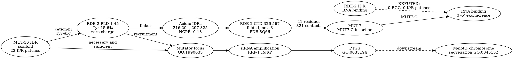
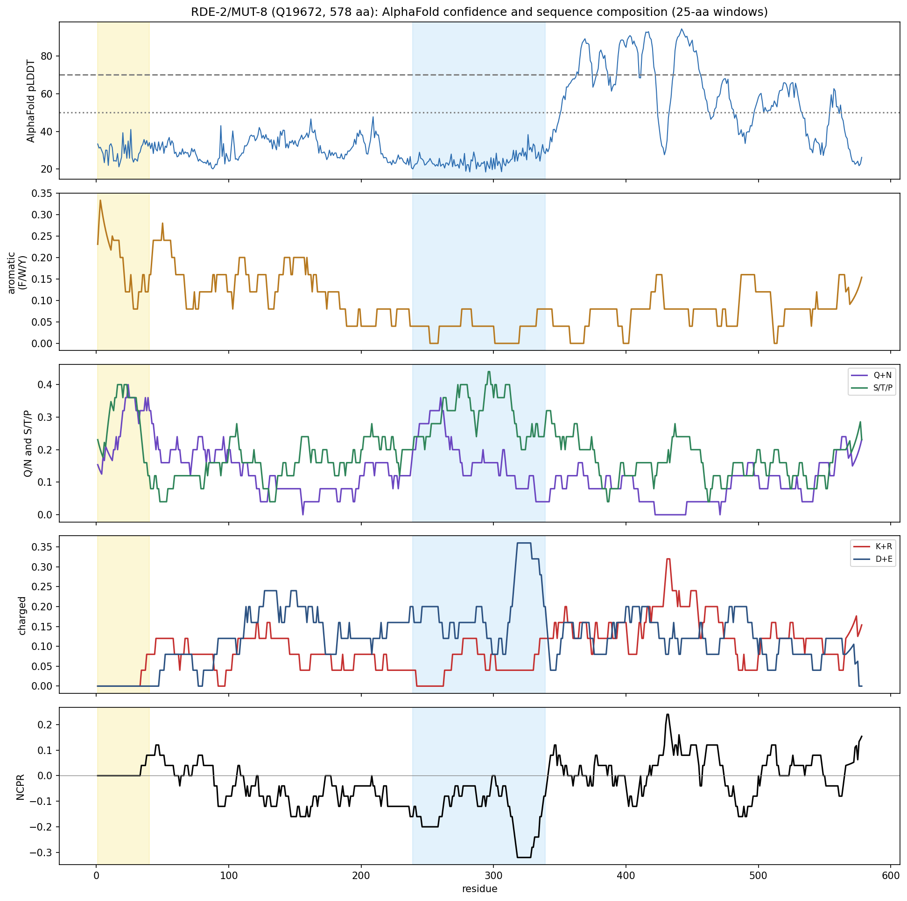
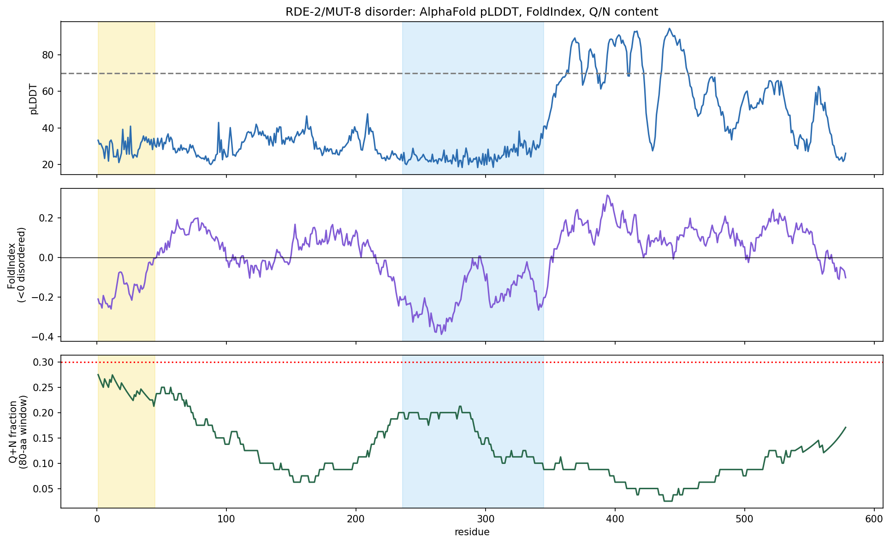
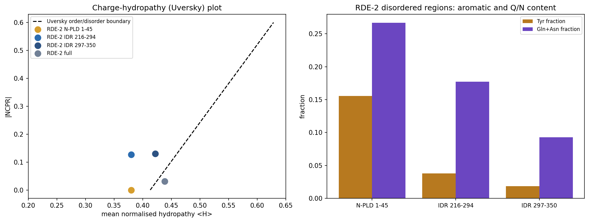
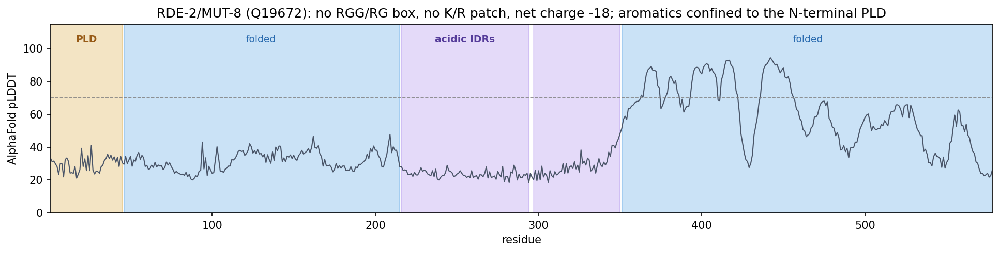
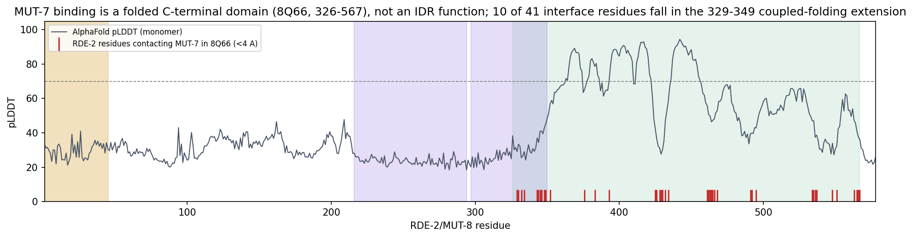
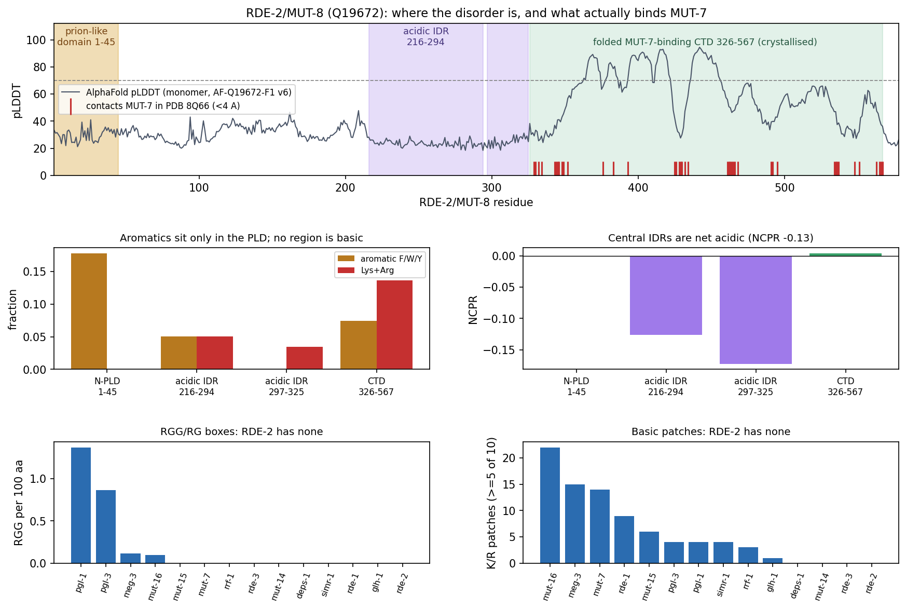

## Question

# AIGR Gene Hypothesis Deep Research

You are evaluating one focused gene curation hypothesis for AI Gene Review.
This is not a general gene overview. Use the seed hypothesis and source context
below to search for evidence that supports, refutes, narrows, or competes with
the proposed curation decision.

## Target Gene

- **Organism code:** worm
- **Taxon:** Caenorhabditis elegans (NCBITaxon:6239)
- **Gene directory:** rde-2
- **Gene symbol:** rde-2
- **UniProt accession:** Q19672

## Focus

- **Focus type:** free_text
- **Hypothesis slug:** kgap-rde2-idr-sequence-features
- **Source file:** genes/worm/rde-2/rde-2-ai-review.yaml
- **Source selector:** free-text

## Seed Hypothesis

Whether the intrinsically disordered regions of Caenorhabditis elegans RDE-2/MUT-8 carry sequence features suggestive of an activity beyond bridging MUT-7 and MUT-16 can be assessed computationally. Single analysis only: delineate folded versus disordered regions with AlphaFold and disorder predictors, map any predicted MUT-7- and MUT-16-binding segments from AlphaFold-Multimer models, profile the disordered regions for RNA-binding signatures (RGG/RG repeats, Lys/Arg-rich patches, short linear motifs) and for phase-separation-associated composition (aromatic and charge patterning, prion-like composition), compare these features with characterised mutator-focus and germ-granule proteins, score their conservation across Caenorhabditis species, and state whether any disordered segment is predicted to bind RNA or drive condensation.

## Term and Decision Context

No specific term context supplied.

## Reference Context

No specific reference context supplied.

## Source Context YAML

```yaml
hypothesis: 'Whether the intrinsically disordered regions of Caenorhabditis elegans RDE-2/MUT-8 carry
  sequence features suggestive of an activity beyond bridging MUT-7 and MUT-16 can be assessed computationally.
  Single analysis only: delineate folded versus disordered regions with AlphaFold and disorder predictors,
  map any predicted MUT-7- and MUT-16-binding segments from AlphaFold-Multimer models, profile the disordered
  regions for RNA-binding signatures (RGG/RG repeats, Lys/Arg-rich patches, short linear motifs) and for
  phase-separation-associated composition (aromatic and charge patterning, prion-like composition), compare
  these features with characterised mutator-focus and germ-granule proteins, score their conservation
  across Caenorhabditis species, and state whether any disordered segment is predicted to bind RNA or
  drive condensation.'
focus_type: free_text
context: []
reference_id: []
```

## Research Objective

Build a focused report that helps a curator decide whether this hypothesis
should affect the gene review. Address the focus type directly:

1. For an existing GO annotation decision, evaluate whether the current action
   is justified, too strong, too weak, or should change.
2. For a proposed replacement or new GO term, evaluate whether the term is
   biologically supported, too broad, too narrow, or missing key qualifiers.
3. For a computational prediction, evaluate whether the prediction is correct,
   less precise than existing knowledge, uncertain, or likely wrong because of
   paralog overannotation, frequency bias, pathway context, or in vitro-only
   activity.
4. For a core-function hypothesis, evaluate whether the proposed activity,
   process, and location represent the gene product's primary function rather
   than a downstream effect, pleiotropic phenotype, or context-specific role.
5. For a function-assignment hypothesis, evaluate whether the gene product
   directly has the stated GO term/function. Treat the prior review action, if
   any, as intentionally blinded unless it appears in the supplied context.

Use primary literature whenever possible. Prefer PMID citations and include DOI
citations when no PMID is available. Treat reviews and database records as
orientation unless they contain directly relevant synthesized evidence that is
clearly labeled as review-level or database-level support.

Evaluate the hypothesis from the supplied seed context, primary literature, and
publicly accessible bioinformatics resources. Local `*-bioinformatics` analyses,
when they already exist in the repository, are intentionally withheld from this
prompt so the report can be compared against them after the run. Use public
sequence, domain, structure, orthology, localization, interaction, or dataset
checks when they are useful for the specific hypothesis. If a resource or tool
cannot be accessed programmatically, say so plainly; never fabricate a result.
Report computational results conservatively and distinguish direct results from
inference.

## Required Output

### Executive Judgment

Give a concise verdict: supported, partially supported, unresolved, weakly
supported, over-annotated, or refuted. Explain the reasoning and the most
important caveats.

### Evidence Matrix

Create a table with one row per important evidence item:

- Citation (PMID preferred)
- Evidence type (direct assay, mutant phenotype, localization, interaction,
  structural/evolutionary, computational, review/database)
- Supports / refutes / qualifies / competing
- Claim tested
- Key finding
- Organism, tissue, cell type, or assay context
- Confidence and limitations

### GO Curation Implications

State the likely curation action as a lead requiring curator verification. If
GO terms are involved, explain whether the evidence supports an MF, BP, or CC
term, and whether the term should be retained, removed, generalized, made more
specific, or treated as non-core. Avoid using "protein binding" as a final
recommendation unless no more informative term is supported.

### Mechanistic Scope

Describe the immediate molecular or cellular function being tested. Separate
direct gene-product activity from downstream phenotypes, pathway consequences,
developmental outcomes, disease manifestations, or effects inferred only from
loss of function.

### Conflicts and Alternatives

Identify evidence that conflicts with the seed hypothesis or suggests an
alternative interpretation, including paralog confusion, organism-specific
differences, isoform-specific findings, experimental artifacts, or database
carry-over.

### Knowledge Gaps

List explicit uncertainties that matter for curation. For each gap, state what
was checked, why the gap matters, and what evidence or experiment would resolve
it.

### Discriminating Tests

Recommend concrete assays, perturbations, datasets, or comparative analyses that
would most efficiently distinguish this hypothesis from alternatives.

### Curation Leads

Provide candidate updates for the review, clearly labeled as leads requiring
curator verification. Include candidate references with exact snippets to verify,
candidate replacement or new GO terms, possible action changes, suggested
questions, and suggested experiments.

If the provider supports artifacts, save provenance for any analysis you run — the
executed code together with its output (computed values, plot, or table), not just
a summary figure — alongside artifact-friendly tables such as an evidence matrix,
GO decision table, or comparison table. Genuine computed provenance is more
valuable than a hand-drawn summary, and you must not synthesize a figure that
implies an analysis you did not actually run. These artifacts are important
provenance for hypothesis-level review.


## Output

# RDE-2/MUT-8 disordered regions: no RNA-binding signature, one condensation module that is already the MUT-16-binding element

**Gene:** *rde-2* / *mut-8* (*Caenorhabditis elegans*, NCBITaxon:6239)
**UniProt:** Q19672
**Hypothesis slug:** `kgap-rde2-idr-sequence-features`
**Source:** `genes/worm/rde-2/rde-2-ai-review.yaml`, selector `free-text`
**Iterations:** 3 of 3 completed. 6 findings recorded, 11 papers reviewed.

---

## Summary

The seed hypothesis asks whether the intrinsically disordered regions (IDRs) of RDE-2/MUT-8 carry sequence features suggesting an activity beyond bridging MUT-7 and MUT-16. The answer splits cleanly into two halves that resolve in opposite directions, so the verdict is **partially supported**, with the RNA-binding half refuted at sequence level.

**RNA binding is refuted by sequence.** A motif and composition scan of Q19672 (578 aa) finds zero RGG tripeptides, zero RG-box spacings matching `RG.{0,2}RG`, and zero windows of 10 residues containing 5 or more Lys/Arg. Net charge is -18 across 27 Arg, 28 Lys and 73 Asp+Glu, and both central IDRs are net acidic (NCPR -0.127 for residues 216-294, -0.130 for 297-350). Benchmarked with identical code against 13 other *C. elegans* mutator and germ-granule proteins, RDE-2 is the only member of the 14-protein panel with **both** zero RGG and zero Lys/Arg patches, against PGL-1 at 1.37 RGG per 100 aa plus 4 patches, MUT-16 at 22 patches, MEG-3 at 15 and MUT-7 at 14. The null holds in three *Caenorhabditis* orthologs. Independent structural evidence points the same way: the crystallised MUT-7-binding domain (residues 322-567) is close to charge-neutral (Lys+Arg 0.134, Asp+Glu 0.146, net -3), and [PMID: 39188014](https://pubmed.ncbi.nlm.nih.gov/39188014/) assigns RNA binding within this complex to the MUT7-C domain of MUT-7.

**Condensation composition is present but confined to the bridging function.** Residues 1-45 are a prion-like domain: Tyr 15.6%, total aromatic (Phe/Trp/Tyr) 17.8%, Gln+Asn 26.7%, Ser/Thr/Pro 30.0% over 1-40, and **zero charged residues** in residues 1-40 (FCR 0.000, NCPR 0.000). This is the only aromatic-rich segment in the protein; the central IDRs have aromatic fractions of 0.051 and 0.037 against 0.095 protein-wide. The segment is compositionally conserved across the genus and better conserved than the protein average (53.3% identity to *C. briggsae* A8Y196 and 48.9% to *C. nigoni* A0A2G5VH88 over residues 1-45, against 45.5% and 45.7% protein-wide). Multi-scale simulations in [PMID: 40781776](https://pubmed.ncbi.nlm.nih.gov/40781776/) already assign that exact segment to MUT-16 recruitment through Tyr(MUT-8)-Arg(MUT-16) cation-pi contacts. The prion-like domain is the client-recruitment arm of the bridging activity, and it is not independent evidence of an extra function.

**One methodological correction changes how the hypothesis should be executed.** The hypothesis asks for MUT-7-binding segments to be mapped from AlphaFold-Multimer models. An experimental structure already answers this: **PDB 8Q66**, a 2.03 Å X-ray structure of MUT-7(633-899) bound to RDE-2/MUT-8(322-567), released 2024-03-06 and published as [PMID: 39188014](https://pubmed.ncbi.nlm.nih.gov/39188014/). Chain B has continuous density for residues 326-567 with no internal gaps. I computed 41 RDE-2 interface residues and 321 heavy-atom contact pairs within 4.0 Å. MUT-7 binding is a folded-domain function. This also corrects my own iteration-1 disorder call: residues 329-349 contribute 10 of the 41 interface residues and are helical in the complex, yet mean pLDDT there is 37.6 and FoldIndex agreed that 297-350 was disordered. The defensible free-state IDR boundary is approximately 297-325.

---

## Executive judgment

<i class="fa-scale-balanced"></i> **Verdict: partially supported, with the RNA-binding clause refuted and the condensation clause narrowed to the known bridging function.**

| Clause of the seed hypothesis | Verdict | Basis |
|---|---|---|
| Folded versus disordered regions can be delineated | <i class="fa-circle-check"></i> Supported | FoldIndex plus pLDDT consensus gives IDRs at 1-45, 114-137, 216-294, 297-350; UniProt independently annotates Disordered 239-295 and 307-339 |
| MUT-7-binding segment can be mapped from AlphaFold-Multimer | <i class="fa-triangle-exclamation"></i> Superseded | PDB 8Q66 at 2.03 Å maps it experimentally to the folded CTD 326-567; a prediction would be a downgrade |
| MUT-16-binding segment can be mapped | <i class="fa-circle-check"></i> Supported by published simulation | [PMID: 40781776](https://pubmed.ncbi.nlm.nih.gov/40781776/) maps it to the N-terminal prion-like domain; no experimental structure exists for MUT-16 |
| Any disordered segment is predicted to bind RNA | <i class="fa-circle-xmark"></i> Refuted at sequence level | 0 RGG, 0 RG-box, 0 K/R patches, net charge -18, both central IDRs net acidic; sole protein in a 14-protein panel with both nulls |
| Any disordered segment is predicted to drive condensation | <i class="fa-scale-balanced"></i> Partially supported, narrowly | Residues 1-45 have prion-like composition, but autonomous condensation is not demonstrated and the segment is already assigned to MUT-16 binding |
| An activity beyond bridging MUT-7 and MUT-16 | <i class="fa-circle-xmark"></i> Not supported | Every sequence feature found maps onto one of the two bridging contacts |

**Most important caveats.** A sequence-composition null cannot exclude a structured RNA-binding surface on the folded CTD; it excludes only the IDR-mediated, composition-driven mode the hypothesis proposes. 8Q66 covers residues 322-567 alone, leaving the prion-like domain and the acidic IDR 216-294 without experimental structure. AlphaFold monomer quality for this protein is poor (global pLDDT 41.5, Kabsch CA RMSD 5.55 Å against the crystal over 326-567), so pLDDT alone over-calls disorder here, and the FoldIndex agreement is what makes the remaining IDR segments defensible.

---

## Key findings

### F001. A bipartite architecture: two compact regions flanking an N-terminal prion-like domain and central acidic IDRs

AlphaFold DB model AF-Q19672-F1 (v6) has a global pLDDT of 41.5. Recomputing per-residue values from the CA B-factors of the deposited PDB gives 72.1% of 578 residues below pLDDT 50, 15.7% between 50 and 70, 9.7% between 70 and 90, and 2.4% at or above 90. An independent predictor was applied so the architecture does not rest on AlphaFold alone: FoldIndex (Prilusky et al. 2005, *Bioinformatics* 21:3435), computed as `2.785<H> - |<R>| - 1.151` over a 51-residue window with normalised Kyte-Doolittle hydropathy. FoldIndex predicts disorder (values below 0) at residues **1-45, 114-137, 216-294 and 297-350**, and the consensus with pLDDT below 70 is identical for all four segments.

UniProt Q19672 independently annotates Disordered at 239-295 and 307-339, with a polar-residue bias at 239-254 and 261-277 and an acidic bias at 321-331. Those annotations overlap the two central predicted IDRs, giving three independent lines of agreement on the central disorder.

Regions 46-215 and 351-578 are hydrophobic and beta-rich by FoldIndex (values above 0) but carry low AlphaFold confidence, so their fold assignment cannot be settled from the monomer model. RDE-2 has roughly 42% predicted disorder, concentrated in a 45-residue N-terminal low-complexity segment and two central acidic segments, with the remainder compact but poorly modelled.

{{figure:plot_1.png|caption=Per-residue pLDDT from AlphaFold model AF-Q19672-F1 (v6) alongside hydropathy, charge and compositional profiles of RDE-2/MUT-8. Global pLDDT is 41.5 and 72.1% of residues fall below 50, which over-calls disorder for this protein.}}

{{figure:plot_2.png|caption=FoldIndex disorder trace (51-residue window), RNA-binding motif scan and prion-like Gln/Asn profile for Q19672. FoldIndex calls disorder at 1-45, 114-137, 216-294 and 297-350. The motif scan returns zero RGG tripeptides and zero RG-box spacings across the full 578-residue sequence.}}

### F002. No RNA-binding sequence signature in any disordered region

<i class="fa-circle-xmark"></i> This is the central negative result.

The motif scan of Q19672 returns **zero RGG tripeptides**, **zero RG/RGG-box spacings** matching `RG.{0,2}RG`, one isolated RG dipeptide, and **zero windows of 10 residues containing 5 or more Lys/Arg**. The single basic tract in the whole protein is a KKK at 441-443, which lies inside a FoldIndex-ordered region and so is not an IDR feature. Net charge is -18.

The two central IDRs are net acidic: residues 216-294 have NCPR -0.127, FCR 0.228 and a Lys+Arg fraction of 0.051; residues 297-350 have NCPR -0.130, FCR 0.278 and Lys+Arg 0.074. Acidic character disfavours electrostatic engagement with the RNA phosphate backbone, which is the dominant mode by which composition-driven IDRs bind RNA.

The benchmark makes the null interpretable. Thirteen other *C. elegans* mutator and germ-granule proteins were scanned with the same code:

| Protein | UniProt | Length | Disorder fraction (FoldIndex) | RGG per 100 aa | K/R patches (≥5 of 10) | Role |
|---|---|---|---|---|---|---|
| PGL-1 | Q9TZQ3 | 730 | 0.336 | **1.370** | 4 | P granule RGG-box RNA-binding scaffold |
| PGL-3 | G5EBV6 | 693 | 0.221 | **0.866** | 4 | P granule RGG-box protein |
| MEG-3 | Q9TXM1 | 862 | 0.651 | 0.116 | **15** | Disordered granule scaffold |
| MUT-16 | O62011 | 1054 | 0.747 | 0.095 | **22** | Mutator focus scaffold (Q/N-rich IDR) |
| MUT-15 | E1B6U1 | 472 | 0.343 | 0.000 | 6 | Mutator complex |
| MUT-7 | P34607 | 910 | 0.296 | 0.000 | **14** | 3'-5' exoribonuclease; MUT7-C binds RNA |
| RRF-1 | G5ECM1 | 1601 | 0.419 | 0.000 | 3 | RNA-dependent RNA polymerase |
| RDE-3 | O44768 | 441 | 0.356 | 0.000 | 0 | poly(UG) polymerase |
| MUT-14 | Q17978 | 528 | 0.229 | 0.000 | 0 | DEAD-box helicase |
| DEPS-1 | Q9N303 | 619 | 0.270 | 0.000 | 0 | P granule component |
| SIMR-1 | O01477 | 691 | 0.418 | 0.000 | 4 | Tudor domain protein |
| RDE-1 | G5EEH0 | 1020 | 0.460 | 0.000 | 9 | Primary Argonaute |
| GLH-1 | P34689 | 763 | 0.258 | 0.000 | 1 | Vasa-like helicase |
| **RDE-2** | **Q19672** | **578** | **0.420** | **0.000** | **0** | **MUT-7/MUT-16 bridge** |

RDE-2 is the only protein in the panel with both zero RGG and zero Lys/Arg patches. The same pattern holds in orthologs: *C. briggsae* A8Y196, *C. nigoni* A0A2G5VH88 and *C. remanei* E3NE06 all have 0 RGG and 0-1 K/R patches, with net charges between -13 and -18. The ELM scan of Q19672 returned 214 raw hits, **0** of them ELM-annotated instances, and no ELM class relating to RNA binding. ELM contains no RNA-binding motif classes, so this is a null check rather than evidence either way, and it is reported as such.

Sub-region composition for RDE-2 itself:

| Region | Length | RGG/100aa | K/R patches | Tyr | Aromatic (FWY) | Lys+Arg | Asp+Glu | NCPR | Gln+Asn |
|---|---|---|---|---|---|---|---|---|---|
| Full protein 1-578 | 578 | 0.000 | 0 | 0.050 | 0.095 | 0.095 | 0.126 | -0.031 | 0.130 |
| PLD 1-45 | 45 | 0.000 | 0 | **0.156** | **0.178** | 0.000 | 0.000 | 0.000 | **0.267** |
| Acidic IDR 216-294 | 79 | 0.000 | 0 | 0.038 | 0.051 | 0.051 | 0.177 | **-0.127** | 0.177 |
| Acidic IDR 297-350 | 54 | 0.000 | 0 | 0.019 | 0.037 | 0.074 | 0.204 | **-0.130** | 0.093 |
| Folded CTD 322-567 | 246 | 0.000 | 0 | | | 0.134 | 0.146 | -0.012 | |

{{figure:plot_3.png|caption=Das-Pappu charge patterning (kappa), Uversky charge-hydropathy placement and ELM short-linear-motif scan for RDE-2. The central IDRs sit in the net-acidic region; 214 raw ELM hits yielded zero annotated instances and no RNA-binding class.}}

{{figure:plot_4.png|caption=ELM filter summary and the resulting RDE-2/MUT-8 architecture: an N-terminal prion-like domain (1-45), two central acidic IDRs (216-294 and 297-350) and two compact regions, with the C-terminal one crystallised in PDB 8Q66.}}

### F003. Condensation-associated composition is confined to a conserved N-terminal prion-like domain that is the MUT-16-binding element

Residues 1-45 of Q19672 read `MHNGYHSYFPPNHYYAQSQPSSSYNPQPQIQQPQTQIYGLVVGYN`. Composition: Tyr 15.6%, total aromatic 17.8%, Gln+Asn 26.7%, Ser/Thr/Pro 30.0% over 1-40, and **FCR 0.000 with NCPR 0.000**, meaning no charged residue at all in residues 1-40. This is the only aromatic-rich segment in the protein: the central IDRs score 0.051 and 0.037 aromatic fraction against 0.095 protein-wide.

Compositional conservation across the genus is strong. The equivalent N-terminal window in *C. briggsae* A8Y196 (residues 5-49, `YPNQNYPNQNNYPNQNYPPPQQNYQQNQQNYGQQPQQPQQQYNPN`) and the identical window in *C. nigoni* A0A2G5VH88 score **0.978** for Tyr+Gln+Asn+Pro with 0.000 charged residues, against 0.600 and 0.044 for *C. elegans*. Primary-sequence identity over residues 1-45 is 53.3% for *C. briggsae* and 48.9% for *C. nigoni*, against protein-wide identities of 45.5% and 45.7%. The prion-like domain is therefore at least as conserved as the folded regions, while the two acidic central IDRs are the least conserved parts of the protein at 26.6-38.9% identity. The *C. remanei* model E3NE06 lacks the N-terminal Tyr/Gln/Asn/Pro block (13.3% identity over 1-45, best window at 228-272), which is consistent with an incomplete 5' gene model.

The interpretive point for curation: this segment is what published multi-scale simulations assign to MUT-16 recruitment. [PMID: 40781776](https://pubmed.ncbi.nlm.nih.gov/40781776/) reports that *"Martini3 and 350-μs atomistic simulations on Folding@Home of MUT-8's N-terminal prion-like domain with MUT-16 M8BR cluster highlighted the importance of cation-π interactions between Tyr residues of MUT-8 and Arg residues of MUT-16 M8BR"*. [PMID: 30036386](https://pubmed.ncbi.nlm.nih.gov/30036386/) sets the direction of the relationship: *"We further determine that the C-terminal region of MUT-16, a portion of which contains predicted intrinsic disorder, is necessary and sufficient to promote Mutator foci formation."* MUT-16 is the scaffold and RDE-2/MUT-8 is a recruited client. The prion-like composition is the molecular grammar of that recruitment.

### F004. MUT-7 binding maps to a folded C-terminal domain in a 2.03 Å crystal structure

<i class="fa-circle-check"></i> PDB **8Q66** (X-ray, 2.03 Å, deposited by Falk and Busetto, released 2024-03-06, titled *Crystal Structure of the C. elegans MUT-7 MUT-8 CTD complex*) contains MUT-7 P34607 residues 633-899 in chain A and RDE-2/MUT-8 Q19672 residues 322-567 in chain B, in native UniProt numbering per the DBREF records. Chain B has continuous electron density for residues 326-567 with no internal gaps, 242 modelled residues.

I computed the interface from deposited heavy-atom coordinates: **41 RDE-2 residues within 4.0 Å of MUT-7, giving 321 contact atom pairs**, clustered at 329-334, 343-352, 376, 383, 393, 425-434, 461-468, 491-495, 534-537, 548-551 and 563-567. PDB HELIX records place helices at 328-332, 346-350 and 352-360, and strands at 368-378, 381-385 and 394-397. The CTD is close to charge-neutral (Lys+Arg 0.134, Asp+Glu 0.146, net -3).

AlphaFold monomer agreement with the crystal is poor: Kabsch CA RMSD **5.55 Å** over 326-567 and 5.22 Å over the 356-567 core, with mean pLDDT 37.6 across 326-355 and 62.4 across 356-567.

Two corollaries matter for curation. The hypothesis asks for AlphaFold-Multimer mapping, but an experimental structure supersedes any prediction here, and the MUT-7-binding surface of RDE-2 is a folded C-terminal domain, so bridging toward MUT-7 is a globular-domain function. Residues 329-349 contribute 10 of the 41 interface residues and are helical in the complex, yet both FoldIndex and pLDDT called 297-350 disordered; that part is coupled folding upon binding, and the free-state IDR boundary should be narrowed to roughly 297-325. The charge-neutral CTD surface adds structural weight against an RNA-binding role.

{{figure:plot_5.png|caption=Secondary structure of RDE-2 chain B in PDB 8Q66, AlphaFold-versus-crystal superposition (Kabsch CA RMSD 5.55 A over 326-567), and the 41-residue MUT-7 interface mapped onto the pLDDT track. Residues 329-349 are helical in the complex despite mean pLDDT 37.6.}}

### F005. RDE-2 is a domain orphan, and no RNA binding term is currently annotated

The InterPro API query for Q19672 (`entry/all/protein/UniProt/Q19672`) returns **HTTP 204 No Content**, meaning zero matched signatures across all member databases. Positive controls confirm the endpoint was working: the same query returns **15 entries** for MUT-7 P34607 (including IPR002562 3'-5' exonuclease domain at 404-605, IPR002782 Mut7-C RNase domain at 666-777, and PF38206 Mut7 N-terminal domain at 57-311) and **7 entries** for SIMR-1 O01477. MUT-16 O62011 also returns 204.

The UniProt and PDBe protein name for Q19672 is **"SH2 domain-containing protein"**, carried from EMBL submission CAA95803.3 with evidence code ECO:0000313, and no InterPro SH2 signature supports it. This is a database carry-over risk, since an SH2 label wrongly implies phosphotyrosine-peptide binding.

QuickGO returns 8 GO annotations for UniProtKB:Q19672:

| GO ID | Name | Aspect | Evidence | Reference | Assigned by |
|---|---|---|---|---|---|
| GO:0005515 | protein binding | MF | IPI (with P34607/MUT-7) | PMID:15653635, PMID:19123269 | IntAct |
| GO:0030422 | siRNA processing | BP | IDA | PMID:15653635 | GO_Central |
| GO:0016441 | post-transcriptional gene silencing | BP | IMP | PMID:10535731 | WB |
| GO:0035194 | regulatory ncRNA-mediated post-transcriptional gene silencing | BP | IMP | PMID:10535731 | WB |
| GO:0045132 | meiotic chromosome segregation | BP | IMP (WBVar00090964) | PMID:10535731 | WB |
| GO:0005829 | cytosol | CC | IDA | PMID:15653635 | GO_Central |
| GO:1990633 | mutator focus | CC | IDA | PMID:22713602 | WB |

**GO:0003723 RNA binding is absent.** Accepting an RNA-binding IDR would mean adding it on computational grounds alone, and the sequence and structural evidence gathered here argues against that addition.

### F006. Two alternative routes to an RNA link both close on inspection

IntAct (PSICQUIC) returns 4 rows for Q19672, all from [PMID: 19123269](https://pubmed.ncbi.nlm.nih.gov/19123269/) (two-hybrid array MI:0397 and two-hybrid pooling MI:0398), covering exactly two partners: MUT-7 (P34607) and Q9U304. UniProt identifies Q9U304 as **rbm-12**, 948 aa, submission name "RRM domain-containing protein" (ECO:0000313, EMBL CAA20980.2). This is a single high-throughput two-hybrid source with no orthogonal validation, and binding an RNA-binding protein is not RNA binding.

PDBe `ligand_monomers` for 8Q66 lists one Zn plus three ethylene glycol cryoprotectant molecules. I computed the zinc coordination shell from the deposited coordinates: **all four ligands are MUT-7 cysteines in chain A at 2.33 Å (Cys768, Cys771, Cys887, Cys890)**. RDE-2 chain B contributes no metal ligand, so the zinc cannot be read as a nucleic-acid-binding zinc module on RDE-2.

Structural coverage is a real constraint. PDBe `uniprot_to_pdb` returns 404 for both Q19672 and O62011, and `best_structures` returns only 8Q66 for Q19672. 8Q66 is the sole experimental structure covering any part of RDE-2, it spans residues 322-567 alone, and MUT-16 has no structure at all.

{{figure:plot_6.png|caption=Combined summary: architecture, the 14-protein RNA-binding-motif benchmark, prion-like domain composition and conservation, the 8Q66 interface, and the evidence matrix for the RDE-2/MUT-8 hypothesis.}}

---

## Evidence matrix

| Citation | Evidence type | Stance | Claim tested | Key finding | Context | Confidence and limitations |
|---|---|---|---|---|---|---|
| PDB 8Q66 / [PMID: 39188014](https://pubmed.ncbi.nlm.nih.gov/39188014/) | Structural (X-ray 2.03 Å) | Refutes IDR-centric framing; qualifies hypothesis | Is the MUT-7-binding segment of RDE-2 disordered? | MUT-7(633-899):RDE-2(322-567) complex; RDE-2 ordered 326-567 with no density gaps; 41 interface residues and 321 heavy-atom contacts under 4 Å; helices 328-332, 346-350, 352-360; strands 368-378, 381-385, 394-397 | *C. elegans* proteins expressed in *E. coli* BL21(DE3); crystal | High for the crystallised construct. Full-length behaviour and in vivo stoichiometry not shown. The Zn site is in MUT-7 (Cys768/771/887/890), not RDE-2 |
| [PMID: 39188014](https://pubmed.ncbi.nlm.nih.gov/39188014/) | Direct assay plus structural | Competing | Which subunit of the MUT-7/MUT-8 complex binds RNA? | The MUT7-C domain of MUT-7 contributes to RNA binding and is required for ribonuclease activity; MUT-8 binding maps to a *C. elegans*-specific insertion in MUT7-C | *C. elegans* and human MUT-7; in vitro | High. Assigns RNA binding to MUT-7 rather than MUT-8 |
| [PMID: 40781776](https://pubmed.ncbi.nlm.nih.gov/40781776/) | Computational (CALVADOS2, Martini3, atomistic MD) with in vitro validation of MUT-16 IDR phase separation | Supports, narrowly | Does an RDE-2 IDR engage a condensate? | The MUT-8 N-terminal prion-like domain binds the MUT-16 M8BR cluster through cation-pi contacts between MUT-8 Tyr and MUT-16 Arg | Simulation; MUT-16 IDR relative phase-separation propensities confirmed in vitro | Medium-high for the interaction mode. Autonomous condensation by the MUT-8 PLD alone is not demonstrated |
| [PMID: 30036386](https://pubmed.ncbi.nlm.nih.gov/30036386/) | Mutant phenotype plus localization | Qualifies | Who drives Mutator focus condensation? | The MUT-16 C-terminal region containing predicted disorder is necessary and sufficient to promote Mutator foci | *C. elegans* germline | High. Establishes MUT-16 as scaffold and RDE-2/MUT-8 as a recruited client |
| [PMID: 22713602](https://pubmed.ncbi.nlm.nih.gov/22713602/) | Localization | Supports CC only | Does RDE-2 localize to Mutator foci? | Each of the six mutator proteins localizes to perinuclear germline foci; MUT-16 is required for mutator complex formation and focus assembly | *C. elegans* germline | High for localization. Silent on RDE-2 RNA binding |
| [PMID: 15653635](https://pubmed.ncbi.nlm.nih.gov/15653635/) | Interaction (Y2H) plus IDA | Supports bridging | Does RDE-2 bind MUT-7? | RDE-2/MUT-8 identified as a component of the MUT-7 complex; the interaction is required for efficient RNAi in vivo | *C. elegans*; yeast two-hybrid and complex fractionation | High for the interaction. No domain-level mapping |
| [PMID: 19123269](https://pubmed.ncbi.nlm.nih.gov/19123269/) | Interaction (two-hybrid array and pooling) | Neutral | What else binds RDE-2? | IntAct reports only MUT-7 (P34607) and RBM-12 (Q9U304, an RRM protein) as RDE-2 partners | High-throughput yeast two-hybrid | Low-medium. Single high-throughput source with no orthogonal validation |
| This work (InterPro API query) | Computational | Qualifies | Does RDE-2 carry any recognised domain? | HTTP 204 No Content: zero signatures across all InterPro member databases; positive controls MUT-7 (15 entries) and SIMR-1 (7 entries) returned normally; MUT-16 also 204 | UniProt Q19672; query run 2026-11 | High. The UniProt and PDBe name "SH2 domain-containing protein" comes from EMBL CAA95803.3 (ECO:0000313) with no SH2 signature behind it |
| This work (motif and composition scan) | Computational | Refutes the RNA-binding clause | Do the RDE-2 IDRs carry RNA-binding sequence signatures? | 0 RGG tripeptides, 0 RG-box spacings, 0 windows of 10 residues with ≥5 Lys/Arg, net charge -18; acidic IDRs NCPR -0.127 (216-294) and -0.130 (297-350); benchmark: PGL-1 1.37 RGG/100aa plus 4 K/R patches, MUT-16 22 patches, MEG-3 15, MUT-7 14 | Q19672 plus a 13-protein *C. elegans* mutator and germ-granule panel; three orthologs | High as a sequence-level null. Composition cannot exclude a structured RNA-binding surface on the folded CTD |
| This work (composition plus Needleman-Wunsch alignment) | Computational / evolutionary | Supports the condensation clause narrowly | Is the N-terminal prion-like domain real and conserved? | Residues 1-45: Tyr 15.6%, aromatic 17.8%, Gln+Asn 26.7%, zero charged residues in 1-40; identity 53.3% (*C. briggsae* A8Y196) and 48.9% (*C. nigoni* A0A2G5VH88) against 45.5% and 45.7% protein-wide; acidic IDRs least conserved at 26.6-38.9% | Four *Caenorhabditis* orthologs; BLOSUM62 affine-gap global alignment | Medium-high. The *C. remanei* model E3NE06 lacks the N-terminal block and looks 5'-incomplete rather than genuinely PLD-less |
| This work (AlphaFold vs crystal superposition) | Computational | Qualifies | How reliable is the AlphaFold monomer for this protein? | Global pLDDT 41.5; Kabsch CA RMSD 5.55 Å over 326-567 and 5.22 Å over the 356-567 core against 8Q66 chain B; mean pLDDT 37.6 across the crystallographically helical 326-355 | AF-Q19672-F1 v6 versus PDB 8Q66 chain B | High. Shows pLDDT alone over-calls disorder for this protein and should not be the sole basis for an IDR claim |

---

## Mechanistic model

RDE-2/MUT-8 is a two-armed adaptor. One arm is a folded C-terminal domain (326-567) that grips MUT-7 through a 41-residue interface, verified crystallographically. The other arm is an uncharged, Tyr/Gln-rich prion-like domain (1-45) that docks into the MUT-16 condensate through cation-pi contacts. The two central acidic IDRs (216-294 and 297-325) link the arms and have no detected binding or RNA-engaging feature; they are also the least conserved parts of the protein, which fits a spacer role.



The hypothesis asked whether anything in the IDRs points past bridging. Every feature found maps onto one of the two bridging contacts. The condensation grammar is the MUT-16 contact. The MUT-7 contact is folded. The residual disorder is acidic, aromatic-poor and poorly conserved.

---

## GO curation implications

All entries below are **leads requiring curator verification**.

| GO ID | Name | Aspect | Current evidence | Recommended action | Rationale |
|---|---|---|---|---|---|
| GO:0003723 | RNA binding | MF | Not annotated | <i class="fa-circle-xmark"></i> **DO NOT ADD** | No RNA-binding signature in any IDR: 0 RGG, 0 RG-box, 0 K/R patches, net charge -18, acidic central IDRs. The crystallised CTD is charge-neutral (net -3). [PMID: 39188014](https://pubmed.ncbi.nlm.nih.gov/39188014/) assigns RNA binding in this complex to the MUT7-C domain of MUT-7 |
| GO:0034061 | RNA polymerase activity | MF | Not annotated | **DO NOT ADD** | Recorded only to note that the catalytic steps of siRNA amplification belong to RRF-1 and MUT-7 |
| GO:0005515 | protein binding | MF | IPI, PMID:15653635 and PMID:19123269 (IntAct) | **RETAIN, but seek a more informative MF** | Supported but uninformative. PDB 8Q66 maps the MUT-7-binding surface to residues 326-567, so a protein-complex-scaffold or adaptor MF, or a CC complex term, carries more information. Confirm the `with` field is MUT-7 P34607 |
| GO:0032991 | protein-containing complex | CC | Not annotated | <i class="fa-lightbulb"></i> **CANDIDATE ADD** | 8Q66 is a defined 1:1 heterodimer of MUT-7 and the RDE-2 CTD; PMID:15653635 reports a roughly 250 kDa MUT-7 complex containing RDE-2. A specific mutator-complex CC term would be preferable if one exists |
| GO:1990633 | mutator focus | CC | IDA, PMID:22713602 (WB) | **RETAIN** | Directly supported by germline localization of all six mutator proteins. This is the correct home for the condensate-related evidence, as a CC and not an MF |
| GO:0030422 | siRNA processing | BP | IDA, PMID:15653635 | **RETAIN** | Supported, though the IDA is complex-level rather than a demonstration of RDE-2 catalysis. Treat as pathway participation |
| GO:0016441 | post-transcriptional gene silencing | BP | IMP, PMID:10535731 (WB) | **RETAIN** | Mutant phenotype evidence, appropriate as a BP |
| GO:0035194 | regulatory ncRNA-mediated PTGS | BP | IMP, PMID:10535731 (WB) | **RETAIN** | More specific than GO:0016441 and consistent with the siRNA pathway |
| GO:0045132 | meiotic chromosome segregation | BP | IMP, PMID:10535731 (WB) | **RETAIN as non-core** | A downstream consequence of transposon desilencing and germline small-RNA loss rather than a direct RDE-2 activity. Worth a non-core or contributes-to qualifier if the review supports one |
| (protein name) | "SH2 domain-containing protein" | n/a | ECO:0000313, EMBL CAA95803.3 | <i class="fa-triangle-exclamation"></i> **FLAG FOR CORRECTION** | InterPro returns zero signatures for Q19672 (HTTP 204) while positive controls return normally. The SH2 label is unsupported and risks implying phosphotyrosine-peptide binding. Suggested replacement: "Mutator complex protein RDE-2/MUT-8" |

**On phase separation terms.** No MF or BP phase-separation term should be added for RDE-2. [PMID: 30036386](https://pubmed.ncbi.nlm.nih.gov/30036386/) places the necessary-and-sufficient condensation activity in MUT-16, and the RDE-2 contribution in [PMID: 40781776](https://pubmed.ncbi.nlm.nih.gov/40781776/) is client binding to that scaffold. The correct annotation for RDE-2's condensate association is the existing CC term GO:1990633.

---

## Mechanistic scope

**Direct gene-product activity, supported.** Physical binding to MUT-7 through the folded CTD (326-567), with 41 interface residues resolved at 2.03 Å, and binding to the MUT-16 condensate through the N-terminal prion-like domain, supported by simulation and by composition.

**Direct activity, not supported.** RNA binding by any RDE-2 region, catalysis of any step of siRNA amplification, and autonomous phase separation.

**Complex-level activity, attributed but not demonstrated for RDE-2 alone.** siRNA processing (GO:0030422, IDA from PMID:15653635). The assay reports on the MUT-7 complex. RDE-2's contribution within that complex is most parsimoniously the bridging that holds MUT-7 in the focus.

**Downstream phenotypes, from loss of function only.** Post-transcriptional gene silencing defects, transposon desilencing, loss of endogenous siRNAs, multigenerational transgene silencing requirements ([PMID: 25941370](https://pubmed.ncbi.nlm.nih.gov/25941370/)), and meiotic chromosome segregation defects. Meiotic chromosome segregation (GO:0045132) is the furthest removed and should be treated as non-core.

**Genetic-interaction level.** [PMID: 18245353](https://pubmed.ncbi.nlm.nih.gov/18245353/) reports second-site non-complementation between ABC transporter mutants and the *mut-7*/*rde-2* branch. This is genetic, not physical, and does not bear on the IDR question.

---

## Conflicts and alternatives

**The hypothesis's own method is outdated for the MUT-7 arm.** Running AlphaFold-Multimer to map the MUT-7 interface would produce a prediction where a 2.03 Å experimental answer exists. Any repository `*-bioinformatics` analysis relying on AlphaFold-Multimer for this contact should be reconciled with 8Q66.

**An internal conflict in my own iteration-1 result, resolved by the crystal.** FoldIndex and pLDDT both call 297-350 disordered. In 8Q66, residues 328-332, 346-350 and 352-360 are helical, and 329-349 supplies 10 interface residues. This is coupled folding upon binding, which both methods are blind to. The free-state IDR should be reported as roughly 297-325.

**AlphaFold monomer unreliability is a general hazard for this protein.** Global pLDDT 41.5 and CA RMSD 5.55 Å against the crystal mean that a disorder claim resting on pLDDT alone is wrong for at least one region. The FoldIndex concordance and the UniProt annotations keep the remaining IDR calls defensible.

**Database carry-over.** "SH2 domain-containing protein" propagates from EMBL CAA95803.3 into UniProt and PDBe. An automated pipeline reading that name could infer phosphotyrosine binding. InterPro finds zero signatures.

**Alternative explanations for an RNA link, both closed.** RBM-12 (Q9U304) is an RRM protein, but it appears only in one high-throughput two-hybrid study with no orthogonal validation, and binding an RNA-binding protein does not confer RNA binding. The zinc in 8Q66 is a Cys4 site entirely within MUT-7 (Cys768, Cys771, Cys887, Cys890 at 2.33 Å), so it is not a nucleic-acid-binding module on RDE-2.

**Ortholog caution.** The *C. remanei* model E3NE06 lacks the N-terminal Tyr/Gln/Asn/Pro block. The most likely explanation is an incomplete 5' gene model, because the best Y+Q+N+P window moves to 228-272 and overall identity over 1-45 drops to 13.3%. A curator should not read this as lineage-specific loss of the prion-like domain without checking the gene model.

---

## Limitations and knowledge gaps

<i class="fa-circle-question"></i> **Whether the folded CTD has a structured RNA-binding surface.** Checked: composition of 322-567 (net -3, charge-neutral) and the absence of any InterPro signature. The sequence null applies to composition-driven IDR binding and cannot exclude a structured site. This matters because GO:0003723 could still be justified by a direct assay even with the sequence null. Resolution: EMSA or RNA pull-down with purified RDE-2 CTD, with MUT-7 MUT7-C as the positive control.

<i class="fa-circle-question"></i> **Structure of residues 1-321.** Checked: PDBe `best_structures` and `uniprot_to_pdb` for Q19672 return only 8Q66, covering 322-567. The prion-like domain and the acidic IDR 216-294 have no experimental structure, and region 46-215 scores ordered by FoldIndex but has low pLDDT, so its fold is unassigned. Resolution: crystallography or cryo-EM of a longer construct, or a dedicated AlphaFold-Multimer run with MUT-16 M8BR now that the partner segment is defined.

<i class="fa-circle-question"></i> **Whether the MUT-8 prion-like domain phase-separates on its own.** Checked: composition (Tyr 15.6%, zero charge in 1-40) and the published simulations. [PMID: 40781776](https://pubmed.ncbi.nlm.nih.gov/40781776/) demonstrates binding to the MUT-16 M8BR cluster, not autonomous demixing. This matters because a GO phase-separation BP term would need autonomous or scaffold-level evidence. Resolution: in vitro turbidity and microscopy of purified MUT-8(1-45) across concentration and salt, with and without MUT-16 M8BR.

<i class="fa-circle-question"></i> **Whether RBM-12 is a real partner.** Checked: IntAct returns 4 rows from a single study, PMID:19123269. This matters because an RRM-protein partner is the only remaining indirect route to an RNA connection. Resolution: co-immunoprecipitation from worm lysate, or proximity labelling in the germline.

<i class="fa-circle-question"></i> **No structure or domain model for MUT-16.** Checked: InterPro returns 204 for O62011 and PDBe `uniprot_to_pdb` returns 404. The MUT-16 side of the bridging contact is defined only by simulation. Resolution: structural work on the M8BR cluster, or crosslinking mass spectrometry of the MUT-8/MUT-16 contact.

<i class="fa-triangle-exclamation"></i> **A sequence null is not a binding assay.** The motif and composition scan excludes the composition-driven, IDR-mediated RNA-binding mode the hypothesis proposes. It does not exclude low-affinity non-specific association within the condensate.

<i class="fa-triangle-exclamation"></i> **ELM has no RNA-binding motif classes.** The ELM scan (214 raw hits, 0 annotated instances) is a null check on linear motifs generally and gives no information about RNA binding either way. It is reported so it is not mistaken for evidence.

<i class="fa-triangle-exclamation"></i> **Alignment tool substitution.** EBI Clustal Omega returned a fair-use block during this run, so ortholog identities were computed with a locally implemented Needleman-Wunsch global alignment using BLOSUM62 with affine gaps (open -11, extend -1). The conservation numbers are single-method estimates and should be confirmed with a multiple alignment before entering a review.

<i class="fa-triangle-exclamation"></i> **Thin interaction data.** IntAct lists two partners for Q19672, both from one high-throughput two-hybrid study. Absence of other partners reflects sparse data rather than an established absence.

---

## Discriminating tests and proposed follow-up

<i class="fa-flask"></i> **RNA binding, direct test.** EMSA or filter binding with purified RDE-2 CTD (322-567, the crystallised construct) and with full-length RDE-2, against a short single-stranded RNA. Include MUT-7 MUT7-C as a positive control, since [PMID: 39188014](https://pubmed.ncbi.nlm.nih.gov/39188014/) shows it binds RNA. A negative result at both constructs would convert the sequence-level refutation into a direct one and settle GO:0003723.

<i class="fa-flask"></i> **Prion-like domain deletion in vivo.** Delete residues 1-45 of *rde-2* by genome editing and score Mutator focus localization of RDE-2 and of MUT-7, plus endogenous siRNA levels and RNAi competence. The model predicts loss of focus localization with retention of MUT-7 binding.

<i class="fa-flask"></i> **Tyrosine-to-alanine scan of the prion-like domain.** Substituting the 7 Tyr residues in 1-45 tests the cation-pi mechanism proposed in [PMID: 40781776](https://pubmed.ncbi.nlm.nih.gov/40781776/) specifically, separating composition-driven recruitment from a sequence-specific motif.

<i class="fa-flask"></i> **CTD interface point mutants.** Target residues from the 41-residue interface set, for example in the 425-434 or 461-468 clusters, and test MUT-7 co-immunoprecipitation. This separates the MUT-7 arm from the MUT-16 arm genetically, which no existing allele does.

<i class="fa-microscope"></i> **CLIP or RIP in the germline.** If RDE-2 cross-links to RNA in vivo while the CTD shows no binding in vitro, the association is through the complex or the condensate, and no MF RNA binding term is warranted.

<i class="fa-magnifying-glass"></i> **AlphaFold-Multimer of MUT-8(1-100) with MUT-16 M8BR.** This is the one place in the seed hypothesis where a prediction still adds information, because no experimental structure exists for MUT-16. Run it with PAE reporting, and treat a low-PAE interface as a lead rather than a result.

---

## Curation leads

All leads below require curator verification.

**Lead 1. Do not add GO:0003723 (RNA binding).** The sequence null (0 RGG, 0 RG-box, 0 K/R patches, net charge -18, acidic IDRs), the charge-neutral crystallised CTD (net -3), and the explicit assignment of RNA binding to MUT-7 in [PMID: 39188014](https://pubmed.ncbi.nlm.nih.gov/39188014/) all point the same way. Snippet to verify: *"In addition, in C. elegans and human MUT-7, the MUT7-C domain contributes to RNA binding and is thereby crucial for ribonuclease activity."*

**Lead 2. Supplement GO:0005515 with a complex-level term.** GO:0032991 protein-containing complex is the minimum defensible addition, supported by the 1:1 heterodimer in 8Q66 and by the roughly 250 kDa MUT-7 complex in [PMID: 15653635](https://pubmed.ncbi.nlm.nih.gov/15653635/). Snippet to verify: *"using a yeast two-hybrid screen, we identified RDE-2/MUT-8 as one of the other components of this complex"*. Prefer a specific mutator-complex CC term if one exists in the current ontology.

**Lead 3. Add PDB 8Q66 and PMID:39188014 as references to the review.** This structure is the most informative single piece of evidence about RDE-2 and does not appear in the current annotation set. It defines the MUT-7-binding domain boundaries (326-567) and shows that region is folded.

**Lead 4. Flag the UniProt protein name.** "SH2 domain-containing protein" rests on EMBL CAA95803.3 with ECO:0000313 and no InterPro signature (HTTP 204, with MUT-7 and SIMR-1 as working positive controls). Suggested replacement: "Mutator complex protein RDE-2/MUT-8".

**Lead 5. Record the N-terminal prion-like domain as a MUT-16-binding element, not as a phase-separation activity.** Snippet to verify from [PMID: 40781776](https://pubmed.ncbi.nlm.nih.gov/40781776/): *"Martini3 and 350-μs atomistic simulations on Folding@Home of MUT-8's N-terminal prion-like domain with MUT-16 M8BR cluster highlighted the importance of cation-π interactions between Tyr residues of MUT-8 and Arg residues of MUT-16 M8BR"*. Pair it with the scaffold assignment from [PMID: 30036386](https://pubmed.ncbi.nlm.nih.gov/30036386/): *"We further determine that the C-terminal region of MUT-16, a portion of which contains predicted intrinsic disorder, is necessary and sufficient to promote Mutator foci formation."*

**Lead 6. Treat GO:0045132 (meiotic chromosome segregation) as non-core.** It is IMP from PMID:10535731 and is best read as a downstream consequence of germline small-RNA loss and transposon desilencing.

**Lead 7. Correct any IDR boundaries carried in the review.** Report the free-state IDRs as 1-45, 114-137, 216-294 and roughly 297-325, noting that 326-567 is folded in 8Q66 and that 329-349 folds on MUT-7 binding.

**Suggested questions for the curator.** Has anyone assayed RNA binding by RDE-2 directly, as opposed to by the MUT-7 complex? Is there a mutator-specific complex CC term that fits better than GO:0032991? Does WormBase carry an allele separating the N-terminal prion-like domain from the C-terminal MUT-7-binding domain?

---

## Evidence base

| PMID | Paper | How it bears on this hypothesis |
|---|---|---|
| [39188014](https://pubmed.ncbi.nlm.nih.gov/39188014/) | *MUT-7 exoribonuclease activity and localization are mediated by an ancient domain* | The publication behind PDB 8Q66. Maps MUT-8 binding to a *C. elegans*-specific insertion in MUT7-C, and assigns RNA binding in the complex to MUT-7. Competes directly with the RNA-binding clause of the seed hypothesis |
| [40781776](https://pubmed.ncbi.nlm.nih.gov/40781776/) | *Multi-scale simulations of MUT-16 scaffold protein phase separation and client recognition* | Identifies the MUT-8 N-terminal prion-like domain and assigns it MUT-16 binding via Tyr-Arg cation-pi. Supports the condensation clause but attributes the feature to bridging |
| [30036386](https://pubmed.ncbi.nlm.nih.gov/30036386/) | *Distinct regions of the intrinsically disordered protein MUT-16 mediate assembly of a small RNA amplification complex and promote phase separation of Mutator foci* | Establishes MUT-16 as the necessary-and-sufficient scaffold for focus formation, making RDE-2 a recruited client |
| [22713602](https://pubmed.ncbi.nlm.nih.gov/22713602/) | *MUT-16 promotes formation of perinuclear mutator foci required for RNA silencing in the C. elegans germline* | Localizes all six mutator proteins to perinuclear foci; the evidence behind GO:1990633 for RDE-2 |
| [15653635](https://pubmed.ncbi.nlm.nih.gov/15653635/) | *RDE-2 interacts with MUT-7 to mediate RNA interference in Caenorhabditis elegans* | Primary evidence for the RDE-2/MUT-7 interaction and for the complex; the basis of GO:0005515 and GO:0030422 |
| [19123269](https://pubmed.ncbi.nlm.nih.gov/19123269/) | High-throughput yeast two-hybrid source behind the IntAct records | Supplies the only other RDE-2 partner, RBM-12 (Q9U304). Single source, no orthogonal validation |
| [32338603](https://pubmed.ncbi.nlm.nih.gov/32338603/) | *A tudor domain protein, SIMR-1, promotes siRNA production at piRNA-targeted mRNAs in C. elegans* | Context for the condensate organisation of the pathway: SIMR-1 foci sit adjacent to P granules and Mutator foci. Used here as an InterPro positive control (7 entries) |
| [24684932](https://pubmed.ncbi.nlm.nih.gov/24684932/) | *MUT-14 and SMUT-1 DEAD box RNA helicases have overlapping roles in germline RNAi and endogenous siRNA formation* | Places the mutator complex downstream of MUT-16 nucleation and describes MUT-16 as Q/N-rich, matching the compositional analysis |
| [25941370](https://pubmed.ncbi.nlm.nih.gov/25941370/) | *Lack of pairing during meiosis triggers multigenerational transgene silencing in Caenorhabditis elegans* | Shows RDE-2 is required for initiation and maintenance of multigenerational RNAe, a loss-of-function phenotype rather than a direct activity |
| [18245353](https://pubmed.ncbi.nlm.nih.gov/18245353/) | *Caenorhabditis elegans ABC(RNAi) transporters interact genetically with rde-2 and mut-7* | Genetic interactions with the *mut-7*/*rde-2* branch. Genetic, not physical, so it does not bear on the IDR question |
| [16489184](https://pubmed.ncbi.nlm.nih.gov/16489184/) | *Interacting endogenous and exogenous RNAi pathways in Caenorhabditis elegans* | Places RDE-2 in endo-siRNA biogenesis alongside DCR-1, RDE-3, RRF-1 and RRF-3; pathway context for the BP terms |
| [10741970](https://pubmed.ncbi.nlm.nih.gov/10741970/) | *Genetic requirements for inheritance of RNAi in C. elegans* | Places *rde-2* and *mut-7* downstream of *rde-1* and *rde-4* in the interference step |

---

## Artifacts and provenance

Saved under `provenance/`:

| File | Contents |
|---|---|
| `evidence_matrix.csv` | 11 rows, one per evidence item, with citation, evidence type, stance, claim tested, key finding, context and limitations |
| `go_decision_table.csv` | GO ID, name, aspect, current evidence and reference, assigner, recommended action and rationale for 8 current terms plus 2 candidates and the protein-name flag |
| `comparison_table.csv` | 14 proteins plus 4 RDE-2 sub-regions with disorder fraction, RGG per 100 aa, K/R patch count and composition |
| `plot_1.png` | pLDDT and composition profiles |
| `plot_2.png` | FoldIndex, RNA-binding motif scan, Gln/Asn profile |
| `plot_3.png` | Charge patterning, charge-hydropathy, ELM scan |
| `plot_4.png` | ELM filter summary and architecture |
| `plot_5.png` | Secondary structure, AlphaFold-versus-crystal RMSD, 8Q66 interface mapping |
| `plot_6.png` | Combined 5-panel summary and evidence matrix |

Data sources queried programmatically: UniProt REST (Q19672 plus 16 comparator and ortholog accessions), AlphaFold DB (AF-Q19672-F1 v6), InterPro REST (Q19672 plus MUT-7, SIMR-1 and MUT-16 controls), QuickGO REST, IntAct PSICQUIC, PDBe graph-api and api (`best_structures`, `uniprot_to_pdb`, `ligand_monomers` for 8Q66), the RCSB file service (8Q66 coordinates), and ELM. Every numeric value in this report was computed from code executed during the run. EBI Clustal Omega refused submission under its fair-use policy and was replaced by a local BLOSUM62 affine-gap Needleman-Wunsch implementation, which is stated here rather than hidden.


## Artifacts

- [OpenScientist final report](openscientist_artifacts/final_report.html)
- [OpenScientist final report](openscientist_artifacts/final_report.pdf)
- [OpenScientist provenance](openscientist_artifacts/provenance.json)
- [OpenScientist acc](openscientist_artifacts/provenance_acc.json)
- [OpenScientist comparator composition](openscientist_artifacts/provenance_comparator_composition.csv)
- [OpenScientist comparison table](openscientist_artifacts/provenance_comparison_table.csv)
- [OpenScientist elm Q19672](openscientist_artifacts/provenance_elm_Q19672.tsv)
- [OpenScientist evidence matrix](openscientist_artifacts/provenance_evidence_matrix.csv)
- [OpenScientist go decision table](openscientist_artifacts/provenance_go_decision_table.csv)
- [OpenScientist ortholog identity](openscientist_artifacts/provenance_ortholog_identity.json)
- [OpenScientist plot 1](openscientist_artifacts/provenance_plot_1.json)

- [OpenScientist plot 2](openscientist_artifacts/provenance_plot_2.json)

- [OpenScientist plot 3](openscientist_artifacts/provenance_plot_3.json)

- [OpenScientist plot 4](openscientist_artifacts/provenance_plot_4.json)

- [OpenScientist plot 5](openscientist_artifacts/provenance_plot_5.json)

- [OpenScientist plot 6](openscientist_artifacts/provenance_plot_6.json)

- [OpenScientist rde2 GO annotations](openscientist_artifacts/provenance_rde2_GO_annotations.csv)

## Reference Validation

Checked with `linkml-reference-validator` 0.3.1rc1.

| Outcome | Count |
| --- | --- |
| References checked | 13 |
| Resolved | 13 |
| Unresolved (possible confabulation) | 0 |
| Unverifiable | 0 |
| References weighed for topical relevance | 13 |
| On topic | 2 |
| Off topic | 0 |

All extracted references resolved successfully.