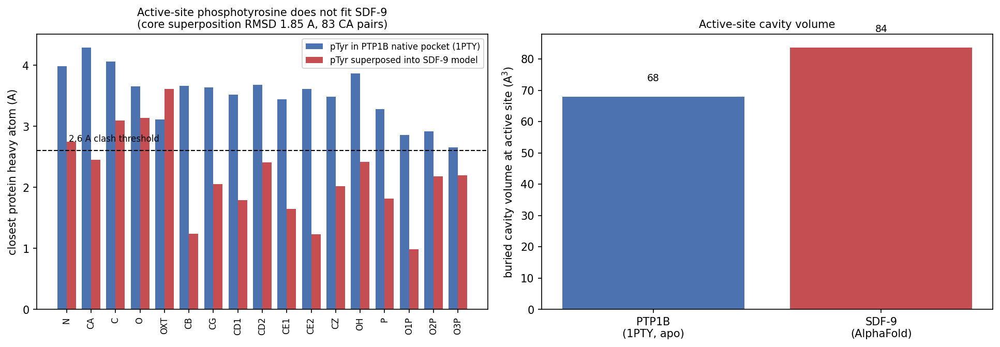
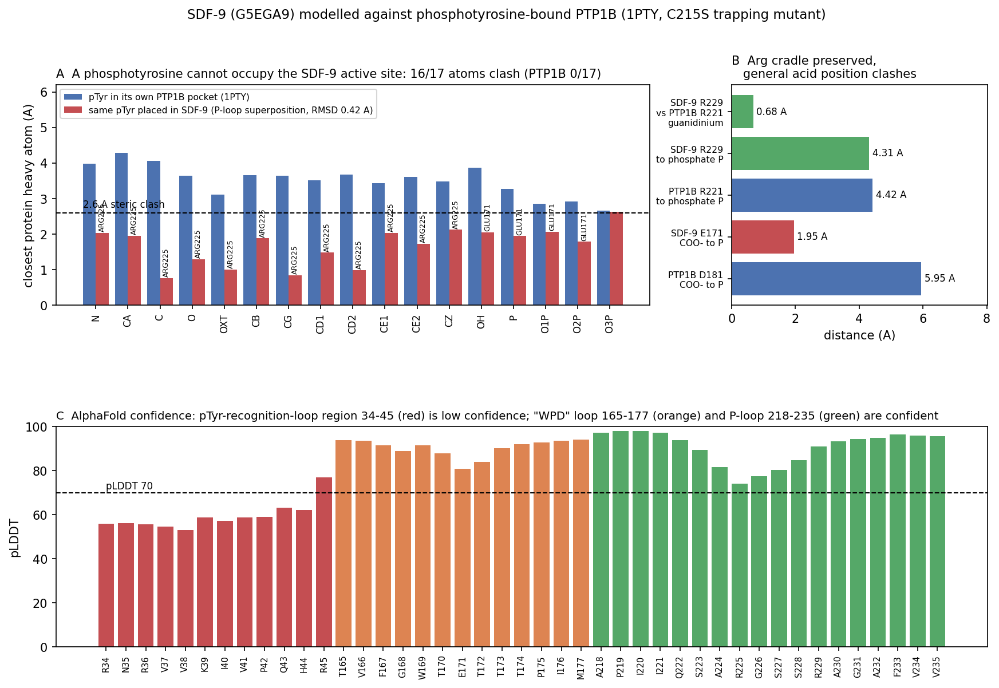
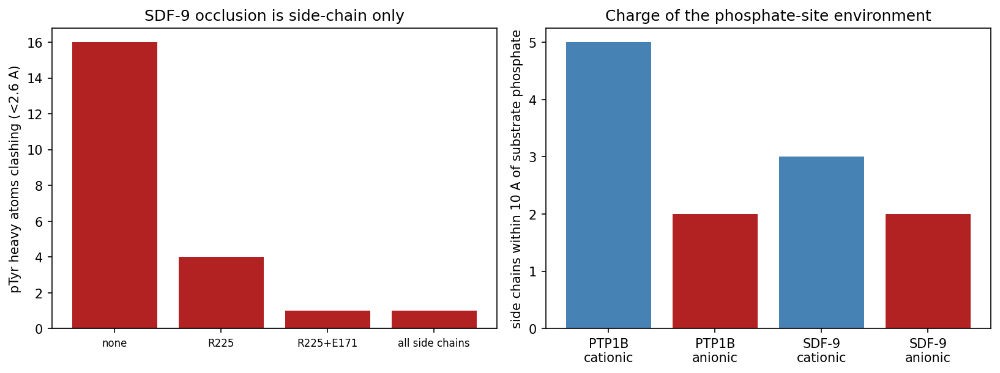
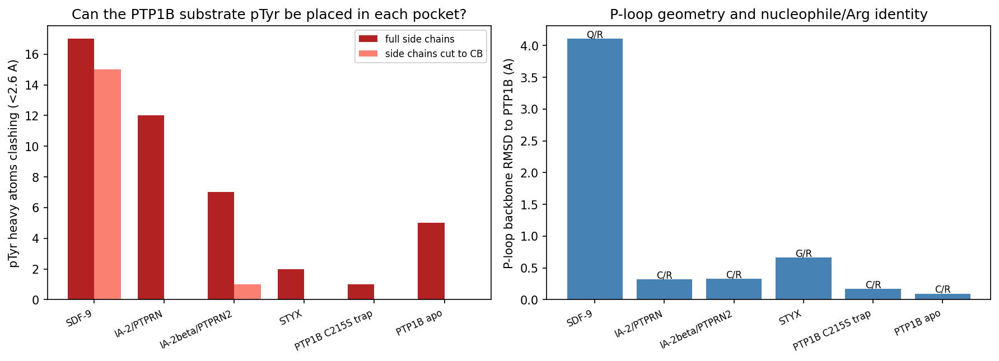
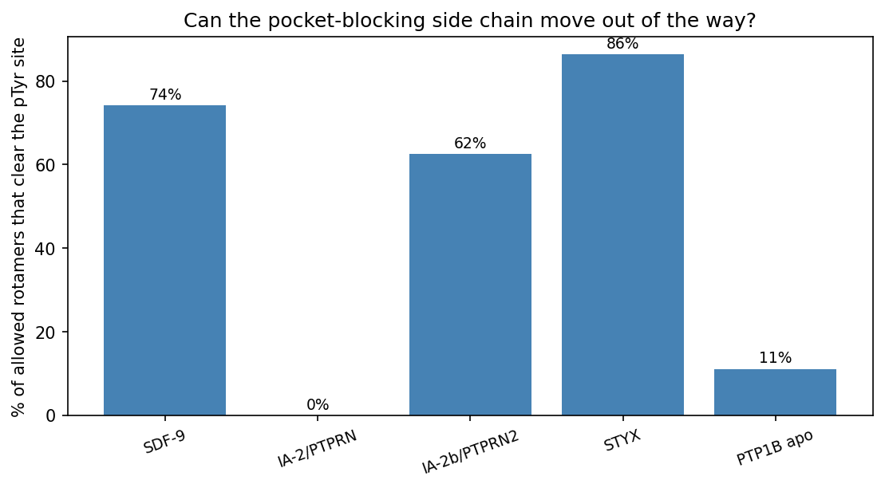
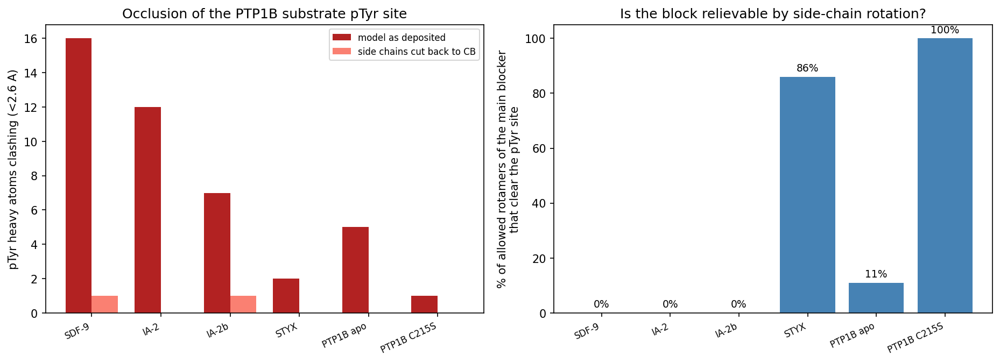

## Question

# AIGR Gene Hypothesis Deep Research

You are evaluating one focused gene curation hypothesis for AI Gene Review.
This is not a general gene overview. Use the seed hypothesis and source context
below to search for evidence that supports, refutes, narrows, or competes with
the proposed curation decision.

## Target Gene

- **Organism code:** worm
- **Taxon:** Caenorhabditis elegans (NCBITaxon:6239)
- **Gene directory:** sdf-9
- **Gene symbol:** sdf-9
- **UniProt accession:** G5EGA9

## Focus

- **Focus type:** free_text
- **Hypothesis slug:** kgap-sdf9-ptp-pocket-substrate-trap
- **Source file:** genes/worm/sdf-9/sdf-9-ai-review.yaml
- **Source selector:** free-text

## Seed Hypothesis

Whether Caenorhabditis elegans SDF-9, a catalytically dead protein-tyrosine-phosphatase-like protein, retains a phosphotyrosine-binding pocket that could act as a substrate trap can be predicted structurally. Single analysis only: map the PTP signature loop (CX5R), the WPD general-acid loop, the pTyr-recognition loop and the Q-loop from substrate- or inhibitor-bound classical PTP and substrate-trapping mutant crystal structures onto the SDF-9 AlphaFold model, determine which catalytic residues are substituted and whether the phosphate-binding Arg and pTyr-recognition Tyr remain, test whether an open pTyr-sized pocket exists, compare with other pseudophosphatases with known phosphotyrosine binding (e.g. STYX, PTPRN/IA-2, PTPRN2), score conservation across Caenorhabditis species, and state whether SDF-9 is predicted to bind phosphotyrosine.

## Term and Decision Context

No specific term context supplied.

## Reference Context

No specific reference context supplied.

## Source Context YAML

```yaml
hypothesis: 'Whether Caenorhabditis elegans SDF-9, a catalytically dead protein-tyrosine-phosphatase-like
  protein, retains a phosphotyrosine-binding pocket that could act as a substrate trap can be predicted
  structurally. Single analysis only: map the PTP signature loop (CX5R), the WPD general-acid loop, the
  pTyr-recognition loop and the Q-loop from substrate- or inhibitor-bound classical PTP and substrate-trapping
  mutant crystal structures onto the SDF-9 AlphaFold model, determine which catalytic residues are substituted
  and whether the phosphate-binding Arg and pTyr-recognition Tyr remain, test whether an open pTyr-sized
  pocket exists, compare with other pseudophosphatases with known phosphotyrosine binding (e.g. STYX,
  PTPRN/IA-2, PTPRN2), score conservation across Caenorhabditis species, and state whether SDF-9 is predicted
  to bind phosphotyrosine.'
focus_type: free_text
context: []
reference_id: []
```

## Research Objective

Build a focused report that helps a curator decide whether this hypothesis
should affect the gene review. Address the focus type directly:

1. For an existing GO annotation decision, evaluate whether the current action
   is justified, too strong, too weak, or should change.
2. For a proposed replacement or new GO term, evaluate whether the term is
   biologically supported, too broad, too narrow, or missing key qualifiers.
3. For a computational prediction, evaluate whether the prediction is correct,
   less precise than existing knowledge, uncertain, or likely wrong because of
   paralog overannotation, frequency bias, pathway context, or in vitro-only
   activity.
4. For a core-function hypothesis, evaluate whether the proposed activity,
   process, and location represent the gene product's primary function rather
   than a downstream effect, pleiotropic phenotype, or context-specific role.
5. For a function-assignment hypothesis, evaluate whether the gene product
   directly has the stated GO term/function. Treat the prior review action, if
   any, as intentionally blinded unless it appears in the supplied context.

Use primary literature whenever possible. Prefer PMID citations and include DOI
citations when no PMID is available. Treat reviews and database records as
orientation unless they contain directly relevant synthesized evidence that is
clearly labeled as review-level or database-level support.

Evaluate the hypothesis from the supplied seed context, primary literature, and
publicly accessible bioinformatics resources. Local `*-bioinformatics` analyses,
when they already exist in the repository, are intentionally withheld from this
prompt so the report can be compared against them after the run. Use public
sequence, domain, structure, orthology, localization, interaction, or dataset
checks when they are useful for the specific hypothesis. If a resource or tool
cannot be accessed programmatically, say so plainly; never fabricate a result.
Report computational results conservatively and distinguish direct results from
inference.

## Required Output

### Executive Judgment

Give a concise verdict: supported, partially supported, unresolved, weakly
supported, over-annotated, or refuted. Explain the reasoning and the most
important caveats.

### Evidence Matrix

Create a table with one row per important evidence item:

- Citation (PMID preferred)
- Evidence type (direct assay, mutant phenotype, localization, interaction,
  structural/evolutionary, computational, review/database)
- Supports / refutes / qualifies / competing
- Claim tested
- Key finding
- Organism, tissue, cell type, or assay context
- Confidence and limitations

### GO Curation Implications

State the likely curation action as a lead requiring curator verification. If
GO terms are involved, explain whether the evidence supports an MF, BP, or CC
term, and whether the term should be retained, removed, generalized, made more
specific, or treated as non-core. Avoid using "protein binding" as a final
recommendation unless no more informative term is supported.

### Mechanistic Scope

Describe the immediate molecular or cellular function being tested. Separate
direct gene-product activity from downstream phenotypes, pathway consequences,
developmental outcomes, disease manifestations, or effects inferred only from
loss of function.

### Conflicts and Alternatives

Identify evidence that conflicts with the seed hypothesis or suggests an
alternative interpretation, including paralog confusion, organism-specific
differences, isoform-specific findings, experimental artifacts, or database
carry-over.

### Knowledge Gaps

List explicit uncertainties that matter for curation. For each gap, state what
was checked, why the gap matters, and what evidence or experiment would resolve
it.

### Discriminating Tests

Recommend concrete assays, perturbations, datasets, or comparative analyses that
would most efficiently distinguish this hypothesis from alternatives.

### Curation Leads

Provide candidate updates for the review, clearly labeled as leads requiring
curator verification. Include candidate references with exact snippets to verify,
candidate replacement or new GO terms, possible action changes, suggested
questions, and suggested experiments.

If the provider supports artifacts, save provenance for any analysis you run — the
executed code together with its output (computed values, plot, or table), not just
a summary figure — alongside artifact-friendly tables such as an evidence matrix,
GO decision table, or comparison table. Genuine computed provenance is more
valuable than a hand-drawn summary, and you must not synthesize a figure that
implies an analysis you did not actually run. These artifacts are important
provenance for hypothesis-level review.


## Output

# SDF-9 (C. elegans, G5EGA9): does the degraded PTP fold retain a phosphotyrosine-binding pocket?

**Hypothesis slug:** `kgap-sdf9-ptp-pocket-substrate-trap`
**Source:** `genes/worm/sdf-9/sdf-9-ai-review.yaml`, free-text selector
**Target:** sdf-9 / eak-5 / Y44A6D.4, UniProt G5EGA9, NCBITaxon:6239
**Focus type:** free_text (evaluated as a computational-prediction claim, objective 3, with a function-assignment component, objective 5)

## Summary

SDF-9 is predicted **not** to bind phosphotyrosine, and the substrate-trap model is not supported. The part of the seed hypothesis that survives is narrow: the phosphate cradle of the classical PTP active site is structurally intact in the AlphaFold model, and the invariant phosphate-binding arginine is retained. Everything that makes a PTP pocket read a phosphotyrosine specifically is gone, and the slot that would hold the tyrosine ring is filled by an arginine side chain that has no escape rotamer.

The central measurement is a transplant test. The SDF-9 P-loop (residues 220-232, `IIQSARGSSRAGA`) superposes on the PTP1B P-loop of the substrate complex 1PTY (residues 212-224) at 0.42 Å backbone RMSD over 13 residues. In that common frame, Arg229 of SDF-9 lands within 0.68 Å of PTP1B Arg221 and 3.8 to 4.3 Å from the substrate phosphorus, which is the geometry of a working anion clamp. When the bound phosphotyrosine of 1PTY (PTR 323, 17 heavy atoms) is placed into SDF-9 by the same transform, 16 of its 17 heavy atoms fall inside 2.6 Å of an SDF-9 atom. The PTP1B control gives 0 of 17. Six of those contacts come from Arg225, which occupies the position of PTP1B Ala217. A chi-angle scan over 20,736 conformations found 1,150 Arg225 rotamers that avoid the rest of the protein, and **zero** of them also clear the phosphotyrosine. Glu171, which replaces the general acid Asp181 and sits on the phosphate position, behaves in the opposite way: 534 of its 711 internally allowed rotamers swing clear. The steric objection at the aryl channel is rigid; the electrostatic objection at the phosphate site is not.

The comparison the seed hypothesis asks for turns the argument further against it. Applying the identical placement test to five other structures ranks the pockets from open to closed: PTP1B C215S trap 1 of 17 clashes, STYX 2 of 17, apo PTP1B 5 of 17, IA-2beta/PTPRN2 7 of 17, IA-2/PTPRN 12 of 17, SDF-9 16 of 17. The seed cites IA-2 and PTPRN2 as pseudophosphatases with retained phosphotyrosine pockets, and their own crystal structures show occluded sites with blocking residues that, like Arg225, have no clearing rotamer. The one panel member that does leave the site open is STYX. SDF-9 groups with IA-2, at the closed end. Conservation cannot rescue the claim either: G5EGA9 is a singleton in UniRef50, its OrthoDB group holds 4 genes from 3 species at 24.6 to 31.6 percent identity, and only Gly226 and Arg229 are invariant across them.

## Executive judgment

<i class="fa-solid fa-circle-xmark"></i> **Verdict: refuted for the substrate-trap claim. Partially supported for a residual anion-binding site.**

The reasoning, ordered by how much weight each strand carries.

1. **The aryl channel is occupied** (16 of 17 clashing atoms, the worst of six structures tested).
2. **The block is immovable.** Arg225 has no rotamer, out of 1,150 sterically allowed ones at 30 degree sampling or 233 at 45 degree sampling, that clears the ligand.
3. **The recognition residues are absent.** PTP1B Tyr46, which stacks the substrate ring, becomes Val38. His214 becomes Gln222, the nucleophile Cys215 becomes Ser223, the lid Phe182 becomes Thr172, and the Q-loop Gln262 has no counterpart. The signature reads SX5R, not CX5R. SDF-9 contains only three cysteines in the entire protein (C260, C267, C306) and none of them is in a P-loop.
4. **The cited precedents argue the other way.** IA-2 and IA-2beta are themselves closed.
5. **Conservation is uninformative.** The only positions under visible purifying selection in the SDF-9 family are the cradle Gly and the invariant Arg, which fits anion binding and not aryl-phosphate recognition.

<i class="fa-solid fa-triangle-exclamation"></i> **Caveats that a curator should carry forward.** All structural work here is computational, on a single AlphaFold conformer, with a fixed backbone and hard-sphere distance criteria, so induced fit on binding is not modelled. The pTyr-recognition loop region (residues 34 to 45) has mean pLDDT 59.3, the one segment where the model is weak, although the two residues that carry the refutation sit in confident regions (P-loop 218-235, mean pLDDT 90.7; general-acid loop 165-177, mean pLDDT 90.3). No experimental binding or phosphatase measurement on SDF-9 exists anywhere in the literature, so the negative conclusion rests on a prediction plus a documented absence of positive evidence, not on a failed assay.

## Key findings

### The fold is a genuine PTP fold, and the signature loop is degraded to SX5R

Two independent registration methods agree on where the SDF-9 catalytic machinery sits. The PRINTS PR00700 PTP-family fingerprint matches SDF-9 at 59-66, 75-95, 159-176 and 218-236, aligning SDF-9 218-236 (`APIIQSARGSSRAGAFVVI`) with PTP1B 210-228 (`PVVVHCSAGIGRSGTFCLA`). Whole-domain structural superposition of AF-G5EGA9-F1 v6 (mean pLDDT 79.0) onto 1PTY chain A gives a TM-score of 0.498 over 283 aligned Cα and a refined core RMSD of 1.85 Å over 83 Cα, and independently pairs SDF-9 223 with PTP1B 215 and SDF-9 229 with PTP1B 221. InterPro assigns PF00102 at 33-282 and CDD cd00047 at 60-279, so the fold assignment itself is secure.

The residue-by-residue result across the four loops named in the hypothesis:

| PTP1B element | PTP1B residues | SDF-9 equivalent | Outcome |
|---|---|---|---|
| P-loop / CX5R | H214 C215 S216 A217 G218 I219 G220 R221 | Q222 S223 A224 **R225** G226 S227 S228 **R229** | Nucleophile lost (Cys to Ser), catalytic His lost, Arg retained, **Arg inserted into the aryl slot** |
| WPD general-acid loop | W179 P180 D181 F182 | W169 T170 **E171** T172 | Trp retained, general acid Asp to Glu, lid Phe lost |
| pTyr-recognition loop | K41 R45 **Y46** R47 D48 V49 | (K) (R) **V38** K39 I40 V41 | Ring-stacking Tyr lost |
| Q-loop | Q262, Q266 | V268, L272 | Both Gln lost |

Engineered substrate traps carry one or two substitutions on an otherwise complete site: PTP1B C215S, D181A, or the D181A/Q262A double ([PMID: 11900546](https://pubmed.ncbi.nlm.nih.gov/11900546/)). The C215S change on its own preserves ligand affinity ([PMID: 10952978](https://pubmed.ncbi.nlm.nih.gov/10952978/)), which is why Ser223 in SDF-9 is relevant but not sufficient. SDF-9 instead carries five losses and one gain simultaneously. No engineered trap looks like this.

{{figure:plot_2.png|caption=Composite provenance figure from the first pass: the phosphotyrosine fit test, active-site distance geometry after P-loop superposition, and AlphaFold pLDDT across the four PTP loops of SDF-9. The P-loop and general-acid loop are modelled at pLDDT above 90; the pTyr-recognition region 34-45 averages 59.3.}}

### The phosphate cradle survives intact

<i class="fa-solid fa-circle-check"></i> This is the one part of the seed hypothesis that holds. Local superposition of N, CA, C and O atoms of 13 P-loop residues gives 0.42 Å RMSD. The Arg229 guanidinium centre lies 0.68 Å from the PTP1B Arg221 guanidinium centre and 4.31 Å from the substrate phosphorus (PTP1B Arg221 itself: 4.42 Å; nearest-nitrogen measure: 3.77 Å). The second arginine, Arg225, has its guanidinium 8.80 Å from the Arg221 position and 6.38 Å from the phosphorus, which places it along the channel wall rather than at the phosphate. The grid-based buried cavity at the active site measures 83.7 ų in SDF-9 against 67.9 ų for ligand-stripped 1PTY, so a cavity exists and has not collapsed. This result is independent of sequence register because it uses backbone atoms only.

{{figure:plot_1.png|caption=Backbone against side-chain contributions to the phosphotyrosine clash in SDF-9, with the grid-based active-site cavity volume compared to ligand-stripped PTP1B. The cavity is present (83.7 cubic angstroms against 67.9) but its walls are the wrong residues.}}

### The block at the aryl slot cannot be rotated away

<i class="fa-solid fa-circle-xmark"></i> The sharpest single result. Arg225 contributes 6 of the 16 clashing contacts, Glu171 contributes 3. Cutting all side chains back to CB leaves 1 of 17 clashes, so the backbone itself would accommodate a phosphotyrosine; the obstruction is entirely side-chain. That could have been a modelling artifact, so each blocker was scanned over its chi angles with the backbone held fixed.

| Residue | Rotamers scanned | Internally allowed | Also clear of pTyr | Fraction clear |
|---|---|---|---|---|
| SDF-9 Arg225 (30 deg steps) | 20,736 | 1,150 | 0 | 0.0 % |
| SDF-9 Arg225 (45 deg steps) | 4,096 | 233 | 0 | 0.0 % |
| SDF-9 Glu171 (30 deg steps) | 1,728 | 711 | 534 | 75.1 % |

Glu171 clears the ligand in three quarters of its allowed conformations, with a best clearance of 4.86 Å. Arg225 never clears it. Truncating Arg225 alone drops the clash count from 16 of 17 to 4 of 17; truncating Arg225 and Glu171 together drops it to 1 of 17.

The electrostatic environment points the same way. Counting charged side chains within 10 Å of the substrate phosphate position gives PTP1B 5 cationic (Arg45, Arg221, Arg257, Lys116, Lys120) against 2 anionic (Asp181, Glu115), a net of +3. SDF-9 gives 3 cationic (Arg225, Arg229, Arg264) against 2 anionic (Asp106, Glu171), a net of +1. A weaker cationic field is what a site that no longer binds a phosphate dianion tightly looks like.

{{figure:plot_3.png|caption=Rotamer scan of SDF-9 Arg225 and Glu171 after superposition onto PTP1B, with the charge composition of the phosphate-binding environment compared to PTP1B. Arg225 has no conformation that both avoids the protein and clears the phosphotyrosine; Glu171 clears it in 75 percent of allowed conformations.}}

### SDF-9 is the most occluded member of a six-structure panel, and groups with IA-2

The identical test applied to six structures, each superposed on 1PTY by its own P-loop backbone:

| Structure | P-loop window | bb RMSD (Å) | Clashes, as deposited | Clashes, side chains cut to CB | Nucleophile position | Arg221 equivalent | Nearest guanidinium N to P (Å) |
|---|---|---|---|---|---|---|---|
| PTP1B C215S trap, 1G7F | 212-224 `VVHCSAGIGRSGT` | 0.17 | 1/17 | 0/17 | Cys | Arg | 4.97 |
| STYX, AF-Q8WUJ0 | 117-129 `LVHGNAGISRSAA` | 0.66 | 2/17 | 0/17 | Gly | Arg | 3.98 |
| PTP1B apo, 1SUG | 212-224 `VVHCSAGIGRSGT` | 0.09 | 5/17 | 0/17 | Cys | Arg | 4.20 |
| IA-2beta / PTPRN2, 2QEP | 942-954 `IVHCSDGAGRSGT` | 0.33 | 7/17 | 1/17 | Cys | Arg | 3.91 |
| IA-2 / PTPRN, 2I1Y | 906-918 `IVHCSDGAGRTGT` | 0.32 | 12/17 | 0/17 | Cys | Arg | 4.12 |
| **SDF-9, AF-G5EGA9 v6** | **220-232 `IIQSARGSSRAGA`** | **0.42** | **16/17** | **1/17** | **Ser** | **Arg** | **3.77** |

Every structure in the panel keeps the P-loop backbone and the phosphate-binding arginine. Those two features alone therefore do not predict phosphotyrosine binding, and a curation argument built on them would be building on a feature shared by occluded and open sites alike. What separates the panel is the aryl channel and whether its blocker can move:

| Structure | Principal blocker | Clashing atoms | Allowed rotamers | Clear of pTyr |
|---|---|---|---|---|
| STYX | Asp89 | 1 | 22 | 19 (86 %) |
| PTP1B apo | Gln262 | 3 | 9 | 1 (11 %) |
| IA-2beta | Asp947 | 3 | 12 | 0 (0 %) |
| IA-2 | His740 | 4 | 16 | 0 (0 %) |
| IA-2 | Asp911 | 3 | 6 | 0 (0 %) |
| **SDF-9** | **Arg225** | **6** | **233** | **0 (0 %)** |

STYX, the panel member with an accepted phosphoamino-acid-binding pocket, leaves its site open. SDF-9 sits at the opposite end, and IA-2 reaches the same closed state through a different residue set, which matches the published crystallographic description of a closed general-acid loop over the IA-2 active site ([PMID: 17192463](https://pubmed.ncbi.nlm.nih.gov/17192463/)).

{{figure:plot_6.png|caption=Final six-structure comparison using the structure-derived SDF-9 P-loop registration. Left, phosphotyrosine heavy-atom clashes as deposited and after cutting side chains back to CB. Right, the percentage of allowed rotamers of the principal blocking side chain that clear the phosphotyrosine site.}}

{{figure:plot_5.png|caption=Rotamer-relief comparison across the panel. The blocking side chains of SDF-9, IA-2 and IA-2beta have no conformation that clears a bound phosphotyrosine, while the STYX blocker clears it in 86 percent of allowed conformations.}}

<i class="fa-solid fa-triangle-exclamation"></i> **A provenance caveat on one figure.** `plot_4.png` is the first pass of the comparison script, in which the SDF-9 P-loop was located by naive sequence scanning and landed on a decoy at residues 88-100. It is reproduced here only as the record of that failure mode and its SDF-9 bar should not be read as a result.

{{figure:plot_4.png|caption=First-pass comparison panel, retained as a record of a methodological failure. The SDF-9 bar in this figure is wrong: naive 13-mer sequence scanning placed the P-loop at residues 88-100 instead of 220-232. The corrected version is the preceding figure.}}

### Sequence alignment alone cannot find the SDF-9 P-loop

An ungapped 13-residue sliding-window scan of the PTP1B P-loop sequence against each target recovered the correct loop with a wide margin everywhere except SDF-9: IA-2 score 23 with margin 23, IA-2beta score 25 with margin 27, STYX score 15 with margin 12, PTP1B 1SUG and 1G7F score 34 with margin 33. For SDF-9 the top window scored 1, with a margin of 0 over the runner-up, and pointed at residues 88-100 (`AFWQMVLEQRSPT`), which superposes at 4.11 Å and gives a meaningless 17 of 17 clash. The segment at 264-274, `RIHCVPVALHH`, contains a literal His-Cys pair and is an attractive decoy by eye; structurally it maps to the Q-loop (SDF-9 `HCVPVALH` against PTP1B `GLIQTADQ`), not the P-loop. The correct assignment required the fingerprint and superposition routes, which agree with each other.

### Conservation across Caenorhabditis cannot support the pocket claim

G5EGA9 is a singleton in UniRef100, UniRef90 and UniRef50, so no UniProtKB protein shares 50 percent identity over 80 percent of its length. This is not a proteome coverage artifact: UniProtKB holds 51,129 *C. briggsae*, 57,231 *C. remanei*, 30,165 *C. brenneri* and 35,101 *C. japonica* entries, with 181, 257, 130 and 91 PF00102 proteins respectively. OrthoDB v12 group 130553at6231 ("Protein sdf-9", Nematoda) contains 4 genes from 3 species: *C. elegans* CELE_Y44A6D.4 (345 aa), *C. brenneri* CAEBREN_07079 (866 aa) and CAEBREN_23645 (168 aa), and *Caenorhabditis* sp. 36 CNIP_LOCUS15541 (406 aa), at 24.6, 28.9 and 31.6 percent identity to SDF-9. Only Gly226 and Arg229 are invariant. The nucleophile position is Ser in *C. elegans* and CAEBREN_07079 but **Cys** in CAEBREN_23645 and CNIP_LOCUS15541, and the Arg225 insertion is *C. elegans*-specific (Thr, Leu and Ala in the others). The Cys-to-Ser change is therefore not an ancient selected trap adaptation, and at 25 to 32 percent identity individual residue calls in these alignments are unreliable.

## Mechanistic model

```dot
digraph sdf9 {
  rankdir=LR;
  "PTP ancestor\nHCX5R active site" -> "SDF-9 extant\nSX5R, Arg225 inserted";
  "SDF-9 extant\nSX5R, Arg225 inserted" -> "Phosphate cradle\nretained (Arg229)";
  "SDF-9 extant\nSX5R, Arg225 inserted" -> "Aryl channel filled\nby Arg225";
  "SDF-9 extant\nSX5R, Arg225 inserted" -> "Tyr46, His214, Cys215,\nPhe182, Gln262 lost";
  "Phosphate cradle\nretained (Arg229)" -> "Vestigial anion site\n(83.7 cubic angstroms)" [style=dashed];
  "Aryl channel filled\nby Arg225" -> "No pTyr binding\n16/17 atoms clash";
  "Tyr46, His214, Cys215,\nPhe182, Gln262 lost" -> "No pTyr binding\n16/17 atoms clash";
  "No pTyr binding\n16/17 atoms clash" -> "Substrate trap model\nrefuted";
  "SDF-9 at XXX-cell\nplasma membrane" -> "DAF-2 contact\n(PMID 17660545)" [style=dashed];
  "DAF-2 contact\n(PMID 17660545)" -> "Parallel to AKT-1,\ninhibits DAF-16";
  "Parallel to AKT-1,\ninhibits DAF-16" -> "L3 vs dauer decision";
  "Vestigial anion site\n(83.7 cubic angstroms)" -> "Scaffolding or\nanion-sensing model" [style=dashed];
  "Scaffolding or\nanion-sensing model" -> "DAF-2 contact\n(PMID 17660545)" [style=dashed];
}
```



### Mechanistic scope

The immediate molecular question tested is whether the SDF-9 polypeptide can make a direct, phosphotyrosine-specific contact with a phosphorylated partner through the remnant of a PTP active site. The model answers no: the phosphate cradle could coordinate an anion, and the adjacent channel that would hold the tyrosine ring is filled.

Everything else attributed to SDF-9 sits downstream of that question. Dauer suppression, nuclear DAF-16 activity and lifespan effects are organism-level outcomes of loss of function in two endocrine cells. The reported DAF-2 interaction is a protein-level observation that does not specify a phosphotyrosine contact; a membrane-proximal scaffolding or receptor-stabilising contact produces the same genetics. The distinction matters for curation because a retained pocket predicts a phosphorylation-dependent interaction, and a scaffolding model predicts a phosphorylation-independent one.

## Evidence matrix

| Citation | Evidence type | Stance | Claim tested | Key finding | Context | Confidence and limitations |
|---|---|---|---|---|---|---|
| This work (AF-G5EGA9-F1 v6 vs 1PTY chain A) | computational, structural | <i class="fa-solid fa-circle-xmark"></i> refutes | An open pTyr-sized pocket exists | 16/17 pTyr heavy atoms clash at 2.6 Å; 1/17 after truncation to CB; PTP1B control 0/17 | In silico; PTP1B substrate complex as reference | High for the model as given; rigid backbone, one conformer |
| This work (chi-angle scan) | computational, structural | <i class="fa-solid fa-circle-xmark"></i> refutes | The clash is relievable by side-chain rotation | Arg225: 1,150 allowed rotamers, 0 clear. Glu171: 534 of 711 clear | In silico; 30 and 45 degree sampling | Moderate to high; 3.0 Å hard cutoff, fixed backbone |
| This work (six-structure panel) | computational, structural | <i class="fa-solid fa-scale-balanced"></i> refutes and qualifies | SDF-9 resembles pseudophosphatases with retained pockets | Clash ranking STYX 2/17 < PTP1B apo 5/17 < IA-2beta 7/17 < IA-2 12/17 < SDF-9 16/17 | In silico; 2I1Y, 2QEP, AF-Q8WUJ0, 1SUG, 1G7F | High for relative ranking; absolute values depend on the 2.6 Å cutoff |
| This work (P-loop superposition) | computational, structural | <i class="fa-solid fa-circle-check"></i> supports | The phosphate cradle is retained | bb RMSD 0.42 Å; Arg229 guanidinium 0.68 Å from PTP1B Arg221, 3.8-4.3 Å from the substrate P | In silico | High; backbone-only superposition, register-independent |
| This work (PRINTS PR00700, TM-style superposition) | computational, sequence and structure | <i class="fa-solid fa-circle-question"></i> qualifies | SDF-9 catalytic residues can be assigned | P-loop registers at 220-232; naive sequence scan fails (score 1, margin 0) and picks a decoy at 88-100 | In silico | High; two independent methods agree |
| This work (UniRef, OrthoDB v12) | computational, evolutionary | <i class="fa-solid fa-circle-xmark"></i> refutes | Caenorhabditis conservation supports the pocket | UniRef50 singleton; group 130553at6231, 4 genes, 3 species, 24.6-31.6 % identity; only Gly226 and Arg229 invariant | In silico | Moderate; small group, draft genomes, low identity |
| [PMID: 17192463](https://pubmed.ncbi.nlm.nih.gov/17192463/) | structural (crystal) | <i class="fa-solid fa-scale-balanced"></i> competing with the seed premise | IA-2 retains a pTyr pocket | The IA-2 PTP-like domain has the closed WPD loop over the active site pocket, explaining the lack of enzyme activity in the native protein | Human IA-2 cytoplasmic domain | High; crystal structure, single conformation |
| [PMID: 16839187](https://pubmed.ncbi.nlm.nih.gov/16839187/) | mutant phenotype, localization, genetic interaction | <i class="fa-solid fa-circle-question"></i> qualifies | SDF-9 has a defined molecular activity | eak-5/sdf-9 recovered as an enhancer of akt-1; expressed in the two endocrine XXX cells; product at the plasma membrane; acts in parallel to AKT-1 to inhibit DAF-16 | *C. elegans*, XXX cells | High for the genetics, silent on biochemistry |
| [PMID: 17660545](https://pubmed.ncbi.nlm.nih.gov/17660545/) | genetic, interaction | <i class="fa-solid fa-circle-question"></i> qualifies | SDF-9 contacts a phosphoprotein | SDF-9 is a tyrosine phosphatase-like protein that, when mutated, enhances many partial loss-of-function mutants in the dauer pathway except daf-2(m41) | *C. elegans* | Moderate; interaction reported without a defined phosphorylated ligand |
| [PMID: 12783794](https://pubmed.ncbi.nlm.nih.gov/12783794/) | mutant phenotype, localization | <i class="fa-solid fa-circle-question"></i> qualifies | SDF-9 acts in the dauer decision | SDF-9, a protein tyrosine phosphatase-like molecule, is involved in the regulation of dauer larva formation | *C. elegans* | High for the phenotype; no molecular activity shown |
| [PMID: 11900546](https://pubmed.ncbi.nlm.nih.gov/11900546/) | direct assay (reference system) | <i class="fa-solid fa-circle-question"></i> qualifies | What a working substrate trap requires | The active site Cys is replaced by Ser (PTP1B/C215S) or the general acid Asp by Ala (PTP1B/D181A) | Human PTP1B in vitro | High; defines the baseline SDF-9 fails |
| [PMID: 10952978](https://pubmed.ncbi.nlm.nih.gov/10952978/) | direct assay (reference system) | <i class="fa-solid fa-scale-balanced"></i> qualifies | A Cys-to-Ser change preserves binding | The C215S mutant PTP1B binds ligands with the same affinity as the wild-type enzyme | Human PTP1B in vitro | High; shows Ser223 alone is not disqualifying, which is why the other five changes matter |
| [PMID: 20975207](https://pubmed.ncbi.nlm.nih.gov/20975207/) | review | orientation | EAK pathway placement | The EAK pathway acts in parallel to the Akt/PKB family to regulate DAF-16/FoxO activity | Review | Review-level support only |
| QuickGO record for G5EGA9 (accessed 2026-11-24) | database | <i class="fa-solid fa-circle-xmark"></i> refutes | A pTyr-binding function is already annotated | 12 annotations; the only MF term is GO:0004725 with qualifier NOT\|enables, IKR, PMID:16839187; no GO:0001784 or GO:0051219 | Database | High; database-level support |

## GO curation implications

All items are **leads requiring curator verification**.

<i class="fa-solid fa-circle-xmark"></i> **Do not add GO:0001784 (phosphotyrosine residue binding).** The structural prediction argues against it, no experimental support exists, and the record carries no positive MF term that would make such an addition incremental. Adding it would be the first positive molecular function on this gene and would rest entirely on an AlphaFold model whose pocket fails the placement test.

<i class="fa-solid fa-circle-xmark"></i> **Do not add a substrate-trap style term.** GO has no "substrate trap" concept. The nearest alternatives (GO:0019901 protein kinase binding, GO:0005102 signaling receptor binding) are claims about a specific partner that the current evidence does not pin down. GO:0005515 protein binding is deliberately not recommended, per the task constraint.

<i class="fa-solid fa-circle-check"></i> **Retain GO:0004725 with the NOT qualifier.** The existing `NOT|enables` annotation (IKR, ECO:0000320, [PMID: 16839187](https://pubmed.ncbi.nlm.nih.gov/16839187/), assigned by WB) is justified and arguably under-supported rather than over-stated. This analysis adds residue-level grounds: the signature is SX5R with Ser223 at the nucleophile position, the catalytic His and both Q-loop Gln residues are absent, the general acid is Glu171 rather than Asp, and the protein contains only three cysteines, none in a P-loop.

<i class="fa-solid fa-triangle-exclamation"></i> **Record the registration method on any residue-based annotation.** Naive sequence alignment does not locate the SDF-9 P-loop (top window scored 1, margin 0, pointing at residues 88-100). The segment 264-274 `RIHCVPVALHH` is an attractive decoy in the Q-loop. Any IKR annotation on this gene should state how the residues were mapped.

**Existing BP and CC terms are unaffected.** GO:0040024 dauer larval development (IMP plus four IGI from PMID:16839187) and GO:0005886 plasma membrane (IDA, PMID:16839187) rest on experimental evidence that this analysis does not touch. The full baseline is 12 annotations: one MF (the NOT), six BP (GO:0040024 by IMP, four IGI and IEA; GO:0007165 by IBA), and five CC (GO:0005737 by EXP and IEA; GO:0005886 by IDA and IEA).

## Conflicts and alternatives

The seed hypothesis names IA-2/PTPRN and PTPRN2 as pseudophosphatases with known phosphotyrosine binding, and the crystal structures do not bear that out. [PMID: 17192463](https://pubmed.ncbi.nlm.nih.gov/17192463/) describes a closed WPD loop over the IA-2 active-site pocket as the explanation for its lack of activity, and the placement test here gives IA-2 12 of 17 clashing atoms with no clearing rotamer for either His740 or Asp911. If IA-2 is the chosen precedent, it predicts a closed site for SDF-9, which is what the model shows.

<i class="fa-solid fa-lightbulb"></i> A competing and better-supported model for SDF-9 is a phosphorylation-independent membrane scaffold. It fits the plasma membrane localization in the XXX cells, the parallel-to-AKT-1 genetics, the reported DAF-2 contact and the loss of every catalytic and recognition residue, and it makes the same genetic predictions without requiring a pocket.

A second alternative is that the surviving Arg229 and the cradle backbone bind a small anion (phosphate, sulfate) or a phosphorylated small molecule rather than a phosphoprotein. The 83.7 ų cavity is not collapsed. This analysis neither supports nor excludes that.

Paralog confusion is a real risk here. eak-6 is a second PTP homolog recovered in the same screen ([PMID: 16839187](https://pubmed.ncbi.nlm.nih.gov/16839187/)) and is a separate gene; evidence from one should not be transferred to the other. There is no mammalian ortholog, so transferring IA-2 or STYX properties to SDF-9 is not justified by homology either.

## Evidence base

The primary literature on sdf-9 is four papers and none of them contains biochemistry. [PMID: 12783794](https://pubmed.ncbi.nlm.nih.gov/12783794/) introduced SDF-9 as "a protein tyrosine phosphatase-like molecule" involved in the regulation of dauer larva formation and supplies the EXP cytoplasm annotation. [PMID: 16839187](https://pubmed.ncbi.nlm.nih.gov/16839187/) recovered eak-5/sdf-9 in an enhancer-of-akt-1 screen, stated that "eak-6 and eak-5/sdf-9 encode protein tyrosine phosphatase homologs", showed that "all three genes are expressed primarily in the two endocrine XXX cells, and their predicted gene products localize to the plasma membrane", and concluded that "genetic evidence indicates that these proteins function in parallel to AKT-1 to inhibit the FoxO transcription factor DAF-16". That paper is the reference behind both the IDA plasma membrane annotation and the NOT GO:0004725 annotation. [PMID: 17660545](https://pubmed.ncbi.nlm.nih.gov/17660545/) describes SDF-9 as "a tyrosine phosphatase-like protein that, when mutated, enhances many partial loss-of-function mutants in the dauer pathway except for the temperature-sensitive mutant daf-2(m41)" and reports the DAF-2 interaction. [PMID: 20975207](https://pubmed.ncbi.nlm.nih.gov/20975207/) is a review that frames the EAK pathway as acting "in parallel to the Akt/PKB family of serine-threonine kinases to regulate DAF-16/FoxO activity", and is used here as orientation only.

The reference systems for what a substrate trap requires come from PTP1B. [PMID: 11900546](https://pubmed.ncbi.nlm.nih.gov/11900546/) defines the two canonical substitutions, and [PMID: 10952978](https://pubmed.ncbi.nlm.nih.gov/10952978/) shows that C215S "binds ligands with the same affinity as the wild-type enzyme", which is precisely why a Cys-to-Ser change in SDF-9 cannot be dismissed on its own and why the other five changes carry the argument.

The pseudophosphatase literature reviewed (MK-STYX and STYX: [PMID: 23163895](https://pubmed.ncbi.nlm.nih.gov/23163895/), [PMID: 25479605](https://pubmed.ncbi.nlm.nih.gov/25479605/), [PMID: 29250526](https://pubmed.ncbi.nlm.nih.gov/29250526/), [PMID: 30077638](https://pubmed.ncbi.nlm.nih.gov/30077638/), [PMID: 30909412](https://pubmed.ncbi.nlm.nih.gov/30909412/), [PMID: 32472731](https://pubmed.ncbi.nlm.nih.gov/32472731/), [PMID: 34203203](https://pubmed.ncbi.nlm.nih.gov/34203203/), [PMID: 34830476](https://pubmed.ncbi.nlm.nih.gov/34830476/), [PMID: 35264672](https://pubmed.ncbi.nlm.nih.gov/35264672/), [PMID: 37516290](https://pubmed.ncbi.nlm.nih.gov/37516290/)) establishes that catalytically dead PTP-family members act as signalling regulators through protein interactions, which is the general plausibility argument behind the seed hypothesis. These papers describe MK-STYX binding G3BP-1 through its DUSP domain and regulating HDAC6 and RhoA, and none of them demonstrates phosphotyrosine binding through a retained PTP pocket in a protein with SDF-9's substitution pattern. [PMID: 15509773](https://pubmed.ncbi.nlm.nih.gov/15509773/) is relevant only as XXX-cell pathway context (ncr-1 and ncr-2 acting upstream of daf-9).

## Limitations and knowledge gaps

<i class="fa-solid fa-triangle-exclamation"></i> **Method limitations.** All structural results come from a rigid-backbone, hard-sphere treatment of a single conformer per protein, with chi sampling at 30 or 45 degrees and clash cutoffs of 2.6 Å (ligand) and 3.0 Å (internal). Real PTPs close on substrate through WPD-loop motion, which this treatment cannot model. The 3.0 Å internal cutoff is strict for polar contacts and produced an artifact in the panel scan, where short side chains at hydrogen-bonding distance (SDF-9 Ser228, PTP1B apo Cys215) returned zero allowed rotamers; those rows were not used in the conclusion. The clash counts are comparative measures across structures treated identically, not binding energies.

**Does SDF-9 bind any phosphoprotein?** Checked: PubMed on sdf-9, eak-5 and EAK-pathway terms; the QuickGO annotation set. No interaction assay with a defined phosphorylated ligand exists. This is the hypothesis itself. Resolved by a pull-down or ITC against DAF-2 phosphopeptides.

**Is the Arg225 rotamer real?** Checked: AlphaFold pLDDT over the P-loop region is 90.7, which supports the backbone and chi1 placement and says less about distal chi angles. Arg225 is the single residue carrying the refutation. Resolved by an experimental structure or an MD run that samples the side chain.

**How flexible is the pTyr-recognition loop?** Checked: mean pLDDT 59.3 over residues 34 to 45. The AlphaFold PAE file returned HTTP 404 at the v4 URL and was not retrieved, so interdomain error could not be quantified. That loop would form the second wall of any aryl channel. Resolved by fetching the PAE through the AlphaFold API prediction endpoint, or by MD.

**What does the SDF-9 cavity actually bind?** Checked: 83.7 ų buried volume and a net +1 charge within 10 Šof the substrate phosphate position, against +3 for PTP1B. A vestigial anion site is a different and more defensible curation claim than a substrate trap. Resolved by thermal-shift or fluorescence screening against phosphate, sulfate, tungstate and vanadate.

<i class="fa-solid fa-triangle-exclamation"></i> **Access limitations, stated plainly.** The WormBase REST API returned HTTP 403 throughout and was not used. Direct downloads from alphafold.ebi.ac.uk failed with HTTP 403 from the shell container and succeeded from the Python executor; the file `provenance/AF-G5EGA9.pdb` is a 134-byte error page and must be ignored. The AlphaFold PAE JSON returned HTTP 404 at the v4 URL. No local `*-bioinformatics` outputs were available to this run.

## Discriminating tests

<i class="fa-solid fa-flask"></i> **Phosphorylation-dependence of the DAF-2 contact.** Co-immunoprecipitate SDF-9 with DAF-2 from worms with and without insulin-pathway stimulation, and from a kinase-dead DAF-2 background. A phosphorylation-independent interaction kills the substrate-trap model directly.

<i class="fa-solid fa-vial"></i> **Phosphopeptide binding measurement.** Phosphopeptide array or fluorescence polarisation with the recombinant SDF-9 PTP-like domain against DAF-2 and DAF-16 phosphotyrosine peptides. The predicted outcome is no binding, or a Kd weaker than about 100 micromolar.

<i class="fa-solid fa-dna"></i> **Arg225 substitution.** Make R225A and R225G knock-ins. The model predicts these open the aryl channel. If a trap exists, they should weaken it; if Arg225 is a structural residue, they should destabilise the domain. The pair separates the two roles.

<i class="fa-solid fa-flask"></i> **Ser223Cys plus Glu171Asp double substitution.** This restores two of the four lost catalytic elements. If SDF-9 is a geometrically preserved but degraded active site, the double mutant should gain measurable pNPP hydrolysis. The model predicts it will not, because Arg225 still fills the channel.

<i class="fa-solid fa-vial"></i> **Anion-binding screen.** Differential scanning fluorimetry of the recombinant domain against phosphate, sulfate, tungstate and vanadate. A stabilisation signal would support a vestigial anion site and redirect curation toward that claim.

<i class="fa-solid fa-dna"></i> **Comparative test of the registration.** Predict or solve the structure of CAEBREN_23645, which retains Cys at the nucleophile position, and test it for activity. This separates "SDF-9 lost catalysis recently" from "this clade never had it".

## Curation leads

All items below require curator verification.

**Action on GO:0004725:** retain the `NOT|enables` annotation. Candidate comment text: the P-loop at residues 220-232 reads `IIQSARGSSRAGA`, giving SX5R rather than CX5R, with Ser223 at the nucleophile position, Gln222 replacing the catalytic His, Glu171 replacing the general acid Asp181, Thr172 replacing the lid Phe182, and no Q-loop Gln. SDF-9 contains only three cysteines (C260, C267, C306), none in a P-loop.

**Action on the seed hypothesis:** record as evaluated and not supported. Suggested review text: structural modelling predicts that SDF-9 does not retain a phosphotyrosine-binding pocket and is unlikely to act as a substrate trap, because the tyrosine channel is occupied by Arg225 in every sterically allowed rotamer, while the phosphate cradle and Arg229 are preserved.

**Candidate references with exact snippets to verify:**

- [PMID: 16839187](https://pubmed.ncbi.nlm.nih.gov/16839187/), verify: "eak-6 and eak-5/sdf-9 encode protein tyrosine phosphatase homologs; eak-4 encodes a novel protein with an N-myristoylation signal."; "All three genes are expressed primarily in the two endocrine XXX cells, and their predicted gene products localize to the plasma membrane."; "Genetic evidence indicates that these proteins function in parallel to AKT-1 to inhibit the FoxO transcription factor DAF-16."
- [PMID: 17192463](https://pubmed.ncbi.nlm.nih.gov/17192463/), verify: "The structure reveals a canonical PTP domain with the closed WPD loop over the active site pocket, explaining the lack of enzyme activity in the native protein." This is the basis for treating IA-2 as a closed rather than an open pseudophosphatase site.
- [PMID: 17660545](https://pubmed.ncbi.nlm.nih.gov/17660545/), verify: "SDF-9 is a tyrosine phosphatase-like protein that, when mutated, enhances many partial loss-of-function mutants in the dauer pathway except for the temperature-sensitive mutant daf-2(m41)." Determine whether the reported DAF-2 interaction is biochemical or genetic, and whether any phosphorylation dependence is shown.
- [PMID: 11900546](https://pubmed.ncbi.nlm.nih.gov/11900546/), verify: "In the first, the active site Cys residue is replaced by a Ser (e.g., PTP1B/C215S) while in the second, the general acid Asp residue is substituted by an Ala (e.g., PTP1B/D181A)."

**Candidate new GO terms:** none recommended for molecular function at this time. If future work shows a phosphorylation-independent DAF-2 contact, GO:0005102 signaling receptor binding would be the lead term, with the partner named in an annotation extension. GO:0001784 phosphotyrosine residue binding should be left off unless a direct binding measurement appears.

**Suggested questions for the curator:** Does the WormBase IKR annotation on GO:0004725 record which residues were inspected and by what method? Should the review note that eak-6 is a separate PTP homolog from the same screen, to prevent evidence transfer? Is there a case for a CC refinement given that the IDA plasma membrane evidence comes from the two XXX cells specifically?

## Provenance

Analyses were run in the code executor; every figure is the direct output of the code that produced the numbers quoted above.

- `plot_6.png`: six-structure comparison, using the structure-derived SDF-9 P-loop window 220-232. This is the corrected version.
- `plot_5.png`: rotamer-relief comparison across the panel.
- `plot_3.png`: SDF-9 rotamer scan and the charge composition of the phosphate-site environment.
- `plot_2.png` and `plot_1.png`: first-round loop mapping, distance geometry, pLDDT by loop, and the cavity-volume measurement.
- `plot_4.png`: retained only as the record of the sequence-registration failure. Its SDF-9 bar is wrong.
- Structures used: AF-G5EGA9-F1-model_v6 (AlphaFold DB), AF-Q8WUJ0-F1-model_v6 (STYX), PDB 1PTY (PTP1B C215S with phosphotyrosine), 1G7F (PTP1B C215S trap), 1SUG (PTP1B apo), 2I1Y (IA-2), 2QEP (IA-2beta). Annotation record: QuickGO annotation search for G5EGA9, accessed 2026-11-24. Orthology: UniRef and OrthoDB v12 (group 130553at6231). Domain assignment: InterPro PF00102, CDD cd00047, PRINTS PR00700.


## Artifacts

- [OpenScientist final report](openscientist_artifacts/final_report.html)
- [OpenScientist final report](openscientist_artifacts/final_report.pdf)
- [OpenScientist provenance](openscientist_artifacts/provenance.json)
- [OpenScientist plot 1](openscientist_artifacts/provenance_plot_1.json)

- [OpenScientist plot 2](openscientist_artifacts/provenance_plot_2.json)

- [OpenScientist plot 3](openscientist_artifacts/provenance_plot_3.json)

- [OpenScientist plot 4](openscientist_artifacts/provenance_plot_4.json)

- [OpenScientist plot 5](openscientist_artifacts/provenance_plot_5.json)

- [OpenScientist plot 6](openscientist_artifacts/provenance_plot_6.json)


## Reference Validation

Checked with `linkml-reference-validator` 0.3.1rc1.

| Outcome | Count |
| --- | --- |
| References checked | 18 |
| Resolved | 18 |
| Unresolved (possible confabulation) | 0 |
| Unverifiable | 0 |
| Quoted claims checked | 1 |
| Quoted claims found in source | 0 |
| Quoted claims **not** found in source | 1 |
| References weighed for topical relevance | 18 |
| On topic | 1 |
| Off topic | 4 |

### Quotes not found in the cited source

Searched the abstract, any retrieved full text, and the title. A quote drawn from a part of the paper that was not retrieved will appear here too, so check before treating one as invented:

Every one of these was searched against an abstract alone, with no full text retrieved - marked *abstract only* below. Where full text can be fetched, re-running with it will settle them; where the source publishes only a summary to PubMed, as GeneReviews chapters do, it will not, and the quote has to be checked by hand against the chapter itself.

- `PMID:17192463` *(abstract only)*: "Genetic evidence indicates that these proteins function in parallel to AKT-1 to inhibit the FoxO transcription factor DAF-16."
  - closest text in source: "The structural interpretation of previous mutagenesis studies indicates that the B-cell epitopes are concentrated on two distinctive regions on peripheral loops of the central beta-sheet surrounding T-cell epitopes within the sheet"

### References that may not be about this subject

These identifiers resolve, so they are not fabrications, but the records they resolve to share almost none of this report's vocabulary. That is a clue and not a verdict - a paper can be relevant in ways its title and abstract do not spell out - so read them before deciding:

- `PMID:30077638` (3 mentions) - The role of pseudophosphatases as signaling regulators.
  - shared terms: protein
- `PMID:34203203` (3 mentions) - The Roles of Pseudophosphatases in Disease.
  - shared terms: protein
- `PMID:34830476` (3 mentions) - Pseudophosphatases as Regulators of MAPK Signaling.
  - shared terms: protein
- `PMID:15509773` (3 mentions) - NCR-1 and NCR-2, the C. elegans homologs of the human Niemann-Pick type C1 disease protein, function upstream of DAF-9 in the dauer formation pathways.
  - shared terms: protein

Weighed against this report's own most characteristic terms: `sdf-9`, `residue`, `ptp1b`, `site`, `phosphotyrosine`, `p-loop`, `arg225`, `trap`, `pocket`, `class`, `fa-solid`, `substrate`, `protein`, `position`, `binding`, `loop`, `rotamer`, `structure`, `model`, `phosphate`.