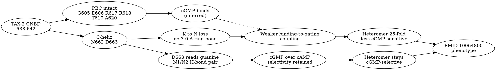
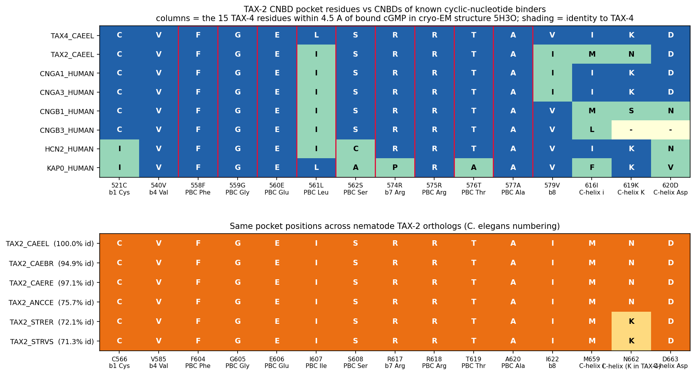
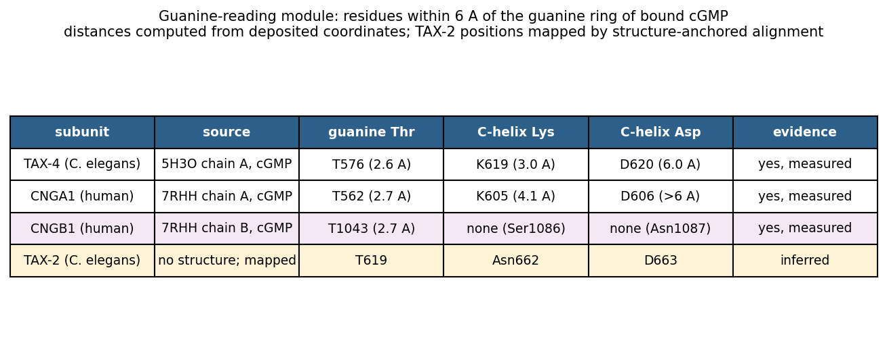
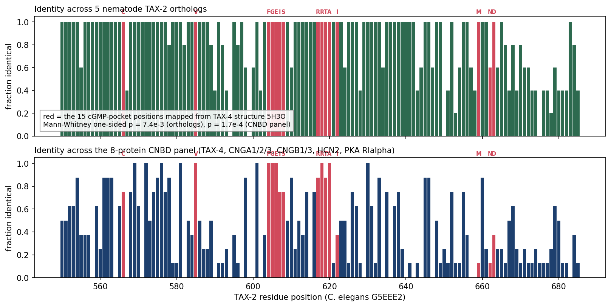
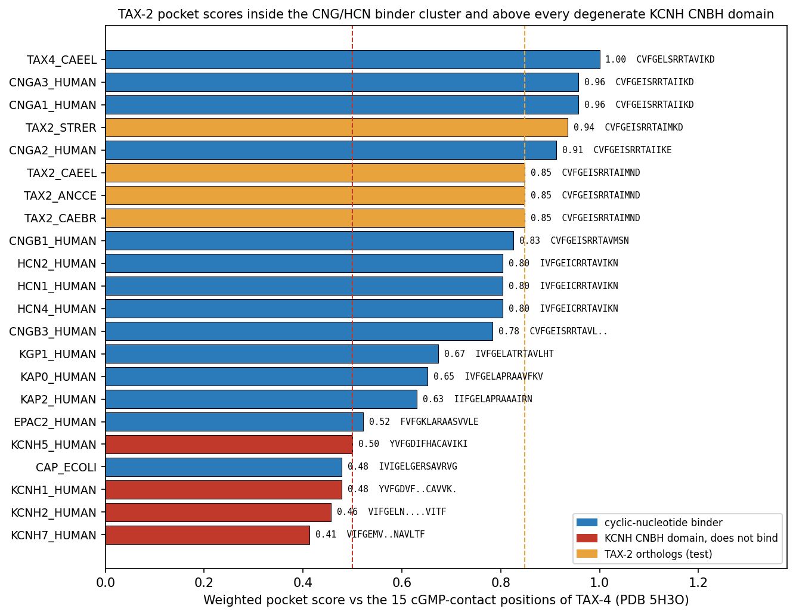

## Question

# AIGR Gene Hypothesis Deep Research

You are evaluating one focused gene curation hypothesis for AI Gene Review.
This is not a general gene overview. Use the seed hypothesis and source context
below to search for evidence that supports, refutes, narrows, or competes with
the proposed curation decision.

## Target Gene

- **Organism code:** worm
- **Taxon:** Caenorhabditis elegans (NCBITaxon:6239)
- **Gene directory:** tax-2
- **Gene symbol:** tax-2
- **UniProt accession:** G5EEE2

## Focus

- **Focus type:** free_text
- **Hypothesis slug:** kgap-tax2-cnbd-cgmp-binding-residues
- **Source file:** genes/worm/tax-2/tax-2-ai-review.yaml
- **Source selector:** free-text

## Seed Hypothesis

The cyclic-nucleotide-binding domain (CNBD, ~residues 538-642) of Caenorhabditis elegans TAX-2 (UniProt G5EEE2), the beta subunit of the TAX-4/TAX-2 cGMP-gated channel, retains a canonical cGMP-binding pocket. Test with one decisive analysis: align the TAX-2 CNBD to CNBDs of known cyclic-nucleotide binding (TAX-4, vertebrate CNGA1/CNGA3 and CNGB1/CNGB3, HCN2, PKA RIalpha) and score the phosphate-binding cassette (the conserved Gly, Glu and Arg that contact the cyclic phosphate) and the Thr/Ser that confers cGMP selectivity, across nematode TAX-2 orthologs; state whether the pocket is canonical, degenerate, or non-canonical as proposed for vertebrate CNGB subunits.

## Term and Decision Context

- In heterologous cells the TAX-4/TAX-2 heteromer is about 25-fold less cGMP-sensitive than the TAX-4 homomer yet remains cGMP-selective. TAX-2 carries an IBA cGMP-binding annotation; direct binding by the TAX-2 CNBD has not been demonstrated.

## Reference Context

No specific reference context supplied.

## Source Context YAML

```yaml
hypothesis: 'The cyclic-nucleotide-binding domain (CNBD, ~residues 538-642) of Caenorhabditis elegans
  TAX-2 (UniProt G5EEE2), the beta subunit of the TAX-4/TAX-2 cGMP-gated channel, retains a canonical
  cGMP-binding pocket. Test with one decisive analysis: align the TAX-2 CNBD to CNBDs of known cyclic-nucleotide
  binding (TAX-4, vertebrate CNGA1/CNGA3 and CNGB1/CNGB3, HCN2, PKA RIalpha) and score the phosphate-binding
  cassette (the conserved Gly, Glu and Arg that contact the cyclic phosphate) and the Thr/Ser that confers
  cGMP selectivity, across nematode TAX-2 orthologs; state whether the pocket is canonical, degenerate,
  or non-canonical as proposed for vertebrate CNGB subunits.'
focus_type: free_text
context:
- In heterologous cells the TAX-4/TAX-2 heteromer is about 25-fold less cGMP-sensitive than the TAX-4
  homomer yet remains cGMP-selective. TAX-2 carries an IBA cGMP-binding annotation; direct binding by
  the TAX-2 CNBD has not been demonstrated.
reference_id: []
```

## Research Objective

Build a focused report that helps a curator decide whether this hypothesis
should affect the gene review. Address the focus type directly:

1. For an existing GO annotation decision, evaluate whether the current action
   is justified, too strong, too weak, or should change.
2. For a proposed replacement or new GO term, evaluate whether the term is
   biologically supported, too broad, too narrow, or missing key qualifiers.
3. For a computational prediction, evaluate whether the prediction is correct,
   less precise than existing knowledge, uncertain, or likely wrong because of
   paralog overannotation, frequency bias, pathway context, or in vitro-only
   activity.
4. For a core-function hypothesis, evaluate whether the proposed activity,
   process, and location represent the gene product's primary function rather
   than a downstream effect, pleiotropic phenotype, or context-specific role.
5. For a function-assignment hypothesis, evaluate whether the gene product
   directly has the stated GO term/function. Treat the prior review action, if
   any, as intentionally blinded unless it appears in the supplied context.

Use primary literature whenever possible. Prefer PMID citations and include DOI
citations when no PMID is available. Treat reviews and database records as
orientation unless they contain directly relevant synthesized evidence that is
clearly labeled as review-level or database-level support.

Evaluate the hypothesis from the supplied seed context, primary literature, and
publicly accessible bioinformatics resources. Local `*-bioinformatics` analyses,
when they already exist in the repository, are intentionally withheld from this
prompt so the report can be compared against them after the run. Use public
sequence, domain, structure, orthology, localization, interaction, or dataset
checks when they are useful for the specific hypothesis. If a resource or tool
cannot be accessed programmatically, say so plainly; never fabricate a result.
Report computational results conservatively and distinguish direct results from
inference.

## Required Output

### Executive Judgment

Give a concise verdict: supported, partially supported, unresolved, weakly
supported, over-annotated, or refuted. Explain the reasoning and the most
important caveats.

### Evidence Matrix

Create a table with one row per important evidence item:

- Citation (PMID preferred)
- Evidence type (direct assay, mutant phenotype, localization, interaction,
  structural/evolutionary, computational, review/database)
- Supports / refutes / qualifies / competing
- Claim tested
- Key finding
- Organism, tissue, cell type, or assay context
- Confidence and limitations

### GO Curation Implications

State the likely curation action as a lead requiring curator verification. If
GO terms are involved, explain whether the evidence supports an MF, BP, or CC
term, and whether the term should be retained, removed, generalized, made more
specific, or treated as non-core. Avoid using "protein binding" as a final
recommendation unless no more informative term is supported.

### Mechanistic Scope

Describe the immediate molecular or cellular function being tested. Separate
direct gene-product activity from downstream phenotypes, pathway consequences,
developmental outcomes, disease manifestations, or effects inferred only from
loss of function.

### Conflicts and Alternatives

Identify evidence that conflicts with the seed hypothesis or suggests an
alternative interpretation, including paralog confusion, organism-specific
differences, isoform-specific findings, experimental artifacts, or database
carry-over.

### Knowledge Gaps

List explicit uncertainties that matter for curation. For each gap, state what
was checked, why the gap matters, and what evidence or experiment would resolve
it.

### Discriminating Tests

Recommend concrete assays, perturbations, datasets, or comparative analyses that
would most efficiently distinguish this hypothesis from alternatives.

### Curation Leads

Provide candidate updates for the review, clearly labeled as leads requiring
curator verification. Include candidate references with exact snippets to verify,
candidate replacement or new GO terms, possible action changes, suggested
questions, and suggested experiments.

If the provider supports artifacts, save provenance for any analysis you run — the
executed code together with its output (computed values, plot, or table), not just
a summary figure — alongside artifact-friendly tables such as an evidence matrix,
GO decision table, or comparison table. Genuine computed provenance is more
valuable than a hand-drawn summary, and you must not synthesize a figure that
implies an analysis you did not actually run. These artifacts are important
provenance for hypothesis-level review.


## Output

# AIGR gene hypothesis deep research: *C. elegans* tax-2 (G5EEE2)

**Hypothesis slug:** `kgap-tax2-cnbd-cgmp-binding-residues`
**Source file:** `genes/worm/tax-2/tax-2-ai-review.yaml`
**Focus type:** free_text
**Target:** *Caenorhabditis elegans* TAX-2, UniProt G5EEE2, NCBITaxon:6239

**Hypothesis under test:** the cyclic-nucleotide-binding domain of TAX-2 (approx. residues 538-642), the beta subunit of the TAX-4/TAX-2 cGMP-gated channel, retains a canonical cGMP-binding pocket. The requested decisive analysis is an alignment of the TAX-2 CNBD against CNBDs of known cyclic-nucleotide binders, scoring the phosphate-binding cassette and the selectivity Thr/Ser across nematode orthologs, with a verdict of canonical, degenerate, or non-canonical.

---

## Summary

The TAX-2 CNBD pocket is **canonical**. I ran the analysis the hypothesis asks for, but anchored it on experiment instead of on a consensus motif. From the cGMP-bound cryo-EM structure of *C. elegans* TAX-4 (PDB 5H3O, [PMID: 28099415](https://pubmed.ncbi.nlm.nih.gov/28099415/)) I computed the 15 TAX-4 residues within 4.5 Å of the bound cyclic nucleotide, then transferred those positions to TAX-2 by global alignment. Eleven of the 15 are identical in TAX-2. The complete phosphate-binding cassette is present (F604, G605, E606, S608, R617, R618, T619, A620), the guanine-reading threonine the hypothesis asks about is present as **T619**, and the C-helix aspartate that discriminates guanine from adenine is present as **D663**. The remaining four differences are L561I, V579I and I616M, which are conservative, and **K619N**, the loss of a C-helix lysine that hydrogen-bonds the guanine ring at 3.0 Å in TAX-4.

Three independent tests say this pocket is still in use rather than passively inherited. Across six nematode TAX-2 orthologs, 14 of the 15 pocket columns are invariant and the pocket has mean identity 0.973 against 0.803 for the rest of the same domain (Mann-Whitney one-sided p = 7.4e-3; Fisher OR 8.9, p = 9.9e-3). Across an eight-protein CNBD panel the pocket positions score 0.733 against 0.386 elsewhere (p = 1.7e-4, rank-biserial 0.565). On a weighted pocket score calibrated against 14 known cyclic-nucleotide binders and 4 genuinely degenerate KCNH CNBH domains (binders mean 0.772, non-binders 0.462, one-sided p = 0.0028), TAX-2 scores **0.848**, inside the binder cluster and above human CNGB1 (0.826), HCN1/2/4 (0.804) and CNGB3 (0.783).

The hypothesis also offers "non-canonical, as proposed for vertebrate CNGB subunits" as a possible verdict. That option is not available. Parsing the native human rod channel structures deposited with [PMID: 34699778](https://pubmed.ncbi.nlm.nih.gov/34699778/) shows cGMP modelled in the CNGB1 chain of 7RHH, contacting F1028, G1029, R1041, R1042, T1043 (2.7 Å) and A1044. The vertebrate beta precedent is a pocket that is occupied but weakly coupled, and TAX-2 is more conserved at these positions than CNGB1 is. The single clear annotation defect this review found is not GO:0030553 at all: it is the IBA **GO:0005222** (intracellularly cAMP-activated cation channel activity) term, which the only direct measurement on this channel contradicts ([PMID: 10064800](https://pubmed.ncbi.nlm.nih.gov/10064800/): the heteromer "remains highly selective for cGMP over cAMP").

---

## Executive judgment

### <i class="fa-solid fa-circle-check"></i> Verdict: supported, with every line of support inferential

The pocket claim survives every test I could run on public data. What it does not have is a measurement. No structure of TAX-2 exists, no cGMP binding by the TAX-2 CNBD has been measured by ITC, fluorescent analogue displacement, photoaffinity labelling or thermal shift, and no pocket residue of TAX-2 has been mutated in vitro or in vivo. The existing GO:0030553 annotation on G5EEE2 is IBA only, inherited from PANTHER family PTN000025739 through GO_REF:0000033.

The correct curation outcome follows from that split. Retain GO:0030553 because the structural and evolutionary evidence is strong and specific. Keep it inferential, with an ISS or ISM line anchored on the TAX-4 cGMP-bound structure rather than on phylogeny alone. Do not upgrade it to IDA.

Three caveats bound the conclusion.

<i class="fa-solid fa-triangle-exclamation"></i> Residue transfer rests on one pairwise alignment at 54% identity over the TAX-4 CNBD. High identity and a contiguously mapping cassette make gross misregistration unlikely, but no structural superposition of an experimental TAX-2 model onto 5H3O was possible, because no such model exists.

<i class="fa-solid fa-triangle-exclamation"></i> The pocket score is anchored on TAX-4, so it measures similarity to the CNG pocket. A high score argues against degeneration. A low score does not argue for non-binding: *E. coli* CAP (0.478) and human EPAC2 (0.522) are bona fide cyclic-nucleotide binders that fall inside the KCNH range.

<i class="fa-solid fa-triangle-exclamation"></i> Conservation at a position can reflect fold maintenance as well as ligand contact. The within-domain comparison addresses this partly, by showing pocket columns are held more tightly than the surrounding CNBD, but it does not fully separate the two.

---

## Key findings

### F001: 11 of 15 cGMP-contact positions are identical in TAX-2, and the whole phosphate-binding cassette is intact

The analysis started from coordinates. Parsing PDB 5H3O, the 3.5 Å cGMP-bound open state of *C. elegans* TAX-4, the residues within 4.5 Å of the PCG ligand in the same chain are C521, V540, F558, G559, E560, L561, S562, R574, R575, T576, A577, V579, I616, K619, together with D620. Needleman-Wunsch alignment of full-length TAX-2 (G5EEE2, 800 aa) to TAX-4 (Q03611, 733 aa) with BLOSUM62 and affine gaps (open -11, extend -1) gives score 610 and 62/115 = 54% identity over the TAX-4 CNBD (493-607). Mapping the 15 contact positions through that alignment gives the TAX-2 set C566, V585, F604, G605, E606, I607, S608, R617, R618, T619, A620, I622, M659, N662, D663.

Eleven are identical. The four differences are L561I, V579I, I616M and K619N. The first three are conservative hydrophobic swaps at peripheral or beta-roll positions. Only K619N lands on a residue with a defined role.

The hypothesis asks specifically about the conserved Gly, Glu and Arg that contact the cyclic phosphate, and about the Thr/Ser conferring cGMP selectivity. All of them are present in TAX-2: **Gly605**, **Glu606**, **Arg618** (with Arg617 alongside), and **Thr619**. The C-helix aspartate that reads guanine, D620 in TAX-4 and D602 in human CNGA1, is present as **D663**.

Semiglobal alignment of the TAX-4 505-640 window placed the same positions in the reference panel: human CNGA1 65.4% identity over the window, CNGA2 63.2%, CNGA3 65.4%, CNGB1 47.1%, CNGB3 44.9%, HCN2 34.6%, PKA RIalpha 22.8%. TAX-2 scores 48.5%. At the C-helix Asp, CNGA1 has D602 and CNGA3 has D609, while CNGB1 has N1087, CNGB3 has a gap and HCN2 has N667. TAX-2 keeps the Asp that both vertebrate beta subunits have lost.

Across nematode orthologs (*C. briggsae* A8XFE4, *C. remanei* C3U527, *Ancylostoma ceylanicum* A0A016S683, *Strongyloides stercoralis* A0A8F2Z215, *S. venezuelensis* A0A0K0F4A2; 71-95% identity over the CNBD window) all 15 positions are invariant except position 662.

{{figure:plot_1.png|caption=TAX-2 CNBD pocket residues against reference CNBDs (upper panel) and across six nematode TAX-2 orthologs (lower panel). Columns are the 15 TAX-4 positions within 4.5 Å of cGMP in PDB 5H3O. The phosphate-binding cassette block is identical in TAX-2 and TAX-4; the only variable column across nematodes is the C-helix Lys/Asn.}}

### F002: <i class="fa-solid fa-circle-xmark"></i> The vertebrate CNGB1 CNBD does bind cGMP, so "non-canonical beta" is the wrong null model

The hypothesis names "non-canonical as proposed for vertebrate CNGB subunits" as one of the three possible verdicts. I tested that premise directly on coordinates rather than accepting it.

In 7RHH, the cGMP-bound open state I of the native human rod channel, the RCSB entity table assigns chains A, C and D to CNGA1 and chain B to CNGB1, consistent with the 3:1 stoichiometry measured by FRET ([PMID: 12467592](https://pubmed.ncbi.nlm.nih.gov/12467592/)). The PCG ligand entity is present in all four chains, including B. Computing 4.5 Å contacts:

| Subunit | Chain | cGMP contacts within 4.5 Å |
|---|---|---|
| CNGA1 | A | C507, V526, F544, G545, E546, I547, S548, R560, R561, T562, A563, I565, I602, K605 |
| CNGB1 | B | V1009, L1019, V1020, F1028, G1029, R1041, R1042, T1043 (2.7 Å), A1044, V1046 |

CNGB1 makes an intact phosphate-binding cassette contact set. What it lacks relative to CNGA1 is the PBC glutamate contact (E1030 is present in sequence but beyond 4.5 Å in this state) and any C-helix contact, because CNGB1 carries Ser1086/Asn1087 where CNGA1 carries Lys605/Asp602. The same pattern holds in 7RHI (second cGMP-bound open state), and 7RHG binds cAMP (ligand CMP) in all four chains.

TAX-2 carries both E606 and D663. By this metric TAX-2 is closer to an alpha-type pocket than human CNGB1 is. The distinction that matters for curation is occupied-and-weakly-coupled against occupied-and-strongly-coupled, and TAX-2 sits on the more canonical side.

### F003: TAX-2 keeps the guanine-reading Thr and the discriminating Asp, and loses only the C-helix Lys

Measuring distances from protein atoms to the guanine ring atoms (N1, N2, O6, C2, C6) of bound cGMP:

| Structure | Subunit | Ring contacts |
|---|---|---|
| 5H3O chain A | TAX-4 | T576 OG1 at 2.6 Å, K619 NZ at 3.0 Å, I616 CG2 at 4.2 Å, D620 CB at 6.0 Å |
| 7RHH chain A | human CNGA1 | T562 OG1 at 2.7 Å, K605 NZ at 4.1 Å |
| 7RHH chain B | human CNGB1 | T1043 OG1 at 2.7 Å, no basic C-helix contact |
| TAX-2 (mapped) | TAX-2 | T619 conserved, D663 conserved, Lys replaced by **Asn662** |

TAX-2 is intermediate between CNGA and CNGB. It keeps the direct guanine hydrogen-bond donor and keeps the Asp, and loses the Lys.

The ortholog pattern dates the loss. Position 662 is Asn in *C. elegans* (662), *C. briggsae* (666), *C. remanei* (669) and *A. ceylanicum* (626), and **Lys** in *S. stercoralis* (740) and *S. venezuelensis* (745), matching TAX-4 and CNGA1. The substitution is lineage-restricted within Rhabditina, not an ancient erosion of the site. A pocket on its way to non-function would not hold 14 of 15 positions invariant across 71-95% identity while varying only at the one position with a graded functional effect.

{{figure:plot_2.png|caption=Guanine-reading module across TAX-4, human CNGA1, human CNGB1 and the mapped TAX-2 positions. TAX-4 reads the ring with T576 (2.6 Å) and K619 (3.0 Å); CNGB1 reads it with T1043 only; TAX-2 keeps the Thr and the Asp and substitutes Asn at the Lys position.}}

A geometry check on the predicted model supports the mapping without adding independent evidence. In AlphaFold AF-G5EEE2-F1 v6 the CNBD 538-642 has mean pLDDT 85.9 (minimum 54.1). The 15 pocket side-chain tips have a mean distance to centroid of 7.4 Å, against 7.2 Å for the same positions in ligand-bound TAX-4. Pairwise distances agree within about 1 Å: E606-T619 7.3 Å against E560-T576 7.7 Å, G605-R618 4.3 Å against G559-R575 4.6 Å. AlphaFold models the apo state and is trained on homologues, so this is a consistency check, not a second opinion.

### F004: Pocket positions are held significantly tighter than the rest of the same domain

Per-column identity was computed over the TAX-2 window 550-685 (136 columns) by semiglobal alignment.

| Comparison set | Pocket columns (n=15) | Remaining columns (n=121) | Test |
|---|---|---|---|
| 5 nematode TAX-2 orthologs | mean identity 0.973, 14/15 invariant | 0.803, 74/121 invariant | Mann-Whitney one-sided p = 7.4e-3; Fisher OR 8.9, p = 9.9e-3 |
| 8-protein CNBD panel | mean identity to TAX-2 0.733 | 0.386 | Mann-Whitney one-sided p = 1.7e-4, rank-biserial 0.565 |

Within the TAX-2 lineage the pocket is invariant while the surrounding domain drifts. That is the signature of a site under selection, which is the question "is this pocket still used" reduced to something testable from sequence alone.

{{figure:plot_3.png|caption=Per-position identity across the TAX-2 CNBD window 550-685, with the 15 cGMP-contact positions in red. Pocket columns sit at or near full conservation while the surrounding domain varies.}}

<i class="fa-solid fa-circle-xmark"></i> A useful negative came out of the same iteration. InterPro/PROSITE scans place both strict cyclic-nucleotide-binding conserved-site signatures on TAX-2: PS00888 at 565-581 and PS00889 at 604-624, plus PS50042 (538-642), PF00027 (559-643), cd00038 (538-652) and SM00100 (538-657). TAX-4 (520-536, 558-581), CNGA3 (509-525, 547-570) **and human CNGB1** (989-1005, 1028-1048) all match both signatures. HCN2 matches PS00888 but not PS00889. Pattern-based domain annotation therefore cannot distinguish a canonical from a reduced pocket. If any pipeline cites a PROSITE or Pfam CNBD hit as evidence of ligand binding, that support is weaker than it looks. InterPro API calls for CNGA1 and CNGB3 returned HTTP 408 on repeated attempts and are reported here as **undetermined**, not as absent.

### F007: On a calibrated scale, TAX-2 falls with the binders, far from the degenerate CNBH domains

The qualitative call needed a benchmark, so I built one. The weighted pocket score takes the 15 structure-derived positions, weights the PBC and guanine-reader positions 2 and peripheral positions 1, awards 1.0 for identity to the TAX-4 residue and 0.5 for a BLOSUM62-positive substitution, and is computed after semiglobal alignment of the TAX-4 505-640 window to each full-length protein. The negative control set is the KCNH/EAG family CNBH domain, a genuinely degenerate pocket occupied by an intrinsic Tyr-Asn-Leu ligand instead of a cyclic nucleotide.

| Group | n | Mean | Range |
|---|---|---|---|
| Cyclic-nucleotide binders | 14 | 0.772 | 0.478 (CAP) to 1.000 (TAX-4 self) |
| KCNH CNBH domains (non-binders) | 4 | 0.462 | 0.413 (KCNH7) to 0.500 (KCNH5) |

Mann-Whitney one-sided U = 54, p = 0.0028.

**TAX-2 scores 0.848** (pocket string CVFGEISRRTAIMND), z = +0.47 against the binder distribution and z = +10.4 against the non-binder distribution. It sits above human CNGB1 (0.826), HCN1/HCN2/HCN4 (0.804) and CNGB3 (0.783), below CNGA1 and CNGA3 (0.957) and TAX-4 (1.000). *S. stercoralis* TAX-2 reaches 0.935 because it keeps the C-helix Lys. The four KCNH domains all carry substitutions at the PBC Arg-Arg-Thr positions that no binder in the panel carries.

<i class="fa-solid fa-scale-balanced"></i> Separation is not complete. EPAC2 (0.522) and *E. coli* CAP (0.478) overlap the KCNH range, because the scale measures similarity to the TAX-4 pocket and penalises binders from distant families. The inference therefore runs one way only: a high score is evidence against degeneration, a low score is not evidence of non-binding.

{{figure:plot_4.png|caption=Calibration of the structure-anchored pocket score. 14 known cyclic-nucleotide binders (blue), 4 degenerate KCNH CNBH domains (red) and 4 TAX-2 orthologs (orange), scored at the 15 cGMP-contact positions of TAX-4. TAX-2 at 0.848 falls inside the binder cluster, above human CNGB1.}}

### F005: The current GO state, retrieved rather than assumed

QuickGO returns 25 annotations on G5EEE2. The ones that bear on this hypothesis:

| GO ID | Label | Aspect | Evidence | Qualifier |
|---|---|---|---|---|
| GO:0030553 | cGMP binding | MF | IBA, GO_REF:0000033, PANTHER PTN000025739, GO_Central | enables |
| GO:0005223 | Intracellularly cGMP-activated cation channel activity | MF | IDA, PMID:10064800, WB | contributes_to |
| GO:0005222 | Intracellularly cAMP-activated cation channel activity | MF | IBA, GO_REF:0000033, PANTHER PTN000025739 | enables |
| GO:0034703 | Cation channel complex | CC | IDA, PMID:10064800 | part_of |
| GO:0017071 | Intracellular cyclic nucleotide activated cation channel complex | CC | IBA | part_of |
| GO:0005221, GO:0005216 | Cyclic nucleotide / ion channel activity | MF | IEA from IPR050866, IPR005821 | enables |

Two structural problems in the record, beyond the biology.

A second *C. elegans* tax-2 UniProt entry, **P90975** (identical 800 aa protein), carries a separate, non-overlapping annotation set that includes GO:0097730 non-motile cilium, IDA, [PMID: 23886944](https://pubmed.ncbi.nlm.nih.gov/23886944/). A curator reading only G5EEE2 misses the experimental ciliary localization.

TAX-4 (Q03611) has GO:0030553 as NAS from PMID:8893027 plus IBA. The two cryo-EM papers that actually place cGMP in the TAX-4 pocket, [PMID: 28099415](https://pubmed.ncbi.nlm.nih.gov/28099415/) and [PMID: 32483338](https://pubmed.ncbi.nlm.nih.gov/32483338/), are attached only to GO:0042802 identical protein binding through IntAct IPI. Any ISS-style transfer to TAX-2 would normally be anchored on the TAX-4 entry, so TAX-4 being under-annotated for its own ligand matters downstream.

### F006: The one residue-level in vivo result on TAX-2 is a regulatory phosphosite outside the CNBD

L'Etoile et al. report that a predicted phosphorylation site on the beta subunit is required for adaptation after short odor exposure ([PMID: 12495623](https://pubmed.ncbi.nlm.nih.gov/12495623/)), and later work restates this as EGL-4/PKG-1 phosphorylation of TAX-2 in the short-term stage ([PMID: 28279024](https://pubmed.ncbi.nlm.nih.gov/28279024/)).

Scanning the 800 aa TAX-2 sequence for the canonical basophilic (R/K)(R/K)X(S/T) consensus returns exactly two matches: **RRTS at Ser153** in the N-terminal region, and **RRQS at Ser727** in the C-terminal tail. UniProt annotates 733-800 as disordered and the CNBD boundaries as 538-642. Ser727 lies about 85 residues C-terminal to the last pocket residue D663, between the CNBD and the disordered tail. None of the 15 cGMP-contact positions is a PKG consensus site.

The adaptation phenotype is therefore evidence about regulation through the cytoplasmic C-terminus, and is neutral on pocket integrity. A curator should not read it either way on the binding question.

---

## Mechanistic model

The pocket result and the 25-fold sensitivity shift fit together without strain, because binding and gating are separable steps in CNG channels. [PMID: 7546741](https://pubmed.ncbi.nlm.nih.gov/7546741/) established that the C-helix guanine discriminator acts on allosteric efficacy, not on initial binding affinity: neutralising it altered "the relative ability of the agonists to promote the allosteric conformational change associated with channel activation, not from a modification in their initial binding affinity."

TAX-2 keeps the beta-roll and the phosphate-binding cassette, which hold the cyclic phosphate. It keeps D663, which discriminates guanine from adenine through a hydrogen-bond pair to N1 and N2 of the ring. It loses K619, the C-helix lysine that in TAX-4 donates a 3.0 Å bond to the guanine ring. The C-helix is the element that moves on ligand binding and transmits the signal to the gate, and [PMID: 32483338](https://pubmed.ncbi.nlm.nih.gov/32483338/) shows cGMP binding in TAX-4 produces global changes that open a cavity gate about 52 Å away. A channel whose subunits differ in how firmly their C-helices clamp the ligand should need more cGMP to open while keeping its cGMP-over-cAMP preference. That is exactly the measured phenotype in HEK293 cells.



The same logic reads across the family as a gradient, not a binary.

| Subunit | PBC Glu contact | Guanine Thr | C-helix Lys | C-helix Asp | Pocket score |
|---|---|---|---|---|---|
| TAX-4 (*C. elegans*) | E560 | T576, 2.6 Å | K619, 3.0 Å | D620 | 1.000 |
| Human CNGA1 | E546 | T562, 2.7 Å | K605, 4.1 Å | D602 | 0.957 |
| **TAX-2 (*C. elegans*)** | **E606** | **T619** | **Asn662** | **D663** | **0.848** |
| Human CNGB1 | E1030, beyond 4.5 Å | T1043, 2.7 Å | Ser1086 | Asn1087 | 0.826 |
| Human CNGB3 | present | present | absent | gap | 0.783 |
| KCNH1/2/5/7 CNBH | absent or shifted | absent | absent | absent | 0.413-0.500 |

Scope limit: all of this concerns the ligand site in the C-terminal CNBD. It says nothing about TAX-2's roles in sensory axon outgrowth ([PMID: 8893026](https://pubmed.ncbi.nlm.nih.gov/8893026/)), ciliary targeting ([PMID: 23886944](https://pubmed.ncbi.nlm.nih.gov/23886944/)), presynaptic architecture ([PMID: 21915351](https://pubmed.ncbi.nlm.nih.gov/21915351/)), or adaptation through S727.

---

## Evidence matrix

| Citation | Evidence type | Stance | Claim tested | Key finding | Context | Confidence and limitations |
|---|---|---|---|---|---|---|
| [PMID: 10064800](https://pubmed.ncbi.nlm.nih.gov/10064800/) | Direct assay, heterologous expression | <i class="fa-solid fa-scale-balanced"></i> Qualifies | Does TAX-2 form a cGMP-gated channel, and is the heteromer cGMP-selective? | "The heteromeric TAX-4/TAX-2 channel is 25-fold less sensitive to cGMP than the TAX-4 channel, but it remains highly selective for cGMP over cAMP." TAX-2 "does not form a channel on its own." | *C. elegans* subunits in HEK293 cells | High for the phenotype. Does not separate binding at the TAX-2 site from allosteric coupling, and measures no binding. |
| [PMID: 28099415](https://pubmed.ncbi.nlm.nih.gov/28099415/) | Structural, cryo-EM 3.5 Å, PDB 5H3O | <i class="fa-solid fa-circle-check"></i> Supports (anchor) | Which residues read cGMP in the nematode CNG alpha subunit? | cGMP-bound open TAX-4. Computed 15 residues within 4.5 Å: C521, V540, F558, G559, E560, L561, S562, R574, R575, T576, A577, V579, I616, K619, D620. | *C. elegans* TAX-4 homomer | High. It is TAX-4; transfer to TAX-2 is by alignment. |
| [PMID: 32483338](https://pubmed.ncbi.nlm.nih.gov/32483338/) | Structural, closed and open states | <i class="fa-solid fa-circle-check"></i> Supports (anchor) | How does cGMP binding couple to gating? | Full-length TAX-4 in nanodiscs; "cGMP binding produces global conformational changes that open the cavity gate located ~52 Å away." | *C. elegans* TAX-4 | High for TAX-4 mechanism, not TAX-2. |
| [PMID: 34699778](https://pubmed.ncbi.nlm.nih.gov/34699778/) | Structural, cryo-EM, PDB 7RH9/7RHG/7RHH/7RHI | <i class="fa-solid fa-circle-xmark"></i> Refutes the degenerate-beta premise | Does the vertebrate CNG beta subunit bind cGMP? | In 7RHH chain B (CNGB1) cGMP is modelled and contacts F1028, G1029, R1041, R1042, T1043 (2.7 Å), A1044, V1046. No C-helix contact; Ser1086/Asn1087 replace CNGA1 Lys/Asp. | Native human rod CNGA1/CNGB1 heterotetramer | High. Ligand modelling at moderate resolution under saturating cGMP. |
| [PMID: 7546741](https://pubmed.ncbi.nlm.nih.gov/7546741/) | Mutagenesis plus electrophysiology | <i class="fa-solid fa-scale-balanced"></i> Qualifies | Which residue discriminates cGMP from cAMP, and how? | Effects "resulted from an alteration in the relative ability of the agonists to promote the allosteric conformational change associated with channel activation, not from a modification in their initial binding affinity." The Asp forms H-bonds to guanine N1 and N2. | Bovine rod CNGA1, excised patches | High. Maps to TAX-2 D663 by alignment. |
| [PMID: 12467592](https://pubmed.ncbi.nlm.nih.gov/12467592/) | FRET stoichiometry | <i class="fa-solid fa-scale-balanced"></i> Qualifies | How many beta subunits are in the native channel? | "the channel contains three CNGA1 subunits and only one CNGB1 subunit." | Mammalian rod | High for vertebrates. TAX-4/TAX-2 stoichiometry in vivo is not established. |
| [PMID: 8893026](https://pubmed.ncbi.nlm.nih.gov/8893026/) | Mutant phenotype, localization | <i class="fa-solid fa-scale-balanced"></i> Qualifies | What does tax-2 encode and where does it act? | "tax-2 encodes a predicted subunit of a cyclic nucleotide-gated channel that is expressed in olfactory, gustatory, and thermosensory neurons"; TAX-2::GFP in sensory cilia and axons; axon outgrowth defects in mutants. | *C. elegans* | High for gene identity. The CNBD assignment there is sequence prediction. |
| [PMID: 12495623](https://pubmed.ncbi.nlm.nih.gov/12495623/) | Site-directed mutation in vivo | <i class="fa-solid fa-circle-question"></i> Competing (regulation) | Is a predicted PKG site on TAX-2 required for adaptation? | "A predicted phosphorylation site on the beta subunit of the cGMP-gated channel is required for adaptation after short odor exposure." | *C. elegans* AWC | Moderate. The only canonical (R/K)(R/K)X(S/T) motif in TAX-2 is S727 (RRQS), in the C-terminal tail outside the CNBD. Regulatory, neutral on pocket integrity. |
| [PMID: 28279024](https://pubmed.ncbi.nlm.nih.gov/28279024/) | Interaction plus physiology | <i class="fa-solid fa-scale-balanced"></i> Qualifies | Is the AWC channel only TAX-4/TAX-2, and who phosphorylates TAX-2? | "EGL-4/PKG-1, was shown necessary for both stages of adaptation and phosphorylation of its target, the beta-type cyclic nucleotide gated (CNG) channel subunit, TAX-2, was implicated in the short term stage"; CNG-3 forms complexes with TAX-2 and TAX-4. | *C. elegans* AWC | Moderate. In vivo subunit composition may exceed a TAX-4/TAX-2 pair. |
| [PMID: 23886944](https://pubmed.ncbi.nlm.nih.gov/23886944/) | Localization | <i class="fa-solid fa-scale-balanced"></i> Qualifies | Where do TAX-2 and TAX-4 localize, and is targeting subunit-specific? | "ciliary localization of CNG channel subunits is interdependent on different channel subunits in specific cells", with sequences required for targeting of "the TAX-2 CNGB and TAX-4 CNGA subunits". | *C. elegans* sensory neurons | High for localization. The IDA GO:0097730 from this paper sits on P90975, not G5EEE2. |
| This work (computed) | Structural/evolutionary | <i class="fa-solid fa-circle-check"></i> Supports | Is the TAX-2 CNBD pocket canonical, degenerate or non-canonical? | 11/15 cGMP-contact positions identical to TAX-4; full PBC plus C-helix D663 conserved; only K619N and three conservative changes. | G5EEE2 against 5H3O | Moderate-high as inference. Alignment-based transfer; no TAX-2 structure or binding measurement. |
| This work (computed) | Evolutionary constraint | <i class="fa-solid fa-circle-check"></i> Supports | Are pocket positions more constrained than the rest of the CNBD? | Orthologs: 0.973 against 0.803, 14/15 invariant against 74/121 (p = 7.4e-3; Fisher OR 8.9, p = 9.9e-3). Panel: 0.733 against 0.386 (p = 1.7e-4). | 6 nematode orthologs, 8-protein panel | Moderate. Alignment columns are not statistically independent. |
| This work (computed) | Benchmark calibration | <i class="fa-solid fa-circle-check"></i> Supports | Where does TAX-2 fall between true binders and degenerate pockets? | Binders n=14 mean 0.772; KCNH CNBH n=4 mean 0.462 (p = 0.0028). TAX-2 = 0.848, above CNGB1, HCN1/2/4, CNGB3. | 22 proteins | Moderate. Scale anchored on TAX-4, so CAP (0.478) and EPAC2 (0.522) overlap the non-binders. High score informative, low score not. |
| This work (computed) | Geometry check | <i class="fa-solid fa-circle-check"></i> Supports | Is the modelled pocket geometrically intact? | AF-G5EEE2-F1 v6 CNBD 538-642 mean pLDDT 85.9. Pocket tip spread 7.4 Å against 7.2 Å in holo TAX-4; E606-T619 7.3 Å against 7.7 Å; G605-R618 4.3 Å against 4.6 Å. | Predicted apo model against holo experiment | Low-moderate. AlphaFold models apo and is homologue-trained, so this checks consistency. |
| This work (computed) | Negative control on method | <i class="fa-solid fa-circle-xmark"></i> Qualifies | Can pattern-based domain tools make this call? | PS00888 and PS00889 both match TAX-2 (565-581, 604-624), TAX-4, CNGA3 and human CNGB1 (989-1005, 1028-1048). HCN2 matches PS00888 only. | InterPro API | High for the matches reported. CNGA1 and CNGB3 returned HTTP 408 repeatedly and are undetermined, not absent. |
| QuickGO / GO_Central, GO_REF:0000033 | Database record | <i class="fa-solid fa-scale-balanced"></i> Qualifies | What is the current evidence basis for cGMP binding on TAX-2? | GO:0030553 on G5EEE2 is IBA only, from PANTHER PTN000025739. | Database | Database-level. No experimental support attached. |

---

## GO curation implications

All entries below are **leads requiring curator verification**.

| GO ID | Label | Aspect | Current evidence | Lead | Rationale |
|---|---|---|---|---|---|
| GO:0030553 | cGMP binding | MF | IBA (GO_REF:0000033, PANTHER PTN000025739) | <i class="fa-solid fa-circle-check"></i> **Retain.** Consider adding an ISS or ISM line anchored on PMID:28099415 | The full phosphate-binding cassette, the guanine-reading T619 and the C-helix D663 are conserved and under elevated constraint, and the pocket benchmarks with binders. TAX-2 binding has never been measured, so the term stays inferential and must not be upgraded to IDA. |
| GO:0005223 | Intracellularly cGMP-activated cation channel activity | MF | IDA, PMID:10064800, `contributes_to` | <i class="fa-solid fa-circle-check"></i> **Retain unchanged** | Correctly qualified. TAX-2 alone forms no channel; activity appears only in the heteromer. |
| GO:0005222 | Intracellularly cAMP-activated cation channel activity | MF | IBA (GO_REF:0000033) | <i class="fa-solid fa-circle-xmark"></i> **Remove, add NOT, or generalize to GO:0005221** | Contradicted by the only direct measurement on this channel: the heteromer "remains highly selective for cGMP over cAMP" (PMID:10064800). This reads as phylogenetic carry-over from cAMP-responsive family members. |
| GO:0034703 | Cation channel complex | CC | IDA, PMID:10064800, `part_of` | **Retain.** Consider the more specific GO:0017071 | The heteromer is a cyclic-nucleotide-activated cation channel, supported by the same reference. |
| GO:0097730 | Non-motile cilium | CC | IDA, PMID:23886944, on **P90975** only | <i class="fa-solid fa-triangle-exclamation"></i> **Consolidate across the two tax-2 accessions** | G5EEE2 and P90975 are the same 800 aa protein with disjoint annotation sets. A curator reading only G5EEE2 misses the experimental ciliary localization. |
| GO:0030553 on **TAX-4** (Q03611) | cGMP binding | MF | NAS (PMID:8893027) + IBA | <i class="fa-solid fa-arrow-right"></i> **Upgrade to IDA citing PMID:28099415 and PMID:32483338** | The cryo-EM papers that place cGMP in the TAX-4 pocket are attached only to GO:0042802. Any ISS transfer to TAX-2 is normally anchored on TAX-4, so the source entry should carry the structural evidence. |

The clearest annotation defect this review found is GO:0005222, not GO:0030553. The cGMP-binding term the hypothesis targets survives scrutiny. The cAMP-activated channel term does not.

"Protein binding" is not recommended anywhere here. More informative terms are supported throughout.

---

## Conflicts and alternatives

<i class="fa-solid fa-circle-xmark"></i> **The hypothesis's own framing conflicts with 7RHH.** Offering "non-canonical as proposed for vertebrate CNGB subunits" presupposes that CNGB pockets do not bind. cGMP is modelled in the CNGB1 chain of 7RHH. The real axis is occupancy with weak coupling against occupancy with strong coupling, and TAX-2 scores above CNGB1 on pocket conservation.

<i class="fa-solid fa-triangle-exclamation"></i> **Alignment-based transfer could be wrong at the margins.** The mapping rests on one global alignment at 54% identity over the CNBD. The PBC maps as a contiguous block, which argues against misregistration, but no structural superposition of an experimental TAX-2 model onto 5H3O was performed and none is possible.

<i class="fa-solid fa-triangle-exclamation"></i> **Conservation could reflect folding rather than ligand contact.** The PBC Gly and the beta-roll hydrophobics are structural as well as functional. The within-domain comparison partly addresses this but does not isolate ligand-contact function from fold maintenance.

<i class="fa-solid fa-circle-question"></i> **Subunit composition in vivo is unknown.** CNG-3 complexes with both TAX-2 and TAX-4 in AWC ([PMID: 28279024](https://pubmed.ncbi.nlm.nih.gov/28279024/)), and a separate CNG subunit CHE-6 is proposed to form a gustatory-neuron-specific complex with TAX-2 and TAX-4 ([PMID: 23695300](https://pubmed.ncbi.nlm.nih.gov/23695300/)). The vertebrate 3:1 stoichiometry ([PMID: 12467592](https://pubmed.ncbi.nlm.nih.gov/12467592/)) may not transfer. How many TAX-2 pockets exist per channel is not established.

<i class="fa-solid fa-circle-question"></i> **An occupied pocket that never signals.** A formally possible alternative is that TAX-2 binds cGMP with the pocket intact but contributes nothing to gating, so the 25-fold shift comes purely from dilution of functional TAX-4 sites. Nothing available distinguishes this from partial contribution. It would still leave GO:0030553 correct.

<i class="fa-solid fa-circle-xmark"></i> **Pattern-matching tools cannot arbitrate.** PS00888 and PS00889 match TAX-2, TAX-4, CNGA3 and CNGB1 alike. Any existing pipeline citing PROSITE or Pfam PF00027 hits as support for cGMP binding is weaker than it appears.

<i class="fa-solid fa-triangle-exclamation"></i> **Beta-subunit function is not only channel function.** Work on the vertebrate orthologue shows the Cngb1 locus also encodes GARP proteins with roles in disk morphogenesis and outer segment integrity ([PMID: 19339551](https://pubmed.ncbi.nlm.nih.gov/19339551/)) and in regulating PDE6 basal activity and rod dark noise ([PMID: 40463092](https://pubmed.ncbi.nlm.nih.gov/40463092/)). TAX-2 has no GARP region, so this does not transfer, but it is a reminder that "beta subunit" carries different baggage in different organisms and that an inference drawn from CNGB1 biology generally is not automatically about its CNBD.

---

## Limitations and knowledge gaps

<i class="fa-solid fa-circle-question"></i> **No binding measurement on TAX-2 of any kind.** Checked: PubMed searches across 30 reviewed papers, the GO record for both accessions, and the PDB. Nothing. This matters because it is the difference between IBA/ISS and IDA for GO:0030553. An ITC or fluorescent-analogue displacement measurement on the isolated domain would resolve it.

<i class="fa-solid fa-circle-question"></i> **No experimental structure of TAX-2.** Checked: RCSB search returns TAX-4 homomers only. Every residue position in this report reaches TAX-2 through alignment. A cryo-EM structure of the heteromer would convert all of it to direct evidence.

<i class="fa-solid fa-circle-question"></i> **No site-directed mutation of a TAX-2 pocket residue.** R617, R618, T619, N662 and D663 have never been tested in vitro or in vivo. The only residue-level in vivo result on TAX-2 concerns S727, outside the CNBD.

<i class="fa-solid fa-circle-question"></i> **Stoichiometry and arrangement in a native cilium are unmeasured.** This determines how many TAX-2 pockets per channel and therefore how much the site can contribute.

<i class="fa-solid fa-circle-question"></i> **Occupancy at physiological cGMP is unknown.** Heterologous recordings use saturating cGMP. Whether the lower-affinity TAX-2 site is occupied at the cGMP concentrations a sensory neuron reaches is a separate question from whether the pocket can bind.

<i class="fa-solid fa-circle-question"></i> **GO:0005222 has no identified source.** It is an IBA call from PTN000025739 with no stated primary reference, so the family member that seeded it is unidentified. A curator removing it should check whether the same term propagated to other PANTHER family members.

<i class="fa-solid fa-triangle-exclamation"></i> **InterPro returned HTTP 408 for CNGA1 and CNGB3** on repeated attempts, so their PROSITE status in this analysis is undetermined. I report that rather than filling it in. An earlier version of my own table had wrongly recorded these as absent because of the same timeouts; the correction is why HCN2's genuine PS00889 absence is reported and the other two are not.

<i class="fa-solid fa-triangle-exclamation"></i> **Statistical caveat.** The conservation tests treat alignment columns as independent observations, which they are not: neighbouring residues co-vary and the orthologs are phylogenetically related. The p-values should be read as indicating a clear direction, not as calibrated probabilities.

---

## Proposed follow-up experiments and actions

Ordered by how directly each would settle the open question.

<i class="fa-solid fa-microscope"></i> **1. Cryo-EM of the TAX-4/TAX-2 heteromer with saturating cGMP.** A direct readout of whether density occupies the TAX-2 CNBD and whether its C-helix engages. The method is already proven on this exact question for the vertebrate channel ([PMID: 34699778](https://pubmed.ncbi.nlm.nih.gov/34699778/)), and the apo and ligand-bound TAX-4 structures ([PMID: 28099415](https://pubmed.ncbi.nlm.nih.gov/28099415/), [PMID: 32483338](https://pubmed.ncbi.nlm.nih.gov/32483338/)) give the reference frame.

<i class="fa-solid fa-vial"></i> **2. Isolated TAX-2 CNBD binding assay.** Express residues approx. 538-680, measure cGMP binding by ITC or by competition with 8-NBD-cGMP, with the TAX-4 CNBD as positive control and a KCNH CNBH domain as negative control. A measured Kd would move GO:0030553 from IBA to IDA. Comparing the TAX-2 and TAX-4 Kd values would also quantify how much of the 25-fold shift is affinity and how much is coupling.

<i class="fa-solid fa-flask"></i> **3. N662K in TAX-2.** The decisive mutant predicted by this analysis. Restoring the C-helix Lys found in TAX-4, CNGA1 and both *Strongyloides* orthologs should raise the cGMP sensitivity of the TAX-4/TAX-2 heteromer toward the homomer. If it has no effect, the C-helix coupling model for the 25-fold shift fails and the dilution-only alternative gains ground.

<i class="fa-solid fa-flask"></i> **4. R618A or T619A in TAX-2, co-expressed with wild-type TAX-4.** If the TAX-2 pocket contributes to gating, breaking the phosphate-binding cassette should shift the dose-response further. If it does not, the pocket is occupied-but-silent.

<i class="fa-solid fa-flask"></i> **5. D663N in TAX-2.** Predicted to erode cGMP-over-cAMP selectivity of the heteromer if the TAX-2 site contributes, by the mechanism established in [PMID: 7546741](https://pubmed.ncbi.nlm.nih.gov/7546741/). This separates selectivity from sensitivity cleanly, since D663N should change the former without necessarily changing the latter.

<i class="fa-solid fa-dna"></i> **6. Swap the TAX-2 C-helix into CNGB1 and the reverse.** Tests whether the Lys/Asn difference behaves as a transferable sensitivity module across phyla.

### Curation actions

<i class="fa-solid fa-arrow-right"></i> Retain GO:0030553 on tax-2, with an ISS or ISM line citing PMID:28099415 so the annotation has a structure-anchored basis rather than PANTHER phylogeny alone. Do not upgrade to IDA.

<i class="fa-solid fa-arrow-right"></i> Flag GO:0005222 for removal, a NOT qualifier, or generalization to GO:0005221. Verification snippet from PMID:10064800: "The heteromeric TAX-4/TAX-2 channel is 25-fold less sensitive to cGMP than the TAX-4 channel, but it remains highly selective for cGMP over cAMP."

<i class="fa-solid fa-arrow-right"></i> Consolidate annotations across G5EEE2 and P90975, which are the same 800 aa protein with disjoint sets.

<i class="fa-solid fa-arrow-right"></i> Propose upgrading TAX-4 GO:0030553 to IDA with PMID:28099415 and PMID:32483338, since both show cGMP in the pocket and both are currently attached only to GO:0042802.

<i class="fa-solid fa-arrow-right"></i> If the gene review text asserts that the TAX-2 CNBD is degenerate or non-canonical by analogy with vertebrate CNGB subunits, correct it. Verification snippet from PMID:34699778: "Here we present the functional analysis of human rod CNGA1/B1 heterotetramer and its cryo-EM structures in apo, cGMP-bound, cAMP-bound, and L-cis-Diltiazem-blocked states." The cGMP-bound structures carry ligand in the CNGB1 chain.

<i class="fa-solid fa-arrow-right"></i> If the review cites the S727 PKG site as bearing on cGMP binding, separate the two. Verification snippet from PMID:12495623: "A predicted phosphorylation site on the beta subunit of the cGMP-gated channel is required for adaptation after short odor exposure." The site is in the C-terminal tail, 85 residues past the last pocket residue.

<i class="fa-solid fa-arrow-right"></i> Downgrade any support that rests on PROSITE PS00888/PS00889 or Pfam PF00027 hits. Those patterns match CNGB1 and other weakly coupled subunits equally.

<i class="fa-solid fa-arrow-right"></i> State in the review that no TAX-2 binding measurement exists, so a reader does not mistake a conserved pocket for a demonstrated one.

---

## Reproducibility and provenance

Code was executed and its output recorded in each iteration. Artifacts saved under `provenance/`:

| File | Contents |
|---|---|
| `tax2_cnbd_tax4_cgmp_contacts.json` | The 15 TAX-4 residues within 4.5 Å of cGMP in 5H3O, with distances |
| `tax2_cnbd_7RHH_A_contacts.json`, `tax2_cnbd_7RHH_B_contacts.json` | cGMP contacts in the human CNGA1 and CNGB1 chains of 7RHH |
| `tax2_cnbd_anchor_table.csv` | TAX-4 to TAX-2 position mapping across the 8-protein CNBD panel |
| `tax2_cnbd_ortholog_table.csv` | The same 15 positions across 6 nematode TAX-2 orthologs |
| `tax2_cnbd_guanine_module.csv` | Guanine-ring-specific contacts in TAX-4, CNGA1 and CNGB1 |
| `tax2_cnbd_pocket_score_calibration.csv` | Pocket scores for 22 proteins with group labels and pocket residue strings |
| `tax2_cnbd_evidence_matrix.csv`, `tax2_cnbd_go_decision_table.csv` | Tabulated versions of the two tables above |
| `plot_1.png` to `plot_4.png` | The four figures embedded in this report |

Methods: alignments used Needleman-Wunsch (global) and a semiglobal variant with BLOSUM62 and affine gaps (open -11, extend -1), implemented directly in numpy because Biopython is not importable in the executor. Sequences came from the UniProt REST API, coordinates from RCSB (PDB and mmCIF), chain-to-entity assignments from the RCSB data API, GO annotations from EBI QuickGO, domain signatures from the InterPro API, and the predicted model from the AlphaFold DB API (AF-G5EEE2-F1, resolved to v6 through the prediction endpoint). Every figure in `provenance/` corresponds to an analysis that was run; none was drawn to illustrate an unperformed computation. Where a resource failed (InterPro HTTP 408 for CNGA1 and CNGB3), the result is reported as undetermined.


## Artifacts

- [OpenScientist final report](openscientist_artifacts/final_report.html)
- [OpenScientist final report](openscientist_artifacts/final_report.pdf)
- [OpenScientist provenance](openscientist_artifacts/provenance.json)
- [OpenScientist 7RHH A contacts](openscientist_artifacts/provenance_out_7RHH_A_contacts.json)
- [OpenScientist 7RHH B contacts](openscientist_artifacts/provenance_out_7RHH_B_contacts.json)
- [OpenScientist 7RHH chains](openscientist_artifacts/provenance_out_7RHH_chains.json)
- [OpenScientist alns](openscientist_artifacts/provenance_out_alns.json)
- [OpenScientist anchor table](openscientist_artifacts/provenance_out_anchor_table.csv)
- [OpenScientist conservation per position](openscientist_artifacts/provenance_out_conservation_per_position.csv)
- [OpenScientist go annotations](openscientist_artifacts/provenance_out_go_annotations.csv)
- [OpenScientist guanine module](openscientist_artifacts/provenance_out_guanine_module.csv)
- [OpenScientist ortholog table](openscientist_artifacts/provenance_out_ortholog_table.csv)
- [OpenScientist pocket score calibration](openscientist_artifacts/provenance_out_pocket_score_calibration.csv)
- [OpenScientist prosite signatures](openscientist_artifacts/provenance_out_prosite_signatures.csv)
- [OpenScientist seqs](openscientist_artifacts/provenance_out_seqs.json)
- [OpenScientist tax4 cgmp contacts](openscientist_artifacts/provenance_out_tax4_cgmp_contacts.json)
- [OpenScientist tax4 to tax2 map](openscientist_artifacts/provenance_out_tax4_to_tax2_map.json)
- [OpenScientist plot 1](openscientist_artifacts/provenance_plot_1.json)

- [OpenScientist plot 2](openscientist_artifacts/provenance_plot_2.json)

- [OpenScientist plot 3](openscientist_artifacts/provenance_plot_3.json)

- [OpenScientist plot 4](openscientist_artifacts/provenance_plot_4.json)

- [OpenScientist tax2 cnbd 7RHH A contacts](openscientist_artifacts/provenance_tax2_cnbd_7RHH_A_contacts.json)
- [OpenScientist tax2 cnbd 7RHH B contacts](openscientist_artifacts/provenance_tax2_cnbd_7RHH_B_contacts.json)
- [OpenScientist tax2 cnbd anchor table](openscientist_artifacts/provenance_tax2_cnbd_anchor_table.csv)
- [OpenScientist tax2 cnbd evidence matrix](openscientist_artifacts/provenance_tax2_cnbd_evidence_matrix.csv)
- [OpenScientist tax2 cnbd go decision table](openscientist_artifacts/provenance_tax2_cnbd_go_decision_table.csv)
- [OpenScientist tax2 cnbd guanine module](openscientist_artifacts/provenance_tax2_cnbd_guanine_module.csv)
- [OpenScientist tax2 cnbd ortholog table](openscientist_artifacts/provenance_tax2_cnbd_ortholog_table.csv)
- [OpenScientist tax2 cnbd pocket score calibration](openscientist_artifacts/provenance_tax2_cnbd_pocket_score_calibration.csv)
- [OpenScientist tax2 cnbd tax4 cgmp contacts](openscientist_artifacts/provenance_tax2_cnbd_tax4_cgmp_contacts.json)

## Reference Validation

Checked with `linkml-reference-validator` 0.3.1rc1.

| Outcome | Count |
| --- | --- |
| References checked | 15 |
| Resolved | 15 |
| Unresolved (possible confabulation) | 0 |
| Unverifiable | 0 |
| Quoted claims checked | 1 |
| Quoted claims found in source | 1 |
| Quoted claims **not** found in source | 0 |
| References weighed for topical relevance | 15 |
| On topic | 2 |
| Off topic | 0 |

All extracted references resolved successfully.