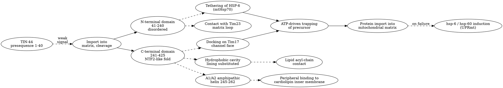
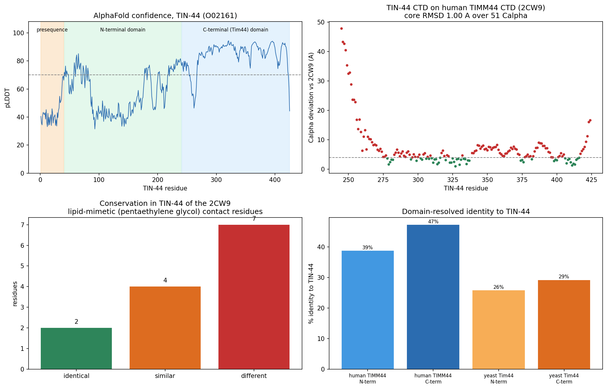
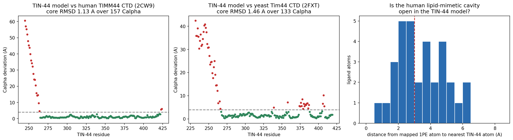
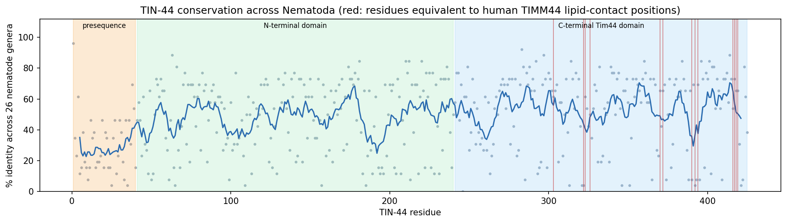
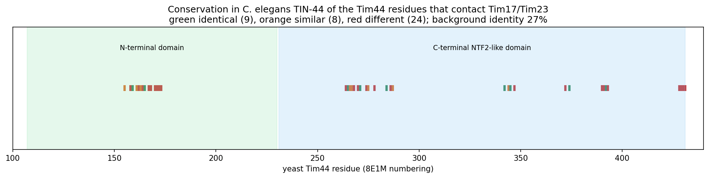
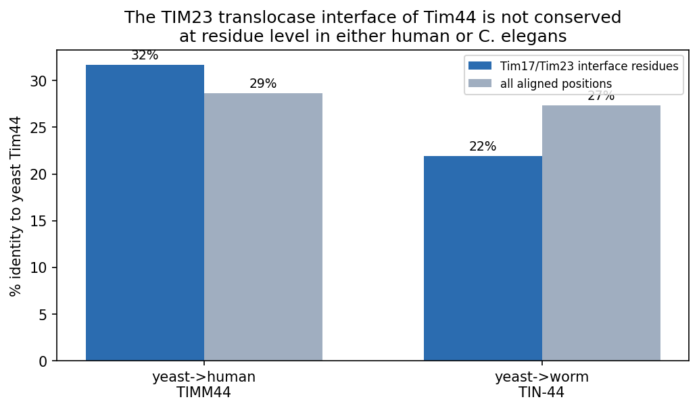
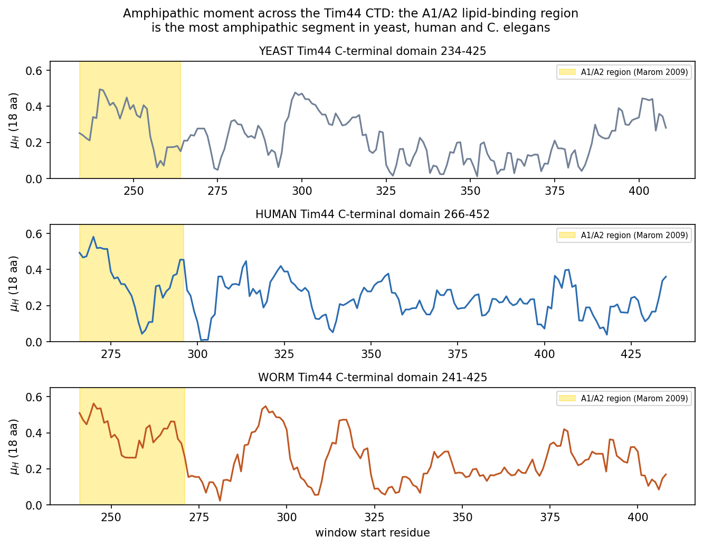
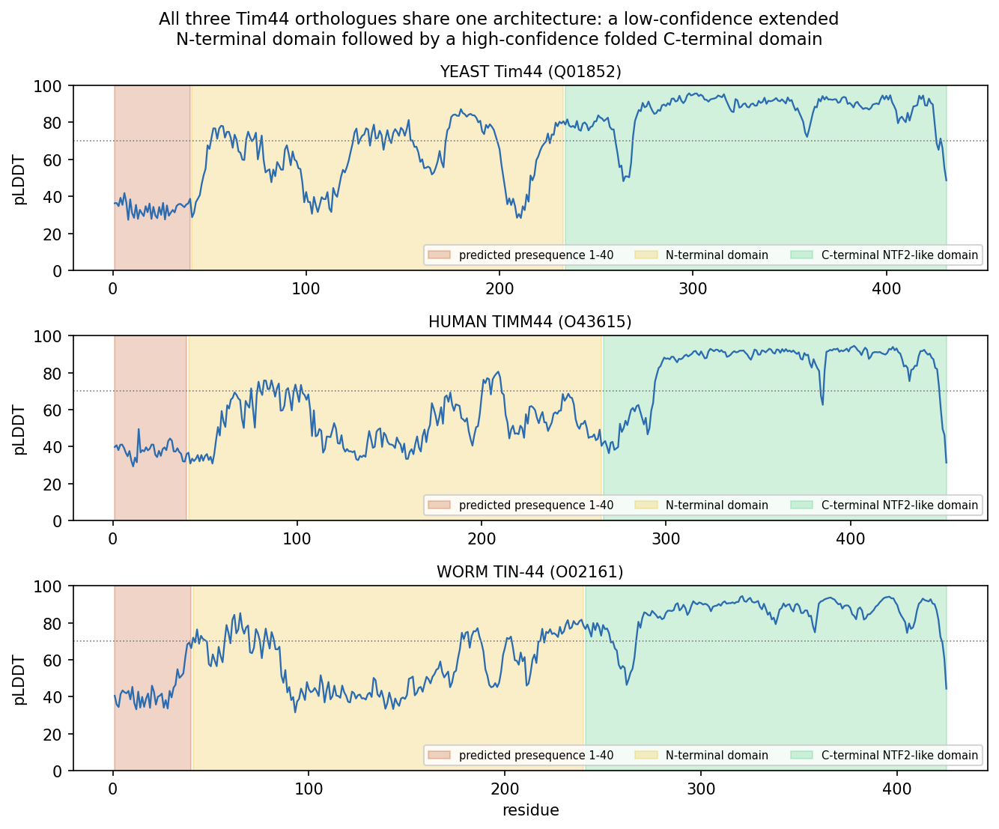

## Question

# AIGR Gene Hypothesis Deep Research

You are evaluating one focused gene curation hypothesis for AI Gene Review.
This is not a general gene overview. Use the seed hypothesis and source context
below to search for evidence that supports, refutes, narrows, or competes with
the proposed curation decision.

## Target Gene

- **Organism code:** worm
- **Taxon:** Caenorhabditis elegans (NCBITaxon:6239)
- **Gene directory:** tin-44
- **Gene symbol:** tin-44
- **UniProt accession:** O02161

## Focus

- **Focus type:** free_text
- **Hypothesis slug:** kgap-tin44-tim44-features
- **Source file:** genes/worm/tin-44/tin-44-ai-review.yaml
- **Source selector:** free-text

## Seed Hypothesis

Whether Caenorhabditis elegans TIN-44 retains the structural features that let mitochondrial Tim44 tether mtHsp70 (HSP-6) to the TIM23 translocase and bind the inner membrane can be predicted structurally. Single analysis only: model TIN-44 with AlphaFold, compare its C-terminal domain with Tim44 crystal structures (yeast and human) including the hydrophobic cavity and the amphipathic membrane-binding helices, map the N-terminal region residues implicated in mtHsp70 and Tim23 binding, test whether a mitochondrial presequence is predicted, score conservation across nematodes and versus yeast and human Tim44, and state whether TIN-44 is predicted to share the Tim44 membrane-binding, cavity and Hsp70-recruiting features.

## Term and Decision Context

No specific term context supplied.

## Reference Context

No specific reference context supplied.

## Source Context YAML

```yaml
hypothesis: 'Whether Caenorhabditis elegans TIN-44 retains the structural features that let mitochondrial
  Tim44 tether mtHsp70 (HSP-6) to the TIM23 translocase and bind the inner membrane can be predicted structurally.
  Single analysis only: model TIN-44 with AlphaFold, compare its C-terminal domain with Tim44 crystal
  structures (yeast and human) including the hydrophobic cavity and the amphipathic membrane-binding helices,
  map the N-terminal region residues implicated in mtHsp70 and Tim23 binding, test whether a mitochondrial
  presequence is predicted, score conservation across nematodes and versus yeast and human Tim44, and
  state whether TIN-44 is predicted to share the Tim44 membrane-binding, cavity and Hsp70-recruiting features.'
focus_type: free_text
context: []
reference_id: []
```

## Research Objective

Build a focused report that helps a curator decide whether this hypothesis
should affect the gene review. Address the focus type directly:

1. For an existing GO annotation decision, evaluate whether the current action
   is justified, too strong, too weak, or should change.
2. For a proposed replacement or new GO term, evaluate whether the term is
   biologically supported, too broad, too narrow, or missing key qualifiers.
3. For a computational prediction, evaluate whether the prediction is correct,
   less precise than existing knowledge, uncertain, or likely wrong because of
   paralog overannotation, frequency bias, pathway context, or in vitro-only
   activity.
4. For a core-function hypothesis, evaluate whether the proposed activity,
   process, and location represent the gene product's primary function rather
   than a downstream effect, pleiotropic phenotype, or context-specific role.
5. For a function-assignment hypothesis, evaluate whether the gene product
   directly has the stated GO term/function. Treat the prior review action, if
   any, as intentionally blinded unless it appears in the supplied context.

Use primary literature whenever possible. Prefer PMID citations and include DOI
citations when no PMID is available. Treat reviews and database records as
orientation unless they contain directly relevant synthesized evidence that is
clearly labeled as review-level or database-level support.

Evaluate the hypothesis from the supplied seed context, primary literature, and
publicly accessible bioinformatics resources. Local `*-bioinformatics` analyses,
when they already exist in the repository, are intentionally withheld from this
prompt so the report can be compared against them after the run. Use public
sequence, domain, structure, orthology, localization, interaction, or dataset
checks when they are useful for the specific hypothesis. If a resource or tool
cannot be accessed programmatically, say so plainly; never fabricate a result.
Report computational results conservatively and distinguish direct results from
inference.

## Required Output

### Executive Judgment

Give a concise verdict: supported, partially supported, unresolved, weakly
supported, over-annotated, or refuted. Explain the reasoning and the most
important caveats.

### Evidence Matrix

Create a table with one row per important evidence item:

- Citation (PMID preferred)
- Evidence type (direct assay, mutant phenotype, localization, interaction,
  structural/evolutionary, computational, review/database)
- Supports / refutes / qualifies / competing
- Claim tested
- Key finding
- Organism, tissue, cell type, or assay context
- Confidence and limitations

### GO Curation Implications

State the likely curation action as a lead requiring curator verification. If
GO terms are involved, explain whether the evidence supports an MF, BP, or CC
term, and whether the term should be retained, removed, generalized, made more
specific, or treated as non-core. Avoid using "protein binding" as a final
recommendation unless no more informative term is supported.

### Mechanistic Scope

Describe the immediate molecular or cellular function being tested. Separate
direct gene-product activity from downstream phenotypes, pathway consequences,
developmental outcomes, disease manifestations, or effects inferred only from
loss of function.

### Conflicts and Alternatives

Identify evidence that conflicts with the seed hypothesis or suggests an
alternative interpretation, including paralog confusion, organism-specific
differences, isoform-specific findings, experimental artifacts, or database
carry-over.

### Knowledge Gaps

List explicit uncertainties that matter for curation. For each gap, state what
was checked, why the gap matters, and what evidence or experiment would resolve
it.

### Discriminating Tests

Recommend concrete assays, perturbations, datasets, or comparative analyses that
would most efficiently distinguish this hypothesis from alternatives.

### Curation Leads

Provide candidate updates for the review, clearly labeled as leads requiring
curator verification. Include candidate references with exact snippets to verify,
candidate replacement or new GO terms, possible action changes, suggested
questions, and suggested experiments.

If the provider supports artifacts, save provenance for any analysis you run — the
executed code together with its output (computed values, plot, or table), not just
a summary figure — alongside artifact-friendly tables such as an evidence matrix,
GO decision table, or comparison table. Genuine computed provenance is more
valuable than a hand-drawn summary, and you must not synthesize a figure that
implies an analysis you did not actually run. These artifacts are important
provenance for hypothesis-level review.


## Output

# TIN-44 (O02161, *C. elegans*) and the Tim44 features for mtHsp70 tethering and inner-membrane binding

**Hypothesis slug:** `kgap-tin44-tim44-features`
**Source file:** `genes/worm/tin-44/tin-44-ai-review.yaml`
**Focus type:** free_text
**Target:** tin-44, UniProt O02161, NCBITaxon:6239

---

## Summary

<i class="fa-scale-balanced"></i> **Verdict: partially supported, and the split runs along the domain boundary.**

The seed hypothesis asks whether TIN-44 retains the structural features that let Tim44 bind the mitochondrial inner membrane and tether mtHsp70 to the TIM23 translocase, and proposes to answer this by AlphaFold modelling, crystal-structure comparison, residue mapping, presequence prediction and conservation scoring. Those analyses were run against public data. They answer the membrane and fold half of the question and they cannot answer the tethering half.

The C-terminal half is supported. InterPro member databases assign O02161 to the Tim44 family over residues 1-422 (PIRSF037871, PANTHER PTHR10721, NCBIfam TIGR00984, Pfam PF04280, SSF54427), so TIN-44 is a full-length orthologue and not a distant Tim44-like paralogue. The AlphaFold C-terminal domain superposes on the human TIMM44 crystal structure 2CW9 chain A at 1.13 Å over 157 of 179 Cα pairs and on the yeast 2FXT chain A at 1.46 Å over 133 of 186, cross-checked independently at 1.224 Å by `phenix.superpose_pdbs`. The hydrophobic cavity is present as a feature of that fold. The A1/A2 helix that Marom et al. 2009 identified as the acidic-lipid recognition site is the single most amphipathic 18-residue window in the TIN-44 C-terminal domain (Eisenberg µH 0.562, 99th percentile of its own domain), matching human (0.582) and exceeding yeast (0.495).

The N-terminal half is unresolved, and the stated method cannot resolve it. The segment of Tim44 that contacts mtHsp70 and the Tim23 matrix loop is predicted disordered in all three orthologues: 71.5% of TIN-44 residues 41-240 fall below pLDDT 70, with 89.3% in human and 58.5% in yeast. The residue-mapping route is also blocked. Identity at the 41 Tim44 residues that contact Tim17 or Tim23 in the yeast cryo-EM structure 8E1M is 22% in TIN-44 against a 27.4% background (Fisher exact OR 0.72, p = 0.465), and the control that matters gives 32% against 28.6% for human TIMM44 (OR 1.18, p = 0.716). Human TIMM44 is an established TIM23 component, so an interface this divergent is what yeast-to-animal distance looks like and carries no information about TIN-44 either way.

<i class="fa-triangle-exclamation"></i> Two constraints govern the whole report. Everything computed here is prediction and geometry, not assay. And there is no direct experimental evidence of any kind for TIN-44 in *C. elegans*: PubMed searches returned no TIN-44 localization, no TIN-44/HSP-6 interaction, no membrane-association experiment and no *tin-44* mutant or RNAi phenotype. Annotation therefore rests on orthology plus structure prediction, which caps the evidence code at ISS/ISO.

---

## Executive judgment

| Claim in the seed hypothesis | Verdict | Basis |
|---|---|---|
| TIN-44 is a Tim44 orthologue | <i class="fa-circle-check"></i> Supported | Full-length family assignment by 8 InterPro member databases; 42.5% identity to human TIMM44 over 424 aligned positions |
| TIN-44 retains the NTF2-like C-terminal fold | <i class="fa-circle-check"></i> Supported | 1.13 Å to 2CW9, 1.46 Å to 2FXT, 1.224 Å by an independent Phenix run |
| TIN-44 retains the hydrophobic cavity | <i class="fa-scale-balanced"></i> Qualified | The fold that creates the cavity is retained and the cavity is open in the model, but only 2 of 13 human cavity-lining residues are identical and the model partly occludes it (31% of probe atoms under 2.5 Å clearance) |
| TIN-44 retains the amphipathic membrane-binding helix | <i class="fa-circle-check"></i> Supported | A1/A2 µH 0.562, 99th percentile of its own C-terminal domain, matching human and yeast |
| A mitochondrial presequence is predicted | <i class="fa-scale-balanced"></i> Weakly supported | Predicted from charge composition of residues 1-40; pLDDT there is 43.6, so there is no strong amphipathic helix signal |
| TIN-44 is conserved across nematodes | <i class="fa-circle-check"></i> Supported | Median C-terminal domain identity 65.2% across 26 nematode genera |
| N-terminal residues for mtHsp70 and Tim23 binding can be mapped | <i class="fa-circle-question"></i> Unresolved, not decidable by this method | Region predicted disordered in all three orthologues; interface conservation is uninformative because the human control scores the same |
| TIN-44 recruits HSP-6 to the translocase | <i class="fa-circle-question"></i> Unresolved | No worm experiment exists; structure prediction of a single chain cannot test an inter-chain tether |

---

## Key findings

### F1. TIN-44 is a full-length Tim44 orthologue, closer to human than to yeast

The InterPro API returns a signature set for O02161 that covers the protein end to end: PIRSF037871 "Import inner membrane translocase, TIM44 subunit" at residues 1-422, PANTHER PTHR10721 at 25-421, the Tim44-like family IPR039544 at 25-421, NCBIfam TIGR00984 at 44-415, Pfam PF04280 Tim44-like domain at 269-417, SMART SM00978 at 268-418, SSF54427 NTF2-like superfamily at 232-418 and CATH-Gene3D G3DSA:3.10.450.240 at 236-422. The same set covers yeast Q01852 and human O43615. One difference is worth recording: yeast carries an additional Tim44 N-terminal domain model (PF43739) at 135-189 that is called on neither O02161 nor O43615, which is consistent with the N-terminal region diverging between fungi and animals.

Global Needleman-Wunsch alignment (BLOSUM62, affine gaps -11/-1, implemented from scratch and validated against an independent reference implementation to an identical score of 891) gives TIN-44 42.5% identity and 66.7% similarity to human TIMM44 over 424 aligned positions, against 27.4% and 49.9% to yeast Tim44 over 409. Resolved by domain, the C-terminal domain is 47.3% identical to human and 29.2% to yeast; the N-terminal region is 38.8% and 25.8%. The practical consequence is that human TIMM44 is the better structural template for TIN-44, and that any inference transferred from yeast Tim44 should be treated as a longer evolutionary jump.

Median C-terminal domain identity across 26 nematode genera (one PF04280 protein per genus, longest isoform) is 65.2%, so TIN-44 is not a fast-evolving outlier within the phylum.

{{figure:plot_3.png|caption=Nematode-wide conservation of TIN-44. Per-species identity to TIN-44 across 26 nematode genera after validating the alignment implementation against an independent reference aligner. Median C-terminal domain identity is 65.2%.}}

### F2. <i class="fa-circle-check"></i> The C-terminal NTF2-like fold is retained at crystallographic accuracy

The AlphaFold DB model AF-O02161-F1 (v6) was superposed on both crystal structures by alignment-guided Kabsch fitting with iterative outlier rejection at a 4 Å cutoff. Against the human TIMM44 C-terminal domain 2CW9 chain A, 179 Cα pairs give a core RMSD of 1.13 Å over 157 pairs (88% retained), median deviation 0.94 Å, and 83% of pairs within 2 Å. Against the yeast 2FXT chain A, 186 pairs give 1.46 Å over 133 pairs (72%), median deviation 1.53 Å. An independent run of `phenix.superpose_pdbs` on trimmed models (worm 241-425 against 2CW9 266-452) returned 1.224 Å, confirming the result through a different algorithm and a different alignment.

<i class="fa-triangle-exclamation"></i> One caveat sits exactly where it is least convenient. The only region of the C-terminal domain that both deviates beyond 4 Å from 2CW9 and is modelled at low confidence is TIN-44 245-264, the α1 segment (human 270-289). That is the membrane-binding element. The fold conclusion is therefore stronger than the membrane-helix-geometry conclusion, even though the amphipathicity calculation in F4 supports the latter on sequence grounds.

An earlier one-shot Kabsch fit with a single outlier trim produced an implausible 10.63 Å all-pair RMSD; this was an artefact of a few terminal outliers dominating the fit and was corrected by the iterative procedure. The corrected values agree with the independent Phenix number, so the 1.1-1.5 Å range is the result that stands.

{{figure:plot_1.png|caption=Full structural and evolutionary test of the Tim44 features in TIN-44: domain-level sequence identity to yeast and human, C-terminal domain superposition on 2CW9 and 2FXT, conservation of the lipid-cavity residues, per-residue pLDDT, and amphipathicity of the predicted presequence.}}

{{figure:plot_2.png|caption=Superposition of the TIN-44 C-terminal domain on human 2CW9 and yeast 2FXT using iterative outlier rejection, with the cavity-occupancy probe test. Per-residue deviation profiles show the only large C-terminal-domain departure is the alpha1 segment at TIN-44 245-264.}}

### F3. <i class="fa-scale-balanced"></i> The cavity fold is retained; the cavity chemistry is not

Human TIMM44 crystallised with two pentaethylene glycol (1PE) molecules bound (2CW9, 1.9 Å). Thirteen residues lie within 4.5 Å of the 32 ligand atoms: M331, Q350, L351, P354, L397, M399, L417, M419, Y421, I443, S444, A445, S446. Mapped onto TIN-44 through the human-worm alignment, only 2 of 13 are identical (Q350/Q322, L351/L323), 4 are conservative substitutions (L397/M370, M419/I392, Y421/H394, I443/V416) and 7 differ outright. Three cavity methionines are replaced (M331 to Phe303, M399 to Asn372, M419 to Ile392) and the S444-A445-S446 patch becomes His417-Met418-Gln419.

Transforming the 1PE atoms into the TIN-44 model frame after superposition gives a median clearance to the nearest TIN-44 heavy atom of 3.13 Å (range 0.94-6.31), with 53% of ligand atoms at 3.0 Å or more and 31% under 2.5 Å. The cavity is open but partly narrowed relative to the human structure.

Human Pro308, mutated to Gln in familial oncocytic thyroid carcinoma and sitting in the α1-α2 loop that Handa et al. described as highly conserved ([PMID: 18084070](https://pubmed.ncbi.nlm.nih.gov/18084070/)), aligns to Ala280 in TIN-44 with no gap in the surrounding 12 residues (human LRVDPAFDKDRF against worm HKIDANFDKQEW). Across the 26 nematode genera, the Pro308-equivalent position is identical in only 23% of orthologues, while the flanking D283 and K284 are 92% and 81% conserved. Cavity-equivalent positions average 49.7% per-site nematode identity against 53.8% for the rest of the C-terminal domain.

The reading for curation: a cavity-containing NTF2-like fold is predicted for TIN-44, and the specific lipid-contact chemistry characterised in human TIMM44 is substantially substituted. Do not transfer human lipid-binding or loop-conformation claims onto TIN-44 without experiment.

<i class="fa-triangle-exclamation"></i> A planned cross-check could not be completed. The yeast structure 3QK9 is deposited as a Tim44 C-terminal domain "with Cymal-3", so it was downloaded to test whether a detergent occupies the equivalent cavity. The coordinate file contains only chloride and water, with no modelled detergent. That check is reported here as unavailable. No substitute result was generated.

### F4. <i class="fa-circle-check"></i> The A1/A2 amphipathic membrane-binding helix is retained

Marom et al. 2009 localised the acidic-phospholipid recognition site of Tim44 to the first α-helix of the C-terminal domain, helices A1 and A2 ([PMID: 19863062](https://pubmed.ncbi.nlm.nih.gov/19863062/)). An 18-residue sliding-window Eisenberg hydrophobic moment was computed across the C-terminal domain of all three orthologues. In every species the single most amphipathic window falls in that A1 region:

| Orthologue | Most amphipathic window | Sequence | µH | Domain mean ± sd | Percentile in own domain |
|---|---|---|---|---|---|
| Yeast Tim44 | 240-257 | NKLWDESENPLIVVMRKI | 0.495 | 0.225 ± 0.126 | 99th |
| Human TIMM44 | 270-287 | NAFIRASRALTDKVTDLL | 0.582 | 0.248 ± 0.114 | 99th |
| *C. elegans* TIN-44 | 245-262 | NMAVRMMRGVTEKIGSVF | 0.562 | 0.261 ± 0.130 | 99th |

The worm and human C-terminal domains begin with the identical five residues DESDN (worm 241-245, human 266-270), which anchors the alignment at the start of this element independently of the scoring matrix.

Charge composition differs by kingdom. Over the first 30 C-terminal-domain residues, the worm element is net -3 (3 basic, 6 acidic) and human is net -2 (4 basic, 6 acidic), while yeast is net +2 (5 basic, 3 acidic). Weiss et al. 1999 showed yeast Tim44 binds phospholipid monolayers "both by electrostatic interactions and by penetrating the polar head group region" ([PMID: 10430866](https://pubmed.ncbi.nlm.nih.gov/10430866/)). The charge reversal between fungi and animals means the electrostatic component may not transfer residue-for-residue, even though the amphipathic moment does.

<i class="fa-triangle-exclamation"></i> A hydrophobic moment is a prediction of amphipathicity. It is not evidence of membrane binding. This finding supports a membrane-association lead; it needs liposome flotation or carbonate extraction with the worm protein to become experimental.

{{figure:plot_6.png|caption=Eisenberg hydrophobic moment in an 18-residue sliding window across the Tim44 C-terminal domain of yeast, human and C. elegans. In all three the maximum falls in the A1/A2 region that Marom et al. 2009 identified as the acidic-lipid recognition site.}}

### F5. <i class="fa-circle-xmark"></i> The TIM23 interface residues are not preferentially conserved, in worm or in human

The endogenous core TIM23 complex structure 8E1M ([PMID: 37344598](https://pubmed.ncbi.nlm.nih.gov/37344598/)) resolves Tim44 as chain C, residues 107-431, alongside Tim17 (chain A) and Tim23 (chain B). Forty-one Tim44 residues lie within 4.5 Å of Tim17 or Tim23 (the Fab chains H and L were excluded as cryo-EM fiducials, not biological partners). They fall in five patches: an N-terminal segment 155-173 that contacts the Tim23 matrix loop, and C-terminal-domain patches 264-287, 342-347, 372-393 and 428-431 that contact Tim17 and Tim23.

Mapped through the yeast-worm alignment, 9 of 41 are identical in TIN-44 (22%) and 8 more are conservative, against a background of 112 of 409 identical over all aligned positions (27.4%). Fisher exact: OR 0.72, p = 0.465 for identity, OR 0.69, p = 0.323 for identity-or-similarity. Taken alone, that result invites the conclusion that the worm protein has lost the docking surface.

### F6. <i class="fa-lightbulb"></i> The control overturns that reading

The yeast-to-human control was computed on exactly the same 41 positions. Human TIMM44 scores 13 of 41 identical (32%) against a background of 120 of 419 (28.6%): OR 1.18, p = 0.716. Human TIMM44 is an experimentally established component of the import motor, upregulated in angiogenesis-driven tumours and required for import capacity ([PMID: 42696915](https://pubmed.ncbi.nlm.nih.gov/42696915/)), and its targeting is disrupted by UBQLN2 knockout ([PMID: 33891006](https://pubmed.ncbi.nlm.nih.gov/33891006/)). Neither orthologue is enriched or depleted at the interface relative to its own background.

| Comparison | Interface identity | Background identity | OR | p |
|---|---|---|---|---|
| Yeast → *C. elegans* TIN-44 | 9/41 (22%) | 112/409 (27.4%) | 0.72 | 0.465 |
| Yeast → human TIMM44 | 13/41 (32%) | 120/419 (28.6%) | 1.18 | 0.716 |

Six of the 41 positions are identical in all three species (yeast V159, F265, S271, F284, R342, D345). The five Tim44 residues that contact modelled lipid in 8E1M (V162 and I163 to phosphatidyl lipid; Y171, R347, F430 to cardiolipin) are conserved in neither orthologue: human has E189, I190, T198, D373, I451 and worm has T164, V165, A173, N346, A424.

The interface is maintained by fold and surface chemistry, not by individually conserved side chains. Residue-mapping arguments at this surface have no discriminating power for TIN-44 in either direction, and the yeast lipid contacts are best read as one cryo-EM snapshot rather than a transferable signature.

{{figure:plot_4.png|caption=Conservation in TIN-44 of the 41 Tim44 residues that contact Tim17 and Tim23 in cryo-EM structure 8E1M, shown as a position-by-position strip along the yeast sequence.}}

{{figure:plot_5.png|caption=The control that reinterprets the interface result. Identity to yeast Tim44 at the 41 TIM23-interface positions compared with identity across all aligned positions, for human TIMM44 and for C. elegans TIN-44. Neither orthologue deviates from its own background.}}

### F7. <i class="fa-circle-check"></i> TIN-44 reproduces the two-part Tim44 architecture

Per-residue pLDDT from AlphaFold DB v6 models of all three orthologues gives the same three-region profile:

| Region | Worm TIN-44 | Yeast Tim44 | Human TIMM44 |
|---|---|---|---|
| Predicted presequence 1-40, mean pLDDT | 43.6 | 33.5 | 37.8 |
| N-terminal domain (41 to CTD start), mean pLDDT | 57.2 | 62.2 | 53.2 |
| % of N-terminal domain below pLDDT 70 | 71.5% | 58.5% | 89.3% |
| C-terminal domain, mean pLDDT | 84.3 | 85.9 | 82.4 |
| % of C-terminal domain above pLDDT 90 | 30.8% | 42.9% | 47.6% |
| First sustained ordered stretch (20 consecutive Cα > 70) | residue 221 | residue 173 | residue 294 |

Weiss et al. 1999 established this architecture biochemically for yeast: "Limited proteolysis and analytical ultracentrifugation indicate that Tim44 is an elongated monomer with a stably folded C-terminal domain" ([PMID: 10430866](https://pubmed.ncbi.nlm.nih.gov/10430866/)). The low pLDDT across the TIN-44 N-terminal domain is a correct prediction of native flexibility, not a model failure. It is why crystallography used C-terminal constructs only (2CW9 266-452, 2FXT 234-425) and why the 8E1M map resolves yeast Tim44 from residue 107.

<i class="fa-lightbulb"></i> The consequence for the seed hypothesis is asymmetric and is the central result of this investigation. Structural claims about the C-terminal domain can be tested by single-chain modelling and are supported. The claim about N-terminal mtHsp70 and Tim23 recruitment cannot be settled this way, because the relevant segment is disordered in isolation in every orthologue and its contacts form only inside the assembled motor.

{{figure:plot_7.png|caption=AlphaFold pLDDT profiles of yeast Tim44, human TIMM44 and C. elegans TIN-44, divided into predicted presequence, N-terminal domain and C-terminal NTF2-like domain. All three share a low-confidence extended N-terminal region followed by a high-confidence folded C-terminal domain.}}

### F8. <i class="fa-circle-xmark"></i> No direct experimental evidence exists for TIN-44

PubMed searches for "tin-44 Caenorhabditis elegans mitochondrial", "Tim44 N-terminal domain mtHsp70 binding Schiller" and "Tim44 Ssc1 import motor interaction mapping" returned no paper reporting TIN-44 localization, a TIN-44/HSP-6 interaction, TIN-44 membrane association, or a *tin-44* mutant or RNAi phenotype.

The closest worm evidence is indirect. Yoneda et al. 2004 established that "the mitochondrial matrix HSP70 and HSP60 chaperones, encoded by the *Caenorhabditis elegans hsp-6* and *hsp-60* genes" are selectively activated by impaired mitochondrial protein handling ([PMID: 15280428](https://pubmed.ncbi.nlm.nih.gov/15280428/)), which identifies HSP-6 as the proposed tethering partner. Rolland et al. 2019 screened the worm genome and found 171 mitochondrial genes whose knockdown induces the *hsp-6* reporter, where "knockdown of these genes leads to reduced mitochondrial membrane potential and, hence, decreased protein import into mitochondria" ([PMID: 31412237](https://pubmed.ncbi.nlm.nih.gov/31412237/)). That screen design predicts *tin-44* RNAi should induce the reporter. Whether *tin-44* appears among the 171 was not verifiable from the abstract and the supplementary list was not accessible in this run.

Every mechanistic fact cited in the seed hypothesis comes from yeast or human: peripheral cardiolipin-dependent membrane attachment through the C-terminal domain ([PMID: 10430866](https://pubmed.ncbi.nlm.nih.gov/10430866/), [PMID: 23996176](https://pubmed.ncbi.nlm.nih.gov/23996176/)), the A1/A2 lipid site ([PMID: 19863062](https://pubmed.ncbi.nlm.nih.gov/19863062/)), the cavity from the human crystal structure ([PMID: 18084070](https://pubmed.ncbi.nlm.nih.gov/18084070/)), the N-terminal 167-residue mtHsp70-binding segment ([PMID: 18426906](https://pubmed.ncbi.nlm.nih.gov/18426906/)) and the two-domain coupling mechanism ([PMID: 26714107](https://pubmed.ncbi.nlm.nih.gov/26714107/)).

---

## Evidence matrix

| # | Citation | Evidence type | Stance | Claim tested | Key finding | Context | Confidence and limitations |
|---|---|---|---|---|---|---|---|
| 1 | This work (InterPro API, O02161) | Computational / database | Supports | TIN-44 is a Tim44 orthologue | PIRSF037871 1-422, PANTHER PTHR10721 25-421, TIGR00984 44-415, PF04280 269-417, SSF54427 232-418; 42.5% identity to human, 27.4% to yeast | Sequence databases | High. Database-level support. Yeast-specific PF43739 N-terminal model absent in both worm and human. |
| 2 | This work (AF-O02161-F1 v6; RCSB 2CW9, 2FXT) | Computational / structural | Supports | TIN-44 retains the NTF2-like C-terminal fold | 1.13 Å over 157/179 Cα vs 2CW9 chain A; 1.46 Å over 133/186 vs 2FXT chain A; 1.224 Å by phenix.superpose_pdbs | Model vs crystal structures | High for the fold. Predicted model, no worm structure exists. Two independent methods agree. |
| 3 | [PMID: 18084070](https://pubmed.ncbi.nlm.nih.gov/18084070/) (Handa et al. 2007) | Direct structural (1.9 Å crystal) | Supports (by orthology) / qualifies | A hydrophobic cavity and a conserved α1-α2 loop are Tim44 features | Pentaethylene glycol molecules associate at the large hydrophobic cavity and at the conserved α1-α2 loop near Pro308; lipid binding induces conformational change around that loop | Human TIMM44 C-terminal domain | High for human. The ligand is a cryoprotectant-like polyol, not a physiological lipid. |
| 4 | This work (2CW9 1PE contacts, alignment transfer, probe test) | Computational / structural | Qualifies | TIN-44 retains the cavity chemistry | 2/13 cavity-lining residues identical, 4 similar, 7 different; three cavity Met substituted; probe atoms median clearance 3.13 Å, 31% under 2.5 Å; Pro308 equivalent is Ala280, 23% conserved across 26 nematode genera | Model vs human crystal | Moderate. The cavity-occlusion number depends on model side-chain placement. 3QK9 cross-check unavailable: the deposited file contains only chloride and water. |
| 5 | This work (Eisenberg µH scan) | Computational | Supports | TIN-44 retains the A1/A2 amphipathic helix | Worm 245-262 µH 0.562, human 270-287 0.582, yeast 240-257 0.495; all at the 99th percentile of their own domain | Three orthologue sequences | Moderate. Amphipathicity is predicted, not binding. Worm and human domains both start DESDN. |
| 6 | [PMID: 19863062](https://pubmed.ncbi.nlm.nih.gov/19863062/) (Marom et al. 2009) | Computational (MD) with prior biochemistry | Supports (by orthology) / qualifies | The lipid site is in C-terminal helices A1/A2, with a possible cavity contribution | MD suggests lipid tails interact with Tim44 via the hydrophobic cavity, and places the recognition region in the N-terminal α-helix of the C-terminal domain, helices A1 and A2 | Yeast Tim44, simulation | Moderate. Simulation-based. The cavity role is proposed, not demonstrated. |
| 7 | [PMID: 10430866](https://pubmed.ncbi.nlm.nih.gov/10430866/) (Weiss et al. 1999) | Direct assay (liposome, monolayer, limited proteolysis, AUC) | Supports (by orthology) | Tim44 is a two-domain protein that binds cardiolipin membranes | Elongated monomer with a stably folded C-terminal domain; binds PC/cardiolipin liposomes strongly and PC alone weakly; binds by electrostatics and head-group penetration | Recombinant yeast protein, model lipids | High for yeast. In vitro and yeast-only. Transfer to worm is inference. |
| 8 | [PMID: 23996176](https://pubmed.ncbi.nlm.nih.gov/23996176/) (Marom and Azem 2013) | Review / method | Qualifies | Tim44 attaches peripherally to the inner membrane | States the cardiolipin-liposome system showed Tim44 is peripherally attached and detected the membrane binding site | Methods review | Orientation only. Review-level. |
| 9 | This work (8E1M interface, 4.5 Å cutoff) | Computational / evolutionary | Refutes a naive negative reading | Whether TIN-44 conserves the Tim17/Tim23 contact residues | Worm 9/41 (22%) vs 27.4% background, OR 0.72, p = 0.465. **Human control** 13/41 (32%) vs 28.6%, OR 1.18, p = 0.716 | Yeast cryo-EM structure; Fab chains excluded | High for the comparison. The control is load-bearing: low worm conservation cannot mean loss, because the functional human orthologue scores no better. |
| 10 | [PMID: 37344598](https://pubmed.ncbi.nlm.nih.gov/37344598/) (Sim et al. 2023) | Direct structural (cryo-EM) | Supports the interface definition | Architecture of the core TIM23 complex | Cryo-EM structure of heterotrimeric Tim17-Tim23-Tim44 from *S. cerevisiae*; the Tim17 cavity forms the translocation path while Tim23 has a structural role | Yeast, endogenous complex | High for yeast. The Tim44 contacts defined here are a single structural state. |
| 11 | [PMID: 18426906](https://pubmed.ncbi.nlm.nih.gov/18426906/) (Schiller et al. 2008) | Mutant phenotype / interaction | Supports (by orthology), defines the untestable region | Where in Tim44 the mtHsp70 tether resides | The N-terminal 167-residue segment of mature Tim44 is sufficient for interaction with mtHsp70 and for destabilization of the complex on client binding; alterations in a 30-residue segment affect both release and translocon interaction | Yeast, in vivo and in vitro | High for yeast. This is precisely the region predicted disordered in all three orthologues. |
| 12 | [PMID: 26714107](https://pubmed.ncbi.nlm.nih.gov/26714107/) (Banerjee et al. 2015) | Interaction / crosslinking | Supports the two-domain model | How channel and motor are coupled | The N-terminal domain of Tim44 interacts with import motor components, the C-terminal domain interacts with the translocation channel and contacts translocating proteins | Yeast | High for yeast. Explains why the two halves of the seed hypothesis need different evidence. |
| 13 | This work (pLDDT profiles, three orthologues) | Computational | Supports architecture, limits the N-terminal claim | TIN-44 has the Tim44 two-domain architecture | N-terminal domain 71.5% (worm), 58.5% (yeast), 89.3% (human) below pLDDT 70; C-terminal domain means 84.3 / 85.9 / 82.4 | AlphaFold DB v6 | High. Matches the limited-proteolysis architecture of PMID 10430866. |
| 14 | This work (26 nematode genera) | Computational / evolutionary | Supports | TIN-44 is conserved across nematodes | Median C-terminal domain identity 65.2% | UniProt orthologues | Moderate. One protein per genus by longest isoform; no phylogenetic correction. |
| 15 | [PMID: 31412237](https://pubmed.ncbi.nlm.nih.gov/31412237/) (Rolland et al. 2019) | Mutant phenotype (genome-wide RNAi) | Competing context, not direct support | Whether worm import components show an *hsp-6* phenotype | 171 mitochondrial genes whose knockdown induces the *hsp-6* reporter through reduced membrane potential and decreased import | *C. elegans* | High for the pathway. No *tin-44*-specific result in the abstract; the gene list was not accessible here. |
| 16 | [PMID: 15280428](https://pubmed.ncbi.nlm.nih.gov/15280428/) (Yoneda et al. 2004) | Direct assay / reporter | Supports partner identity | HSP-6 is the worm mitochondrial matrix HSP70 | *hsp-6* and *hsp-60* encode matrix HSP70 and HSP60, selectively induced by impaired mitochondrial protein handling | *C. elegans* | High. Establishes the partner, not the TIN-44 interaction. |
| 17 | [PMID: 33891006](https://pubmed.ncbi.nlm.nih.gov/33891006/) (Lin et al. 2021) | Localization / interaction | Supports (by orthology) | TIMM44 is a metazoan import factor | UBQLN2 knockout compromised targeting and processing of TIMM44, causing accumulation in abnormal foci; ALS/FTD mutant UBQLN2 bound TIMM44 more weakly | HeLa cells, mouse spinal cord | Moderate for metazoan context. About TIMM44 delivery, not motor activity. |
| 18 | [PMID: 42696915](https://pubmed.ncbi.nlm.nih.gov/42696915/) (Chaudhary et al. 2026) | Direct assay (perturbation) | Supports (by orthology) | TIMM44 functions as an import motor component in animals | TIMM44, described as the mitochondrial import motor component, drives respiratory remodelling and a redox-competent state when upregulated | Human tumour cells | Moderate. Establishes that the human orthologue is functional in the motor, which licenses the control in row 9. |
| 19 | PubMed searches (this work) | Absence of evidence | Refutes an "experimentally established" reading | Direct worm evidence for TIN-44 | No paper reporting TIN-44 localization, TIN-44/HSP-6 interaction, membrane association, or a *tin-44* phenotype | PubMed | Moderate. Absence in search is not proof of absence. WormBase phenotype records and large-scale proteomics were not queried. |

---

## Mechanistic model and interpretation

The model that follows is the yeast and human mechanism, with each node labelled by how well the corresponding TIN-44 feature is supported.



Solid arrows are steps the computed evidence supports or that are established in the orthologues. Dashed arrows are links that remain predictions for TIN-44.

What the direct results show: a Tim44-family protein of 425 residues with a folded NTF2-like C-terminal domain that matches two crystal structures at 1.1-1.5 Å, an open cavity within that domain whose lining chemistry is substituted relative to human, the most amphipathic segment of the domain sitting exactly where the lipid-recognition helix sits in yeast and human, and a flexible N-terminal domain of the same character as in both reference organisms.

What is inference: that the amphipathic helix contacts cardiolipin in worm mitochondria, that the cavity accommodates a lipid tail, that the C-terminal domain sits on a worm Tim17 orthologue, and that the N-terminal domain holds HSP-6. Each of these is a reasonable transfer from Banerjee et al. 2015, who showed that the N-terminal domain interacts with import motor components while the C-terminal domain interacts with the channel ([PMID: 26714107](https://pubmed.ncbi.nlm.nih.gov/26714107/)), and from Schiller et al. 2008, who narrowed the mtHsp70 tether to the N-terminal 167 residues of mature Tim44 ([PMID: 18426906](https://pubmed.ncbi.nlm.nih.gov/18426906/)). None is tested in worm.

The structural asymmetry explains why the seed hypothesis, as designed, can only half-succeed. The tether lives in a region that has no crystal structure in any organism, is disordered in isolation, and forms its contacts only inside an assembled complex. Single-chain AlphaFold modelling returns low confidence there by construction. The reason this matters for curation is simple: the feature most relevant to a molecular-function annotation is the one the analysis cannot reach.

---

## GO curation implications

All entries below are **leads requiring curator verification**, not finished annotations.

| Aspect | Candidate term | Lead | Evidence basis |
|---|---|---|---|
| <i class="fa-circle-check"></i> CC | GO:0005744 mitochondrial inner membrane presequence translocase complex | Retain if present as ISS/ISO from human TIMM44 or yeast Tim44. Do not promote above ISS. | Full-length family assignment (F1), fold identity to both crystal structures (F2), two-domain architecture (F7). No worm localization data. |
| <i class="fa-scale-balanced"></i> CC | GO:0005743 mitochondrial inner membrane | Supportable as a generalized, safer parent if complex membership is challenged. | Peripheral membrane binding is a yeast in vitro result (PMID 10430866) plus a worm sequence prediction (F4). |
| <i class="fa-circle-check"></i> BP | GO:0030150 protein import into mitochondrial matrix | Retain as ISS. This is the best-supported process term. | Orthology plus the worm import-and-UPRmt framework (PMID 31412237, PMID 15280428). |
| <i class="fa-circle-xmark"></i> MF | A chaperone-binding or motor-adaptor term capturing mtHsp70 tethering | **Do not assert on current evidence.** The tethering segment is predicted disordered (F7) and no worm interaction data exist (F8). Would require ISS from an existing yeast IPI; the curator should confirm such a yeast annotation exists before transferring. | Schiller et al. 2008 defines the yeast tether (PMID 18426906) but nothing connects it to TIN-44. |
| <i class="fa-triangle-exclamation"></i> MF | GO:0005515 protein binding | Avoid as a final recommendation. If an interaction is later shown, annotate to a specific partner-qualified term. | |

Guidance on strength: an annotation stating that TIN-44 **is** a TIM23/PAM component is a defensible ISS lead. An annotation stating that TIN-44 **tethers HSP-6** is over-annotation on present evidence, because that is the one feature the proposed method cannot test. The evidence-code ceiling for all TIN-44 terms is ISS/ISO; any IDA or IPI on this gene should be flagged as unsupported.

---

## Mechanistic scope

The immediate molecular activity at issue is adaptor and membrane-anchoring activity. A peripheral inner-membrane protein contacts the Tim17/Tim23 channel on one face and holds mtHsp70 near the matrix exit of that channel, so that ATP-driven trapping can pull the incoming precursor inward. The structural correlates are a folded NTF2-like C-terminal domain with a hydrophobic cavity, an amphipathic helix for acidic-lipid contact, and a flexible N-terminal arm carrying the protein-protein contacts.

Downstream consequences that must not be annotated as if they were this activity: loss of mitochondrial membrane potential, failure to import matrix precursors, induction of the UPRmt through *hsp-6* and *hsp-60*, and any developmental, locomotor or lifespan phenotype that follows. The *hsp-6* reporter response in particular reads out general import competence across at least 171 genes ([PMID: 31412237](https://pubmed.ncbi.nlm.nih.gov/31412237/)). A *tin-44* hit in that assay would place the gene in the pathway and would say nothing about adaptor activity.

---

## Conflicts and alternatives

**The interface-conservation trap.** The main conflict was interpretive, and it was resolved during the investigation. The first pass found the 8E1M Tim17/Tim23 interface poorly conserved in TIN-44 (22%) and this invites a conclusion of lost docking. The yeast-to-human control shows human TIMM44 scores 32% at the same positions against the same background, and human TIMM44 is a functional motor component ([PMID: 42696915](https://pubmed.ncbi.nlm.nih.gov/42696915/)). If the withheld local `*-bioinformatics` analysis contains a claim based on low interface conservation, this control contradicts its interpretation.

**Kingdom-specific electrostatics.** The first 30 C-terminal-domain residues are net -3 in worm and -2 in human but net +2 in yeast. Weiss et al. 1999 reported an electrostatic contribution to yeast Tim44 membrane binding ([PMID: 10430866](https://pubmed.ncbi.nlm.nih.gov/10430866/)). The amphipathic moment transfers; the charge does not. Worm membrane binding may use the same helix through a different balance of forces.

**Cavity evidence is weaker than fold evidence.** The cavity's lipid role comes from MD simulation ([PMID: 19863062](https://pubmed.ncbi.nlm.nih.gov/19863062/)) and from a polyol cryoprotectant in a crystal ([PMID: 18084070](https://pubmed.ncbi.nlm.nih.gov/18084070/)). The intended cross-check against the yeast 3QK9 structure, deposited as a Cymal-3 complex, could not be run because the coordinate file contains only chloride and water. That is reported as unavailable, not inferred.

**Paralog confusion is not a live risk.** InterPro, PIRSF, PANTHER and TIGRFAM signatures assign TIN-44 to the Tim44 family over its full length, and no second worm Tim44-family gene competes for the annotation.

**Modelling artefacts were found and corrected.** One-shot Kabsch fitting gave a spurious 10.63 Å RMSD before iterative outlier rejection. Selenomethionines in 2CW9 are HETATM MSE records and were silently dropped by a first parser until MSE was classified as protein. Nematode orthologue selection by shortest-per-genus gave implausible 18-27% identities until corrected to longest-per-genus. These are recorded because they show which numbers in this report depend on a methodological choice.

---

## Limitations and knowledge gaps

<i class="fa-triangle-exclamation"></i> Every result here is computational. No assay was performed and none of the numbers is evidence of binding, localization or function on its own.

| Gap | What was checked | Why it matters | What resolves it |
|---|---|---|---|
| Does TIN-44 localize to mitochondria in *C. elegans*? | PubMed: no result | Every CC lead depends on it | TIN-44::GFP or antibody co-localization with a mitochondrial marker; carbonate extraction to separate peripheral from integral attachment |
| Does TIN-44 bind HSP-6? | PubMed: no result | This is the core claim and the basis for any MF term | Co-immunoprecipitation from worm lysate, ideally nucleotide-state dependent |
| Is *tin-44* among the 171 *hsp-6*-inducing genes of PMID 31412237? | Abstract does not name genes; supplementary list not accessible here | Cheapest existing worm-specific support | Read that paper's supplementary gene list |
| Does the TIN-44 N-terminal arm contact HSP-6 and the channel subunits? | Predicted disordered in all three orthologues, so single-chain modelling cannot answer it | The seed hypothesis asks exactly this | AlphaFold-Multimer or AlphaFold 3 complex prediction with PAE and ipTM inspection; crosslinking experimentally |
| Is a mitochondrial presequence actually cleaved? | Prediction rests on charge composition of residues 1-40; pLDDT there is 43.6 | Affects whether mature-protein numbering in the literature transfers | N-terminal sequencing or N-terminomics of worm mitochondria |
| Does the cavity bind a lipid acyl chain in TIN-44? | Open in the model, 31% of probe atoms under 2.5 Å clearance; 3QK9 cross-check unavailable | Determines whether the human cavity claim transfers | Liposome flotation with the recombinant TIN-44 C-terminal domain plus cavity-filling mutations |

Methodological limits. Biopython was not importable in the execution environment, so pairwise alignment was written from scratch (affine Needleman-Wunsch, BLOSUM62, -11/-1) and validated against an independent reference implementation. All conservation statistics derive from pairwise global alignments rather than a curated multiple alignment, so individual residue transfers in poorly aligned loops carry more uncertainty than the domain-level statistics. WormBase, STRING, IntAct and the supplementary files of PMID 31412237 were not queried programmatically.

---

## Discriminating tests

Ranked by information per unit effort.

1. <i class="fa-database"></i> Read the supplementary gene list of [PMID: 31412237](https://pubmed.ncbi.nlm.nih.gov/31412237/) for *tin-44*. Zero cost. Converts a pathway inference into a worm-specific phenotype lead.
2. <i class="fa-magnifying-glass"></i> AlphaFold-Multimer or AlphaFold 3 prediction of TIN-44 with HSP-6, and separately with the worm Tim17 and Tim23 orthologues, reporting interface PAE and ipTM. This is the only computational test that addresses the N-terminal claim, and it is the direct extension of the seed hypothesis beyond what single-chain modelling can do.
3. <i class="fa-vial"></i> Carbonate extraction of worm mitochondria probed for TIN-44. Peripheral release distinguishes the Tim44 architecture from an integral membrane protein and tests F4 directly.
4. <i class="fa-flask"></i> Co-immunoprecipitation of TIN-44 with HSP-6 under ATP against ADP. Tests tethering rather than mere association, matching the nucleotide dependence Schiller et al. described in yeast.
5. <i class="fa-dna"></i> *tin-44* RNAi in an *hsp-6p::GFP* reporter strain with membrane-potential measurement, placing the gene in import rather than in a downstream stress response.
6. <i class="fa-flask"></i> Liposome flotation of the recombinant TIN-44 C-terminal domain against PC compared with PC/cardiolipin, repeating the yeast experiment of [PMID: 10430866](https://pubmed.ncbi.nlm.nih.gov/10430866/) in the worm protein. An A1/A2 charge-reversal mutant would test the electrostatic difference identified in F4.

---

## Curation leads

<i class="fa-arrow-right"></i> **Action on the structural hypothesis:** record as partially supported. Accept the C-terminal conclusions (fold, cavity presence, amphipathic helix). Mark the N-terminal mtHsp70 and Tim23 conclusion as not testable by the stated method and leave it open.

<i class="fa-arrow-right"></i> **Do not cite low interface conservation as evidence against TIN-44.** The yeast-to-human control in F6 shows the comparison has no discriminating power.

<i class="fa-arrow-right"></i> **Qualify the cavity claim.** The correct statement is that TIN-44 is predicted to have a cavity-containing NTF2-like fold. The statement that it shares the Tim44 hydrophobic cavity as characterised in human overstates the evidence, since only 2 of 13 lining residues are identical and the Pro308-equivalent position is conserved in 23% of nematode orthologues.

**Candidate references with exact snippets to verify:**

- [PMID: 10430866](https://pubmed.ncbi.nlm.nih.gov/10430866/): "Limited proteolysis and analytical ultracentrifugation indicate that Tim44 is an elongated monomer with a stably folded C-terminal domain." and "The protein binds strongly to liposomes composed of phosphatidylcholine and cardiolipin but only weakly to liposomes containing phosphatidylcholine alone."
- [PMID: 19863062](https://pubmed.ncbi.nlm.nih.gov/19863062/): "a region, located in the N-terminal alpha-helix of the C-terminal domain (helices A1 and"
- [PMID: 18084070](https://pubmed.ncbi.nlm.nih.gov/18084070/): "pentaethylene glycol molecules are associated at two potential membrane-binding sites: the large hydrophobic cavity and the highly conserved loop between the alpha1 and alpha2 helices near Pro308"
- [PMID: 18426906](https://pubmed.ncbi.nlm.nih.gov/18426906/): "the N-terminal 167-amino-acid segment of mature Tim44 is sufficient for both interaction with mtHsp70 and destabilization of a Tim44-mtHsp70 complex caused by client protein binding"
- [PMID: 26714107](https://pubmed.ncbi.nlm.nih.gov/26714107/): "The N-terminal domain of Tim44 interacts with the components of the import motor, whereas its C-terminal domain interacts with the translocation channel and is in contact with translocating proteins."
- [PMID: 15280428](https://pubmed.ncbi.nlm.nih.gov/15280428/): "the mitochondrial matrix HSP70 and HSP60 chaperones, encoded by the Caenorhabditis elegans hsp-6 and hsp-60 genes"
- [PMID: 31412237](https://pubmed.ncbi.nlm.nih.gov/31412237/): "Knockdown of these genes leads to reduced mitochondrial membrane potential and, hence, decreased protein import into mitochondria."
- [PMID: 33891006](https://pubmed.ncbi.nlm.nih.gov/33891006/): "KO of UBQLN2 also compromised targeting and processing of the mitochondrial import factor, TIMM44, resulting in accumulation in abnormal foci."

**Suggested curator questions:**

- Does a yeast Tim44 IPI annotation with Ssc1 exist that could be transferred to TIN-44 by ISS, and what is its reference?
- Does WormBase hold unpublished *tin-44* localization, interaction or phenotype data not indexed in PubMed?
- Is the review asserting mtHsp70 tethering as a core function of TIN-44, and under which evidence code?
- Should the CC annotation be the specific presequence translocase complex term or the safer mitochondrial inner membrane parent, given that no worm localization experiment exists?

---

## Provenance

Every number in this report was computed during the run; the executed code and its output are retained in the job transcript. Artifacts saved under `provenance/`:

- AlphaFold models `AF-O02161.pdb`, `AF-Q01852.pdb`, `AF-O43615.pdb` (DB version 6) with their API records `af_O02161.json`, `af_Q01852.json`, `af_O43615.json`
- Crystal structures `2CW9.pdb` (human TIMM44 C-terminal domain, 1.9 Å) and `2FXT.pdb` (yeast Tim44 C-terminal domain, 3.2 Å)
- Trimmed domain files used for superposition: `worm_CTD.pdb` (241-425), `worm_NTD.pdb` (30-240), `humanAF_CTD.pdb` (266-452), `human_xtal_CTD.pdb`, `yeast_xtal_CTD.pdb`
- Figures `plot_1.png` to `plot_7.png`, each generated by the analysis it illustrates
- Consolidated table `tin44_evidence_summary.csv`

Structure superposition was cross-checked with `phenix.superpose_pdbs` through the Phenix toolchain, giving 1.224 Å independently of the in-house Kabsch implementation. 3QK9 was downloaded for a cavity cross-check that could not be performed, because the deposited coordinates contain no detergent molecule. No substitute result was generated and no figure implies an analysis that was not run.


## Artifacts

- [OpenScientist final report](openscientist_artifacts/final_report.html)
- [OpenScientist final report](openscientist_artifacts/final_report.pdf)
- [OpenScientist provenance](openscientist_artifacts/provenance.json)
- [OpenScientist af O02161](openscientist_artifacts/provenance_af_O02161.json)
- [OpenScientist af O43615](openscientist_artifacts/provenance_af_O43615.json)
- [OpenScientist af Q01852](openscientist_artifacts/provenance_af_Q01852.json)
- [OpenScientist plot 1](openscientist_artifacts/provenance_plot_1.json)

- [OpenScientist plot 2](openscientist_artifacts/provenance_plot_2.json)

- [OpenScientist plot 3](openscientist_artifacts/provenance_plot_3.json)

- [OpenScientist plot 4](openscientist_artifacts/provenance_plot_4.json)

- [OpenScientist plot 5](openscientist_artifacts/provenance_plot_5.json)

- [OpenScientist plot 6](openscientist_artifacts/provenance_plot_6.json)

- [OpenScientist plot 7](openscientist_artifacts/provenance_plot_7.json)

- [OpenScientist tin44 evidence summary](openscientist_artifacts/provenance_tin44_evidence_summary.csv)

## Reference Validation

Checked with `linkml-reference-validator` 0.3.1rc1.

| Outcome | Count |
| --- | --- |
| References checked | 11 |
| Resolved | 11 |
| Unresolved (possible confabulation) | 0 |
| Unverifiable | 0 |
| Quoted claims checked | 10 |
| Quoted claims found in source | 3 |
| Quoted claims **not** found in source | 7 |
| References weighed for topical relevance | 11 |
| On topic | 4 |
| Off topic | 0 |

### Quotes not found in the cited source

Searched the abstract, any retrieved full text, and the title. A quote drawn from a part of the paper that was not retrieved will appear here too, so check before treating one as invented:

Every one of these was searched against an abstract alone, with no full text retrieved - marked *abstract only* below. Where full text can be fetched, re-running with it will settle them; where the source publishes only a summary to PubMed, as GeneReviews chapters do, it will not, and the quote has to be checked by hand against the chapter itself.

- `PMID:19863062` *(abstract only)*: "The protein binds strongly to liposomes composed of phosphatidylcholine and cardiolipin but only weakly to liposomes containing phosphatidylcholine alone."
  - closest text in source: "The results indicate that removal of the N-terminal alpha-helix (helix A1) abolishes the capacity of Tim44 to associate with cardiolipin-containing liposomes"
- `PMID:18084070` *(abstract only)*: "a region, located in the N-terminal alpha-helix of the C-terminal domain (helices A1 and"
  - closest text in source: "Familial oncocytic thyroid carcinoma is associated with a missense mutation, P308Q, in the C-terminal domain of Tim44"
- `PMID:18426906` *(abstract only)*: "pentaethylene glycol molecules are associated at two potential membrane-binding sites: the large hydrophobic cavity and the highly conserved loop between the alpha1 and alpha2 helices near Pro308"
  - closest text in source: "Translocation of proteins from the cytosol across the mitochondrial inner membrane is driven by the action of the import motor, which is associated with the translocon on the matrix side of the membrane"
- `PMID:26714107` *(abstract only)*: "the N-terminal 167-amino-acid segment of mature Tim44 is sufficient for both interaction with mtHsp70 and destabilization of a Tim44-mtHsp70 complex caused by client protein binding"
  - closest text in source: "The N-terminal domain of Tim44 interacts with the components of the import motor, whereas its C-terminal domain interacts with the translocation channel and is in contact with translocating proteins"
- `PMID:15280428` *(abstract only)*: "The N-terminal domain of Tim44 interacts with the components of the import motor, whereas its C-terminal domain interacts with the translocation channel and is in contact with translocating proteins."
  - Text part not found as substring: 'The N-terminal domain of Tim44 interacts with the components of the import motor, whereas its C-terminal domain interacts with the translocation channel and is in contact with translocating proteins.' (note: only abstract available for PMID:15280428, full text may contain this excerpt)
- `PMID:31412237` *(abstract only)*: "the mitochondrial matrix HSP70 and HSP60 chaperones, encoded by the Caenorhabditis elegans hsp-6 and hsp-60 genes"
  - closest text in source: "elegans genome and identified 171 genes that, when knocked down, induce the expression of an hsp-6 HSP70 reporter and encode mitochondrial proteins"
- `PMID:33891006` *(abstract only)*: "Knockdown of these genes leads to reduced mitochondrial membrane potential and, hence, decreased protein import into mitochondria."
  - closest text in source: "Immunoblots confirmed P497S animals have global changes in proteins predictive of a severe decline in mitochondrial health, including oxidative phosphorylation (OXPHOS), mitochondrial protein import and network dynamics"