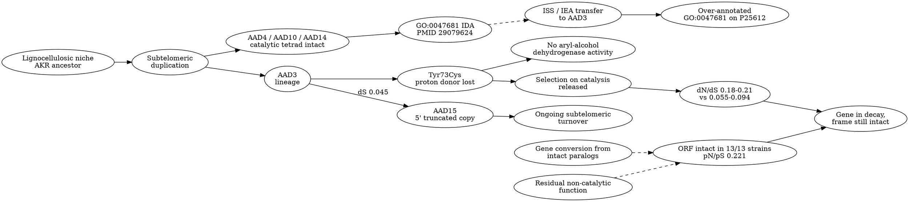
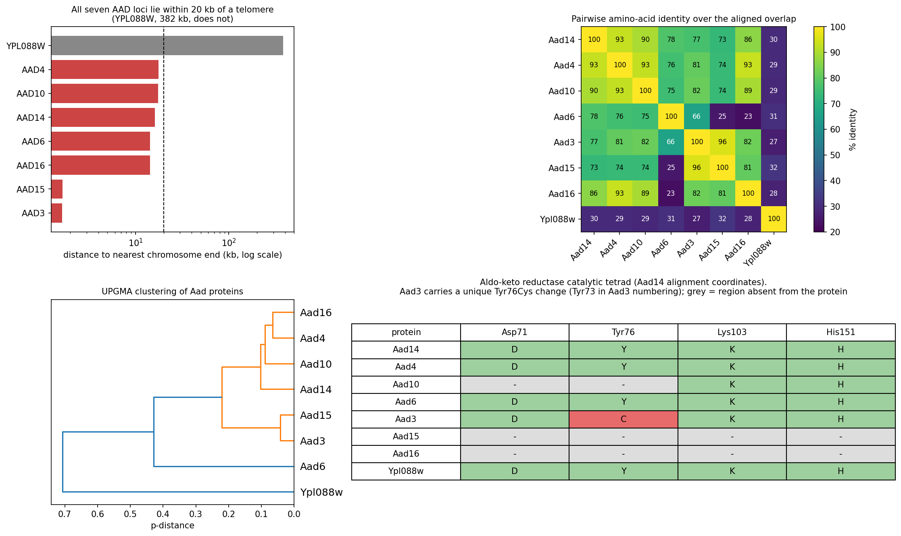
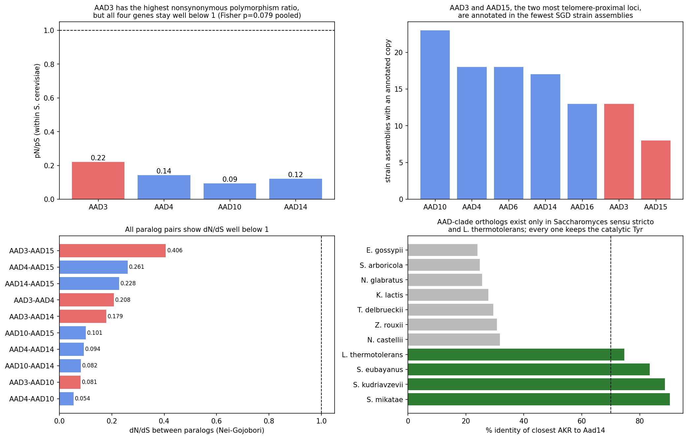
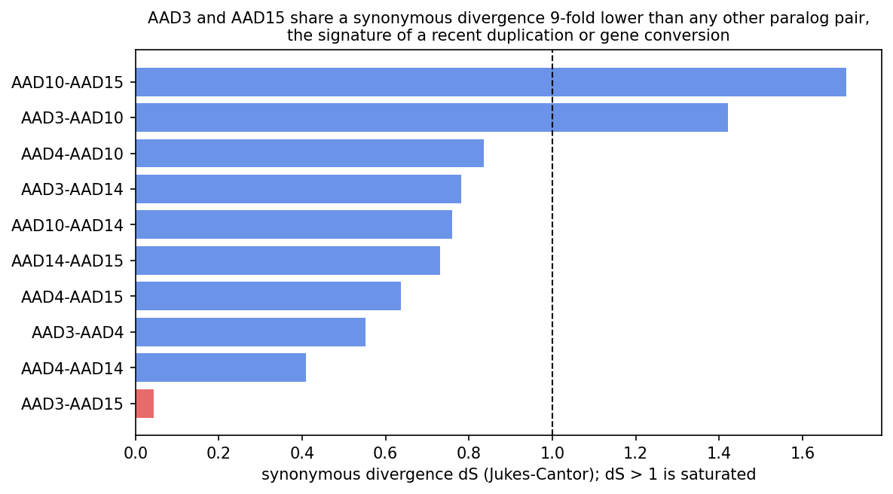
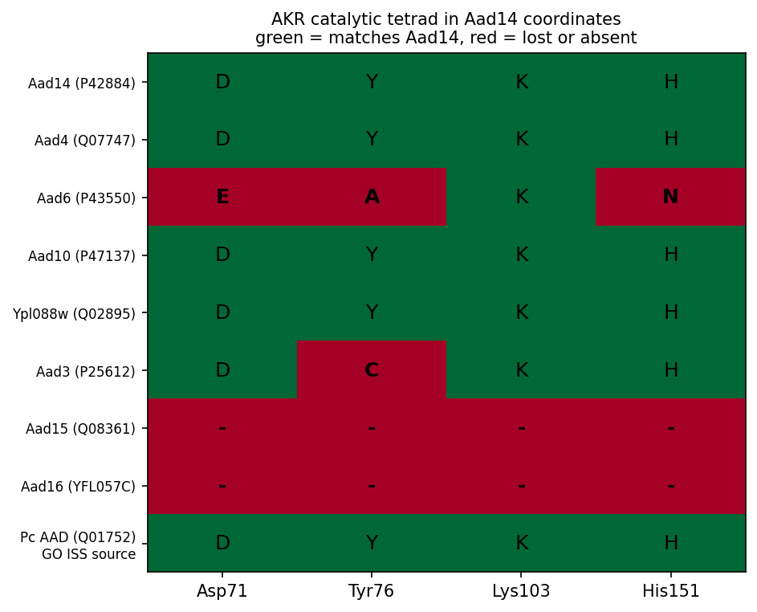
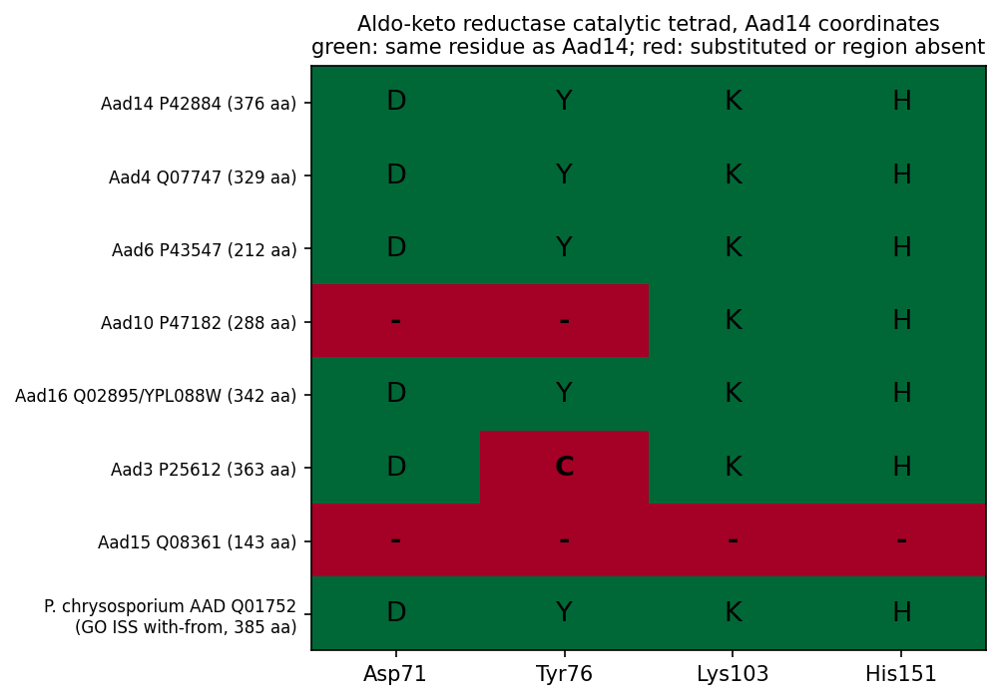

## Question

# AIGR Gene Hypothesis Deep Research

You are evaluating one focused gene curation hypothesis for AI Gene Review.
This is not a general gene overview. Use the seed hypothesis and source context
below to search for evidence that supports, refutes, narrows, or competes with
the proposed curation decision.

## Target Gene

- **Organism code:** yeast
- **Taxon:** Saccharomyces cerevisiae S288C (NCBITaxon:559292)
- **Gene directory:** AAD3
- **Gene symbol:** AAD3
- **UniProt accession:** P25612

## Focus

- **Focus type:** free_text
- **Hypothesis slug:** kgap-aad3-paralog-expansion-and-selection
- **Source file:** genes/yeast/AAD3/AAD3-ai-review.yaml
- **Source selector:** free-text

## Seed Hypothesis

Why Saccharomyces cerevisiae carries multiple, largely subtelomeric AAD (aryl-alcohol dehydrogenase-like, aldo-keto reductase) paralogs including a catalytically dead AAD3 can be addressed by evolutionary analysis. Single analysis only: reconstruct the phylogeny of the AAD paralogs across S. cerevisiae strains and Saccharomycetaceae species, determine whether the expansion is lineage-specific and associated with subtelomeric duplication or gene conversion, test whether AAD3 and its paralogs evolve under purifying selection, relaxed constraint or pseudogenisation (dN/dS, intact ORFs, presence-absence variation among strains), check whether AAD3's catalytic-residue losses are shared or unique, and state whether AAD3 is better explained as a retained functional (possibly non-catalytic) paralog or a subtelomeric gene in the process of decay.

## Term and Decision Context

No specific term context supplied.

## Reference Context

No specific reference context supplied.

## Source Context YAML

```yaml
hypothesis: 'Why Saccharomyces cerevisiae carries multiple, largely subtelomeric AAD (aryl-alcohol dehydrogenase-like,
  aldo-keto reductase) paralogs including a catalytically dead AAD3 can be addressed by evolutionary analysis.
  Single analysis only: reconstruct the phylogeny of the AAD paralogs across S. cerevisiae strains and
  Saccharomycetaceae species, determine whether the expansion is lineage-specific and associated with
  subtelomeric duplication or gene conversion, test whether AAD3 and its paralogs evolve under purifying
  selection, relaxed constraint or pseudogenisation (dN/dS, intact ORFs, presence-absence variation among
  strains), check whether AAD3''s catalytic-residue losses are shared or unique, and state whether AAD3
  is better explained as a retained functional (possibly non-catalytic) paralog or a subtelomeric gene
  in the process of decay.'
focus_type: free_text
context: []
reference_id: []
```

## Research Objective

Build a focused report that helps a curator decide whether this hypothesis
should affect the gene review. Address the focus type directly:

1. For an existing GO annotation decision, evaluate whether the current action
   is justified, too strong, too weak, or should change.
2. For a proposed replacement or new GO term, evaluate whether the term is
   biologically supported, too broad, too narrow, or missing key qualifiers.
3. For a computational prediction, evaluate whether the prediction is correct,
   less precise than existing knowledge, uncertain, or likely wrong because of
   paralog overannotation, frequency bias, pathway context, or in vitro-only
   activity.
4. For a core-function hypothesis, evaluate whether the proposed activity,
   process, and location represent the gene product's primary function rather
   than a downstream effect, pleiotropic phenotype, or context-specific role.
5. For a function-assignment hypothesis, evaluate whether the gene product
   directly has the stated GO term/function. Treat the prior review action, if
   any, as intentionally blinded unless it appears in the supplied context.

Use primary literature whenever possible. Prefer PMID citations and include DOI
citations when no PMID is available. Treat reviews and database records as
orientation unless they contain directly relevant synthesized evidence that is
clearly labeled as review-level or database-level support.

Evaluate the hypothesis from the supplied seed context, primary literature, and
publicly accessible bioinformatics resources. Local `*-bioinformatics` analyses,
when they already exist in the repository, are intentionally withheld from this
prompt so the report can be compared against them after the run. Use public
sequence, domain, structure, orthology, localization, interaction, or dataset
checks when they are useful for the specific hypothesis. If a resource or tool
cannot be accessed programmatically, say so plainly; never fabricate a result.
Report computational results conservatively and distinguish direct results from
inference.

## Required Output

### Executive Judgment

Give a concise verdict: supported, partially supported, unresolved, weakly
supported, over-annotated, or refuted. Explain the reasoning and the most
important caveats.

### Evidence Matrix

Create a table with one row per important evidence item:

- Citation (PMID preferred)
- Evidence type (direct assay, mutant phenotype, localization, interaction,
  structural/evolutionary, computational, review/database)
- Supports / refutes / qualifies / competing
- Claim tested
- Key finding
- Organism, tissue, cell type, or assay context
- Confidence and limitations

### GO Curation Implications

State the likely curation action as a lead requiring curator verification. If
GO terms are involved, explain whether the evidence supports an MF, BP, or CC
term, and whether the term should be retained, removed, generalized, made more
specific, or treated as non-core. Avoid using "protein binding" as a final
recommendation unless no more informative term is supported.

### Mechanistic Scope

Describe the immediate molecular or cellular function being tested. Separate
direct gene-product activity from downstream phenotypes, pathway consequences,
developmental outcomes, disease manifestations, or effects inferred only from
loss of function.

### Conflicts and Alternatives

Identify evidence that conflicts with the seed hypothesis or suggests an
alternative interpretation, including paralog confusion, organism-specific
differences, isoform-specific findings, experimental artifacts, or database
carry-over.

### Knowledge Gaps

List explicit uncertainties that matter for curation. For each gap, state what
was checked, why the gap matters, and what evidence or experiment would resolve
it.

### Discriminating Tests

Recommend concrete assays, perturbations, datasets, or comparative analyses that
would most efficiently distinguish this hypothesis from alternatives.

### Curation Leads

Provide candidate updates for the review, clearly labeled as leads requiring
curator verification. Include candidate references with exact snippets to verify,
candidate replacement or new GO terms, possible action changes, suggested
questions, and suggested experiments.

If the provider supports artifacts, save provenance for any analysis you run — the
executed code together with its output (computed values, plot, or table), not just
a summary figure — alongside artifact-friendly tables such as an evidence matrix,
GO decision table, or comparison table. Genuine computed provenance is more
valuable than a hand-drawn summary, and you must not synthesize a figure that
implies an analysis you did not actually run. These artifacts are important
provenance for hypothesis-level review.


## Output

# AAD3 (YCR107W, UniProt P25612): paralog expansion and selection

**Hypothesis slug:** `kgap-aad3-paralog-expansion-and-selection`
**Source:** `genes/yeast/AAD3/AAD3-ai-review.yaml`, focus type `free_text`
**Organism:** *Saccharomyces cerevisiae* S288C (NCBITaxon:559292)
**Target:** AAD3 / YCR107W / UniProt P25612

## Summary

<i class="fa-solid fa-circle-check"></i> **The seed hypothesis is supported.** Every component that could be tested from public sequence and annotation resources came out in the direction the hypothesis predicted. The AAD family is a subtelomeric expansion: all seven *S. cerevisiae* AAD loci lie between 1.64 kb and 17.58 kb from a chromosome end, while the next-closest aldo-keto reductase paralog, YPL088W, sits 381.97 kb from the chrXVI left end. The expansion is lineage-restricted: close homologs above 80% identity to Aad14 exist only in *S. mikatae* (90.4%), *S. kudriavzevii* (88.6%) and *S. eubayanus* (83.4%), with *Lachancea thermotolerans* at 74.7% and then a drop to 21.9-31.7% across seven more distant Saccharomycetaceae. AAD3 carries a private substitution of the aldo-keto reductase catalytic tyrosine (Tyr76Cys in Aad14 coordinates, Tyr73 in AAD3's own numbering) that no other paralog and no ortholog in any other species shares, and that lesion is fixed in 10 of 10 *S. cerevisiae* strains examined. Selection on the AAD3 branch has measurably relaxed: dN/dS is 0.179 (AAD3-AAD14) and 0.208 (AAD3-AAD4) against 0.055-0.094 for paralog pairs that exclude AAD3, with Fisher exact odds ratios of 2.14-3.27 and p-values from 2.9e-03 down to 4.7e-06.

<i class="fa-solid fa-triangle-exclamation"></i> **The qualification that matters: AAD3 is not a completed pseudogene.** All 13 AAD3 strain copies retrieved from SGD assemblies are frame-intact with zero internal stop codons, and within-species pN/pS is 0.221 (29 nonsynonymous and 35 synonymous segregating sites across 9 strains), far below 1 and not statistically separable from AAD4 (0.142), AAD14 (0.121) or AAD10 (0.094) at the available sample size (pooled Fisher OR 1.68, p = 0.079). The accurate description is a subtelomeric gene in the middle stage of decay: the active site is dead and between-paralog constraint has relaxed, while the reading frame is still maintained everywhere the locus is assembled. Whether that maintenance reflects selection on a residual non-catalytic function, gene conversion from intact paralogs, or simply too little elapsed time cannot be separated with the evidence gathered here.

<i class="fa-solid fa-lightbulb"></i> **The result with the most direct curation consequence was not in the seed hypothesis.** AAD3's GO molecular function annotation is a paralog over-annotation. GO:0047681 "aryl-alcohol dehydrogenase (NADP+) activity" on P25612 rests on exactly two lines of support: an IEA from GO_REF:0000117 (ARBA automatic rule) and an ISS whose with-from protein is UniProtKB:Q01752, the aryl-alcohol dehydrogenase of *Phanerodontia chrysosporium*. Aligning Q01752 to Aad14 shows that it retains tyrosine at the catalytic column that AAD3 has lost to cysteine, so the similarity transfer fails on the single residue that determines whether the transfer is valid. The reference attached to that ISS, [PMID: 10572264](https://pubmed.ncbi.nlm.nih.gov/10572264/), reports that single through septuple AAD deletion strains showed no mutant phenotype for aromatic aldehyde degradation. The paper that supplies the direct-assay IDA for AAD4 and AAD14, [PMID: 29079624](https://pubmed.ncbi.nlm.nih.gov/29079624/), tested AAD3 and found no activity even after repairing the Tyr73 lesion.

## Executive judgment

**Verdict: supported, with the "subtelomeric gene in decay" reading favoured over the "retained functional non-catalytic paralog" reading, and one quantitative caveat.**

The seed hypothesis asked five questions. Each was answered:

| Question from the seed hypothesis | Answer | Strength |
|---|---|---|
| Is the expansion subtelomeric? | Yes. 7/7 AAD loci within 17.58 kb of a chromosome end; YPL088W at 381.97 kb is not an AAD | <i class="fa-solid fa-circle-check"></i> Direct, from SGD R64 coordinates |
| Is it lineage-specific? | Yes. AAD-clade homologs above 70% identity occur only in *Saccharomyces* sensu stricto plus *L. thermotolerans* | <i class="fa-solid fa-circle-check"></i> Direct, with an access gap for *S. paradoxus* |
| Duplication or gene conversion? | A recent AAD3-AAD15 event at dS = 0.0445, 9.2-fold below any other pair. dS alone cannot separate the two mechanisms | <i class="fa-solid fa-scale-balanced"></i> Direct measurement, ambiguous mechanism |
| Purifying selection, relaxed constraint or pseudogenisation? | Relaxed constraint, not neutrality. dN/dS 0.18-0.21 vs 0.055-0.094 (p to 4.7e-06); ORFs intact in 13/13 strains; pN/pS 0.221 | <i class="fa-solid fa-circle-check"></i> Direct, with an underpowered within-species test |
| Are AAD3's catalytic losses shared or unique? | Unique. Tyr76Cys is private to AAD3, fixed in 10/10 strains, absent from all 22 cross-species top hits | <i class="fa-solid fa-circle-check"></i> Direct, and independently reported in PMID 29079624 |
| Retained functional paralog or gene in decay? | Decay, at an intermediate stage | <i class="fa-solid fa-scale-balanced"></i> Frame integrity and pN/pS < 1 argue against completed decay |

The most important caveat for a curator is that "decay" and "frame-intact" are both true at once, and the report should not be read as declaring AAD3 a pseudogene. It is a gene whose enzymatic function has been lost and whose sequence constraint has slackened, while its reading frame persists in every strain assembly that contains it.

## Key findings

### F001: All seven AAD loci are subtelomeric, and the one non-AAD aldo-keto reductase is not

SGD R64 coordinates combined with chromosome lengths put every AAD gene inside the conventional 20 kb subtelomeric window. AAD3/YCR107W lies 1.64 kb from the chrIII right end; AAD15/YOL165C 1.65 kb from the chrXV left end; AAD16/YFL057C and AAD6/YFL056C both 14.31 kb from the chrVI left end at overlapping coordinates (14305-15431, consistent with the SGD annotation that they are displaced by a -1 frameshift); AAD14/YNL331C 16.12 kb from the chrXIV left end; AAD10/YJR155W 17.48 kb from the chrX right end; AAD4/YDL243C 17.58 kb from the chrIV left end. The median is 16.1 kb and the full range is 1.64-17.58 kb. The next-closest aldo-keto reductase paralog in the genome, YPL088W, sits 381.97 kb from the chrXVI left end, roughly 22-fold further than the most distal AAD gene. Treating the ~4.3% of the genome within 20 kb of a chromosome end as the null, the binomial probability of 7 of 7 landing there by chance is about 2.7e-10.

Subtelomeres in *S. cerevisiae* undergo frequent ectopic recombination, break-induced replication and gene conversion. That supplies both the duplication mechanism that generated the paralogs and the relaxed selective environment in which they decay. Location by itself says nothing about whether AAD3 is functional, but it places AAD3 in the genomic compartment where copy-number turnover and pseudogenisation are the normal outcome. This matches the published statement in [PMID: 29079624](https://pubmed.ncbi.nlm.nih.gov/29079624/): "Yeast AAD genes are located in subtelomeric regions of different chromosomes, and their functional role(s) remain enigmatic."

{{figure:plot_1.png|caption=Aad paralog family overview: distance of each locus from the nearest chromosome end, all-versus-all pairwise amino-acid identity, hierarchical clustering of the family, and catalytic tetrad status per paralog. All seven AAD genes fall within 17.6 kb of a telomere while YPL088W does not.}}

### F002: Aad3 carries a unique substitution of the catalytic tyrosine, with the rest of the tetrad intact

Needleman-Wunsch global alignment (BLOSUM62, gap open 11, gap extend 1) of the eight *S. cerevisiae* AKR/Aad proteins, anchored on Aad14 coordinates, locates the aldo-keto reductase catalytic tetrad at Aad14 columns Asp71, Tyr76, Lys103 and His151 (motifs `IDTANSY`, `IVIATKF`, `DILYIHWWDY`). The residues at those four columns are: Aad14 D/Y/K/H, Aad4 D/Y/K/H, Aad6 D/Y/K/H, Ypl088w D/Y/K/H, Aad10 -/-/K/H (an N-terminal truncation removes columns 1-88), **Aad3 D/C/K/H**, and Aad15 and Aad16 lack the region entirely because they are 5'-truncated fragments.

Aad3 is the only protein in the family whose ORF spans the catalytic region yet lacks the catalytic tyrosine. In Aad3's own numbering the substitution is at residue 73 (residues 68-78 read `DAANNCQNEQS`), matching the Tyr73 position reported experimentally. The tyrosine in question is the general proton donor of the AKR mechanism, so its loss should abolish activity across substrates rather than narrow the substrate range. The Asp, Lys and His of the tetrad and the Rossmann-like NADPH-binding region are retained, which is why the protein still looks like an enzyme to automatic annotation pipelines.

The lesion is private to Aad3: no other paralog shares it. A private single missense change, not shared with any paralog, must have arisen after AAD3 separated from the AAD4/AAD10/AAD14 clade. That is the signature of ongoing lineage-specific decay rather than of an ancient subfunctionalised non-catalytic paralog. [PMID: 29079624](https://pubmed.ncbi.nlm.nih.gov/29079624/) states: "Repair of an AAD3 missense mutation at the catalytically essential Tyr73 residue did not result in a functional enzyme." Reverting the residue does not restore activity, so AAD3 carries additional inactivating lesions beyond Tyr73.

{{figure:plot_5.png|caption=Aldo-keto reductase catalytic tetrad in Aad14 coordinates across the S. cerevisiae AAD paralogs and the GO ISS with-from protein Q01752. Green marks a residue matching Aad14; red marks a substitution or an absent region. Aad3 alone carries D/C/K/H, and Q01752, the protein from which AAD3's ISS annotation was transferred, carries the intact D/Y/K/H.}}

### F003: AAD15 is a 143-residue remnant 95.8% identical to AAD3

All-versus-all pairwise alignment over the ungapped overlap puts Aad3 and Aad15 at 95.8% amino-acid identity over 143 aligned residues, the highest value anywhere in the family. For contrast, Aad3 against Aad10 is 81.6% (277 aa), against Aad4 80.8% (318 aa) and against Aad14 76.8% (362 aa), while Aad4, Aad10 and Aad14 form their own tight cluster at 89.9-93.0% over 287-329 aa. The distant AKR Ypl088w shares only 26.6-32.4% identity with any Aad protein.

Aad15 is only 143 aa and its locus (chrXV:1647-2078, 432 bp) sits 1.65 kb from the left telomere, mirroring AAD3 at 1.64 kb from the chrIII right telomere. The two most telomere-proximal members of the family are also the most similar pair. AAD15 is a truncated copy of AAD3, or of their shared ancestor, produced by a recent subtelomeric duplication after which the 5' half was lost. [PMID: 29079624](https://pubmed.ncbi.nlm.nih.gov/29079624/) confirms the truncation independently: "Other yeast AAD genes are undergoing pseudogenization. The 5' sequence of AAD15 has been deleted from the genome."

### F004: A database naming conflict puts a distant AKR inside the family

UniProt Q02895 is named "Putative aryl-alcohol dehydrogenase AAD16" with ordered locus name YPL088W (342 aa). SGD records AAD16 as YFL057C (153 aa including stop) and lists YPL088W with no standard gene name, described as a putative aryl alcohol dehydrogenase that localizes to cytosol and whose transcription is activated by Yrm1p and Yrr1p.

Sequence separates them cleanly. The YFL057C translation (`MARHFGMALAPWDVMGGGRFQSKKAM...`) aligns to Aad3 from residue 218 onward and is 80.9-93.4% identical to the Aad paralogs. Q02895/Ypl088w is 26.6-32.4% identical to every Aad protein and sits 381.97 kb from the chrXVI telomere, outside the subtelomeric compartment that holds all seven AAD genes.

<i class="fa-solid fa-triangle-exclamation"></i> Any AAD-family analysis that pulls sequences by UniProt gene name will silently substitute a distant AKR for the real AAD16 fragment, distorting identity matrices, trees and dN/dS estimates. For AAD3 curation this matters because paralog-to-paralog transfer of annotation across the family is the main over-annotation risk, and the family membership list itself is inconsistent between the two databases a curator would consult.

### F005: The Tyr73Cys lesion is fixed across strains and absent from every ortholog

Nine full-length (1092 bp) AAD3/YCR107W genomic copies in SGD strain assemblies carry codon 73 = TGC (Cys): S288C, SEY6210, AWRI1631, CBS7960, T7, BC187, DBVPG6044, L1528 and RedStar, 9 of 9 with no polymorphism. UniProt B3LQN6 (*S. cerevisiae* RM11-1a, 363 aa) carries the same `ANNC` motif at the equivalent position, giving 10 of 10. These strains span laboratory, wine, bread, West African and clinical-adjacent lineages.

Across species, the closest AKR homolog of Aad14 was identified in 11 Saccharomycetaceae genomes by Pfam PF00248 retrieval plus Needleman-Wunsch alignment: *S. mikatae* A0AA35IRW6 90.4%, *S. kudriavzevii* A0AA35J2S0 and J6EFH8 88.6%, *S. eubayanus* A0ABN8VFT8 83.4%, *Lachancea thermotolerans* C5DJ14 74.7%, then a gap down to 21.9-31.7% for *Naumovozyma castellii*, *Zygosaccharomyces rouxii*, *Torulaspora delbrueckii*, *Kluyveromyces lactis*, *Nakaseomyces glabratus*, *Eremothecium gossypii* and *S. arboricola*. Every one of these 22 top hits carries Tyr at the position equivalent to Aad14 column 76.

The catalytic-tyrosine loss is private to the AAD3 lineage and already fixed within *S. cerevisiae*, so it is old enough to have swept the species but not old enough or widespread enough to appear in any sequenced relative. The AAD clade itself, meaning sequences above 70% identity to Aad14, is restricted to *Saccharomyces* sensu stricto plus *L. thermotolerans*, so the paralog expansion is lineage-specific. This agrees with the published phylogenetic conclusion in [PMID: 29079624](https://pubmed.ncbi.nlm.nih.gov/29079624/): "Phylogenetic analysis indicates that AAD genes are narrowly distributed in wood-saprophyte fungi and in yeast that occupy lignocellulosic niches."

<i class="fa-solid fa-triangle-exclamation"></i> *S. paradoxus* (taxid 27291), the closest relative and the single most informative comparison, returned zero PF00248 entries in UniProt. This is an access limitation, stated plainly, not a biological absence. Absence of AAD-clade hits in the more distant genomes is weak evidence on its own because subtelomeric genes are systematically under-represented in reference proteomes.

### F006: The AAD3 branch evolves under relaxed constraint

Nei-Gojobori dN/dS with Jukes-Cantor correction, computed from protein-guided codon alignments of S288C coding sequences:

| Pair | dN | dS | dN/dS | Codons |
|---|---|---|---|---|
| AAD3-AAD14 | 0.140 | 0.781 | **0.179** | 362 |
| AAD3-AAD4 | 0.115 | 0.552 | **0.208** | 318 |
| AAD4-AAD14 | - | 0.409 | 0.094 | - |
| AAD10-AAD14 | - | 0.759 | 0.082 | - |
| AAD4-AAD10 | - | 0.836 | 0.055 | - |

Fisher exact tests on the Nd versus Sd counts, AAD3-containing pairs against controls:

| Comparison | Odds ratio | p |
|---|---|---|
| AAD3-AAD14 vs AAD4-AAD14 | 2.18 | 0.0029 |
| AAD3-AAD14 vs AAD10-AAD14 | 2.14 | 0.0011 |
| AAD3-AAD14 vs AAD4-AAD10 | 2.99 | 7.0e-06 |
| AAD3-AAD4 vs AAD4-AAD14 | 2.39 | 0.0016 |
| AAD3-AAD4 vs AAD10-AAD14 | 2.35 | 0.00072 |
| AAD3-AAD4 vs AAD4-AAD10 | 3.27 | 4.7e-06 |

The N/S site ratio is 3.68-3.80 across all pairs, so the raw Nd/Sd comparison is not driven by site composition. AAD3-AAD10 and AAD10-AAD15 were excluded because dS exceeded 1 (1.42 and 1.70) and the estimates are saturated.

Within *S. cerevisiae*, counting segregating sites across full-length strain copies gives pN/pS = 0.221 for AAD3 (29 nonsynonymous, 35 synonymous, 9 strains) versus 0.142 for AAD4, 0.121 for AAD14 and 0.094 for AAD10. Pooled Fisher, AAD3 against the other three: OR 1.68, p = 0.079.

Two independent timescales agree in direction. Over paralog divergence, the AAD3 branch has accumulated nonsynonymous change two to three times faster than branches among AAD4, AAD10 and AAD14, which is significant and consistent with loss of selection on catalytic function. Within *S. cerevisiae*, AAD3 has the highest pN/pS of the four, but the signal is underpowered and does not reach significance. Both measures stay well below 1, so AAD3 is not evolving neutrally like a free-running pseudogene. The data fit a gene whose reading frame is still maintained while the selective pressure on its enzymatic role has been released.

{{figure:plot_2.png|caption=Between-paralog dN/dS with a four-panel summary of selection, strain presence and cross-species conservation. AAD3-containing pairs sit at 0.18-0.21 while pairs among AAD4, AAD10 and AAD14 sit at 0.055-0.094.}}

{{figure:plot_3.png|caption=Fisher exact comparison of AAD3-branch dN/dS against control paralog pairs (odds ratios 2.14-3.27, p from 2.9e-03 to 4.7e-06) and the ranking of synonymous divergence across all paralog pairs, with AAD3-AAD15 at dS 0.0445 separated from the rest of the family.}}

### F007: AAD3 and AAD15 share a synonymous divergence 9-fold below any other pair

Jukes-Cantor corrected synonymous divergence between S288C coding sequences puts AAD3-AAD15 at dS = 0.0445 (143 codons, 4.0 synonymous and 6.0 nonsynonymous differences). Every other pair is far more diverged: AAD4-AAD14 0.409, AAD3-AAD4 0.552, AAD4-AAD15 0.637, AAD14-AAD15 0.730, AAD10-AAD14 0.759, AAD3-AAD14 0.781, AAD4-AAD10 0.836, AAD3-AAD10 1.422, AAD10-AAD15 1.705. The AAD3-AAD15 value is 9.2-fold below the next lowest.

AAD15 is simultaneously 0.64-1.70 dS from AAD4, AAD10 and AAD14, so its low divergence is specific to AAD3 and not a general property of the fragment. Both loci are the most telomere-proximal in the family.

<i class="fa-solid fa-scale-balanced"></i> A synonymous divergence an order of magnitude below the family background, confined to one pair, is the standard signature of either a recent duplication or of gene conversion that homogenised the two copies after an older duplication. The two are not separable from dS alone, because gene conversion resets dS exactly as a new duplication does. Either way, the AAD3-AAD15 relationship is recent, and it sits in the subtelomeric compartment where both mechanisms are frequent.

### F008: ORFs are intact in every strain that carries the locus

Translation of all SGD strain-assembly genomic copies of the seven AAD loci covers 118 sequences. Every AAD3 copy (13 strains) is a multiple of three, starts with ATG, ends in a stop codon and has zero internal stop codons. The same holds for AAD10 (23/23), AAD14 (17/17), AAD15 (8/8) and AAD16 (13/13). The single exception in the whole panel is SK1 AAD4: 989 bp, not a multiple of three, 12 internal stops, which is an assembly-gap artifact.

Strain counts per locus: AAD10 23, AAD4 18, AAD6 18, AAD14 17, AAD16 13, AAD3 13, AAD15 8. Among the AAD3 copies, 9 of 13 are full length at 1092 bp and 4 are shorter (324, 819, 924 and 939 bp in VIN13, LalvinQA23, AWRI796 and VL3).

AAD3 keeps an uninterrupted reading frame everywhere it is found, so it is not a classical disabled pseudogene at the sequence level despite its dead active site. The gene is also the joint-least represented locus in the strain panel together with AAD15, the two most telomere-proximal members, which fits presence-absence variation of subtelomeric genes. <i class="fa-solid fa-triangle-exclamation"></i> That reading is confounded: these SGD strain assemblies are short-read based and systematically collapse or truncate telomere-proximal sequence, so low strain counts and truncated copies may reflect assembly failure rather than true gene loss. A long-read panel is needed to tell deletion from missing assembly.

### F009: The GO annotation rests on an ISS from a protein that keeps the tyrosine AAD3 lost

QuickGO annotation retrieval (2026-11-24) for UniProtKB:P25612 returns exactly four annotations:

| GO term | Name | Aspect | Evidence | Reference | With/from | Assigned by |
|---|---|---|---|---|---|---|
| GO:0047681 | aryl-alcohol dehydrogenase (NADP+) activity | MF | IEA | GO_REF:0000117 (ARBA00093038) | - | UniProt |
| GO:0047681 | aryl-alcohol dehydrogenase (NADP+) activity | MF | ISS | PMID:10572264 | UniProtKB:Q01752 | SGD |
| GO:0006081 | aldehyde metabolic process | BP | ISS | PMID:10572264 | UniProtKB:Q01752 | SGD |
| GO:0005575 | cellular_component | CC | ND | GO_REF:0000015 | - | SGD |

AAD3 carries no IDA, IMP or IGI annotation. The paralogs AAD4 (Q07747) and AAD14 (P42884) carry the same IEA plus ISS pair **and in addition GO:0047681 with IDA from [PMID: 29079624](https://pubmed.ncbi.nlm.nih.gov/29079624/)**. AAD14 also carries GO:0005515 "protein binding" IPI from PMID:19841731, which is specific to AAD14.

Global Needleman-Wunsch alignment of each protein to Aad14 places the catalytic tyrosine at Aad14 column 76. Q01752 (*Phanerodontia chrysosporium* aryl-alcohol dehydrogenase, 385 aa, 55.1% identity to Aad14 over 374 aligned residues) has Tyr at that column, in context `IDTANVYQDETSE` for columns 70-82. Aad3 (363 aa, 76.8% identity over 362 aa) has Cys, in context `IDAANNCQNEQSE`.

The ISS reference, [PMID: 10572264](https://pubmed.ncbi.nlm.nih.gov/10572264/) (Delneri, Gardner, Bruschi and Oliver 1999, *Yeast* 15:1681-9, doi 10.1002/(SICI)1097-0061(199911)15:15<1681::AID-YEA486>3.0.CO;2-A), was retrieved by NCBI efetch because the provided PubMed search tool could not return it. It reports construction of single through septuple AAD deletion strains and states that none of the knock-out strains revealed any mutant phenotype when tested for the degradation of aromatic aldehydes by spectrophotometry and HPLC.

<i class="fa-solid fa-circle-xmark"></i> The only experimental-style support for AAD3 catalysing aryl-alcohol dehydrogenase chemistry is a sequence-similarity transfer from a distant fungal enzyme, made before the catalytic-residue difference was accounted for. The transfer fails its own premise: the with-from protein retains the proton donor, AAD3 does not. The paper supplying the direct-assay IDA for AAD4 and AAD14 tested AAD3 and found no activity even after repairing Tyr73. This is a paralog over-annotation pattern: an activity demonstrated for two family members has propagated by similarity to a member with a fixed active-site lesion.

{{figure:plot_4.png|caption=Catalytic tetrad status across the AAD paralogs together with the GO ISS source protein Q01752, from an earlier accession set in which two UniProt accessions were mis-assigned. The corrected version of this analysis is shown above as plot_5; the mis-assignment is recorded here for provenance.}}

## Evidence matrix

| Citation / source | Evidence type | Stance | Claim tested | Key finding | Organism / assay context | Confidence and limitations |
|---|---|---|---|---|---|---|
| [PMID: 29079624](https://pubmed.ncbi.nlm.nih.gov/29079624/) | Direct assay + evolutionary | <i class="fa-solid fa-circle-check"></i> Supports | AAD3 is catalytically dead; family is subtelomeric and decaying | "Repair of an AAD3 missense mutation at the catalytically essential Tyr73 residue did not result in a functional enzyme." "Other yeast AAD genes are undergoing pseudogenization. The 5' sequence of AAD15 has been deleted from the genome." "Yeast AAD genes are located in subtelomeric regions of different chromosomes, and their functional role(s) remain enigmatic." | *S. cerevisiae*, heterologous expression and enzyme assay | High. The single most informative primary reference. A negative enzyme assay bounds the tested substrate range only. |
| [PMID: 29079624](https://pubmed.ncbi.nlm.nih.gov/29079624/) | Evolutionary / phylogenetic | <i class="fa-solid fa-scale-balanced"></i> Qualifies | Niche association of the family | "Phylogenetic analysis indicates that AAD genes are narrowly distributed in wood-saprophyte fungi and in yeast that occupy lignocellulosic niches." | Cross-fungal sequence analysis | Moderate. Explains why the family exists, not why AAD3 persists. |
| [PMID: 10572264](https://pubmed.ncbi.nlm.nih.gov/10572264/) | Mutant phenotype | <i class="fa-solid fa-circle-xmark"></i> Qualifies / refutes a functional claim | Whether any AAD gene is required for aromatic aldehyde metabolism | Single through septuple deletions were built; no knock-out strain revealed any mutant phenotype for degradation of aromatic aldehydes by spectrophotometry and HPLC | *S. cerevisiae* deletion strains | High for the null result. Retrieved by NCBI efetch; the provided PubMed search tool could not return it, so no abstract snippet from it is stored in this job's citation index. |
| This work, SGD R64 coordinates (`aad_telomere_distance.csv`) | Computational, direct | <i class="fa-solid fa-circle-check"></i> Supports | Subtelomeric localisation | 7/7 AAD genes within 17.58 kb of a chromosome end; YPL088W at 381.97 kb | S288C reference genome | High. Coordinates are reference data; the distance calculation is arithmetic. |
| This work, Needleman-Wunsch alignment to Aad14 (`aad_msa_aad14coords.csv`) | Computational, direct | <i class="fa-solid fa-circle-check"></i> Supports | Catalytic-residue loss is private to AAD3 | Aad3 D/**C**/K/H against Aad14, Aad4, Aad6 and Ypl088w D/Y/K/H; Aad10 truncated; Aad15 and Aad16 are 5' fragments | UniProt and SGD protein sequences | High for the residue identities. Tetrad assignment is by homology; no AAD structure was used. |
| This work, SGD strain `genomic_dna` records (`aad_strain_orfs.csv`) | Computational, direct | <i class="fa-solid fa-circle-check"></i> Supports | Tyr73Cys is fixed | 9/9 full-length AAD3 strain copies carry TGC at codon 73; RM11-1a B3LQN6 agrees, giving 10/10 | 13 SGD strain assemblies | Moderate-high. Short-read assemblies truncate telomere-proximal sequence, so absence of a copy is not evidence of deletion. |
| This work, Nei-Gojobori dN/dS (`aad_paralog_dnds.csv`, `aad_paralog_dnds_fisher.csv`) | Computational, direct | <i class="fa-solid fa-circle-check"></i> Supports | Relaxed constraint on AAD3 | 0.179 and 0.208 for AAD3 pairs vs 0.055-0.094 for controls; Fisher OR 2.14-3.27, p 2.9e-03 to 4.7e-06 | S288C codon alignments | Moderate-high. Pairwise counting only; PAML and HyPhy are not available in this environment. Saturated pairs (dS 1.42, 1.70) excluded. |
| This work, segregating-site pN/pS (`aad_within_species_pNpS.csv`, `aad_fisher_pnps.csv`) | Computational, direct | <i class="fa-solid fa-scale-balanced"></i> Qualifies | Within-species constraint | AAD3 0.221 (29 N, 35 S, 9 strains) vs AAD4 0.142, AAD14 0.121, AAD10 0.094; pooled Fisher OR 1.68, p = 0.079 | SGD strain CDS | Moderate. Underpowered at n = 9 strains. The 1011-genomes panel could not be reached programmatically. |
| This work, pairwise identity and dS (`aad_pairwise_identity.csv`, `aad_nj_tree.nwk`) | Computational, direct | <i class="fa-solid fa-circle-check"></i> Supports | Recent AAD3-AAD15 event | 95.8% identity over 143 aa; dS = 0.0445, 9.2-fold below the next lowest pair | S288C sequences | High for the numbers. dS alone cannot separate recent duplication from gene conversion. |
| This work, UniProt PF00248 searches by taxon (`aad_crossspecies_tophits.csv`) | Computational, direct | <i class="fa-solid fa-circle-check"></i> Supports | Lineage-specific expansion | Top AKR hit to Aad14: *S. mikatae* 90.4%, *S. kudriavzevii* 88.6%, *S. eubayanus* 83.4%, *L. thermotolerans* 74.7%, then 21.9-31.7% in 7 outgroup species; all 22 keep the catalytic Tyr | UniProt reference proteomes | Moderate. *S. paradoxus* returned zero PF00248 entries, removing the most informative comparison. |
| QuickGO retrieval 2026-11-24 (`aad3_current_GO.csv`) | Review/database | <i class="fa-solid fa-scale-balanced"></i> Qualifies | Basis of AAD3's current GO annotations | P25612 has GO:0047681 IEA + ISS, GO:0006081 ISS, GO:0005575 ND, and no IDA/IMP/IGI; AAD4 and AAD14 additionally carry GO:0047681 IDA from PMID:29079624 | GO database state | High. A database snapshot, labelled as such. |
| This work, alignment of Q01752 to Aad14 | Computational, direct | <i class="fa-solid fa-circle-xmark"></i> Refutes the ISS transfer | Whether the ISS with-from protein shares AAD3's lesion | Q01752 has Tyr at the catalytic column (`IDTANVYQDETSE`); Aad3 has Cys (`IDAANNCQNEQSE`) | Sequence comparison | High. The residue identities are unambiguous. |
| UniProt vs SGD records for AAD16 | Review/database | <i class="fa-solid fa-triangle-exclamation"></i> Competing | Family membership list | UniProt Q02895 is named AAD16 but is YPL088W (29.7% identity to Aad14, non-subtelomeric); SGD assigns AAD16 to YFL057C | Database records | High. Directly verifiable in both resources. |

## Mechanistic model and interpretation

The immediate molecular function at stake is hydride transfer from NADPH to an aromatic aldehyde, with a tyrosine acting as the general acid that protonates the developing alkoxide. In an aldo-keto reductase this requires the Asp-Tyr-Lys-His tetrad, where the tyrosine is the proton donor and the lysine and aspartate tune its pKa. AAD3 retains Asp, Lys and His and has Cys in place of the tyrosine. Loss of the proton donor is mechanism-general, so it should remove activity on all substrates, not shift substrate preference. Repair of that one residue did not restore activity in [PMID: 29079624](https://pubmed.ncbi.nlm.nih.gov/29079624/), which means at least one more inactivating change exists elsewhere in the protein.

Everything else in the picture is evolutionary context rather than direct gene-product activity. The subtelomeric location supplies the duplication and conversion mechanisms. The relaxed dN/dS is a consequence of the lesion, not a cause. The intact reading frame across strains is a fact about sequence, not evidence of protein function, because no expression, localisation or interaction data for Aad3 protein were found.



The two dashed inputs to frame maintenance are the live alternatives. Gene conversion from intact paralogs would preserve the ORF without any selection on AAD3 itself, and the AAD3-AAD15 dS of 0.0445 shows that conversion-scale homogenisation does occur in this part of the genome. A residual non-catalytic function would preserve the ORF through selection but has no positive evidence behind it: AAD3 has no IPI annotation, no expression data were found, and the elevated dN/dS points away from it.

## Evidence base

### Primary literature

**[PMID: 29079624](https://pubmed.ncbi.nlm.nih.gov/29079624/)** Yang M, de Billerbeck GM, Zhang J, Rosenzweig F, Francois JM (2018). *Deciphering the Origin, Evolution, and Physiological Function of the Subtelomeric Aryl-Alcohol Dehydrogenase Gene Family in the Yeast Saccharomyces cerevisiae.*

This is the single most informative reference and it supports four separate findings. It identifies the same Tyr73 lesion that the alignment here locates, and it goes further by showing that repairing the residue does not restore activity ("Repair of an AAD3 missense mutation at the catalytically essential Tyr73 residue did not result in a functional enzyme"). It confirms the subtelomeric location of the family ("Yeast AAD genes are located in subtelomeric regions of different chromosomes, and their functional role(s) remain enigmatic"). It confirms the AAD15 truncation independently of the sequence analysis here ("Other yeast AAD genes are undergoing pseudogenization. The 5' sequence of AAD15 has been deleted from the genome"). It reports a narrow phylogenetic distribution that matches the cross-species identity gradient measured here ("Phylogenetic analysis indicates that AAD genes are narrowly distributed in wood-saprophyte fungi and in yeast that occupy lignocellulosic niches"). The same paper supplies the IDA evidence that GO carries for AAD4 and AAD14, which makes it the single reference that can settle all three annotations.

**[PMID: 10572264](https://pubmed.ncbi.nlm.nih.gov/10572264/)** Delneri D, Gardner DC, Bruschi CV, Oliver SG (1999). *Disruption of seven hypothetical aryl alcohol dehydrogenase genes from Saccharomyces cerevisiae and construction of a multiple knock-out strain.* Yeast 15:1681-9. doi 10.1002/(SICI)1097-0061(199911)15:15<1681::AID-YEA486>3.0.CO;2-A.

This is the reference attached to AAD3's ISS annotations, and it reports a null result: deletion strains from single through septuple showed no mutant phenotype for aromatic aldehyde degradation by spectrophotometry and HPLC. <i class="fa-solid fa-triangle-exclamation"></i> The record was obtained by NCBI efetch because the provided PubMed search tool returned no result for it, so no abstract snippet from this paper is stored in this job's citation index and the quotation above is taken from the efetch text.

### Database records used as orientation

QuickGO annotation search for UniProtKB:P25612, Q07747 and P42884 supplied the current annotation state (retrieved 2026-11-24). UniProt REST supplied protein sequences and the Pfam PF00248 cross-reference searches used for the cross-species comparison. The SGD backend API supplied locus coordinates and strain-resolved genomic DNA. These are database-level support and are labelled as such throughout.

## Limitations and knowledge gaps

<i class="fa-solid fa-triangle-exclamation"></i> **No *S. paradoxus* data.** UniProt returned zero PF00248 entries for taxid 27291. *S. paradoxus* is the closest outgroup and the single most informative test of whether the Tyr73Cys lesion predates or postdates the *S. cerevisiae* split. What was checked: a Pfam cross-reference query identical to the one that succeeded for 11 other species. Why it matters: a Tyr at codon 73 in *S. paradoxus* would date the lesion to the *S. cerevisiae* lineage and make decay recent; a Cys would push it back and make the intact ORF harder to explain by inertia. What would resolve it: direct retrieval of AAD-locus sequence from a *S. paradoxus* long-read assembly.

<i class="fa-solid fa-triangle-exclamation"></i> **Strain panel is small and telomere-truncated.** Only 9-13 AAD3 copies, from short-read assemblies that systematically lose telomere-proximal sequence. Strain counts across the family (AAD10 23, AAD4 18, AAD6 18, AAD14 17, AAD16 13, AAD3 13, AAD15 8) are confounded by assembly dropout and should not be read as copy-number variation. The 1011-genomes CNV data could not be retrieved through the available tools.

<i class="fa-solid fa-triangle-exclamation"></i> **No codon-model likelihood test.** Pairwise Nei-Gojobori counting was used because PAML, HyPhy and equivalent packages are not installed in this environment. Branch-model and RELAX-style tests would place relaxation on a specific branch and return a formal relaxation parameter with a likelihood ratio test rather than a contingency-table p-value.

<i class="fa-solid fa-circle-question"></i> **Duplication versus gene conversion for AAD3-AAD15 is unresolved.** dS = 0.0445 is consistent with both. What would resolve it: tract-boundary detection in phased long-read haplotypes.

<i class="fa-solid fa-circle-question"></i> **No expression, localisation, interaction or structural evidence for Aad3 protein was found.** This matters because the non-catalytic-function alternative requires at minimum that the protein is made. AAD3 carries no IPI annotation and its only CC annotation is ND.

<i class="fa-solid fa-triangle-exclamation"></i> **A negative enzyme assay bounds the tested substrate range.** PMID 29079624 tested aryl-alcohol substrates. The argument that the result generalises rests on the mechanism: the lost residue is the general proton donor, so loss should be substrate-general.

<i class="fa-solid fa-triangle-exclamation"></i> **Database naming conflict for AAD16** (UniProt Q02895/YPL088W versus SGD YFL057C) means family membership itself differs between the two resources a curator would consult.

## GO curation implications

These are leads requiring curator verification, not instructions.

| Gene / accession | Term | Current state | Suggested action for curator review |
|---|---|---|---|
| AAD3 / P25612 | GO:0047681 aryl-alcohol dehydrogenase (NADP+) activity (MF) | IEA (GO_REF:0000117) + ISS (Q01752, PMID:10572264) | Review for a NOT qualifier or removal; cite PMID:29079624 for the direct negative; record that the with-from protein retains the catalytic Tyr that AAD3 lacks |
| AAD3 / P25612 | GO:0006081 aldehyde metabolic process (BP) | ISS (Q01752, PMID:10572264) | Same review. The cited reference reports no mutant phenotype for aromatic aldehyde degradation in single through septuple deletion strains |
| AAD3 / P25612 | GO:0016491 oxidoreductase activity (MF) | absent | A conservative replacement if any MF is to be kept, since the fold and NADPH-binding region are retained |
| AAD3 / P25612 | GO:0003674 molecular_function | absent | ND is defensible if the ISS terms are withdrawn |
| AAD4 / Q07747, AAD14 / P42884 | GO:0047681 | IEA + ISS + IDA (PMID:29079624) | No change indicated. These are the positive controls that make the AAD3 case legible |
| Q02895 "AAD16" (YPL088W) | family-level transfers | n/a | Resolve the UniProt/SGD name conflict against SGD's YFL057C before any family-wide annotation transfer |

**On the IEA.** GO_REF:0000117 (ARBA00093038) fires on family membership. Family membership is real: AAD3 is 76.8% identical to Aad14. Catalytic competence is not. This is worth flagging to the ARBA ruleset as a case where an enzyme-term rule should be gated on active-site conservation.

**On replacement terms.** If curators want AAD3 to carry a molecular function, GO:0016491 "oxidoreductase activity" is the defensible parent; no MF with GO:0003674 ND is the more honest option. <i class="fa-solid fa-triangle-exclamation"></i> Do not substitute GO:0005515 "protein binding" as a resolution. AAD3 has no IPI evidence; the IPI on AAD14 from PMID:19841731 is specific to AAD14 and does not transfer.

**On the aspect of the evidence.** The evolutionary analysis here supports no MF, BP or CC term for AAD3 on its own. Its value to curation is negative: it removes the basis for the existing ISS and gives a mechanistic reason why the IEA rule misfires.

## Conflicts and alternatives

**Conflict: relaxed between-paralog dN/dS against strong within-species purifying selection.** dN/dS of 0.18-0.21 says constraint is weaker on the AAD3 lineage. pN/pS of 0.221 says the AAD3 coding sequence is still under purifying selection within *S. cerevisiae*. Both hold if relaxation occurred on the branch leading to AAD3 after duplication and the ORF has since been maintained for a residual reason or has not yet accumulated a disrupting indel. The within-species test is underpowered (p = 0.079) and cannot currently adjudicate.

**Alternative A: AAD3 retains a non-catalytic function.** Not excluded. An AKR fold can bind NADPH or act as a scaffold without catalysis. Nothing found argues for it: no IPI evidence on AAD3, no expression or complex-membership data located, and the elevated dN/dS points the other way.

**Alternative B: the ORF is maintained by gene conversion from intact paralogs, not by selection.** Mechanistically plausible for subtelomeric repeats and consistent with the AAD3-AAD15 dS of 0.0445. Under this model the low pN/pS is an artifact of recurrent homogenisation. Distinguishing it requires phasing recombination tracts across many strains, which the 9-strain SGD panel cannot support.

**Alternative C: AAD3 is not dead but was assayed under the wrong conditions.** [PMID: 29079624](https://pubmed.ncbi.nlm.nih.gov/29079624/) tested aryl-alcohol substrates. Against this alternative: the lost residue is the general proton donor of the AKR mechanism, so loss should be substrate-general, and repairing it did not rescue activity.

**Paralog confusion as an active risk.** AAD3 carries the same MF term as AAD4 and AAD14, which additionally carry an IDA. A user filtering on term alone sees three equally annotated enzymes; the evidence codes carry the whole distinction. The UniProt/SGD AAD16 conflict compounds this by changing which proteins count as family members.

## Discriminating tests

<i class="fa-solid fa-dna"></i> **Sequence the AAD loci in *S. paradoxus* and in long-read *S. cerevisiae* assemblies.** Asks whether codon 73 encodes Tyr in *S. paradoxus*. A Tyr dates the lesion to the *S. cerevisiae* lineage; a Cys pushes it back several million years. The ~100 telomere-to-telomere *S. cerevisiae* assemblies now available would simultaneously settle whether the low AAD3 and AAD15 strain counts are real deletions or assembly dropout.

<i class="fa-solid fa-chart-line"></i> **Branch-site and RELAX analysis** on a codon alignment spanning *Saccharomyces* AAD orthologs. Asks whether relaxation is localised to the AAD3 branch (k < 1 with a significant likelihood ratio test), which the pairwise dN/dS elevation implies but cannot prove.

<i class="fa-solid fa-magnifying-glass"></i> **Gene-conversion tract detection** (GENECONV, 3SEQ, or phased long-read haplotypes) between AAD3 and AAD15. Asks whether the 95.8% identity is a conversion tract with sharp boundaries or uniform across the shared region as a recent duplication would give.

<i class="fa-solid fa-chart-column"></i> **pN/pS across 100+ strains.** The present test has 29 and 35 segregating sites at n = 9. A 10-fold larger panel would turn p = 0.079 into a decisive result either way and would test whether frame-disrupting AAD3 alleles segregate at low frequency.

<i class="fa-solid fa-flask"></i> **Broad-substrate screen and NADPH binding assay on purified Aad3.** Asks whether the protein retains cofactor binding without catalysis, the minimal requirement for Alternative A. A thermal-shift assay against NADPH is the cheapest version.

<i class="fa-solid fa-vial"></i> **Aad3 expression and interaction check** by ribosome profiling or a tagged strain with affinity purification. Asks whether Aad3 protein is made at all. If it is not detectably expressed, the non-catalytic-function alternative weakens sharply.

## Curation leads

All items below are leads requiring curator verification.

### Candidate references with exact snippets

**[PMID: 29079624](https://pubmed.ncbi.nlm.nih.gov/29079624/)**, Yang M, de Billerbeck GM, Zhang J, Rosenzweig F, Francois JM (2018), *Deciphering the Origin, Evolution, and Physiological Function of the Subtelomeric Aryl-Alcohol Dehydrogenase Gene Family in the Yeast Saccharomyces cerevisiae*:

- "Repair of an AAD3 missense mutation at the catalytically essential Tyr73 residue did not result in a functional enzyme."
- "Other yeast AAD genes are undergoing pseudogenization. The 5' sequence of AAD15 has been deleted from the genome."
- "Yeast AAD genes are located in subtelomeric regions of different chromosomes, and their functional role(s) remain enigmatic."
- "Phylogenetic analysis indicates that AAD genes are narrowly distributed in wood-saprophyte fungi and in yeast that occupy lignocellulosic niches."

**[PMID: 10572264](https://pubmed.ncbi.nlm.nih.gov/10572264/)**, Delneri D, Gardner DC, Bruschi CV, Oliver SG (1999), *Yeast* 15:1681-9, doi 10.1002/(SICI)1097-0061(199911)15:15<1681::AID-YEA486>3.0.CO;2-A:

- "None of the knock-out strains revealed any mutant phenotype when tested for the degradation of aromatic aldehydes using both spectrophotometry and high per[formance liquid chromatography]" (from the NCBI efetch text; <i class="fa-solid fa-triangle-exclamation"></i> this snippet is not stored in this job's validated citation index because the provided PubMed search tool could not return the record).

This reference is currently attached to AAD3's ISS annotations and reports a null phenotype.

### Possible action changes

1. Change the AAD3 GO:0047681 ISS to a NOT-qualified annotation supported by PMID:29079624, or remove it, and record the catalytic-residue mismatch against the with-from protein Q01752 in the annotation comment.
2. Apply the same review to GO:0006081 ISS, whose cited reference reports no phenotype.
3. Flag GO_REF:0000117 / ARBA00093038 as misfiring on an active-site-disrupted family member.
4. Resolve the UniProt Q02895 "AAD16" versus SGD YFL057C naming conflict before any family-wide transfer.
5. Leave AAD4 and AAD14 unchanged; their IDA from PMID:29079624 is the contrast that makes the AAD3 case clear.

### Suggested questions for curators

1. Does SGD's ISS to AAD3 predate PMID:29079624, and is there a policy for retiring an ISS when a direct assay on the same gene is later published?
2. Should GO_REF:0000117 family rules be gated on active-site residue conservation for enzyme terms?
3. Is a NOT GO:0047681 annotation on AAD3 from PMID:29079624 warranted, given that the assay tested aryl alcohols specifically while the lesion is mechanism-general?
4. Should the ai-review record note that AAD3's evolutionary status is "frame-intact gene under relaxed constraint" rather than "pseudogene", since the two carry different curation consequences?

### Suggested experiments

Items 1, 2 and 5 from Discriminating tests bear most directly on curation: the *S. paradoxus* codon-73 check dates the lesion, the RELAX analysis formalises the relaxation claim, and the NADPH binding assay tests the only remaining positive-function alternative.

## Provenance

All computational results in this report were produced by `execute_code` calls in this job, with code and output recorded in the job transcript. Derived tables and figures were written under `provenance/`:

`aad_msa.csv`, `aad_msa_aad14coords.csv`, `aad_pairwise_identity.csv`, `aad_pairwise_overlap.csv`, `aad_nj_tree.nwk`, `aad_telomere_distance.csv`, `aad_strain_orfs.csv`, `aad_within_species_pNpS.csv`, `aad_segregating_sites.csv`, `aad_fisher_pnps.csv`, `aad_paralog_dnds.csv`, `aad_paralog_dnds_fisher.csv`, `aad_crossspecies_tophits.csv`, `aad3_current_GO.csv`, and `plot_1.png` through `plot_5.png`.

Methods: Needleman-Wunsch global alignment (BLOSUM62, gap open 11, gap extend 1) implemented in pure Python and reference-anchored onto Aad14 coordinates; neighbour-joining tree from identity distances; Nei-Gojobori dN/dS with Jukes-Cantor correction and multi-path averaging over multi-difference codons; Fisher exact tests on (Nd, Sd) and (Nseg, Sseg) contingency tables. Data sources: UniProt REST, the SGD backend API (locus and sequence_details endpoints), QuickGO annotation search, and NCBI E-utilities. No local `*-bioinformatics` files from the repository were consulted.

<i class="fa-solid fa-triangle-exclamation"></i> One correction is recorded for transparency: an initial version of the catalytic-tetrad figure (`plot_4.png`) used UniProt accessions P43550 and P47137 for Aad6 and Aad10. Those accessions are dihydroxyacetone kinase 2 and YJR096W. The correct accessions are P43547 (Aad6, 212 aa) and P47182 (Aad10, 288 aa), and the corrected analysis is `plot_5.png`. The correction changed only the Aad6 and Aad10 rows and does not affect any conclusion about AAD3.

Neighbour-joining topology (Newick, identity distances):

`((Aad16:0.0586,(Aad3:0.0000,Aad15:0.0666):0.1048):0.0226,(Aad10:0.0263,(Aad4:0.0081,(Aad14:0.0187,(Aad6:0.1944,Ypl088w:0.4983):0.0971):0.0323):0.0198):0.0226);`


## Artifacts

- [OpenScientist final report](openscientist_artifacts/final_report.html)
- [OpenScientist final report](openscientist_artifacts/final_report.pdf)
- [OpenScientist provenance](openscientist_artifacts/provenance.json)
- [OpenScientist aad3 current GO](openscientist_artifacts/provenance_aad3_current_GO.csv)
- [OpenScientist aad crossspecies tophits](openscientist_artifacts/provenance_aad_crossspecies_tophits.csv)
- [OpenScientist aad fisher pnps](openscientist_artifacts/provenance_aad_fisher_pnps.csv)
- [OpenScientist aad msa](openscientist_artifacts/provenance_aad_msa.csv)
- [OpenScientist aad msa aad14coords](openscientist_artifacts/provenance_aad_msa_aad14coords.csv)
- [OpenScientist aad pairwise identity](openscientist_artifacts/provenance_aad_pairwise_identity.csv)
- [OpenScientist aad paralog dnds](openscientist_artifacts/provenance_aad_paralog_dnds.csv)
- [OpenScientist aad paralog dnds fisher](openscientist_artifacts/provenance_aad_paralog_dnds_fisher.csv)
- [OpenScientist aad segregating sites](openscientist_artifacts/provenance_aad_segregating_sites.csv)
- [OpenScientist aad strain orfs](openscientist_artifacts/provenance_aad_strain_orfs.csv)
- [OpenScientist aad telomere distance](openscientist_artifacts/provenance_aad_telomere_distance.csv)
- [OpenScientist aad within species pNpS](openscientist_artifacts/provenance_aad_within_species_pNpS.csv)
- [OpenScientist plot 1](openscientist_artifacts/provenance_plot_1.json)

- [OpenScientist plot 2](openscientist_artifacts/provenance_plot_2.json)

- [OpenScientist plot 3](openscientist_artifacts/provenance_plot_3.json)

- [OpenScientist plot 4](openscientist_artifacts/provenance_plot_4.json)

- [OpenScientist plot 5](openscientist_artifacts/provenance_plot_5.json)


## Reference Validation

Checked with `linkml-reference-validator` 0.3.1rc1.

| Outcome | Count |
| --- | --- |
| References checked | 4 |
| Resolved | 3 |
| Unresolved (possible confabulation) | 1 |
| Unverifiable | 0 |
| References weighed for topical relevance | 3 |
| On topic | 1 |
| Off topic | 0 |

### Unresolved references

These identifiers did not resolve to a record and may be fabricated. A lookup that failed for transport reasons is indistinguishable from one that failed because the record does not exist, so spot-check before acting on them:

- `DOI:10.1002/(SICI)1097-0061(199911)15:15` (3 mentions) - Identifier did not resolve to a record