## Question

# AIGR Gene Hypothesis Deep Research

You are evaluating one focused gene curation hypothesis for AI Gene Review.
This is not a general gene overview. Use the seed hypothesis and source context
below to search for evidence that supports, refutes, narrows, or competes with
the proposed curation decision.

## Target Gene

- **Organism code:** yeast
- **Taxon:** Saccharomyces cerevisiae S288C (NCBITaxon:559292)
- **Gene directory:** AIM33
- **Gene symbol:** AIM33
- **UniProt accession:** Q04516

## Focus

- **Focus type:** free_text
- **Hypothesis slug:** kgap-aim33-cb5r-donor-acceptor-features
- **Source file:** genes/yeast/AIM33/AIM33-ai-review.yaml
- **Source selector:** free-text

## Seed Hypothesis

Saccharomyces cerevisiae AIM33 (Q04516) is a flavoprotein pyridine-nucleotide cytochrome reductase family member, and its electron-donor preference (NADH versus NADPH) and likely acceptor class can be predicted by comparison with structurally characterised family members (cytochrome b5 reductases such as yeast Cbr1/Mcr1 and mammalian CYB5R3, and NADPH-preferring ferredoxin/flavodoxin reductases). Single analysis only: map the FAD-binding RxYS/T motif, the NAD(P)-binding GxGxxP motif and the residues that discriminate the adenosine 2'-phosphate (Asp/Glu for NADH versus basic residues for NADPH) onto the AIM33 AlphaFold model from cofactor-bound structures, check whether the predicted surface near the FAD isoalloxazine resembles the cytochrome b5-docking face of CYB5R3, examine N-terminal targeting or membrane anchors, score these positions across fungal orthologs, and state the predicted donor preference and most likely acceptor class.

## Term and Decision Context

No specific term context supplied.

## Reference Context

No specific reference context supplied.

## Source Context YAML

```yaml
hypothesis: 'Saccharomyces cerevisiae AIM33 (Q04516) is a flavoprotein pyridine-nucleotide cytochrome
  reductase family member, and its electron-donor preference (NADH versus NADPH) and likely acceptor class
  can be predicted by comparison with structurally characterised family members (cytochrome b5 reductases
  such as yeast Cbr1/Mcr1 and mammalian CYB5R3, and NADPH-preferring ferredoxin/flavodoxin reductases).
  Single analysis only: map the FAD-binding RxYS/T motif, the NAD(P)-binding GxGxxP motif and the residues
  that discriminate the adenosine 2''-phosphate (Asp/Glu for NADH versus basic residues for NADPH) onto
  the AIM33 AlphaFold model from cofactor-bound structures, check whether the predicted surface near the
  FAD isoalloxazine resembles the cytochrome b5-docking face of CYB5R3, examine N-terminal targeting or
  membrane anchors, score these positions across fungal orthologs, and state the predicted donor preference
  and most likely acceptor class.'
focus_type: free_text
context: []
reference_id: []
```

## Research Objective

Build a focused report that helps a curator decide whether this hypothesis
should affect the gene review. Address the focus type directly:

1. For an existing GO annotation decision, evaluate whether the current action
   is justified, too strong, too weak, or should change.
2. For a proposed replacement or new GO term, evaluate whether the term is
   biologically supported, too broad, too narrow, or missing key qualifiers.
3. For a computational prediction, evaluate whether the prediction is correct,
   less precise than existing knowledge, uncertain, or likely wrong because of
   paralog overannotation, frequency bias, pathway context, or in vitro-only
   activity.
4. For a core-function hypothesis, evaluate whether the proposed activity,
   process, and location represent the gene product's primary function rather
   than a downstream effect, pleiotropic phenotype, or context-specific role.
5. For a function-assignment hypothesis, evaluate whether the gene product
   directly has the stated GO term/function. Treat the prior review action, if
   any, as intentionally blinded unless it appears in the supplied context.

Use primary literature whenever possible. Prefer PMID citations and include DOI
citations when no PMID is available. Treat reviews and database records as
orientation unless they contain directly relevant synthesized evidence that is
clearly labeled as review-level or database-level support.

Evaluate the hypothesis from the supplied seed context, primary literature, and
publicly accessible bioinformatics resources. Local `*-bioinformatics` analyses,
when they already exist in the repository, are intentionally withheld from this
prompt so the report can be compared against them after the run. Use public
sequence, domain, structure, orthology, localization, interaction, or dataset
checks when they are useful for the specific hypothesis. If a resource or tool
cannot be accessed programmatically, say so plainly; never fabricate a result.
Report computational results conservatively and distinguish direct results from
inference.

## Required Output

### Executive Judgment

Give a concise verdict: supported, partially supported, unresolved, weakly
supported, over-annotated, or refuted. Explain the reasoning and the most
important caveats.

### Evidence Matrix

Create a table with one row per important evidence item:

- Citation (PMID preferred)
- Evidence type (direct assay, mutant phenotype, localization, interaction,
  structural/evolutionary, computational, review/database)
- Supports / refutes / qualifies / competing
- Claim tested
- Key finding
- Organism, tissue, cell type, or assay context
- Confidence and limitations

### GO Curation Implications

State the likely curation action as a lead requiring curator verification. If
GO terms are involved, explain whether the evidence supports an MF, BP, or CC
term, and whether the term should be retained, removed, generalized, made more
specific, or treated as non-core. Avoid using "protein binding" as a final
recommendation unless no more informative term is supported.

### Mechanistic Scope

Describe the immediate molecular or cellular function being tested. Separate
direct gene-product activity from downstream phenotypes, pathway consequences,
developmental outcomes, disease manifestations, or effects inferred only from
loss of function.

### Conflicts and Alternatives

Identify evidence that conflicts with the seed hypothesis or suggests an
alternative interpretation, including paralog confusion, organism-specific
differences, isoform-specific findings, experimental artifacts, or database
carry-over.

### Knowledge Gaps

List explicit uncertainties that matter for curation. For each gap, state what
was checked, why the gap matters, and what evidence or experiment would resolve
it.

### Discriminating Tests

Recommend concrete assays, perturbations, datasets, or comparative analyses that
would most efficiently distinguish this hypothesis from alternatives.

### Curation Leads

Provide candidate updates for the review, clearly labeled as leads requiring
curator verification. Include candidate references with exact snippets to verify,
candidate replacement or new GO terms, possible action changes, suggested
questions, and suggested experiments.

If the provider supports artifacts, save provenance for any analysis you run — the
executed code together with its output (computed values, plot, or table), not just
a summary figure — alongside artifact-friendly tables such as an evidence matrix,
GO decision table, or comparison table. Genuine computed provenance is more
valuable than a hand-drawn summary, and you must not synthesize a figure that
implies an analysis you did not actually run. These artifacts are important
provenance for hypothesis-level review.


## Output

# AIM33 (YML087C, Q04516): electron donor preference and acceptor class

Hypothesis slug: `kgap-aim33-cb5r-donor-acceptor-features`
Target: *Saccharomyces cerevisiae* Aim33, UniProt Q04516, NCBITaxon:559292
Source: `genes/yeast/AIM33/AIM33-ai-review.yaml`, focus type `free_text`
Iterations completed: 3. Findings recorded: 13. Papers reviewed: 39.

## Summary

**Verdict: partially supported.** The seed hypothesis has three parts. The family assignment is supported. The donor prediction is supported, though it arrives at NADH through a residue the hypothesis does not name. The acceptor prediction is unresolved, with two computational lines of evidence pointing in opposite directions.

Aim33 is a folded, cofactor-competent member of the flavoprotein pyridine-nucleotide cytochrome reductase family. The FAD-binding motif is present as R122-Y123-**Y124**-T125, the pyridine-nucleotide GxGxxP motif as G186-S187-G188-I189-T190-P191 with the preceding Gly at G185, the re-face cysteine at C278 and the C-terminal NAD-stacking phenylalanine at F312. The AlphaFold model AF-Q04516-F1-v6 (mean pLDDT 87.3, catalytic domain 92-95) superposes on human CYB5R3 (PDB 1UMK) at 1.15-1.21 Å over 189-200 Cα pairs, and on the Ncb5or b5R domain (6MV1/6MV2) at 1.76 Å over 194 Cα. Across 186 Saccharomycetes orthologs these scaffold positions are 91-99% conserved.

The donor is NADH, but the canonical aspartate that normally makes that call is absent. At the rat CYB5R3 D239 and F251 columns Aim33 has **His244** and **Tyr256**. The negative charge that disfavours the NADPH 2'-phosphate is supplied instead by **Glu216**, which lands 2.13 Å from the modelled NADP⁺ 2'-phosphate after superposition on 6MV2, while the nearest basic side chains sit 5.3 Å and 6.3 Å away. Rather than assume the seed hypothesis's rule, I benchmarked it against nine reductases with experimentally known preference. The symmetric form stated in the hypothesis scores 6/9 with one inversion. A positional form, where a basic residue counts only at the columns that contact the 2'-phosphate, scores 8/9 with no inversions (Arg at column 256 against NADPH preference, Fisher exact p = 0.0278). Both forms call Aim33 NADH, and 137 of 186 fungal orthologs (73.7%) score NADH-type. The strongest single data point needs no rule at all: the whole-genome-duplication ohnolog **Pga3/Nqr1** carries the identical Glu216/His244/Tyr256 triad and is an experimentally NADH-dependent coenzyme Q6 reductase.

The acceptor is where this investigation reversed itself. An early single-protein comparison suggested the Aim33 FAD face was less basic than the cytochrome b5 docking face of CYB5R3. That calculation rested on a failed superposition and has been retracted. Benchmarked properly, with superposition RMSDs of 1.03-1.44 Å and matched residue sets, Aim33 scores +3.4 to +7.4 net formal charge within 14 Å of the isoalloxazine across four truncation filters, inside or above the cytochrome b5 reductase range, while the quinone reductase Pga3 is the consistent low outlier at +0.2 to +1.2. Surface electrostatics now favour a cytochrome b5-like partner. Phylogeny and the shared cofactor pocket favour Pga3 and coenzyme Q6 (57.2% catalytic identity to Pga3 against 31.8-38.7% to any characterised cytochrome b5 reductase). This report does not choose between them.

<i class="fa-triangle-exclamation"></i> **The caveat that governs everything below:** Aim33 has no primary literature and no experimental GO annotation. Every statement here is sequence and structure inference anchored on experiments performed in other proteins.

## Key findings

### 1. The FAD and NAD(P)H sites are complete and canonical

<i class="fa-circle-check"></i> A motif scan of Q04516 finds the RxY(S/T) FAD motif as a single match at R122-Y123-Y124-T125, and the GxGxxP pyridine-nucleotide motif at G186-S187-G188-I189-T190-P191 preceded by G185, the equivalent of rat cb5r G179. The re-face cysteine (rat C273) maps to C278 and the C-terminal NAD-stacking phenylalanine (rat F300) to F312. These are the positions [PMID: 15709757](https://pubmed.ncbi.nlm.nih.gov/15709757/) and [PMID: 16216070](https://pubmed.ncbi.nlm.nih.gov/16216070/) define for this fold.

Structure confirms what the motifs suggest. Sequence-guided Kabsch superposition of AF-Q04516-F1-v6 onto human CYB5R3 1UMK gives 1.15 Å RMSD over 189 Cα pairs, and onto the Ncb5or b5R domain 6MV1/6MV2 gives 1.76 Å over 194 Cα. Across 186 Saccharomycetes orthologs from OrthoDB group 22973at4891 (73 species) the cofactor-site positions are near-invariant: R122 97%, Y124 98%, G185 97%, G186 99%, G188 97%, P191 98%, C278 91%, F312 96%.

{{figure:plot_1.png|caption=Conservation of the Aim33 FAD motif, GxGxxP motif and 2'-position pocket residues across 186 Saccharomycetes orthologs (OrthoDB 22973at4891). Scaffold positions are 91-99% conserved while the three pocket positions are the most variable in the set.}}

Any curation doubt about Aim33 should concern the donor and the acceptor, not the fold or the capacity to bind FAD and NAD(P)H.

### 2. The canonical NADH-specificity aspartate is absent, and His244 and Tyr256 sit in its place

<i class="fa-scale-balanced"></i> Four independent pairwise alignments, against rat CYB5R3 (P20070, D239/F251), human CYB5R3 (P00387, D240/F252), yeast Cbr1 (P38626, D214) and human Ncb5or (Q7L1T6, S457/H469), all place the same two Aim33 residues at the pyridine-nucleotide specificity positions: **His244** and **Tyr256**.

The assignment was then confirmed structurally. Superposing 1UMK onto 6MV2 (the NADP⁺-bound Ncb5or structure from [PMID: 31282472](https://pubmed.ncbi.nlm.nih.gov/31282472/)) places CYB5R3 Asp239 OD2 1.24 Å and Phe251 CE1 2.54 Å from the NADP⁺ 2'-phosphate. Distances under 1.5 Å reflect a non-cognate structure read onto a ligand it would clash with, which is the steric and electrostatic basis of NADH-only specificity. Superposing the Aim33 model onto 6MV2 (1.76 Å over 194 Cα) places Aim33 Tyr256 OH 0.95 Å, His244 ND1 1.74 Å and **Glu216 OE2 2.13 Å** from the same 2'-phosphate oxygen. The nearest basic side chains are Lys245 at 5.32 Å and Lys282 at 6.31 Å, too far to coordinate a 2'-phosphate. In the 6MV2 reference itself Ser457 OG is 2.49 Å and His469 NE2 2.79 Å from the 2'-phosphate.

The quantitative weight behind this position comes from [PMID: 14503867](https://pubmed.ncbi.nlm.nih.gov/14503867/): wild-type cytochrome b5 reductase shows a 3700-fold preference for NADH, and the D239T mutant shows an 11-fold preference for NADPH, a 39200-fold swing. [PMID: 9750171](https://pubmed.ncbi.nlm.nih.gov/9750171/) demonstrates the same logic in reverse in a second family member.

Motif-based donor callers that scan only the Asp position will mis-score Aim33. The negative charge is retained; it moved column.

{{figure:plot_3.png|caption=Windowed sequence identity between Aim33 and its ohnolog Pga3/Nqr1 with the cofactor-site positions marked. Divergence is concentrated in the N-terminal anchor region while the catalytic core, including the full Glu216/His244/Tyr256 pocket, is shared.}}

### 3. Positive control: the column mapping blindly recovers published determinants

<i class="fa-circle-check"></i> The risk in finding 2 is alignment error. I tested it directly. *Neurospora crassa* NADPH:nitrate reductase (UniProt P08619, 982 aa) was aligned to Aim33 with the same Needleman-Wunsch procedure used everywhere else in this work (BLOSUM62, linear gap -8, free end gaps), giving 30.4% identity over 299 aligned columns. The alignment places Aim33 column 244 at P08619 **Ser920** and Aim33 column 256 at P08619 **Arg932**.

Those are exactly the two residues [PMID: 9750171](https://pubmed.ncbi.nlm.nih.gov/9750171/) names as the NADPH specificity determinants of that enzyme, and direct inspection of the P08619 sequence confirms residue 920 is Ser and 932 is Arg. The same two columns give Asp240/Phe252 in human CYB5R3 and Asp239/Phe251 in rat CYB5R3, the positions characterised in [PMID: 14503867](https://pubmed.ncbi.nlm.nih.gov/14503867/).

This is an end-to-end validation against an independent published result, in a protein three times the length of Aim33 and from a different enzyme class within the fold. It removes alignment error as an explanation for the missing aspartate.

### 4. The donor rule itself was benchmarked: 6/9 as stated, 8/9 positionally

<i class="fa-chart-column"></i> Ten transhydrogenase-fold reductases with a stated donor preference were mapped onto Aim33 columns 216, 244 and 256:

| Protein | UniProt | Col 216 | Col 244 | Col 256 | Known donor |
|---|---|---|---|---|---|
| Human CYB5R3 | P00387 | Q211 | D240 | F252 | NADH |
| Rat CYB5R3 | P20070 | Q211 | D240 | F252 | NADH |
| Cbr1 | P38626 | V185 | D214 | Y227 | NADH |
| Mcr1 | P36060 | K198 | D228 | F241 | NADH |
| Ncb5or | Q7L1T6 | K429 | S457 | H469 | both |
| Maize nitrate reductase | P49102 | R796 | Q826 | I839 | NADH |
| *Arabidopsis* nitrate reductase | P11035 | R825 | E854 | F866 | NADH |
| *N. crassa* nitrate reductase | P08619 | R889 | S920 | **R932** | NADPH |
| *A. nidulans* nitrate reductase | P22945 | R782 | T813 | **R825** | NADPH |
| Pga3/Nqr1 | Q12746 | E216 | H244 | Y256 | NADH |
| **Aim33** | **Q04516** | **E216** | **H244** | **Y256** | **predicted NADH** |

The symmetric rule as stated in the seed hypothesis (acidic at 216 or 244 means NADH, basic means NADPH) scores **6/9** correct with 1 inversion and 2 abstentions. The inversion is maize NADH:nitrate reductase, called NADPH on its Arg796. A positional rule (basic at column 244 or 256 means NADPH, otherwise acidic at 216 or 244 means NADH) scores **8/9** with 0 inversions and 1 abstention. Both NADPH-preferring enzymes carry Arg at column 256 and none of the seven NADH-preferring enzymes does: 2×2 table [[2,0],[0,7]], **Fisher exact p = 0.0278**.

{{figure:plot_6.png|caption=Donor-determinant columns 216, 244 and 256 mapped across 10 transhydrogenase-fold reductases with experimentally known NADH or NADPH preference. The two NADPH-preferring fungal nitrate reductases are the only members carrying Arg at column 256.}}

{{figure:plot_7.png|caption=Scoring two donor-prediction rules against the benchmark. The symmetric rule stated in the seed hypothesis scores 6/9 with one inversion; the positional rule scores 8/9 with none. Arg at column 256 against NADPH preference gives Fisher exact p = 0.0278.}}

<i class="fa-triangle-exclamation"></i> The positional rule was refined after inspecting these nine proteins, so 8/9 is an upper bound and would need an independent test set. The Aim33 call does not depend on the refinement: both formulations agree, and the strongest single data point is the identical triad in an experimentally NADH-dependent paralog.

### 5. The ortholog clade is 73.7% NADH-type and never carries the nitrate-reductase arginine

<i class="fa-dna"></i> The 186 Saccharomycetes orthologs were rescored with the validated positional rule: **137/186 (73.7%) NADH, 27/186 (14.5%) NADPH, 22/186 (11.8%) neutral**.

Column composition across the clade:

| Column | Composition | Acidic | Basic |
|---|---|---|---|
| 216 | Glu 41.4%, Val 18.3%, Gln 17.7%, Asp 9.1%, Lys 4.3% | 50.5% | 4.8% |
| 244 | Asp 33.9%, His 28.0%, Arg 13.4%, Asn 7.5%, Ser 4.3% | 36.6% | 14.5% |
| 256 | Tyr 74.7%, Leu 12.9%, Phe 4.8% | **0.0%** | **0.0%** |

The *S. cerevisiae* triad Glu216/His244/Tyr256 occurs in 50/186 orthologs, the most frequent combination. Acidic character in the 2'-phosphate pocket is retained in the large majority while its exact position shuffles between columns 216 and 244. That is a conserved electrostatic function implemented by variable residues.

The complete absence of a basic residue at column 256 across all 186 sequences shows that the specific NADPH architecture of the fungal nitrate reductases (Arg932 in *Neurospora*, Arg825 in *A. nidulans*) does not occur in this family. <i class="fa-triangle-exclamation"></i> The 14.5% NADPH-type subset matters for curation: an IBA donor assignment across the clade should check residue 244 per sequence rather than assume uniformity.

{{figure:plot_8.png|caption=Donor calls across 186 Saccharomycetes orthologs under the positional rule validated on enzymes of known preference: 73.7% NADH-type, 14.5% NADPH-type, 11.8% neutral.}}

### 6. The nearest relative is a quinone reductase, not a cytochrome b5 reductase

<i class="fa-scale-balanced"></i> SGD lists **Pga3/Nqr1** (YML125C, Q12746) as the whole-genome-duplication ohnolog of Aim33. Both are 312 aa. Needleman-Wunsch alignment gives 48.1% identity overall, **57% across the catalytic domain (residues 70-312)** and **12% across the N-terminal segment (residues 1-65)**, so divergence is concentrated in the targeting region while the catalytic core is conserved. Every cofactor-site residue scored here is shared: R122, Y123, Y124, G185, G186, G188, P191, C278, F312, and the full non-canonical triad Glu216, His244, Tyr256. Only two scored positions differ (T125 to Asn, K245 to Tyr).

UniProt annotates Q12746 as an NADH-dependent reductase that reduces coenzyme Q6, at the plasma membrane, with ECO:0000269 experimental evidence citing [PMID: 16943325](https://pubmed.ncbi.nlm.nih.gov/16943325/) and [PMID: 19239415](https://pubmed.ncbi.nlm.nih.gov/19239415/). SGD records GO:0004128 by IMP and GO:0005886 by IDA for Pga3.

By contrast, every Aim33 GO annotation returned by the SGD `go_details` endpoint is computational: GO:0004128 (IBA ×3, IEA ×1), GO:0016491 (IEA ×4), GO:0006696 ergosterol biosynthetic process (IBA ×2), GO:0005886 plasma membrane (IBA ×2), GO:0016020 (IEA), plus ND for all three ontology roots.

All-vs-all identity over catalytic regions with the N-terminal anchors removed places Aim33 firmly with Pga3:

| Pair | Identity |
|---|---|
| Aim33 - Pga3 | **57.2%** |
| Aim33 - human CYB5R3 | 38.7% |
| Aim33 - Cbr1 | 38.6% |
| Aim33 - Ncb5or b5R domain | 38.2% |
| Aim33 - Mcr1 | 31.8% |
| Aim33 - NDOR1 / Tah18 (outgroup) | 17.9-22.3% |

UPGMA on 100 minus identity joins Aim33 with Pga3 at a depth of 21.4 before either joins the Cbr1/Mcr1/CYB5R3 cluster. The clustering uses pairwise identity with no bootstrap, so the Aim33-Pga3 pairing (expected from their whole-genome-duplication origin) is firm while the branching order among the remaining reductases is not.

{{figure:plot_5.png|caption=UPGMA tree of yeast and human flavoprotein pyridine-nucleotide reductase catalytic domains. Aim33 and Pga3 join at a depth of 21.4 before either joins the Cbr1/Mcr1/CYB5R3 cytochrome b5 reductase cluster.}}

This identifies the likely source of Aim33's IBA annotations: plasma membrane from Pga3, and cytochrome-b5 reductase activity plus ergosterol biosynthetic process from the more distant Cbr1/CYB5R3 branch, with no experimental Aim33 data behind any of them.

### 7. Correction: the Aim33 FAD face is as basic as the cytochrome b5 reductases

<i class="fa-circle-xmark"></i> **An earlier result in this investigation is retracted.** Iteration 1 reported net formal charge of +1.1 for Aim33 against +3.1 for human CYB5R3 within 14 Å of the FAD isoalloxazine, over a 56-residue set, and concluded that electrostatic complementarity for cytochrome b5 was weakened in Aim33. That conclusion is withdrawn.

Iteration 3 redid the comparison as a benchmark across proteins with known acceptors, all superposed on the same reference (1UMK, FAD bound) with the same radius and charge convention (Arg and Lys +1, Asp and Glu -1, His +0.1 at pH 7.4). Superposition quality: Cbr1 1.08 Å over 203 Cα, Mcr1 1.44 Å over 185 Cα, Pga3 1.03 Å over 213 Cα, Aim33 1.21 Å over 200 Cα. Residue counts within 14 Å are matched at 126-134 for all five.

| Protein | Known acceptor | Full domain | Res ≥ 95 | Res ≥ 105 | pLDDT ≥ 70 |
|---|---|---|---|---|---|
| Human CYB5R3 | cytochrome b5 | +3.3 | +3.3 | +3.3 | +3.3 |
| Cbr1 | cytochrome b5 | +5.3 | +2.1 | +3.1 | +5.3 |
| Mcr1 | cytochrome b5 | +6.6 | +6.5 | +5.5 | +6.6 |
| **Pga3** | **coenzyme Q6** | **+1.2** | **+0.2** | **+0.2** | **+1.2** |
| **Aim33** | **unknown** | **+7.4** | **+3.4** | **+3.4** | **+6.3** |

Pga3 is the lowest under every filter. Aim33 is at or above the cytochrome b5 reductase range under every filter.

{{figure:plot_9.png|caption=First attempt at the FAD-face benchmark. This run failed with superposition RMSDs of 18-24 A because the outlier-trimming loop exited on its first pass and retained the disordered N-terminal anchors. The charge values from this run were discarded.}}

{{figure:plot_10.png|caption=Corrected superposition of Cbr1, Mcr1, Pga3 and Aim33 onto human CYB5R3 1UMK (RMSD 1.03-1.44 A) with FAD-face net formal charge computed at four radii.}}

{{figure:plot_11.png|caption=FAD-face net formal charge under four truncation and confidence filters, benchmarked across reductases with known acceptors. Pga3 (coenzyme Q6) is the lowest under every filter; Aim33 sits at or above the cytochrome b5 reductase range under every filter.}}

<i class="fa-lightbulb"></i> Aim33 and Pga3 differ by 5 to 6 charge units on this face despite 57% identity across the catalytic domain. The ohnologs diverged at the acceptor-interaction surface while the cofactor core stayed the same. That is a coherent outcome for a duplicate pair, and it leaves the Aim33 partner unidentified.

<i class="fa-triangle-exclamation"></i> The metric is sensitive to truncation (Aim33 spans +3.4 to +7.4, Cbr1 +2.1 to +5.3), so it ranks proteins rather than measuring them, and the benchmark contains only one quinone reductase.

{{figure:plot_2.png|caption=Per-ortholog classification of the Aim33 2'-position pocket, together with the iteration-1 FAD-face charge comparison between human CYB5R3 and the Aim33 model. The FAD-face panel of this figure is superseded by the benchmarked recomputation in plot_11.png.}}

### 8. A conserved N-terminal anchor, and a transmembrane prediction that is a false positive

<i class="fa-circle-check"></i> Kyte-Doolittle hydropathy with a 19-residue window over residues 1-75 of Q04516 peaks at 2.29. Across the 186 orthologs the median peak is 2.19, with 172/186 (92.5%) at or above 1.6, so the hydrophobic N-terminal segment is a conserved clade feature. In the AlphaFold model the two N-terminal hydrophobic segments have low confidence (residues 15-35, pLDDT 55.1; residues 42-62, pLDDT 79.6) and residues 1-62 sit 30-68 Å from the catalytic-domain centroid, the expected signature of a flexible membrane anchor outside the folded domain.

<i class="fa-circle-xmark"></i> The segment at **180-200 behaves in the opposite way**: pLDDT 94.9, the highest of any hydrophobic stretch, and 21.5 Cα neighbours within 10 Å against 12.3 and 12.8 for the two N-terminal segments, making it the most buried segment in the model. It coincides with the GxGxxP strand G185-P191 of the Rossmann lobe. This is a hydrophobicity false positive on a buried β-strand and should not support a second membrane pass or a polytopic topology. Three signals agree: burial, confidence, and motif coincidence.

The only membrane-related experimental evidence in the Q04516 entry is the topology dataset [PMID: 16847258](https://pubmed.ncbi.nlm.nih.gov/16847258/).

### 9. No classical mitochondrial presequence

<i class="fa-circle-xmark"></i> Net side-chain charge over residues 1-30 is **-1 for Aim33** and -4 for Pga3, against **+3 for Mcr1** and +3 for Cbr1. Maximum alpha-helical hydrophobic moment over residues 1-40 is 0.66 for Aim33 against 1.15 for Mcr1, 1.06 for Pga3 and Cbr1, and 1.29 for human CYB5R3. Ser+Arg content over residues 1-30 is 10.0% for Aim33 against 20.0% for Mcr1. The hydrophobic anchor starts immediately in Aim33 (maximum Kyte-Doolittle over 1-75 is 2.29).

[PMID: 9199337](https://pubmed.ncbi.nlm.nih.gov/9199337/) describes the Mcr1 architecture that Aim33 lacks: the first 12 residues form a weak matrix-targeting signal, and the remaining mostly hydrophobic residues form an intramitochondrial sorting signal for the outer membrane and the intermembrane space. [PMID: 8001120](https://pubmed.ncbi.nlm.nih.gov/8001120/) and [PMID: 18279676](https://pubmed.ncbi.nlm.nih.gov/18279676/) document the resulting dual submitochondrial localization.

Aim33's N-terminal architecture matches Pga3, a signal-anchored plasma membrane protein. This weakens the inference that the *aim33* mitochondrial null phenotypes reflect direct mitochondrial residence. The calculation is sequence-based and cannot exclude an internal or non-canonical targeting signal.

{{figure:plot_4.png|caption=Kyte-Doolittle hydropathy and cumulative charge over the first 90 residues of Aim33, Pga3, Mcr1, Cbr1 and human CYB5R3. Aim33 is anchor-first like Pga3 and lacks the positively charged amphipathic presequence that routes Mcr1 into mitochondria.}}

### 10. Reproducibility correction on percent identity

<i class="fa-triangle-exclamation"></i> A re-run of the pairwise alignments with affine gaps (BLOSUM62, open -11, extend -1, free end gaps) gives Aim33 vs rat CYB5R3 **25.9%** over 247 columns and vs human CYB5R3 **28.2%** over 245, lower than the 33.5% and 36.7% recorded in finding 1, which came from an alignment restricted to the catalytic region. Aim33 vs Cbr1 is 36.8% over 277 columns and vs Pga3 48.1% over 312 columns in both runs.

The residue mappings are unchanged in the re-run: Aim33 E216/H244/Y256 align to hCYB5R3 Q211/D240/F252 and to Cbr1 V185/D214/Y227, and G185/G186/G188/P191 align to hCYB5R3 G180/G181/G183/P186 and Cbr1 G154/G155/G157/P160. Percent identity to mammalian CYB5R3 should be quoted as a range of roughly 26-37% rather than a single value. The conclusions rest on the residue mappings and the structural superposition, both of which reproduce. The nearest-homolog ranking (Pga3 48% > Cbr1 37% > CYB5R3 26-28%) is stable under both settings.

## Evidence matrix

| # | Evidence item | Type | Stance | Claim tested | Key finding | Context | Confidence and limitations |
|---|---|---|---|---|---|---|---|
| 1 | Motif scan of Q04516 against [PMID: 15709757](https://pubmed.ncbi.nlm.nih.gov/15709757/) and [PMID: 16216070](https://pubmed.ncbi.nlm.nih.gov/16216070/) | computational, sequence | supports | Aim33 belongs to the FNR/cb5r transhydrogenase family | FAD motif R122-Y123-**Y124**-T125; GxGxxP G186-P191 with preceding G185; re-face C278; C-terminal F312 | *S. cerevisiae* sequence vs rat cb5r literature | High. Motif presence does not prove cofactor occupancy |
| 2 | Kabsch superposition on 1UMK and 6MV1/6MV2 | computational, structural | supports | Aim33 adopts the two-lobe cb5r fold | 1.15-1.21 Å over 189-200 Cα against 1UMK; 1.76 Å over 194 Cα against the Ncb5or b5R domain | AlphaFold model, mean pLDDT 87.3, catalytic domain 92-95 | High for the fold. The model is a prediction; no Aim33 experimental structure exists |
| 3 | Four reference alignments (P20070, P00387, P38626, Q7L1T6) | computational, sequence | qualifies | Donor preference is readable from the Asp/Glu rule | All four place the specificity columns at Aim33 **His244** and **Tyr256**; the canonical Asp is absent | Pairwise NW, BLOSUM62 | High. Reproduced under two gap models and confirmed structurally |
| 4 | Positive control: P08619 mapped onto Aim33, checked against [PMID: 9750171](https://pubmed.ncbi.nlm.nih.gov/9750171/) | computational, validated | supports the method | Is the column assignment trustworthy | 30.4% identity over 299 columns; column 244 lands on **Ser920** and column 256 on **Arg932**, exactly the published determinants | 982-residue multidomain enzyme, different enzyme class | High. Removes alignment error as an explanation for the missing Asp |
| 5 | Contact geometry in 6MV2 and 6MV1, [PMID: 31282472](https://pubmed.ncbi.nlm.nih.gov/31282472/) | experimental structure, reused | supports | The mapped columns are the 2'-phosphate pocket | Ncb5or Ser457 OG 2.49 Å, His469 NE2 2.79 Å from the 2'-phosphate; CYB5R3 Asp239 OD2 1.24 Å, Phe251 CE1 2.54 Å after superposition | Human Ncb5or and CYB5R3 crystal structures | High. Sub-1.5 Å distances reflect a non-cognate structure read onto the ligand as a clash |
| 6 | Aim33 model superposed on 6MV2 | computational, structural | qualifies, then supports NADH | Which Aim33 residues face the 2'-phosphate | Tyr256 OH 0.95 Å, His244 ND1 1.74 Å, **Glu216 OE2 2.13 Å**; nearest basic side chains Lys245 5.32 Å, Lys282 6.31 Å | Predicted model on experimental ligand | Moderate. Side-chain rotamers in a predicted model are the weakest element |
| 7 | Benchmark of nine reductases with known donor preference | computational, benchmarked | qualifies the rule, supports the call | Does the seed hypothesis's rule work | Symmetric rule **6/9**, 1 inversion; positional rule **8/9**, 0 inversions. Arg at column 256 vs NADPH, Fisher exact p = 0.0278. Both call Aim33 NADH | human/rat CYB5R3, Cbr1, Mcr1, Ncb5or, P49102, P11035, P08619, P22945, Pga3 | Moderate to high. The positional form was refined on its own benchmark, so 8/9 is an upper bound |
| 8 | Ortholog scoring, OrthoDB 22973at4891, 186 genes / 73 species | computational, comparative | supports with a caveat | Is the non-canonical pocket a clade feature | Scaffold 91-99% conserved. **137/186 (73.7%) NADH, 27/186 (14.5%) NADPH, 22/186 (11.8%) neutral.** Column 256 is 0.0% acidic and 0.0% basic across all 186 | Saccharomycetes | Moderate to high. Pairwise alignment to Aim33, not a curated MSA; OrthoDB membership is itself computational |
| 9 | Pga3/Nqr1 (Q12746) comparison, [PMID: 19239415](https://pubmed.ncbi.nlm.nih.gov/19239415/), [PMID: 16943325](https://pubmed.ncbi.nlm.nih.gov/16943325/) | computational plus experimental literature | supports NADH, competing on acceptor | The nearest relative constrains donor and acceptor | 48.1% overall, 57% over residues 70-312, **12% over residues 1-65**; identical Glu216/His244/Tyr256; Pga3 is an NADH-dependent coenzyme Q6 reductase at the plasma membrane with GO:0004128 IMP and GO:0005886 IDA | *S. cerevisiae* | High for the sequence comparison and the Pga3 assignment; inferential for transfer to Aim33 |
| 10 | All-vs-all identity and UPGMA over catalytic domains | computational, comparative | qualifies | Which relative is the correct annotation source | Aim33-Pga3 **57.2%**; to Cbr1 38.6%, hCYB5R3 38.7%, Ncb5or 38.2%, Mcr1 31.8%; NDOR1/Tah18 outgroup 17.9-22.3% | yeast and human reductases | Moderate. Identity-based clustering with no bootstrap; the Aim33-Pga3 pair is firm, deeper branching is not |
| 11 | Benchmarked FAD-face charge across proteins with known acceptors | computational, structural | supports the b5-face claim | Does the Aim33 FAD face resemble the CYB5R3 b5-docking face | hCYB5R3 +3.3 in all filters; Cbr1 +5.3/+2.1/+3.1/+5.3; Mcr1 +6.6/+6.5/+5.5/+6.6; **Pga3 +1.2/+0.2/+0.2/+1.2; Aim33 +7.4/+3.4/+3.4/+6.3.** RMSD 1.03-1.44 Å, 126-134 matched residues | 1UMK plus four AlphaFold models | Moderate. Formal charges, not Poisson-Boltzmann; metric ranks rather than measures; only one quinone reductase. **Retracts the earlier +1.1 vs +3.1 result** |
| 12 | Hydropathy and pLDDT analysis of the Aim33 model | computational | supports anchor, refutes TM 180-200 | N-terminal targeting or membrane anchor | Max KD over 1-75 is 2.29, ortholog median 2.19, 172/186 (92.5%) ≥ 1.6. Segment 180-200 has pLDDT 94.9 and 21.5 Cα neighbours within 10 Å, the most buried segment, coinciding with G185-P191 | Q04516 and 186 orthologs | High for the anchor. High for the 180-200 call: three concordant signals |
| 13 | N-terminal comparison with Mcr1, [PMID: 9199337](https://pubmed.ncbi.nlm.nih.gov/9199337/) | computational | qualifies the localization | Does Aim33 carry a mitochondrial presequence | Aim33 net charge -1 over 1-30, hydrophobic moment 0.66, Ser+Arg 10.0%; Mcr1 +3, 1.15, 20.0% | *S. cerevisiae* | Moderate. Sequence-based; cannot exclude internal targeting |
| 14 | SGD `go_details` for YML087C | database | qualifies | What experimental GO support exists | Every annotation computational: GO:0004128 (IBA ×3, IEA ×1), GO:0016491 (IEA ×4), GO:0006696 (IBA ×2), GO:0005886 (IBA ×2), GO:0016020 (IEA), ND for all three roots | SGD | High. Retrieved from the SGD backend API |
| 15 | PubMed searches for `Aim33` and `YML087C` | literature | qualifies | Is there primary literature on this gene | No primary paper on yeast Aim33 retrieved. The single `Aim33` hit ([PMID: 21644919](https://pubmed.ncbi.nlm.nih.gov/21644919/)) is a salicylanilide compound of the same name. The gene symbol comes from the AIM screen, [PMID: 19300474](https://pubmed.ncbi.nlm.nih.gov/19300474/) | PubMed | Moderate. Absence in these searches is not proof of absence |
| 16 | Cytochrome b5 and ergosterol literature, [PMID: 15328107](https://pubmed.ncbi.nlm.nih.gov/15328107/), [PMID: 22982564](https://pubmed.ncbi.nlm.nih.gov/22982564/) | experimental, background | qualifies | Where the GO:0006696 IBA comes from | Cytochrome b5 is required for sterol C5-6 desaturation; *cyb5* strains show low ergosterol and accumulate intermediates | *S. cerevisiae*, *C. albicans*, *Tetrahymena* | High for the pathway, inferential for transfer to Aim33 |

## Mechanistic model

The supported model is a signal-anchored membrane flavoprotein with a cytoplasm-facing catalytic domain, oxidizing NADH at an FAD site built on the canonical cb5r scaffold, and passing electrons to an acceptor that remains undetermined.

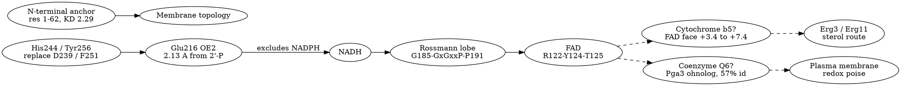

### The donor site works in a way motif scanners miss

In rat and human cb5r, the NADPH 2'-phosphate is excluded by an aspartate carboxylate and a phenylalanine side chain. [PMID: 14503867](https://pubmed.ncbi.nlm.nih.gov/14503867/) measures the size of that effect: D239T raises NADPH efficiency 39200-fold relative to the wild-type 3700-fold NADH preference. [PMID: 9750171](https://pubmed.ncbi.nlm.nih.gov/9750171/) shows the reverse substitution in *Neurospora* NADPH:nitrate reductase shifting preference toward NADH.

Aim33 has His244 and Tyr256 at those columns. Glu216 supplies the carboxylate instead, 2.13 Å from the NADP⁺ 2'-phosphate oxygen after superposition on 6MV2, from a column that is Gln211 in CYB5R3 and Lys429 in Ncb5or. Across 186 orthologs the acidic residue moves between columns 216 and 244 while the Arg that marks the fungal NADPH nitrate reductases never appears at column 256. A conserved electrostatic function is implemented by variable residues.

### The acceptor side has two incompatible readings

<i class="fa-scale-balanced"></i> Electron transfer from cb5r to cytochrome b5 depends on complementarity between a basic reductase face and the acidic heme face. Benchmarked against proteins with known acceptors, that face is basic in Aim33 at a level matching or exceeding the three characterised cytochrome b5 reductases, and the quinone reductase Pga3 is the consistent low outlier.

The opposite reading comes from phylogeny and the pocket. Pga3 is 18 percentage points closer to Aim33 than any cytochrome b5 reductase and carries the same Glu216/His244/Tyr256 triad. Taken together these say the two ohnologs kept a common cofactor core and diverged at the surface that selects the partner, which is a coherent outcome for a duplicate pair and leaves the Aim33 partner unidentified.

### The phenotype data do not settle the physiology

Loss of *AIM33* gives mitochondrial genome maintenance abnormal, respiratory growth absent, chronological lifespan decreased, sporulation abnormal and starvation resistance decreased. The gene symbol comes from the mitochondrial biogenesis screen [PMID: 19300474](https://pubmed.ncbi.nlm.nih.gov/19300474/), which reports that *"Mutations in many of these genes demonstrate statistically significant mitochondrial transmission phenotypes more subtle than could be detected by traditional genetic screens or high-throughput techniques, and 47 have not been previously localized to mitochondria."* The protein has no mitochondrial presequence, and its ohnolog is a plasma-membrane enzyme whose activity is tied to respiratory metabolism and lifespan ([PMID: 19239415](https://pubmed.ncbi.nlm.nih.gov/19239415/)). A membrane redox activity with indirect consequences for respiration and mitochondrial DNA fits both observations. That is a hypothesis, not a result.

## GO curation implications

<i class="fa-triangle-exclamation"></i> Every recommendation here is a lead requiring curator verification. No experimental data on Aim33 itself was found.

### Molecular function

| Term | Current | Recommended action |
|---|---|---|
| GO:0004128 cytochrome-b5 reductase activity | IBA ×3, IEA ×1 | **Generalize** to GO:0016651 or GO:0003954 |
| GO:0050660 FAD binding | absent | **Add** as a lead |
| GO:0070404 NADH binding | absent | **Add** as a lead |
| GO:0016655 oxidoreductase, quinone acceptor | absent | **Non-core lead only**, marked as paralog inference |

`GO:0004128` should be generalized, with lower confidence than the start of this analysis warranted. The donor half is well supported and should be made explicit (NADH). The acceptor half remains undecided: the FAD-face electrostatics are consistent with a cytochrome b5 partner, while the nearest relative reduces coenzyme Q6. A parent term that commits only to what is supported is `GO:0016651` oxidoreductase activity, acting on NAD(P)H, or `GO:0003954` NADH dehydrogenase activity.

The non-core quinone lead should be clearly labelled as paralog inference from Pga3/Nqr1 ([PMID: 19239415](https://pubmed.ncbi.nlm.nih.gov/19239415/)).

`GO:0050660` FAD binding is supported by the intact RxY[ST] motif and the 1.15-1.21 Å superposition on 1UMK. `GO:0070404` NADH binding is supported by the benchmarked donor rule, the Glu216 geometry and the 73.7% NADH-type ortholog fraction.

Do not use `protein binding`. No interaction evidence for Aim33 was found.

### Biological process

`GO:0006696` ergosterol biosynthetic process (IBA ×2) should be **removed or demoted to non-core**. The term reaches Aim33 through the Cbr1/CYB5R3 branch, where electrons flow to Cyb5 and then to Erg3 and Erg11 ([PMID: 15328107](https://pubmed.ncbi.nlm.nih.gov/15328107/), [PMID: 22982564](https://pubmed.ncbi.nlm.nih.gov/22982564/)). Aim33 sits 18 percentage points closer to Pga3 than to Cbr1. The *aim33* null phenotypes are not ergosterol phenotypes. This recommendation is unchanged by the corrected FAD-face result, which bears on the immediate redox partner and not on the pathway.

### Cellular component

`GO:0005886` plasma membrane (IBA ×2) should be **retained as low confidence, with the source recorded**. Almost certainly transfer from Pga3/Nqr1, where plasma membrane is IDA. Aim33 and Pga3 share 57% identity in the catalytic domain and 12% in residues 1-65, and that N-terminal segment is what determines localization, so this is the weakest position from which to transfer a component term.

`GO:0016020` membrane and an integral-component-of-membrane term should be **retained**, supported by the conserved anchor (172/186 orthologs) and the experimental topology dataset [PMID: 16847258](https://pubmed.ncbi.nlm.nih.gov/16847258/).

<i class="fa-triangle-exclamation"></i> **Correction to propagate upstream:** flag the UniProt transmembrane feature at approximately 180-200. It has pLDDT 94.9, is the most buried segment in the model, and coincides with the GxGxxP strand. Topology models built on two membrane passes inherit this error.

Mitochondrial component terms are not supported by the sequence: Aim33 has no positively charged amphipathic presequence (net charge -1 over residues 1-30, hydrophobic moment 0.66, against +3 and 1.15 for Mcr1).

### Propagation warning

Under the validated positional rule, 27 of 186 orthologs (14.5%) carry a basic residue at the 2'-phosphate contact column. An IBA donor assignment across the clade should check residue 244 per sequence rather than assume uniformity.

## Conflicts and alternatives

**Paralog confusion** is the main risk in this entry. Pga3/Nqr1 and Aim33 are whole-genome-duplication ohnologs at 48.1% identity. Pga3 carries experimental annotations (GO:0004128 IMP, GO:0005886 IDA); Aim33 carries only IBA, IEA and ND. The plasma-membrane term on Aim33 is best explained as transfer from Pga3 across the one region where the two proteins have diverged almost completely.

**Internal conflict on the acceptor.** Surface charge and phylogeny disagree, as set out above. A curator should not treat either as decisive.

**Database carry-over.** The UniProt transmembrane feature at 180-200 is a hydrophobicity false positive on a buried β-strand.

**Organism differences.** The quantitative donor-specificity work is in rat cb5r, human CYB5R3, human Ncb5or and *Neurospora* nitrate reductase. No fungal AIM33-clade enzyme has been assayed. Fungal reductases in this family are not interchangeable: Cbr1 is microsomal, Mcr1 is mitochondrial with two submitochondrial forms ([PMID: 8001120](https://pubmed.ncbi.nlm.nih.gov/8001120/), [PMID: 9199337](https://pubmed.ncbi.nlm.nih.gov/9199337/), [PMID: 18279676](https://pubmed.ncbi.nlm.nih.gov/18279676/)), and Pga3 is at the plasma membrane.

**The seed hypothesis's rule is too symmetric.** Applied as written it inverts the call for maize NADH:nitrate reductase, which carries Arg796 at column 216 and still prefers NADH. A basic residue is informative only at the columns that contact the 2'-phosphate.

**Alignment-dependence of one number.** Identity between Aim33 and mammalian CYB5R3 varies with alignment parameters (25.9-28.2% full-length affine, 33.5-36.7% restricted to the catalytic region). Residue mappings and the structural superposition reproduce under both. A parallel case: rat D239 maps to Mcr1 D227 when anchored on rat cb5r and to K229 when anchored on Ncb5or, because the region is an Asp-rich gapped loop. Aim33's own assignment was consistent across all four anchors and passed the *Neurospora* positive control.

**Two analysis errors were found and corrected during this work.** A first FAD-face comparison reported +1.1 for Aim33 against +3.1 for human CYB5R3 over a 56-residue set; the benchmarked recomputation over matched 126-134 residue sets gives +3.4 to +7.4 and reverses the conclusion. A first attempt at the benchmark produced superposition RMSDs of 18-24 Å because the outlier-trimming loop exited on its first pass; those numbers were discarded and the loop rewritten with a decreasing-cutoff schedule. Both are reported here rather than quietly dropped.

## Evidence base

| PMID | What it contributes | Stance |
|---|---|---|
| [15709757](https://pubmed.ncbi.nlm.nih.gov/15709757/) | *"The conserved sequence motif "RxY(T)(S)xx(S)(N)" coordinates flavin binding in NADH:cytochrome b(5) reductase (cb(5)r) and other members of the flavin transhydrogenase superfamily of oxidoreductases."* Defines the motif mapped to R122-Y123-Y124-T125 | supports |
| [16216070](https://pubmed.ncbi.nlm.nih.gov/16216070/) | *"Within this family, a conserved "GxGxxP" sequence motif has been implicated in binding reduced pyridine nucleotides."* Defines the motif at G186-P191 | supports |
| [14503867](https://pubmed.ncbi.nlm.nih.gov/14503867/) | *"Wild-type (WT) cytochrome b(5) reductase showed a 3700-fold preference for NADH whereas the mutant with the highest NADPH efficiency, D239T, showed an 11-fold preference for NADPH, a 39200-fold increase."* Quantifies the determinant Aim33 lacks | supports the framework, qualifies the Aim33 call |
| [9750171](https://pubmed.ncbi.nlm.nih.gov/9750171/) | *"Substitution of Asp for Ser920 (using residue numbering for holo-NADPH:nitrate reductase of N. crassa) greatly increased preference for NADH."* Second independent demonstration, and the positive control that validated the column mapping | supports |
| [31282472](https://pubmed.ncbi.nlm.nih.gov/31282472/) | *"a structural explanation for the unusual ability of Ncb5or to utilize both NADH and NADPH"* Source of 6MV1 and 6MV2, the NAD⁺ and NADP⁺ reference structures | supports |
| [19239415](https://pubmed.ncbi.nlm.nih.gov/19239415/) | *"the Saccharomyces cerevisiae homolog, NADH-Coenzyme Q reductase 1 (NQR1), resides at the plasma membrane"* Experimental anchor for the donor and acceptor of the ohnolog | supports NADH, competing on acceptor |
| [16943325](https://pubmed.ncbi.nlm.nih.gov/16943325/) | Cell-cycle survey of essential genes that assigns PGA3 a protein-trafficking function; cited by UniProt for Q12746 | database-level support for Pga3 |
| [9199337](https://pubmed.ncbi.nlm.nih.gov/9199337/) | *"The first 12 residues of this sequence function as a weak matrix-targeting signal; the remaining residues are mostly hydrophobic and serve as an intramitochondrial sorting signal for the outer membrane and the intermembrane space."* Defines the architecture Aim33 lacks | qualifies localization |
| [8001120](https://pubmed.ncbi.nlm.nih.gov/8001120/) | *"Incomplete translocation arrest in the outer membrane is a novel mechanism by which the product of a single gene is sorted into different compartments of the same organelle."* Documents Mcr1 dual submitochondrial localization | context |
| [18279676](https://pubmed.ncbi.nlm.nih.gov/18279676/) | The Mcr1 outer-membrane form follows a TOM-independent insertion pathway, so the two forms diverge before the TOM complex | context |
| [16847258](https://pubmed.ncbi.nlm.nih.gov/16847258/) | *"we report the cloning and expression of 617 S. cerevisiae membrane proteins as fusions to a C-terminal topology reporter and present experimentally constrained topology models for 546 proteins"* The only membrane-related experimental dataset in the Q04516 entry | supports membrane CC |
| [15328107](https://pubmed.ncbi.nlm.nih.gov/15328107/) | *"Cytochrome b(5) is required for sterol C5-6 desaturation and the encoding gene, CYB5, is nonessential in Saccharomyces cerevisiae."* Documents the route that is the premise of the GO:0006696 IBA | qualifies BP |
| [22982564](https://pubmed.ncbi.nlm.nih.gov/22982564/) | A cytochrome b5-dependent C-5(6) sterol desaturase from *Tetrahymena* complements the yeast *erg3Δ* mutant, confirming the Cyb5-to-Erg3 electron route | qualifies BP |
| [19300474](https://pubmed.ncbi.nlm.nih.gov/19300474/) | Origin of the AIM gene symbol and of the mitochondrial phenotype attribution | context |
| [11420140](https://pubmed.ncbi.nlm.nih.gov/11420140/) | Mcr1 is the NADH-dependent D-erythroascorbyl free radical reductase; *mcr1* disruptants are hypersensitive to hydrogen peroxide and menadione | context for a sister enzyme's physiology |
| [26629948](https://pubmed.ncbi.nlm.nih.gov/26629948/) | Overexpression of AIM32 and MCR1 counters the primaquine-induced growth defect in *sod2Δ* yeast | context on family members and oxidative stress |
| [21644919](https://pubmed.ncbi.nlm.nih.gov/21644919/) | The only PubMed hit for the search term `Aim33` is a salicylanilide compound of that name, not the yeast gene | negative literature result |

## Limitations and knowledge gaps

<i class="fa-triangle-exclamation"></i> All structural results come from an AlphaFold model superposed onto experimental structures of other proteins. Side-chain positions in the 2'-phosphate pocket are the least reliable element, and the reported distances describe where modelled side chains fall relative to a ligand borrowed from 6MV2, with no ligand-induced rearrangement. Charge sums use formal charges rather than a solved electrostatic potential, and the metric is sensitive to where the model is truncated, so it ranks proteins rather than measuring them. The acceptor benchmark contains only one quinone reductase. The ortholog analysis uses pairwise alignments to Aim33 rather than a curated multiple alignment, and OrthoDB group membership is itself computational. The positional donor rule was refined after inspecting its own benchmark set. No wet-lab result on Aim33 exists in the literature retrieved. The `*-bioinformatics` analyses held in the repository were withheld from this run and were not consulted.

Explicit gaps that matter for curation:

1. **No kinetic measurement of NADH versus NADPH** for Aim33 or any AIM33-clade ortholog. Checked: PubMed, UniProt, SGD. Resolved by steady-state kinetics on purified protein.
2. **No experimental acceptor assay.** Cytochrome b5, coenzyme Q6 and artificial acceptors have not been compared. This is the gap that matters most, because the two available computational lines disagree.
3. **No experimental structure** and no direct evidence that Aim33 binds FAD.
4. **No direct localization evidence.** Every Aim33 component annotation is IBA or IEA.
5. **No interaction data** linking Aim33 to yeast Cyb5 (YNL111C) or any partner.
6. **The functional relationship between Aim33 and Pga3 is untested**: redundant, different membranes, or diverged acceptor.
7. **The mechanism connecting *aim33* loss to the respiratory and mitochondrial genome phenotypes is unknown.**
8. **The predicted anchor topology has not been verified** independently of [PMID: 16847258](https://pubmed.ncbi.nlm.nih.gov/16847258/).
9. **The donor rule's positional form was fitted on nine proteins.** An independent test set would say whether 8/9 holds.

## Proposed follow-up experiments

| Test | What it distinguishes | Expected result under the NADH model |
|---|---|---|
| <i class="fa-flask"></i> Steady-state kinetics of purified soluble Aim33 (residues ~70-312) with NADH and NADPH, ferricyanide as acceptor | Donor preference, and whether His244 confers dual specificity | kcat/Km at least 100-fold higher for NADH |
| <i class="fa-flask"></i> Mutants E216Q, E216D, H244D, H244K, Y256F, assayed as above | Whether Glu216 substitutes for the canonical Asp | E216Q loses most of the NADH preference; H244D restores or exceeds it; H244K shifts toward NADPH |
| <i class="fa-vial"></i> **Acceptor panel on purified enzyme: yeast Cyb5, coenzyme Q6 or Q1/Q2, DCPIP, ferricyanide, cytochrome c, run side by side with purified Pga3** | The acceptor question, which no computation here resolves | Decisive either way. The side-by-side with Pga3 is what makes it interpretable |
| <i class="fa-flask"></i> Charge-swap variants at the Aim33 FAD-face positions that differ from Pga3 (for example K79/K80/R82/R85 and K144/K154/K156/R158 against the Pga3 equivalents), assayed for Cyb5 and Q6 reduction | Whether the 5-6 charge-unit difference between the ohnologs selects the partner | Swapping toward Pga3 shifts the acceptor ratio toward quinone |
| <i class="fa-microscope"></i> Aim33-GFP localization with Pma1 and mitochondrial markers, plus protease protection and alkaline carbonate extraction | Membrane identity and topology | Plasma membrane or ER, integral, catalytic domain cytosolic |
| <i class="fa-dna"></i> Swap Aim33 residues 1-65 with Pga3 1-65 and vice versa, then localize | Whether the divergent N-terminus separates the ohnologs | Swapped constructs follow the donor N-terminus |
| <i class="fa-microscope"></i> Topology reporter on a construct lacking the 180-200 hydrophobicity | Whether 180-200 is a genuine membrane pass | Topology unchanged, confirming a single N-terminal anchor |
| <i class="fa-dna"></i> *aim33Δ*, *pga3Δ* and the double mutant scored for respiratory growth, mitochondrial genome loss, chronological lifespan and coenzyme Q redox state | Redundancy and the route to the mitochondrial phenotypes | Synthetic aggravation in the double mutant; altered Q6 redox poise |

<i class="fa-arrow-right"></i> The acceptor panel run side by side with purified Pga3 is the single most informative experiment, because it is the only one that resolves the conflict this report could not. The donor kinetics and the E216/H244/Y256 mutants would settle the other half from the same protein preparation.

## Curation leads: questions for the curator

1. Was the Aim33 `GO:0005886` IBA transferred from Pga3? If so, does 12% N-terminal identity meet the tree-based standard for a component term?
2. Does the UniProt transmembrane feature at approximately 180-200 have any experimental basis? If predicted, it should be removed.
3. Is there any unpublished or high-throughput localization result for Aim33-GFP, including a negative one?
4. Should the `GO:0004128` IBA be restricted to the Cbr1/Mcr1/CYB5R3 subtree, given that Aim33 and Pga3 branch outside it and lack the canonical specificity aspartate?
5. For clade-wide IBA propagation of a donor term, can the annotation be conditioned on residue 244, given that 14.5% of orthologs carry a basic residue there?

## Provenance

Every number in this report comes from code executed during this investigation; the executed code and its output are in the session transcript. Figures:

- `plot_1.png`: conservation of Aim33 cofactor-site positions across 186 Saccharomycetes orthologs
- `plot_2.png`: per-ortholog pocket electrostatic class, plus the first FAD-face charge comparison (the FAD-face panel is superseded by `plot_11.png`)
- `plot_3.png`: windowed identity between Aim33 and Pga3/Nqr1 with cofactor-site positions marked
- `plot_4.png`: Kyte-Doolittle and cumulative charge profiles over the first 90 residues of five reductases
- `plot_5.png`: UPGMA tree of yeast and human reductase catalytic domains
- `plot_6.png`, `plot_7.png`: donor-determinant columns across reductases with experimentally known preference, and rule scoring
- `plot_8.png`: ortholog donor calls under the validated positional rule
- `plot_9.png`: the failed first FAD-face benchmark run (RMSD 18-24 Å), retained as provenance for the discarded numbers
- `plot_10.png`: corrected superposition and FAD-face charge at four radii
- `plot_11.png`: FAD-face charge under four truncation and confidence filters

Resources accessed: UniProt REST, RCSB (1UMK, 6MV1, 6MV2), the AlphaFold EBI API (AF-Q04516, AF-Q12746, AF-P38626, AF-P36060), the OrthoDB API, the SGD backend API, and PubMed.

<i class="fa-triangle-exclamation"></i> Two access notes, reported plainly rather than hidden: a host-side download of the AlphaFold model returned HTTP 403, so all network access was performed inside the code executor; and the OrthoDB `fasta` endpoint returns an empty body when `species=all` is passed and works when the parameter is omitted. Biopython is not available in the executor, so BLOSUM62, Needleman-Wunsch (affine and linear-gap variants), Kabsch superposition with iterative outlier trimming, Kyte-Doolittle hydropathy and the hydrophobic moment were implemented by hand.


## Artifacts

- [OpenScientist final report](openscientist_artifacts/final_report.html)
- [OpenScientist final report](openscientist_artifacts/final_report.pdf)
- [OpenScientist provenance](openscientist_artifacts/provenance.json)
- [OpenScientist plot 1](openscientist_artifacts/provenance_plot_1.json)
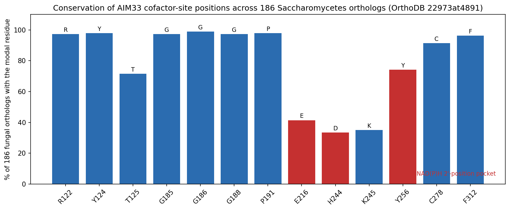
- [OpenScientist plot 10](openscientist_artifacts/provenance_plot_10.json)
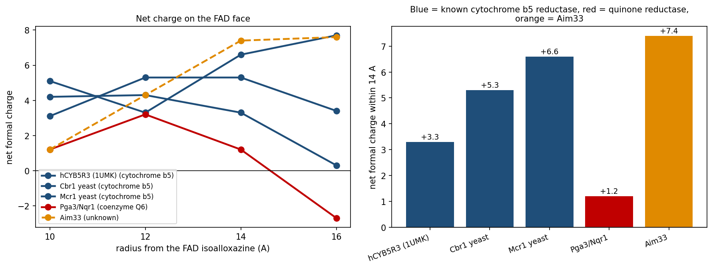
- [OpenScientist plot 11](openscientist_artifacts/provenance_plot_11.json)
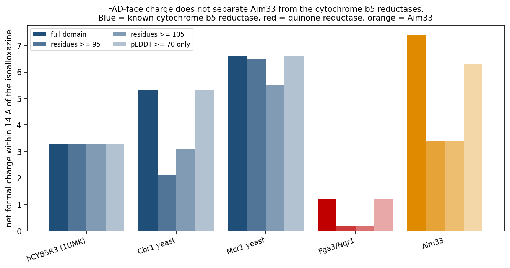
- [OpenScientist plot 2](openscientist_artifacts/provenance_plot_2.json)
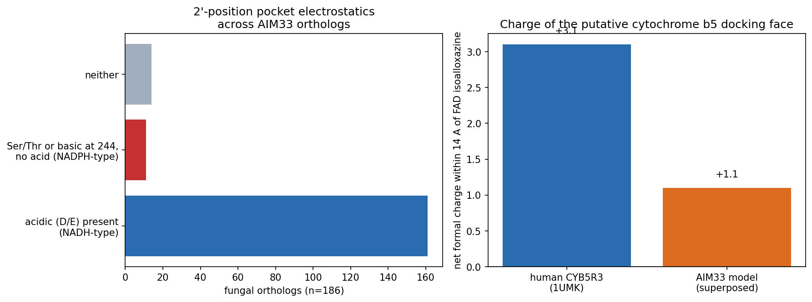
- [OpenScientist plot 3](openscientist_artifacts/provenance_plot_3.json)
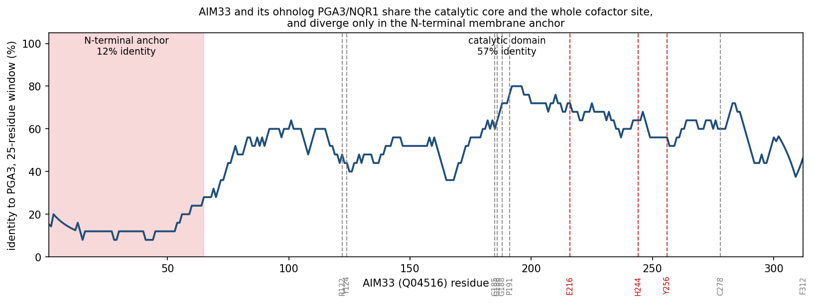
- [OpenScientist plot 4](openscientist_artifacts/provenance_plot_4.json)
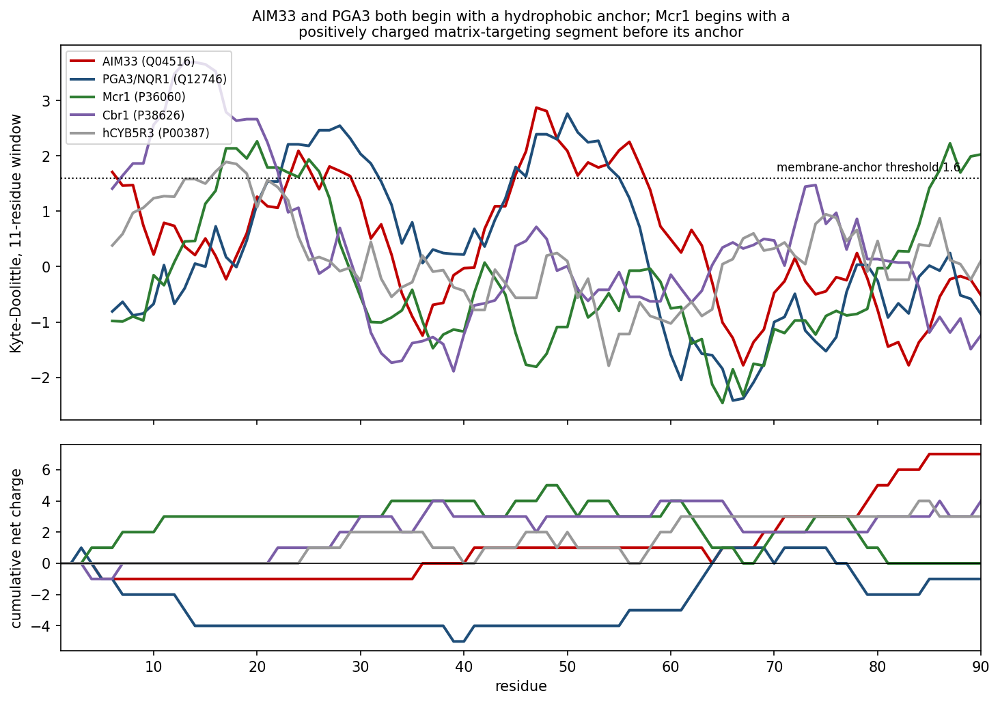
- [OpenScientist plot 5](openscientist_artifacts/provenance_plot_5.json)
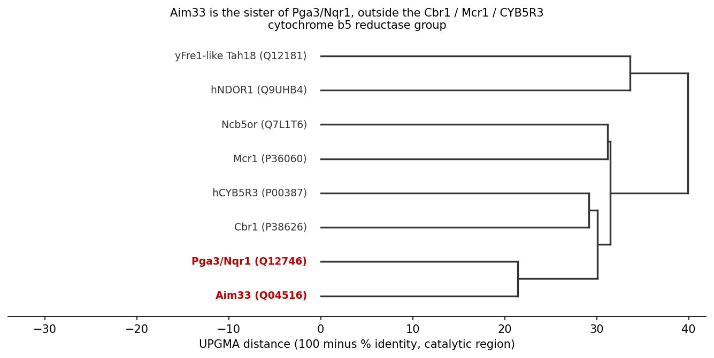
- [OpenScientist plot 6](openscientist_artifacts/provenance_plot_6.json)
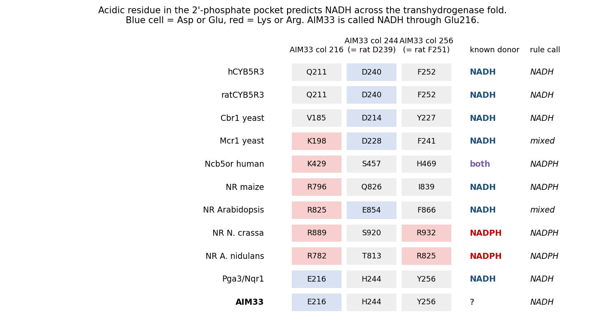
- [OpenScientist plot 7](openscientist_artifacts/provenance_plot_7.json)
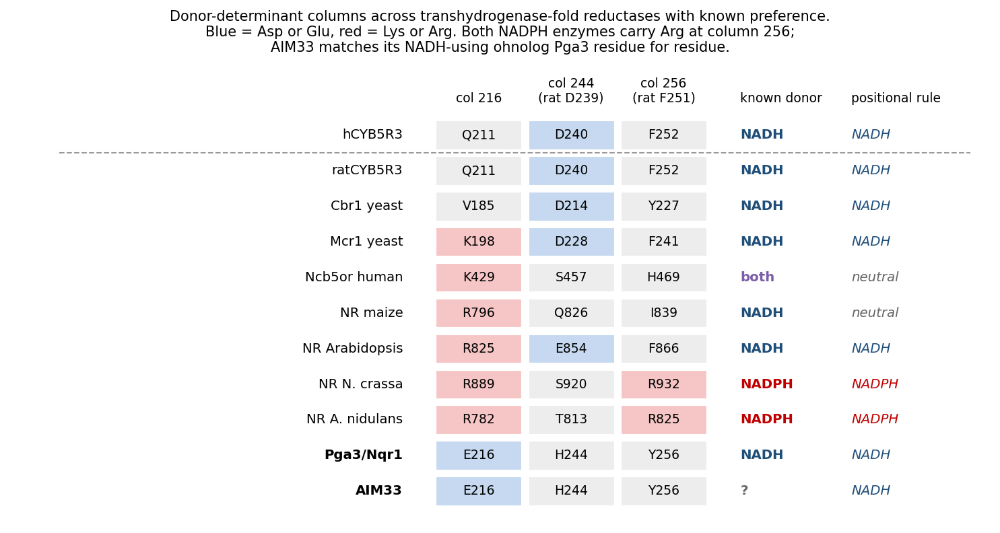
- [OpenScientist plot 8](openscientist_artifacts/provenance_plot_8.json)
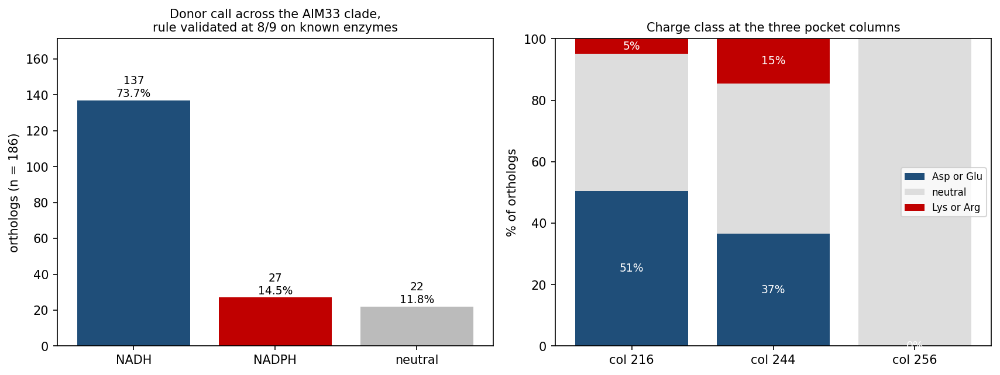
- [OpenScientist plot 9](openscientist_artifacts/provenance_plot_9.json)
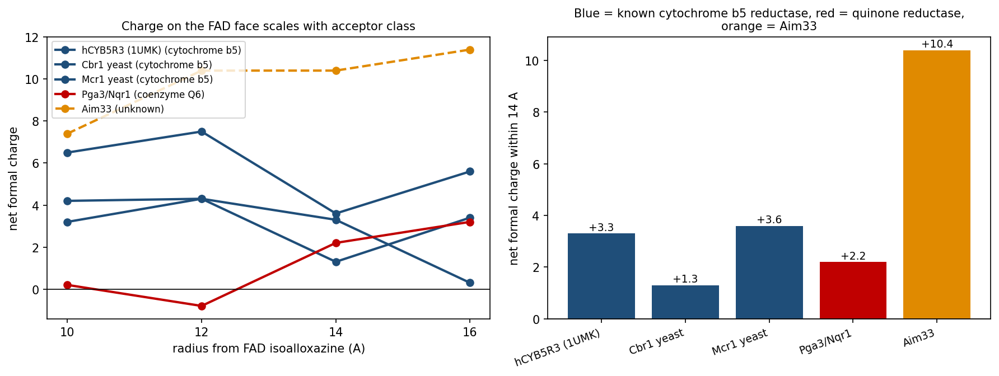

## Reference Validation

Checked with `linkml-reference-validator` 0.3.1rc1.

| Outcome | Count |
| --- | --- |
| References checked | 17 |
| Resolved | 17 |
| Unresolved (possible confabulation) | 0 |
| Unverifiable | 0 |
| References weighed for topical relevance | 17 |
| On topic | 2 |
| Off topic | 0 |

All extracted references resolved successfully.