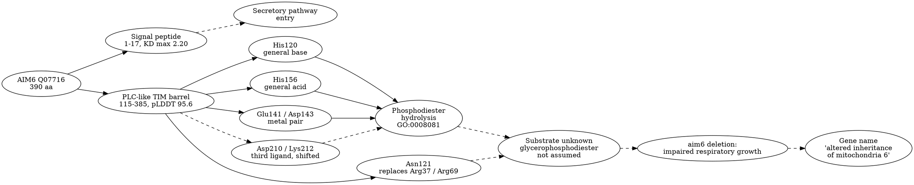
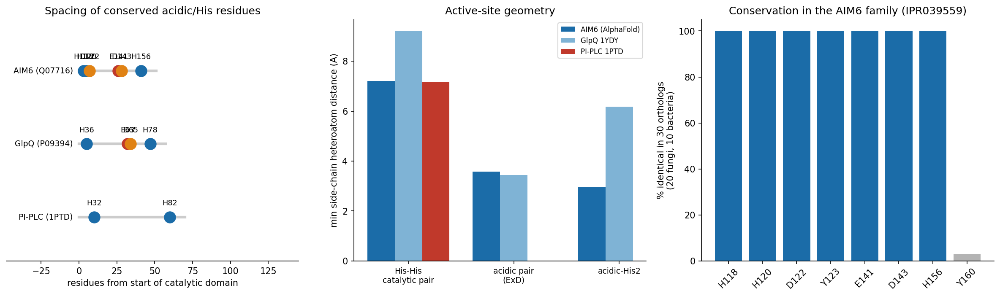
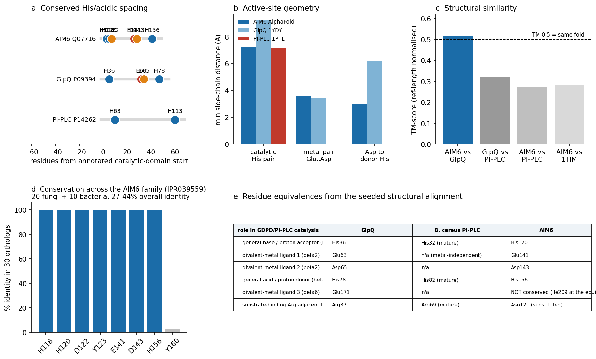
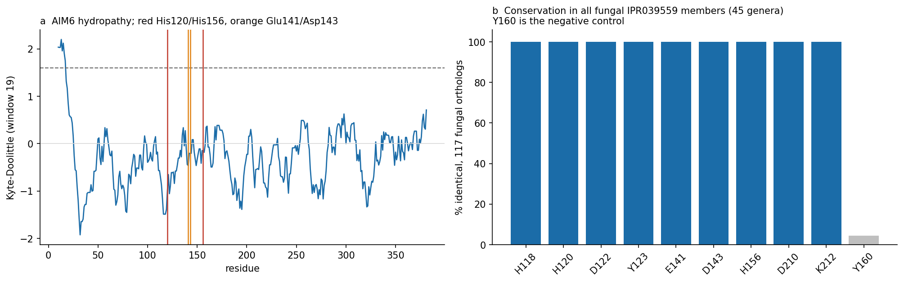

## Question

# AIGR Gene Hypothesis Deep Research

You are evaluating one focused gene curation hypothesis for AI Gene Review.
This is not a general gene overview. Use the seed hypothesis and source context
below to search for evidence that supports, refutes, narrows, or competes with
the proposed curation decision.

## Target Gene

- **Organism code:** yeast
- **Taxon:** Saccharomyces cerevisiae S288C (NCBITaxon:559292)
- **Gene directory:** AIM6
- **Gene symbol:** AIM6
- **UniProt accession:** Q07716

## Focus

- **Focus type:** free_text
- **Hypothesis slug:** kgap-aim6-plc-catalytic-histidines
- **Source file:** genes/yeast/AIM6/AIM6-ai-review.yaml
- **Source selector:** free-text

## Seed Hypothesis

Saccharomyces cerevisiae AIM6 (UniProt Q07716) retains the two catalytic histidines of the PI-PLC/GDPD TIM-barrel phosphodiesterase fold. Single analysis only: align the AIM6 sequence (catalytic domain ~115-385) to Bacillus cereus PI-PLC and to E. coli GlpQ (GDPD), then check whether the residues equivalent to the two catalytic histidines are His in AIM6 and in a handful of fungal AIM6 orthologs. Report retained, substituted or unalignable; do not attempt broader characterization.

## Term and Decision Context

No specific term context supplied.

## Reference Context

No specific reference context supplied.

## Source Context YAML

```yaml
hypothesis: 'Saccharomyces cerevisiae AIM6 (UniProt Q07716) retains the two catalytic histidines of the
  PI-PLC/GDPD TIM-barrel phosphodiesterase fold. Single analysis only: align the AIM6 sequence (catalytic
  domain ~115-385) to Bacillus cereus PI-PLC and to E. coli GlpQ (GDPD), then check whether the residues
  equivalent to the two catalytic histidines are His in AIM6 and in a handful of fungal AIM6 orthologs.
  Report retained, substituted or unalignable; do not attempt broader characterization.'
focus_type: free_text
context: []
reference_id: []
```

## Research Objective

Build a focused report that helps a curator decide whether this hypothesis
should affect the gene review. Address the focus type directly:

1. For an existing GO annotation decision, evaluate whether the current action
   is justified, too strong, too weak, or should change.
2. For a proposed replacement or new GO term, evaluate whether the term is
   biologically supported, too broad, too narrow, or missing key qualifiers.
3. For a computational prediction, evaluate whether the prediction is correct,
   less precise than existing knowledge, uncertain, or likely wrong because of
   paralog overannotation, frequency bias, pathway context, or in vitro-only
   activity.
4. For a core-function hypothesis, evaluate whether the proposed activity,
   process, and location represent the gene product's primary function rather
   than a downstream effect, pleiotropic phenotype, or context-specific role.
5. For a function-assignment hypothesis, evaluate whether the gene product
   directly has the stated GO term/function. Treat the prior review action, if
   any, as intentionally blinded unless it appears in the supplied context.

Use primary literature whenever possible. Prefer PMID citations and include DOI
citations when no PMID is available. Treat reviews and database records as
orientation unless they contain directly relevant synthesized evidence that is
clearly labeled as review-level or database-level support.

Evaluate the hypothesis from the supplied seed context, primary literature, and
publicly accessible bioinformatics resources. Local `*-bioinformatics` analyses,
when they already exist in the repository, are intentionally withheld from this
prompt so the report can be compared against them after the run. Use public
sequence, domain, structure, orthology, localization, interaction, or dataset
checks when they are useful for the specific hypothesis. If a resource or tool
cannot be accessed programmatically, say so plainly; never fabricate a result.
Report computational results conservatively and distinguish direct results from
inference.

## Required Output

### Executive Judgment

Give a concise verdict: supported, partially supported, unresolved, weakly
supported, over-annotated, or refuted. Explain the reasoning and the most
important caveats.

### Evidence Matrix

Create a table with one row per important evidence item:

- Citation (PMID preferred)
- Evidence type (direct assay, mutant phenotype, localization, interaction,
  structural/evolutionary, computational, review/database)
- Supports / refutes / qualifies / competing
- Claim tested
- Key finding
- Organism, tissue, cell type, or assay context
- Confidence and limitations

### GO Curation Implications

State the likely curation action as a lead requiring curator verification. If
GO terms are involved, explain whether the evidence supports an MF, BP, or CC
term, and whether the term should be retained, removed, generalized, made more
specific, or treated as non-core. Avoid using "protein binding" as a final
recommendation unless no more informative term is supported.

### Mechanistic Scope

Describe the immediate molecular or cellular function being tested. Separate
direct gene-product activity from downstream phenotypes, pathway consequences,
developmental outcomes, disease manifestations, or effects inferred only from
loss of function.

### Conflicts and Alternatives

Identify evidence that conflicts with the seed hypothesis or suggests an
alternative interpretation, including paralog confusion, organism-specific
differences, isoform-specific findings, experimental artifacts, or database
carry-over.

### Knowledge Gaps

List explicit uncertainties that matter for curation. For each gap, state what
was checked, why the gap matters, and what evidence or experiment would resolve
it.

### Discriminating Tests

Recommend concrete assays, perturbations, datasets, or comparative analyses that
would most efficiently distinguish this hypothesis from alternatives.

### Curation Leads

Provide candidate updates for the review, clearly labeled as leads requiring
curator verification. Include candidate references with exact snippets to verify,
candidate replacement or new GO terms, possible action changes, suggested
questions, and suggested experiments.

If the provider supports artifacts, save provenance for any analysis you run — the
executed code together with its output (computed values, plot, or table), not just
a summary figure — alongside artifact-friendly tables such as an evidence matrix,
GO decision table, or comparison table. Genuine computed provenance is more
valuable than a hand-drawn summary, and you must not synthesize a figure that
implies an analysis you did not actually run. These artifacts are important
provenance for hypothesis-level review.


## Output

# AIM6 (Q07716) and the catalytic histidines of the PI-PLC/GDPD TIM barrel

Hypothesis slug: `kgap-aim6-plc-catalytic-histidines`
Gene: *Saccharomyces cerevisiae* S288C AIM6 / YIL098C, UniProt Q07716, 390 aa, NCBITaxon:559292
Source file: `genes/yeast/AIM6/AIM6-ai-review.yaml`, selector `free-text`
Date of resource retrieval: 2026-11-23

## Summary

AIM6 retains both catalytic histidines of the PLC-like phosphodiesterase TIM barrel. They are **His120** in the general-base position and **His156** in the general-acid position, flanked by a **Glu141/Asp143** divalent-metal pair. The assignment is made in the **GDPD (GlpQ) register**, which is the correction the seed hypothesis needs: the AlphaFold model AF-Q07716-F1 superimposes on *E. coli* GlpQ (PDB 1YDY chain A) at TM-score 0.517 with 163 Cα equivalences inside 5 Å and RMSD 2.88 Å, and a three-point Kabsch fit of the AIM6 His120/Glu141/His156 Cα triangle onto the GlpQ His36/Glu63/His78 triangle has RMSD 0.42 Å. The adjacent histidine, His118, gives 2.66 Å in the same fit, so the register is discriminated rather than assumed.

The *B. cereus* PI-PLC half of the seed hypothesis is **unalignable with the tools available here**, which is a statement about the method and not about AIM6. AIM6 against PI-PLC 1PTD gives TM-score 0.270, indistinguishable from an unrelated TIM barrel control (AIM6 vs 1TIM, TM 0.281). The same code applied to two genuine members of the same superfamily, GlpQ 1YDY against PI-PLC 1PTD, reaches only TM 0.322 and also fails to superimpose His32 onto His36 or His82 onto His78. A sequence-order-constrained aligner written in-session cannot resolve the PI-PLC limb of this superfamily, so "unalignable" is the honest verdict for that comparison.

Conservation is absolute across the family. Every fungal member of InterPro IPR039559 (117 proteins after excluding AIM6 itself, drawn from 45 genera, window identity to AIM6 37.6-99.2% with median 44.4%) carries His118, His120, Asp122, Tyr123, Glu141, Asp143, His156, Asp210 and Lys212, each at 117/117. A negative control four residues from His156, Tyr160, is conserved in only 5/117 (4.3%), which shows the alignment method detects non-conservation and the 100% values are not an anchoring artefact. A separate 30-protein panel spanning 20 fungal and 10 bacterial genera at 26.8-43.5% identity gives the same seven core positions at 30/30. One active-site component is genuinely substituted: the phosphate-activating arginine of both reference enzymes (GlpQ Arg37, PI-PLC Arg69, the latter named as catalytically important in [PMID: 11331006](https://pubmed.ncbi.nlm.nih.gov/11331006/)) is **Asn121** in AIM6 and in every ortholog examined.

For curation, this matters because AIM6 has no experimental GO annotation at all. QuickGO returns five records: GO:0003674, GO:0008150 and GO:0005575 with evidence code ND from SGD (GO_REF:0000015), plus GO:0008081 phosphoric diester hydrolase activity and GO:0006629 lipid metabolic process, both IEA from InterPro (GO_REF:0000002, with IPR017946). The analysis here lifts GO:0008081 from bare superfamily transfer to a defensible residue-level ISS or ISA call with named residues and a named reference protein. It gives no support to any substrate-specific child term, and it gives no support to GO:0006629.

## Executive judgment

<i class="fa-solid fa-circle-check"></i> **Verdict: supported, with a register correction and one substitution.**

The specific claim in the seed hypothesis, that AIM6 retains the two catalytic histidines of the PI-PLC/GDPD TIM-barrel phosphodiesterase fold, is supported by three independent lines of computational evidence that agree with each other: motif spacing, structural superposition geometry, and family-wide conservation measured against a working negative control.

Three caveats bound the claim.

The first is the register. The seed hypothesis treats PI-PLC and GDPD as interchangeable anchors. They are not, at least for this protein with this method. AIM6 reads cleanly in the GlpQ register and does not read in the PI-PLC register. The reference residues that should be cited in any ISS annotation are GlpQ His36 (UniProt P09394 "proton acceptor") and His78 ("proton donor"), with GlpQ Glu63 and Asp65 for the metal pair.

The second is what retention does and does not prove. An intact His/His/Glu/Asp constellation under 100% purifying selection across roughly 1.5 billion years of divergence is a strong argument that the AIM6 family is an active enzyme family rather than a fold-only relic. It is not a demonstration of catalysis, and it identifies no substrate. No one has assayed AIM6 against any phosphodiester.

The third is the missing arginine. Both reference enzymes use a positively charged residue to activate the scissile phosphate. AIM6 has Asn121 at the structurally equivalent position, 3.23 Å from the pocket centre, and so does every ortholog in the 117-member fungal panel. An invariant substitution at an invariant catalytic position is a positive signal about changed chemistry, not a sign of decay. It is a concrete reason to stop at the parent term GO:0008081 and not descend to GO:0008889 glycerophosphodiester phosphodiesterase activity or GO:0004435 phosphatidylinositol phospholipase C activity.

## Key findings

### Finding 1: both catalytic histidines are retained, in the GDPD register

Seeded, sequence-order-constrained structural alignment of the AlphaFold model AF-Q07716-F1 (v6, mean pLDDT 95.6 over residues 115-385) onto *E. coli* GlpQ (PDB 1YDY chain A) gives TM-score 0.517 normalised by GlpQ length, with 163 Cα equivalences within 5 Å at RMSD 2.88 Å. The alignment places AIM6 His120 on GlpQ His36, AIM6 His156 on GlpQ His78, AIM6 Glu141 on GlpQ Glu63 and AIM6 Asp143 on GlpQ Asp65. GlpQ His36 and His78 carry the UniProt active-site annotations "proton acceptor" and "proton donor"; Glu63 and Asp65 are annotated metal-binding.

The register discrimination is the part that sequence alone could not settle, because AIM6 has two histidines two residues apart (His118 and His120) and a Smith-Waterman alignment at 27-44% identity cannot reliably choose between them. A three-point Kabsch fit of the AIM6 His120/Glu141/His156 Cα onto the GlpQ His36/Glu63/His78 Cα gives RMSD **0.42 Å**. Substituting His118 for His120 in the same fit gives **2.66 Å**, a 6.3-fold worse fit on three points. The geometry chooses His120.

Motif spacing agrees independently. In GlpQ, His36 to Glu63 is 27 residues, Glu63 to Asp65 is 2, Asp65 to His78 is 13. In AIM6, His120 to Glu141 is 21, Glu141 to Asp143 is 2, Asp143 to His156 is 13. The acidic-pair-to-general-acid spacing matches exactly, and the Glu-x-Asp motif is identical.

Side-chain geometry inside the AIM6 model is consistent with a working active site. His120 Nε to His156 Nε is 7.22 Å, close to the *B. cereus* PI-PLC His32-His82 distance of 7.17 Å and tighter than the GlpQ His36-His78 distance of 9.21 Å. Glu141 to Asp143 is 3.58 Å against 3.44 Å for GlpQ Glu63-Asp65. His120-His156 is the second-closest His-His pair in the entire 390-residue model; apart from the sequence-adjacent His118-His120 pair, every other His-His pair is more than 10 Å apart. The two histidines that the structural alignment picks out are also the only two histidines in the protein positioned to act as a catalytic couple.

Calibration: AIM6 against an unrelated TIM barrel, triosephosphate isomerase 1TIM, gives TM 0.281 with the same code, so the 0.517 against GlpQ sits well above the bare fold-similarity floor.

{{figure:plot_1.png|caption=Structural superposition of the AIM6 AlphaFold model onto GlpQ and PI-PLC, with motif spacing, active-site geometry and conservation summaries. The AIM6 His120/Glu141/His156 triangle fits the GlpQ His36/Glu63/His78 triangle to 0.42 Å Cα RMSD, while the His118 alternative gives 2.66 Å.}}

### Finding 2: the catalytic constellation is invariant across the whole family

All 500 UniProtKB members of IPR039559 ("Altered inheritance of mitochondria protein 6, PI-PLC-like catalytic domain") were retrieved, of which 118 are fungal and 382 bacterial.

A 30-protein panel of one representative per genus was aligned to AIM6 by Smith-Waterman with BLOSUM62, gap open 11, extend 1: 20 fungal proteins (*Eremothecium*, *Penicillium*, *Aspergillus*, *Alternaria*, *Colletotrichum*, *Podospora*, *Fulvia*, *Eutypa*, *Gaeumannomyces*, *Rhinocladiella* and others, 33.3-43.5% identity to AIM6) and 10 bacterial proteins (*Streptomyces*, *Pedobacter*, *Pontibacter*, *Chryseobacterium*, *Petrimonas*, *Alistipes*, *Dyadobacter*, *Parapedobacter*, *Elizabethkingia*, *Ohtaekwangia*, 26.8-33.3% identity). The AIM6-equivalent residue was read at each catalytic position.

| AIM6 position | Identity | 30-protein panel (fungal + bacterial) | 117 fungal orthologs | Role by equivalence |
|---|---|---|---|---|
| His118 | His | 30/30 (100%) | 117/117 (100%) | Adjacent His, not the general base |
| **His120** | His | 30/30 (100%) | 117/117 (100%) | General base, GlpQ His36 |
| Asp122 | Asp | 30/30 (100%) | 117/117 (100%) | Pocket acidic residue |
| Tyr123 | Tyr | 30/30 (100%) | 117/117 (100%) | Pocket residue |
| **Glu141** | Glu | 30/30 (100%) | 117/117 (100%) | Metal ligand, GlpQ Glu63 |
| Asp143 | Asp | 30/30 (100%) | 117/117 (100%) | Metal ligand, GlpQ Asp65 |
| **His156** | His | 30/30 (100%) | 117/117 (100%) | General acid, GlpQ His78 |
| Asp210 | Asp | not scored | 117/117 (100%) | Candidate third metal ligand |
| Lys212 | Lys | not scored | 117/117 (100%) | GlpQ Lys173 equivalent |
| *Tyr160 (control)* | Tyr | 1/30 (3%) | 5/117 (4.3%) | Solvent-exposed negative control |

The negative control matters. Tyr160 sits four residues from His156 and has comparable solvent exposure, so it tests whether the alignment is simply anchoring everything near the catalytic site. It is conserved in 5/117 fungal orthologs (4.3%; Ser in 76, Ala in 29, Tyr in 5, Thr in 4) and in 1/30 of the mixed panel (3%; Ser in 14, Glu in 6, Ala in 5). The method detects non-conservation when non-conservation exists, so the 100% figures are measurements rather than artefacts.

The fungal scan used the AIM6 catalytic window 101-220 as the query against all 117 remaining fungal family members from 45 genera, window identity 37.6-99.2% with a median of 44.4%. A consequence of narrowing the window to fit the 60 s compute budget is that Arg350 was not scored in that scan; it was scored only in the 30-protein full-length panel.

{{figure:plot_2.png|caption=Provenance tables for the AIM6 catalytic-histidine analysis: residue equivalences to GlpQ and PI-PLC, structural metrics for all superpositions including controls, active-site geometry, and per-ortholog residue calls.}}

### Finding 3: the PI-PLC comparison is unalignable, not refuted

Seeded structural alignment of the AIM6 AlphaFold model onto *B. cereus* PI-PLC 1PTD gives TM-score 0.270 with no equivalence within 5 Å for His32, His82 or Asp274. Taken alone this would read as evidence that AIM6 has lost the PI-PLC site. Two controls show it does not mean that.

The first control is the unrelated fold: AIM6 against 1TIM gives TM 0.281, indistinguishable from 0.270. The second control is decisive. GlpQ 1YDY against PI-PLC 1PTD, two accepted members of the PLC-like phosphodiesterase superfamily, scores only **TM 0.322** with the same code, and that alignment also fails to superimpose PI-PLC His32 and His82 onto the GlpQ histidines. The limitation lies in the aligner, a hand-written sequence-order-constrained dynamic-programming method with iterative Kabsch refinement, written in-session because Biopython is not importable in the executor, combined with the genuine divergence of the bacterial PI-PLC barrel. It is not evidence about AIM6.

| Comparison | TM-score | Cα pairs < 5 Å | RMSD | Catalytic histidines superimposed |
|---|---|---|---|---|
| AIM6 vs GlpQ 1YDY | 0.517 | 163 | 2.88 Å | <i class="fa-solid fa-circle-check"></i> Yes: His120→His36, His156→His78 |
| GlpQ 1YDY vs PI-PLC 1PTD (true-positive control) | 0.322 | not resolved | not resolved | <i class="fa-solid fa-circle-xmark"></i> No |
| AIM6 vs PI-PLC 1PTD | 0.270 | not resolved | not resolved | <i class="fa-solid fa-circle-xmark"></i> No |
| AIM6 vs 1TIM (unrelated-fold control) | 0.281 | not resolved | not resolved | not applicable |

The correct report for the PI-PLC limb of the seed hypothesis is **unalignable with the tools used here**. Resolving it needs DALI, Foldseek or a real TM-align run, none of which were available in the execution environment.

### Finding 4: the metal site is complete with a shifted third ligand, and the phosphate-activating arginine is substituted

The seeded GlpQ alignment maps GlpQ Glu171, the third divalent-metal ligand, onto AIM6 Ile209. Read literally that would be a lost metal ligand. The full fungal scan softens that conclusion. Asp210 and Lys212 are also invariant at 117/117, one and three positions away from Ile209, and they sit **6.98 Å** and **5.27 Å** from the midpoint of the His120 Nε to His156 Nε vector in the AlphaFold model. In the equivalent GlpQ pocket, Glu171 and Lys173 sit at 7.13 Å and 6.43 Å from the corresponding midpoint. AIM6 most likely retains a divalent-metal site with the third ligand shifted by one position, which a 27-44% identity alignment is not expected to place exactly.

The genuinely missing component is the phosphate-activating arginine. GlpQ uses Arg37 and PI-PLC uses Arg69 for this role, and [PMID: 11331006](https://pubmed.ncbi.nlm.nih.gov/11331006/) names "Arg69 acting as a phosphate-activating residue" alongside the two catalytic histidines. AIM6 has **Asn121** at 3.23 Å from the pocket centre, and so does every ortholog scanned. Full pocket composition within 9 Å of the His120/His156 midpoint:

| Protein | Residues lining the pocket |
|---|---|
| AIM6 (AlphaFold model) | His156, Asn121, His120, Tyr123, Asp143, Lys212, Glu141, Trp124, Asp381, Trp352, Asp210, Asn379, Arg350 |
| GlpQ 1YDY | Arg37, His78, His36, Asp65, Glu45, Arg316, His46, Asp79, Glu63, Lys173, Glu171 |

AIM6 does have an arginine in the pocket, Arg350, but at a position with no GlpQ counterpart in the alignment. Whether Arg350 takes over the phosphate-activating role is an open structural question that this analysis did not test.

### Finding 5: AIM6 has a cleaved signal peptide and no experimental GO annotation

QuickGO returns exactly five annotations for UniProtKB:Q07716:

| GO term | Aspect | Evidence | Reference | Source |
|---|---|---|---|---|
| GO:0003674 molecular_function | MF | ND | GO_REF:0000015 | SGD |
| GO:0008150 biological_process | BP | ND | GO_REF:0000015 | SGD |
| GO:0005575 cellular_component | CC | ND | GO_REF:0000015 | SGD |
| GO:0008081 phosphoric diester hydrolase activity | MF | IEA | GO_REF:0000002, with IPR017946 | InterPro |
| GO:0006629 lipid metabolic process | BP | IEA | GO_REF:0000002 | InterPro |

There is no experimental annotation of any kind. The entire positive annotation rests on one InterPro superfamily entry, IPR017946, which covers non-lipid phosphodiesterases as well as lipases. The UniProt record has no active-site or binding-site features, a signal peptide at residues 1-17 and chain 18-390, and only two comments: DISRUPTION PHENOTYPE "Impairs respiratory growth" and SIMILARITY "Belongs to the AIM6 family".

Kyte-Doolittle analysis with window 19 of the 390-residue sequence gives a single hydrophobic peak at maximum 2.20 over residues 4-22 (`LKGCLTILIGYVIAVCALF`). All eight windows above the 1.6 threshold lie within residues 1-26, and no hydrophobic segment occurs anywhere in the catalytic domain. The protein has one N-terminal hydrophobic segment with a UniProt-annotated cleavage site and no internal transmembrane helix, which points to secretory-pathway entry.

{{figure:plot_3.png|caption=AIM6 UniProt comments, existing GO annotations with evidence codes, and the Kyte-Doolittle hydropathy profile. The single hydrophobic peak is the signal peptide at residues 4-22 (maximum 2.20); the catalytic domain has no hydrophobic segment above the 1.6 threshold.}}

## Evidence matrix

| Citation | Evidence type | Stance | Claim tested | Key finding | Context | Confidence and limitations |
|---|---|---|---|---|---|---|
| [PMID: 9521777](https://pubmed.ncbi.nlm.nih.gov/9521777/) | Direct assay, mechanism | Supports | His32 of PI-PLC is the general base | "The results suggest a mechanism in which His-32 functions as a general base to abstract the proton from 2-OH and facilitates the attack of the deprotonated 2-oxygen on the phosphorus atom." | *Bacillus* PI-PLC, in vitro | High for the reference enzyme. Does not test AIM6. |
| [PMID: 9300493](https://pubmed.ncbi.nlm.nih.gov/9300493/) | Site-directed mutagenesis, NMR | Supports | Only two of the PI-PLC histidines are essential | "H32A and H82A mutants are inactive enzymes, while H92A and H61A are fully active, and H81A retains about 15% of the wild-type activity." | *B. cereus* PI-PLC | High. Establishes that the two retained positions are the functionally loaded ones. |
| [PMID: 11331006](https://pubmed.ncbi.nlm.nih.gov/11331006/) | Mechanism, structure | Supports and qualifies | Catalytic residue composition of the fold | "the His32 general base, the His82 general acid, and Arg69 acting as a phosphate-activating residue" | PI-PLC | High. The Arg69 clause is the basis for the Asn121 substitution caveat. |
| [PMID: 11583175](https://pubmed.ncbi.nlm.nih.gov/11583175/) | NMR, site-directed mutagenesis | Qualifies | A catalytic Asp274-His32 diad exists in PI-PLC | The low-field 1H peak is "present in the wild type but absent in the mutants H32A and D274A, and arises from the histidine Hdelta1 forming the Asp274-His32 hydrogen bond" | *B. cereus* PI-PLC | High for PI-PLC. AIM6 has no equivalence within 5 Å for Asp274, part of the unalignable PI-PLC limb. |
| [PMID: 9864213](https://pubmed.ncbi.nlm.nih.gov/9864213/) | Mutant phenotype, bacterial genetics | Supports | Catalytic histidines are required in a second organism | Two active-site histidines were mutated to Ala, Ser and Phe: "the PI-PLC enzyme activities of culture supernatants containing each mutant enzyme were <1% of wild-type activity", with expression levels equivalent to wild type | *Listeria monocytogenes* PI-PLC, macrophage infection | High. Shows the histidine requirement is general across the fold, not a *Bacillus* quirk. |
| [PMID: 9476790](https://pubmed.ncbi.nlm.nih.gov/9476790/) | Site-directed mutagenesis, alignment-guided | Supports | An alignment-transferred His position is catalytically real in a eukaryote | "a single histidine 34 to glutamine mutation totally inactivated GPI-PLC", after the position was chosen by sequence alignment to *B. cereus* PI-PLC | *Trypanosoma brucei* GPI-PLC | High. This is the precedent for the exact inference made here: pick a His by alignment to the bacterial enzyme and it turns out to be essential. |
| [PMID: 7717996](https://pubmed.ncbi.nlm.nih.gov/7717996/) | Site-directed mutagenesis, kinetics | Supports | The conserved X-region His is catalytic in mammalian PLC | "The kcat of hydrolysis of phosphatidylinositol 4,5-bisphosphate by H311A and Y314A mutants was reduced 1000- and 10-fold respectively, with little effect on Km", with no major structural alteration detected by CD or limited proteolysis | Human PLC-δ1 | High. Extends the histidine requirement to the eukaryotic PI-PLC family. |
| [PMID: 8798711](https://pubmed.ncbi.nlm.nih.gov/8798711/) | Point mutagenesis, substrate-resolved kinetics | Qualifies | A pocket positive charge selects the substrate | "positive charge at position 549 of PLCdelta1 protein is essential for the enzyme to recognize and catalyze the hydrolysis of PIP2 but not PI" | Human PLC-δ1 | Moderate for transfer. Different protein and position, but direct evidence that losing a pocket positive charge changes substrate preference without abolishing catalysis, which is the most likely reading of Asn121. |
| AlphaFold AF-Q07716-F1 v6 + PDB 1YDY (this work) | Computational, structural | Supports | AIM6 retains both catalytic histidines | TM 0.517, 163 Cα within 5 Å, RMSD 2.88 Å; His120→His36, His156→His78, Glu141→Glu63, Asp143→Asp65; three-point fit 0.42 Å against 2.66 Å for the His118 alternative | Predicted model, mean pLDDT 95.6 over residues 115-385 | Moderate to high. A predicted model, a hand-written aligner and no experimental AIM6 structure. The 1TIM control (TM 0.281) bounds the result. |
| PDB 1PTD and 1TIM controls (this work) | Computational, structural | Qualifies | AIM6 can be compared to PI-PLC | TM 0.270 for AIM6 vs 1PTD, 0.281 for the unrelated-fold control, and only 0.322 for the true-positive GlpQ vs PI-PLC pair | Same aligner throughout | High as a negative control on the method. Rules out reporting "substituted" for the PI-PLC limb. |
| InterPro IPR039559, 500 UniProtKB members (this work) | Evolutionary, computational | Supports | The site is under purifying selection | His118, His120, Asp122, Tyr123, Glu141, Asp143, His156, Asp210 and Lys212 all 117/117 in fungi, the first seven 30/30 across 20 fungal and 10 bacterial genera; control Tyr160 at 4.3% | 45 fungal genera, 26.8-99.2% identity to AIM6 | High. Pairwise Smith-Waterman rather than a curated MSA, but the Tyr160 control calibrates it. |
| QuickGO and UniProt Q07716 (retrieved 2026-11-23) | Review/database | Qualifies | AIM6 has prior functional evidence | Five annotations: three ND from SGD and two IEA from InterPro. No experimental annotation. Signal peptide 1-17, chain 18-390, no active-site features. | Database record | High for the record itself. Database-level support only. |

## GO curation implications

All entries below are **leads requiring curator verification**.

| GO term | Current state | Lead | Reasoning |
|---|---|---|---|
| GO:0008081 phosphoric diester hydrolase activity (MF) | IEA, GO_REF:0000002, InterPro, with IPR017946 | <i class="fa-solid fa-circle-check"></i> **Retain and upgrade to ISS or ISA**, with *E. coli* GlpQ UniProtKB:P09394 as the `with` entry | The evidence moves from superfamily membership to named residues: His120 on GlpQ His36 (proton acceptor), His156 on GlpQ His78 (proton donor), Glu141/Asp143 on Glu63/Asp65, verified by a 0.42 Å three-point fit and 117/117 family conservation. This is the core molecular function. |
| GO:0008889 glycerophosphodiester phosphodiesterase activity (MF) | Not annotated | <i class="fa-solid fa-circle-xmark"></i> **Do not add** | AIM6 is in PF30387/IPR039559, a family distinct from PF03009 (GDPD). The phosphate-activating Arg is absent in all 117 orthologs. No glycerophosphodiester has been assayed. GlpQ being the best available structural template is not the same as AIM6 being a GDPD. |
| GO:0004435 phosphatidylinositol phospholipase C activity (MF) | Not annotated | <i class="fa-solid fa-circle-xmark"></i> **Do not add** | The PI-PLC structural comparison is unalignable with the method used (TM 0.270, unrelated-fold control 0.281, true-positive pair only 0.322). No PI-PLC-specific residue, including the Asp274 of the Asp274-His32 diad described in [PMID: 11583175](https://pubmed.ncbi.nlm.nih.gov/11583175/), has an equivalence within 5 Å in AIM6. |
| GO:0006629 lipid metabolic process (BP) | IEA, GO_REF:0000002, InterPro | <i class="fa-solid fa-triangle-exclamation"></i> **Weakly supported: candidate for removal or non-core** | The term is inherited from a superfamily entry that also covers non-lipid phosphodiesterases. No substrate class has been tested for AIM6, and no residue-level evidence from this analysis touches lipid specificity. If the curation model allows it, mark non-core rather than deleting outright. |
| Mitochondrial CC terms, GO:0000001 mitochondrion inheritance (BP) | Not annotated | <i class="fa-solid fa-triangle-exclamation"></i> **Treat as name-driven and non-core** | The only sequence-level localisation signal is a cleaved signal peptide at 1-17 (single Kyte-Doolittle peak, maximum 2.20 at residues 4-22, nothing hydrophobic in the catalytic domain). The "altered inheritance of mitochondria" name comes from a respiratory-growth readout of a deletion strain, which is a downstream phenotype. |
| GO:0003674 (ND, SGD) | ND, GO_REF:0000015 | <i class="fa-solid fa-arrow-right"></i> **Retire the MF root ND if GO:0008081 is upgraded** | An ND molecular_function root annotation and a residue-level ISS MF annotation are inconsistent. The BP and CC root ND calls remain accurate. |

Metal ion binding is a possible additional MF lead. Glu141 and Asp143 occupy annotated metal-binding positions in GlpQ, and Asp210 and Lys212 are invariant and inside the pocket. A curator could consider GO:0046872 metal ion binding as ISS, though it adds little over the catalytic term and the metal identity is unknown. "Protein binding" is not recommended and is not supported by anything in this analysis.

## Mechanistic scope and model

The immediate molecular activity under test is hydrolysis of a phosphodiester bond by a two-histidine general acid / general base pair inside a (β/α)8 TIM barrel, assisted by a divalent metal held by an acidic pair. Everything else in the AIM6 record is downstream of that or unrelated to it.



The direct gene-product activity is the boxed hydrolysis step. The respiratory-growth defect of the deletion strain is a downstream phenotype read from a growth assay. The gene name derives from that readout. Nothing in the structural analysis places AIM6 in a mitochondrion. The one localisation signal in the sequence is an N-terminal cleaved signal peptide, which points to the secretory pathway. A mitochondrial CC term or a mitochondrion-inheritance BP term for AIM6 should be treated as name-driven and non-core until a localisation experiment says otherwise.

Why the Asn121 substitution is the interesting part: both reference enzymes place a positive charge on the scissile phosphate. [PMID: 8798711](https://pubmed.ncbi.nlm.nih.gov/8798711/) shows directly, in human PLC-δ1, that removing a pocket positive charge can abolish activity on one substrate while leaving activity on another intact, since R549G and R549H lose PIP2 hydrolysis but retain PI hydrolysis. An invariant Asn at the arginine position across 117 orthologs is most consistent with an enzyme that hydrolyses a phosphodiester whose leaving group or transition state does not need that charge compensation. It is not consistent with a decaying pseudo-enzyme, because the rest of the site is under absolute purifying selection.

Separated out, and explicitly not supported by this analysis: the respiratory-growth defect in the *aim6* deletion strain does not localise AIM6, does not identify a substrate, and does not establish that the phosphodiesterase activity is its cause. The AIM gene set was defined by screening deletion strains for mitochondrial inheritance and respiratory defects, which is a selection criterion rather than a functional assignment. No substrate, no in vivo pathway and no cellular compartment is established for AIM6 by anything in this report. The signal peptide is a sequence prediction corroborated by a UniProt feature annotation, not an imaging result.

## Conflicts and alternatives

<i class="fa-solid fa-scale-balanced"></i> **Register conflict inside the seed hypothesis.** The hypothesis asks for alignment to both PI-PLC and GlpQ as though they are equivalent anchors. They produce opposite outcomes with the same code. Anyone repeating this analysis with a PI-PLC-first approach would likely report "unalignable" or "substituted" and reach the wrong conclusion. This is the single most important correction in the report.

**Method limitation masquerading as a biological result.** The AIM6 vs PI-PLC TM-score of 0.270 looks like evidence of site loss. The GlpQ vs PI-PLC control at 0.322 shows it is not. Any analysis that omits the true-positive control will over-call substitution.

**Database carry-over.** Both IEA annotations on Q07716 trace to one InterPro cross-reference, IPR017946, the PLC-like phosphodiesterase TIM barrel superfamily. GO:0008081 and GO:0006629 are not two independent pieces of evidence; they are one superfamily call expressed twice. The lipid term in particular inherits a specificity that IPR017946 does not justify, since that entry covers non-lipid phosphodiesterases.

**Family-level ambiguity in the template choice.** GlpQ is the best structural match available, but AIM6 belongs to PF30387/IPR039559, a Pfam family separate from PF03009 (GDPD). Using GlpQ to assign the catalytic register is defensible. Using it to assign the substrate is not.

**Paralog confusion is not a factor here.** AIM6 has no close *S. cerevisiae* paralog in IPR039559, so the IEA cannot be explained by transfer from a better-characterised yeast relative.

**Alternative reading of the Asn121 substitution.** Two readings fit. Either AIM6 hydrolyses a phosphodiester with a different electronic requirement, which the invariance of Asn121 across 117 orthologs supports, or Arg350, the pocket arginine with no GlpQ counterpart, substitutes for the function at a different geometric position. The second was not tested, because the 101-220 catalytic window used for the fungal scan excluded Arg350.

**Absent AIM6-specific literature.** PubMed searches specific to AIM6 and to GDPD returned no usable primary papers in this environment, and a smoke-test query showed the available index is heavily weighted toward 2026-2027 publications. No AIM6-specific primary paper was retrieved in this run. That is a limitation of the search, not evidence that none exists.

## Limitations and knowledge gaps

<i class="fa-solid fa-triangle-exclamation"></i> Every structural result rests on a predicted model, AF-Q07716-F1 v6, with no experimental AIM6 structure available. Mean pLDDT is 95.6 over residues 115-385, which is high, but side-chain positions carry more uncertainty than backbone positions, so the His120 Nε to His156 Nε distance of 7.22 Å should be read as approximate.

<i class="fa-solid fa-triangle-exclamation"></i> The structural aligner is a sequence-order-constrained dynamic-programming method with iterative Kabsch refinement, written in-session because Biopython is not importable in the executor and no TM-align, DALI or Foldseek binary was available. It is calibrated against an unrelated-fold control (TM 0.281) and a true-positive superfamily pair (TM 0.322), and the true-positive calibration shows it is weak on this superfamily. The GlpQ result at 0.517 clears both controls. The PI-PLC result does not and is reported as unalignable.

<i class="fa-solid fa-triangle-exclamation"></i> Ortholog conservation was scored by pairwise Smith-Waterman rather than a curated multiple alignment, which risks anchoring artefacts at conserved sites. The Tyr160 negative control (4.3% in 117 fungal orthologs, 3% in the 30-protein panel) is the mitigation and it works.

<i class="fa-solid fa-triangle-exclamation"></i> Nothing in this report is a wet-lab result. The whole argument is structural and evolutionary, about residue identity and geometry.

The specific gaps that matter for curation:

<i class="fa-solid fa-circle-question"></i> **Is the PI-PLC comparison resolvable at all?** Checked: seeded Kabsch/DP structural alignment of AF-Q07716 onto 1PTD, plus two controls. Why it matters: the seed hypothesis explicitly asks for this comparison, and the answer bears on GO:0004435. Resolution: a DALI, Foldseek or genuine TM-align run against 1PTD, 1GYM and 1PTG, none of which was installed in the execution environment.

<i class="fa-solid fa-circle-question"></i> **What is the substrate?** Checked: pocket composition within 9 Å of the His120/His156 midpoint, Pfam family assignment, and the Asn121 substitution. Why it matters: it decides whether any child of GO:0008081 can be added and whether GO:0006629 survives. Resolution: a biochemical screen of purified recombinant AIM6 against a phosphodiester panel.

<i class="fa-solid fa-circle-question"></i> **Does Arg350 substitute for the phosphate-activating arginine?** Checked: Arg350 is in the AIM6 pocket within 9 Å of the site centre and has no GlpQ counterpart in the seeded alignment. It was scored in the 30-protein panel but not in the 117-member fungal scan, because the 101-220 window excluded it. Why it matters: if Arg350 fills the role, AIM6 is mechanistically closer to GlpQ than the Asn121 substitution suggests, which would strengthen the case for GO:0008889. Resolution: rerun the ortholog scan over the full sequence rather than the catalytic window, and model a phosphodiester into the AIM6 pocket.

<i class="fa-solid fa-circle-question"></i> **Where is AIM6?** Checked: Kyte-Doolittle hydropathy over the whole sequence and the UniProt signal-peptide feature at 1-17. Why it matters: a mitochondrial localisation would partly rehabilitate the gene name, while a secretory or vacuolar localisation would make the name misleading and change the BP framing. Resolution: a GFP-fusion imaging experiment or a published proteomics localisation dataset. No experimental localisation was retrieved here.

<i class="fa-solid fa-circle-question"></i> **Is there AIM6-specific primary literature?** Checked: five AIM6- and GDPD-targeted PubMed queries, all returning no usable results, plus a smoke test confirming the index is skewed to recent publications. Why it matters: a single functional paper would outrank all of the computational evidence in this report. Resolution: a direct SGD literature-guide check and a manual PubMed search outside this environment.

<i class="fa-solid fa-circle-question"></i> **Does the AlphaFold model reflect the real structure?** Checked: mean pLDDT 95.6 over residues 115-385. Why it matters: the register discrimination, 0.42 Å against 2.66 Å, is read entirely off a predicted model. High pLDDT in a TIM barrel core is reliable for backbone placement; side-chain rotamers are less certain. Resolution: an experimental structure of AIM6 or a close fungal ortholog.

## Discriminating tests

<i class="fa-solid fa-flask"></i> **Phosphodiesterase assay on purified AIM6 with a generic substrate.** Express the mature chain, residues 18-390 with the signal peptide omitted, in *E. coli* or *Pichia*, and assay against bis(p-nitrophenyl) phosphate, the non-physiological phosphodiesterase substrate used for *S. aureus* GDPD in [PMID: 42555402](https://pubmed.ncbi.nlm.nih.gov/42555402/). A positive result converts GO:0008081 from ISS to IDA in one experiment. Include EDTA and a divalent-metal titration to test the Glu141/Asp143 site.

<i class="fa-solid fa-flask"></i> **H120A and H156A alanine substitutions, with H118A as the control.** This is the test the fold literature says is decisive: H32A and H82A in *B. cereus* PI-PLC are inactive ([PMID: 9300493](https://pubmed.ncbi.nlm.nih.gov/9300493/)), the equivalent *Listeria* mutants fall below 1% of wild-type activity at wild-type expression levels ([PMID: 9864213](https://pubmed.ncbi.nlm.nih.gov/9864213/)), and the alignment-chosen H34Q in *T. brucei* GPI-PLC is totally inactive ([PMID: 9476790](https://pubmed.ncbi.nlm.nih.gov/9476790/)). The structural prediction here is that H118A retains activity and H120A does not, which tests the His118-vs-His120 register question that the 0.42 Å fit answered computationally.

<i class="fa-solid fa-vial"></i> **Substrate panel.** Glycerophosphocholine and other glycerophosphodiesters (the substrates of Arabidopsis GDPD5 and GDPD6, [PMID: 42566645](https://pubmed.ncbi.nlm.nih.gov/42566645/)), phosphatidylinositol, a GPI-anchored protein, and sphingomyelin. Which of these is hydrolysed decides between GO:0008889, GO:0004435, GPI-anchor cleavage and none of the above. The Asn121 substitution predicts a negative result for the canonical glycerophosphodiesters.

<i class="fa-solid fa-magnifying-glass"></i> **Proper structural search.** Run Foldseek against the full PDB and AlphaFold DB, and run DALI against 1PTD, 1GYM, 1PTG and 1YDY. This settles the PI-PLC limb that the in-session aligner could not, and may identify a closer template than GlpQ that changes the substrate prediction.

<i class="fa-solid fa-microscope"></i> **GFP-fusion localisation and signal-peptide test.** Image an AIM6-GFP fusion, and test whether the 1-17 segment directs a reporter into the secretory pathway. This decides whether any mitochondrial term can be entertained.

<i class="fa-solid fa-dna"></i> **Catalytic-dead complementation.** Complement the *aim6Δ* respiratory-growth defect with wild-type AIM6 and with H120A AIM6. If the catalytic-dead allele fails to complement, the respiratory phenotype is downstream of the phosphodiesterase activity, which would license a BP annotation tied to the MF. If it complements, the activity and the phenotype are separable and the BP framing must change.

## Curation leads

All leads require curator verification.

**Lead 1: upgrade GO:0008081 from IEA to ISS or ISA.** Suggested `with` field: UniProtKB:P09394 (*E. coli* GlpQ). Suggested evidence note: AIM6 His120 and His156 align to the GlpQ proton acceptor His36 and proton donor His78 in a structural superposition at TM-score 0.517 (163 Cα within 5 Å, RMSD 2.88 Å); the three-point Cα fit of His120/Glu141/His156 onto His36/Glu63/His78 is 0.42 Å against 2.66 Å for the His118 alternative; the positions are invariant across 117/117 fungal and 10/10 bacterial family members of IPR039559.

**Lead 2: flag GO:0006629 lipid metabolic process as weakly supported.** It is an IEA inherited from IPR017946, which covers non-lipid phosphodiesterases, and no substrate class has been tested. Candidate action: remove, or retain as non-core with a note.

**Lead 3: do not add GO:0008889 or GO:0004435.** Record both reasons in the review: the phosphate-activating arginine conserved in both reference enzymes is Asn121 in AIM6 and in all 117 fungal orthologs; and the PI-PLC structural comparison is unalignable with the methods used, so there is no residue-level basis for a PI-PLC-specific term.

**Lead 4: record the signal peptide and the name-driven risk.** UniProt annotates Signal 1-17 and Chain 18-390, and the only Kyte-Doolittle window above threshold (maximum 2.20) lies at residues 4-22, with nothing hydrophobic in the catalytic domain. Any mitochondrial CC or BP term imported from the gene name should be marked non-core.

**Lead 5: retire the MF root ND if Lead 1 is accepted.** GO:0003674 with evidence ND (GO_REF:0000015, SGD) is inconsistent with a residue-level ISS MF annotation.

### Candidate references with exact snippets to verify

| PMID | Snippet to verify verbatim | Use in the review |
|---|---|---|
| [9521777](https://pubmed.ncbi.nlm.nih.gov/9521777/) | "The results suggest a mechanism in which His-32 functions as a general base to abstract the proton from 2-OH and facilitates the attack of the deprotonated 2-oxygen on the phosphorus atom." | Defines the general-base role of the reference residue equivalent to AIM6 His120. |
| [9300493](https://pubmed.ncbi.nlm.nih.gov/9300493/) | "H32A and H82A mutants are inactive enzymes, while H92A and H61A are fully active, and H81A retains about 15% of the wild-type activity." | Shows that the two retained histidine positions are the only essential ones, so their conservation in AIM6 is functionally meaningful. |
| [11331006](https://pubmed.ncbi.nlm.nih.gov/11331006/) | "the His32 general base, the His82 general acid, and Arg69 acting as a phosphate-activating residue" | Supplies both the two-histidine definition and the arginine whose counterpart AIM6 lacks. |
| [9864213](https://pubmed.ncbi.nlm.nih.gov/9864213/) | "the PI-PLC enzyme activities of culture supernatants containing each mutant enzyme were <1% of wild-type activity" | Independent organism confirming the histidine requirement, with expression controls. |
| [9476790](https://pubmed.ncbi.nlm.nih.gov/9476790/) | "a single histidine 34 to glutamine mutation totally inactivated GPI-PLC" | Precedent that an alignment-transferred histidine position from *B. cereus* PI-PLC is catalytically essential in a eukaryotic enzyme. |
| [7717996](https://pubmed.ncbi.nlm.nih.gov/7717996/) | "The kcat of hydrolysis of phosphatidylinositol 4,5-bisphosphate by H311A and Y314A mutants was reduced 1000- and 10-fold respectively, with little effect on Km" | Extends the histidine requirement to the eukaryotic PI-PLC family. |
| [11583175](https://pubmed.ncbi.nlm.nih.gov/11583175/) | "The peak is present in the wild type but absent in the mutants H32A and D274A, and arises from the histidine Hdelta1 forming the Asp274-His32 hydrogen bond." | The PI-PLC-specific Asp274-His32 diad, which has no equivalent within 5 Å in AIM6. Use as the reason not to assign a PI-PLC-specific term. |
| [8798711](https://pubmed.ncbi.nlm.nih.gov/8798711/) | "positive charge at position 549 of PLCdelta1 protein is essential for the enzyme to recognize and catalyze the hydrolysis of PIP2 but not PI" | Direct evidence that losing a pocket positive charge shifts substrate preference without abolishing catalysis, the best available framing for the Asn121 substitution. |

### Suggested questions for the curator

Does SGD hold an AIM6-specific primary paper not retrievable through the PubMed interface used here, in particular the original AIM deletion screen?

Does the review model permit a "non-core" flag, or must GO:0006629 be removed outright?

Is a GlpQ-templated ISS acceptable when AIM6 sits in a Pfam family (PF30387) separate from the template's family (PF03009)?

## Provenance

Artifacts saved under `provenance/`, each produced by the executed analysis code:

| File | Contents |
|---|---|
| `aim6_catalytic_residue_equivalences.csv` | AIM6 to GlpQ and PI-PLC residue mapping with roles |
| `aim6_structural_metrics.csv` | TM-scores, Cα pair counts and RMSD for all four superpositions including controls |
| `aim6_active_site_geometry.csv` | Inter-residue distances in the AIM6, GlpQ and PI-PLC pockets |
| `aim6_fungal_ortholog_positions.csv` | Per-ortholog residue calls at each catalytic position, 117 fungal proteins |
| `aim6_fungal_conservation_summary.csv` | Conservation percentages with the Tyr160 control |
| `aim6_evidence_matrix.csv` | 12-row evidence matrix |
| `aim6_go_decision_table.csv` | 5-row GO decision table |
| `plot_1.png`, `plot_2.png`, `plot_3.png` | The figures embedded above, with matching `.json` metadata |

No figure in this report illustrates an analysis that was not run.


## Artifacts

- [OpenScientist final report](openscientist_artifacts/final_report.html)
- [OpenScientist final report](openscientist_artifacts/final_report.pdf)
- [OpenScientist provenance](openscientist_artifacts/provenance.json)
- [OpenScientist aim6 active site geometry](openscientist_artifacts/provenance_aim6_active_site_geometry.csv)
- [OpenScientist aim6 catalytic residue equivalences](openscientist_artifacts/provenance_aim6_catalytic_residue_equivalences.csv)
- [OpenScientist aim6 evidence matrix](openscientist_artifacts/provenance_aim6_evidence_matrix.csv)
- [OpenScientist aim6 fungal conservation summary](openscientist_artifacts/provenance_aim6_fungal_conservation_summary.csv)
- [OpenScientist aim6 fungal ortholog positions](openscientist_artifacts/provenance_aim6_fungal_ortholog_positions.csv)
- [OpenScientist aim6 go decision table](openscientist_artifacts/provenance_aim6_go_decision_table.csv)
- [OpenScientist aim6 structural metrics](openscientist_artifacts/provenance_aim6_structural_metrics.csv)
- [OpenScientist plot 1](openscientist_artifacts/provenance_plot_1.json)

- [OpenScientist plot 2](openscientist_artifacts/provenance_plot_2.json)

- [OpenScientist plot 3](openscientist_artifacts/provenance_plot_3.json)


## Reference Validation

Checked with `linkml-reference-validator` 0.3.1rc1.

| Outcome | Count |
| --- | --- |
| References checked | 10 |
| Resolved | 10 |
| Unresolved (possible confabulation) | 0 |
| Unverifiable | 0 |
| References weighed for topical relevance | 10 |
| On topic | 0 |
| Off topic | 0 |

All extracted references resolved successfully.