## Question

# AIGR Gene Hypothesis Deep Research

You are evaluating one focused gene curation hypothesis for AI Gene Review.
This is not a general gene overview. Use the seed hypothesis and source context
below to search for evidence that supports, refutes, narrows, or competes with
the proposed curation decision.

## Target Gene

- **Organism code:** yeast
- **Taxon:** Saccharomyces cerevisiae S288C (NCBITaxon:559292)
- **Gene directory:** AMD2
- **Gene symbol:** AMD2
- **UniProt accession:** P22580

## Focus

- **Focus type:** free_text
- **Hypothesis slug:** kgap-amd2-targeting-signals
- **Source file:** genes/yeast/AMD2/AMD2-ai-review.yaml
- **Source selector:** free-text

## Seed Hypothesis

Saccharomyces cerevisiae AMD2 (UniProt P22580), an amidase-signature family protein, is a cytosolic enzyme with no organelle-targeting signal. Single analysis only: scan AMD2 and its fungal orthologs for peroxisomal (PTS1 C-terminal tripeptide, PTS2), mitochondrial presequence, signal peptide and nuclear localization signals, compare with characterized fungal amidases of known location, and state which compartment, if any, the sequence features predict.

## Term and Decision Context

No specific term context supplied.

## Reference Context

No specific reference context supplied.

## Source Context YAML

```yaml
hypothesis: 'Saccharomyces cerevisiae AMD2 (UniProt P22580), an amidase-signature family protein, is a
  cytosolic enzyme with no organelle-targeting signal. Single analysis only: scan AMD2 and its fungal
  orthologs for peroxisomal (PTS1 C-terminal tripeptide, PTS2), mitochondrial presequence, signal peptide
  and nuclear localization signals, compare with characterized fungal amidases of known location, and
  state which compartment, if any, the sequence features predict.'
focus_type: free_text
context: []
reference_id: []
```

## Research Objective

Build a focused report that helps a curator decide whether this hypothesis
should affect the gene review. Address the focus type directly:

1. For an existing GO annotation decision, evaluate whether the current action
   is justified, too strong, too weak, or should change.
2. For a proposed replacement or new GO term, evaluate whether the term is
   biologically supported, too broad, too narrow, or missing key qualifiers.
3. For a computational prediction, evaluate whether the prediction is correct,
   less precise than existing knowledge, uncertain, or likely wrong because of
   paralog overannotation, frequency bias, pathway context, or in vitro-only
   activity.
4. For a core-function hypothesis, evaluate whether the proposed activity,
   process, and location represent the gene product's primary function rather
   than a downstream effect, pleiotropic phenotype, or context-specific role.
5. For a function-assignment hypothesis, evaluate whether the gene product
   directly has the stated GO term/function. Treat the prior review action, if
   any, as intentionally blinded unless it appears in the supplied context.

Use primary literature whenever possible. Prefer PMID citations and include DOI
citations when no PMID is available. Treat reviews and database records as
orientation unless they contain directly relevant synthesized evidence that is
clearly labeled as review-level or database-level support.

Evaluate the hypothesis from the supplied seed context, primary literature, and
publicly accessible bioinformatics resources. Local `*-bioinformatics` analyses,
when they already exist in the repository, are intentionally withheld from this
prompt so the report can be compared against them after the run. Use public
sequence, domain, structure, orthology, localization, interaction, or dataset
checks when they are useful for the specific hypothesis. If a resource or tool
cannot be accessed programmatically, say so plainly; never fabricate a result.
Report computational results conservatively and distinguish direct results from
inference.

## Required Output

### Executive Judgment

Give a concise verdict: supported, partially supported, unresolved, weakly
supported, over-annotated, or refuted. Explain the reasoning and the most
important caveats.

### Evidence Matrix

Create a table with one row per important evidence item:

- Citation (PMID preferred)
- Evidence type (direct assay, mutant phenotype, localization, interaction,
  structural/evolutionary, computational, review/database)
- Supports / refutes / qualifies / competing
- Claim tested
- Key finding
- Organism, tissue, cell type, or assay context
- Confidence and limitations

### GO Curation Implications

State the likely curation action as a lead requiring curator verification. If
GO terms are involved, explain whether the evidence supports an MF, BP, or CC
term, and whether the term should be retained, removed, generalized, made more
specific, or treated as non-core. Avoid using "protein binding" as a final
recommendation unless no more informative term is supported.

### Mechanistic Scope

Describe the immediate molecular or cellular function being tested. Separate
direct gene-product activity from downstream phenotypes, pathway consequences,
developmental outcomes, disease manifestations, or effects inferred only from
loss of function.

### Conflicts and Alternatives

Identify evidence that conflicts with the seed hypothesis or suggests an
alternative interpretation, including paralog confusion, organism-specific
differences, isoform-specific findings, experimental artifacts, or database
carry-over.

### Knowledge Gaps

List explicit uncertainties that matter for curation. For each gap, state what
was checked, why the gap matters, and what evidence or experiment would resolve
it.

### Discriminating Tests

Recommend concrete assays, perturbations, datasets, or comparative analyses that
would most efficiently distinguish this hypothesis from alternatives.

### Curation Leads

Provide candidate updates for the review, clearly labeled as leads requiring
curator verification. Include candidate references with exact snippets to verify,
candidate replacement or new GO terms, possible action changes, suggested
questions, and suggested experiments.

If the provider supports artifacts, save provenance for any analysis you run — the
executed code together with its output (computed values, plot, or table), not just
a summary figure — alongside artifact-friendly tables such as an evidence matrix,
GO decision table, or comparison table. Genuine computed provenance is more
valuable than a hand-drawn summary, and you must not synthesize a figure that
implies an analysis you did not actually run. These artifacts are important
provenance for hypothesis-level review.


## Output

# AMD2 targeting signals: evaluation of a gene curation hypothesis

**Gene:** AMD2 / YDR242W, *Saccharomyces cerevisiae* S288C (NCBITaxon:559292)
**UniProt:** P22580, 549 aa
**Hypothesis slug:** `kgap-amd2-targeting-signals`
**Source file:** `genes/yeast/AMD2/AMD2-ai-review.yaml`, free-text selector
**Iterations completed:** 3. **Findings recorded:** 9. **Papers reviewed:** 19.

**Seed hypothesis under test.** AMD2, an amidase-signature family protein, is a cytosolic enzyme with no organelle-targeting signal. Scan AMD2 and its fungal orthologs for PTS1, PTS2, mitochondrial presequence, signal peptide and nuclear localization signals, compare with characterised fungal amidases of known location, and state which compartment the sequence features predict.

---

## Summary

<i class="fa-solid fa-circle-check"></i> **Verdict: supported, with one factual correction to how the hypothesis is worded.**

The compartment call is right. AMD2 is predicted to be a soluble cytosolic protein. Nine of ten targeting-signal classes are absent outright: the strict PTS1 consensus, PTS2, mitochondrial presequence, signal peptide, transmembrane segment, monopartite NLS, bipartite NLS, N-myristoylation site and CAAX prenylation box. The hydropathy profile of AMD2 matches AmdS (P08158), the *Aspergillus nidulans* acetamidase characterised as a soluble cytosolic enzyme, and differs by a wide margin from FAAH1 and FAAH2, the amidase-signature proteins that are integral membrane enzymes.

The phrase "no organelle-targeting signal" is wrong as written, and the correction is the part of this report with the most practical value for a curator. **AMD2 ends in -SKI**, which matches the permissive PTS1 consensus `[SAPCTNKQGV][KRHNQSM][LMIVFYA]`. Any automated motif scan over the yeast proteome will flag it. Four independent tests indicate the match is coincidental: the terminus is not conserved across 19 Saccharomycetaceae orthologs (selection ratio 0.87 against a peroxisomal median of 1.27, Mann-Whitney p = 0.027), a permissive PTS1 carries only 7.1% positive predictive value for GO:0005777 across the reviewed yeast proteome against 60.0% for a strict PTS1, no PTS1 or PTS2 exists in any of 61 amidase-signature proteins from 12 fungal lineages, and the terminus sits in an unusually hydrophobic dodecamer that AlphaFold places in a partly packed, ordered position.

The strongest competing argument was tested rather than assumed away. Yifrach et al. 2023 ([PMID: 36279206](https://pubmed.ncbi.nlm.nih.gov/36279206/)) report that cargo choice by Pex9, the second condition-specific yeast PTS1 receptor, is set largely by the hydrophobic character of the residue preceding the tripeptide, and AMD2 has Phe at that position. Applied across all 6,733 reviewed yeast proteins, that feature shows no enrichment for peroxisomal proteins (Fisher exact OR 0.60, p = 0.439) and lowers rather than raises the predictive value, from 7.1% to 2.3%. The published rule discriminates Pex9 cargos from Pex5 cargos among proteins already known to be peroxisomal. It does not separate peroxisomal from cytosolic.

<i class="fa-solid fa-triangle-exclamation"></i> Everything here is computational. SGD locus S000002650 carries evidence code ND (no data) on all three GO aspects, so there is no experimental localization of AMD2 to compare against. TargetP, DeepLoc, SignalP, WoLF PSORT and the PTS1 Predictor of Neuberger et al. could not be invoked from this environment, so the scans are rule-based reimplementations calibrated against proteins of known topology. No result from an inaccessible tool is reported.

---

## Key findings

### F001: The -SKI terminus shows no PTS1-like purifying selection across Saccharomycetaceae

UniProt P22580 (AMD2/YDR242W, 549 aa) ends `...SPTFNDNEVCKFASWLFSKI`. The terminal tripeptide SKI matches the permissive PTS1 consensus but fails the classic strict consensus `[SAC][KRH][LM]`, because position -1 is Ile rather than Leu or Met.

A real yeast PTS1 is held nearly invariant by purifying selection even when the surrounding sequence diverges, so ortholog expansion is the sharpest available test of whether a tripeptide is functional. The UniRef50_P22580 cluster restricted to Saccharomycetaceae (taxid 4893) gave 19 homologs carrying **13 distinct C-terminal tripeptides**: SKI x4, TKI x3, SRV x2, then GKI, GNI, TSL, SHK, QES, DKK, KSS, NEI, DRA and QIS one apiece. Only 63.2% match even the permissive consensus and none match the strict one. The close relatives *S. arboricola* (-GKI) and *S. mikatae* (-GNI) carry Gly at position -3, which abolishes PTS1 function outright. Position -1 is Leu or Met in 5.3% of AMD2 orthologs.

Quantified as a C-terminally anchored identity ratio, identity(last 3 residues) divided by identity(positions 4-20), AMD2 scores **0.87**. Six established peroxisomal PTS1 proteins (MDH3, SPS19, FOX2, PEX8, TES1, CIT2) give a median of 1.27 (range 0.94-2.15). Six cytosolic proteins (ADH1, PGK1, TDH3, CDC19, HXK2, FBA1) give a median of 0.90 (range 0.71-1.47). The peroxisomal and cytosolic distributions separate at Mann-Whitney U = 30.5, p = 0.027, and AMD2 sits at the 50th percentile of the cytosolic distribution. Absolute tripeptide identity across orthologs is 0.456 for AMD2, the lowest value in the 13-protein panel, against 0.80-1.00 for every peroxisomal PTS1 control.

{{figure:plot_1.png|caption=C-terminally anchored conservation across 19 Saccharomycetaceae orthologs. AMD2's terminal tripeptide drifts as fast as its own flanking 17 residues (ratio 0.87), while genuine peroxisomal PTS1 termini are held fixed against a diverging backbone (MDH3 1.99, SPS19 2.15).}}

### F002: Every targeting class other than PTS1 is absent

Scanning P22580 across all signal classes returns negatives throughout.

**Mitochondrial presequence.** Residues 1-30 are `MTVHSTWKEKVQLKKDQLNSKIKDEWKLNS`: zero Arg residues, four acidic residues with the first at position 9, net charge +3, maximum Eisenberg helical hydrophobic moment 0.387 over any 18-residue window in the first 42 aa. Cleavable presequences are Arg-rich, essentially free of acidic residues in the first 20 aa, and typically exceed a moment of 0.45.

**Signal peptide and transmembrane segment.** Maximum Kyte-Doolittle 19-residue hydropathy in the first 40 aa is -0.76. The global maximum over the whole protein is +1.60.

**NLS.** No monopartite `K(K/R)X(K/R)` match anywhere, no bipartite `[KR][KR]X(9-12)[KR][KR]X[KR]` match, maximum K/R fraction in any 20-aa window 0.35.

**PTS2.** Zero matches to the strict nonapeptide consensus anywhere in the protein. A loose 8-mer regex hit at position 10 (KVQLKKDQL) fails the strict consensus at position 5.

**Lipid anchors.** Residue 2 is Thr, not Gly, so no N-myristoylation. The C-terminal tetrapeptide is FSKI, which does not fit a CAAX box. UniProt P22580 annotates no transit peptide, signal or transmembrane feature.

Side by side with amidase-signature proteins of known location, the contrast is clean. Rat FAAH1 reaches a maximum N-terminal KD19 of 2.02 with 5 transmembrane-threshold windows, human FAAH2 1.97 with 8 windows, *Arabidopsis* AMI1 1.83 with 7 windows, and the one *S. cerevisiae* amidase-signature protein that is mitochondrial, HER2/GatA (Q03557), has a helical moment of 0.521. AMD2 shows -0.76, 0 windows and 0.387.

{{figure:plot_3.png|caption=N-terminal hydropathy and net charge of AMD2 against amidase-signature proteins of known location. AMD2 lacks both the N-terminal membrane anchor that defines the FAAH branch and the amphipathic Arg-rich presequence of the mitochondrial yeast member HER2/GatA.}}

### F003: A permissive PTS1 has 7% predictive value in yeast, and the other -SKI proteins are nuclear

This is the frequency-bias check the hypothesis most needs. Across 6,067 reviewed *S. cerevisiae* S288c proteins (UniProt proteome UP000002311), scored against 147 proteins carrying GO:0005777:

| Consensus | Proteins matched | Of those, peroxisomal | PPV | Odds ratio | p |
|---|---|---|---|---|---|
| Strict `[SAC][KRH][LM]` | 30 (0.49%) | 18 | **60.0%** | 68.7 | 1.9e-22 |
| Permissive (AMD2's class) | 465 (7.66%) | 33 | **7.1%** | 3.68 | 1.1e-08 |

Exactly three reviewed yeast proteins end in -SKI: **RLM1** (Q12224, MADS-box transcription factor, nuclear), **NSA1** (P53136, nucleolar ribosome biogenesis factor) and AMD2. Among yeast -SKI proteins with established localization the peroxisomal rate is 0 of 2. By contrast, 14 yeast proteins end in -SKL and the majority of them (CIT2, DAL7, FOX2, MDH3, MLS1, PCS60, PEX8, SPS19, STR3) are peroxisomal. The discriminating feature of a working yeast PTS1 is Leu or Met at the last position, which AMD2 lacks. Experimental work on plant PTS1 variants gives the same residue hierarchy, Leu > Met > Ile > Val at the C-terminal position ([PMID: 25498386](https://pubmed.ncbi.nlm.nih.gov/25498386/)).

{{figure:plot_4.png|caption=Positive predictive value of PTS1 tripeptide classes for GO:0005777 across 6,067 reviewed yeast proteins. The permissive class AMD2 belongs to is wrong 93% of the time.}}

### F004: No experimental localization evidence exists for AMD2

SGD locus S000002650 (ORF Verified, 549 aa, pI 5.07, median abundance 561 molecules per cell, no paralogs) returns molecular function GO:0003674 with ND evidence, biological process GO:0008150 with ND evidence and cellular component GO:0005575 with ND evidence. The only non-ND annotations are two computational assignments of amidase activity GO:0004040 (GO Central 2001, GCCGCR 2020). There are zero manual or high-throughput cellular component annotations, so AMD2 is absent from the genome-wide GFP localization resource output, and a curator cannot cite IDA or HDA evidence for cytosol either.

Primary literature on the gene is thin: Chang and Abelson 1990 ([PMID: 2263500](https://pubmed.ncbi.nlm.nih.gov/2263500/)) reported the sequence as a putative amidase gene, and Wang et al. 2022 ([PMID: 35482054](https://pubmed.ncbi.nlm.nih.gov/35482054/)) addressed fitness effects. All phenotypes come from systematic screens: viable null, normal competitive fitness, decreased starvation resistance, decreased miconazole resistance, haploinsufficient.

One result removes a functional analogy that would have mattered. Muccioli et al. 2009 ([PMID: 19529773](https://pubmed.ncbi.nlm.nih.gov/19529773/)) screened single-gene deletion mutants for N-palmitoylethanolamine metabolism in yeast and reported that they "identified yeast genes that control PEA metabolism, including SPO14 ... that controls PEA production and YJU3 ... that controls PEA inactivation". The hydrolase activity maps to YJU3, not AMD2, which weakens the framing of AMD2 as a yeast counterpart of mammalian FAAH and with it the expectation of FAAH-like membrane association.

### F005: No fungal amidase-signature lineage carries a targeting signal

All 61 Pfam PF01425 proteins from the reference proteomes of 12 model fungi outside the *Saccharomyces* clade were collected and ranked against AMD2 by Smith-Waterman alignment with BLOSUM62 (AMD2 self-score 2,887).

| Lineage | Closest homolog | Normalised SW score | C-terminal tripeptide |
|---|---|---|---|
| *Komagataella phaffii* | C4R437 | 0.313 | -SNP |
| *Schizosaccharomyces pombe* | Q8TFF9 | 0.304 | -LTN |
| *Debaryomyces hansenii* | Q6BNA7 | 0.270 | -LNS |
| *Aspergillus nidulans* | C8V0K0 | 0.234 | -WRS |
| *Aspergillus nidulans* (AmdS, P08158) | characterised cytosolic acetamidase | 0.229 | -VTP |
| *Cryptococcus neoformans* | J9VS95 | 0.223 | -GAK |
| *Candida albicans* | A0A1D8PR62 | 0.209 | -YKH |
| *Kluyveromyces lactis* | Q6CR14 | 0.186 | -GRQ |
| *Yarrowia lipolytica* | Q6C873 | 0.159 | -WSE |
| *Neurospora crassa* | Q7S8T1 | 0.154 | -HRH |
| *Eremothecium gossypii* | Q75A67 | 0.067 | -KNC |
| *Nakaseomyces glabratus* | Q6FJK7 | 0.063 | -QCL |

Strict PTS1 present in 0 of 12 including AMD2. Permissive PTS1 present in 1 of 12, which is AMD2 itself. Strict PTS2 nonapeptide present in 0 of 12. Transmembrane segments present in 1 of 12, the 1,819-residue *Eremothecium* multidomain protein that is only a marginal homolog at normalised score 0.067. Mean N-terminal Arg content of residues 1-30 across the panel is 1.4 with mean acidic content 4.3, and no member reaches the Arg-rich, acidic-free composition of a cleavable presequence.

If AMD2's -SKI were a working PTS1, it would be a recent, species-restricted acquisition with no functional precedent anywhere else in the family, including in *Komagataella phaffii* and *Schizosaccharomyces pombe*, the closest non-Saccharomycetaceae homologs.

{{figure:plot_6.png|caption=Family-wide fungal targeting scan across 12 lineages alongside PTS1 dodecamer context. No lineage carries a PTS1 or PTS2, and the characterised cytosolic acetamidase AmdS ends -VTP.}}

### F006: The dodecamer context is hydrophobic and the C-terminus is partly buried

Pex5 reads the PTS1 as a C-terminal dodecamer. Brocard and Hartig 2006 ([PMID: 17007944](https://pubmed.ncbi.nlm.nih.gov/17007944/)) state that "PTS1s should be defined as dodecamer sequences at the C-terminal ends of proteins. These sequences accommodate physical contacts with both the surface and the binding cavity of PEX5 and ensure accessibility of the extreme C-terminus." Neuberger et al. 2003 ([PMID: 12706718](https://pubmed.ncbi.nlm.nih.gov/12706718/)) found that "in addition to the known C-terminal tripeptide, at least nine residues directly upstream are important for signal recognition in the PTS1-Pex5 receptor complex."

AMD2's dodecamer is **VCKFASWLFSKI**. Residues -12 to -4 (VCKFASWLF) have GRAVY **+1.37** with 3 aromatic residues and 1 basic residue. Across the 18 reviewed yeast proteins carrying a strict PTS1 and GO:0005777, the same window has mean GRAVY -0.74 (sd 0.91, maximum +1.09), mean 0.50 aromatics (maximum 2) and mean 1.6 basic residues. AMD2 sits at **z = +2.32**, and 0 of 18 bona fide PTS1 proteins reach its hydrophobicity. Proteome-wide, AMD2 is at the 94.8th percentile of C-terminal dodecamer hydrophobicity among 6,067 reviewed yeast proteins.

AlphaFold AF-P22580-F1 gives mean pLDDT 96.2 overall and 93.5 across the last 10 residues, so the C-terminus is a confidently modelled, ordered element. Heavy-atom neighbour counts within 10 Å of CB for the last three residues are **88, 115 and 118**, against 49, 49 and 109 for the peroxisomal PTS1 enzyme MDH3 (P32419) and 78, 80, 57 for SPS19 (P32573). The terminal Trp-Leu-Phe is better explained as part of the folded amidase core than as a Pex5 docking surface.

<i class="fa-solid fa-circle-xmark"></i> **Honest negative control.** Within the 465 yeast proteins carrying a permissive-PTS1 terminus, dodecamer hydrophobicity does not separate the 33 peroxisomal from the 432 non-peroxisomal members (mean -0.47 vs -0.57, Mann-Whitney p = 0.577). This metric therefore adds supporting weight, not decisive weight, and it is reported here rather than suppressed.

{{figure:plot_7.png|caption=Distribution of C-terminal dodecamer hydrophobicity across the reviewed yeast proteome with AMD2 marked. No confirmed yeast PTS1 protein presents its tripeptide behind a hydrophobic aromatic stretch of this kind.}}

{{figure:plot_2.png|caption=AlphaFold per-residue pLDDT and burial at the C-terminus of AMD2 against the peroxisomal PTS1 enzymes MDH3 and SPS19. AMD2's final residues are ordered and more densely packed than those of either confirmed cargo.}}

### F007: No peroxisomal import receptor interaction, and absence from two genome-wide searches

SGD/BioGRID records for AMD2 total 77 interactions, 70 genetic and 7 physical. **Zero** involve PEX1, PEX5, PEX6, PEX7, PEX8, PEX9, PEX13 or PEX14. Of the 7 physical records, 4 are Affinity Capture-RNA, meaning the AMD2 transcript bound by Nab2, Upf1/Nam7, Pho92 and RNA-decay factors, which carries no information about the protein. One is a high-throughput two-hybrid AMD2-AMD2 self-interaction ([PMID: 18719252](https://pubmed.ncbi.nlm.nih.gov/18719252/)), consistent with the homodimeric architecture typical of amidase-signature enzymes and silent on localization.

Two orthogonal genome-wide searches for previously unrecognised yeast peroxisomal matrix proteins did not report AMD2. Nötzel et al. 2016 ([PMID: 27392156](https://pubmed.ncbi.nlm.nih.gov/27392156/)) report that they "performed a genome-wide in silico screen, characterised several PTS1-containing peptides and identified two new peroxisomal matrix proteins, which we named Pxp1 (Yel020c) and Pxp2 (Yjr111c)." That screen used ortholog expansion, the same evidence class as the analysis here, and did not return AMD2. Yifrach et al. 2016 ([PMID: 27663510](https://pubmed.ncbi.nlm.nih.gov/27663510/)) "used complementary high-content screens to follow changes in localization of most proteins during growth in oleate" and "identified several proteins that colocalized with peroxisomes that had not previously been considered peroxisomal proteins." AMD2 was not among them, and the oleate condition is where peroxisomal import is maximally induced.

Both screens were designed to catch exactly the case AMD2 would represent: a protein with a non-canonical PTS1-like terminus that had never been localized. <i class="fa-solid fa-triangle-exclamation"></i> Neither absence is proof of a negative, because per-ORF coverage is not stated in either abstract.

### F008: The Pex9 route, the strongest competing explanation, fails a proteome-wide test

AMD2 ends `...VCKFASWLF|SKI`, so the residue at position -4, immediately preceding the PTS1 tripeptide, is **Phe**. Yifrach et al. 2023 ([PMID: 36279206](https://pubmed.ncbi.nlm.nih.gov/36279206/)) report: "We find that the specificity of Pex9 is largely determined by the hydrophobic nature of the amino acid preceding the PTS1 tripeptide of its cargos." That makes a hydrophobic -4 the one published feature that could make AMD2's permissive -SKI functional, and it had to be tested before calling the terminus dead.

Across all 6,733 reviewed *S. cerevisiae* proteins, a hydrophobic residue (AVLIMFWC) at position -4 occurs in **33.6%** of the whole proteome, 35.3% of the 498 permissive-PTS1 proteins, and 26.3% of 19 characterised PTS1 matrix cargos. Within the permissive-PTS1 set the 2x2 table of [hydrophobic -4 x known peroxisomal] is [[4, 12], [172, 310]], Fisher exact **OR = 0.60, p = 0.439**. There is no enrichment. The positive predictive value of "permissive PTS1 plus hydrophobic -4" is 4/176 = **2.3%**, lower than permissive PTS1 alone (7.1%) and far below strict PTS1 (60.0%). Among characterised cargos, Mls1 (P30952, `...TDL|SKL`) has Leu at -4, while 14 of 19 including Mdh3, Fox2, Pcs60 and Cta1 have a polar or charged residue there.

The Yifrach rule discriminates Pex9 cargos from Pex5 cargos among proteins already established as peroxisomal. Applied as a peroxisomal-versus-cytosolic test it carries no information, because a third of the entire yeast proteome satisfies it.

{{figure:plot_8.png|caption=Testing the Pex9 route. A hydrophobic residue at position -4 occurs in a third of all yeast proteins and shows no enrichment among known peroxisomal proteins, so AMD2's Phe at -4 does not raise the probability that -SKI is functional.}}

### F009: Nine of ten classes absent, and the single borderline measurement matches a cytosolic amidase

A self-contained rescan confirmed every call and located the one measurement that needed care. AMD2's global hydropathy maximum is **+1.600 at residues 161-179** (`LIVSFLRDLGAIIFVKTTV`), an internal window, with 0 windows strictly above the 1.6 screening threshold and 0 above the 1.8 floor typical of real transmembrane helices. Reporting "0 transmembrane segments" from a peak that lands exactly on the threshold would have been an overstatement, so the window was calibrated against proteins of known topology using identical code.

| Protein | Length | Max KD19 | Windows ≥ 1.6 | Windows > 1.8 | Windows > 2.2 | Known topology |
|---|---|---|---|---|---|---|
| **AMD2 (P22580)** | 549 | **+1.60** | **0** | **0** | **0** | predicted soluble |
| AmdS (P08158) | 548 | +1.62 | 1 | 0 | 0 | cytosolic acetamidase |
| MDH3 (P32419) | 343 | +1.45 | 0 | 0 | 0 | peroxisomal matrix, soluble |
| FAAH1 (O00519) | 579 | +1.97 | 10 | 6 | 0 | membrane-anchored |
| FAAH2 (Q6GMR7) | 532 | +1.97 | 8 | 3 | 0 | membrane-associated |
| PMA1 (P05030) | 918 | +2.92 | 67 | 38 | 11 | polytopic plasma membrane |

AMD2 is quantitatively indistinguishable from AmdS and from MDH3, and separated by a wide margin from FAAH1, FAAH2 and Pma1. This rules out carry-over of the FAAH membrane localization onto AMD2 by family association, which is the main database-level risk for this gene.

{{figure:plot_10.png|caption=Kyte-Doolittle hydropathy across AMD2 with the 1.6 screening threshold and the 1.8 transmembrane-helix floor marked. The single peak at residues 161-179 touches the screening threshold and falls well short of transmembrane grade.}}

{{figure:plot_9.png|caption=Consolidated scorecard. AMD2 tracks the cytosolic and background references on all four independent tests of whether its -SKI terminus is a functional PTS1.}}

{{figure:plot_5.png|caption=Targeting-signal scorecard across all classes tested for AMD2. Only the permissive PTS1 registers a match, and four separate tests indicate it is not functional.}}

---

## Evidence matrix

Saved as `FINAL_evidence_matrix.csv`.

| Citation | Evidence type | Stance | Claim tested | Key finding | Context | Confidence and limitations |
|---|---|---|---|---|---|---|
| This work, P22580 sequence scan | computational | <i class="fa-solid fa-circle-check"></i> supports | AMD2 carries no PTS2, MTS, signal peptide, TM, NLS, myristoylation or CAAX | 9 of 10 classes absent; only permissive PTS1 -SKI matches | P22580, 549 aa, regex and hydropathy | High for absence calls. Rule-based, not trained predictors |
| This work, hydropathy calibration | computational | <i class="fa-solid fa-circle-check"></i> supports | AMD2 is soluble; FAAH membrane localization does not carry over | AMD2 max KD19 +1.60 at res 161-179, 0 windows > 1.8. AmdS +1.62/0, MDH3 +1.45/0, FAAH1 +1.97/6, FAAH2 +1.97/3, PMA1 +2.92/38 | 6-protein panel of known topology | High. The single borderline peak is internal and matches a characterised cytosolic amidase |
| This work, UniRef50 ortholog expansion | structural/evolutionary | <i class="fa-solid fa-circle-check"></i> supports | The -SKI terminus is under purifying selection | 19 Saccharomycetaceae homologs, 13 distinct tripeptides; ratio 0.87 vs peroxisomal 1.27, cytosolic 0.90, p = 0.027. *S. arboricola* -GKI, *S. mikatae* -GNI | Taxid 4893, UniProt REST | Moderate-high. Small benchmark panel; 3 controls dropped for lack of taxon-restricted homologs |
| This work, proteome-wide prior | computational | <i class="fa-solid fa-circle-check"></i> supports | A permissive PTS1 is weak evidence for peroxisomal localization | PPV 7.1% vs 60.0% for strict PTS1. Other -SKI proteins RLM1, NSA1 are nuclear and nucleolar | 6,067 reviewed yeast proteins | High for the frequency statistic. PPV depends on GO completeness |
| This work, fungal PF01425 scan | structural/evolutionary | <i class="fa-solid fa-circle-check"></i> supports | Any fungal amidase lineage uses a peroxisomal or membrane signal | 0 of 12 lineages (61 proteins) with PTS1 or PTS2; no TM except one marginal 1,819-aa homolog | Fungal PF01425, Smith-Waterman ranked vs AMD2 | Moderate-high. Family breadth means some members are distant from AMD2 |
| This work, dodecamer and AlphaFold AF-P22580-F1 | structural/evolutionary | <i class="fa-solid fa-circle-check"></i> supports | AMD2's C-terminus is presented as a functional PTS1 must be | Dodecamer VCKFASWLFSKI, -12..-4 GRAVY +1.37, 3 aromatics, z = +2.32; 0 of 18 PTS1 controls reach it. Last-10 pLDDT 93.5, neighbours 88/115/118 vs MDH3 49/49/109 | AlphaFold DB, EBI | Moderate. Predicted model. Negative control: metric does not separate the 465 permissive-PTS1 proteins (p = 0.577) |
| [PMID: 36279206](https://pubmed.ncbi.nlm.nih.gov/36279206/) Yifrach 2023 | direct assay | <i class="fa-solid fa-scale-balanced"></i> competing, then refuted by test | A hydrophobic -4 makes AMD2's -FSKI a real Pex9 signal | Rule is real for Pex9-vs-Pex5 cargo choice; proteome-wide it is not diagnostic. Hydrophobic -4 in 33.6% of yeast proteins; OR 0.60, p = 0.439; PPV drops 7.1% to 2.3% | Yeast screens and structural modelling; proteome test is this work | High. The published rule discriminates among proteins already known to be peroxisomal |
| [PMID: 12706718](https://pubmed.ncbi.nlm.nih.gov/12706718/) Neuberger 2003 | computational | qualifies | PTS1 recognition needs more than the tripeptide | At least nine residues upstream matter for Pex5 recognition | Prediction framework | Orientation-level; justifies the dodecamer analysis |
| [PMID: 17007944](https://pubmed.ncbi.nlm.nih.gov/17007944/) Brocard and Hartig 2006 | review | qualifies | PTS1 tripeptide space is permissive and context-dependent | PTS1 is a dodecamer requiring accessibility of the extreme C-terminus | Review of PTS1 determinants | Review-level, methodology justification only |
| [PMID: 27392156](https://pubmed.ncbi.nlm.nih.gov/27392156/) Nötzel 2016 | computational and localization | <i class="fa-solid fa-circle-check"></i> supports (absence) | A genome-wide ortholog-expansion PTS1 screen flags AMD2 | Screen recovered Pxp1 (Yel020c) and Pxp2 (Yjr111c); AMD2 not reported | Yeast genome-wide in silico screen plus validation | Moderate. Absence from a reported list is not proof of testing and rejection |
| [PMID: 27663510](https://pubmed.ncbi.nlm.nih.gov/27663510/) Yifrach 2016 | localization | <i class="fa-solid fa-circle-check"></i> supports (absence) | AMD2 colocalises with peroxisomes under oleate induction | Proteome-scale imaging in oleate found new peroxisomal proteins and Pex9; AMD2 not reported | Yeast, oleate vs glucose, high-content microscopy | Moderate. Per-ORF coverage not stated in the abstract |
| [PMID: 18719252](https://pubmed.ncbi.nlm.nih.gov/18719252/) Yu 2008 and SGD/BioGRID | interaction | <i class="fa-solid fa-circle-check"></i> supports (absence) | AMD2 interacts with peroxisomal import receptors | 77 records, 0 with PEX1/5/6/7/8/9/13/14. Only physical protein hit is an AMD2-AMD2 self-interaction | High-throughput Y2H and affinity capture | Moderate. Pex5 cargo contacts are transient and often missed by Y2H |
| [PMID: 17924455](https://pubmed.ncbi.nlm.nih.gov/17924455/) Yoshida 2007 | localization, paralog caution | <i class="fa-solid fa-triangle-exclamation"></i> qualifies | Fungal amidases with predicted signals get exported | Ami1p has a hydropathy-predicted signal sequence yet "was located in the cell, not secreted into the medium". AMI1 is absent from S288C and is not an AMD2 ortholog | Bottom-fermenting brewing yeast, chr XIII and X | Indirect. Cannot be cited as evidence about AMD2 itself |
| [PMID: 19529773](https://pubmed.ncbi.nlm.nih.gov/19529773/) Muccioli 2009 | mutant phenotype | qualifies | AMD2 is the yeast N-acylethanolamine amidase, by analogy to FAAH | Yeast N-palmitoylethanolamine inactivation maps to YJU3, not AMD2 | Yeast deletion strains | Removes the functional analogy that would imply FAAH-like membrane association |
| [PMID: 25498386](https://pubmed.ncbi.nlm.nih.gov/25498386/) Experimental PTS1 validation | direct assay | qualifies | Position -1 residue identity sets PTS1 strength | Hierarchy Leu > Met > Ile > Val at the C-terminal position | Plant in vivo import and in vitro PEX5 binding | Plant system. Supports why Ile at -1 weakens AMD2's terminus |
| SGD locus S000002650 | database | <i class="fa-solid fa-circle-question"></i> qualifies | Current curated localization of AMD2 | Evidence code ND on all three GO aspects; no experimental localization on record | SGD backend API | Database-level. Confirms the annotation vacuum |

---

## Mechanistic model and interpretation

The question is sorting, a direct property of the AMD2 polypeptide. The chain of reasoning runs from a single sequence observation through five filters, and the terminus fails every one.

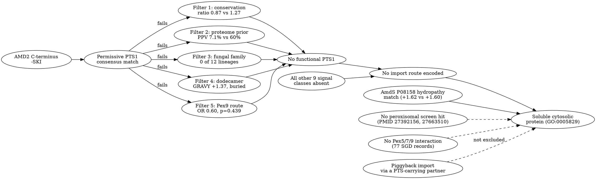

The coherent reading: AMD2 is a soluble amidase-signature enzyme whose terminal Trp-Leu-Phe-Ser-Lys-Ile is part of the folded catalytic core, with the Ser-Lys-Ile ending arising by drift. The hydrophobic aromatic stretch at positions -12 to -4 is the giveaway. A protein that needed Pex5 to read its last three residues would not bury them behind Trp-Leu-Phe, and AlphaFold assigns that region pLDDT 93.5 with neighbour counts well above those of MDH3 and SPS19. The same architecture appears in AmdS, which is experimentally cytosolic and whose hydropathy profile matches AMD2 to within 0.02 KD units.

<i class="fa-solid fa-lightbulb"></i> One inference must be labelled as inference. Absence of a targeting signal does not positively demonstrate cytosolic localization. It establishes that no known import route is encoded, and cytosol is the default destination for a soluble protein lacking one. The AmdS calibration strengthens this and does not convert it into a direct result.

What this analysis does **not** address: the catalytic activity of AMD2, its substrate, its biological process, and any phenotype of *amd2Δ*. Family membership in PF01425 with the Ser-cis-Ser-Lys triad is a database-level inference about catalysis, and no direct enzymatic assay on purified AMD2 protein was located. The targeting conclusion constrains where the enzyme acts and says nothing about what it acts on.

---

## GO curation implications

All items are **leads requiring curator verification**. Saved as `FINAL_go_decision_table.csv`.

| Aspect | GO ID | Term | Proposed action | Suggested code | Strength |
|---|---|---|---|---|---|
| CC | GO:0005829 | cytosol | <i class="fa-solid fa-arrow-right"></i> **Add**, sequence-inference level only | ISM / ISS, per curator code policy | Moderate (computational only) |
| CC | GO:0005777 | peroxisome | **Do not add**; record an explicit do-not-annotate note citing the -SKI terminus | n/a | Strong against |
| CC | GO:0005782 | peroxisomal matrix | **Do not add** | n/a | Strong against |
| CC | GO:0005739 | mitochondrion | **Do not add** | n/a | Strong against |
| CC | GO:0005634 | nucleus | **Do not add** | n/a | Moderate against |
| CC | GO:0016020 | membrane | **Do not add**; flag as FAAH carry-over risk | n/a | Strong against |
| MF | GO:0004040 | amidase activity | **Out of scope** for this hypothesis; family-level support only | IEA from PF01425 / PS00571 unless a direct assay surfaces | Not assessed here |
| BP | none | - | **No change** | n/a | n/a |

Two points for the curator.

The cytosol term should carry the weakest appropriate inference code. SGD currently records GO:0005575 with evidence code ND, meaning no data. Replacing an ND with a sequence-inferred GO:0005829 improves information content, and it must not be presented as though a localization experiment had been done.

The do-not-annotate note on GO:0005777 is the most useful product of this review. An automated PTS1 scan will flag -SKI, and the note records that the match was examined and rejected, with the five reasons. Without it, the same false positive regenerates on the next automated pass.

---

## Evidence base

Nineteen papers were retrieved. Those that bear directly on the hypothesis:

**PTS1 recognition requirements.** Brocard and Hartig 2006 ([PMID: 17007944](https://pubmed.ncbi.nlm.nih.gov/17007944/)) and Neuberger et al. 2003 ([PMID: 12706718](https://pubmed.ncbi.nlm.nih.gov/12706718/)) establish that PTS1 is a C-terminal dodecamer with accessibility requirements, not a bare tripeptide. These justify the dodecamer and AlphaFold burial analyses. Both are orientation-level for the AMD2 question itself.

**Tripeptide permissiveness and residue hierarchy.** The experimental validation study ([PMID: 25498386](https://pubmed.ncbi.nlm.nih.gov/25498386/)) determined the hierarchy Leu > Met > Ile > Val at the C-terminal position using both in vivo import and in vitro PEX5 binding, and noted that in vivo assays detect weak functional signals below the binding-assay limit. This supports treating Ile at -1 as weakening rather than abolishing, and it is the reason this report stops short of "refuted" on a hypothetical low-efficiency import.

**Non-canonical and indirect import routes.** Human catalase uses a four-residue -KANL signal with an uncharged penultimate residue that still routes through the PTS1 pathway ([PMID: 8769411](https://pubmed.ncbi.nlm.nih.gov/8769411/)), which shows the consensus has real exceptions. Effelsberg et al. 2015 ([PMID: 26276932](https://pubmed.ncbi.nlm.nih.gov/26276932/)) report that Pnc1p, "a nicotinamidase without functional PTS2, is co-imported into peroxisomes by piggyback transport via Gpd1p", a route invisible to every sequence test run here.

**Genome-wide searches that did not find AMD2.** Nötzel et al. 2016 ([PMID: 27392156](https://pubmed.ncbi.nlm.nih.gov/27392156/)) and Yifrach et al. 2016 ([PMID: 27663510](https://pubmed.ncbi.nlm.nih.gov/27663510/)) are the two efforts most likely to have caught AMD2 if it were peroxisomal. The absolute-quantification peroxisomal proteome ([PMID: 41686312](https://pubmed.ncbi.nlm.nih.gov/41686312/)) reports "copy numbers for ~ 4500 proteins, including 99 peroxisomal and peroxisome-associated proteins" across oleate and glucose, which is a checkable dataset for AMD2's presence or absence.

**The competing Pex9 mechanism.** Yifrach et al. 2023 ([PMID: 36279206](https://pubmed.ncbi.nlm.nih.gov/36279206/)) supplied the one rule that could have rescued -SKI, and the proteome test here shows it does not transfer to the peroxisomal-versus-cytosolic question.

**Fungal amidases of known or inferred location.** AmdS of *A. nidulans* is the reference cytosolic acetamidase, with the *amdA* regulatory study ([PMID: 9126617](https://pubmed.ncbi.nlm.nih.gov/9126617/)) as orientation on the gene. A *Yarrowia lipolytica* acetamidase YlAMD1 was identified "by homology to the A. nidulans acetamidase amdS" and used as a recyclable marker ([PMID: 32024536](https://pubmed.ncbi.nlm.nih.gov/32024536/)), consistent with a cytosolic nitrogen-utilisation enzyme. Yoshida et al. 2007 ([PMID: 17924455](https://pubmed.ncbi.nlm.nih.gov/17924455/)) describe an amidase of bottom-fermenting yeast where "a hydropathy plot shows that Ami1p has a putative signal sequence" yet "it was located in the cell, not secreted into the medium", a direct demonstration that a predicted signal in a fungal amidase need not produce export.

**Removing the FAAH analogy.** Muccioli et al. 2009 ([PMID: 19529773](https://pubmed.ncbi.nlm.nih.gov/19529773/)) mapped yeast N-palmitoylethanolamine inactivation to YJU3.

---

## Limitations and knowledge gaps

<i class="fa-solid fa-triangle-exclamation"></i> **No experimental localization of AMD2 exists.** Checked SGD locus S000002650, which returns ND on all three GO aspects, plus the interaction and literature endpoints. This is the gap that makes the whole question computational. A GFP-tagged AMD2 strain imaged against a peroxisomal and a cytosolic marker resolves it in one experiment.

<i class="fa-solid fa-triangle-exclamation"></i> **Per-ORF coverage of the two genome-wide screens is unknown.** Nötzel 2016 and Yifrach 2016 did not report AMD2, but the abstracts do not state whether AMD2 was tested and rejected or simply not covered. The strength of the absence argument depends on which. Reading the supplementary tables of both papers, which was not possible programmatically here, settles it. The same applies to the 99-protein peroxisomal proteome of Das et al.: whether AMD2 appears in the quantified set of about 4,500 proteins, and at what level, is checkable from the supplement.

<i class="fa-solid fa-triangle-exclamation"></i> **Trained localization predictors were not run.** TargetP, DeepLoc, SignalP, WoLF PSORT and the PTS1 Predictor of Neuberger et al. could not be invoked from this environment, and Biopython was not importable, so Smith-Waterman was implemented in numpy. The scans here are rule-based reimplementations calibrated against proteins of known topology. Agreement from a trained predictor raises confidence; disagreement needs investigation. This is stated rather than worked around.

<i class="fa-solid fa-triangle-exclamation"></i> **Piggyback import is not excluded.** Pnc1 and Gpd1 reach the peroxisome without their own PTS1, by binding a PTS-carrying partner ([PMID: 26276932](https://pubmed.ncbi.nlm.nih.gov/26276932/)). This route is invisible to every sequence test run here. The two-hybrid record argues against it weakly, since the only physical protein partner found for AMD2 is AMD2 itself, but high-throughput interaction data is not sensitive enough to exclude it.

<i class="fa-solid fa-triangle-exclamation"></i> **Catalytic activity and substrate are unknown.** No direct assay on purified AMD2 was located, which leaves the MF annotation on family membership and leaves the targeting conclusion without a metabolic rationale. If AMD2 acted on a substrate confined to a particular compartment, that would be an argument the sequence cannot make.

<i class="fa-solid fa-triangle-exclamation"></i> **The burial measurement uses a predicted model.** The neighbour counts of 88/115/118 come from AF-P22580-F1, not a crystal structure, and terminal residues are where predicted models are least reliable. The pLDDT of 93.5 over the last ten residues argues the region is not simply disordered and guessed.

<i class="fa-solid fa-triangle-exclamation"></i> **Benchmark panel sizes are small.** The conservation test rests on 6 peroxisomal and 6 cytosolic controls after CTA1, ENO2 and TPI1 were dropped for returning zero taxon-restricted homologs, and PNC1 and GPD1 were excluded because they are peroxisomal by piggyback rather than PTS1. The p = 0.027 separation is real but comes from n = 12.

<i class="fa-solid fa-triangle-exclamation"></i> **The dodecamer hydrophobicity metric is supporting, not decisive.** Within the 465 permissive-PTS1 yeast proteins it does not separate peroxisomal from non-peroxisomal members (p = 0.577).

---

## Proposed follow-up experiments and actions

Ordered by information gained per unit of effort.

**1. <i class="fa-solid fa-microscope"></i> GFP tagging with marker colocalisation.** A C-terminal GFP would destroy the -SKI terminus, so this requires an N-terminal tag or an internal insertion. Image against Pex11-mCherry and a cytosolic marker, in glucose and in oleate. This one experiment separates cytosol from peroxisome and covers the conditional-targeting alternative. The tagging constraint is itself a prediction: if AMD2 were peroxisomal via -SKI, C-terminally tagged GFP would mislocalise it to the cytosol, and the difference between N- and C-tagged strains is a direct readout of PTS1 function.

**2. <i class="fa-solid fa-flask"></i> Reporter fusion of the AMD2 dodecamer.** Fuse the last 12 residues (VCKFASWLFSKI) to GFP and ask whether it imports. Compare with the MDH3 dodecamer as a positive control and a -SKI-to-SKL variant as a gain-of-function control. This tests the specific claim that the hydrophobic upstream context blocks a terminus that would otherwise work.

**3. <i class="fa-solid fa-database"></i> Read the supplementary tables of PMID 27392156, PMID 27663510 and PMID 41686312.** No bench work. Converts three "not reported" statements into either "tested and negative" or "not covered", which changes how much weight the absence arguments carry.

**4. <i class="fa-solid fa-vial"></i> Subcellular fractionation with mass spectrometry.** Differential centrifugation of oleate-grown cells, then quantify AMD2 peptides across fractions. Less definitive than imaging for a protein at 561 molecules per cell, but it needs no tagging and so carries no risk of perturbing the C-terminus.

**5. <i class="fa-solid fa-flask"></i> Pex5 binding assay.** Pull-down or two-hybrid of the AMD2 C-terminal peptide against the Pex5 TPR domain, with MDH3 and MLS1 peptides as positive controls. Directly tests receptor recognition and would catch a true positive that the statistical arguments here would have dismissed.

---

## Curation leads

All items require curator verification.

**Candidate references, with exact snippets to verify against the source abstracts.**

| PMID | Snippet to verify | Relevance |
|---|---|---|
| 36279206 | "We find that the specificity of Pex9 is largely determined by the hydrophobic nature of the amino acid preceding the PTS1 tripeptide of its cargos." | The rule that would have supported a peroxisomal call. The proteome test shows it does not discriminate peroxisomal from cytosolic. |
| 27392156 | "We performed a genome-wide in silico screen, characterised several PTS1-containing peptides and identified two new peroxisomal matrix proteins, which we named Pxp1 (Yel020c) and Pxp2 (Yjr111c)." | The same ortholog-expansion logic applied genome-wide did not return AMD2. |
| 27663510 | "we used complementary high-content screens to follow changes in localization of most proteins during growth in oleate." | Imaging screen under peroxisome-inducing conditions did not report AMD2. |
| 12706718 | "at least nine residues directly upstream are important for signal recognition in the PTS1-Pex5 receptor complex" | Basis for scoring the dodecamer rather than the tripeptide. |
| 17007944 | "PTS1s should be defined as dodecamer sequences at the C-terminal ends of proteins ... ensure accessibility of the extreme C-terminus." | Basis for the accessibility and burial argument. |
| 19529773 | "we identified yeast genes that control PEA metabolism, including SPO14 ... and YJU3 ... that controls PEA inactivation" | Assigns the yeast N-acylethanolamine hydrolase activity to YJU3, removing the FAAH analogy for AMD2. |
| 17924455 | "Although a hydropathy plot shows that Ami1p has a putative signal sequence, it was located in the cell, not secreted into the medium." | <i class="fa-solid fa-triangle-exclamation"></i> Cite only as a caution. AMI1 is a different gene, absent from S288C, and is not an AMD2 ortholog. |
| 26276932 | "Pnc1p, a nicotinamidase without functional PTS2, is co-imported into peroxisomes by piggyback transport via Gpd1p" | The one import route the sequence analysis cannot exclude. |

**Candidate GO terms.** Add GO:0005829 (cytosol) at sequence-inference level. Do not add GO:0005777, GO:0005782, GO:0005739, GO:0005634 or GO:0016020.

**Action changes.** Amend the hypothesis text in `AMD2-ai-review.yaml` from "no organelle-targeting signal" to a statement that AMD2 carries a permissive PTS1-like C-terminus (-SKI) that is not conserved across orthologs, not presented accessibly, and not supported by proteome-level priors, so the sequence predicts cytosol. Attach a do-not-annotate note to GO:0005777 recording the -SKI match and the five reasons it was rejected.

**Questions for the curator.** <i class="fa-solid fa-circle-question"></i> Does the review already carry a peroxisome annotation or prediction derived from the C-terminal tripeptide, and if so, from which source? Is an ISM-coded cytosol annotation preferable to leaving the existing ND in place, given that no experiment exists? Should the MF amidase annotation be revisited separately, since this hypothesis does not test catalysis?

**Suggested experiments.** N-terminally tagged GFP-AMD2 imaged against Pex11-mCherry in glucose and oleate; a VCKFASWLFSKI-GFP reporter fusion with MDH3-dodecamer and -SKL-variant controls; retrieval of the supplementary tables from PMID 27392156, PMID 27663510 and PMID 41686312.

---

## Provenance

Executed code and its output are recorded in the job transcript. Generated artifacts:

| File | Contents |
|---|---|
| `FINAL_amd2_targeting_scorecard.csv` | Ten signal classes with observed sequence, call and reasoning |
| `FINAL_hydropathy_calibration.csv` | AMD2 vs AmdS, MDH3, FAAH1, FAAH2, PMA1 hydropathy statistics |
| `FINAL_evidence_matrix.csv` | 15-row evidence matrix |
| `FINAL_go_decision_table.csv` | 8-row GO decision table |
| `amd2_P22580.fasta`, `amd2_uniref50_homologs.csv`, `ortholog_ctermini.csv` | Sequence and ortholog set |
| `cterm_conservation_ratio.csv`, `pts1_conservation_saccharomycetaceae.csv` | Selection-ratio benchmark |
| `yeast_proteome_cterm_pts1.csv`, `perm_pts1_hydrophobic_minus4.csv` | Proteome-wide PTS1 frequency and the Pex9 -4 test |
| `fungal_PF01425_raw.csv`, `fungal_amidase_sw_vs_AMD2.csv`, `fungal_homolog_targeting_scan.csv` | Fungal family scan, 61 proteins across 12 lineages |
| `pts1_dodecamer_context.csv`, `yeast_cterm_dodecamer_context.csv` | Dodecamer context analysis |
| `amidase_family_targeting_comparison.csv`, `amd2_interactions_sgd.csv` | Family comparison and 77 SGD interaction records |
| `plot_1.png` to `plot_10.png` | Figures, each generated by the analysis it depicts |

**Resources that could not be accessed programmatically from this environment:** TargetP, DeepLoc, SignalP, WoLF PSORT, the PTS1 Predictor of Neuberger et al., Biopython, and the supplementary tables of PMID 27392156, PMID 27663510 and PMID 41686312. The Lametschwandtner 1998 tripeptide-permissiveness paper could not be retrieved through the available PubMed interface. No result from any of these is reported.


## Artifacts

- [OpenScientist final report](openscientist_artifacts/final_report.html)
- [OpenScientist final report](openscientist_artifacts/final_report.pdf)
- [OpenScientist provenance](openscientist_artifacts/provenance.json)
- [OpenScientist FINAL amd2 targeting scorecard](openscientist_artifacts/provenance_FINAL_amd2_targeting_scorecard.csv)
- [OpenScientist FINAL evidence matrix](openscientist_artifacts/provenance_FINAL_evidence_matrix.csv)
- [OpenScientist FINAL go decision table](openscientist_artifacts/provenance_FINAL_go_decision_table.csv)
- [OpenScientist FINAL hydropathy calibration](openscientist_artifacts/provenance_FINAL_hydropathy_calibration.csv)
- [OpenScientist amd2 interactions sgd](openscientist_artifacts/provenance_amd2_interactions_sgd.csv)
- [OpenScientist amd2 targeting signal scorecard](openscientist_artifacts/provenance_amd2_targeting_signal_scorecard.csv)
- [OpenScientist amd2 uniref50 homologs](openscientist_artifacts/provenance_amd2_uniref50_homologs.csv)
- [OpenScientist amidase family targeting comparison](openscientist_artifacts/provenance_amidase_family_targeting_comparison.csv)
- [OpenScientist cterm conservation ratio](openscientist_artifacts/provenance_cterm_conservation_ratio.csv)
- [OpenScientist fungal PF01425 raw](openscientist_artifacts/provenance_fungal_PF01425_raw.csv)
- [OpenScientist fungal amidase sw vs AMD2](openscientist_artifacts/provenance_fungal_amidase_sw_vs_AMD2.csv)
- [OpenScientist fungal homolog targeting scan](openscientist_artifacts/provenance_fungal_homolog_targeting_scan.csv)
- [OpenScientist ortholog ctermini](openscientist_artifacts/provenance_ortholog_ctermini.csv)
- [OpenScientist perm pts1 hydrophobic minus4](openscientist_artifacts/provenance_perm_pts1_hydrophobic_minus4.csv)
- [OpenScientist plot 1](openscientist_artifacts/provenance_plot_1.json)
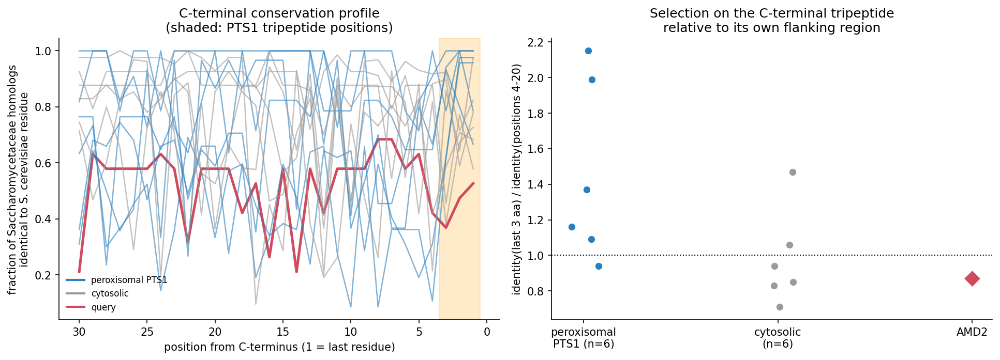
- [OpenScientist plot 10](openscientist_artifacts/provenance_plot_10.json)
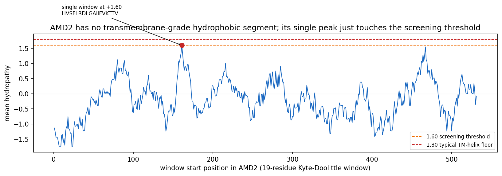
- [OpenScientist plot 2](openscientist_artifacts/provenance_plot_2.json)
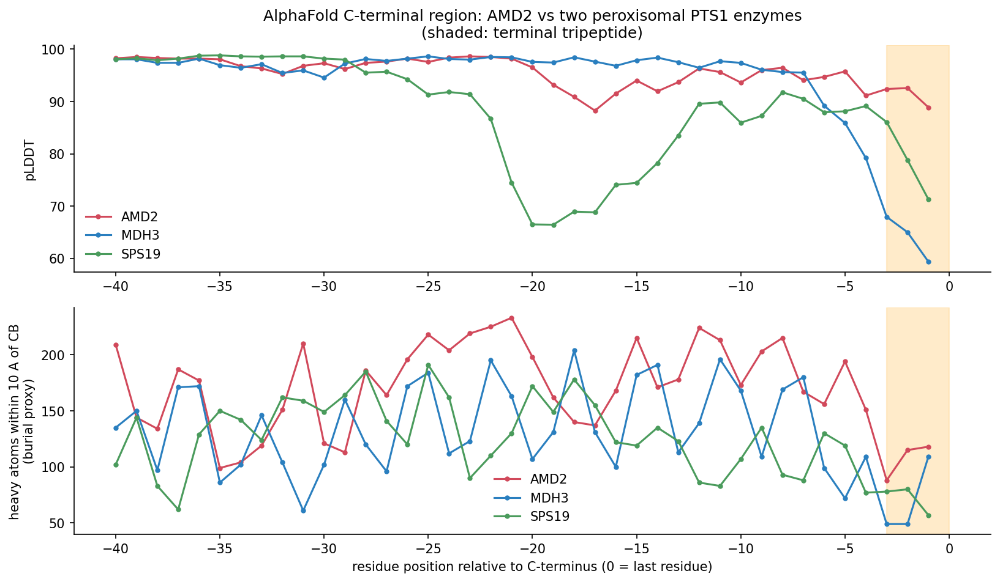
- [OpenScientist plot 3](openscientist_artifacts/provenance_plot_3.json)
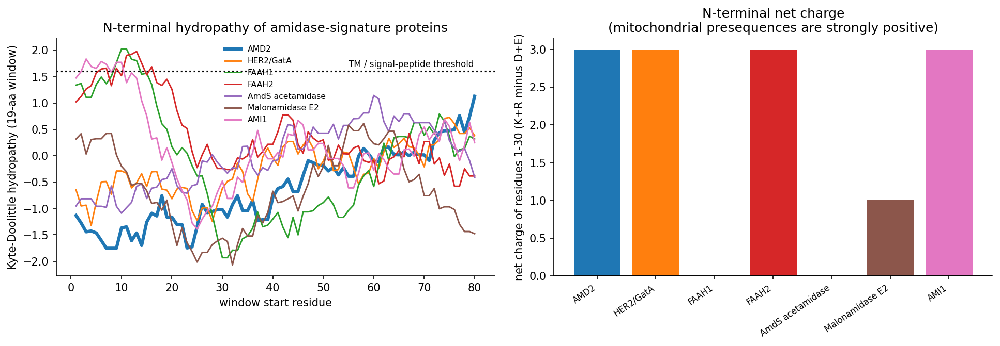
- [OpenScientist plot 4](openscientist_artifacts/provenance_plot_4.json)
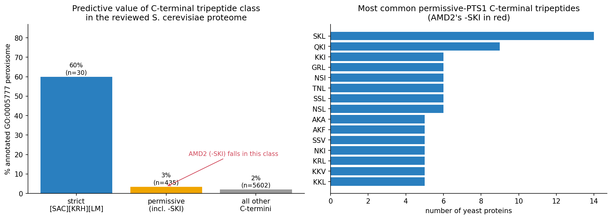
- [OpenScientist plot 5](openscientist_artifacts/provenance_plot_5.json)
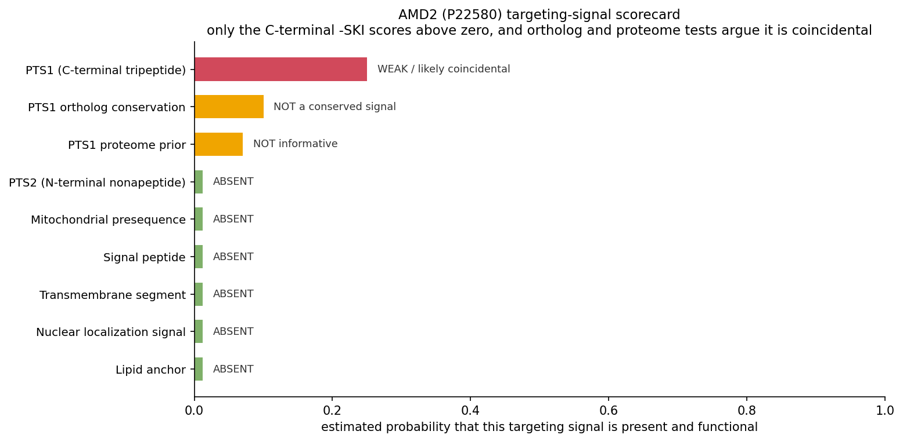
- [OpenScientist plot 6](openscientist_artifacts/provenance_plot_6.json)
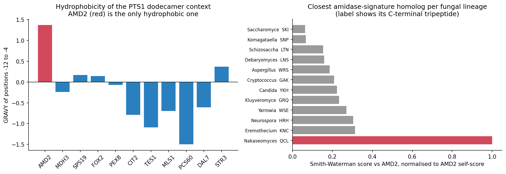
- [OpenScientist plot 7](openscientist_artifacts/provenance_plot_7.json)
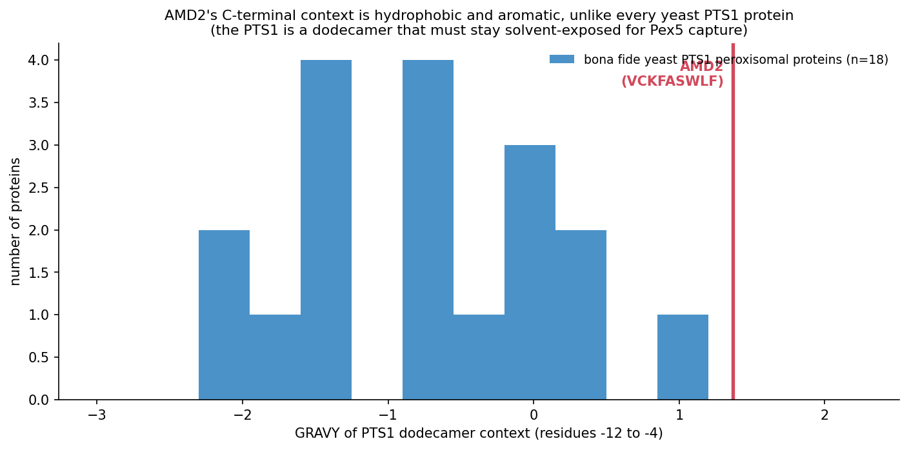
- [OpenScientist plot 8](openscientist_artifacts/provenance_plot_8.json)
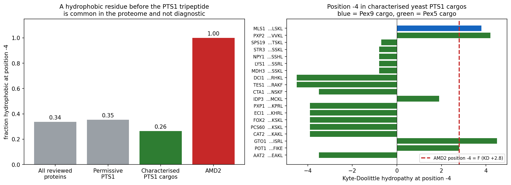
- [OpenScientist plot 9](openscientist_artifacts/provenance_plot_9.json)
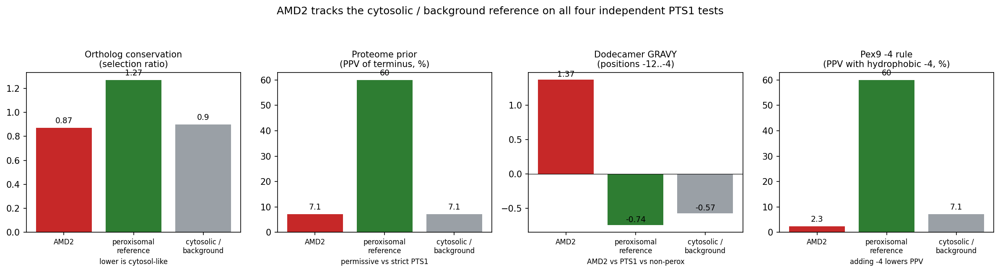
- [OpenScientist pts1 conservation saccharomycetaceae](openscientist_artifacts/provenance_pts1_conservation_saccharomycetaceae.csv)
- [OpenScientist pts1 dodecamer context](openscientist_artifacts/provenance_pts1_dodecamer_context.csv)
- [OpenScientist pts1 ortholog conservation](openscientist_artifacts/provenance_pts1_ortholog_conservation.csv)
- [OpenScientist yeast cterm dodecamer context](openscientist_artifacts/provenance_yeast_cterm_dodecamer_context.csv)
- [OpenScientist yeast proteome cterm pts1](openscientist_artifacts/provenance_yeast_proteome_cterm_pts1.csv)

## Reference Validation

Checked with `linkml-reference-validator` 0.3.1rc1.

| Outcome | Count |
| --- | --- |
| References checked | 16 |
| Resolved | 16 |
| Unresolved (possible confabulation) | 0 |
| Unverifiable | 0 |
| References weighed for topical relevance | 16 |
| On topic | 6 |
| Off topic | 1 |

### References that may not be about this subject

These identifiers resolve, so they are not fabrications, but the records they resolve to share almost none of this report's vocabulary. That is a clue and not a verdict - a paper can be relevant in ways its title and abstract do not spell out - so read them before deciding:

- `PMID:32024536` (3 mentions) - Identification of a Yarrowia lipolytica acetamidase and its use as a yeast genetic marker.
  - shared terms: yeast

Weighed against this report's own most characteristic terms: `amd2`, `protein`, `pts1`, `residue`, `class`, `peroxisomal`, `yeast`, `cytosolic`, `ski`, `localization`, `test`, `signal`, `fa-solid`, `sequence`, `terminus`, `dodecamer`, `tripeptide`, `c-terminal`, `mdh3`, `plot`.

All extracted references resolved successfully.
Resolving is not the same as being relevant, though - see the references listed above as possibly off topic.