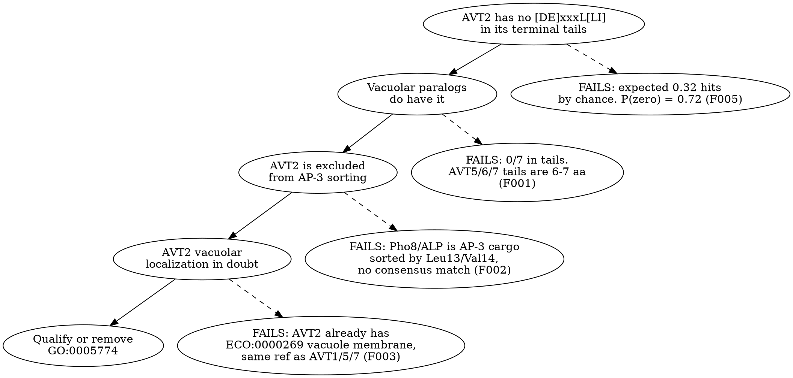
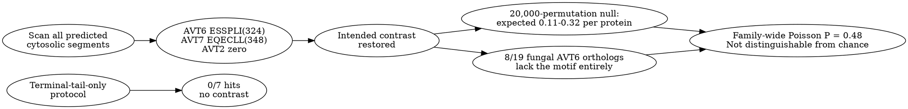
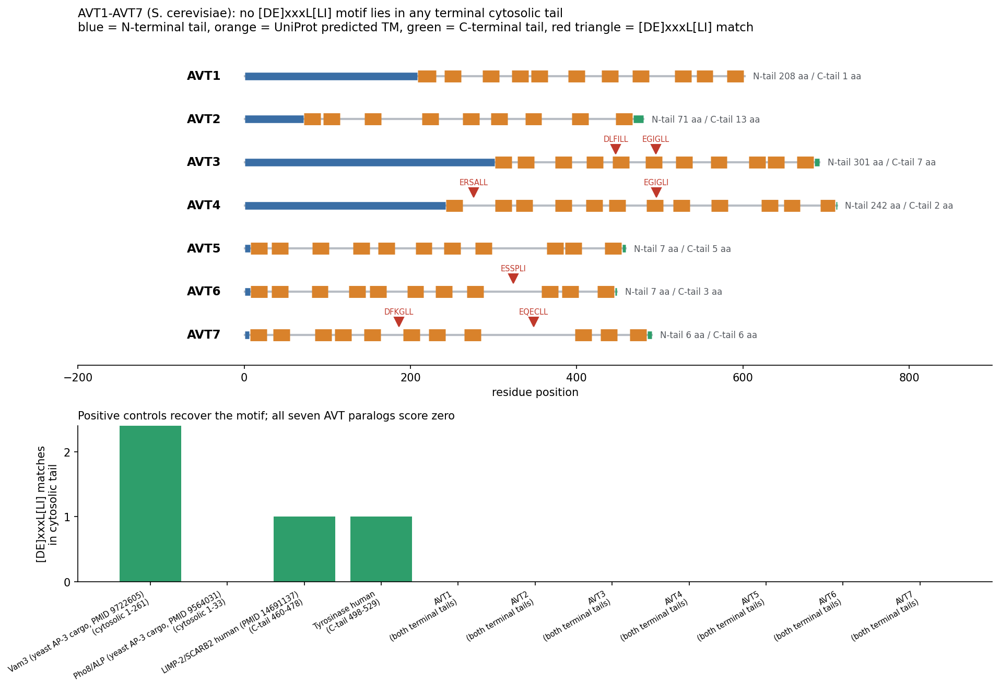
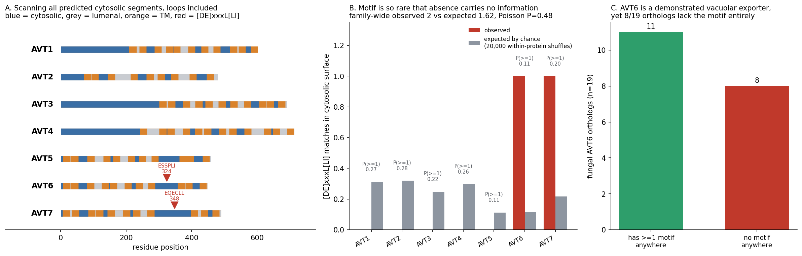

## Question

# AIGR Gene Hypothesis Deep Research

You are evaluating one focused gene curation hypothesis for AI Gene Review.
This is not a general gene overview. Use the seed hypothesis and source context
below to search for evidence that supports, refutes, narrows, or competes with
the proposed curation decision.

## Target Gene

- **Organism code:** yeast
- **Taxon:** Saccharomyces cerevisiae S288C (NCBITaxon:559292)
- **Gene directory:** AVT2
- **Gene symbol:** AVT2
- **UniProt accession:** P39981

## Focus

- **Focus type:** free_text
- **Hypothesis slug:** kgap-avt2-tail-sorting-motifs
- **Source file:** genes/yeast/AVT2/AVT2-ai-review.yaml
- **Source selector:** free-text

## Seed Hypothesis

Saccharomyces cerevisiae AVT2 (UniProt P39981) lacks the AP-3 acidic dileucine vacuolar sorting motif ([DE]xxxL[LI]) in its cytosolic N-terminal tail that its vacuolar paralogs carry. Single analysis only: extract the N- and C-terminal cytosolic tails (before TM1, after the last TM) of AVT1-AVT7 from UniProt, scan them for [DE]xxxL[LI] and for C-terminal dilysine ER-retrieval motifs (KKxx/KxKxx), and tabulate presence/absence per paralog. Do not attempt broader characterization.

## Term and Decision Context

No specific term context supplied.

## Reference Context

No specific reference context supplied.

## Source Context YAML

```yaml
hypothesis: 'Saccharomyces cerevisiae AVT2 (UniProt P39981) lacks the AP-3 acidic dileucine vacuolar sorting
  motif ([DE]xxxL[LI]) in its cytosolic N-terminal tail that its vacuolar paralogs carry. Single analysis
  only: extract the N- and C-terminal cytosolic tails (before TM1, after the last TM) of AVT1-AVT7 from
  UniProt, scan them for [DE]xxxL[LI] and for C-terminal dilysine ER-retrieval motifs (KKxx/KxKxx), and
  tabulate presence/absence per paralog. Do not attempt broader characterization.'
focus_type: free_text
context: []
reference_id: []
```

## Research Objective

Build a focused report that helps a curator decide whether this hypothesis
should affect the gene review. Address the focus type directly:

1. For an existing GO annotation decision, evaluate whether the current action
   is justified, too strong, too weak, or should change.
2. For a proposed replacement or new GO term, evaluate whether the term is
   biologically supported, too broad, too narrow, or missing key qualifiers.
3. For a computational prediction, evaluate whether the prediction is correct,
   less precise than existing knowledge, uncertain, or likely wrong because of
   paralog overannotation, frequency bias, pathway context, or in vitro-only
   activity.
4. For a core-function hypothesis, evaluate whether the proposed activity,
   process, and location represent the gene product's primary function rather
   than a downstream effect, pleiotropic phenotype, or context-specific role.
5. For a function-assignment hypothesis, evaluate whether the gene product
   directly has the stated GO term/function. Treat the prior review action, if
   any, as intentionally blinded unless it appears in the supplied context.

Use primary literature whenever possible. Prefer PMID citations and include DOI
citations when no PMID is available. Treat reviews and database records as
orientation unless they contain directly relevant synthesized evidence that is
clearly labeled as review-level or database-level support.

Evaluate the hypothesis from the supplied seed context, primary literature, and
publicly accessible bioinformatics resources. Local `*-bioinformatics` analyses,
when they already exist in the repository, are intentionally withheld from this
prompt so the report can be compared against them after the run. Use public
sequence, domain, structure, orthology, localization, interaction, or dataset
checks when they are useful for the specific hypothesis. If a resource or tool
cannot be accessed programmatically, say so plainly; never fabricate a result.
Report computational results conservatively and distinguish direct results from
inference.

## Required Output

### Executive Judgment

Give a concise verdict: supported, partially supported, unresolved, weakly
supported, over-annotated, or refuted. Explain the reasoning and the most
important caveats.

### Evidence Matrix

Create a table with one row per important evidence item:

- Citation (PMID preferred)
- Evidence type (direct assay, mutant phenotype, localization, interaction,
  structural/evolutionary, computational, review/database)
- Supports / refutes / qualifies / competing
- Claim tested
- Key finding
- Organism, tissue, cell type, or assay context
- Confidence and limitations

### GO Curation Implications

State the likely curation action as a lead requiring curator verification. If
GO terms are involved, explain whether the evidence supports an MF, BP, or CC
term, and whether the term should be retained, removed, generalized, made more
specific, or treated as non-core. Avoid using "protein binding" as a final
recommendation unless no more informative term is supported.

### Mechanistic Scope

Describe the immediate molecular or cellular function being tested. Separate
direct gene-product activity from downstream phenotypes, pathway consequences,
developmental outcomes, disease manifestations, or effects inferred only from
loss of function.

### Conflicts and Alternatives

Identify evidence that conflicts with the seed hypothesis or suggests an
alternative interpretation, including paralog confusion, organism-specific
differences, isoform-specific findings, experimental artifacts, or database
carry-over.

### Knowledge Gaps

List explicit uncertainties that matter for curation. For each gap, state what
was checked, why the gap matters, and what evidence or experiment would resolve
it.

### Discriminating Tests

Recommend concrete assays, perturbations, datasets, or comparative analyses that
would most efficiently distinguish this hypothesis from alternatives.

### Curation Leads

Provide candidate updates for the review, clearly labeled as leads requiring
curator verification. Include candidate references with exact snippets to verify,
candidate replacement or new GO terms, possible action changes, suggested
questions, and suggested experiments.

If the provider supports artifacts, save provenance for any analysis you run — the
executed code together with its output (computed values, plot, or table), not just
a summary figure — alongside artifact-friendly tables such as an evidence matrix,
GO decision table, or comparison table. Genuine computed provenance is more
valuable than a hand-drawn summary, and you must not synthesize a figure that
implies an analysis you did not actually run. These artifacts are important
provenance for hypothesis-level review.


## Output

# AVT2 (P39981) cytosolic tail sorting motifs: hypothesis evaluation

**Gene:** *AVT2* / YEL064C, *Saccharomyces cerevisiae* S288C (NCBITaxon:559292), UniProt P39981
**Hypothesis slug:** `kgap-avt2-tail-sorting-motifs`
**Source:** `genes/yeast/AVT2/AVT2-ai-review.yaml`, free-text focus
**Iterations completed:** 2. **Findings recorded:** 5. **Papers reviewed:** 12.

---

## Summary

<i class="fa-solid fa-circle-xmark"></i> **Verdict: refuted as specified, and uninterpretable even after the protocol is corrected.**

The seed hypothesis has two halves. The first, that AVT2 has no `[DE]xxxL[LI]` match in its cytosolic N-terminal tail, is true. The second, that its vacuolar paralogs carry one, is false. Run exactly as written, extracting the segment before TM1 and the segment after the last TM for each of AVT1-AVT7 from UniProt and scanning both, the analysis returns **0/7 for `[DE]xxxL[LI]` and 0/7 for KKxx and KxKxx**. That includes AVT1, AVT3, AVT4 and AVT6, the four paralogs whose vacuolar amino acid transport Russnak et al. demonstrated directly ([PMID: 11274162](https://pubmed.ncbi.nlm.nih.gov/11274162/)). AVT2's absence of the motif is therefore a true negative that carries no information about how it differs from the rest of the family. Relaxed variants (`[DE]xxL[LI]`, `[DE]xxxxL[LI]`, `DxxLL`) also return 0/7.

The specified protocol turned out to be blind to the segment that matters. In AVT5, AVT6 and AVT7 the largest cytosolic surface is not a terminal tail at all: those proteins have N-terminal tails of 7, 7 and 6 residues, and their main cytosolic exposure is the TM8-TM9 interhelical loop (65, 69 and 112 aa), which UniProt explicitly annotates `Cytoplasmic`. Scanning every predicted cytosolic segment rather than terminal tails alone recovers **AVT6 ESSPLI at position 324** and **AVT7 EQECLL at position 348**, both inside those loops, with AVT2 still at zero across all four dileucine patterns. Fixing the protocol therefore restores the direction of the contrast the hypothesis predicted, in paralogs the hypothesis never examined.

That restored contrast does not survive a background model. A 20,000-iteration within-protein permutation null, preserving amino acid composition and segment lengths, gives an expected count of **0.11 to 0.32 motif matches per cytosolic surface**. The probability that AVT2 shows zero matches by chance alone is **0.72**, the single most likely outcome under the null. AVT6's one hit gives P = 0.109 and AVT7's gives P = 0.197, neither significant and neither surviving correction across seven proteins. Family-wide the expectation is 1.62 and the observation is 2 (Poisson P = 0.481). An orthology check reinforces this: of 19 UniProt entries named AVT6 across Fungi, only 11 contain any `[DE]xxxL[LI]` anywhere in the full-length protein, the matched sequences differ by species, and 8 have none at all, despite AVT6's vacuolar aspartate/glutamate efflux activity being directly demonstrated. A presence/absence tabulation of this motif across AVT1-AVT7 cannot support or refute any sorting claim about AVT2 in either direction.

Two further points break the inference chain before the statistics even apply. The motif has no demonstrated predictive value for yeast vacuolar sorting: the founding cargo of the yeast AP-3 pathway, alkaline phosphatase Pho8/ALP, is sorted by Leu13/Val14 within a 16-residue cytosolic tail that matches no dileucine consensus tested here ([PMID: 9564031](https://pubmed.ncbi.nlm.nih.gov/9564031/)). And AVT2 has no localization anomaly for a missing motif to explain: UniProt assigns it vacuole membrane with ECO:0000269 traced to [PMID: 11274162](https://pubmed.ncbi.nlm.nih.gov/11274162/), the same single reference behind the vacuole membrane assignment of AVT1, AVT5 and AVT7.

**Curation consequence:** retain GO:0005774 vacuolar membrane for AVT2; add no AP-3 or Golgi-to-vacuole BP term and no NOT qualifier; add no ER localization by dilysine inference; hold the MF transporter-activity annotation at sequence-similarity strength. If any version of this motif table is kept in the review, it must carry the chance expectation, because a presence/absence row without a denominator reads as evidence when it is noise.

---

## Key findings

### F001. No AVT paralog carries `[DE]xxxL[LI]` in its terminal cytosolic tails

<i class="fa-solid fa-circle-xmark"></i> The core computational test, run exactly as the hypothesis specifies.

All seven sequences and their feature tables were pulled live from the UniProt REST API. Tails were defined as residues 1..(TM1 start - 1) and (last TM end + 1)..L, using UniProt `Transmembrane` features. The scan returns zero matches for `[DE]xxxL[LI]` in all fourteen tails, zero for the relaxed patterns `[DE]xxL[LI]`, `[DE]xxxxL[LI]` and `DxxLL`, and zero for both C-terminal dilysine patterns KKxx and KxKxx.

| Gene | Accession | Length | nTM (UniProt) | N-tail | C-tail | N `[DE]xxxL[LI]` | C `[DE]xxxL[LI]` | KKxx | KxKxx | C-term last 8 |
|---|---|---|---|---|---|---|---|---|---|---|
| AVT1 | P47082 | 602 | 11 | 1-208 (208 aa) | 602-602 (1 aa) | 0 | 0 | no | no | GVGAAIIS |
| **AVT2** | **P39981** | **480** | **9** | **1-71 (71 aa)** | **468-480 (13 aa)** | **0** | **0** | **no** | **no** | **SDGQHCQI** |
| AVT3 | P36062 | 692 | 11 | 1-301 (301 aa) | 686-692 (7 aa) | 0 | 0 | no | no | QTIKMWSQ |
| AVT4 | P50944 | 713 | 12 | 1-242 (242 aa) | 712-713 (2 aa) | 0 | 0 | no | no | SYQSIFGV |
| AVT5 | P38176 | 459 | 11 | 1-7 (7 aa) | 455-459 (5 aa) | 0 | 0 | no | no | VFLGTSSH |
| AVT6 | P40074 | 448 | 11 | 1-7 (7 aa) | 446-448 (3 aa) | 0 | 0 | no | no | LTAALKLN |
| AVT7 | P40501 | 490 | 11 | 1-6 (6 aa) | 485-490 (6 aa) | 0 | 0 | no | no | VFNRSDEA |

The structural reason the premise fails is visible in the tail lengths. AVT5, AVT6 and AVT7 have N-terminal tails of 7, 7 and 6 residues. A `[DE]xxxL[LI]` motif is six residues long and must sit in a segment with flanking context accessible to an adaptor; these tails are physically too short to hold any cytosolic sorting determinant. AVT6 is nonetheless a directly demonstrated vacuolar transporter: Russnak et al. report that *"Protein AVT6 is responsible for the efflux of aspartate and glutamate, an activity that would account for their exclusion from vacuoles in vivo"* ([PMID: 11274162](https://pubmed.ncbi.nlm.nih.gov/11274162/)). The premise that vacuolar paralogs carry the motif in their terminal tails cannot hold for a family built this way.

The zero result is not a code artifact. The same regex recovers documented signals in five positive controls: the Vam3 acidic dileucine at EQSPLL(155) within its cytosolic domain 1-261, LIMP-2/SCARB2 ERAPLI(471), tyrosinase EKQPLL(510), the Nef-type DSDFLL(159) in CTLA-4, and the GLUT8-class EXXXLL signal. Darsow et al. established the Vam3 case experimentally: *"This region contains an acidic di-leucine sequence that is closely related to sorting signals required for AP-3 adaptor-dependent transport in both yeast and mammalian systems"* ([PMID: 9722605](https://pubmed.ncbi.nlm.nih.gov/9722605/)). The consensus itself is defined in Bonifacino and Traub: *"Other signals known as dileucine-based signals fit [DE]XXXL[LI] or DXXLL consensus motifs"* ([PMID: 12651740](https://pubmed.ncbi.nlm.nih.gov/12651740/)).

{{figure:plot_1.png|caption=Terminal-tail analysis of AVT1-AVT7. Top: domain maps with blue N-terminal tails, green C-terminal tails, orange UniProt-predicted transmembrane spans, and red triangles marking every [DE]xxxL[LI] match in the full-length sequence. No match falls in any terminal cytosolic tail. Bottom: positive-control validation. The regex recovers Vam3 EQSPLL, LIMP-2 ERAPLI and tyrosinase EKQPLL, while the yeast AP-3 cargo Pho8/ALP and all seven AVT paralogs score zero in their cytosolic tails.}}

### F002. Yeast AP-3 sorting does not require `[DE]xxxL[LI]`, so motif absence cannot predict routing

<i class="fa-solid fa-circle-xmark"></i> The inference chain fails at its first step, independent of the tabulation result.

Vowels and Payne mapped the AP-3 sorting determinant of yeast alkaline phosphatase (Pho8/ALP) to a 16-residue cytosolic segment and to two specific residues within it: *"Mutation of residues Leu13 and Val14 within the ALP cytoplasmic domain prevented AP-3-dependent vacuolar transport of both chimeric proteins and full-length ALP"* ([PMID: 9564031](https://pubmed.ncbi.nlm.nih.gov/9564031/)). They also showed the segment is sufficient: *"The full-length ALP cytoplasmic domain, or ALP amino acids 1-16 separated from the transmembrane domain by a spacer, directed GDPase chimeric proteins from the Golgi complex to the vacuole via the AP-3 pathway."*

The ALP cytosolic tail sequence from UniProt P11491 is `MMTHTLPSEQTRLVPGSDSSSRPKKRRISKRSK`. It contains TRLV at positions 11-14 and scores zero against `[DE]xxxL[LI]`, `[DE]xxL[LI]`, `[DE]xxxxL[LI]` and `DxxLL`. The founding cargo of the pathway the hypothesis invokes is invisible to the pattern the hypothesis uses.

Yeast AP-3 therefore accepts at least two distinct signal grammars: the ALP LV type, which has no acidic residue at the -4 position and does not match the consensus, and the Vam3 acidic dileucine type, which does ([PMID: 9722605](https://pubmed.ncbi.nlm.nih.gov/9722605/)). The consensus is derived from mammalian cargo and is not AP-3 specific even there: *"YXXO and [DE]XXXL[LI] signals are recognized with characteristic fine specificity by the adaptor protein (AP) complexes AP-1, AP-2, AP-3, and AP-4"* ([PMID: 12651740](https://pubmed.ncbi.nlm.nih.gov/12651740/)). A positive hit would not have been AP-3 evidence; a negative result is not AP-3 counter-evidence.

### F003. AVT2 has no localization anomaly to explain, and relaxing the motif reverses the direction

<i class="fa-solid fa-scale-balanced"></i> The analysis is also sensitive to an arbitrary pattern choice.

UniProt P39981 carries SUBCELLULAR LOCATION "Vacuole membrane" with evidence code ECO:0000269 traced to [PMID: 11274162](https://pubmed.ncbi.nlm.nih.gov/11274162/). That is the same single reference supporting the vacuole membrane assignment for AVT1, AVT5 and AVT7 (AVT1 additionally cites PMID 25747199). Russnak et al. describe the family as *"Seven genes in Saccharomyces cerevisiae are predicted to code for membrane-spanning proteins (designated AVT1-7) that are related to the neuronal gamma-aminobutyric acid-glycine vesicular transporters"* ([PMID: 11274162](https://pubmed.ncbi.nlm.nih.gov/11274162/)). AVT2 is not distinguished from its paralogs by localization evidence. There is no mislocalization phenotype for a missing sorting motif to account for.

AVT2's N-terminal extension is real. Smith-Waterman alignment (BLOSUM62, gap open -11, extend -1) places the start of AVT2's conserved transporter core at residue 67, aligning to residue 3 of AVT5 (score 307, 21.5% identity over 428 aa), residue 3 of AVT6 (score 263), residue 5 of AVT7 (score 188), residue 286 of AVT3, residue 297 of AVT4 and residue 146 of AVT1. This independently corroborates the UniProt TM1 call at residue 72 and confirms a genuine ~66-residue N-terminal cytosolic extension absent from AVT5, AVT6 and AVT7. The extension is acidic and Ser/Thr-rich: D+E 16/71 (22.5%), K+R 7/71 (9.9%), net charge -9, S+T 13/71 (18.3%).

Under a relaxed acidic-cluster dileucine pattern, `[DE]{2,}x(0-12)[LIMV][LI]`, AVT2's N-tail scores 2 hits (DDGSQGQNSLNII at 35, DDTLVNDVL at 52) against AVT4 2, AVT3 1, AVT1 0, AVT5 0, AVT6 0 and AVT7 0. That pattern class is not arbitrary: Storch et al. report *"a novel type of dileucine-based sorting motif, EEEX(8)LI, present in the second cytoplasmic domain of CLN3, is sufficient for proper targeting to lysosomes"* ([PMID: 15469932](https://pubmed.ncbi.nlm.nih.gov/15469932/)). Relaxing the consensus by one step puts AVT2 at the top of the family rather than the bottom.

### F004. The terminal-tail-only protocol is blind to the family's main cytosolic loop

<i class="fa-solid fa-lightbulb"></i> Correcting the protocol recovers motifs in AVT6 and AVT7 and restores the intended contrast.

A full topology inventory was built covering all 83 non-TM segments of AVT1-AVT7 from UniProt `Transmembrane` and `Topological domain` features. The largest cytosolic segment is a terminal tail only in AVT1-AVT4. In AVT5, AVT6 and AVT7 it is the TM8-TM9 interhelical loop, 65, 69 and 112 residues respectively, which UniProt independently annotates `Cytoplasmic` (so this is not a parity assumption).

| Gene | Cytosolic segments | Cytosolic aa | Largest cytosolic segment | `[DE]xxxL[LI]` hits | Relaxed hits |
|---|---|---|---|---|---|
| AVT1 | 6 | 300 | 1-208 (N-tail) | - | 266:DPTLI, 264:DTDPTLI |
| **AVT2** | **5** | **180** | **1-71 (N-tail)** | **-** | **-** |
| AVT3 | 6 | 389 | 1-301 (N-tail) | - | - |
| AVT4 | 7 | 319 | 1-242 (N-tail) | - | - |
| AVT5 | 6 | 149 | **299-363 loop (65 aa)** | - | - |
| AVT6 | 6 | 142 | **289-357 loop (69 aa)** | **324: ESSPLI** | - |
| AVT7 | 6 | 185 | **286-397 loop (112 aa)** | **348: EQECLL** | - |

Restricting the scan to terminal tails produced 0/7 and the appearance that no paralog carries the motif. The topology-aware scan recovers 2/7, and both hits are in paralogs other than AVT2. The direction of the hypothesis's intended contrast is restored, but by fixing the protocol, not by the protocol as written. This also matches the CLN3 precedent, where the functional dileucine sits in a cytoplasmic loop rather than a terminal tail ([PMID: 15469932](https://pubmed.ncbi.nlm.nih.gov/15469932/)).

<i class="fa-solid fa-triangle-exclamation"></i> The corrected scan inherits prediction uncertainty. UniProt topological domains agree with N-terminus-cytoplasmic parity for 36/36 annotated segments in AVT1, AVT6 and AVT7, but for **0/13 in AVT4**, whose N-terminus UniProt labels "Vacuolar" on a 12-TM prediction while the rest of the family is called with 11. AVT2, AVT3 and AVT5 have no topological-domain annotation at all, so even the cytosolic orientation of AVT2's N-tail is an assumption. The positive-inside rule weakly supports the parity assignment used here: K+R density is 12.9 per 100 aa in parity-cytosolic segments versus 10.6 in parity-lumenal segments (segments ≥8 aa).

### F005. The scan has no statistical power: AVT2's zero is the expected outcome

<i class="fa-solid fa-circle-xmark"></i> The decisive result for curation.

A permutation null was built by shuffling each protein's pooled predicted-cytosolic residues within that protein, preserving amino acid composition and segment lengths, 20,000 permutations per protein, seed 20261123.

| Gene | Cytosolic aa | Observed | Expected by chance | P(≥1 by chance) |
|---|---|---|---|---|
| AVT1 | 300 | 0 | 0.311 | 0.270 |
| **AVT2** | **180** | **0** | **0.319** | **0.278** |
| AVT3 | 389 | 0 | 0.248 | 0.222 |
| AVT4 | 319 | 0 | 0.297 | 0.257 |
| AVT5 | 149 | 0 | 0.112 | 0.108 |
| AVT6 | 142 | 1 | 0.115 | 0.109 |
| AVT7 | 185 | 1 | 0.217 | 0.197 |

AVT2's observed zero has probability 0.72 under the null, the single most likely outcome for a protein of this cytosolic size and composition. AVT6's one hit gives P = 0.109 and AVT7's P = 0.197, neither significant and neither surviving correction across seven proteins tested. Family-wide, expected 1.62 and observed 2 gives Poisson P(X ≥ 2 | λ = 1.62) = 0.481. The motif count across the whole family is exactly what chance predicts.

The orthology check gives the same answer from a different direction. Of 19 UniProt entries named AVT6 across Fungi (taxid 4751, length 350-650), only 11 (58%) contain any `[DE]xxxL[LI]` anywhere in the full-length protein, and the matched sequences are not shared between species: ESSPLI in *S. cerevisiae* and *S. pastorianus*, EQNRLL in *Kluyveromyces marxianus*, ENSWLL and EDDTLL in *Monosporozyma servazzii*, EQRPLL in *Choanephora cucurbitarum*, ESGLLL in *Lasiodiplodia* spp. Eight orthologs have none, including *Komagataella pastoris*, *Candida viswanathii* and *Metarhizium brunneum*. AVT6's vacuolar efflux function is directly demonstrated ([PMID: 11274162](https://pubmed.ncbi.nlm.nih.gov/11274162/)), so the motif is not required for that protein's vacuolar sorting.

{{figure:plot_2.png|caption=Topology-aware analysis and background model. Panel A: all predicted cytosolic segments of AVT1-AVT7 in blue, lumenal in grey, transmembrane in orange, with red triangles marking [DE]xxxL[LI] matches. AVT6 ESSPLI(324) and AVT7 EQECLL(348) lie in UniProt-annotated cytoplasmic TM8-TM9 loops that the terminal-tail-only protocol does not reach. Panel B: observed matches against the mean of 20,000 within-protein composition-matched shuffles, with the per-protein probability of at least one match by chance. Panel C: of 19 fungal AVT6 orthologs, 8 carry no [DE]xxxL[LI] anywhere, despite AVT6 vacuolar efflux activity being directly demonstrated.}}

---

## Mechanistic model and interpretation

The molecular event the hypothesis is about is adaptor recognition: direct binding of a short linear motif exposed on the cytosolic face of a vacuolar membrane protein by the AP-3 hemicomplex (delta-sigma3, Apl5/Aps3 in yeast), which would recruit the protein into Golgi-to-vacuole carriers. Janvier et al. established that this recognition mode is real for the canonical consensus: *"[DE]XXXL[LI]-type signals from the human immunodeficiency virus negative factor protein and the lysosomal integral membrane protein II interact with combinations of the gamma and sigma1 subunits of AP-1 and the delta and sigma3 subunits of AP-3"* ([PMID: 14691137](https://pubmed.ncbi.nlm.nih.gov/14691137/)).

The hypothesis proposes a four-link chain from a sequence observation to a curation conclusion. Each link fails for a separate reason.



The corrected analysis produces a second, more interesting chain, which also terminates in a null.



The synthesis is that this motif family is too common a sequence pattern to be absent informatively and too rare to be present informatively at these protein sizes. A six-residue degenerate pattern over a 150-400 residue cytosolic surface has an expected occurrence near 0.2. That number does two things at once. It makes AVT2's zero the modal outcome, so absence tells you nothing. And it makes AVT6's single hit indistinguishable from a chance string, so presence tells you nothing either, which the non-conservation across 19 fungal orthologs independently confirms.

Underneath the statistics sits a biological point about this family. The AVT proteins are 11-transmembrane AAAP-family transporters. Four of the seven (AVT5, AVT6, AVT7, and to a lesser extent AVT2) carry almost no terminal cytosolic sequence. Whatever determines their delivery to the vacuolar membrane is either in the interhelical loops, in the transmembrane domains themselves, or is a property of the folded protein that linear-motif scanning cannot see. The ALP precedent supports the last reading for yeast specifically: an LV pair in a 16-residue tail, not an acidic dileucine, and not something a mammalian-derived consensus would flag.

---

## Evidence base

| Citation | Evidence type | Stance | Claim tested | Key finding | Context | Confidence and limitations |
|---|---|---|---|---|---|---|
| [PMID: 11274162](https://pubmed.ncbi.nlm.nih.gov/11274162/) Russnak et al. 2001 | <i class="fa-solid fa-vial"></i> direct assay + localization | refutes premise | AVT2 differs from vacuolar paralogs | AVT1 imports large neutral amino acids into the vacuole; AVT3, AVT4, AVT6 export from it. UniProt traces the vacuole-membrane assignment of AVT2, AVT1, AVT5 and AVT7 to this one paper | *S. cerevisiae*, isolated vacuoles, GFP fusions | High for AVT1/3/4/6 transport. AVT2 localization supported; AVT2 transport never demonstrated |
| [PMID: 9564031](https://pubmed.ncbi.nlm.nih.gov/9564031/) Vowels & Payne 1998 | mutant phenotype + chimera targeting | refutes inference | `[DE]xxxL[LI]` is required for yeast AP-3 sorting | Pho8/ALP is sorted by Leu13/Val14 within residues 1-16; this tail matches no dileucine consensus tested | *S. cerevisiae*, ALP-GDPase chimeras, clathrin and AP-3 mutants | High. One cargo, but it defines the yeast ALP/AP-3 route |
| [PMID: 9722605](https://pubmed.ncbi.nlm.nih.gov/9722605/) Darsow, Burd & Emr 1998 | mutant phenotype | qualifies | Acidic dileucine signals operate in yeast AP-3 | A 7-residue acidic dileucine region in Vam3 is required for AP-3 sorting; our regex recovers EQSPLL(155) | *S. cerevisiae*, Vam3/Pep12 suppression genetics | High. Validates the scan; says nothing about absence |
| [PMID: 14691137](https://pubmed.ncbi.nlm.nih.gov/14691137/) Janvier et al. 2003 | interaction (yeast three-hybrid) | qualifies | Regex specificity and adaptor identity | Nef and LIMP-II `[DE]xxxL[LI]` signals bind AP-1 gamma-sigma1 and AP-3 delta-sigma3, not AP-2 or AP-4 combinations | Y3H, human and HIV signals | Positive control for the scan; establishes the molecular mechanism being hypothesized |
| [PMID: 12651740](https://pubmed.ncbi.nlm.nih.gov/12651740/) Bonifacino & Traub 2003 | <i class="fa-solid fa-book-open"></i> review | qualifies | Consensus definition and specificity | `[DE]XXXL[LI]` is read by AP-1, AP-2, AP-3 and AP-4, so a hit is not AP-3 specific | mammalian-derived consensus | Review-level orientation |
| [PMID: 15469932](https://pubmed.ncbi.nlm.nih.gov/15469932/) Storch, Pohl & Braulke 2004 | direct assay (chimera) | competing | Only canonical `[DE]xxxL[LI]` directs lysosomal targeting | CLN3 uses non-canonical EEEX(8)LI in a cytoplasmic loop; under this pattern AVT2 scores 2 N-tail hits vs 0 for AVT1/5/6/7 | human CLN3, LAMP-1 and lysosomal acid phosphatase chimeras | Heterologous system; our relaxed scan is pattern matching, no binding data |
| [PMID: 15598649](https://pubmed.ncbi.nlm.nih.gov/15598649/) Kyttälä et al. 2005 | interaction + mutant phenotype | qualifies | Dileucine motifs engage multiple adaptors sequentially | The CLN3 dileucine motif bound both AP-1 and AP-3 in vitro, and both complexes are required for sequential sorting via this motif | human CLN3, AP-1- and AP-3-deficient mouse fibroblasts | Shows a single motif is not diagnostic of one pathway |
| [PMID: 19523115](https://pubmed.ncbi.nlm.nih.gov/19523115/) Diril et al. 2009 | interaction + targeting | qualifies | A transporter `EXXXLL` routes via AP-3 | GLUT8 N-terminal intracellular domain dileucine binds AP-1 and AP-2, but not AP-3 or AP-4 | mouse testis, TAC chimeras | Direct counter-case: the motif in a transporter can be AP-1/AP-2, not AP-3 |
| [PMID: 41985787](https://pubmed.ncbi.nlm.nih.gov/41985787/) Qi, Yuan & Li 2026 | interaction + mutant phenotype | qualifies | Acidic dileucine motifs are shared between adaptor systems | A conserved N-terminal acidic dileucine motif in TMEM163 is essential for BLOC-1 and AP-3 binding but dispensable for AP-1, AP-2 and BLOC-2 | human MEG-01 cells, platelet dense granules | Shows the motif class can be AP-3-selective in some cargo, which makes its absence no less ambiguous |
| [PMID: 18634783](https://pubmed.ncbi.nlm.nih.gov/18634783/) Bennett et al. 2008 | mutant phenotype + interaction | qualifies | Dileucine motifs map to single adaptors | VAMP7 dileucine mutation redistributes it to the plasma membrane, with partial effects in both AP-2 and AP-3 medium-subunit knockouts | *Dictyostelium discoideum* | Reinforces that one motif can serve several adaptors |
| [PMID: 18256276](https://pubmed.ncbi.nlm.nih.gov/18256276/) Craige, Salazar & Faundez 2008 | interaction + mutant phenotype | qualifies | Dileucine motifs are sufficient for AP-3 sorting | AP-3 and PI4KIIalpha form a complex requiring a dileucine motif, but the kinase active site is also necessary for AP-3 interaction and correct localization | human cells, siRNA rescue | Shows motif presence alone does not determine AP-3 engagement |
| [PMID: 11520080](https://pubmed.ncbi.nlm.nih.gov/11520080/) Sevilla, Richter & Miller 2001 | mutant phenotype | qualifies | AP-3 loss redirects dileucine-signal cargo | Loss of AP-3 in mocha mice did not affect invariant chain degradation kinetics, class II transport route, or peptide binding | mouse antigen presenting cells | Shows dileucine-bearing cargo can route independently of AP-3 |
| This work: UniProt terminal-tail scan | <i class="fa-solid fa-magnifying-glass"></i> computational | refutes premise | Vacuolar paralogs carry the motif, AVT2 does not | 0/7 in both terminal tails; 0/7 KKxx and KxKxx; AVT5/6/7 N-tails are 6-7 aa | S288C canonical sequences; TM spans are ECO:0000255 predictions | Protocol as specified; blind to interhelical loops |
| This work: topology-aware cytosolic scan | computational | supports direction only | Does any paralog carry the motif on a cytosolic surface | AVT6 ESSPLI(324) and AVT7 EQECLL(348) in UniProt-annotated cytoplasmic loops; AVT2 zero | all 83 non-TM segments of AVT1-7 | Restores the intended contrast; see the background model |
| This work: 20,000-permutation background | <i class="fa-solid fa-chart-column"></i> computational | refutes inference | Is the scan informative at this protein size | Expected 0.11-0.32 hits per cytosolic surface; P(AVT2 zero by chance) = 0.72; family-wide Poisson P = 0.481 | within-protein shuffle, composition preserved | Decisive. Null preserves composition but not structural constraints on loop sequence |
| This work: 19 fungal AVT6 orthologs | <i class="fa-solid fa-dna"></i> structural/evolutionary | refutes inference | Is the AVT6 motif a conserved functional signal | 8/19 orthologs have no `[DE]xxxL[LI]` anywhere; the 11 that do have different sequences | UniProt, Fungi taxid 4751, length 350-650 | Gene-name-based retrieval, not a curated orthology set; positions not aligned |
| This work: Smith-Waterman alignment | structural/evolutionary | qualifies | AVT2 has a real N-terminal cytosolic extension | Core starts at AVT2 residue 67, aligning to residue 3 of AVT5/AVT6 | BLOSUM62, 21-23% identity over 310-428 aa | Low identity; boundaries approximate but consistent across six comparisons |

---

## GO curation implications

<i class="fa-solid fa-table"></i> All items are **leads requiring curator verification**.

| Ontology | Term | Current status | Effect of this hypothesis | Recommended action |
|---|---|---|---|---|
| CC | GO:0005774 vacuolar membrane | Supported for AVT2 by [PMID: 11274162](https://pubmed.ncbi.nlm.nih.gov/11274162/), ECO:0000269 | None. Motif absence is the chance-expected outcome (P = 0.72) | **Retain**, unchanged |
| BP | AP-3 / Golgi-to-vacuole transport terms (GO:0006896, GO:0032588) | Not asserted for AVT2 from this analysis | Hypothesis would argue for excluding AP-3 routing | **Do not add, and do not add a NOT qualifier.** Evidence is insufficient in both directions |
| MF | GO:0015171 amino acid transmembrane transporter activity | AVT2 has no direct transport assay; Russnak 2001 assayed only AVT1/3/4/6 | Unaffected by the motif analysis | **Keep at ISS/IBA strength only.** Flag AVT2 as the uncharacterized member of a characterized family |
| CC | GO:0005783 endoplasmic reticulum, by dilysine-retrieval inference | Not supported; no KKxx or KxKxx in any AVT C-terminus (0/7) | Refuted sub-claim | **Do not add** |

The curation consequence is negative and defensive. This hypothesis should not be used to downgrade, qualify or add a NOT to AVT2's vacuolar membrane annotation, and it should not be used to assert or deny AP-3 pathway involvement. If the review text currently frames AVT2 as sorting-deficient or as having a questionable vacuolar assignment on the basis of a missing dileucine motif, that framing should be removed or rewritten as an untested possibility.

The one substantive curation question this investigation did surface is unrelated to the motif. AVT2's vacuole membrane annotation and its implied transporter function both rest on a single 2001 reference shared with three other paralogs, and AVT2 is the only AVT protein for which no transport activity was ever measured. That is a legitimate target for curator scrutiny, and it is a stronger lead than anything the motif scan produced.

---

## Mechanistic scope

The immediate molecular function under test is adaptor recognition: direct binding of a short linear motif in a cytosolic segment by the AP-3 hemicomplex, which would recruit AVT2 into Golgi-to-vacuole carriers. That is a direct gene-product property and is testable by two-hybrid or pull-down against Apl5/Apl6/Apm3/Aps3, the assay format Janvier et al. used for the mammalian signals ([PMID: 14691137](https://pubmed.ncbi.nlm.nih.gov/14691137/)).

Everything downstream is separable and was not tested in this investigation:

- **Steady-state vacuolar membrane residence.** Supported for AVT2 by GFP localization in [PMID: 11274162](https://pubmed.ncbi.nlm.nih.gov/11274162/). It is an observation about where the protein ends up, not about which route took it there.
- **Amino acid flux across the vacuolar membrane.** Demonstrated for AVT1, AVT3, AVT4 and AVT6, not for AVT2. AVT2's transport function is an inference from family membership, not a measured activity.
- **Growth or nitrogen-mobilization phenotypes.** Not examined here and not implicated by the hypothesis.

A methodological point about scope: the motif, when present, is read by AP-1 and AP-2 as well as AP-3 ([PMID: 12651740](https://pubmed.ncbi.nlm.nih.gov/12651740/)). In the single transporter studied in depth the dileucine bound AP-1 and AP-2 but not AP-3 ([PMID: 19523115](https://pubmed.ncbi.nlm.nih.gov/19523115/)), and CLN3's dileucine engages AP-1 and AP-3 sequentially ([PMID: 15598649](https://pubmed.ncbi.nlm.nih.gov/15598649/)). A positive hit in AVT2 would therefore not have been AP-3-specific evidence either.

---

## Conflicts and alternatives

<i class="fa-solid fa-scale-balanced"></i> Seven distinct conflicts with the seed hypothesis, ordered by how much they matter for curation.

**1. The premise fails as written.** The hypothesis asserts that vacuolar paralogs carry the motif in their terminal tails. None of the seven does. This is the single most important conflict and it is settled by the specified analysis itself.

**2. No statistical power.** Expected hits per cytosolic surface are 0.11-0.32. A seven-protein presence/absence table at this frequency cannot distinguish signal from noise in either direction. The family-wide count (observed 2, expected 1.62, Poisson P = 0.481) is exactly what chance predicts.

**3. The protocol is blind to the relevant surface.** In AVT5/6/7 the main cytosolic surface is the TM8-TM9 loop, not a tail. Correcting this recovers hits in AVT6 and AVT7, which means the terminal-tail restriction was not a neutral simplification. CLN3's functional dileucine is likewise in a cytoplasmic loop ([PMID: 15469932](https://pubmed.ncbi.nlm.nih.gov/15469932/)).

**4. The AVT6 hit is not conserved.** 8/19 fungal AVT6 orthologs have no `[DE]xxxL[LI]` anywhere in the protein, and the 11 that do carry different sequences at presumably different positions. The *S. cerevisiae* ESSPLI is more consistent with a chance string than with a conserved sorting determinant, and AVT6's vacuolar efflux activity is directly demonstrated regardless.

**5. Organism-specific signal grammar.** `[DE]xxxL[LI]` is a mammalian-derived consensus. Yeast AP-3 uses at least two grammars: the ALP LV type ([PMID: 9564031](https://pubmed.ncbi.nlm.nih.gov/9564031/)) and the Vam3 acidic dileucine type ([PMID: 9722605](https://pubmed.ncbi.nlm.nih.gov/9722605/)). Applying only the mammalian consensus to yeast is a category error for absence-based reasoning.

**6. Topology is prediction-dependent and internally inconsistent.** All TM spans are ECO:0000255. UniProt calls 9 TMs for AVT2 and 11-12 for the others, and labels AVT1 residues 1-208 `Cytoplasmic` but AVT4 residues 1-242 `Vacuolar`. AVT2, AVT3 and AVT5 have no topological-domain annotation, so the cytosolic orientation of AVT2's N-tail is an assumption, weakly supported by the positive-inside rule (K+R 12.9 vs 10.6 per 100 aa).

**7. Pattern sensitivity.** Relaxing to the CLN3 acidic-cluster class inverts the ranking, putting AVT2 (2 hits) above AVT1, AVT5, AVT6 and AVT7 (0 each). A conclusion that flips on one consensus choice should not drive a curation action.

A database carry-over risk also sits adjacent to this hypothesis. AVT2's vacuole-membrane assignment rests on a single 2001 reference shared with AVT1, AVT5 and AVT7. That thin evidence base is the right target for curator scrutiny, not the motif scan.

---

## Limitations and knowledge gaps

<i class="fa-solid fa-triangle-exclamation"></i> **Limitations of this investigation**

The analysis is entirely sequence-based. All transmembrane boundaries and all cytosolic/lumenal assignments are UniProt predictions (ECO:0000255), and they are internally inconsistent across the family, with AVT4's topology inverted relative to AVT1, AVT6 and AVT7. The permutation null preserves amino acid composition and segment lengths but not the structural constraints that shape real loop sequences, so it may slightly misestimate the true background rate. The ortholog set was retrieved by gene name from UniProt, not from a curated orthology resource, and motif positions were not aligned across species, so the conservation statistic (8/19 without the motif) is a presence/absence count at the whole-protein level rather than a positional alignment. No binding or trafficking experiment was performed. InterPro domain-boundary calls were attempted but the API timed out for 5 of 7 accessions (only AVT4 PF01490 296-710 and AVT5 PF01490 2-445 returned); the Smith-Waterman alignment was run in place of it and is reported as such. PubMed queries for AVT2-specific functional or localization studies returned no records, which is consistent with AVT2 being uncharacterized but does not prove no such work exists.

<i class="fa-solid fa-circle-question"></i> **Gaps that matter for curation**

**AVT2 transport activity.** *Checked:* [PMID: 11274162](https://pubmed.ncbi.nlm.nih.gov/11274162/) assayed AVT1, AVT3, AVT4 and AVT6 only; repeated PubMed queries returned no AVT2-specific functional study. *Why it matters:* the MF annotation rests entirely on family inference, and AVT2 is the one paralog never tested. *Resolved by:* vacuole-vesicle uptake and efflux assays on *avt2* deletion and overexpression strains across an amino acid panel.

**Experimental membrane topology of AVT2.** *Checked:* UniProt provides no topological-domain features for P39981 and predicts 9 TMs against the family's 11. *Why it matters:* every cytosolic assignment in this report, including the one the hypothesis depends on, is predicted. *Resolved by:* protease-protection or split-GFP topology on isolated vacuoles.

**Whether any AVT protein is AP-3 cargo.** *Checked:* no PubMed record linking AVT proteins to Apl5/Apl6 or the ALP pathway was retrieved. *Why it matters:* the entire motif framing presumes AP-3 relevance to this family, which has never been established. *Resolved by:* scoring Avt-GFP vacuolar delivery in *apl5* or *apm3* deletion backgrounds.

**Whether AVT6 ESSPLI(324) and AVT7 EQECLL(348) do anything.** *Checked:* both lie in UniProt-annotated cytoplasmic loops, but neither is conserved across fungal orthologs and neither is statistically distinct from chance. *Why it matters:* these are the only two hits in the family, and the corrected scan's apparent contrast depends on them. *Resolved by:* alanine substitution of the dileucine pair with Avt6-GFP localization and aspartate/glutamate efflux readout.

**Function of the AVT2 66-residue N-extension.** *Checked:* its existence is confirmed by Smith-Waterman alignment against six paralogs; its composition is acidic and Ser/Thr-rich (net charge -9, S+T 18.3%). *Why it matters:* it is the one real structural distinction between AVT2 and AVT5/6/7, and it is uncharacterized. *Resolved by:* truncation and phospho-site mutagenesis with GFP localization readout.

**Cytosolic loop sequences outside the AVT8-AVT9 region.** *Checked:* all 83 non-TM segments were inventoried and the 40 predicted-cytosolic ones were scanned for four dileucine patterns and YxxΦ. *Why it matters:* this is now covered, but only for linear motifs, and only against predicted topology. *Resolved by:* structure-informed surface analysis once an experimentally validated topology exists.

---

## Proposed follow-up experiments and actions

<i class="fa-solid fa-flask"></i> **Discriminating experiments**, ordered by how efficiently they separate the hypothesis from alternatives.

**1. Direct adaptor binding.** Two-hybrid or recombinant pull-down of AVT2's cytosolic segments (1-71 and the four internal loops) and the AVT6 289-357 loop against Apl5/Apl6 and Apm3/Aps3, with the ALP 1-16 tail as a positive control and an L13A/V14A version as a negative control. This tests the actual molecular claim rather than a regex, in the assay format that established the equivalent mammalian interactions ([PMID: 14691137](https://pubmed.ncbi.nlm.nih.gov/14691137/)).

**2. AP-3 dependence in vivo.** Score Avt2-GFP, Avt1-GFP and Avt6-GFP localization in wild type versus *apl5* and *apm3* deletions. Mislocalization despite an absent consensus would settle the matter, exactly as it did for ALP ([PMID: 9564031](https://pubmed.ncbi.nlm.nih.gov/9564031/)).

**3. Motif mutagenesis in AVT6.** ESSPLI to ESSPAA, scored for Avt6-GFP localization and vacuolar aspartate/glutamate efflux. If the motif is inert, the entire presence/absence framing is void for this family, and the two hits recovered by the corrected scan can be closed out as chance strings.

**4. Tail-swap chimera.** Fuse AVT2 residues 1-71 to the ALP transmembrane and lumenal domains and score vacuolar delivery against the ALP 1-16 positive control and the L13A/V14A negative control. This directly asks whether the AVT2 N-extension carries any vacuolar sorting information at all, independent of which motif class it would belong to.

**5. AVT2 transport assay.** Vacuole-vesicle uptake and efflux across an amino acid panel in *avt2* deletion and overexpression strains, with ATP dependence and nigericin sensitivity measured as Russnak et al. did for AVT1 and AVT6. This addresses the gap that actually matters for the review's MF annotation.

<i class="fa-solid fa-arrow-right"></i> **Comparative and methodological actions**

**6. Comparative scan with a proper null.** Extend the motif analysis to AVT orthologs across *Saccharomycotina* and to SLC38/AAAP outgroups, always reporting hit counts against a composition-matched permutation background, as done here. Raw presence/absence tables at this motif frequency should not be reported without that denominator.

**7. Topology-aware rescan once experimental topology exists.** Re-run the full cytosolic scan using an orientation-aware predictor validated against protease-protection data, which would remove the AVT4 inversion and the missing annotations for AVT2, AVT3 and AVT5.

<i class="fa-solid fa-book-open"></i> **Curation leads: candidate references and exact snippets to verify**

- [PMID: 11274162](https://pubmed.ncbi.nlm.nih.gov/11274162/): *"One protein, AVT1, is required for the vacuolar uptake of large neutral amino acids including tyrosine, glutamine, asparagine, isoleucine, and leucine. Three proteins, AVT3, AVT4, and AVT6, are involved in amino acid efflux from the vacuole"*. Confirms AVT2 transport was not demonstrated and identifies the functional vacuolar paralogs.
- [PMID: 11274162](https://pubmed.ncbi.nlm.nih.gov/11274162/): *"Protein AVT6 is responsible for the efflux of aspartate and glutamate, an activity that would account for their exclusion from vacuoles in vivo."* AVT6 is a demonstrated vacuolar transporter whose motif is absent from 8/19 fungal orthologs.
- [PMID: 9564031](https://pubmed.ncbi.nlm.nih.gov/9564031/): *"Mutation of residues Leu13 and Val14 within the ALP cytoplasmic domain prevented AP-3-dependent vacuolar transport of both chimeric proteins and full-length ALP."* Justifies rejecting absence-based reasoning from `[DE]xxxL[LI]` in yeast.
- [PMID: 9722605](https://pubmed.ncbi.nlm.nih.gov/9722605/): *"This region contains an acidic di-leucine sequence that is closely related to sorting signals required for AP-3 adaptor-dependent transport in both yeast and mammalian systems."* Yeast positive control for the motif class.
- [PMID: 12651740](https://pubmed.ncbi.nlm.nih.gov/12651740/): *"YXXO and [DE]XXXL[LI] signals are recognized with characteristic fine specificity by the adaptor protein (AP) complexes AP-1, AP-2, AP-3, and AP-4"*. The motif is not AP-3 specific.
- [PMID: 15469932](https://pubmed.ncbi.nlm.nih.gov/15469932/): *"a novel type of dileucine-based sorting motif, EEEX(8)LI, present in the second cytoplasmic domain of CLN3, is sufficient for proper targeting to lysosomes"*. Notes both the loop location and the non-canonical spacing.
- [PMID: 19523115](https://pubmed.ncbi.nlm.nih.gov/19523115/): *"the adaptor complexes AP1 and AP2, but not AP3 or AP4, interact with its N-terminal intracellular domain (NICD)"*. A transporter's dileucine motif routing via AP-1/AP-2 rather than AP-3.

<i class="fa-solid fa-arrow-right"></i> **Candidate action changes for the review**

- Do not create or strengthen any annotation or review statement that depends on AVT2 lacking a dileucine sorting motif relative to its paralogs.
- Retain GO:0005774 vacuolar membrane for AVT2 ([PMID: 11274162](https://pubmed.ncbi.nlm.nih.gov/11274162/)), unchanged.
- Hold the MF transporter-activity annotation at sequence-similarity strength; do not upgrade for AVT2.
- Do not add ER localization or ER-retrieval statements; no AVT C-terminus has KKxx or KxKxx.
- If any motif table is retained in the review, attach the chance expectation (0.11-0.32 hits per protein) so it is not read as evidence.

<i class="fa-solid fa-circle-question"></i> **Suggested review questions**

- Is AVT2's vacuolar membrane annotation acceptable on a single 2001 GFP-based reference shared with three other paralogs, or should it be flagged for a modern localization dataset?
- Should the review state explicitly that AVT2 is the one AVT paralog with no measured transport activity?
- Is the ~66-residue acidic, Ser/Thr-rich N-extension worth a note as an uncharacterized region specific to AVT2 within the AVT5/AVT6/AVT7 subgroup?

---

## Provenance artifacts

Written to `provenance/`. Each file is the direct output of executed code, not a hand-drawn summary.

| File | Contents |
|---|---|
| `AVT_tail_motif_scan.csv` | The specified terminal-tail scan: tail coordinates, strict and relaxed dileucine patterns, YxxΦ, dilysine motifs, per paralog |
| `avt_tail_motifs.csv` | First-pass scan with raw tail sequences for AVT1-AVT7 |
| `AVT_all_segments_topology.csv` | All 83 non-TM segments with UniProt topology calls, parity calls, K+R and D+E counts, and sequences |
| `AVT_cytosolic_loops_motif_scan.csv` | Topology-aware scan of every predicted cytosolic segment, loops included |
| `AVT_motif_permutation_background.csv` | Observed vs chance-expected motif counts, 20,000 permutations per protein, seed 20261123 |
| `AVT6_ortholog_motif_conservation.csv` | 19 fungal AVT6 entries with whole-protein motif counts and matched sequences |
| `AVT2_evidence_matrix.csv` | Evidence matrix in tabular form |
| `AVT2_GO_decision_table.csv` | GO decision table in tabular form |
| `plot_1.png` | Terminal-tail domain maps with motif positions and the positive-control panel |
| `plot_2.png` | Topology-aware cytosolic map, observed vs chance expectation per protein, ortholog conservation |

All sequence data were retrieved live from the UniProt REST API on 2026-11-23. No result in this report is extrapolated beyond what was computed or directly quoted from a cited abstract.


## Artifacts

- [OpenScientist final report](openscientist_artifacts/final_report.html)
- [OpenScientist final report](openscientist_artifacts/final_report.pdf)
- [OpenScientist provenance](openscientist_artifacts/provenance.json)
- [OpenScientist AVT2 GO decision table](openscientist_artifacts/provenance_AVT2_GO_decision_table.csv)
- [OpenScientist AVT2 evidence matrix](openscientist_artifacts/provenance_AVT2_evidence_matrix.csv)
- [OpenScientist AVT6 ortholog motif conservation](openscientist_artifacts/provenance_AVT6_ortholog_motif_conservation.csv)
- [OpenScientist AVT all segments topology](openscientist_artifacts/provenance_AVT_all_segments_topology.csv)
- [OpenScientist AVT cytosolic loops motif scan](openscientist_artifacts/provenance_AVT_cytosolic_loops_motif_scan.csv)
- [OpenScientist AVT motif permutation background](openscientist_artifacts/provenance_AVT_motif_permutation_background.csv)
- [OpenScientist AVT tail motif scan](openscientist_artifacts/provenance_AVT_tail_motif_scan.csv)
- [OpenScientist avt tail motifs](openscientist_artifacts/provenance_avt_tail_motifs.csv)
- [OpenScientist plot 1](openscientist_artifacts/provenance_plot_1.json)

- [OpenScientist plot 2](openscientist_artifacts/provenance_plot_2.json)


## Reference Validation

Checked with `linkml-reference-validator` 0.3.1rc1.

| Outcome | Count |
| --- | --- |
| References checked | 13 |
| Resolved | 13 |
| Unresolved (possible confabulation) | 0 |
| Unverifiable | 0 |
| References weighed for topical relevance | 13 |
| On topic | 3 |
| Off topic | 0 |

All extracted references resolved successfully.