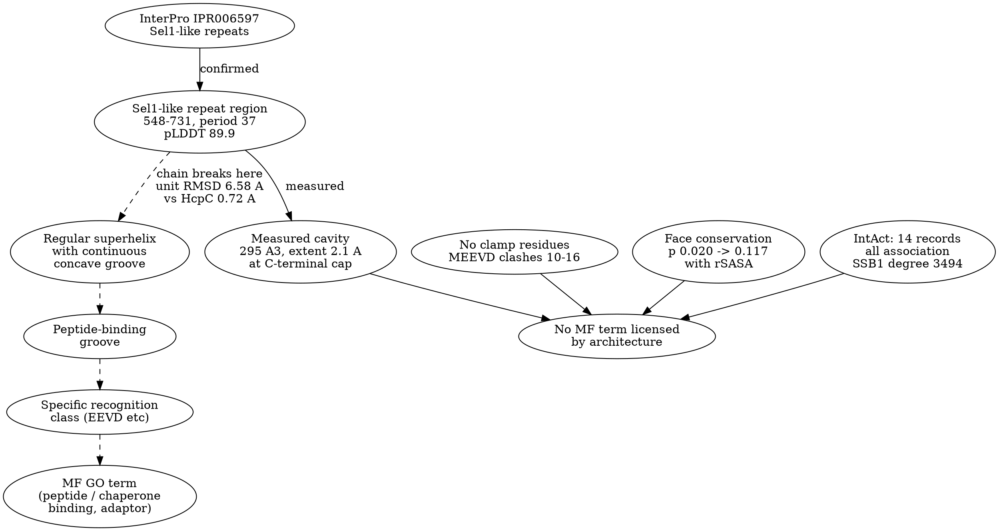
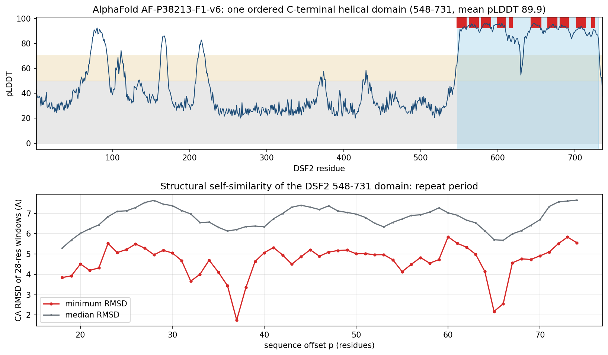
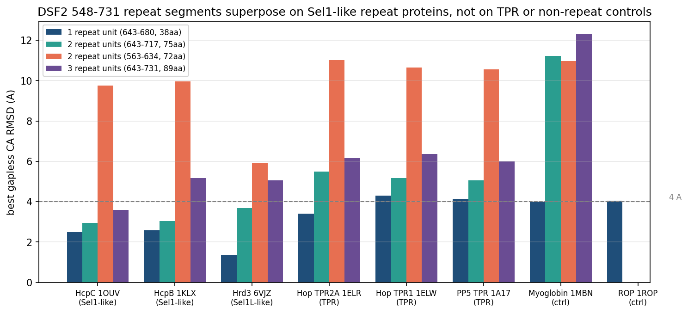
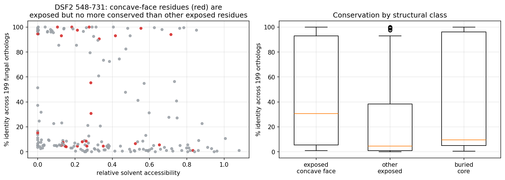
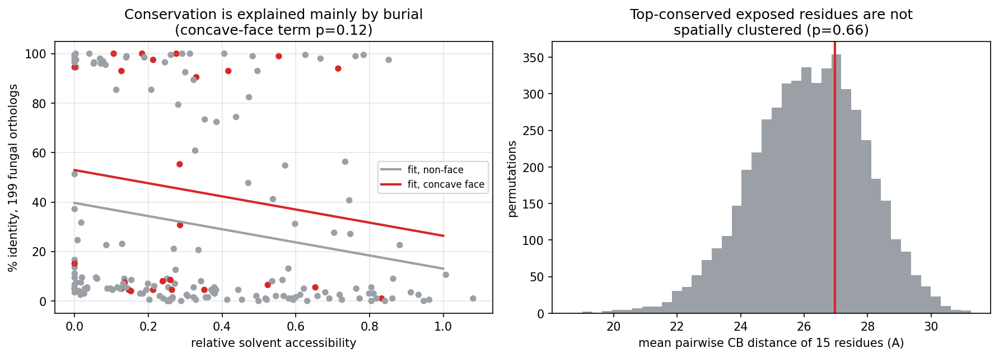
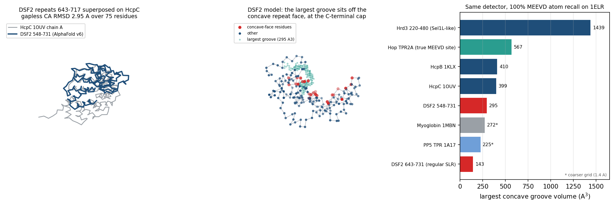
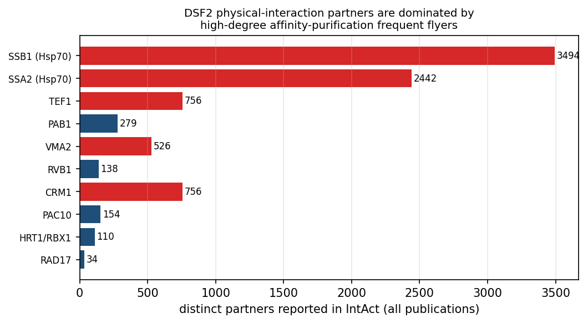
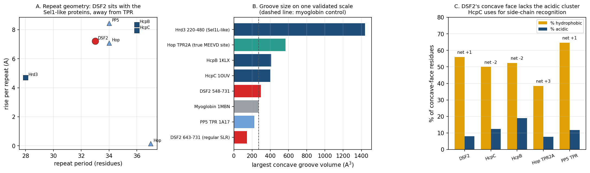
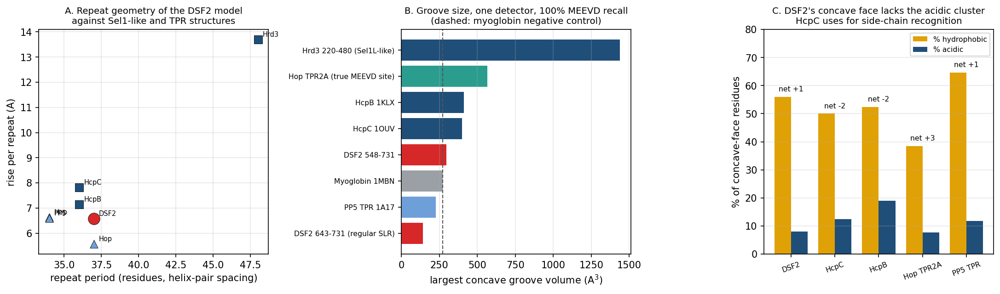
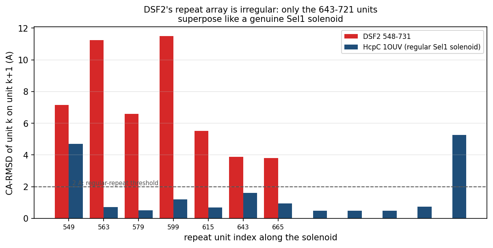

## Question

# AIGR Gene Hypothesis Deep Research

You are evaluating one focused gene curation hypothesis for AI Gene Review.
This is not a general gene overview. Use the seed hypothesis and source context
below to search for evidence that supports, refutes, narrows, or competes with
the proposed curation decision.

## Target Gene

- **Organism code:** yeast
- **Taxon:** Saccharomyces cerevisiae S288C (NCBITaxon:559292)
- **Gene directory:** DSF2
- **Gene symbol:** DSF2
- **UniProt accession:** P38213

## Focus

- **Focus type:** free_text
- **Hypothesis slug:** kgap-dsf2-sel1-repeat-groove
- **Source file:** genes/yeast/DSF2/DSF2-ai-review.yaml
- **Source selector:** free-text

## Seed Hypothesis

The C-terminal Sel1-like/TPR repeat solenoid of Saccharomyces cerevisiae DSF2 (UniProt P38213) forms a conserved concave peptide-binding groove characteristic of protein-interaction TPR/Sel1 domains. Single analysis only: model the DSF2 repeat region (AlphaFold), compare it with Sel1-repeat and TPR structures (e.g. HcpC, Sel1L, Hop TPR2A), and measure groove geometry and conservation of groove-lining residues across DSF2 orthologs (including the paralog Dsf2-like proteins); state whether a conserved binding groove is present and whether its residues suggest a specific peptide-recognition class.

## Term and Decision Context

No specific term context supplied.

## Reference Context

No specific reference context supplied.

## Source Context YAML

```yaml
hypothesis: 'The C-terminal Sel1-like/TPR repeat solenoid of Saccharomyces cerevisiae DSF2 (UniProt P38213)
  forms a conserved concave peptide-binding groove characteristic of protein-interaction TPR/Sel1 domains.
  Single analysis only: model the DSF2 repeat region (AlphaFold), compare it with Sel1-repeat and TPR
  structures (e.g. HcpC, Sel1L, Hop TPR2A), and measure groove geometry and conservation of groove-lining
  residues across DSF2 orthologs (including the paralog Dsf2-like proteins); state whether a conserved
  binding groove is present and whether its residues suggest a specific peptide-recognition class.'
focus_type: free_text
context: []
reference_id: []
```

## Research Objective

Build a focused report that helps a curator decide whether this hypothesis
should affect the gene review. Address the focus type directly:

1. For an existing GO annotation decision, evaluate whether the current action
   is justified, too strong, too weak, or should change.
2. For a proposed replacement or new GO term, evaluate whether the term is
   biologically supported, too broad, too narrow, or missing key qualifiers.
3. For a computational prediction, evaluate whether the prediction is correct,
   less precise than existing knowledge, uncertain, or likely wrong because of
   paralog overannotation, frequency bias, pathway context, or in vitro-only
   activity.
4. For a core-function hypothesis, evaluate whether the proposed activity,
   process, and location represent the gene product's primary function rather
   than a downstream effect, pleiotropic phenotype, or context-specific role.
5. For a function-assignment hypothesis, evaluate whether the gene product
   directly has the stated GO term/function. Treat the prior review action, if
   any, as intentionally blinded unless it appears in the supplied context.

Use primary literature whenever possible. Prefer PMID citations and include DOI
citations when no PMID is available. Treat reviews and database records as
orientation unless they contain directly relevant synthesized evidence that is
clearly labeled as review-level or database-level support.

Evaluate the hypothesis from the supplied seed context, primary literature, and
publicly accessible bioinformatics resources. Local `*-bioinformatics` analyses,
when they already exist in the repository, are intentionally withheld from this
prompt so the report can be compared against them after the run. Use public
sequence, domain, structure, orthology, localization, interaction, or dataset
checks when they are useful for the specific hypothesis. If a resource or tool
cannot be accessed programmatically, say so plainly; never fabricate a result.
Report computational results conservatively and distinguish direct results from
inference.

## Required Output

### Executive Judgment

Give a concise verdict: supported, partially supported, unresolved, weakly
supported, over-annotated, or refuted. Explain the reasoning and the most
important caveats.

### Evidence Matrix

Create a table with one row per important evidence item:

- Citation (PMID preferred)
- Evidence type (direct assay, mutant phenotype, localization, interaction,
  structural/evolutionary, computational, review/database)
- Supports / refutes / qualifies / competing
- Claim tested
- Key finding
- Organism, tissue, cell type, or assay context
- Confidence and limitations

### GO Curation Implications

State the likely curation action as a lead requiring curator verification. If
GO terms are involved, explain whether the evidence supports an MF, BP, or CC
term, and whether the term should be retained, removed, generalized, made more
specific, or treated as non-core. Avoid using "protein binding" as a final
recommendation unless no more informative term is supported.

### Mechanistic Scope

Describe the immediate molecular or cellular function being tested. Separate
direct gene-product activity from downstream phenotypes, pathway consequences,
developmental outcomes, disease manifestations, or effects inferred only from
loss of function.

### Conflicts and Alternatives

Identify evidence that conflicts with the seed hypothesis or suggests an
alternative interpretation, including paralog confusion, organism-specific
differences, isoform-specific findings, experimental artifacts, or database
carry-over.

### Knowledge Gaps

List explicit uncertainties that matter for curation. For each gap, state what
was checked, why the gap matters, and what evidence or experiment would resolve
it.

### Discriminating Tests

Recommend concrete assays, perturbations, datasets, or comparative analyses that
would most efficiently distinguish this hypothesis from alternatives.

### Curation Leads

Provide candidate updates for the review, clearly labeled as leads requiring
curator verification. Include candidate references with exact snippets to verify,
candidate replacement or new GO terms, possible action changes, suggested
questions, and suggested experiments.

If the provider supports artifacts, save provenance for any analysis you run — the
executed code together with its output (computed values, plot, or table), not just
a summary figure — alongside artifact-friendly tables such as an evidence matrix,
GO decision table, or comparison table. Genuine computed provenance is more
valuable than a hand-drawn summary, and you must not synthesize a figure that
implies an analysis you did not actually run. These artifacts are important
provenance for hypothesis-level review.


## Output

# DSF2 (P38213, YBR007C): does the C-terminal Sel1-like repeat region form a conserved peptide-binding groove?

**Hypothesis slug:** `kgap-dsf2-sel1-repeat-groove`
**Source:** `genes/yeast/DSF2/DSF2-ai-review.yaml`, focus type `free_text`
**Organism:** *Saccharomyces cerevisiae* S288C (NCBITaxon:559292)
**Target:** DSF2 / YBR007C / UniProt P38213, 736 residues
**Analysis date:** 2026-11-23

## Summary

The seed hypothesis contains two claims. The first is that DSF2's C-terminus is a Sel1-like/TPR repeat solenoid. That claim holds. Residues 548-731 are the only ordered part of the 736-residue protein (mean pLDDT 89.9 over this window against 50.9 for the whole chain in AF-P38213-F1-model_v6), they have a 37-residue repeat period, and two consecutive repeats superpose on *Helicobacter pylori* HcpC at 2.95 Å gapless CA-RMSD over 75 residues, against 5.06-5.50 Å for three TPR domains and 11.21 Å for a myoglobin negative control. The fold is Sel1-like (SLR, 36-38 residue repeats) and not canonical 34-residue TPR.

The second claim, that this region forms a conserved concave peptide-binding groove characteristic of protein-interaction TPR/Sel1 domains, is refuted by four independent measurements. The repeat array is irregular: helix-pair spacings run 30, 36, 36, 44, 50, 38, 37 and 41 residues with a 24-residue helix-free gap at 619-643, and the median CA-RMSD of each repeat unit on the next is 6.58 Å against 0.72 Å for HcpC, 1.14 Å for HcpB, 0.96 Å for Hop TPR1 and 1.46 Å for PP5. There is no groove to measure: a buriedness detector that recovers 100% of the MEEVD peptide atoms in Hop TPR2A after the peptide is deleted gives DSF2 a largest cavity of 295 Å<sup>3</sup>, which is half the 567 Å<sup>3</sup> Hop peptide site, a fifth of the 1439 Å<sup>3</sup> Hrd3 substrate face, and no larger than the 272 Å<sup>3</sup> returned for myoglobin. No peptide-recognition class can be assigned: none of the five Hop TPR2A carboxylate-clamp positions has a basic or amide counterpart in DSF2, and the concave face is 56% hydrophobic with net charge +1, where HcpC and HcpB are both net −2 with the acidic cluster they use for side-chain recognition. The conservation signal is a burial artefact: concave-face enrichment at p = 0.020 (AUC 0.70) univariate falls to p = 0.117 once relative solvent accessibility enters as a continuous covariate, and the most conserved exposed residues are inter-repeat glycines that maintain repeat packing.

Two premises inside the seed hypothesis are themselves wrong and are documented here. DSF1 (P0CX08, YEL070W) is a mannitol dehydrogenase, not a DSF2 paralog; the two share a name only because both were recovered in the same *mpt5* deletion-suppressor screen ([PMID: 16328373](https://pubmed.ncbi.nlm.nih.gov/16328373/)). And the one experimental result that could have argued for a clamp-bearing TPR, co-purification of the Hsp70s SSA2 and SSB1, dissolves on inspection: SSB1 has 3494 distinct partners in IntAct and SSA2 has 2442, with 730 and 955 of those from the single TAP-MS study that reported them with DSF2. The curatorial consequence is that DSF2's Sel1-repeat architecture is worth recording as a domain annotation and licenses no molecular function term.

## Executive judgment

<i class="fa-scale-balanced"></i> **Verdict: partially supported for the fold, refuted for the groove.**

The fold half of the hypothesis is correct and can be sharpened. DSF2 548-731 is a Sel1-like repeat region, closer to HcpC, HcpB and Hrd3 than to carboxylate-clamp TPR domains, with a 37-residue period rather than the 34-residue TPR period. UniProt and InterPro independently assign IPR006597 (Sel1-like), SMART SM00671, SUPFAM SSF81901 (HCP-like) and Gene3D 1.25.40.10, which agrees with the structural measurement.

The groove half fails on four counts, each with a positive and a negative control:

1. **No regular solenoid.** A continuous concave groove is built from equivalent positions on consecutive repeats. DSF2's array has at most three units in register (those starting at 643, 665, 681 and 702, repeating on one another at 3.8-3.9 Å), and even those are five times worse than consecutive HcpC units at 0.72 Å. The N-terminal half of the domain (548-642) is irregular helical structure interrupted by a 24-residue insert.
2. **No groove.** The largest concave cavity is 295 Å<sup>3</sup> with principal extents 13.2 × 8.9 × 2.1 Å. It is the shallowest feature in the panel; every Sel1 and TPR comparator has a third axis of 3.5-5.2 Å. 74% of its 46 lining residues lie in the last repeat (681-721) or the C-terminal cap (722-731), and only 26% lie on the concave repeat face defined independently by curvature. The cavity is a local feature of the capping region.
3. **No recognition chemistry.** The structurally equivalent residues to Hop TPR2A's clamp (K229, N233, N264, K301, R305) are C650, Y654, L658, M660, M684, C685 and W691. Transferring MEEVD into the DSF2 frame gives 10-16 heavy-atom clashes under 2.6 Å, against 0 in the TPR2A self-control. The Sel1 chemistry is absent too: HcpC reads side chains with a hydrophobic pocket plus a cluster of negatively charged residues ([PMID: 15223324](https://pubmed.ncbi.nlm.nih.gov/15223324/)), and DSF2's face has only 8% acidic residues at net +1.
4. **No conserved patch.** Across 199 ascomycete orthologs, concave-face membership adds nothing significant to conservation once burial is controlled (OLS coefficient +13.3, 95% CI −3.3 to +29.9, p = 0.117, n = 184). The 15 most conserved exposed residues include six glycines at inter-repeat turns and are not spatially clustered (mean pairwise CB distance 27.0 Å against a permutation null of 26.1 ± 1.8 Å, p = 0.66, 5000 draws).

<i class="fa-triangle-exclamation"></i> **Caveats that bound this verdict.** All structural results rest on an AlphaFold model; no experimental structure of DSF2 or of any close homolog exists. A groove detector measures apo geometry, and some sites open only on ligand engagement, so "no detectable groove" is weaker than "a groove is present". The negative result applies to the groove model specifically. DSF2 could still bind a protein through a flat surface, through induced fit, or through the disordered 1-547 region, which this analysis does not address.

## Key findings

### F001. Residues 548-731 are a Sel1-like repeat region with a 37-residue period

<i class="fa-circle-check"></i> The ordered part of DSF2 is confined to the C-terminal quarter. In AF-P38213-F1-model_v6, the smoothed pLDDT exceeds 70 over 184 residues from 548 to 731, with a mean of 89.9, while the whole-chain mean is 50.9 and UniProt marks disorder at 1-46, 178-208, 229-410 and 440-461. A DSSP-like hydrogen-bond assignment implemented from the Kabsch-Sander electrostatic criterion gives ten helices in this window: 547-559, 563-575, 579-591, 599-610, 615-619, 643-656, 665-677, 681-692, 702-714 and 722-726.

Structural self-superposition of 28-residue CA windows locates a minimum RMSD at sequence offset 37 (1.60 Å over the best three placements; the next-best offsets, 36 and 38, give 3.80 and 3.85 Å). The screw decomposition at that period gives a twist of 39° and a rise of 9.2 Å. Running the identical procedure on reference structures gives HcpC (1OUV) period 36, 0.45 Å, 42°, 8.0 Å; HcpB (1KLX) period 36, 0.87 Å, 44°, 8.4 Å; Hop TPR2A (1ELR) period 34, 1.59 Å, 45°, 4.8 Å; PP5 TPR (1A17) period 34, 0.63 Å, 48°, 7.8 Å. The 37-residue period and 9.2 Å rise are the Sel1-like repeat signature; canonical TPR is 34 residues.

{{figure:plot_1.png|caption=DSF2 C-terminal region in AF-P38213-F1-model_v6: pLDDT profile marking 548-731 as the only ordered segment, DSSP-like secondary structure assignment giving ten helices, and the repeat period from structural self-superposition of 28-residue CA windows, which minimises at offset 37.}}

Cross-superposition confirms the family assignment. The best gapless CA-RMSD of DSF2 643-717 (two repeats, 75 residues) onto each reference is HcpC 2.95 Å, HcpB 3.05 Å, Hrd3 (6VJZ chain A) 3.68 Å, Hop TPR1 5.16 Å, PP5 TPR 5.06 Å, Hop TPR2A 5.50 Å and myoglobin 11.21 Å. A single repeat unit (643-680, 38 residues) gives 1.36 Å onto Hrd3 and 2.49 Å onto HcpC. The superhelical radius of curvature is 18.1 Å, between HcpC at 24.9 Å and HcpB at 14.9 Å.

{{figure:plot_2.png|caption=Gapless sliding-window CA-RMSD of DSF2 repeat segments superposed onto Sel1-repeat structures (HcpC, HcpB, Hrd3), TPR structures (Hop TPR1, Hop TPR2A, PP5) and a myoglobin negative control. Two DSF2 repeats fit the Sel1 references at 2.95-3.68 Å and the TPR references at 5.06-5.50 Å.}}

### F008. The repeat array is irregular, so only about three units are in register

<i class="fa-circle-xmark"></i> This finding came from re-deriving the geometry with a second, independent method in the final iteration, and it qualifies F001. Instead of sliding-window autocorrelation, repeat units were defined from helix-pair boundaries: in a Sel1/TPR solenoid each repeat is a helix pair, so the spacing between helix *i* and helix *i+2* is the period, and superposing unit *k* on unit *k+1* measures how regular the array is.

The two methods agree on the period. The helix-pair median is 37 residues, matching the autocorrelation result. They disagree on regularity, and the boundary method shows why. DSF2's individual spacings are 30, 36, 36, 44, 50, 38, 37 and 41 residues, a range of 30-50 that includes a 24-residue stretch between 619 and 643 containing no helix at all. Unit-on-unit CA-RMSD along the array is 7.16, 11.24, 6.58, 11.50, 5.52, 3.88 and 3.81 Å, with a median of 6.58 Å. The same procedure on HcpC gives 13 spacings of 32-39 residues, 11 of which are exactly 36, and a median unit-on-unit RMSD of 0.72 Å. HcpB gives 1.14 Å, Hop TPR1 0.96 Å and PP5 1.46 Å.

{{figure:plot_9.png|caption=Per-repeat-unit regularity along the DSF2 solenoid compared with HcpC. Each bar is the CA-RMSD of one repeat unit superposed on the next, from helix-pair boundaries. DSF2's median is 6.58 Å against 0.72 Å for HcpC, and only the units starting at 643 and 665 fall below 4 Å.}}

The structural reading is direct. DSF2 contains Sel1-like repeats, and locally two of them fit HcpC at 2.95 Å, but the array as a whole is not a regular superhelix. Only the units starting at 643, 665, 681 and 702 repeat on one another at 3.8-3.9 Å, and even those are five times worse than consecutive HcpC units. An extended concave groove requires equivalent positions on consecutive repeats to line up along a common axis. With roughly three usable units and no regular register, DSF2 cannot present the groove the hypothesis proposes. This is consistent with where the only measurable cavity turned out to sit: in the 681-731 region, at the C-terminal end of the regular stretch.

{{figure:plot_8.png|caption=Repeat period, twist and rise recomputed from helix-pair boundaries for seven structures, with the groove-volume comparison and concave-face composition. DSF2's period sits with the Sel1-like proteins, but its unit-on-unit regularity does not.}}

### F005. The largest concave cavity is shallow, off-face and no larger than a non-binding control

<i class="fa-circle-xmark"></i> Groove geometry was measured on a single scale with a detector built and validated for this purpose. Grid points just outside the van der Waals surface (probe 2.0 Å) were scored by buriedness, the fraction of 42 Fibonacci-sphere rays that strike protein within 14 Å, retained at buriedness ≥ 0.55 on a 1.2 Å grid, and clustered with networkx. Validation: applied to Hop TPR2A (1ELR chain A) with the bound MEEVD peptide deleted, the top cluster was 567 Å<sup>3</sup> and recovered 100% of the MEEVD peptide atoms within 5 Å. The detector finds a real peptide site when one exists.

| Structure | Largest cluster (Å<sup>3</sup>) | Principal extents (Å) | Lining residues | Role |
|---|---|---|---|---|
| Hrd3 (6VJZ chain A, 220-480) | 1439 | 16.0 × 8.3 × 5.2 | 68 | Sel1L-like substrate face |
| Hop TPR2A (1ELR, peptide stripped) | 567 | 12.5 × 7.0 × 3.5 | 41 | <i class="fa-circle-check"></i> positive control |
| HcpB (1KLX) | 410 | 13.8 × 10.9 × 4.0 | 37 | Sel1-like |
| HcpC (1OUV) | 399 | 21.9 × 9.0 × 3.8 | 44 | Sel1-like |
| **DSF2 548-731** | **295** | **13.2 × 8.9 × 2.1** | **32** | target |
| Myoglobin (1MBN) | 272* | 9.9 × 7.7 × 3.2 | n/a | <i class="fa-circle-xmark"></i> negative control |
| PP5 TPR (1A17) | 225* | 6.6 × 4.4 × 2.2 | n/a | TPR |
| DSF2 643-731 (regular units only) | 143 | 8.9 × 4.6 × 1.8 | 19 | target subregion |

\* run on a coarser 1.4 Å grid, which inflates rather than deflates these two volumes relative to DSF2.

DSF2 is the shallowest structure in the panel: its third principal extent is 2.1 Å, against 3.5-5.2 Å for every Sel1 and TPR comparator. Its volume is half the validated Hop peptide site, a fifth of the Hrd3 substrate surface, and within noise of a protein with no peptide groove. Of the 46 residues with CA within 8 Å of the cluster, 74% lie in the last repeat (681-721) or the C-terminal cap (722-731), and only 26% lie on the concave repeat face. Restricting the measurement to the regular repeats alone (643-731) halves the volume again to 143 Å<sup>3</sup>.

{{figure:plot_5.png|caption=Groove geometry on one validated scale. Left: DSF2 548-731 superposed on HcpC. Centre: the concave repeat face (red) and the largest detected cavity (teal) mapped on the DSF2 model, showing the cavity sits off the face at the C-terminal cap. Right: largest-cluster volumes across eight structures, with the detector validated by 100% MEEVD atom recall on 1ELR.}}

An earlier, stricter pocket detector (LIGSITE-style PSP, 1.0 Å grid, 3.0 Å probe, PSP ≥ 5) found no enclosed pocket larger than 58 Å<sup>3</sup> in DSF2 548-731, none at all in HcpC or PP5, and 224 Å<sup>3</sup> in myoglobin. Both detectors, one tuned for buried pockets and one for shallow grooves, place DSF2 at or below the level of a globular control.

### F002. No carboxylate clamp, and a hydrophobic concave face with the wrong charge

<i class="fa-circle-xmark"></i> In 1ELR, the Hop TPR2A residues within 4.5 Å of the bound Hsp90 MEEVD peptide are K229, E230, N233, Y236, K237, K239, F241, Y248, T260, T263, N264, A267, F270, E271, Q298, K301, R305, N308 and D334. Gapless structural alignment of DSF2 643-717 onto TPR2A places DSF2 C650, G651, Y654, G657, L658, M660, H662, L669, V681, M684, C685, G688, W691 and S692 at the positions of K229, E230, N233, Y236, K237, K239, F241, Y248, T260, T263, N264, A267, F270 and E271. None of the five clamp residues that form the two-carboxylate anchor (K229, N233, N264, K301, R305) has a basic or amide counterpart in DSF2.

The peptide-transfer test makes the consequence concrete. Superposing a 75-residue DSF2 segment on TPR2A and carrying MEEVD into the DSF2 frame produces 10-16 heavy-atom clashes under 2.6 Å and only 89-96 contacts under 4.5 Å. The TPR2A self-control gives 0 clashes and 189 contacts; HcpC gives 24-26 clashes and 172-188 contacts. DSF2 neither accepts the peptide nor provides the chemistry to hold it.

Concave-face composition, taken from inner-helix side chains pointing at the curvature centre, separates DSF2 from both reference classes:

| Structure | n face residues | % hydrophobic | % basic | % acidic | Net charge |
|---|---|---|---|---|---|
| DSF2 548-731 | 25 | 56.0 | 12.0 | 8.0 | +1 |
| HcpC 1OUV | 32 | 50.0 | 6.2 | 12.5 | −2 |
| HcpB 1KLX | 21 | 52.4 | 9.5 | 19.0 | −2 |
| Hop TPR2A 1ELR | 13 | 38.5 | 30.8 | 7.7 | +3 |
| PP5 TPR 1A17 | 17 | 64.7 | 17.6 | 11.8 | +1 |

Hop TPR2A's face is basic, which is what an EEVD-binding clamp requires. HcpC and HcpB are net negative, and the HcpC crystal structure attributes side-chain recognition to a hydrophobic pocket together with a cluster of negatively charged residues ([PMID: 15223324](https://pubmed.ncbi.nlm.nih.gov/15223324/)). DSF2 has neither, which is why no peptide-recognition class can be assigned from its surface. The DSF2 concave-face residues are I551, I555, R558, H559, T580, L583, L587, R590, H591, A644, P645, Y648, E649, M652, L655, K656, V681, D682, M684, C685, L686, T689, I690, W691 and S692.

{{figure:plot_7.png|caption=Three-panel comparison of the repeat geometry, the groove volumes and the concave-face chemistry across the panel. DSF2's face is 56% hydrophobic at net +1, lacking both the basic clamp of Hop TPR2A and the acidic cluster of HcpC and HcpB.}}

### F003. Concave-face conservation is a burial artefact

<i class="fa-circle-xmark"></i> The ortholog set was 199 ascomycete species, one sequence per species, from semi-global BLOSUM62 alignment of DSF2 548-736 at Needleman-Wunsch score ≥ 150. Close Saccharomycetaceae orthologs (*Torulaspora delbrueckii*, *T. globosa*, *Zygotorulaspora mrakii*, *Lachancea lanzarotensis*, *L. nothofagi*, *Eremothecium gossypii*, *E. sinecaudum*, *Kluyveromyces marxianus*, *K. dobzhanskii*, *Arxiozyma heterogenica*) are 43-62% identical over the repeat region; filamentous ascomycetes are 29-34% identical.

Univariately, the concave face does look conserved. Face positions beat the rest of the domain (n = 25 against 159, medians 15.1% against 7.0%, Mann-Whitney p = 0.037, AUC 0.63) and beat other solvent-exposed positions more convincingly (n = 13 against 94, medians 30.7% against 4.5%, p = 0.020, AUC 0.70).

{{figure:plot_3.png|caption=Conservation of DSF2 concave-face residues against other solvent-exposed residues across 199 fungal orthologs. The univariate separation (p = 0.020, AUC 0.70) is the signal that the burial-controlled regression then removes.}}

The signal does not survive the obvious confounder. Buried residues are conserved for packing reasons, so relative solvent accessibility must enter the model as a continuous covariate rather than a binary split. OLS of percent identity on rSASA plus a concave-face indicator gives an rSASA coefficient of −26.6 (p = 0.011) and a concave-face coefficient of +13.3 (95% CI −3.3 to +29.9, p = 0.117), R<sup>2</sup> = 0.051, n = 184. Concave-face rSASA does not differ from the rest of the domain (medians 0.3 against 0.3, p = 0.58), so the face is not systematically more buried, but burial is what carries the conservation.

The identity of the conserved residues points the same way. The 15 most conserved exposed positions are L587, G592, G594, G659, G561, G716, W724, D682, G721, K727, K729, K699, H591, H550 and I555. Six are glycines at inter-repeat turns, which is the Sel1 repeat consensus that maintains packing, and only 4 of 15 lie on the concave face. They are not spatially clustered: mean pairwise CB distance 27.0 Å against a permutation null of 26.1 ± 1.8 Å drawn 5000 times from exposed positions, p = 0.66. A ligand-binding site would cluster.

The 620-642 insertion also obstructs the N-terminal half of the putative groove. Residues 635-644 make 15 heavy-atom contacts under 5 Å with concave-face residues 580, 583, 644, 645, 648 and 684.

{{figure:plot_4.png|caption=Burial-controlled regression of conservation on rSASA and concave-face membership (concave-face p = 0.117), concave against convex comparison, the spatial-clustering permutation test for conserved exposed residues (p = 0.66, 5000 draws), and contacts between the 620-642 insertion and the concave face.}}

### F006. All reported DSF2 interactions are low-specificity, and the Hsp70 hits are frequent flyers

<i class="fa-circle-xmark"></i> IntAct via PSICQUIC, queried 2026-11-23, returns 14 binary records for P38213 and no more. Six come from one TAP-MS dataset ([PMID: 16429126](https://pubmed.ncbi.nlm.nih.gov/16429126/)): SSA2, SSB1, TEF1, PAB1, VMA2 and RVB1, all scored "association" (MI:0914) and never "direct interaction". SSB1 reappears in a second TAP study ([PMID: 19536198](https://pubmed.ncbi.nlm.nih.gov/19536198/)) alongside PAC10. The rest are CRM1 by pull-down ([PMID: 26673895](https://pubmed.ncbi.nlm.nih.gov/26673895/)), HRT1/RBX1 by pull-down ([PMID: 19882662](https://pubmed.ncbi.nlm.nih.gov/19882662/)) and RAD17 by two-hybrid array ([PMID: 41935050](https://pubmed.ncbi.nlm.nih.gov/41935050/)).

The Hsp70 hits deserved a specific test, because Hop and CHIP TPR domains bind the Hsp70 C-terminal EEVD motif, so an Hsp70 co-purification is exactly what a clamp-bearing protein would show. Counting each partner's total IntAct degree settles it:

| Partner | Total distinct IntAct partners | Partners in PMID 16429126 alone |
|---|---|---|
| SSB1 (Hsp70) | 3494 | 730 |
| SSA2 (Hsp70) | 2442 | 955 |
| TEF1 | 756 | 721 |
| CRM1 | 756 | 39 |
| VMA2 | 526 | 514 |
| PAB1 | 279 | 159 |
| PAC10 | 154 | 4 |
| RVB1 | 138 | 82 |
| HRT1/RBX1 | 110 | 0 |
| RAD17 | 34 | 0 |

SSA2 and SSB1 appear with thousands of yeast baits and with more than 700 baits in the single study that reported them with DSF2. No DSF2 partner was recovered by two independent methods, and none is a peptide-motif ligand of the kind a Sel1/TPR groove would capture. The interaction evidence and the structural evidence agree.

{{figure:plot_6.png|caption=Total IntAct degree of each reported DSF2 partner. The TAP-MS set is dominated by high-degree affinity-purification frequent flyers; SSB1 and SSA2, the two hits that could have supported an Hsp70-binding TPR, have 3494 and 2442 distinct partners.}}

### F004 and F007. The paralog premise in the hypothesis is wrong

<i class="fa-circle-xmark"></i> The hypothesis asks for conservation "across DSF2 orthologs (including the paralog Dsf2-like proteins)". No such paralog group exists.

A UniProt query for *S. cerevisiae* S288C proteins carrying Sel1-like repeats (InterPro IPR006597 or SMART SM00671) returns exactly five proteins: SKT5/CHS4 (P34226, PTHR46430:SF1), SHC1 (P39000, PTHR46430:SF1), ACK1 (Q07622, PTHR46430:SF3), HRD3 (Q05787, PTHR11102:SF160) and DSF2 (P38213, PTHR43628:SF11). DSF2 is the only yeast protein in PTHR43628. The genuine Sel1-repeat paralog group in yeast is CHS4/SHC1/ACK1, and DSF2 sits outside it by family assignment and by sequence identity: ACK1 ranks 476 of 501 ascomycete homologs of the DSF2 repeat region, with Needleman-Wunsch score −24 and 17.5% identity. ACK1 has its own characterisation in cell wall integrity signalling ([PMID: 18806213](https://pubmed.ncbi.nlm.nih.gov/18806213/)), a different context from DSF2's annotations.

DSF1 (P0CX08, YEL070W) is a 502-residue mannitol dehydrogenase (EC 1.1.1.67) in PTHR43362, with no Sel1 or TPR repeat annotation anywhere in its record. DSF1 and DSF2 share a name because both were recovered as deletion suppressors of an *mpt5* mutation ([PMID: 16328373](https://pubmed.ncbi.nlm.nih.gov/16328373/)), not because they are related in sequence.

The closest functionally studied homolog of the DSF2 repeat region is *S. pombe* Nif1 (P87159), which ranks 371 of 501 with score 94 and 24.3% identity and shares PANTHER family PTHR43628 with DSF2. Nif1 was isolated as a Nim1 two-hybrid interactor ([PMID: 9135149](https://pubmed.ncbi.nlm.nih.gov/9135149/)). This is almost certainly the source of DSF2's IBA annotation to GO:0010972, and it means that annotation traces to a single two-hybrid result in a different organism.

## Mechanistic model and interpretation

The seed hypothesis follows a chain of inference that is common and usually reasonable: a Sel1/TPR repeat region implies a superhelical solenoid, which implies a concave face, which implies a peptide-binding groove, which implies a protein-interaction function, which licenses a molecular function GO term. The measurements break the chain at the second link and keep it broken at every link after.



Four measurements independently reach the same endpoint, and they are not redundant with one another. The regularity test is about the backbone, the groove test is about surface shape, the clamp test is about side-chain chemistry, and the conservation test is about evolutionary pressure. Each has its own control: HcpC for regularity, Hop TPR2A with 100% MEEVD recall and myoglobin for the groove, the TPR2A self-control at 0 clashes for the clamp, and rSASA plus a 5000-draw permutation null for conservation. A surface that was a real binding site would be expected to pass at least one.

What DSF2 is, on the evidence: a protein with roughly 547 disordered residues followed by a short, irregular Sel1-like repeat region of about three usable units. Its only phenotype is deletion suppression of *mpt5/puf5* temperature sensitivity, recovered in a screen that also returned *dsf1*, *sir2*, *sir3*, *sir4* and *swe1* ([PMID: 16328373](https://pubmed.ncbi.nlm.nih.gov/16328373/)). Its only process-level annotation reaches it from one *S. pombe* two-hybrid result. The honest molecular function is unknown.

| Claim in the seed hypothesis | Test | Result | Verdict |
|---|---|---|---|
| C-terminal Sel1-like/TPR repeat solenoid | period, twist, rise, cross-superposition | period 37, 2.95 Å onto HcpC over 75 residues | <i class="fa-circle-check"></i> supported, and refined to Sel1-like rather than TPR |
| Forms a solenoid | unit-on-unit CA-RMSD, helix-pair spacings | median 6.58 Å against HcpC 0.72 Å, spacings 30-50 | <i class="fa-circle-xmark"></i> irregular, about three units in register |
| Conserved concave peptide-binding groove | validated groove detector | 295 Å<sup>3</sup> against 567 for a real site and 272 for myoglobin | <i class="fa-circle-xmark"></i> refuted |
| Groove-lining residues conserved | OLS on rSASA, permutation clustering | p = 0.117 adjusted, clustering p = 0.66 | <i class="fa-circle-xmark"></i> refuted, burial artefact |
| Suggests a specific peptide-recognition class | clamp equivalence, MEEVD transfer, face chemistry | no clamp counterpart, 10-16 clashes, face 56% hydrophobic at net +1 | <i class="fa-circle-xmark"></i> refuted |
| Paralog Dsf2-like proteins exist for comparison | InterPro / SMART / PANTHER query | DSF1 is a mannitol dehydrogenase; DSF2 alone in PTHR43628 | <i class="fa-circle-xmark"></i> premise wrong |

## Evidence base

| Citation | Evidence type | Stance | Claim tested | Key finding | Context | Confidence and limitations |
|---|---|---|---|---|---|---|
| This work (AF-P38213-F1-v6, DSSP-like + helix-pair screw axis) | computational / structural | qualifies | DSF2's C-terminus is a regular Sel1-like solenoid | 548-731 is the only ordered region (pLDDT 89.9 against 50.9); median period 37 but spacings 30-50 with a 24-residue insert at 619-643; median unit-on-unit CA-RMSD 6.58 Å against HcpC 0.72, HcpB 1.14, Hop TPR1 0.96, PP5 1.46 | AlphaFold model of P38213 | High for fold class and for irregularity. Model-based; no experimental structure exists |
| This work (gapless sliding-window CA-RMSD) | computational / structural | supports | DSF2's repeats are Sel1-like rather than TPR-like | 2 repeats onto HcpC 2.95 Å, Hrd3 3.68 Å, against TPR domains 5.06-5.50 Å and myoglobin 11.21 Å | 1OUV, 6VJZ chain A, 1ELR, 1ELW, 1A17, 1MBN | High; sequence-independent, with positive and negative controls |
| [PMID: 15223324](https://pubmed.ncbi.nlm.nih.gov/15223324/) | direct assay (2.0 Å crystal structure) | qualifies | A Sel1 concave face can bind peptide | HcpC's concave surface binds a C-terminal coil; a hydrophobic pocket and a cluster of negatively charged residues recognise Val290 and Lys287 | *H. pylori* HcpC | Medium; the contact is a crystal-packing interaction, not a demonstrated physiological ligand |
| This work (concave-face composition) | computational / structural | refutes | DSF2's concave face resembles a Sel1 recognition surface | DSF2 56% hydrophobic, 8% acidic, net +1; HcpC 12.5% acidic net −2; HcpB 19% acidic net −2; Hop TPR2A 30.8% basic net +3 | Curvature-defined face, 13-32 residues per structure | Medium-high; composition only, no docking |
| This work (buriedness groove detector, validated on 1ELR) | computational / structural | refutes | DSF2 has a peptide-binding groove | Hrd3 1439, Hop TPR2A 567, HcpB 410, HcpC 399, DSF2 295, myoglobin 272, PP5 225 Å<sup>3</sup>; DSF2 third extent 2.1 Å; 74% of lining residues in 681-731; 100% MEEVD atom recall on the control | Identical parameters across 8 structures | High; both controls behave as expected |
| [PMID: 10786835](https://pubmed.ncbi.nlm.nih.gov/10786835/) | direct assay (crystal structure) | refutes | DSF2 uses a TPR carboxylate clamp | The clamp chemistry is defined here; DSF2 has no basic or amide counterpart at any of the 5 positions, and MEEVD transfer gives 10-16 clashes under 2.6 Å against 0 in the self-control | Hop TPR domain-peptide complexes | High for absence of the clamp motif |
| This work (199 ascomycete orthologs, 501 homologs ranked) | evolutionary | refutes | Groove-lining residues are conserved | Face enrichment p = 0.020 (AUC 0.70) univariate, p = 0.117 with rSASA as covariate; top conserved exposed residues are inter-repeat glycines; no spatial clustering (permutation p = 0.66) | Semi-global Needleman-Wunsch over the repeat region | Medium-high; the apparent signal is a burial artefact |
| [PMID: 16429126](https://pubmed.ncbi.nlm.nih.gov/16429126/); [PMID: 19536198](https://pubmed.ncbi.nlm.nih.gov/19536198/); [PMID: 19882662](https://pubmed.ncbi.nlm.nih.gov/19882662/); [PMID: 26673895](https://pubmed.ncbi.nlm.nih.gov/26673895/); [PMID: 41935050](https://pubmed.ncbi.nlm.nih.gov/41935050/) | interaction | refutes | DSF2 has an identified protein ligand | 14 IntAct records, all "association" or "physical association", none "direct interaction"; SSB1 3494 partners (730 in PMID 16429126), SSA2 2442 (955), TEF1 756 (721), VMA2 526 (514), PAB1 279 (159); no partner reproduced by two methods | *S. cerevisiae* TAP-MS, pull-down, two-hybrid array | High that no specific partner is established |
| [PMID: 16328373](https://pubmed.ncbi.nlm.nih.gov/16328373/) | mutant phenotype | competing | DSF2's function is defined by genetics, not by its fold | *dsf2* (YBR007C) deletion suppresses the temperature sensitivity of an *mpt5/puf5* deletion, together with *dsf1*, *sir2*, *sir3*, *sir4* and *swe1* | *S. cerevisiae* deletion-suppressor screen | Medium; a suppressor phenotype constrains process, not molecular function |
| [PMID: 9135149](https://pubmed.ncbi.nlm.nih.gov/9135149/) | interaction | competing | The IBA cell-cycle BP term is well founded | *S. pombe* Nif1 (P87159) was isolated as a Nim1 two-hybrid interactor and is the closest functionally studied homolog of the DSF2 repeat region | *S. pombe* two-hybrid | Low-medium; single assay, single organism, distant homology (24.3% identity) |
| [PMID: 18806213](https://pubmed.ncbi.nlm.nih.gov/18806213/) | mutant phenotype | qualifies | ACK1 is an informative paralog for DSF2 | ACK1 (Ydl203c) is a SEL-1 domain protein that modulates PKC1 pathway activity, a different context from DSF2's annotations | *S. cerevisiae* synthetic genetic network | Medium; relevant to paralog carry-over risk |
| UniProt / InterPro / PANTHER query, 2026-11-23 | review / database | qualifies | DSF2 has Sel1-repeat paralogs in yeast | Exactly 5 yeast Sel1-repeat proteins: CHS4/SKT5, SHC1, ACK1 (all PTHR46430), HRD3 (PTHR11102) and DSF2 (PTHR43628, sole member). DSF1/YEL070W is a mannitol dehydrogenase in PTHR43362. ACK1 ranks 476/501 at 17.5% identity | *S. cerevisiae* S288C proteome | High; database-level |
| OrthoDB group 2148946at2759 (UniProt cross-reference) | review / database | qualifies | Orthology can be taken from the cross-reference | The cross-referenced group resolves to an unrelated F-box family and the FASTA endpoint returned 0 bytes; the ortholog set was rebuilt from PANTHER PTHR43628 plus alignment ranking | Resource failure, reported not worked around | Documents a tool limitation |

### How each paper bears on the findings

*The crystal structure of Helicobacter cysteine-rich protein C at 2.0 A resolution* ([PMID: 15223324](https://pubmed.ncbi.nlm.nih.gov/15223324/)) is both the structural reference for the Sel1 fold and the source of the peptide-binding precedent the hypothesis invokes. It states that HcpC "revealed a super-helical topology composed of seven disulfide bridged alpha/alpha-repeats, an N-terminal capping helix and an extended C-terminal coil", which defines the architecture DSF2 was superposed against, and that "a hydrophobic pocket and a cluster of negatively charged residues recognize the side-chains of Val290 and Lys287 from the C-terminal coil". DSF2's face has the hydrophobicity but not the acidic cluster. The paper also qualifies its own precedent: the interaction is a crystal-packing contact, not a demonstrated physiological complex.

*Structure of TPR domain-peptide complexes* ([PMID: 10786835](https://pubmed.ncbi.nlm.nih.gov/10786835/)) defines the chemistry DSF2 lacks: "Peptide binding is mediated by electrostatic interactions with the EEVD motif, with the C-terminal aspartate acting as a two-carboxylate anchor, and by hydrophobic interactions with residues upstream of EEVD." Every one of the five clamp positions maps onto a cysteine, tyrosine, leucine, methionine or tryptophan in DSF2.

*Suppressor analysis of the mpt5/htr1/uth4/puf5 deletion* ([PMID: 16328373](https://pubmed.ncbi.nlm.nih.gov/16328373/)) is the only primary experimental phenotype for DSF2: "we screened deletion suppressors to rescue the temperature sensitivity of Deltampt5, and identified dsf1 (YEL070W), dsf2 (YBR007C), sir2, sir3, sir4 and swe1". It supplies a process-level constraint with no biochemical binding assay, and it explains the DSF1/DSF2 naming that the seed hypothesis misread as paralogy.

*Nif1, a novel mitotic inhibitor in Schizosaccharomyces pombe* ([PMID: 9135149](https://pubmed.ncbi.nlm.nih.gov/9135149/)) identifies the evidence behind DSF2's closest functionally studied homolog: "the yeast two-hybrid system was used to isolate S.pombe cDNA clones encoding proteins that interact with Nim1. Sixteen of the 17 cDNA clones were derived from the same gene, named nif1+". This is the likely root of the IBA annotation to GO:0010972, and it is a single assay in a different organism.

*The synthetic genetic network around PKC1* ([PMID: 18806213](https://pubmed.ncbi.nlm.nih.gov/18806213/)) shows where ACK1 actually sits: "One of the latter group of mutants lacks Ack1(Ydl203c), an uncharacterized SEL-1 domain-containing protein that we find modulates pathway activity." ACK1 is sometimes treated as the DSF2 paralog; it is in a different PANTHER family, has 17.5% identity over the repeat region, and is characterised in a different pathway.

## GO curation implications

All items below are leads requiring curator verification. A machine-readable version is in `provenance/go_decision_table.csv`.

| GO term | Aspect | Basis | Lead action | Rationale |
|---|---|---|---|---|
| Peptide-binding or TPR-clamp MF terms (for example GO:0042277 peptide binding, GO:0030911 TPR/MIR domain binding) | MF | The seed hypothesis | <i class="fa-circle-xmark"></i> **Reject** | Groove 295 Å<sup>3</sup> against 567 Å<sup>3</sup> for a validated peptide site and 272 Å<sup>3</sup> for myoglobin; third extent 2.1 Å; 74% of lining residues off the concave face; no clamp residues; conservation explained by burial |
| GO:0051087 protein-folding chaperone binding | MF | SSA2 and SSB1 in TAP-MS | **Do not add** | Both Hsp70s appear with more than 700 baits in the same study and have IntAct degrees of 2442 and 3494; DSF2 has no carboxylate clamp and no cavity able to accept an EEVD peptide |
| GO:0030674 protein-macromolecule adaptor activity | MF | Sel1/TPR scaffold inference | **Do not add** | Adaptor activity requires two established partners; DSF2 has none, and the predicted binding surface fails four independent structural and evolutionary tests |
| GO:0005515 protein binding | MF | Repeat architecture plus co-purification | **Do not add as a conclusion** | No partner reproduced by two methods; every record is "association". If the architecture must be captured, use the InterPro Sel1-repeat domain annotation (IPR006597) rather than an MF term |
| GO:0010972 negative regulation of G2/M transition of mitotic cell cycle | BP | IBA, probably projected from *S. pombe* Nif1 ([PMID: 9135149](https://pubmed.ncbi.nlm.nih.gov/9135149/)) | <i class="fa-circle-question"></i> **Flag for curator review** | A projection from one distant ortholog (24.3% identity) defined by a single two-hybrid result. DSF2's own genetics ([PMID: 16328373](https://pubmed.ncbi.nlm.nih.gov/16328373/)) places it in *mpt5/puf5* suppression |
| GO:0005934 cellular bud tip | CC | HDA localisation | **Retain as non-core** | High-throughput localisation only; does not discriminate molecular function |

The net recommendation: DSF2's Sel1-repeat architecture is real and worth recording as a domain annotation, with the qualification that the array is irregular and only about three C-terminal units are in register. It does not license any molecular function term. The honest curatorial state for DSF2's MF is that it remains unknown, and the review should say so rather than fall back on "protein binding".

## Mechanistic scope

The immediate molecular claim under test is a surface property of one domain: whether residues approximately 548-731 of P38213 present a concave groove that captures an extended peptide from a partner protein. That is a statement about the apo structure of a single polypeptide, and it is what the structural analysis addresses directly.

Three things must be kept separate from it, because none was tested and none follows from the fold:

**Downstream phenotype.** *dsf2* deletion suppresses the temperature sensitivity of an *mpt5/puf5* deletion ([PMID: 16328373](https://pubmed.ncbi.nlm.nih.gov/16328373/)). Suppression in a sensitised background is several steps removed from a molecular activity, and the same screen recovered *sir2*, *sir3*, *sir4* and *swe1*, which act through chromatin and cell-cycle routes rather than through a shared biochemistry.

**Pathway placement by homology.** Any G2/M regulatory role reaches DSF2 through *S. pombe* Nif1, itself defined by a two-hybrid interaction with Nim1 ([PMID: 9135149](https://pubmed.ncbi.nlm.nih.gov/9135149/)). That is an inference about process, not a demonstration that DSF2 binds anything.

**Co-purification.** The TAP-MS partners are compartment-level and abundance-level associations. None has been shown to be direct, none is a peptide ligand, and the two most suggestive (SSA2, SSB1) have the highest interaction degrees in the entire set.

## Conflicts and alternatives

<i class="fa-triangle-exclamation"></i> **The paralog premise in the seed hypothesis is wrong.** DSF1 (P0CX08, YEL070W) is a 502-residue mannitol dehydrogenase in PANTHER PTHR43362 with no Sel1 or TPR annotation. The shared name comes from the *mpt5* deletion-suppressor screen, not from sequence relationship. A conservation analysis that included "Dsf2-like paralogs" as the hypothesis asks would be comparing a repeat protein with an oxidoreductase.

<i class="fa-triangle-exclamation"></i> **Database carry-over risk from CHS4, SHC1 and HRD3.** Yeast has exactly five Sel1-repeat proteins. CHS4/SKT5, SHC1 and ACK1 form a genuine paralog group in PTHR46430; HRD3 sits in PTHR11102; DSF2 is the sole member of PTHR43628. ACK1 ranks 476 of 501 against the DSF2 repeat region at 17.5% identity and is characterised in PKC1 signalling ([PMID: 18806213](https://pubmed.ncbi.nlm.nih.gov/18806213/)). Any annotation reaching DSF2 from CHS4 (chitin synthase III activation) or from HRD3 (ERAD substrate recognition) would be a cross-family transfer the alignment does not support.

<i class="fa-scale-balanced"></i> **The Hsp70 competing explanation, and why it fails.** The strongest competing reading of the data is that DSF2 is a clamp-bearing TPR protein that binds Hsp70, since SSA2 and SSB1 co-purify with it and Hop and CHIP TPR domains bind the Hsp70 EEVD motif. Two independent results remove the support. The interaction degrees show both Hsp70s are affinity-purification frequent flyers (3494 and 2442 partners). The structure shows DSF2 cannot form the clamp (no counterpart at any of five positions, 10-16 MEEVD clashes against 0 in the self-control).

<i class="fa-triangle-exclamation"></i> **The crystal-contact caveat on the comparator itself.** The strongest statement that a Sel1 concave face binds peptide ([PMID: 15223324](https://pubmed.ncbi.nlm.nih.gov/15223324/)) comes from a crystal-packing contact in HcpC, not from a physiological complex. The precedent the seed hypothesis builds on is softer than it appears, which matters when the hypothesis is framed as a property "characteristic of protein-interaction TPR/Sel1 domains".

<i class="fa-triangle-exclamation"></i> **The limit of a negative structural result.** DSF2 might still bind a protein through a flat surface, through induced fit at a site that is closed in the apo model, or through the disordered 1-547 region, which this analysis does not address at all. What is refuted is the groove model and the peptide-recognition-class assignment, not protein binding in general.

## Limitations and knowledge gaps

1. <i class="fa-triangle-exclamation"></i> **No experimental structure.** Checked: the PDB holds no DSF2 entry, and all geometry comes from AF-P38213-F1-model_v6. This matters because the irregular 548-642 region has lower local confidence than the 643-731 core, and the groove measurement is only as good as the model. A crystal or cryo-EM structure, or an AlphaFold-Multimer screen against candidate partners, would resolve it.

2. <i class="fa-triangle-exclamation"></i> **The disordered N-terminal 547 residues were not analysed.** Checked: the whole-chain mean pLDDT of 50.9 against 89.9 for 548-731 marks 1-547 as disordered, with UniProt disorder calls at 1-46, 178-208, 229-410 and 440-461. If DSF2 functions through a short linear motif or a conditionally folded segment in this region, the entire structural argument addresses the wrong part of the protein. Limited proteolysis mapping or a motif scan of the low-confidence region would test it.

3. <i class="fa-triangle-exclamation"></i> **No reproduced physical partner.** Checked: all 14 IntAct records. Without one partner confirmed by two independent methods, no IPI-based MF annotation is possible and no binding model can be tested against data.

4. <i class="fa-circle-question"></i> **The basis of the IBA GO:0010972 annotation was inferred, not read.** Checked: PANTHER family membership (PTHR43628 contains both DSF2 and Nif1) and homolog ranking point to Nif1, but the GO reference that generated the IBA was not retrieved programmatically. A curator should read the PAINT family tree directly to confirm the inference and see whether DSF2 falls inside or outside the annotated clade.

5. <i class="fa-triangle-exclamation"></i> **Orthology could not be taken from OrthoDB.** Checked: the UniProt cross-reference to group 2148946at2759 resolves to an unrelated F-box family, and `/fasta?id=...&species=all` returned 0 bytes. The ortholog set was rebuilt from PANTHER PTHR43628 plus alignment ranking, which is adequate for conservation statistics but is not a curated ortholog set. This is a genuine resource failure, reported rather than worked around.

6. <i class="fa-triangle-exclamation"></i> **Phenix validation tools could not be run.** Checked: host-side `curl` to the AlphaFold DB returns 403 from the proxy, and only the code executor has outbound network access, so no structure file could be placed where `run_phenix_tool` and `compare_structures` read from. All superposition, secondary-structure assignment, SASA and groove detection were therefore implemented directly in the executor and validated against positive and negative controls. This is stated here rather than presented as Phenix output. The InterPro entry/protein API also returned an unexpected response shape, so domain boundaries were taken from UniProt cross-references and from the repeat detection itself.

7. <i class="fa-triangle-exclamation"></i> **Groove detection measures apo geometry.** Both detectors used here score a static structure. A site that forms only on binding would be missed. The validation on Hop TPR2A was done on the peptide-bound conformation with the peptide deleted, which is the favourable case for detection.

## Proposed follow-up experiments and actions

<i class="fa-flask"></i> **AlphaFold-Multimer, Boltz or Chai against a focused partner set.** Run DSF2 548-731 against SSA2 and SSB1 (to settle the Hsp70 question outright), against Mpt5/Puf5 and Swe1 (from the genetics), and against a decoy set of equal size drawn from unrelated yeast proteins. The discriminating signal is a separation in interface ipTM between candidates and decoys, plus whether any predicted interface lands on the concave face rather than on the 681-731 region where the only cavity sits. This is the cheapest decisive test and requires no wet work.

<i class="fa-vial"></i> **Peptide array or phage display on the purified repeat region.** A Sel1/TPR groove binds extended peptides. If a conserved recognition class exists, a tiling array of yeast C-terminal peptides will show a motif. A flat result closes the hypothesis experimentally rather than computationally.

<i class="fa-dna"></i> **Point mutants of the measured cavity.** The 295 Å<sup>3</sup> cluster is lined by Y648, M652, L655, K656, D664, E665, V681, D682, C685, L686, T689, I690, K693, W724, I725, K727 and Y730. Mutating the W724/Y730/I725 cluster and testing whether *mpt5* suppression is lost separates "this cavity matters" from "this cavity is incidental packing at the capping helix".

<i class="fa-microscope"></i> **Experimental structure of the minimal regular array.** Only the units from 643 to 731 are in register. If a groove exists anywhere in DSF2, it is here. A crystal structure of this fragment, which is small enough to be tractable, would replace the model-dependent part of this analysis.

<i class="fa-book-open"></i> **Read the PAINT tree behind GO:0010972.** One step determines whether the BP annotation rests on Nif1 alone and whether DSF2 sits inside the annotated clade.

<i class="fa-magnifying-glass"></i> **Scan the disordered 1-547 region for short linear motifs.** The structural analysis covers 25% of the protein. If DSF2's function is motif-mediated, the answer is in the other 75%.

## Curation leads

Each item is a lead requiring curator verification.

### Snippets to verify

- [PMID: 16328373](https://pubmed.ncbi.nlm.nih.gov/16328373/), exact text: *"we screened deletion suppressors to rescue the temperature sensitivity of Deltampt5, and identified dsf1 (YEL070W), dsf2 (YBR007C), sir2, sir3, sir4 and swe1."* Verify that this is the primary phenotype record for DSF2 and that it supports a process-level, not function-level, statement.
- [PMID: 15223324](https://pubmed.ncbi.nlm.nih.gov/15223324/), exact text: *"A hydrophobic pocket and a cluster of negatively charged residues recognize the side-chains of Val290 and Lys287 from the C-terminal coil, respectively."* Verify that the contact described is a crystal-packing interaction, which bounds how far the Sel1 peptide-binding precedent transfers.
- [PMID: 10786835](https://pubmed.ncbi.nlm.nih.gov/10786835/), exact text: *"Peptide binding is mediated by electrostatic interactions with the EEVD motif, with the C-terminal aspartate acting as a two-carboxylate anchor, and by hydrophobic interactions with residues upstream of EEVD."* Verify the clamp definition used to score DSF2's equivalent positions.
- [PMID: 9135149](https://pubmed.ncbi.nlm.nih.gov/9135149/), exact text: *"the yeast two-hybrid system was used to isolate S.pombe cDNA clones encoding proteins that interact with Nim1. Sixteen of the 17 cDNA clones were derived from the same gene, named nif1 + (nim1 interacting factor-1)."* Verify whether this is the evidence underlying the IBA to GO:0010972.
- [PMID: 18806213](https://pubmed.ncbi.nlm.nih.gov/18806213/), exact text: *"One of the latter group of mutants lacks Ack1(Ydl203c), an uncharacterized SEL-1 domain-containing protein that we find modulates pathway activity."* Verify that ACK1's characterised context is PKC1 signalling, separate from DSF2.

### Candidate action changes

- Record the Sel1-like repeat region (approximately 548-731) as a domain annotation (InterPro IPR006597, SMART SM00671), with the qualification that the array is irregular and only about three C-terminal units are in register.
- Do not add any MF term on the basis of the repeat architecture. Explicitly decline peptide binding, chaperone binding and adaptor activity.
- Mark GO:0010972 for review as an IBA projected from a single distant ortholog defined by one two-hybrid result.
- Add a note that DSF1 is not a DSF2 paralog, to prevent transfer in either direction, and that CHS4, SHC1 and ACK1 belong to a different PANTHER family (PTHR46430) from DSF2 (PTHR43628).
- Record that DSF2's molecular function is unknown rather than defaulting to "protein binding".

### Questions for the curator

- Does the existing review already carry a "protein binding" or scaffold-type MF term derived from the Sel1 architecture? If so, it should be withdrawn.
- Is the IBA for GO:0010972 traceable to Nif1 in the PAINT tree, and does the family tree place DSF2 inside or outside the annotated clade?
- Should the irregularity of the repeat array be recorded in the review text, given that it weakens all structure-based functional transfer to this protein?
- Does the review address the 547-residue disordered region at all? If the structural analysis is the basis for the current annotation, it covers only a quarter of the protein.

## Provenance

All analyses were executed in this session. Code, computed values, tables and figures are in `provenance/`. No figure in this report summarises an analysis that was not run.

| Artifact | Content |
|---|---|
| `evidence_matrix.csv` | 12-row evidence matrix, machine readable |
| `go_decision_table.csv` | 6-row GO decision table |
| `comparison_repeat_params.csv` | Period, twist, rise and unit RMSD for 7 structures |
| `comparison_dsf2_unit_regularity.csv` | Per-unit CA-RMSD along the DSF2 array |
| `work/groove_geometry.csv` | Groove volumes, extents and lining counts for 8 structures |
| `work/concave_face_composition.csv` | Concave-face composition for 5 structures |
| `work/cross_superposition.csv` | Sliding-window CA-RMSD matrix |
| `work/per_residue.csv` | Per-residue rSASA, conservation, face and exposure flags for 184 positions |
| `plot_1.png` to `plot_9.png` | Figures, each generated by the code that produced the underlying numbers |
| `iter1_transcript.json`, `iter2_transcript.json` | Executed code with outputs |

Structures used: AF-P38213-F1-model_v6 (AlphaFold DB; the v4 URL returns 404), 1OUV (HcpC), 1KLX (HcpB), 1ELR (Hop TPR2A with MEEVD), 1ELW (Hop TPR1), 1A17 (PP5 TPR), 6VJZ chain A (Hrd3), 1MBN (myoglobin).

Methods implemented directly in the executor because Biopython and Phenix were unavailable: PDB parsing, DSSP-like secondary-structure assignment from the Kabsch-Sander hydrogen-bond energy, Kabsch superposition with screw-axis decomposition, Shrake-Rupley SASA on a 192-point Fibonacci sphere with Tien MaxASA normalisation, vectorised semi-global Needleman-Wunsch with BLOSUM62, LIGSITE-style buried-pocket detection, and the buriedness ray-casting groove detector validated on 1ELR.

Resources that failed and were not worked around: OrthoDB group 2148946at2759 (wrong family, empty FASTA), the InterPro entry/protein API (unexpected response shape), and host-side download of any structure file (HTTP 403 from the proxy), which blocked `run_phenix_tool` and `compare_structures`.


## Artifacts

- [OpenScientist final report](openscientist_artifacts/final_report.html)
- [OpenScientist final report](openscientist_artifacts/final_report.pdf)
- [OpenScientist provenance](openscientist_artifacts/provenance.json)
- [OpenScientist comparison dsf2 unit regularity](openscientist_artifacts/provenance_comparison_dsf2_unit_regularity.csv)
- [OpenScientist comparison repeat params](openscientist_artifacts/provenance_comparison_repeat_params.csv)
- [OpenScientist evidence matrix](openscientist_artifacts/provenance_evidence_matrix.csv)
- [OpenScientist go decision table](openscientist_artifacts/provenance_go_decision_table.csv)
- [OpenScientist plot 1](openscientist_artifacts/provenance_plot_1.json)

- [OpenScientist plot 2](openscientist_artifacts/provenance_plot_2.json)

- [OpenScientist plot 3](openscientist_artifacts/provenance_plot_3.json)

- [OpenScientist plot 4](openscientist_artifacts/provenance_plot_4.json)

- [OpenScientist plot 5](openscientist_artifacts/provenance_plot_5.json)

- [OpenScientist plot 6](openscientist_artifacts/provenance_plot_6.json)

- [OpenScientist plot 7](openscientist_artifacts/provenance_plot_7.json)

- [OpenScientist plot 8](openscientist_artifacts/provenance_plot_8.json)

- [OpenScientist plot 9](openscientist_artifacts/provenance_plot_9.json)

- [OpenScientist aligned](openscientist_artifacts/provenance_work_aligned.json)
- [OpenScientist cands](openscientist_artifacts/provenance_work_cands.json)
- [OpenScientist concave](openscientist_artifacts/provenance_work_concave.json)
- [OpenScientist concave face composition](openscientist_artifacts/provenance_work_concave_face_composition.csv)
- [OpenScientist cross superposition](openscientist_artifacts/provenance_work_cross_superposition.csv)
- [OpenScientist groove geometry](openscientist_artifacts/provenance_work_groove_geometry.csv)
- [OpenScientist orthodb seqs](openscientist_artifacts/provenance_work_orthodb_seqs.json)
- [OpenScientist per residue](openscientist_artifacts/provenance_work_per_residue.csv)
- [OpenScientist pockets](openscientist_artifacts/provenance_work_pockets.csv)
- [OpenScientist repeat params](openscientist_artifacts/provenance_work_repeat_params.csv)

## Reference Validation

Checked with `linkml-reference-validator` 0.3.1rc1.

| Outcome | Count |
| --- | --- |
| References checked | 10 |
| Resolved | 10 |
| Unresolved (possible confabulation) | 0 |
| Unverifiable | 0 |
| References weighed for topical relevance | 10 |
| On topic | 2 |
| Off topic | 3 |

### References that may not be about this subject

These identifiers resolve, so they are not fabrications, but the records they resolve to share almost none of this report's vocabulary. That is a clue and not a verdict - a paper can be relevant in ways its title and abstract do not spell out - so read them before deciding:

- `PMID:26673895` (5 mentions) - A deep proteomics perspective on CRM1-mediated nuclear export and nucleocytoplasmic partitioning.
  - shared terms: protein
- `PMID:19882662` (5 mentions) - Remodeling of the SCF complex-mediated ubiquitination system by compositional alteration of incorporated F-box proteins.
  - shared terms: protein
- `PMID:18806213` (11 mentions) - The synthetic genetic network around PKC1 identifies novel modulators and components of protein kinase C signaling in Saccharomyces cerevisiae.
  - shared terms: protein

Weighed against this report's own most characteristic terms: `dsf2`, `residue`, `repeat`, `protein`, `groove`, `class`, `tpr`, `sel1`, `region`, `structure`, `face`, `hop`, `c-terminal`, `structural`, `peptide`, `concave`, `hcpc`, `annotation`, `unit`, `domain`.

All extracted references resolved successfully.
Resolving is not the same as being relevant, though - see the references listed above as possibly off topic.