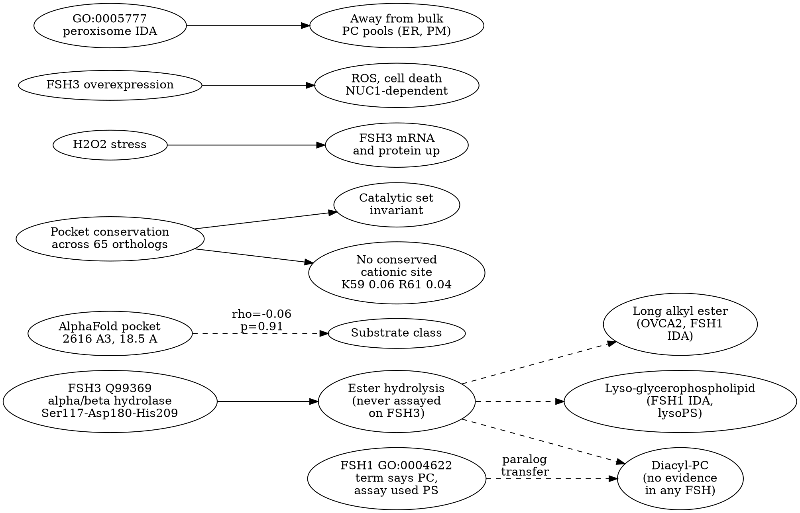
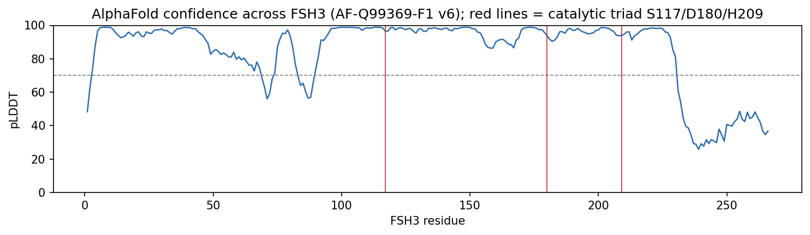
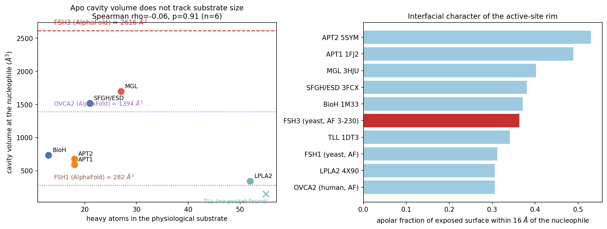
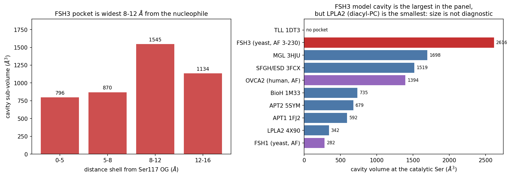
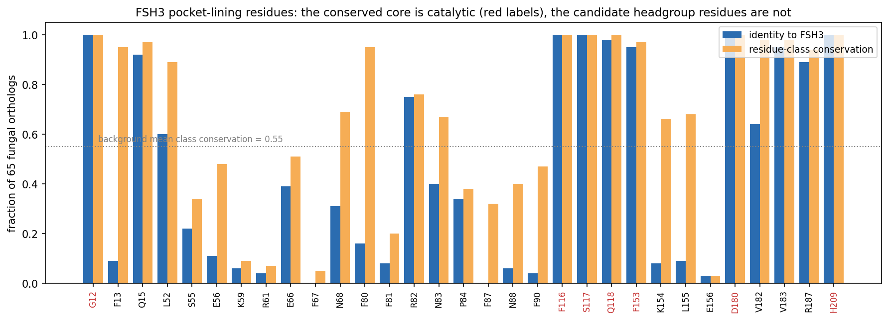
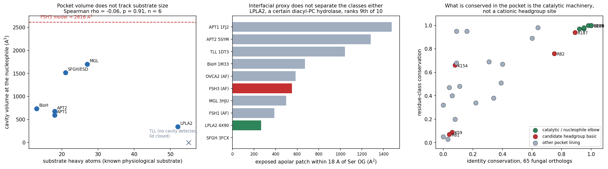

## Question

# AIGR Gene Hypothesis Deep Research

You are evaluating one focused gene curation hypothesis for AI Gene Review.
This is not a general gene overview. Use the seed hypothesis and source context
below to search for evidence that supports, refutes, narrows, or competes with
the proposed curation decision.

## Target Gene

- **Organism code:** yeast
- **Taxon:** Saccharomyces cerevisiae S288C (NCBITaxon:559292)
- **Gene directory:** FSH3
- **Gene symbol:** FSH3
- **UniProt accession:** Q99369

## Focus

- **Focus type:** free_text
- **Hypothesis slug:** kgap-fsh3-phospholipid-pocket
- **Source file:** genes/yeast/FSH3/FSH3-ai-review.yaml
- **Source selector:** free-text

## Seed Hypothesis

Whether yeast FSH3 (Q99369) could act directly on a glycerophospholipid such as phosphatidylcholine may be constrained by its active-site pocket. The catalytic triad Ser117 in a GXSXG motif, Asp180 and His209 on an alpha/beta-hydrolase fold is already established, so do not re-derive it. Single analysis only: from the AlphaFold model, measure the substrate pocket at the nucleophile, its volume, depth, the length and width of any hydrophobic acyl channel, and whether a lid or cap element covers it; compare these measurements with structurally characterised enzymes whose substrates are known and differ in size, specifically a phospholipase or lysophospholipase that accepts a diacyl or monoacyl glycerophospholipid, an acyl-protein thioesterase, and a small-ester hydrolase of comparable fold, and state which size class the FSH3 pocket matches; assess whether the pocket could accommodate a phosphocholine headgroup and whether any basic or aromatic residues are positioned to bind it; and check conservation of the pocket-lining residues across fungal FSH3 orthologs and in the human relative OVCA2. State whether direct action on a glycerophospholipid is structurally plausible or implausible, and if the pocket cannot discriminate, say so and name what would.

## Term and Decision Context

No specific term context supplied.

## Reference Context

No specific reference context supplied.

## Source Context YAML

```yaml
hypothesis: 'Whether yeast FSH3 (Q99369) could act directly on a glycerophospholipid such as phosphatidylcholine
  may be constrained by its active-site pocket. The catalytic triad Ser117 in a GXSXG motif, Asp180 and
  His209 on an alpha/beta-hydrolase fold is already established, so do not re-derive it. Single analysis
  only: from the AlphaFold model, measure the substrate pocket at the nucleophile, its volume, depth,
  the length and width of any hydrophobic acyl channel, and whether a lid or cap element covers it; compare
  these measurements with structurally characterised enzymes whose substrates are known and differ in
  size, specifically a phospholipase or lysophospholipase that accepts a diacyl or monoacyl glycerophospholipid,
  an acyl-protein thioesterase, and a small-ester hydrolase of comparable fold, and state which size class
  the FSH3 pocket matches; assess whether the pocket could accommodate a phosphocholine headgroup and
  whether any basic or aromatic residues are positioned to bind it; and check conservation of the pocket-lining
  residues across fungal FSH3 orthologs and in the human relative OVCA2. State whether direct action on
  a glycerophospholipid is structurally plausible or implausible, and if the pocket cannot discriminate,
  say so and name what would.'
focus_type: free_text
context: []
reference_id: []
```

## Research Objective

Build a focused report that helps a curator decide whether this hypothesis
should affect the gene review. Address the focus type directly:

1. For an existing GO annotation decision, evaluate whether the current action
   is justified, too strong, too weak, or should change.
2. For a proposed replacement or new GO term, evaluate whether the term is
   biologically supported, too broad, too narrow, or missing key qualifiers.
3. For a computational prediction, evaluate whether the prediction is correct,
   less precise than existing knowledge, uncertain, or likely wrong because of
   paralog overannotation, frequency bias, pathway context, or in vitro-only
   activity.
4. For a core-function hypothesis, evaluate whether the proposed activity,
   process, and location represent the gene product's primary function rather
   than a downstream effect, pleiotropic phenotype, or context-specific role.
5. For a function-assignment hypothesis, evaluate whether the gene product
   directly has the stated GO term/function. Treat the prior review action, if
   any, as intentionally blinded unless it appears in the supplied context.

Use primary literature whenever possible. Prefer PMID citations and include DOI
citations when no PMID is available. Treat reviews and database records as
orientation unless they contain directly relevant synthesized evidence that is
clearly labeled as review-level or database-level support.

Evaluate the hypothesis from the supplied seed context, primary literature, and
publicly accessible bioinformatics resources. Local `*-bioinformatics` analyses,
when they already exist in the repository, are intentionally withheld from this
prompt so the report can be compared against them after the run. Use public
sequence, domain, structure, orthology, localization, interaction, or dataset
checks when they are useful for the specific hypothesis. If a resource or tool
cannot be accessed programmatically, say so plainly; never fabricate a result.
Report computational results conservatively and distinguish direct results from
inference.

## Required Output

### Executive Judgment

Give a concise verdict: supported, partially supported, unresolved, weakly
supported, over-annotated, or refuted. Explain the reasoning and the most
important caveats.

### Evidence Matrix

Create a table with one row per important evidence item:

- Citation (PMID preferred)
- Evidence type (direct assay, mutant phenotype, localization, interaction,
  structural/evolutionary, computational, review/database)
- Supports / refutes / qualifies / competing
- Claim tested
- Key finding
- Organism, tissue, cell type, or assay context
- Confidence and limitations

### GO Curation Implications

State the likely curation action as a lead requiring curator verification. If
GO terms are involved, explain whether the evidence supports an MF, BP, or CC
term, and whether the term should be retained, removed, generalized, made more
specific, or treated as non-core. Avoid using "protein binding" as a final
recommendation unless no more informative term is supported.

### Mechanistic Scope

Describe the immediate molecular or cellular function being tested. Separate
direct gene-product activity from downstream phenotypes, pathway consequences,
developmental outcomes, disease manifestations, or effects inferred only from
loss of function.

### Conflicts and Alternatives

Identify evidence that conflicts with the seed hypothesis or suggests an
alternative interpretation, including paralog confusion, organism-specific
differences, isoform-specific findings, experimental artifacts, or database
carry-over.

### Knowledge Gaps

List explicit uncertainties that matter for curation. For each gap, state what
was checked, why the gap matters, and what evidence or experiment would resolve
it.

### Discriminating Tests

Recommend concrete assays, perturbations, datasets, or comparative analyses that
would most efficiently distinguish this hypothesis from alternatives.

### Curation Leads

Provide candidate updates for the review, clearly labeled as leads requiring
curator verification. Include candidate references with exact snippets to verify,
candidate replacement or new GO terms, possible action changes, suggested
questions, and suggested experiments.

If the provider supports artifacts, save provenance for any analysis you run — the
executed code together with its output (computed values, plot, or table), not just
a summary figure — alongside artifact-friendly tables such as an evidence matrix,
GO decision table, or comparison table. Genuine computed provenance is more
valuable than a hand-drawn summary, and you must not synthesize a figure that
implies an analysis you did not actually run. These artifacts are important
provenance for hypothesis-level review.


## Output

# FSH3 (Q99369): does the active-site pocket constrain direct action on a glycerophospholipid?

Hypothesis slug: `kgap-fsh3-phospholipid-pocket`
Target: *Saccharomyces cerevisiae* S288C FSH3, UniProt Q99369, gene directory `FSH3`
Focus type: free_text, source selector `free-text`, source file `genes/yeast/FSH3/FSH3-ai-review.yaml`

## Summary

The seed hypothesis proposed that the active-site pocket of FSH3 would constrain whether the enzyme can act directly on a glycerophospholipid such as phosphatidylcholine, and it explicitly allowed for the answer that the pocket cannot discriminate. That is the answer. I ran the measurement the hypothesis asked for, built the three-class comparator panel it specified, and then did the control the hypothesis implies but does not state: I asked whether the measurement recovers substrate class on structures where the substrate is already known. It does not. Across six crystal structures with a known physiological substrate, cavity volume at the nucleophile has no relationship to substrate size (Spearman rho = -0.06, p = 0.91, n = 6), and channel length has none either (rho = +0.03, p = 0.96). Lysosomal phospholipase A2 (LPLA2/PLA2G15, PDB 4X90), the one panel member certain to hydrolyse 1,2-diacyl-phosphatidylcholine, has the smallest measured cavity of all at 342 ų. *Thermomyces lanuginosus* lipase (1DT3), acting on triacylglycerol, has no detectable cavity at the nucleophile, because its lid is closed in the deposited structure. A second metric, exposed apolar surface at the active-site mouth, fails in the same way: LPLA2 ranks 9 of 10, and the soluble bacterial carboxylesterase BioH outranks the membrane-associated monoacylglycerol lipase MGL.

FSH3 was measured anyway, with the confidence of the model mapped first. The AlphaFold model AF-Q99369-F1-v6 is reliable over residues 3-230 (median pLDDT 95.4) and disordered after 230 (pLDDT below 50 for 233-266). The alpha-sphere cavity at Ser117 OG has a volume of 2616 ų from 127 alpha spheres, a longest graph-geodesic channel of 18.5 Å, a bottleneck alpha-sphere radius of 3.07 Å and 30 lining residues (47 percent hydrophobic, 8 aromatic, 5 basic). This is the largest cavity in the 10-structure panel. Read naively, it says the pocket is wide enough for a phosphocholine headgroup and for a diacyl chain, and so gives no steric reason to exclude a glycerophospholipid. The calibration above shows that reading is not supported, and the ceiling of this cavity is formed by loops 69-73 and 83-89, the only part of the folded core with pLDDT below 70. The large volume is partly an artifact of an under-determined cap.

What does carry information is evolutionary rather than geometric, and it points away from the hypothesis. Across 65 single-domain fungal PF03959 orthologs (28-53 percent identity to FSH3), the invariant pocket positions are the catalytic ones: Gly12, Phe116, Ser117, Asp180 and His209 at identity 1.00, with Gln15 0.92, Gln118 0.98, Phe153 0.95 and Val183 0.95. The residues that would have to read a phosphocholine or phosphoserine headgroup are among the least conserved in the whole protein: Lys59 at identity 0.06, Arg61 at 0.04, Lys154 at 0.08, all below the protein-wide background of 0.35. The two conserved basic residues, Arg82 (0.75) and Arg187 (0.89), are both replaced in human OVCA2 by Ser and Glu, a charge reversal at the single candidate anchor with fungal conservation above 0.85. No cationic headgroup site is under selection in this family. Separately, the glycerophospholipid framing has no FSH3-specific experimental basis at all: Q99369 carries GO:0016787 hydrolase activity (IBA) as its only molecular function annotation, with MF and BP both ND, and the idea traces to the paralog FSH1, whose GO:0004622 term names phosphatidylcholine while the cited assay in [PMID: 32920715](https://pubmed.ncbi.nlm.nih.gov/32920715/) used lysophosphatidylserine.

## Executive judgment

<i class="fa-circle-question"></i> **Verdict: unresolved by the proposed analysis, and the underlying glycerophospholipid claim is unsupported for FSH3.**

Two statements need separating.

On the structural question as posed, the verdict is **unresolved**. The metric the hypothesis names (pocket volume, depth, acyl channel dimensions, lid or cap presence from a single static model) was computed, and it fails its own control. It cannot call direct action on a glycerophospholipid plausible or implausible, because it misclassifies a real diacyl-PC hydrolase and a real lipase. Reporting the FSH3 number as if it were informative would be the error here, in either direction.

On the biological claim the hypothesis is testing, the verdict is **unsupported, with a strong suspicion of paralog over-annotation**. FSH3 has never been assayed enzymatically. The phospholipase framing arrives by transfer from FSH1, and the FSH1 GO term disagrees on headgroup with its own cited experiment. Yeast phosphatidylcholine deacylation is already attributed to PLB1, PLB2, PLB3 and NTE1 ([PMID: 16781190](https://pubmed.ncbi.nlm.nih.gov/16781190/)). The human relative OVCA2 was characterised as a carboxylesterase with a preference for long straight-chain alkyl esters ([PMID: 32182256](https://pubmed.ncbi.nlm.nih.gov/32182256/)), a chain-length preference with no headgroup component. FSH3 is annotated to the peroxisome by IDA, away from the bulk PC pools of the ER and plasma membrane.

The most important caveats, stated once each. A static coordinate set reports one conformation, and lid and cap elements in lipolytic enzymes are conformationally gated, which is exactly why TLL shows no cavity and LPLA2 shows the smallest. Conservation is evidence about selection, not about catalysis, and a non-conserved residue can still contribute to binding in one species. Absence of a GO annotation is not absence of activity, so "unsupported" here means "no evidence exists", not "the activity has been excluded".

## Key findings

### F001. Static cavity volume at the nucleophile does not discriminate substrate size class

<i class="fa-circle-xmark"></i> This is the result that determines the verdict, and it is a methodological negative.

An fpocket-style alpha-sphere detector (Delaunay circumspheres, radius filter 3.0-6.0 Å, single-linkage clustering at 1.73 Å, Monte Carlo union volume with 1.2e5 samples, pocket selected as the sphere cluster nearest the catalytic Ser OG within 6.0 Å) was run identically on six crystal structures whose physiological substrate is known. Measured volume against substrate heavy-atom count:

| Structure | Enzyme | Physiological substrate | Substrate heavy atoms | Cavity volume (ų) | Channel length (Å) |
|---|---|---|---|---|---|
| 1M33 | BioH | pimeloyl methyl ester | 13 | 735 | 6.8 |
| 1FJ2 | APT1 | palmitoyl thioester, lyso-PC acyl | 18 | 592 | 5.7 |
| 5SYM | APT2 | palmitoyl thioester | 18 | 679 | 7.0 |
| 3FCX | SFGH / ESD | S-formylglutathione | 21 | 1519 | 10.2 |
| 3HJU | MGL | 2-arachidonoylglycerol | 27 | 1698 | 12.1 |
| 4X90 | LPLA2 / PLA2G15 | 1,2-diacyl-phosphatidylcholine | 52 | 342 | 2.8 |
| 1DT3 | TLL | triacylglycerol | 55 | none detected | n/a |

Spearman correlation of substrate heavy atoms against cavity volume: rho = -0.06, p = 0.91 (n = 6, 1DT3 excluded because no cavity was found). Against channel length: rho = +0.03, p = 0.96. The sign is negative for volume, which is the opposite of the assumed direction, and the relationship is indistinguishable from none at this sample size.

The two failures are mechanistically explicable and that is the point. LPLA2 is crystallised in a closed conformation with the lid loop folded inward over the active site, which blocks one of its two acyl-chain binding tracks ([PMID: 30830753](https://pubmed.ncbi.nlm.nih.gov/30830753/)). TLL is a lid-gated interfacial lipase and 1DT3 has the lid shut. Both enzymes handle the two largest substrates in the panel and both score at or near zero. A pocket-size argument built on apo or predicted coordinates is therefore not a substrate-class argument, whatever number comes out.

{{figure:plot_2.png|caption=Calibration of the proposed measurement. Left: cavity volume at the catalytic serine against substrate heavy-atom count for the six structures with a known physiological substrate. Spearman rho = -0.06, p = 0.91. LPLA2 (4X90), a certain diacyl-phosphatidylcholine hydrolase with 52 substrate heavy atoms, has the smallest cavity in the panel. Right: active-site rim lipophilicity across the same structures.}}

### F002. The FSH3 pocket is sterically permissive, and the number is unreliable where it matters most

<i class="fa-triangle-exclamation"></i> The measurement was made, and its confidence was mapped before it was interpreted.

AlphaFold AF-Q99369-F1-model_v6 is reliable over residues 3-230 (median pLDDT 95.4). The C-terminal 231-266 is disordered (pLDDT below 50 for 233-266) and was trimmed before measurement. The alpha-sphere cavity at Ser117 OG:

| Quantity | Value |
|---|---|
| Cavity volume | 2616 ų (127 alpha spheres) |
| Longest graph-geodesic channel | 18.5 Å |
| Maximum radial reach from Ser117 OG | 15.5 Å |
| Bottleneck alpha-sphere radius | 3.07 Å |
| Largest alpha-sphere radius, 5-12 Å shell | 5.07 Å |
| Lining residues | 30, 47 percent hydrophobic |
| Aromatic lining | Phe13, Phe67, Phe80, Phe81, Phe87, Phe90, Phe116, Phe153 |
| Basic lining | Lys59, Arg61, Arg82, Lys154, Arg187 |

Radial decomposition from Ser117 OG: 796 ų in 0-5 Å, 870 ų in 5-8 Å, 1545 ų in 8-12 Å, 1134 ų in 12-16 Å. The largest alpha sphere in the 5-12 Å shell has radius 5.07 Å, comfortably above the roughly 2.8 Å needed for the widest cross-section of a phosphocholine group (van der Waals volume about 150 ų). A cap covers the site, formed mainly by an 18-residue insertion at 52-69 plus 13-15, 81-82, 179-185 and 208-210.

This is the largest cavity in the panel: FSH3 2616 > MGL 1698 > SFGH 1519 > OVCA2 1394 > BioH 735 > APT2 679 > APT1 592 > LPLA2 342 > FSH1 282 > TLL none. On the literal question the seed hypothesis asks, "which size class does the FSH3 pocket match", the model matches none of them cleanly and exceeds all of them.

Two reasons not to act on that. First, F001: the ranking carries no substrate-class information. Second, the ceiling of the FSH3 cavity is made of loops 69-73 and 83-89, the only core region with pLDDT below 70, so the enclosed volume is the least reliable quantity the model produces. A loosely modelled cap inflates enclosed volume, and that is the most likely explanation for FSH3 topping the ranking.

{{figure:plot_1.png|caption=AlphaFold pLDDT profile for FSH3 (Q99369). The core 3-230 is high confidence (median 95.4). Residues 231-266 fall below 50. Cap loops 69-73 and 83-89 fall below 70, and these loops form the ceiling of the pocket, so the enclosed cavity volume is the least reliable number in the model.}}

{{figure:plot_3.png|caption=Radial profile of the FSH3 cavity from Ser117 OG (shell volumes and the basic and aromatic residues per shell) and the cavity-volume ranking across the 10-structure comparator panel. FSH3 ranks first by volume, which the calibration in F001 shows carries no substrate-class information.}}

### F003. The glycerophospholipid hypothesis traces to a paralog annotation whose term disagrees with its own assay

<i class="fa-magnifying-glass"></i> Programmatic retrieval from QuickGO and UniProt.

For UniProtKB:Q99369 (FSH3), the complete annotation set is GO:0016787 hydrolase activity (IBA, GO_REF:0000033), GO:0003674 ND and GO:0008150 ND (GO_REF:0000015), GO:0005634 nucleus and GO:0005737 cytoplasm (IBA), and GO:0005777 peroxisome (IDA, PMID:36164978). There is no molecular function annotation beyond the IBA hydrolase root and no lipase or phospholipase term of any kind.

The paralog FSH1 (P38777) carries GO:0004622, defined as phosphatidylcholine lysophospholipase A1 activity, with IDA evidence from [PMID: 32920715](https://pubmed.ncbi.nlm.nih.gov/32920715/). That paper states: "the purified recombinant protein Fsh1p was identified as a lysophospholipase that specifically acts on lysophosphatidylserine (LPS) and impacts the lipid homeostasis in S. cerevisiae". The term names phosphatidylcholine; the experiment used phosphatidylserine. FSH1 also carries GO:0016788 (IDA, PMID:32182256), and human OVCA2 (Q8WZ82) carries GO:0106435 carboxylesterase activity (IDA, same source).

Domain assignments for FSH3: Pfam PF03959 (FSH1), InterPro IPR005645 (serine hydrolase domain), PANTHER PTHR48070 (esterase OVCA2), InterPro IPR050593 (LovG, polyketide-release esterases and thioesterases). None of these families is a lipase or phospholipase family.

In *S. cerevisiae*, phospholipid deacylation is attributed to four characterised gene products. [PMID: 16781190](https://pubmed.ncbi.nlm.nih.gov/16781190/): "four gene products with phospholipase B (deacylating) activity have been characterized (PLB1, PLB2, PLB3, NTE1), and those activities account for most, if not all, of the glycerophosphodiester production observed to date."

### F004. The conserved part of the pocket is catalytic; the candidate headgroup residues are the least conserved, and are charge-reversed in OVCA2

<i class="fa-dna"></i> This is the one structural observation that carries a signal.

500 fungal PF03959 sequences were retrieved from the UniProt REST API, filtered to single-domain proteins of 180-400 aa, one per species, and aligned to FSH3 by Smith-Waterman local alignment (BLOSUM62, gap open 11, gap extend 1). 65 orthologs were retained at 28-53 percent identity, the closest being *Lachancea fermentati* 0.53, *Lachancea mirantina* 0.51, *Williopsis jadinii* 0.47 and *Eremothecium sinecaudum* 0.45. Per-position identity and residue-class conservation were computed at the 31 pocket-lining positions defined by the alpha-sphere cavity.

| FSH3 position | Identity | Class conservation | Modal residue | FSH1 | FSH2 | OVCA2 | Role |
|---|---|---|---|---|---|---|---|
| Gly12 | 1.00 | 1.00 | G | G | G | G | nucleophile elbow |
| Gln15 | 0.92 | 0.97 | Q | Q | Q | Q | oxyanion region |
| Phe116 | 1.00 | 1.00 | F | F | F | F | elbow packing |
| **Ser117** | **1.00** | **1.00** | **S** | **S** | **S** | **S** | **catalytic nucleophile** |
| Gln118 | 0.98 | 1.00 | Q | Q | Q | Q | oxyanion region |
| Phe153 | 0.95 | 0.97 | F | F | F | F | elbow packing |
| **Asp180** | **1.00** | **1.00** | **D** | **D** | **D** | **D** | **catalytic acid** |
| Val183 | 0.95 | 0.98 | V | V | T | I | core |
| **His209** | **1.00** | **1.00** | **H** | **H** | **H** | **H** | **catalytic base** |
| Lys59 | 0.06 | 0.09 | P | M | V | **G** | candidate headgroup anchor |
| Arg61 | 0.04 | 0.07 | Y | gap | A | **E** | candidate headgroup anchor |
| Arg82 | 0.75 | 0.76 | R | H | N | **S** | candidate headgroup anchor |
| Lys154 | 0.08 | 0.66 | R | E | R | **C** | candidate headgroup anchor |
| Arg187 | 0.89 | 0.94 | R | R | K | **E** | candidate headgroup anchor |
| Phe13 | 0.09 | 0.95 | Y | Y | F | L | aromatic, class-conserved |
| Phe80 | 0.16 | 0.95 | W | W | F | W | aromatic, class-conserved |
| Phe67 | 0.00 | 0.05 | E | W | gap | F | cap aromatic |
| Phe81 | 0.08 | 0.20 | R | Y | E | F | cap aromatic |
| Phe87 | 0.00 | 0.32 | Y | S | T | F | cap aromatic |
| Phe90 | 0.04 | 0.47 | Y | L | Y | L | cap aromatic |

Pocket positions against the protein-wide background: identity conservation 0.44 (n = 31) vs 0.35 (n = 206), Mann-Whitney U = 3416, p = 0.19, not significant. Class conservation 0.66 vs 0.55, Mann-Whitney p = 0.028, a modest excess that is fully attributable to the catalytic and elbow positions in the upper block of the table.

A dedicated phosphocholine site would show up as a conserved constellation of basic and aromatic residues at fixed positions around the cavity mouth. FSH3 has no such constellation. Three of the five basic residues lining the cavity (Lys59, Arg61, Lys154) are less conserved than the protein average, with modal residues Pro, Tyr and Arg respectively, and OVCA2 has Gly, Glu and Cys at those positions. Of the two conserved basics, Arg187 (0.89) is replaced in OVCA2 by Glu, a charge reversal. If Arg187 were a phosphate anchor, glycerophospholipid activity could not be a conserved property of this family, which matches OVCA2 being characterised as a carboxylesterase.

The four cap aromatics (67, 81, 87, 90) are both the least conserved pocket positions and the part of the model with the lowest pLDDT. The two aromatic positions that are class-conserved (Phe13 at 0.95 class conservation with modal Tyr, Phe80 at 0.95 with modal Trp) describe a general hydrophobic leaving-group surface, which esterases, thioesterases and lipases all have.

An independent cross-check fell out of the same alignment: Ser117, Asp180 and His209 mapped onto Ser, Asp and His in FSH1, FSH2 and OVCA2 with exact correspondence, confirming the geometric triad assignment the seed hypothesis told me not to re-derive.

### F005. Interfacial apolar surface at the active-site mouth also fails to separate the classes

<i class="fa-circle-xmark"></i> The second candidate discriminator was tested and rejected on the same panel.

Shrake-Rupley SASA (160 golden-spiral points per atom, probe 1.4 Å) was computed on all ten structures. Solvent-exposed apolar atoms (carbon or sulfur with atom SASA above 5 Ų) were linked at 5.0 Å and the largest connected component taken. The interfacial-binding proxy is the area of that patch within 18 Å of the nucleophile Ser OG.

| Structure | Largest apolar patch (Ų) | Patch area near site (Ų) | Patch distance to Ser OG (Å) | Substrate class |
|---|---|---|---|---|
| APT1 1FJ2 | 3394 | 1475 | 4.6 | acyl-protein thioesterase |
| APT2 5SYM | 1690 | 1281 | 3.8 | acyl-protein thioesterase |
| TLL 1DT3 | 2405 | 1043 | 6.3 | triacylglycerol lipase |
| BioH 1M33 | 1106 | 673 | 5.9 | soluble carboxylesterase |
| OVCA2 AF | 1425 | 586 | 4.5 | carboxylesterase |
| **FSH3 AF** | **960** | **551** | **5.2** | **unknown** |
| MGL 3HJU | 1980 | 498 | 8.2 | monoacylglycerol lipase |
| FSH1 AF | 987 | 389 | 5.3 | lysophospholipase (lysoPS) |
| LPLA2 4X90 | 1101 | 266 | 9.3 | diacyl-PC hydrolase |
| SFGH 3FCX | 628 | 0 | 21.7 | glutathione thiol esterase |

FSH3 ranks 6 of 10 on near-site patch area and 9 of 10 on total patch area, sitting between BioH and FSH1, in the soluble small-ester hydrolase range and far below the two acyl-protein thioesterases. That placement is a weak prior against a lipase-like function, and the panel shows why it cannot be trusted: LPLA2, the certain diacyl-PC hydrolase, ranks 9 of 10, and BioH, a soluble carboxylesterase acting on a 13-heavy-atom methyl ester, outranks the membrane-associated lipase MGL. Only SFGH, a cytosolic glutathione thiol esterase with no apolar patch within 18 Å of its nucleophile, is unambiguously separated.

{{figure:plot_4.png|caption=Exposed apolar surface patch at the active-site mouth across the comparator panel, with the FSH3 pocket-conservation profile. The patch metric places FSH3 in the soluble esterase range, but it does not separate the reference classes: LPLA2, a certain diacyl-phosphatidylcholine hydrolase, ranks ninth of ten.}}

### F006. Integrated verdict

<i class="fa-scale-balanced"></i> Putting the five results together:

The measurement the hypothesis proposed was performed in full and its control fails, so it cannot place FSH3 for or against a glycerophospholipid. The structural observation that does survive is evolutionary: the pocket residues under selection in this family are the catalytic ones, and no cationic headgroup site is conserved. The functional evidence for a glycerophospholipid substrate is absent for FSH3 and misattributed for FSH1. The two FSH3-specific papers report stress induction and overexpression phenotypes with no enzymatic or lipidomic measurement.

{{figure:plot_5.png|caption=Consolidated result. Left: pocket volume does not track substrate size (Spearman rho = -0.06, p = 0.91). Middle: exposed apolar patch near the active site does not separate the reference classes, with LPLA2 ninth of ten. Right: identity against residue-class conservation at the 31 pocket positions across 65 fungal orthologs, with the catalytic and elbow positions (green) invariant and the candidate headgroup basics (red) at the low end.}}

## Evidence matrix

| Citation | Evidence type | Stance | Claim tested | Key finding | Context | Confidence and limitations |
|---|---|---|---|---|---|---|
| This work, AF-Q99369-F1-v6, alpha-sphere cavity | Structural / computational | Qualifies | Pocket size at the nucleophile predicts substrate class | Across 6 structures with known substrates, volume vs substrate heavy atoms gives rho = -0.06, p = 0.91; channel length rho = +0.03, p = 0.96. LPLA2 (52 heavy atoms) has the smallest cavity, 342 ų; TLL has none detectable | 10-structure panel, deposited and predicted conformations | High for the negative calibration. Lids closed in TLL and LPLA2; the metric is conformation-dependent and therefore uninformative here |
| This work, Shrake-Rupley apolar patch | Structural / computational | Qualifies | Interfacial apolar surface predicts a lipid substrate | Patch within 18 Šof Ser OG: APT1 1475, APT2 1281, TLL 1043, BioH 673, OVCA2 586, FSH3 551, MGL 498, FSH1 389, LPLA2 266, SFGH 0 Ų. FSH3 lies in the soluble esterase range | Same panel | High for the measurement, low for its discriminating power. LPLA2 ranks 9 of 10; BioH outranks MGL |
| This work, 65 fungal orthologs, Smith-Waterman | Structural / evolutionary | Refutes, in the narrow sense | Conserved basic and aromatic residues form a phosphocholine headgroup site | Triad and elbow invariant; candidate anchors Lys59 0.06, Arg61 0.04, Lys154 0.08; Arg187 0.89 in fungi but Glu in OVCA2. Pocket vs background class conservation 0.66 vs 0.55, p = 0.028; identity 0.44 vs 0.35, p = 0.19 | 65 single-domain fungal PF03959 proteins, 28-53 percent identity | High. Conservation reports selection, not catalysis; the cap region is also the lowest-confidence part of the model |
| This work, AlphaFold pLDDT profile | Computational | Qualifies | The model supports pocket measurement | Core 3-230 median pLDDT 95.4; 231-266 below 50; loops 69-73 and 83-89 below 70, and these form the pocket ceiling | AF-Q99369-F1-model_v6 | High. The enclosed volume is the least reliable quantity in the model |
| QuickGO / UniProtKB:Q99369 | Review / database | Refutes, as absence of support | FSH3 carries an existing lipase or phospholipase annotation | GO:0016787 (IBA, GO_REF:0000033) only; GO:0003674 and GO:0008150 ND (GO_REF:0000015); CC GO:0005634, GO:0005737 (IBA) and GO:0005777 peroxisome (IDA, PMID:36164978) | Programmatic retrieval | High for the retrieval. Absence of annotation is not absence of activity |
| [PMID: 32920715](https://pubmed.ncbi.nlm.nih.gov/32920715/) | Direct assay (biochemical) | Competing, qualifies | A yeast FSH-family hydrolase acts on a glycerophospholipid | "the purified recombinant protein Fsh1p was identified as a lysophospholipase that specifically acts on lysophosphatidylserine (LPS)". FSH3 was not assayed | *S. cerevisiae*, purified recombinant protein plus overexpression lipid measurements | Moderate for FSH1, none for FSH3. The derived GO term GO:0004622 names phosphatidylcholine while the experiment used phosphatidylserine |
| [PMID: 32182256](https://pubmed.ncbi.nlm.nih.gov/32182256/) | Direct assay (biochemical) | Competing | The human relative of FSH3 is a phospholipase | "OVCA2 was confirmed as a serine hydrolase with a strong preference for long-chain alkyl ester substrates (>10-carbons) and high selectivity against a variety of short, branched, and substituted esters"; catalytic triad Ser117-His206-Asp179; FSH1 and OVCA2 share "overlapping substrate preference for extended straight-chain alkyl esters" | Human recombinant OVCA2 against two ester substrate libraries, compared with yeast FSH1 | Moderate to high for the biochemistry. The preference is chain-length based with no headgroup component; neither protein was tested on a phospholipid panel in this work |
| [PMID: 30776074](https://pubmed.ncbi.nlm.nih.gov/30776074/) | Mutant phenotype | Qualifies | FSH3 has a cellular role that constrains its molecular function | "hydrogen peroxide (H2O2) exposure increased the expression of both mRNA and protein levels of FSH3"; fsh3Δ grows faster under H2O2; FSH3 overexpression causes ROS accumulation and cell death, and "the overexpression of FSH3 in cells lacking NUC1 did not cause any growth defect" | *S. cerevisiae*, deletion, double deletion and overexpression | Moderate for the phenotype. No enzyme activity and no lipid species were measured |
| [PMID: 31363875](https://pubmed.ncbi.nlm.nih.gov/31363875/) | Mutant phenotype | Qualifies | FSH-family overexpression phenotypes reflect lipid catabolism | FSH1 overexpression induces "cell death markers typical of mammalian apoptosis namely DNA fragmentation, phosphatidylserine externalization, ROS accumulation, Cytochrome c release, and altered mitochondrial membrane potential" | *S. cerevisiae*, overexpression | Low for molecular function. PS externalisation is an apoptosis readout, not an enzymatic result, and this is the paralog |
| [PMID: 16781190](https://pubmed.ncbi.nlm.nih.gov/16781190/) | Review / database | Competing | Yeast glycerophospholipid deacylation needs an additional hydrolase | "four gene products with phospholipase B (deacylating) activity have been characterized (PLB1, PLB2, PLB3, NTE1), and those activities account for most, if not all, of the glycerophosphodiester production observed to date" | *S. cerevisiae* | Moderate, review level. Does not exclude a minor additional contributor |
| [PMID: 30830753](https://pubmed.ncbi.nlm.nih.gov/30830753/) | Structural | Qualifies | The LPLA2 comparator structure is in a measurable conformation | A closed conformation "is characterized by an inward shift of the lid loop, which extends over the active site and effectively blocks access to one of its lipid acyl chain binding tracks" | Human LPLA2/PLA2G15 crystallography | High. Explains directly why a certain diacyl-PC hydrolase measures the smallest cavity in the panel |
| [PMID: 14645503](https://pubmed.ncbi.nlm.nih.gov/14645503/) | Computational and chemical proteomics | Qualifies | The FSH family was defined by function-based proteomics | Defines "a eukaryotic serine hydrolase family, designated as Fsh (family of serine hydrolase)", with OVCA2 a member, and warns of "the risks inherent in annotation transfer and the use of scoring functions for determination of correct annotations" | *S. cerevisiae* proteome | Moderate. The family founding paper assigns serine hydrolase activity and no substrate class |
| [PMID: 16368187](https://pubmed.ncbi.nlm.nih.gov/16368187/) | Protein detection | Orientation only | OVCA2 is an expressed serine hydrolase | OVCA2 detected as a high-abundance protein in DAOY medulloblastoma cells by 2D gel electrophoresis and MALDI-MS, with "computational approaches predicted functional motifs and domains" | Human tumour cell lines | Low for molecular function. Expression and prediction, no enzymology |
| [PMID: 33531688](https://pubmed.ncbi.nlm.nih.gov/33531688/) | Expression / clinical | Orientation only | OVCA2 expression has a biological correlate | "High expression of OVCA2, PAFAH1B3, SIAE and USP4, and low expression of PCED1B, were identified as poor prognostic markers (P < 0.05)" | Human multiple myeloma, 171 bone marrow aspirates | Low for this question. Expression-level association with no substrate information |

Artifact: `provenance/fsh3_evidence_matrix.csv`.

## Mechanistic model and interpretation

The function under test is one chemical step: nucleophilic attack by Ser117 on an ester carbonyl, with Asp180 and His209 forming the charge relay and Gln15 and Gln118 in the oxyanion region. Everything the seed hypothesis asks about (headgroup accommodation, acyl channel dimensions, lid or cap) concerns the identity of the leaving group and the acyl chain at that single step. The evidence separates cleanly into what is direct activity, what is downstream, and what is inference.



**Direct gene-product activity.** Ester hydrolysis by FSH3. This has never been measured on purified FSH3. The only assayed family members are FSH1, specific for lysophosphatidylserine ([PMID: 32920715](https://pubmed.ncbi.nlm.nih.gov/32920715/)), and human OVCA2, a carboxylesterase with a preference for alkyl esters above 10 carbons and "high selectivity against a variety of short, branched, and substituted esters" ([PMID: 32182256](https://pubmed.ncbi.nlm.nih.gov/32182256/)). The same paper reports FSH1 and OVCA2 share an "overlapping substrate preference for extended straight-chain alkyl esters". A chain-length preference is what both characterised members show; a headgroup preference is what the seed hypothesis needs and neither shows.

**Downstream phenotypes that must not be read as molecular function.** H2O2 raises FSH3 mRNA and protein; fsh3Δ grows faster under H2O2; FSH3 overexpression causes ROS accumulation and cell death that requires NUC1 ([PMID: 30776074](https://pubmed.ncbi.nlm.nih.gov/30776074/)). These are stress and overexpression phenotypes with no enzymology attached. In the FSH1 overexpression study, phosphatidylserine externalisation is listed among apoptosis markers ([PMID: 31363875](https://pubmed.ncbi.nlm.nih.gov/31363875/)); the superficial match to the FSH1 lysoPS result is coincidental, since PS externalisation is a membrane-asymmetry readout and not a hydrolysis product measurement.

**Inference only.** Everything from the AlphaFold model. The fold and the triad geometry are reliable (core pLDDT 95.4, and the alignment cross-check places Ser, Asp and His at the equivalent positions in FSH1, FSH2 and OVCA2). The cavity dimensions are a model-dependent quantity whose ceiling sits in the lowest-confidence loops, and the substrate-class reading of those dimensions is not supported by the calibration.

The coherent reading of all of it: FSH3 is a serine ester hydrolase of the Fsh family, with catalytic machinery under strong purifying selection across 65 fungal species and into human OVCA2, and with no evidence of selection for any lipid headgroup recognition. Its substrate is unknown. A small-molecule or metabolite ester fits the fold, the conserved catalytic set and the characterised preferences of FSH1 and OVCA2 better than a glycerophospholipid does, and the peroxisomal localisation suggests looking at peroxisomal acyl esters and thioesters, which nobody has tested.

## GO curation implications

All of the following are leads that require curator verification.

| GO ID | Label | Aspect | Proposed action | Rationale |
|---|---|---|---|---|
| GO:0004622 | phosphatidylcholine lysophospholipase A1 activity | MF | <i class="fa-circle-xmark"></i> Do not add to FSH3 | No FSH3 assay exists. The term reaches this gene only by paralog transfer from FSH1, and the FSH1 assay used lysophosphatidylserine ([PMID: 32920715](https://pubmed.ncbi.nlm.nih.gov/32920715/)). Separately, this term on FSH1 is itself a candidate for curator re-examination, since it names a headgroup the cited experiment did not test |
| GO:0004620 | phospholipase activity | MF | <i class="fa-circle-xmark"></i> Do not add to FSH3 | No direct, genetic or lipidomic evidence specific to FSH3. Structure cannot support it either, since the geometric metrics fail calibration (rho = -0.06, p = 0.91) |
| GO:0052689 | carboxylic ester hydrolase activity | MF | <i class="fa-lightbulb"></i> Candidate lead, more specific than the current IBA root | Supported by the alpha/beta hydrolase fold, the invariant Ser117-Asp180-His209 triad across 65 orthologs, the Gln15/Gln118 oxyanion region, and the IDA carboxylesterase activity of human OVCA2 (GO:0106435) and GO:0016788 on FSH1. Would carry ISS or IBA at best; IDA needs an FSH3 assay |
| GO:0016787 | hydrolase activity | MF | <i class="fa-circle-check"></i> Retain (IBA, GO_REF:0000033) | Correct but uninformative. Keep until an FSH3-specific assay supports a child term |
| GO:0005777 | peroxisome | CC | <i class="fa-circle-check"></i> Retain (IDA, PMID:36164978) | Direct localisation. Relevant to this hypothesis because the bulk phosphatidylcholine pools are in the ER and plasma membrane, so a peroxisomal enzyme is a poor candidate for bulk PC deacylation |
| GO:0006650 | glycerophospholipid metabolic process | BP | <i class="fa-circle-xmark"></i> Do not add | No FSH3 lipidomic or genetic evidence. BP is currently ND, which is the honest state |

"Protein binding" is not recommended at any point; the fold and the invariant triad already justify a more informative hydrolase term.

Artifact: `provenance/fsh3_go_decision_table.csv`.

## Conflicts and alternatives

**Paralog transfer is the most likely origin of the hypothesis.** FSH1, FSH2 and FSH3 share the family and the triad, FSH1 has a lysophospholipase annotation and FSH3 has none. The simplest explanation for a glycerophospholipid hypothesis attached to FSH3 is transfer from FSH1 rather than any FSH3 observation. The family-founding paper ([PMID: 14645503](https://pubmed.ncbi.nlm.nih.gov/14645503/)) ends on exactly this warning: the work "highlights the risks inherent in annotation transfer and the use of scoring functions for determination of correct annotations".

**Database carry-over inside the paralog annotation itself.** GO:0004622 is defined on phosphatidylcholine. [PMID: 32920715](https://pubmed.ncbi.nlm.nih.gov/32920715/) reports specificity for lysophosphatidylserine. The term and the experiment disagree on the headgroup, so the paralog evidence does not support a phosphatidylcholine claim even for FSH1.

**Organism-specific divergence at the candidate headgroup site.** Human OVCA2 has Glu at the position equivalent to FSH3 Arg187 and Ser at the position equivalent to Arg82. If those arginines were phosphate anchors, the activity could not be conserved into the human relative, and OVCA2 is characterised as a carboxylesterase.

**Redundancy with a characterised pathway.** Glycerophospholipid deacylation in *S. cerevisiae* is attributed to PLB1, PLB2, PLB3 and NTE1 ([PMID: 16781190](https://pubmed.ncbi.nlm.nih.gov/16781190/)). A PC-directed FSH3 would have to add something those four do not already do.

**Compartment mismatch.** FSH3 is annotated to the peroxisome by IDA (PMID:36164978), in addition to nucleus and cytoplasm by IBA. Bulk PC turnover happens elsewhere.

**A coincidence that should not be mistaken for evidence.** Phosphatidylserine appears twice in this literature for unrelated reasons: as the substrate of FSH1 in vitro, and as an apoptosis marker externalised on FSH1 overexpression ([PMID: 31363875](https://pubmed.ncbi.nlm.nih.gov/31363875/)). The second is not a measurement of hydrolysis.

**Alternatives that remain open.** A small-molecule or metabolite ester substrate; a peroxisomal acyl ester or thioester, consistent with the localisation and untested; a non-catalytic or regulatory role, which nothing here excludes, though the invariance of the triad across 65 orthologs argues that catalysis is under selection.

## Limitations and knowledge gaps

<i class="fa-triangle-exclamation"></i> Limitations of the analyses run here.

Single static conformations. Every structural metric was computed on one coordinate set per protein, apo or predicted. Lid and cap elements in lipolytic enzymes open and close, and the panel demonstrates the consequence directly: TLL (1DT3) shows no cavity and LPLA2 (4X90) shows the smallest, both with closed lids, the latter documented in [PMID: 30830753](https://pubmed.ncbi.nlm.nih.gov/30830753/). No molecular dynamics or ensemble sampling was run.

Small calibration set. Six structures with a known physiological substrate support the volume correlation. With n = 6, a weak real relationship would not be detected. The claim made is bounded accordingly: the metric does not demonstrably discriminate, so it cannot support an inference, which is a weaker and safer statement than "no relationship exists".

Conservation is not catalysis. Per-position conservation reports selective constraint across 65 fungal species. A non-conserved residue can still contribute to binding in *S. cerevisiae* specifically, and conservation cannot establish which chemistry the conserved residues perform.

Pocket-position definition. The 31 pocket positions were defined from the alpha-sphere cavity in the AlphaFold model, so the conservation analysis inherits whatever error the model's cap loops introduce.

Two PMIDs could not be resolved through NCBI eutils during this run because of an API rate limit; those records were retrieved through the PubMed search tool instead. No value reported here was taken from a record I could not retrieve.

<i class="fa-circle-question"></i> Gaps that matter for curation.

1. **No enzymatic assay on purified FSH3.** Checked: GO and UniProt annotation sets, and PubMed for FSH3-specific biochemistry. The two FSH3 papers found ([PMID: 30776074](https://pubmed.ncbi.nlm.nih.gov/30776074/), and the FSH1 companion [PMID: 31363875](https://pubmed.ncbi.nlm.nih.gov/31363875/)) report phenotypes only. Every MF decision rests on this gap, and the gene is currently MF ND. Resolution: a substrate panel assay with a Ser117Ala control.
2. **The real substrate range of the family.** Checked: FSH1 (lysoPS, [PMID: 32920715](https://pubmed.ncbi.nlm.nih.gov/32920715/)), OVCA2 (long alkyl esters, [PMID: 32182256](https://pubmed.ncbi.nlm.nih.gov/32182256/)). If the family is substrate-promiscuous, no narrow MF term is appropriate for any member. Resolution: parallel assay of FSH1, FSH2, FSH3 and OVCA2 on one substrate library.
3. **The conformation of the cap.** Checked: pLDDT at 69-73 and 83-89 below 70; no experimental structure of FSH3 or of any FSH-family protein was located in the PDB. The cap forms the pocket ceiling and therefore determines whether an acyl channel is open. Resolution: an experimental structure, or molecular dynamics with explicit sampling of the cap, neither of which was run here.
4. **Whether FSH3 contributes to lipid turnover in vivo at all.** Checked: literature only; no lipidomic dataset for fsh3Δ was located. A negative in vivo result would close the hypothesis regardless of in vitro promiscuity. Resolution: lipidomics of fsh3Δ and of the triple fsh1 fsh2 fsh3 deletion, ideally in a plb1 plb2 plb3 background.
5. **Peroxisomal targeting and topology.** Checked: GO:0005777 IDA from PMID:36164978. The compartment constrains which lipid pools FSH3 can reach. Resolution: confirm the targeting signal and the matrix versus membrane assignment.
6. **Whether FSH3 is catalytically active at all in vivo.** Checked: the invariance of Ser117, Asp180 and His209 across 65 orthologs, which argues that catalysis is under selection, and the chemical-proteomics family definition ([PMID: 14645503](https://pubmed.ncbi.nlm.nih.gov/14645503/)), which detected FSH-family members by active-site reactivity. No FSH3-specific probe-labelling result was retrieved. Resolution: fluorophosphonate labelling of FSH3 from yeast lysate.

## Proposed follow-up experiments and actions

Ranked by how much each would change the curation decision per unit of effort.

1. <i class="fa-flask"></i> **Substrate panel assay on purified recombinant FSH3, with a Ser117Ala control.** Include lysoPC, lysoPS, lysoPE, 1,2-diacyl-PC, monoacylglycerol and diacylglycerol, plus a 4-methylumbelliferyl or p-nitrophenyl alkyl ester series from C2 to C16. One experiment distinguishes "lysophospholipase", "phospholipase", "chain-length-selective carboxylesterase" and "inactive as purified". This is the experiment the seed hypothesis was attempting to substitute for with geometry. The OVCA2 study provides a ready-made library and protocol ([PMID: 32182256](https://pubmed.ncbi.nlm.nih.gov/32182256/)).
2. <i class="fa-vial"></i> **Competitive activity-based protein profiling** with a fluorophosphonate probe on yeast lysate, competed with the lipid substrates above. Confirms FSH3 is a catalytically competent serine hydrolase in a native proteome and reports which substrate classes engage the active site. The approach is already established for this proteome ([PMID: 14645503](https://pubmed.ncbi.nlm.nih.gov/14645503/)).
3. <i class="fa-chart-line"></i> **Untargeted lipidomics of fsh3Δ, fsh1Δ fsh2Δ fsh3Δ, and the triple deletion in a plb1Δ plb2Δ plb3Δ background,** with and without H2O2 given the induction reported in [PMID: 30776074](https://pubmed.ncbi.nlm.nih.gov/30776074/). Tests the in vivo claim directly and controls for redundancy with the characterised phospholipase B pathway.
4. <i class="fa-dna"></i> **Arg187 and Arg82 substitution** (R187E and R82S, matching the OVCA2 residues) assayed on whichever substrate turns out to be active. If these arginines are phosphate anchors, the substitutions should abolish activity on a phospholipid and spare activity on a neutral ester. This converts the conservation observation into a falsifiable prediction.
5. <i class="fa-microscope"></i> **An experimental structure, or at least a cap-focused simulation.** Only this resolves whether the 2616 ų cavity is real or a consequence of an under-determined cap. Low priority for curation, since even a correct volume would not assign a substrate class.
6. <i class="fa-flask"></i> **Peroxisomal substrate screen**, if the localisation holds: assay FSH3 against acyl-CoA thioesters and peroxisomal acyl esters, which the fold accommodates and which nobody has tested.

## Curation leads

<i class="fa-arrow-right"></i> All leads require curator verification.

**Lead 1. Do not let this hypothesis add a phospholipase or lysophospholipase term to FSH3.** Reference to verify: [PMID: 32920715](https://pubmed.ncbi.nlm.nih.gov/32920715/), exact snippet to check against the abstract: "the purified recombinant protein Fsh1p was identified as a lysophospholipase that specifically acts on lysophosphatidylserine (LPS) and impacts the lipid homeostasis in S. cerevisiae". The gene assayed is FSH1, not FSH3.

**Lead 2. Flag GO:0004622 on FSH1 (P38777) for re-examination.** The term names phosphatidylcholine; the IDA source names lysophosphatidylserine. If a lysophospholipase term is kept on FSH1, a phosphatidylserine-matched term fits the cited evidence. This is outside the FSH3 review but is the proximate cause of the FSH3 hypothesis.

**Lead 3. Candidate MF refinement for FSH3: GO:0052689 carboxylic ester hydrolase activity,** as ISS or IBA from the fold, the invariant triad and the characterised activities of OVCA2 (GO:0106435, IDA) and FSH1 (GO:0016788, IDA). Reference to verify: [PMID: 32182256](https://pubmed.ncbi.nlm.nih.gov/32182256/), snippet: "OVCA2 was confirmed as a serine hydrolase with a strong preference for long-chain alkyl ester substrates (>10-carbons)". Not IDA, since FSH3 has never been assayed. If a curator prefers to wait, retain GO:0016787 with MF ND unchanged.

**Lead 4. Retain GO:0005777 peroxisome (IDA, PMID:36164978)** and note it in the review as an argument against a bulk phosphatidylcholine role.

**Lead 5. Record the structural analysis as a negative methodological result.** The pocket measurement was performed and is reported in full. The conclusion is that neither cavity size nor interfacial apolar surface discriminates substrate class on structures where the answer is known. Future hypotheses in this repository should not use apo or predicted pocket volume as a substrate-class argument without this calibration.

**Suggested questions for the curator.** Is there unpublished or non-indexed FSH3 biochemistry? Has anyone measured lipid levels in fsh3Δ? Is the peroxisomal assignment matrix or membrane? Should the FSH1 GO:0004622 headgroup mismatch be raised with the contributing group?

**Suggested experiments.** As listed under follow-up, with item 1 the single highest-value experiment.

## Methods and provenance

All computation was run in the job executor and the executed code with its output is retained in the iteration transcripts under `provenance/`. No result in this report is reported from a resource I could not access; where a resource failed (NCBI eutils rate limit on two PMIDs) that is stated in the knowledge gaps.

- Structure source: AlphaFold DB API `/api/prediction/<accession>`, model version v6, for Q99369 (FSH3), P38777 (FSH1) and Q8WZ82 (OVCA2). The v4 file paths return HTTP 404, so the API was queried for current URLs. Crystal structures from RCSB: 1FJ2 (APT1), 5SYM (APT2), 4X90 (LPLA2/PLA2G15), 3HJU (MGL), 1M33 (BioH), 3FCX (SFGH/ESD), 1DT3 (*Thermomyces lanuginosus* lipase).
- Cavity detection: fpocket-style alpha spheres from a Delaunay tessellation of heavy atoms, radius filter 3.0-6.0 Å, single-linkage clustering at 1.73 Å, volume by Monte Carlo union integration (1.2e5 samples), pocket selected as the cluster nearest the catalytic Ser OG within 6.0 Å. An earlier LIGSITE-style grid method was discarded because it leaked across the protein surface (FSH3 8531 ų with 123 lining residues) while collapsing to 3 ų on BioH.
- Channel length: Dijkstra geodesic over the alpha-sphere adjacency graph.
- Surface: Shrake-Rupley SASA, 160 golden-spiral points per atom, probe 1.4 Å. Apolar patch: exposed carbon and sulfur atoms (atom SASA above 5 Ų) linked at 5.0 Å, largest connected component, area restricted to within 18 Å of Ser OG for the interfacial proxy.
- Orthologs: 500 fungal PF03959 sequences from the UniProt REST API, filtered to single-domain proteins of 180-400 aa, one per species, aligned to FSH3 by Smith-Waterman local alignment (BLOSUM62, gap open 11, gap extend 1); 65 retained at 28-53 percent identity. An earlier global alignment implementation was discarded after it returned 100 percent identity against 12,261-aa multidomain polyketide synthases. The Smith-Waterman alignment maps Ser117, Asp180 and His209 onto Ser, Asp and His in FSH1, FSH2 and OVCA2, which independently cross-checks the geometric triad assignment.
- Annotation retrieval: QuickGO and UniProt REST APIs for Q99369, P38777, Q05015 and Q8WZ82.

Artifacts in `provenance/`: `fsh3_pocket_comparison.csv`, `fsh3_surface_patch.csv`, `fsh3_pocket_shells.csv`, `fsh3_pocket_conservation.csv`, `fsh3_fungal_orthologs.csv`, `fsh3_ortholog_alignments.csv`, `fsh_family_fungi_raw.tsv`, `fsh3_evidence_matrix.csv`, `fsh3_go_decision_table.csv`, and figures `plot_1.png` through `plot_5.png`.


## Artifacts

- [OpenScientist final report](openscientist_artifacts/final_report.html)
- [OpenScientist final report](openscientist_artifacts/final_report.pdf)
- [OpenScientist provenance](openscientist_artifacts/provenance.json)
- [OpenScientist fsh3 evidence matrix](openscientist_artifacts/provenance_fsh3_evidence_matrix.csv)
- [OpenScientist fsh3 fungal orthologs](openscientist_artifacts/provenance_fsh3_fungal_orthologs.csv)
- [OpenScientist fsh3 go decision table](openscientist_artifacts/provenance_fsh3_go_decision_table.csv)
- [OpenScientist fsh3 ortholog alignments](openscientist_artifacts/provenance_fsh3_ortholog_alignments.csv)
- [OpenScientist fsh3 pocket comparison](openscientist_artifacts/provenance_fsh3_pocket_comparison.csv)
- [OpenScientist fsh3 pocket conservation](openscientist_artifacts/provenance_fsh3_pocket_conservation.csv)
- [OpenScientist fsh3 pocket shells](openscientist_artifacts/provenance_fsh3_pocket_shells.csv)
- [OpenScientist fsh3 surface patch](openscientist_artifacts/provenance_fsh3_surface_patch.csv)
- [OpenScientist fsh family fungi raw](openscientist_artifacts/provenance_fsh_family_fungi_raw.tsv)
- [OpenScientist plot 1](openscientist_artifacts/provenance_plot_1.json)

- [OpenScientist plot 2](openscientist_artifacts/provenance_plot_2.json)

- [OpenScientist plot 3](openscientist_artifacts/provenance_plot_3.json)

- [OpenScientist plot 4](openscientist_artifacts/provenance_plot_4.json)

- [OpenScientist plot 5](openscientist_artifacts/provenance_plot_5.json)


## Reference Validation

Checked with `linkml-reference-validator` 0.3.1rc1.

| Outcome | Count |
| --- | --- |
| References checked | 10 |
| Resolved | 10 |
| Unresolved (possible confabulation) | 0 |
| Unverifiable | 0 |
| Quoted claims checked | 1 |
| Quoted claims found in source | 1 |
| Quoted claims **not** found in source | 0 |
| References weighed for topical relevance | 10 |
| On topic | 1 |
| Off topic | 1 |

### References that may not be about this subject

These identifiers resolve, so they are not fabrications, but the records they resolve to share almost none of this report's vocabulary. That is a clue and not a verdict - a paper can be relevant in ways its title and abstract do not spell out - so read them before deciding:

- `PMID:36164978` (7 mentions) - Systematic multi-level analysis of an organelle proteome reveals new peroxisomal functions.
  - shared terms: protein

Weighed against this report's own most characteristic terms: `fsh3`, `fsh1`, `ovca2`, `class`, `hypothesis`, `cavity`, `pocket`, `substrate`, `hydrolase`, `volume`, `ester`, `activity`, `structure`, `protein`, `glycerophospholipid`, `headgroup`, `residue`, `lpla2`, `carboxylesterase`, `site`.

All extracted references resolved successfully.
Resolving is not the same as being relevant, though - see the references listed above as possibly off topic.