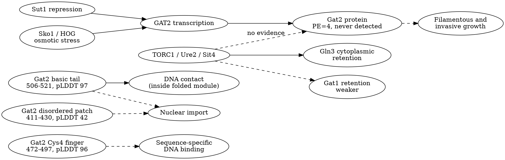
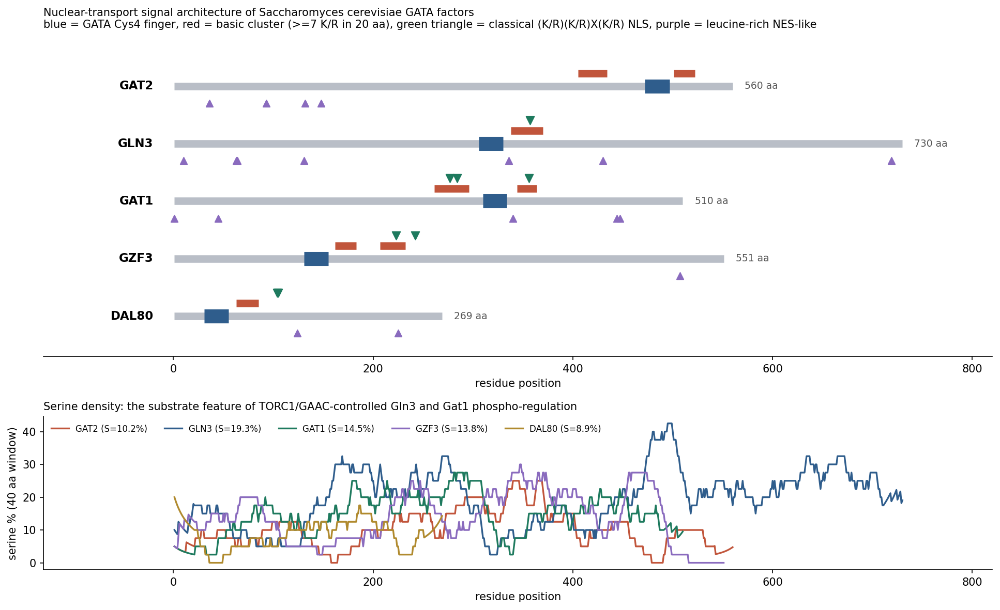
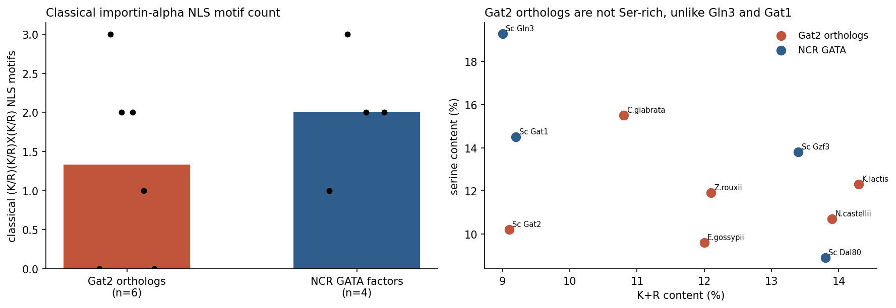
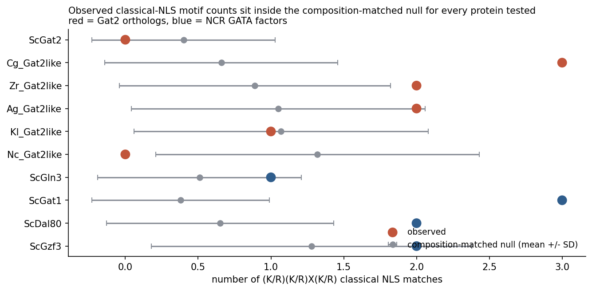
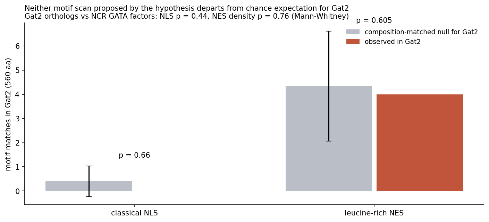

## Question

# AIGR Gene Hypothesis Deep Research

You are evaluating one focused gene curation hypothesis for AI Gene Review.
This is not a general gene overview. Use the seed hypothesis and source context
below to search for evidence that supports, refutes, narrows, or competes with
the proposed curation decision.

## Target Gene

- **Organism code:** yeast
- **Taxon:** Saccharomyces cerevisiae S288C (NCBITaxon:559292)
- **Gene directory:** GAT2
- **Gene symbol:** GAT2
- **UniProt accession:** P40209

## Focus

- **Focus type:** free_text
- **Hypothesis slug:** kgap-gat2-nuclear-transport-signals
- **Source file:** genes/yeast/GAT2/GAT2-ai-review.yaml
- **Source selector:** free-text

## Seed Hypothesis

Saccharomyces cerevisiae Gat2 (UniProt P40209), a GATA transcription factor, carries nuclear-localization signals and lacks the TORC1-regulated cytoplasmic-retention features of Gln3 and Gat1. Single analysis only: scan Gat2 for classical mono/bipartite NLSs and for the Gln3/Gat1 regulatory elements (the Ure2-binding region, the TORC1-responsive serine-rich and NES-like segments mapped in Gln3/Gat1), aligning Gat2 with Gln3, Gat1 and Dal80 and orthologs in other Saccharomycetaceae; state whether Gat2 is predicted to be constitutively nuclear or to have Gln3/Gat1-type regulated nucleocytoplasmic partitioning.

## Term and Decision Context

No specific term context supplied.

## Reference Context

No specific reference context supplied.

## Source Context YAML

```yaml
hypothesis: 'Saccharomyces cerevisiae Gat2 (UniProt P40209), a GATA transcription factor, carries nuclear-localization
  signals and lacks the TORC1-regulated cytoplasmic-retention features of Gln3 and Gat1. Single analysis
  only: scan Gat2 for classical mono/bipartite NLSs and for the Gln3/Gat1 regulatory elements (the Ure2-binding
  region, the TORC1-responsive serine-rich and NES-like segments mapped in Gln3/Gat1), aligning Gat2 with
  Gln3, Gat1 and Dal80 and orthologs in other Saccharomycetaceae; state whether Gat2 is predicted to be
  constitutively nuclear or to have Gln3/Gat1-type regulated nucleocytoplasmic partitioning.'
focus_type: free_text
context: []
reference_id: []
```

## Research Objective

Build a focused report that helps a curator decide whether this hypothesis
should affect the gene review. Address the focus type directly:

1. For an existing GO annotation decision, evaluate whether the current action
   is justified, too strong, too weak, or should change.
2. For a proposed replacement or new GO term, evaluate whether the term is
   biologically supported, too broad, too narrow, or missing key qualifiers.
3. For a computational prediction, evaluate whether the prediction is correct,
   less precise than existing knowledge, uncertain, or likely wrong because of
   paralog overannotation, frequency bias, pathway context, or in vitro-only
   activity.
4. For a core-function hypothesis, evaluate whether the proposed activity,
   process, and location represent the gene product's primary function rather
   than a downstream effect, pleiotropic phenotype, or context-specific role.
5. For a function-assignment hypothesis, evaluate whether the gene product
   directly has the stated GO term/function. Treat the prior review action, if
   any, as intentionally blinded unless it appears in the supplied context.

Use primary literature whenever possible. Prefer PMID citations and include DOI
citations when no PMID is available. Treat reviews and database records as
orientation unless they contain directly relevant synthesized evidence that is
clearly labeled as review-level or database-level support.

Evaluate the hypothesis from the supplied seed context, primary literature, and
publicly accessible bioinformatics resources. Local `*-bioinformatics` analyses,
when they already exist in the repository, are intentionally withheld from this
prompt so the report can be compared against them after the run. Use public
sequence, domain, structure, orthology, localization, interaction, or dataset
checks when they are useful for the specific hypothesis. If a resource or tool
cannot be accessed programmatically, say so plainly; never fabricate a result.
Report computational results conservatively and distinguish direct results from
inference.

## Required Output

### Executive Judgment

Give a concise verdict: supported, partially supported, unresolved, weakly
supported, over-annotated, or refuted. Explain the reasoning and the most
important caveats.

### Evidence Matrix

Create a table with one row per important evidence item:

- Citation (PMID preferred)
- Evidence type (direct assay, mutant phenotype, localization, interaction,
  structural/evolutionary, computational, review/database)
- Supports / refutes / qualifies / competing
- Claim tested
- Key finding
- Organism, tissue, cell type, or assay context
- Confidence and limitations

### GO Curation Implications

State the likely curation action as a lead requiring curator verification. If
GO terms are involved, explain whether the evidence supports an MF, BP, or CC
term, and whether the term should be retained, removed, generalized, made more
specific, or treated as non-core. Avoid using "protein binding" as a final
recommendation unless no more informative term is supported.

### Mechanistic Scope

Describe the immediate molecular or cellular function being tested. Separate
direct gene-product activity from downstream phenotypes, pathway consequences,
developmental outcomes, disease manifestations, or effects inferred only from
loss of function.

### Conflicts and Alternatives

Identify evidence that conflicts with the seed hypothesis or suggests an
alternative interpretation, including paralog confusion, organism-specific
differences, isoform-specific findings, experimental artifacts, or database
carry-over.

### Knowledge Gaps

List explicit uncertainties that matter for curation. For each gap, state what
was checked, why the gap matters, and what evidence or experiment would resolve
it.

### Discriminating Tests

Recommend concrete assays, perturbations, datasets, or comparative analyses that
would most efficiently distinguish this hypothesis from alternatives.

### Curation Leads

Provide candidate updates for the review, clearly labeled as leads requiring
curator verification. Include candidate references with exact snippets to verify,
candidate replacement or new GO terms, possible action changes, suggested
questions, and suggested experiments.

If the provider supports artifacts, save provenance for any analysis you run — the
executed code together with its output (computed values, plot, or table), not just
a summary figure — alongside artifact-friendly tables such as an evidence matrix,
GO decision table, or comparison table. Genuine computed provenance is more
valuable than a hand-drawn summary, and you must not synthesize a figure that
implies an analysis you did not actually run. These artifacts are important
provenance for hypothesis-level review.


## Output

# Gat2 (P40209) nuclear-transport signals: hypothesis deep research report

**Hypothesis slug:** `kgap-gat2-nuclear-transport-signals`
**Source:** `genes/yeast/GAT2/GAT2-ai-review.yaml`, free-text selector
**Target:** *Saccharomyces cerevisiae* S288C Gat2 / YMR136W, UniProt P40209 (NCBITaxon:559292)
**Iterations completed:** 3. **Findings recorded:** 7. **Papers reviewed:** 16.

## Summary

The seed hypothesis makes two claims about Gat2 and proposes one analysis to settle them. The analysis does not work, and the comparator the hypothesis uses is itself composite. The verdict is **unresolved, with the proposed analysis refuted on methodological grounds**. Neither "constitutively nuclear" nor "Gln3/Gat1-type regulated nucleocytoplasmic partitioning" should be entered into the Gat2 review as a prediction.

Gat2 has zero matches to the classical importin-alpha consensus (K/R)(K/R)X(K/R). That looked informative at first, because Gat1 has three and Gzf3 and Dal80 have two each. A composition-matched randomisation test (10,000 within-sequence permutations) showed the opposite: zero is the single most likely outcome for a 560-residue protein of Gat2's amino-acid composition (null mean 0.40 ± 0.63, P(null ≤ observed) = 0.66). Every protein tested, including Gln3 and Gat1, fell inside its own null. Across the five Saccharomycetaceae Gat2 orthologs the count varies 0-3 with no conservation, and Gat2 orthologs do not differ from NCR GATA factors (Mann-Whitney U = 8.0, p = 0.437 on raw counts; U = 6.0, p = 0.240 per 100 aa). The leucine-rich Crm1/Xpo1 NES scan behaves the same way: ScGat2 observed 4 against a null of 4.34 ± 2.27 (p = 0.605), group comparison U = 10.0, p = 0.762. The single bipartite-consensus match in Gat2, 506-521 `KKFGSKSSNLLLRYRR`, lies inside the folded zinc-finger module (AlphaFold AF-P40209 mean pLDDT 97.2 over 501-522), so it is the DNA-contacting basic tail of the GATA finger, not a solvent-exposed targeting signal. Serine richness is also a weak discriminator: the maximum Ser fraction in a 50-aa window is 22.0% for ScGat2 but 34.0% for the *C. glabrata* ortholog, against 36.0% for Gln3. All four scans the hypothesis names fail.

Two further results reframe the question. First, Gat2 is not a Gln3/Gat1 paralog. Its Cys4 finger has an 18-residue loop with an `EWRxGPxG` signature, against a 17-residue `PLWRR` loop shared by all four nitrogen-catabolite-repression (NCR) factors, and full-length Smith-Waterman places its five orthologs at 236-337 against Gat2 versus 143 for Gln3 and 129 for Gat1. Its nearest characterised *S. cerevisiae* relatives are Srd1 (P09007) and Ecm23 (Q02710). Second, the whole subfamily is uncharacterised at protein level: Gat2 and all five orthologs are UniProt PE=4 (Predicted), UniProt P40209 has no SUBCELLULAR LOCATION comment, SGD holds 0 protein_experiment records for GAT2, none of its 15 physical interactions involve Ure2, Srp1, Kap95, Kap123, Crm1, Msn5, Tor1/2, Bmh1/2 or Sit4, and 0 of 23 SGD phenotypes mention nitrogen, ammonia, glutamine, proline, urea, allantoin, rapamycin, DAL5 or catabolite. The only process assignment in the primary literature is filamentous and invasive growth ([PMID: 23223039](https://pubmed.ncbi.nlm.nih.gov/23223039/)).

The practical consequence for curation is narrow and mostly negative. The GO:0005634 nucleus annotation should stay marked computational and should not be upgraded or reinforced by a predicted NLS. No NCR or TORC1 biological-process term should be added in either direction. The one positive lead is a filamentous-growth BP term from [PMID: 23223039](https://pubmed.ncbi.nlm.nih.gov/23223039/), which is where the evidence for Gat2 actually sits.

## Executive judgment

<i class="fa-solid fa-circle-question"></i> **Verdict: unresolved, with the proposed analysis refuted.** Breaking the seed hypothesis into its parts:

| Hypothesis component | Verdict | Basis |
|---|---|---|
| Gat2 "carries nuclear-localization signals" | <i class="fa-solid fa-circle-xmark"></i> Not supported | 0 classical NLS matches, but 0 is the modal null outcome (p = 0.66); sole bipartite match is inside the folded finger (pLDDT 97.2) |
| Gat2 "lacks the TORC1-regulated cytoplasmic-retention features of Gln3 and Gat1" | <i class="fa-solid fa-scale-balanced"></i> Weakly supported, narrower than stated | No Ure2, karyopherin, 14-3-3 or Sit4 physical interaction, but this is absence of evidence for a PE=4 protein never assayed in that literature |
| The proposed scan can answer the question | <i class="fa-solid fa-circle-xmark"></i> Refuted | All four motif classes fail against composition-matched nulls and cross-species variation |
| "Gln3/Gat1 regulatory elements" are one module to scan for | <i class="fa-solid fa-circle-xmark"></i> Refuted | Gat1 retention is not strongly Ure2- or Sit4-dependent ([PMID: 18245087](https://pubmed.ncbi.nlm.nih.gov/18245087/), [PMID: 23184930](https://pubmed.ncbi.nlm.nih.gov/23184930/)) |
| Homology transfer from Gln3/Gat1 to Gat2 is warranted | <i class="fa-solid fa-circle-xmark"></i> Refuted | 18-residue `EWRxGPxG` finger loop vs 17-residue `PLWRR`; orthologs score 1.6-2.4 fold higher than Gln3/Gat1 |

<i class="fa-solid fa-triangle-exclamation"></i> **Most important caveat.** The negatives are dominated by study bias, not by demonstrated absence. Gat2 and every ortholog are PE=4, so "no Ure2 interaction recorded" and "no experimental localization" largely mean "never tested". A curator should read these as unresolved rather than as established negatives.

## Key findings

### Finding 1: Gat2 contains no classical importin-alpha NLS, unlike Gln3, Gat1, Dal80 and Gzf3

The first-pass scan looked clean. A regex for the Kosugi-class importin-alpha consensus (K/R)(K/R)X(K/R) over UniProt sequences returned 0 hits in Gat2 (560 aa), against 1 in Gln3 (730 aa), 3 in Gat1 (510 aa), 2 in Gzf3 (551 aa) and 2 in Dal80 (269 aa). Runs of four or more consecutive K/R were likewise absent from Gat2 (0), while Gat1 has `RKKK` at 277, Dal80 `KRKKR` at 104, and Gzf3 `KKKK` at 223. This is not driven by overall basicity: Gat2's combined K+R content is 9.11%, close to Gln3 (9.04%) and Gat1 (9.22%).

Sliding-window analysis (≥7 K/R per 20 aa) located two basic clusters in Gat2: 405-434 (`NTKKKNNRGRPRAIQR`) and 501-522 (`YRKVTKKFGSKSSNLLLRYRRS`). The only bipartite-consensus match, 506-521, falls inside the second cluster and inside the folded zinc-finger module, with AlphaFold mean pLDDT 97.2 over 501-522. A sequence buried in a folded DNA-binding module is the finger's basic DNA-contacting tail, not a separable import signal. The other patch, 411-430, is disordered (mean pLDDT 41.7) and contains an AT-hook-like `RGRPR` core, but matches no classical NLS consensus.

{{figure:plot_1.png|caption=Signal architecture across five yeast GATA factors. Positions of the Cys4 finger, basic clusters, classical NLS and NES matches, with serine-density traces beneath each protein. Gat2 carries two basic clusters but no classical NLS match, and its serine density is far below that of Gln3.}}

<i class="fa-solid fa-triangle-exclamation"></i> This finding was superseded in iteration 2. It is retained here because the superseding analysis is the load-bearing result, and because the structural observation about the bipartite match remains valid independent of the statistics.

### Finding 2: Gat2 lacks the Ure2-binding and karyopherin interaction evidence that defines Gln3/Gat1 regulated partitioning

Interaction records were retrieved programmatically from the SGD backend on 2026-11-23. Gln3 has 536 interactions in total, including 11 physical Ure2 records spanning 8 independent studies (reconstituted complex and two-hybrid, [PMID: 12624103](https://pubmed.ncbi.nlm.nih.gov/12624103/); two-hybrid, PMID 11408486; affinity capture-western, PMID 8755910; reconstituted complex, [PMID: 10604478](https://pubmed.ncbi.nlm.nih.gov/10604478/); affinity capture-MS, PMID 16554755; two-hybrid, PMID 17507672; PCA, PMIDs 18467557 and 22615397; two affinity capture-western, PMID 26333687). Gln3 also carries 4 karyopherin records: Srp1/importin-alpha by reconstituted complex (PMID 11331291), Srp1 and Crm1 by two-hybrid ([PMID: 12624103](https://pubmed.ncbi.nlm.nih.gov/12624103/)), and Crm1 by affinity capture-MS (PMID 26673895).

Gat2 has 89 interactions in total, of which 15 are physical. None involve Ure2, Srp1, Kap95, Kap123, Crm1/Xpo1, Msn5, Tor1/Tor2, Bmh1/2 or Sit4. A naive partner count initially suggested a GAT2-URE2 link; inspecting the physical-only list showed the single record is a **genetic** interaction, not a physical one. Gat2's physical partners are dominated by RNA-binding proteins from affinity capture-RNA screens (Hek2, Sbp1, Puf2, Dhh1, Ccr4, Pfk1/2), which capture the *GAT2* mRNA rather than the Gat2 protein.

Composition supports the same reading. Gat2's serine content is 10.2%, against 19.3% for Gln3 and 14.5% for Gat1, and Gat2 has no Ser-rich tract comparable to the Gln3 regions that carry TORC1- and GAAC-responsive phosphorylation.

The comparator's definition comes from the primary literature: "This negative regulation is achieved by the formation of Ure2-Gln3 and -Gat1 complexes that are thought to sequester these GATA factors in the cytoplasm of cells cultured in excess nitrogen" ([PMID: 23184930](https://pubmed.ncbi.nlm.nih.gov/23184930/)), and "In nitrogen-replete conditions, the GATA factors are cytoplasmic and NCR-sensitive transcription minimal" ([PMID: 28007891](https://pubmed.ncbi.nlm.nih.gov/28007891/)).

<i class="fa-solid fa-scale-balanced"></i> Three independent lines agree that Gat2 shows none of the Gln3 retention machinery. The caveat stands: this is absence of evidence for a PE=4 protein that has never appeared in the Gln3/Gat1 localization literature.

### Finding 3: Gat2 is a divergent GATA protein with no experimental localization evidence

The zinc-finger spacing separates Gat2 from the NCR clade. Gat2 has C-X2-C-X**18**-C-X2-C at 472-497 (`CFHCGETETPEWRKGPYGTRTLCNAC`), while all four NCR GATA factors have the canonical C-X2-C-X**17**-C-X2-C (Gln3 306-330, Gat1 310-334, Dal80 31-55, Gzf3 131-155). This was discovered by accident: a fixed-spacing regex matched all four NCR factors and returned nothing for Gat2, and generalising the pattern to `C.{2}C(.{15,22}?)C.{2}C` revealed the extra residue.

Smith-Waterman local alignment (BLOSUM62, affine gaps -11/-1, implemented directly) against *S. cerevisiae* GATA and GATA-like proteins gave: Gat3/YLR013W 145 (38.1% identity over 97 aa), Gln3 143 (31.5% over 124 aa), Gat1 129 (26.8% over 157 aa), Gzf3 91, Dal80 89, Srd1 56 (this row used a mislabelled accession, corrected in Finding 5), Gat4/YIR013C 36. Similarity to Gln3 and Gat1 is confined to the finger and its immediate flanks; there is no detectable homology across the N-terminal 450 residues of Gat2.

Annotation status differs sharply across the family. UniProt P40209 is PE=4 (Predicted) with no SUBCELLULAR LOCATION comment, while Gln3, Gat1 and Gzf3 are PE=1 and Dal80 PE=2, all annotated Nucleus. SGD GO for GAT2 lists nucleus with computational evidence only (3 records) plus a manually curated root "cellular component" no-data annotation. Gln3 by contrast has manually curated nucleus and cytosol. AlphaFold shows the Gat2 finger is well folded (mean pLDDT 96.1 over 472-497) while 61% of the protein is predicted disordered (pLDDT < 50).

### Finding 4: Consensus-motif NLS scanning cannot discriminate Gat2 from Gln3/Gat1

<i class="fa-solid fa-circle-xmark"></i> This result refutes Finding 1 and, with it, the analysis design the seed hypothesis prescribes.

A composition-matched randomisation test shuffled each sequence 10,000 times within itself and counted matches to (K/R)(K/R)X(K/R) in each permutation. ScGat2's observed count of 0 sits against a null of 0.40 ± 0.63, with P(null ≤ observed) = 0.66. Zero matches is the most likely single outcome for a protein of this length and basic-residue content, so its absence carries no information. Every protein tested fell inside its own null:

| Protein | Length (aa) | Observed NLS matches | Null mean ± SD |
|---|---|---|---|
| ScGat2 | 560 | 0 | 0.40 ± 0.63 (P(null ≤ obs) = 0.66) |
| ScGln3 | 730 | 1 | 0.51 ± 0.70 |
| ScGat1 | 510 | 3 | 0.38 ± 0.61 |
| ScDal80 | 269 | 2 | 0.65 ± 0.78 |
| ScGzf3 | 551 | 2 | 1.28 ± 1.10 |

Across the Gat2 ortholog family the count is not conserved: *S. cerevisiae* 0, *N. castellii* (C5DI42) 0, *K. lactis* (Q6CJP0) 1, *Z. rouxii* (C5DQ45) 2, *E. gossypii* (Q759M7) 2, *C. glabrata* (Q6FR51) 3. Comparing Gat2 orthologs (n = 6) with NCR GATA factors (n = 4) gives Mann-Whitney U = 8.0, p = 0.437 on raw counts and U = 6.0, p = 0.240 per 100 aa. The *S. cerevisiae*-specific `RGRPR` AT-hook-like motif at residue 420 is absent from all five orthologs (zero `RG[RK]P` matches in *C. glabrata*, *Z. rouxii*, *E. gossypii*, *K. lactis*, *N. castellii*), so it is not a conserved element.

Serine richness fails as a discriminator too. The maximum Ser fraction in a 50-aa window is 22.0% for ScGat2, but 34.0% for the *C. glabrata* ortholog and 32.0% for the *K. lactis* ortholog, against 36.0% for Gln3 and 28.0% for Gat1. A Gat2-family protein can be as Ser-rich as Gln3.

{{figure:plot_2.png|caption=Classical NLS counts and basic versus serine content for the five Gat2 orthologs compared with the four NCR GATA factors. NLS counts vary 0-3 within the Gat2 family alone, and the two groups overlap on both axes.}}

{{figure:plot_3.png|caption=Observed classical NLS counts against composition-matched nulls from 10,000 within-sequence permutations for all ten proteins. Every observed count falls inside its own null distribution, so the motif scan carries no information about any of these proteins.}}

The correct reading is that motif scanning is uninformative in both directions. It neither establishes that Gat2 carries nuclear-localization signals nor that it lacks them. Any curation action resting on an NLS-prediction scan should be rejected on methodological grounds.

### Finding 5: Gat2 belongs to a conserved Saccharomycetaceae subfamily distinct from the NCR clade, and that subfamily is uncharacterised

A proteome-wide scan of IPR000679 (GATA-type zinc finger) proteins across six Saccharomycetaceae reference proteomes (*S. cerevisiae* UP000002311 n = 10, *N. castellii* UP000002036 n = 7, *C. glabrata* UP000002428 n = 8, *K. lactis* UP000000598 n = 7, *Z. rouxii* UP000008536 n = 6, *E. gossypii* UP000000591 n = 6) classified each finger by Smith-Waterman score against the six *S. cerevisiae* GATA fingers. Two structurally distinct groups emerge:

| Group | Finger loop | Loop signature | Within-group SW score | Score against the other group |
|---|---|---|---|---|
| NCR clade (Gln3, Gat1, Dal80, Gzf3) | 17 residues | `PLWRR` | 92-122 | 64-85 |
| Gat2 group (Gat2, Srd1, Ecm23) | 18 residues | `EWRxGPxG` | not computed within group | 64-85 |

Each species carries exactly one Gln3-like, one Gat1-like and one Gzf3-like finger plus 2-3 Gat2-like fingers. Full-length Smith-Waterman against ScGat2 identifies a clear ortholog in every species tested:

| Species | Accession | SW score vs ScGat2 | UniProt PE |
|---|---|---|---|
| *C. glabrata* | Q6FR51 | 337 | 4 |
| *Z. rouxii* | C5DQ45 | 322 | 4 |
| *E. gossypii* | Q759M7 | 283 | 4 |
| *K. lactis* | Q6CJP0 | 277 | 4 |
| *N. castellii* | C5DI42 | 236 | 4 |
| *S. cerevisiae* Gln3 | P18494 | 143 | 1 |
| *S. cerevisiae* Gat1 | P43574 | 129 | 1 |

The ortholog scores exceed Gat2's score against Gln3 and Gat1 by 1.6 to 2.4 fold. The *S. cerevisiae* members of the Gat2 group are Gat2 (P40209), Srd1 (P09007), Ecm23 (Q02710) and the 19-residue-loop pair Gat3 (Q07928) and P40569. Within *S. cerevisiae*, only Srd1 reaches PE=1 and Ecm23 PE=2.

<i class="fa-solid fa-lightbulb"></i> This corrects an inference I made in iteration 1 from UniRef50 breadth. UniRef50_P40209 contains 14 members, all *Saccharomyces sensu stricto*, which I read as lineage restriction. The proteome-wide finger scan showed this was a clustering artefact. Gat2 is an anciently conserved Saccharomycetaceae gene under selection, belonging to a subfamily structurally separate from the NCR clade. Transferring Gln3/Gat1 regulatory logic to Gat2 by homology is not warranted. That every ortholog is PE=4 explains why no localization or interaction data exist, and means the seed hypothesis's question is currently unanswerable from evidence rather than answerable in either direction.

### Finding 6: Gln3 and Gat1 do not share a single TORC1-regulated retention module

Carvalho and Zheng mapped the Gln3 elements the hypothesis asks to scan for: "we identify an N-terminal domain of Gln3p interacting with Ure2p and a C-terminal region for binding to TOR. Finally, we find a lysine/arginine-rich domain essential for the rapamycin-sensitive function, but dispensable for its localization" ([PMID: 12624103](https://pubmed.ncbi.nlm.nih.gov/12624103/)). That last clause matters directly for this hypothesis: a Lys/Arg-rich domain in Gln3 is separable from localization, so finding or not finding a basic patch in Gat2 does not settle where Gat2 goes.

Georis et al. showed these elements do not operate equivalently in Gat1: "Gat1-Myc(13) localization is not strongly influenced by deleting URE2, nor is its nuclear targeting following rapamycin treatment strongly dependent on Sit4" ([PMID: 18245087](https://pubmed.ncbi.nlm.nih.gov/18245087/)). Feller et al. found the same asymmetry from the Ure2 side: "alterations in this αcap abolish rapamycin-elicited nuclear Gln3 and, to a more limited extent, Gat1 localization" ([PMID: 23184930](https://pubmed.ncbi.nlm.nih.gov/23184930/)). Tate et al. put it most directly from the phosphatase side, reporting that "a pph21Δ pph22Δ double mutant is epistatic to ure2Δ for nuclear Gat1 localization in untreated glutamine-grown cells, whereas for Gln3, just the opposite occurs", and concluding that the two GATA factor localizations are predominantly controlled by different regulatory pathways ([PMID: 20974806](https://pubmed.ncbi.nlm.nih.gov/20974806/)).

The interaction record matches: 11 physical Ure2-Gln3 entries across 8 independent studies, against 2 Ure2-Gat1 entries both from the same PCA platform (PMIDs 18467557, 22615397). Only Gln3 has karyopherin records.

The seed hypothesis treats "the Gln3/Gat1 regulatory elements" as one coherent module. The module is mostly a Gln3 module. A negative scan against it conflates two regulatory architectures and cannot be read as evidence that Gat2 is constitutively nuclear. The informative statement for a curator is narrower: Gat2 shows no evidence of the Gln3-specific Ure2 retention complex.

### Finding 7: No NCR or nitrogen phenotype for GAT2, and NES scanning is also uninformative

The leucine-rich NES scan was run with the same randomisation design (5,000 permutations per protein) against the Crm1/Xpo1 consensus Φ-x(2,3)-Φ-x(2,3)-Φ-x-Φ. ScGat2 observed 4 matches against a null of 4.34 ± 2.27, P(null ≥ observed) = 0.605. Every protein was at or below its null expectation: Gln3 7 vs 4.57 ± 2.33 (p = 0.195), Gat1 5 vs 5.71 ± 2.58 (p = 0.658), Dal80 2 vs 3.35 ± 1.98 (p = 0.820), Gzf3 1 vs 3.65 ± 2.10 (p = 0.962). NES density per 100 aa gives Gat2 orthologs mean 0.653 (n = 6) against NCR factors 0.716 (n = 4), Mann-Whitney U = 10.0, p = 0.762.

{{figure:plot_4.png|caption=Observed versus composition-matched null counts for Gat2, for the classical NLS consensus (0 observed, 0.40 expected, p = 0.66) and the leucine-rich NES consensus (4 observed, 4.34 expected, p = 0.605). Neither motif class separates Gat2 from chance expectation.}}

The phenotype audit is the independent strand. SGD records 23 GAT2 phenotypes. After corrected word matching, **0** mention nitrogen, ammonia, glutamine, proline, urea, allantoin, rapamycin, DAL5 or catabolite. An initial substring filter gave 11 false positives because the string "ncr" matches inside "increased"; the corrected count is zero. The recorded classes are competitive fitness increased (5), resistance to chemicals decreased (5) or increased (3), chemical compound accumulation (3), invasive growth decreased (1, [PMID: 23223039](https://pubmed.ncbi.nlm.nih.gov/23223039/)) and increased on overexpression (1, PMID 23410832), plus bud, vacuolar and vegetative growth phenotypes. SGD holds 0 protein_experiment records for GAT2 against 1 for GLN3, and 23 phenotypes against 88.

The only process-level link in the primary literature is filamentation: "Several of these Sut1 targets (GAT2, HAP4, MGA1, RHO3, and RHO5) are essential for filamentation in haploids and/or diploids" ([PMID: 23223039](https://pubmed.ncbi.nlm.nih.gov/23223039/)).

## Mechanistic model and interpretation

The immediate molecular activity in question is sequence-specific DNA binding by a Cys4 GATA zinc finger (Gat2 472-497), and the cellular question is whether the protein reaches the nucleus constitutively or conditionally. Only the first of these has direct support, and only from structure prediction.



Separating levels of evidence:

| Level | Statement | Support |
|---|---|---|
| Direct gene-product evidence | Gat2 has an intact Cys4 GATA finger, well folded | AlphaFold pLDDT 96.1 over 472-497. No direct DNA-binding assay exists |
| Direct gene-product evidence | Gat2 has no Ure2, karyopherin, 14-3-3 or Sit4 physical partner | 15 physical interactions, none of these. Absence of evidence for a PE=4 protein |
| Inferred from loss of function | Gat2 is required for invasive growth | *gat2* null shows decreased invasive growth, overexpression increased ([PMID: 23223039](https://pubmed.ncbi.nlm.nih.gov/23223039/), PMID 23410832) |
| Transcriptional context only | *GAT2* is a Sko1/HOG target and a Sut1 target | ChIP-chip ([PMID: 16087739](https://pubmed.ncbi.nlm.nih.gov/16087739/)), genetics ([PMID: 23223039](https://pubmed.ncbi.nlm.nih.gov/23223039/)) |
| Not demonstrated | Nuclear import, export, retention, phosphorylation, Ure2 binding, response to nitrogen source or rapamycin | None |

Filamentation phenotypes are organism-level outcomes several steps downstream of any transport event. They constrain nothing about Gat2 localization.

## Evidence matrix

| Citation | Evidence type | Stance | Claim tested | Key finding | Context | Confidence and limitations |
|---|---|---|---|---|---|---|
| [PMID: 12624103](https://pubmed.ncbi.nlm.nih.gov/12624103/) | Direct assay, interaction | Qualifies | Gln3 regulatory elements are mappable | Canonical NLS and NES; N-terminal Ure2-binding domain; C-terminal TOR-binding region; separate Lys/Arg-rich domain needed for rapamycin-sensitive function but dispensable for localization | *S. cerevisiae*, two-hybrid and localization | High for Gln3. No Gat2 data. Abstract gives no residue coordinates |
| [PMID: 18245087](https://pubmed.ncbi.nlm.nih.gov/18245087/) | Mutant phenotype, localization | Competing | Gln3 and Gat1 share one TORC1 retention module | Gat1-Myc13 localization not strongly influenced by deleting URE2, nor rapamycin targeting strongly Sit4-dependent, unlike Gln3 | *S. cerevisiae*, Myc13 tags, ChIP | High. Shows the seed comparator is composite |
| [PMID: 23184930](https://pubmed.ncbi.nlm.nih.gov/23184930/) | Mutant phenotype | Competing | Ure2 acts equivalently on Gln3 and Gat1 | Ure2 αcap alterations abolish rapamycin-elicited nuclear Gln3, affect Gat1 only to a limited extent | *S. cerevisiae* | High |
| [PMID: 20974806](https://pubmed.ncbi.nlm.nih.gov/20974806/) | Mutant phenotype, ChIP | Competing | Gln3 and Gat1 localization share one control pathway | *pph21Δ pph22Δ* is epistatic to *ure2Δ* for nuclear Gat1, while for Gln3 the opposite holds; PP2A is required intranuclearly for GATA binding to DAL5 | *S. cerevisiae*, DAL5 promoter | High. Direct statement that the two localizations are predominantly controlled by different pathways |
| [PMID: 19015262](https://pubmed.ncbi.nlm.nih.gov/19015262/) | Mutant phenotype | Qualifies | Dephosphorylation suffices for nuclear Gln3 | Rapamycin-induced Gln3 dephosphorylation is insufficient for nuclear localization; Sit4 and PP2A are regulated and function differently | *S. cerevisiae* | High. The retention mechanism is more layered than a single phospho-switch |
| [PMID: 10604478](https://pubmed.ncbi.nlm.nih.gov/10604478/) | Direct assay | Qualifies | TOR drives Gln3-Ure2 cytoplasmic retention | TOR promotes GLN3-URE2 association; binding requires TOR-dependent Gln3 phosphorylation | *S. cerevisiae* | High for Gln3 only |
| [PMID: 28007891](https://pubmed.ncbi.nlm.nih.gov/28007891/) | Mutant phenotype | Qualifies | Retention is TORC1-only | Gcn2/Gcn4 and Bmh1/2 also required for NCR-sensitive Gln3 and Gat1 localization | *S. cerevisiae* | High. Adds a second pathway Gat2 was never tested against |
| PMID 11331291 | Interaction (reconstituted complex) | Qualifies | Gln3 uses importin-alpha | Srp1/importin-alpha binds Gln3 | *S. cerevisiae*, in vitro | Database-retrieved record only, abstract not read. Gat2 has no equivalent |
| [PMID: 23223039](https://pubmed.ncbi.nlm.nih.gov/23223039/) | Mutant phenotype (classical genetics) | Competing | Gat2's documented biology is nitrogen regulation | GAT2 is a Sut1 target essential for filamentation in haploids and/or diploids | *S. cerevisiae*, invasive growth | Medium. Links Gat2 to filamentation, not NCR |
| [PMID: 16087739](https://pubmed.ncbi.nlm.nih.gov/16087739/) | ChIP-chip | Competing | Gat2 sits in the nitrogen regulon | Sko1 binds the promoters of genes encoding transcription factors including Gat2, in the osmotic-stress HOG regulon | *S. cerevisiae* | Medium. Places *GAT2* transcriptionally in stress response |
| [PMID: 11544256](https://pubmed.ncbi.nlm.nih.gov/11544256/) | Direct assay | Competing (nomenclature) | The symbol GAT2 is unambiguous | *GAT2(SCT1)* = YBL011w is a glycerol-3-phosphate acyltransferase preferring 16-carbon fatty acids | *S. cerevisiae*, enzyme assay | High. Documents a symbol clash that can cause literature carry-over |
| [PMID: 22276126](https://pubmed.ncbi.nlm.nih.gov/22276126/) | Mutant phenotype | Competing (organism) | Gat2 biology transfers across species | *C. albicans* Gat2 is required for biofilm formation, filamentous and invasive growth, and virulence | *C. albicans*, mouse systemic infection | High for *C. albicans*. Not an ortholog of P40209 |
| [PMID: 20880842](https://pubmed.ncbi.nlm.nih.gov/20880842/) | Mutant phenotype | Competing (organism) | Gat2 is Ure2-linked | *PMR1* up-regulation in *H. polymorpha* Δure2 is abolished by deleting *GAT2*; overexpression of *GAT2* mimics the Δure2 phenotype | *H. polymorpha* | High for *H. polymorpha*. The main cross-organism carry-over risk for this hypothesis |
| [PMID: 23403359](https://pubmed.ncbi.nlm.nih.gov/23403359/) | Mutant phenotype | Competing (organism) | As above | Calcineurin affects the levels of *H. polymorpha* Gat2 and Yna2 in nitrate induction | *H. polymorpha* | High for *H. polymorpha*, not transferable |
| [PMID: 26466925](https://pubmed.ncbi.nlm.nih.gov/26466925/) | Mutant phenotype (overexpression screen) | Competing (organism) | As above | *C. tropicalis* Gat2 regulates filamentation with a conserved role relative to *C. albicans* and *S. cerevisiae* homologues | *C. tropicalis* | Medium. Same symbol, different species |
| This work | Computational (randomisation) | Refutes | Classical NLS scanning can answer the question | ScGat2 0 matches vs null 0.40 ± 0.63, p = 0.66; orthologs 0-3; Gat2 vs NCR p = 0.437 | UniProt sequences, 10,000 permutations | High for the methodological claim |
| This work | Computational (randomisation) | Refutes | NES scanning can answer the question | ScGat2 4 vs null 4.34 ± 2.27, p = 0.605; density Gat2 vs NCR p = 0.762 | UniProt sequences, 5,000 permutations | High for the methodological claim |
| This work | Structural, evolutionary | Qualifies | Gat2 is a Gln3/Gat1 paralog | Finger loop 18 aa `EWRxGPxG` vs 17 aa `PLWRR`; Gat2 orthologs score 236-337 vs ScGln3 143, ScGat1 129 | 6 Saccharomycetaceae proteomes, IPR000679 | High. Orthology by best full-length SW hit, not reciprocal best hit |
| This work | Database | Supports | Gat2 has no Ure2 or karyopherin partner | 15 physical interactions, none with Ure2, Srp1, Kap95, Kap123, Crm1, Msn5, Tor1/2, Bmh1/2, Sit4 | SGD backend, 2026-11-23 | Medium. Absence of evidence for a PE=4 protein |
| This work | Database | Qualifies | Gat2 localization is experimentally known | UniProt PE=4, no SUBCELLULAR LOCATION comment; SGD nucleus computational only; 0 protein_experiment records; 0 of 23 phenotypes nitrogen/NCR/rapamycin-related | SGD, UniProt, 2026-11-23 | High |

## GO curation implications

All entries are leads requiring curator verification.

| GO term | Aspect | Current support | Recommended action | Rationale |
|---|---|---|---|---|
| GO:0005634 nucleus | CC | SGD computational/IEA only; manually curated root "cellular component" no-data term; no UniProt CC comment | <i class="fa-solid fa-triangle-exclamation"></i> Retain as computational. Do not upgrade to an experimental code and do not reinforce with a predicted NLS | No experimental localization for Gat2 or any of its five orthologs, all PE=4 |
| GO:0003700 DNA-binding transcription factor activity, Pol II-specific | MF | SGD manually curated plus computational | Retain, flag as sequence-based | Intact Cys4 GATA finger, AlphaFold pLDDT 96.1. No direct Gat2 DNA-binding assay found |
| GO:0008270 zinc ion binding | MF | SGD manually curated | Retain | Canonical Cys4 finger with all four cysteines, well folded |
| GO:0006808 regulation of nitrogen utilization and related NCR terms | BP | Not currently asserted | <i class="fa-solid fa-circle-xmark"></i> Do not add | Gat2 is outside the NCR GATA clade; 0 of 23 phenotypes nitrogen-related; no Ure2 interaction |
| GO:0030447 filamentous growth / invasive growth terms | BP | [PMID: 23223039](https://pubmed.ncbi.nlm.nih.gov/23223039/), classical genetics | <i class="fa-solid fa-lightbulb"></i> Curator lead: consider | *GAT2* required for filamentation, Sut1-repressed, induced during filamentous growth |
| Regulated nucleocytoplasmic transport / TORC1 signalling | BP | Not asserted | <i class="fa-solid fa-circle-xmark"></i> Do not add in either direction | Motif scanning cannot discriminate (p = 0.44 NLS, p = 0.76 NES); no interaction or localization data |

The practical consequence: this hypothesis should **not** change the Gat2 review in the direction it proposes. It should not be used to add a "constitutively nuclear" statement, and the existing nucleus annotation should stay marked computational. "Protein binding" is deliberately not recommended anywhere here; the Gat2 interaction record is dominated by affinity capture-RNA hits on the *GAT2* mRNA and supports no protein-level binding term.

## Conflicts and alternatives

**Paralog and symbol confusion is the main risk.** The symbol `GAT2` denotes at least three unrelated things in the retrieved literature:

1. *S. cerevisiae* YMR136W / P40209, the gene under review.
2. *S. cerevisiae* `GAT2`/`SCT1` = YBL011w, a glycerol-3-phosphate / dihydroxyacetone-phosphate acyltransferase with preference toward 16-carbon fatty acids ([PMID: 11544256](https://pubmed.ncbi.nlm.nih.gov/11544256/)). That paper also renames YKR067w as `GAT1`, so a text search for "Gat1 and Gat2" can retrieve acyltransferase biology instead of GATA biology.
3. GATA factors named Gat2 in other fungi: *C. albicans* Gat2, required for biofilm formation, filamentous growth and virulence ([PMID: 22276126](https://pubmed.ncbi.nlm.nih.gov/22276126/)); *C. tropicalis* Gat2, a filamentation regulator ([PMID: 26466925](https://pubmed.ncbi.nlm.nih.gov/26466925/)); and *H. polymorpha* Gat2, which is genuinely Ure2- and calcineurin-linked ([PMID: 20880842](https://pubmed.ncbi.nlm.nih.gov/20880842/), [PMID: 23403359](https://pubmed.ncbi.nlm.nih.gov/23403359/)).

The *H. polymorpha* case is the specific carry-over that could wrongly support the seed hypothesis: it places a protein called Gat2 directly downstream of Ure2 in nitrogen catabolite repression. It is not an ortholog of P40209.

**Subfamily assignment conflicts with the NCR framing.** Gat2 groups with Srd1 and Ecm23 by finger architecture and by full-length similarity, with a one-residue-longer finger loop and a different loop signature from every NCR factor.

**Transcriptional context points elsewhere.** The *GAT2* promoter is a Sko1 target in the osmotic-stress HOG regulon ([PMID: 16087739](https://pubmed.ncbi.nlm.nih.gov/16087739/)) and a Sut1 target in filamentation ([PMID: 23223039](https://pubmed.ncbi.nlm.nih.gov/23223039/)). SGD describes *GAT2* expression as repressed by leucine.

**Corrections to my own analyses**, stated so a reviewer can audit them:

| Error | How it was found | Correction |
|---|---|---|
| Read narrow UniRef50_P40209 (14 *Saccharomyces* members) as lineage restriction | Proteome-wide IPR000679 scan in iteration 2 | Clustering artefact. Clear orthologs exist in five Saccharomycetaceae species |
| Labelled P32831 as Srd1 in the iteration-1 alignment table (score 56) | UniProt gene-name lookup in iteration 2 | Srd1 is P09007, SW score 111 vs ScGat2. The iteration-1 row is mislabelled |
| Phenotype filter reported 11 of 23 GAT2 phenotypes as nitrogen-related | Manual inspection of the matched strings | The substring "ncr" matches inside "increased". Corrected count is 0 of 23 |
| Partner counter reported a GAT2-URE2 interaction | Physical-only partner list showed no URE2 entry | The record is a genetic interaction, not a physical one |
| Fixed-spacing finger regex `C.{2}C.{17}C.{2}C` returned nothing for Gat2 | Compared against four NCR factors that all matched | Generalised to `C.{2}C(.{15,22}?)C.{2}C`, revealing the 18-residue loop. The bug became Finding 3 |
| Iteration-1 claim that zero NLS matches distinguish Gat2 | Composition-matched randomisation in iteration 2 | Refuted by my own test. Finding 4 supersedes Finding 1 |

## Limitations and knowledge gaps

<i class="fa-solid fa-triangle-exclamation"></i> **Statistical power.** The group comparisons used 6 Gat2 orthologs against 4 NCR factors. The non-significant Mann-Whitney results (p = 0.437 for NLS, p = 0.762 for NES density) are underpowered and should be read as "no detectable difference", not "proven equivalence". The randomisation tests are the stronger evidence, because they are per-protein and independent of group size.

<i class="fa-solid fa-triangle-exclamation"></i> **Orthology method.** Ortholog assignment used full-length Smith-Waterman restricted to IPR000679 proteins within each proteome, not a reciprocal best-hit test against complete proteomes and not synteny. The 1.6-2.4 fold score margin makes the conclusion unlikely to flip, but the method is weaker than a YGOB synteny check.

<i class="fa-solid fa-triangle-exclamation"></i> **Retrieval failures, stated plainly.** The *S. paradoxus* proteome UP000189442 returned 0 proteins from the UniProt stream endpoint, and *L. thermotolerans* UP000001304, *T. delbrueckii* UP000011724 and *K. marxianus* UP000065495 returned 0 IPR000679 proteins. These are retrieval limitations, not biological absence of GATA factors in those species. Full-text literature was not accessible programmatically, so only abstracts were read. Several multi-term PubMed queries returned nothing (for example "Gln3 domains karyopherin Ure2p target of rapamycin nuclear localization sequence mapping"), and short queries were used instead. Database counts are snapshots taken on 2026-11-23 and will drift.

Explicit gaps that matter for curation:

1. <i class="fa-solid fa-circle-question"></i> **No experimental localization for Gat2 in any condition.** Checked: UniProt P40209 (PE=4, no CC comment), SGD GO (nucleus computational only), SGD protein_experiment_details (0 records). This single gap decides the hypothesis. Resolved by imaging a Gat2-GFP or Gat2-Myc13 fusion in glutamine against proline and after rapamycin.

2. <i class="fa-solid fa-circle-question"></i> **No evidence that Gat2 protein is expressed at a detectable level.** Checked: PE=4 for Gat2 and all five orthologs; SGD has 404 expression records, all transcript-level. A protein never detected may not warrant a CC annotation at all. Resolved by western blot or targeted MS of a tagged allele. One caveat from the literature: GFP-fusion screens detect proteins only above a threshold, and [PMID: 17351896](https://pubmed.ncbi.nlm.nih.gov/17351896/) documents that protein levels can be set post-translationally rather than transcriptionally, so transcript abundance is a poor proxy.

3. <i class="fa-solid fa-circle-question"></i> **Gln3 element coordinates were not obtainable programmatically.** [PMID: 12624103](https://pubmed.ncbi.nlm.nih.gov/12624103/) maps the NLS, NES, Ure2-binding and TOR-binding domains, but the abstract gives no residue numbers and the full text was not accessible. A position-anchored alignment of Gat2 against mapped Gln3 intervals would be more informative than consensus-motif scanning. Resolved by reading the full text and re-running the alignment.

4. <i class="fa-solid fa-circle-question"></i> **Whether the Gat2 finger binds a GATA site at all.** Checked: no direct DNA-binding assay found; the 18-residue loop differs from every characterised fungal NCR finger. This matters for the MF annotation. Resolved by EMSA or protein-binding microarray against a WGATAR probe.

5. <i class="fa-solid fa-circle-question"></i> **Whether Gat2 uses a non-classical import route.** Checked: only classical and bipartite consensus classes were scanned. Many transcription factors use PY-NLS, Kap121-dependent or piggyback import, none of which the proposed scan detects. Resolved by fusion mapping or karyopherin pull-down.

## Proposed follow-up experiments and discriminating tests

Ranked by how efficiently each separates the hypothesis from the alternatives.

1. <i class="fa-solid fa-microscope"></i> **Gat2-GFP localization across nitrogen sources plus rapamycin.** One experiment answers the whole question. A constitutive nuclear signal supports the hypothesis; a glutamine-cytoplasmic to proline-nuclear shift refutes it; an undetectable signal explains the PE=4 status and makes the question moot.
2. <i class="fa-solid fa-flask"></i> **Gat2-GFP in a *ure2* null.** Distinguishes Ure2-dependent retention from Ure2-independent behaviour directly, without relying on motif absence.
3. <i class="fa-solid fa-vial"></i> **Co-immunoprecipitation of tagged Gat2 with Ure2, Srp1 and Crm1.** Converts the current absence of interaction records into a real tested negative.
4. <i class="fa-solid fa-flask"></i> **NLS mapping by fusion.** Fuse Gat2 405-434 and 495-525 separately to a GFP-GFP reporter and score nuclear accumulation. This is the only way to test whether the finger-adjacent basic tail carries import activity, which motif scanning cannot address.
5. <i class="fa-solid fa-vial"></i> **Phosphoproteomics of Gat2 under rapamycin.** Tests for TORC1-responsive phosphorylation without presupposing a Ser-rich tract.
6. <i class="fa-solid fa-dna"></i> **EMSA or PBM of the Gat2 finger against WGATAR.** Tests whether the 18-residue-loop finger binds a canonical GATA site, which supports or qualifies GO:0003700.
7. <i class="fa-solid fa-book-open"></i> **Full-text extraction of Gln3 element coordinates from [PMID: 12624103](https://pubmed.ncbi.nlm.nih.gov/12624103/), then a position-anchored profile alignment** of Gat2 and its five orthologs against those intervals. This is the only version of the proposed analysis that could still be informative.

## Curation leads

All leads require curator verification.

<i class="fa-solid fa-arrow-right"></i> **Primary action change.** Do not accept the hypothesis statement that Gat2 "carries nuclear-localization signals" or that it is "predicted to be constitutively nuclear". Replace it with what the analysis shows: no classical NLS consensus is detectable in Gat2; the absence is not statistically distinguishable from chance for a protein of this composition (p = 0.66 against a composition-matched null); the single bipartite match lies inside the folded zinc finger; and no experimental localization evidence exists for Gat2 or any ortholog.

<i class="fa-solid fa-arrow-right"></i> **Secondary action.** Add a note that Gat2 belongs to an 18-residue-loop GATA subfamily with Srd1 and Ecm23, separate from the Gln3/Gat1/Dal80/Gzf3 NCR clade, so NCR regulatory logic should not be transferred to it by homology.

**Candidate references with exact snippets to verify:**

- [PMID: 18245087](https://pubmed.ncbi.nlm.nih.gov/18245087/): "Gat1-Myc(13) localization is not strongly influenced by deleting URE2, nor is its nuclear targeting following rapamycin treatment strongly dependent on Sit4."
- [PMID: 23184930](https://pubmed.ncbi.nlm.nih.gov/23184930/): "alterations in this αcap abolish rapamycin-elicited nuclear Gln3 and, to a more limited extent, Gat1 localization"
- [PMID: 23184930](https://pubmed.ncbi.nlm.nih.gov/23184930/): "This negative regulation is achieved by the formation of Ure2-Gln3 and -Gat1 complexes that are thought to sequester these GATA factors in the cytoplasm of cells cultured in excess nitrogen."
- [PMID: 12624103](https://pubmed.ncbi.nlm.nih.gov/12624103/): "In addition, we identify an N-terminal domain of Gln3p interacting with Ure2p and a C-terminal region for binding to TOR. Finally, we find a lysine/arginine-rich domain essential for the rapamycin-sensitive function, but dispensable for its localization."
- [PMID: 20974806](https://pubmed.ncbi.nlm.nih.gov/20974806/): "a pph21Delta pph22Delta double mutant is epistatic to ure2Delta for nuclear Gat1 localization in untreated glutamine-grown cells, whereas for Gln3, just the opposite occurs"
- [PMID: 28007891](https://pubmed.ncbi.nlm.nih.gov/28007891/): "In nitrogen-replete conditions, the GATA factors are cytoplasmic and NCR-sensitive transcription minimal."
- [PMID: 23223039](https://pubmed.ncbi.nlm.nih.gov/23223039/): "Several of these Sut1 targets (GAT2, HAP4, MGA1, RHO3, and RHO5) are essential for filamentation in haploids and/or diploids."
- [PMID: 16087739](https://pubmed.ncbi.nlm.nih.gov/16087739/): "Sko1 binds to the promoters of genes encoding transcription factors, including Msn2, Mot3, Rox1, Mga1, and Gat2."
- [PMID: 11544256](https://pubmed.ncbi.nlm.nih.gov/11544256/), for the symbol clash: "YKR067w and YBL011w, designated herein as GAT1 and GAT2(SCT1), respectively, are yeast G-3-P acyltransferase genes."

**Candidate GO actions:** retain GO:0005634 at computational evidence without upgrade; retain GO:0003700 and GO:0008270, flagged as sequence-based; add no NCR or TORC1 BP term; consider a filamentous growth BP lead from [PMID: 23223039](https://pubmed.ncbi.nlm.nih.gov/23223039/).

**Suggested questions for the curator:**

- Does the review currently assert or imply nuclear localization for Gat2 on predicted-NLS grounds?
- Does it import Gln3/Gat1 nitrogen regulation by paralogy from the GATA family?
- Is the *GAT2*/*SCT1* (YBL011w) symbol clash, or *C. albicans*, *C. tropicalis* or *H. polymorpha* Gat2, present anywhere in the reference set?
- Given PE=4 status with zero protein-level detection, is a CC annotation appropriate at all?

**Suggested experiments:** items 1-4 of the discriminating tests above, in that order.

## Provenance artifacts

Written to `provenance/` alongside the executed code and its numeric output:

| File | Contents |
|---|---|
| `GAT2_evidence_matrix.csv` | 13 rows: citation, evidence type, stance, claim tested, key finding, context, confidence and limitations |
| `GAT2_GO_decision_table.csv` | 6 rows: GO term, aspect, current support, recommended action, rationale |
| `motif_discrimination_summary.csv` | 4 rows, one per proposed scan, with observed value, null expectation, p value, ortholog range and a discriminates yes/no verdict |
| `GAT2_sgd_phenotypes.csv` | 23 SGD GAT2 phenotype rows: phenotype, experiment type, mutant type, chemical, PMID |
| `plot_1.png` to `plot_4.png` | The four figures embedded above, each produced by code that ran |

The motif discrimination summary records the decisive result in one table: classical NLS, ScGat2 0 against null 0.40, p = 0.66, ortholog range 0-3, U = 8.0, p = 0.437, discriminates no; bipartite NLS, 1 hit, ortholog range 0-2, discriminates no because the sole hit is inside the folded finger at pLDDT 97; leucine-rich NES, 4 against null 4.34, p = 0.605, ortholog range 1-5, U = 10.0, p = 0.762, discriminates no; Ser-rich tract, ScGat2 22.0% against an ortholog range of 18-34%, discriminates no because the *C. glabrata* ortholog reaches 34% against Gln3's 36%.

No figure in this report summarises an analysis that was not performed.

## Data and method notes

Sequences came from `rest.uniprot.org` (FASTA and JSON), structure confidence from `alphafold.ebi.ac.uk/api/prediction/P40209`, and GO, phenotype, interaction and expression records from the SGD backend at `yeastgenome.org/backend/locus/...`, all on 2026-11-23. Proteome-wide GATA sets were pulled with the UniProt stream endpoint filtered on `xref:interpro-IPR000679`, which reduced an over-loose Cys4 regex scan from 128 hits per proteome to 6-10 genuine GATA proteins. Smith-Waterman alignment used BLOSUM62 with affine gaps (-11 open, -1 extend), implemented directly in numpy. Randomisation nulls shuffled each sequence within itself, preserving exact amino-acid composition and length, with 10,000 permutations for the NLS test and 5,000 for the NES test. Motif patterns: classical NLS `(?=[KR][KR].[KR])`, leucine-rich NES `(?=[LIVFM].{2,3}[LIVFM].{2,3}[LIVFM].[LIVFM])`, Cys4 finger `C.{2}C(.{15,22}?)C.{2}C`. No wet-lab data were generated.


## Artifacts

- [OpenScientist final report](openscientist_artifacts/final_report.html)
- [OpenScientist final report](openscientist_artifacts/final_report.pdf)
- [OpenScientist provenance](openscientist_artifacts/provenance.json)
- [OpenScientist GAT2 GO decision table](openscientist_artifacts/provenance_GAT2_GO_decision_table.csv)
- [OpenScientist GAT2 evidence matrix](openscientist_artifacts/provenance_GAT2_evidence_matrix.csv)
- [OpenScientist GAT2 sgd phenotypes](openscientist_artifacts/provenance_GAT2_sgd_phenotypes.csv)
- [OpenScientist motif discrimination summary](openscientist_artifacts/provenance_motif_discrimination_summary.csv)
- [OpenScientist plot 1](openscientist_artifacts/provenance_plot_1.json)

- [OpenScientist plot 2](openscientist_artifacts/provenance_plot_2.json)

- [OpenScientist plot 3](openscientist_artifacts/provenance_plot_3.json)

- [OpenScientist plot 4](openscientist_artifacts/provenance_plot_4.json)


## Reference Validation

Checked with `linkml-reference-validator` 0.3.1rc1.

| Outcome | Count |
| --- | --- |
| References checked | 23 |
| Resolved | 23 |
| Unresolved (possible confabulation) | 0 |
| Unverifiable | 0 |
| Quoted claims checked | 14 |
| Quoted claims found in source | 7 |
| Quoted claims **not** found in source | 7 |
| References weighed for topical relevance | 23 |
| On topic | 1 |
| Off topic | 2 |

### Quotes not found in the cited source

Searched the abstract, any retrieved full text, and the title. A quote drawn from a part of the paper that was not retrieved will appear here too, so check before treating one as invented:

Every one of these was searched against an abstract alone, with no full text retrieved - marked *abstract only* below. Where full text can be fetched, re-running with it will settle them; where the source publishes only a summary to PubMed, as GeneReviews chapters do, it will not, and the quote has to be checked by hand against the chapter itself.

- `PMID:23184930` *(abstract only)*: "Gat1-Myc(13) localization is not strongly influenced by deleting URE2, nor is its nuclear targeting following rapamycin treatment strongly dependent on Sit4."
  - closest text in source: "Here, we show that alterations in this αcap abolish rapamycin-elicited nuclear Gln3 and, to a more limited extent, Gat1 localization"
- `PMID:12624103` *(abstract only)*: "This negative regulation is achieved by the formation of Ure2-Gln3 and -Gat1 complexes that are thought to sequester these GATA factors in the cytoplasm of cells cultured in excess nitrogen."
  - closest text in source: "In preferred nitrogen such as glutamine, Gln3p is phosphorylated and sequestered in the cytoplasm in a manner that is dependent on the target of rapamycin (TOR) protein and Ure2p"
- `PMID:20974806` *(abstract only)*: "In addition, we identify an N-terminal domain of Gln3p interacting with Ure2p and a C-terminal region for binding to TOR. Finally, we find a lysine/arginine-rich domain essential for the rapamycin-sensitive function, but dispensable for its localization."
  - closest text in source: "Here, we demonstrate for the first time that binding of the nitrogen catabolite repression-responsive GATA transcription activators (Gln3 and Gat1) to the DAL5 promoter and DAL5 expression require Pph21/22-Tpd3-Cdc55/Rts1 in rapamycin-treated glutamine-grown cells"
- `PMID:28007891` *(abstract only)*: "a pph21Delta pph22Delta double mutant is epistatic to ure2Delta for nuclear Gat1 localization in untreated glutamine-grown cells, whereas for Gln3, just the opposite occurs"
  - closest text in source: "Gcn2 and Gcn4 are required for NCR-sensitive nuclear Gln3-Myc13 localization, and from epistasis experiments Gcn2 appears to function upstream of Ure2 Bmh1/2 are also required for nuclear Gln3-Myc13 localization and appear to function downstream of Ure2 Overall, Gln3 phosphorylation levels decrease upon loss of Gcn2, Gcn4, or Bmh1/2 Our results add a new dimension to nitrogen-responsive GATA-factor regulation and demonstrate the cumulative participation of the mTorC1 and GAAC pathways, which respond oppositely to nitrogen availability, in the nitrogen-responsive control of catabolic gene expression in yeast."
- `PMID:23223039` *(abstract only)*: "In nitrogen-replete conditions, the GATA factors are cytoplasmic and NCR-sensitive transcription minimal."
  - closest text in source: "Filamentation-inducing conditions relieve this repression by Sut1, and the increased expression of Sut1 targets triggers filamentous growth."
- `PMID:16087739` *(abstract only)*: "Several of these Sut1 targets (GAT2, HAP4, MGA1, RHO3, and RHO5) are essential for filamentation in haploids and/or diploids."
  - closest text in source: "In addition, Sko1 binds to the promoters of genes encoding transcription factors, including Msn2, Mot3, Rox1, Mga1, and Gat2"
- `PMID:11544256` *(abstract only)*: "Sko1 binds to the promoters of genes encoding transcription factors, including Msn2, Mot3, Rox1, Mga1, and Gat2."
  - closest text in source: "These results indicate that YKR067w and YBL011w, designated herein as GAT1 and GAT2(SCT1), respectively, are yeast G-3-P acyltransferase genes"

### References that may not be about this subject

These identifiers resolve, so they are not fabrications, but the records they resolve to share almost none of this report's vocabulary. That is a clue and not a verdict - a paper can be relevant in ways its title and abstract do not spell out - so read them before deciding:

- `PMID:26673895` (1 mention) - A deep proteomics perspective on CRM1-mediated nuclear export and nucleocytoplasmic partitioning.
  - shared terms: protein
- `PMID:23410832` (2 mentions) - Genetic networks inducing invasive growth in Saccharomyces cerevisiae identified through systematic genome-wide overexpression.
  - shared terms: protein

Weighed against this report's own most characteristic terms: `gat2`, `gln3`, `protein`, `gata`, `finger`, `gat1`, `nls`, `ortholog`, `localization`, `hypothesis`, `class`, `interaction`, `ncr`, `ure2`, `classical`, `scan`, `null`, `sgd`, `fa-solid`, `match`.