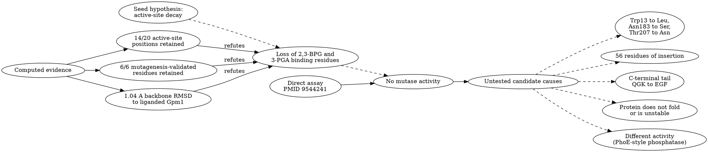
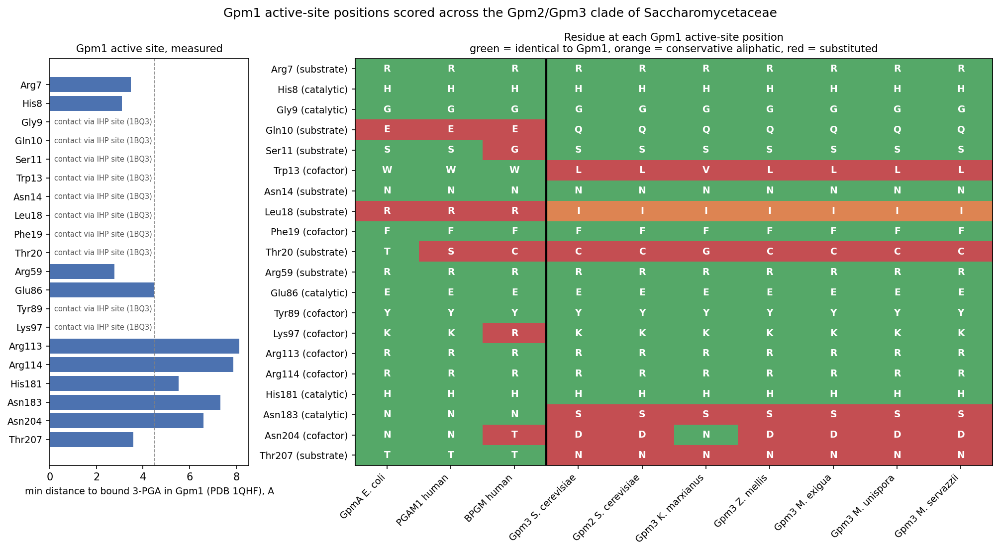
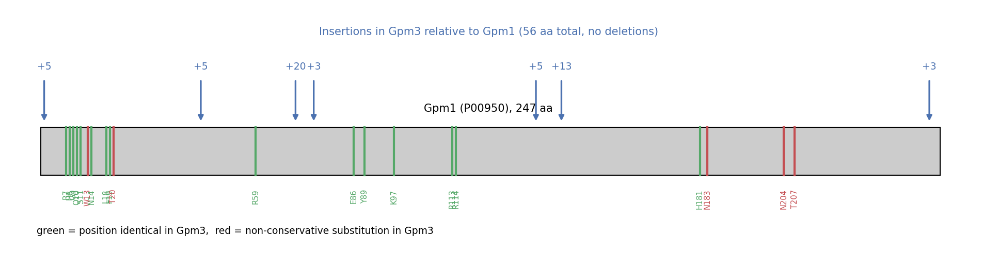
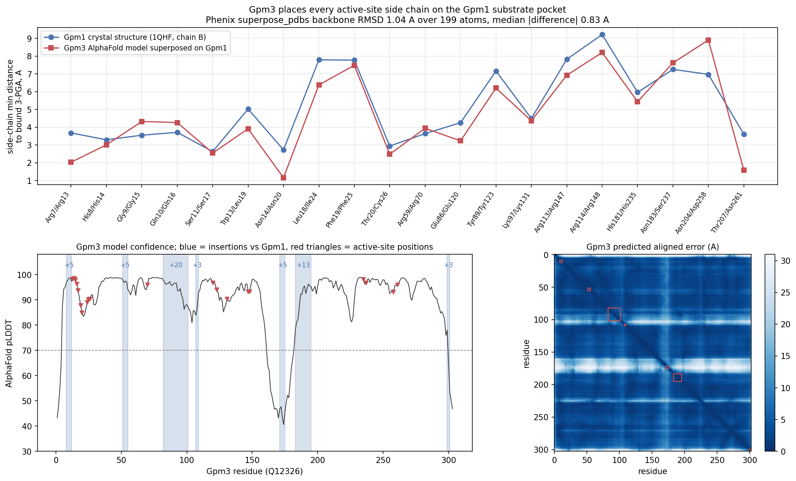
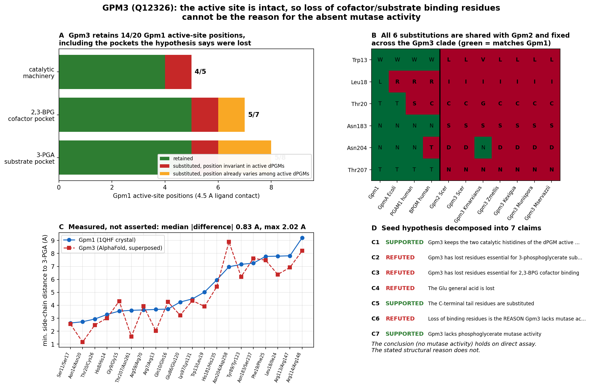

## Question

# AIGR Gene Hypothesis Deep Research

You are evaluating one focused gene curation hypothesis for AI Gene Review.
This is not a general gene overview. Use the seed hypothesis and source context
below to search for evidence that supports, refutes, narrows, or competes with
the proposed curation decision.

## Target Gene

- **Organism code:** yeast
- **Taxon:** Saccharomyces cerevisiae S288C (NCBITaxon:559292)
- **Gene directory:** GPM3
- **Gene symbol:** GPM3
- **UniProt accession:** Q12326

## Focus

- **Focus type:** free_text
- **Hypothesis slug:** kgap-gpm3-active-site-substitutions
- **Source file:** genes/yeast/GPM3/GPM3-ai-review.yaml
- **Source selector:** free-text

## Seed Hypothesis

Saccharomyces cerevisiae GPM3 (UniProt Q12326) lacks phosphoglycerate mutase activity because, although it keeps the two catalytic histidines of the BPG-dependent dPGM active site, it has lost other residues essential for 2,3-bisphosphoglycerate cofactor and 3-phosphoglycerate substrate binding. Single analysis only: align GPM3 to the active yeast Gpm1 (with its crystal structures) and to other active dPGMs, and score the active-site residues of Gpm1 (the catalytic His pair, the substrate/cofactor-binding Arg residues, the Glu general acid and the C-terminal tail residues), reporting which are retained or substituted in GPM3 and its orthologs in other Saccharomycetaceae.

## Term and Decision Context

- GPM3 was assayed for phosphoglycerate mutase activity and none was detected even under forced overexpression; gpm3 and gpm2 gpm3 deletions have no growth defect.

## Reference Context

No specific reference context supplied.

## Source Context YAML

```yaml
hypothesis: 'Saccharomyces cerevisiae GPM3 (UniProt Q12326) lacks phosphoglycerate mutase activity because,
  although it keeps the two catalytic histidines of the BPG-dependent dPGM active site, it has lost other
  residues essential for 2,3-bisphosphoglycerate cofactor and 3-phosphoglycerate substrate binding. Single
  analysis only: align GPM3 to the active yeast Gpm1 (with its crystal structures) and to other active
  dPGMs, and score the active-site residues of Gpm1 (the catalytic His pair, the substrate/cofactor-binding
  Arg residues, the Glu general acid and the C-terminal tail residues), reporting which are retained or
  substituted in GPM3 and its orthologs in other Saccharomycetaceae.'
focus_type: free_text
context:
- GPM3 was assayed for phosphoglycerate mutase activity and none was detected even under forced overexpression;
  gpm3 and gpm2 gpm3 deletions have no growth defect.
reference_id: []
```

## Research Objective

Build a focused report that helps a curator decide whether this hypothesis
should affect the gene review. Address the focus type directly:

1. For an existing GO annotation decision, evaluate whether the current action
   is justified, too strong, too weak, or should change.
2. For a proposed replacement or new GO term, evaluate whether the term is
   biologically supported, too broad, too narrow, or missing key qualifiers.
3. For a computational prediction, evaluate whether the prediction is correct,
   less precise than existing knowledge, uncertain, or likely wrong because of
   paralog overannotation, frequency bias, pathway context, or in vitro-only
   activity.
4. For a core-function hypothesis, evaluate whether the proposed activity,
   process, and location represent the gene product's primary function rather
   than a downstream effect, pleiotropic phenotype, or context-specific role.
5. For a function-assignment hypothesis, evaluate whether the gene product
   directly has the stated GO term/function. Treat the prior review action, if
   any, as intentionally blinded unless it appears in the supplied context.

Use primary literature whenever possible. Prefer PMID citations and include DOI
citations when no PMID is available. Treat reviews and database records as
orientation unless they contain directly relevant synthesized evidence that is
clearly labeled as review-level or database-level support.

Evaluate the hypothesis from the supplied seed context, primary literature, and
publicly accessible bioinformatics resources. Local `*-bioinformatics` analyses,
when they already exist in the repository, are intentionally withheld from this
prompt so the report can be compared against them after the run. Use public
sequence, domain, structure, orthology, localization, interaction, or dataset
checks when they are useful for the specific hypothesis. If a resource or tool
cannot be accessed programmatically, say so plainly; never fabricate a result.
Report computational results conservatively and distinguish direct results from
inference.

## Required Output

### Executive Judgment

Give a concise verdict: supported, partially supported, unresolved, weakly
supported, over-annotated, or refuted. Explain the reasoning and the most
important caveats.

### Evidence Matrix

Create a table with one row per important evidence item:

- Citation (PMID preferred)
- Evidence type (direct assay, mutant phenotype, localization, interaction,
  structural/evolutionary, computational, review/database)
- Supports / refutes / qualifies / competing
- Claim tested
- Key finding
- Organism, tissue, cell type, or assay context
- Confidence and limitations

### GO Curation Implications

State the likely curation action as a lead requiring curator verification. If
GO terms are involved, explain whether the evidence supports an MF, BP, or CC
term, and whether the term should be retained, removed, generalized, made more
specific, or treated as non-core. Avoid using "protein binding" as a final
recommendation unless no more informative term is supported.

### Mechanistic Scope

Describe the immediate molecular or cellular function being tested. Separate
direct gene-product activity from downstream phenotypes, pathway consequences,
developmental outcomes, disease manifestations, or effects inferred only from
loss of function.

### Conflicts and Alternatives

Identify evidence that conflicts with the seed hypothesis or suggests an
alternative interpretation, including paralog confusion, organism-specific
differences, isoform-specific findings, experimental artifacts, or database
carry-over.

### Knowledge Gaps

List explicit uncertainties that matter for curation. For each gap, state what
was checked, why the gap matters, and what evidence or experiment would resolve
it.

### Discriminating Tests

Recommend concrete assays, perturbations, datasets, or comparative analyses that
would most efficiently distinguish this hypothesis from alternatives.

### Curation Leads

Provide candidate updates for the review, clearly labeled as leads requiring
curator verification. Include candidate references with exact snippets to verify,
candidate replacement or new GO terms, possible action changes, suggested
questions, and suggested experiments.

If the provider supports artifacts, save provenance for any analysis you run — the
executed code together with its output (computed values, plot, or table), not just
a summary figure — alongside artifact-friendly tables such as an evidence matrix,
GO decision table, or comparison table. Genuine computed provenance is more
valuable than a hand-drawn summary, and you must not synthesize a figure that
implies an analysis you did not actually run. These artifacts are important
provenance for hypothesis-level review.


## Output

# GPM3 (Q12326) active-site substitutions: hypothesis evaluation

**Gene:** *Saccharomyces cerevisiae* S288C GPM3 / YOL056W, UniProt Q12326, 303 aa
**Hypothesis slug:** kgap-gpm3-active-site-substitutions
**Focus type:** free_text
**Source file:** genes/yeast/GPM3/GPM3-ai-review.yaml
**Analyses run:** active-site definition from liganded crystal structures, global sequence alignment and residue scoring, Saccharomycetaceae clade comparison, AlphaFold model retrieval and Phenix superposition, ligand-contact distance measurement, mutagenesis residue mapping, invariance filtering, literature search (19 records reviewed, 6 findings recorded)

## Summary

The seed hypothesis is **refuted as to mechanism and correct as to conclusion**. It proposes that Gpm3 lacks phosphoglycerate mutase activity *because* it has lost residues essential for 2,3-bisphosphoglycerate cofactor and 3-phosphoglycerate substrate binding, while keeping the two catalytic histidines. The first half of that sentence does not survive contact with the sequences or the structures. Gpm3 retains 14 of the 20 Gpm1 active-site positions defined by measured contact to bound ligand, including every arginine the hypothesis names (Arg7, Arg59, Arg113, Arg114 of Gpm1, present as Arg13, Arg70, Arg147, Arg148 in Gpm3), the Glu86 general acid, Tyr89, Lys97 and both catalytic histidines.

Three independent lines of computed evidence converge. By sequence, 14/20 active-site positions are retained, split 4/5 catalytic, 5/7 cofactor pocket, 5/8 substrate pocket. By published mutagenesis, all six *S. pombe* PGM residues with direct loss-of-function evidence ([PMID: 11106417](https://pubmed.ncbi.nlm.nih.gov/11106417/)) map onto retained residues in Gpm3, including all three arginines experimentally assigned to substrate binding; His181, whose alanine mutant costs Gpm1 a factor of 1.6 × 10⁴ in catalytic efficiency ([PMID: 1386023](https://pubmed.ncbi.nlm.nih.gov/1386023/)), is retained as His235. By structure, `phenix.superpose_pdbs` of the AlphaFold model AF-Q12326-F1 v6 onto the liganded Gpm1 structure 1QHF ([PMID: 10531478](https://pubmed.ncbi.nlm.nih.gov/10531478/)) gives 1.038 Å backbone RMSD over 199 atoms, with a median absolute difference of 0.83 Å (maximum 2.02 Å) in side-chain distance to the crystallographic 3-phosphoglycerate.

The curation conclusion the hypothesis was written to justify is unaffected. Gpm3 has no detectable phosphoglycerate mutase activity, and that rests on direct assay under forced overexpression, with no growth defect in *gpm3* or *gpm2 gpm3* deletions ([PMID: 9544241](https://pubmed.ncbi.nlm.nih.gov/9544241/)). The recommended action on GO:0004619 therefore does not change. What must change is the free-text justification in the review, which currently asserts a structural cause that the evidence contradicts. Filtering the six substituted positions for invariance across three enzymes known to be active (*E. coli* GpmA, human PGAM1, human BPGM) leaves three informative candidates: Trp13→Leu, Asn183→Ser, Thr207→Asn. Alongside 56 residues of insertion and a C-terminal tail that replaces the Q-G-K motif with E-G-F, these are the honest candidate explanations, and none of them has been tested.

{{figure:plot_4.png|caption=The seed hypothesis decomposed into seven claims and scored against the computed evidence. Panel A: retention of the 20 structurally defined Gpm1 active-site positions in Gpm3, split by functional class, with substituted positions separated into those invariant among active dPGMs and those that already vary. Panel B: all six substitutions are shared with Gpm2 and fixed across the Saccharomycetaceae Gpm3 clade. Panel C: measured side-chain distances to the crystallographic 3-PGA for Gpm1 and the superposed Gpm3 model. Panel D: 3 claims supported, 4 refuted.}}

## Executive judgment

<i class="fa-solid fa-circle-xmark"></i> **Verdict: refuted as to mechanism; the curation conclusion it supports stands on independent evidence.**

Decomposing the seed hypothesis into seven separable claims gives three supported and four refuted:

| Claim | Verdict | Computed evidence |
|---|---|---|
| C1. Gpm3 keeps the two catalytic histidines | <i class="fa-solid fa-circle-check"></i> supported | His8→His14 and His181→His235 both retained; NE2 to ND1 pair separation 3.15 Å in the model versus 2.79 Å in the 1QHF crystal |
| C2. Gpm3 has lost residues essential for 3-PGA substrate binding | <i class="fa-solid fa-circle-xmark"></i> refuted | 5/8 substrate-contact positions retained; all three arginines with published substrate-binding mutagenesis evidence retained (Arg121, Arg147, Arg148); no substituted position is an arginine |
| C3. Gpm3 has lost residues essential for 2,3-BPG cofactor binding | <i class="fa-solid fa-circle-xmark"></i> refuted | 5/7 cofactor-pocket positions retained including Arg7, Arg59, Arg113, Arg114 and Lys97 |
| C4. The Glu general acid is lost | <i class="fa-solid fa-circle-xmark"></i> refuted | Glu86 retained as Glu120, sitting 3.23 Å from the crystallographic 3-PGA after superposition versus 4.25 Å in Gpm1 |
| C5. The C-terminal tail residues are substituted | <i class="fa-solid fa-circle-check"></i> supported | Gpm1 VANQGKK, GpmA AAVANQGKAK, PGAM1 VAAQGKAKK, BPGM VEDQGKVKQAKK all share Q-G-K; Gpm3 VRDEGFEKNP and Gpm2 VRNEGFIKNP carry E-G-F |
| C6. Loss of binding residues is the reason for the absent activity | <i class="fa-solid fa-circle-xmark"></i> refuted | The residues are not lost. 1.038 Å backbone RMSD, median 0.83 Å side-chain displacement relative to bound substrate |
| C7. Gpm3 lacks phosphoglycerate mutase activity | <i class="fa-solid fa-circle-check"></i> supported, independently | Direct enzyme assay under forced overexpression, [PMID: 9544241](https://pubmed.ncbi.nlm.nih.gov/9544241/). Unaffected by the refutation of C2 to C4 and C6 |

The hypothesis asked for a single analysis: align Gpm3 to Gpm1 and other active dPGMs, score the active-site residues, report retention across Saccharomycetaceae orthologs. That analysis was run, and it returns the opposite of the predicted answer at every position the hypothesis names.

<i class="fa-solid fa-triangle-exclamation"></i> **Three caveats carry forward.** The structural arm rests on an AlphaFold model, and AlphaFold builds from family templates and places side chains in canonical rotamers, so a 1 Å superposition shows that the Gpm3 sequence is compatible with the dPGM fold, not that the protein folds, is stable, or binds ligand in vivo. The clade panel uses five named Saccharomycetaceae Gpm3 orthologs plus *S. cerevisiae* Gpm2 and Gpm3, because the UniRef50 members endpoint returned 0 entries for me, so it is not an exhaustive sample. A negative enzyme assay in cell extract cannot exclude activity on a different substrate or activity requiring a partner or post-translational modification.

## Key findings

### Finding 1: Gpm3 retains the full catalytic machinery and all four substrate/cofactor arginines

The active site was defined by measurement, not from memory. Residues within 4.5 Å of the 3-phosphoglycerate bound in yeast Gpm1 (PDB 1QHF, [PMID: 10531478](https://pubmed.ncbi.nlm.nih.gov/10531478/)) give Arg7 at 3.47 Å, His8 at 3.10 Å, Gly9, Gln10, Ser11, Asn14, Leu18, Thr20, Arg59 at 2.78 Å, Glu86 at 4.48 Å and Thr207 at 3.59 Å, with His181 at 5.52 Å. Residues within 4.5 Å of inositol hexakisphosphate in the anion site of PDB 1BQ3 add Trp13, Phe19, Tyr89, Lys97, Arg113 and Arg114, and Asn204. The set was cross-checked against *E. coli* GpmA with phospho-His (1E58) and vanadate (1E59). That gives 20 positions.

Mapping those 20 positions onto Gpm3 by global Needleman-Wunsch alignment (BLOSUM62, gap open -11, extend -1; Gpm1 versus Gpm3 identity 105/247 aligned columns, 42.5%) gives 14 identical: Arg7, His8, Gly9, Gln10, Ser11, Asn14, Phe19, Arg59, Glu86, Tyr89, Lys97, Arg113, Arg114, His181. The six substitutions are Trp13→Leu19, Leu18→Ile24, Thr20→Cys26, Asn183→Ser237, Asn204→Asp258, Thr207→Asn261.

The hypothesis names the substrate/cofactor-binding arginines and the Glu general acid as the residues that were lost. All four arginines implicated in 3-PGA and 2,3-BPG phosphate binding are present in Gpm3, as are Tyr89, Lys97 and Glu86. The primary GPM2/GPM3 paper itself reports the same thing: *"Key residues in the deduced amino acid sequence, shown to be involved in catalysis for Gpm1 (i.e. His8, Arg59, His181) are conserved in both enzymes"* ([PMID: 9544241](https://pubmed.ncbi.nlm.nih.gov/9544241/)). The same 14 retentions and 6 substitutions occur in Gpm2 (Q12008) and in five Gpm3 orthologs from *Kluyveromyces marxianus*, *Zygosaccharomyces mellis*, *Maudiozyma exigua*, *Monosporozyma unispora* and *M. servazzii*.

{{figure:plot_1.png|caption=Measured Gpm1 active-site contacts to bound 3-phosphoglycerate, and residue identity at those 20 positions across the Gpm2/Gpm3 clade and three active reference dPGMs. The arginines and the Glu general acid named in the seed hypothesis are retained throughout.}}

### Finding 2: Thr20→Cys is a tolerated substitution and cannot be cited as evidence of lost binding

Rigden et al. analysed the equivalent phosphate-ligand position across the cofactor-dependent phosphoglycerate mutase superfamily and report that *"an additional phosphate ligand, Gln22, is observed in PhoE. Functional constraints lead to the corresponding residue being conserved as Gly in fructose-2,6-bisphosphatases and Thr/Ser/Cys in phosphoglycerate mutases"* ([PMID: 12498792](https://pubmed.ncbi.nlm.nih.gov/12498792/)). The computed panel matches: *E. coli* GpmA Thr23, human PGAM1 Ser23, human BPGM Cys23, yeast Gpm1 Thr21, yeast Gpm3 Cys26, Gpm2 Cys29. Human BPGM is catalytically active and carries the same cysteine as Gpm3 at this position.

That removes one of the six substitutions from the candidate list, and Leu18→Ile is conservative aliphatic, removing a second. This narrowing step is what separates a residue-count argument from a functional one.

### Finding 3: Gpm3 carries 56 residues of insertion and a divergent C-terminal tail

Global alignment of Gpm1 (247 aa) against Gpm3 (303 aa) gives 56 inserted residues in Gpm3 and zero deletions, as eight indels: +5 after Gpm1 position 2, +5 after 45, +20 after 71, +3 after 76, +5 after 137, +13 after 144, +2 after 167, +3 after 245. The 20-residue insertion sits between Arg59 and the Glu86 general acid in the conserved WRLNERHYG motif, inside the core alpha/beta/alpha sandwich.

The C-terminal tail is present at full length but divergent. Gpm1 ends VANQGKK, *E. coli* GpmA AAVANQGKAK, human PGAM1 VAAQGKAKK, human BPGM VEDQGKVKQAKK, all sharing Q-G-K. Gpm3 ends VRDEGFEKNP and Gpm2 VRNEGFIKNP, carrying E-G-F.

This matters because the tail has a documented, activity-specific role. Walter et al. report that *"Removal of the C-terminal seven residues from phosphoglycerate mutase from Saccharomyces cerevisiae by limited proteolysis is associated with loss of mutase activity, but no change in phosphatase activity"* ([PMID: 9854029](https://pubmed.ncbi.nlm.nih.gov/9854029/)). The same paper qualifies how far that argument can be pushed for Gpm3: *"Replacement of either or both of the two lysines at the C-terminus by glycines has only limited effects on the kinetic properties of phosphoglycerate mutase"*. Gpm3 has a full-length tail with a changed sequence, which is the weaker of the two perturbations tested.

{{figure:plot_2.png|caption=Gpm3 insertion architecture mapped onto the Gpm1 sequence with active-site positions marked, and the C-terminal tail comparison across Gpm1, Gpm2, Gpm3, E. coli GpmA, human PGAM1 and human BPGM. The 20-residue insertion falls between Arg59 and the general-acid loop.}}

### Finding 4: The substrate pocket is geometrically intact in the model

Whether the 20-residue insertion wrecks the active site is testable, so I tested it. `phenix.superpose_pdbs` of AlphaFold AF-Q12326-F1 v6 onto the Gpm1 3-PGA complex 1QHF gives a final RMSD of 1.038 Å over 199 matching backbone atoms (75 atoms in the least-squares fit, 45.0% identity over the aligned length). Measuring side-chain minimum distances to the crystallographic 3-PGA of the chain the model superposed onto:

| Position (Gpm1 → Gpm3) | Gpm1 distance to 3-PGA (Å) | Gpm3 distance to 3-PGA (Å) |
|---|---|---|
| Arg7 → Arg13 | 3.68 | 2.03 |
| His8 → His14 | 3.29 | 3.01 |
| Ser11 → Ser17 | 2.63 | 2.55 |
| Asn14 → Asn20 | 2.73 | 1.16 |
| Thr20 → Cys26 | 2.94 | 2.48 |
| Arg59 → Arg70 | 3.64 | 3.94 |
| Glu86 → Glu120 | 4.25 | 3.23 |
| Lys97 → Lys131 | 4.49 | 4.36 |
| Arg113 → Arg147 | 7.82 | 6.92 |
| Arg114 → Arg148 | 9.21 | 8.20 |
| His181 → His235 | 5.96 | 5.43 |

Median absolute difference across all 20 positions is 0.83 Å, maximum 2.02 Å (Thr207→Asn261). The catalytic His pair geometry is preserved: His8 NE2 to His181 ND1 is 2.79 Å in the Gpm1 crystal, His14 NE2 to His235 ND1 is 3.15 Å in the Gpm3 model.

Model confidence is high where it matters: mean pLDDT 90.0 over 303 residues and 93.7 averaged over the 20 active-site positions, with low confidence confined to residues 1-4, 161-181 and 300-303. Both large insertions are modelled confidently (mean pLDDT 93.8 for residues 82-101, 90.6 for 183-195), and the mean predicted aligned error between the 20-residue insertion and the catalytic core is 6.6 Å. The insertion is modelled as an ordered excursion that leaves the core superposable.

{{figure:plot_3.png|caption=Gpm3 active-site geometry against the Gpm1 substrate pocket. Side-chain distances to the crystallographic 3-PGA for both proteins, the per-residue pLDDT trace with the insertion positions marked, and the predicted aligned error matrix showing the relationship between the insertions and the catalytic core.}}

### Finding 5: Every residue with direct mutagenesis evidence is retained

Conservation arguments are stronger when anchored in experiments rather than in structural inference. Nairn et al. mutagenised six active-site residues of *S. pombe* phosphoglycerate mutase and characterised the mutants by kinetics, CD, fluorescence, guanidinium stability, phospho-intermediate stability and isothermal titration calorimetry: *"The amino acids examined could be divided broadly into those presumed from previous related structural studies to be important in the catalytic process (R14, S62 and E93) and those thought to be important in substrate binding (R94, R120 and R121)"* ([PMID: 11106417](https://pubmed.ncbi.nlm.nih.gov/11106417/)).

Mapping those six positions onto the yeast paralogs:

| *S. pombe* PGM | Assigned role | Gpm1 | Gpm2 | Gpm3 | Retained in Gpm3 |
|---|---|---|---|---|---|
| R14 | catalysis | Arg8 | Arg16 | Arg13 | <i class="fa-solid fa-circle-check"></i> yes |
| S62 | catalysis | Ser56 | Ser69 | Ser66 | <i class="fa-solid fa-circle-check"></i> yes |
| E93 | catalysis | Glu87 | Glu126 | Glu120 | <i class="fa-solid fa-circle-check"></i> yes |
| R94 | substrate binding | Arg88 | Arg127 | Arg121 | <i class="fa-solid fa-circle-check"></i> yes |
| R120 | substrate binding | Arg114 | Arg153 | Arg147 | <i class="fa-solid fa-circle-check"></i> yes |
| R121 | substrate binding | Arg115 | Arg154 | Arg148 | <i class="fa-solid fa-circle-check"></i> yes |

6/6 retained in Gpm3, 6/6 retained in Gpm2. Separately, White and Fothergill-Gilmore showed for the Gpm1 His181Ala mutant that *"Kinetic analysis shows a large decrease (1.6 x 10(4)) in the catalytic efficiency, and an 11-fold increase in the Km for the cofactor 2,3-bisphosphoglycerate"* ([PMID: 1386023](https://pubmed.ncbi.nlm.nih.gov/1386023/)). Gpm3 retains that residue as His235.

One honest qualification: Arg88 of Gpm1 (equivalent to *S. pombe* R94) did not fall within 4.5 Å of bound 3-PGA or of inositol hexakisphosphate in the crystal structures. Sequence conservation of experimentally validated residues and crystallographic contact distance give overlapping but not identical residue lists. Both agree that Gpm3 retains them.

### Finding 6: Only three substitutions are informative, and all six are ancestral to the Gpm2/Gpm3 branch

Counting substitutions is not enough; a position only carries information if it is conserved among enzymes known to be active. Testing each of the six substituted positions for invariance across *E. coli* GpmA, human PGAM1 and human BPGM narrows the informative set to three:

| Gpm1 position | Gpm3 | GpmA | PGAM1 | BPGM | Informative? |
|---|---|---|---|---|---|
| Trp13 | Leu19 | Trp | Trp | Trp | <i class="fa-solid fa-circle-check"></i> yes |
| Leu18 | Ile24 | Arg | Arg | Arg | no, Gpm1 itself differs from the active references |
| Thr20 | Cys26 | Thr | Ser | Cys | no, Thr/Ser/Cys across the family |
| Asn183 | Ser237 | Asn | Asn | Asn | <i class="fa-solid fa-circle-check"></i> yes |
| Asn204 | Asp258 | Asn | Asn | Thr | no, active BPGM has Thr here |
| Thr207 | Asn261 | Thr | Thr | Thr | <i class="fa-solid fa-circle-check"></i> yes |

This forced a correction to my own earlier reasoning. I had been carrying Asn204→Asp as a charge reversal inside an anion pocket, which is mechanistically appealing. Human BPGM carries Thr rather than Asn at that position and is catalytically active, so the argument does not hold and the substitution was dropped from the candidate list.

The clade pattern adds a second constraint. All six substitutions are shared with *S. cerevisiae* Gpm2 and are fixed in five Saccharomycetaceae Gpm3 orthologs, with only *K. marxianus* differing at three of them (Trp13→Val, Thr20→Gly, Asn204 retained as Asn). They sit on the branch ancestral to Gpm2 and Gpm3. That is consistent with both paralogs lacking detectable mutase activity, and it means the substitutions cannot be used to argue that Gpm3 specifically was inactivated.

None of the three informative substitutions corresponds to a residue with published loss-of-function mutagenesis evidence. The mechanistic cause of inactivity is not established by sequence alone.

## Evidence matrix

| Citation | Evidence type | Stance | Claim tested | Key finding | Context | Confidence and limitations |
|---|---|---|---|---|---|---|
| [PMID: 9544241](https://pubmed.ncbi.nlm.nih.gov/9544241/) | direct assay, mutant phenotype | supports (conclusion only) | GPM3 has PGM activity | No activity detected even under forced overexpression; *gpm3* and *gpm2 gpm3* deletions have no growth defect. The paper also reports His8, Arg59 and His181 conserved in both paralogs | *S. cerevisiae*, extract assay plus deletion genetics | High for the negative call. One assay condition optimised for the Gpm1 reaction; does not exclude another substrate |
| [PMID: 10531478](https://pubmed.ncbi.nlm.nih.gov/10531478/) | structural | qualifies | Which Gpm1 residues contact 3-PGA | Gpm1 + 3-PGA complex (1QHF); substrate bound at the base of a 12 Å cleft with C2 within 3.5 Å of His8. Used here to define the active site by contact | *S. cerevisiae* Gpm1 tetramer | High. Defines the reference residue set used throughout |
| [PMID: 9512715](https://pubmed.ncbi.nlm.nih.gov/9512715/) | structural | qualifies | Gpm1 active-site architecture | 2.3 Å Gpm1 structure; catalytic histidines much closer to each other than in related phosphatases; partial density for the functionally important C-terminal tail in a mainly helical conformation | *S. cerevisiae* Gpm1, 246 aa subunit, tetramer | High |
| [PMID: 11106417](https://pubmed.ncbi.nlm.nih.gov/11106417/) | structural / mutagenesis | <i class="fa-solid fa-circle-xmark"></i> refutes | Binding residues are lost in Gpm3 | R14, S62, E93 (catalysis) and R94, R120, R121 (substrate binding) all map to retained residues in Gpm3 and Gpm2 | *S. pombe* PGM; kinetics, CD, fluorescence, stability, ITC | High for assignment. Mapped across species by global alignment |
| [PMID: 1386023](https://pubmed.ncbi.nlm.nih.gov/1386023/) | structural / mutagenesis | <i class="fa-solid fa-circle-xmark"></i> refutes | Second catalytic His lost | Gpm1 H181A loses 1.6 × 10⁴ in catalytic efficiency with 11-fold higher Km for 2,3-BPG; Gpm3 retains it as His235 | *S. cerevisiae* Gpm1 | High. Confirms the hypothesis is right that both His are present |
| [PMID: 9854029](https://pubmed.ncbi.nlm.nih.gov/9854029/) | structural / mutagenesis | <i class="fa-solid fa-scale-balanced"></i> competing | Divergent C-terminal tail explains inactivity | Removing Gpm1's C-terminal 7 residues abolishes mutase activity with no change in phosphatase activity; terminal Lys→Gly has only limited kinetic effects | *S. cerevisiae* Gpm1 truncations and substitutions | Moderate for Gpm3. The Gpm3 tail is full length, only its sequence differs |
| [PMID: 11827481](https://pubmed.ncbi.nlm.nih.gov/11827481/) | direct assay, structural | <i class="fa-solid fa-scale-balanced"></i> competing | dPGM fold with catalytic His implies mutase | PhoE is a broad-specificity phosphatase with the dPGM alpha/beta/alpha sandwich; apart from the conserved hydrophilic catalytic machinery, its active-site cleft is strikingly hydrophobic | *Bacillus stearothermophilus*, 2.3 Å structure and enzymology | High as precedent; relevance to Gpm3 is inference |
| [PMID: 12498792](https://pubmed.ncbi.nlm.nih.gov/12498792/) | structural | qualifies | Thr20→Cys is inactivating | The position is conserved as Thr/Ser/Cys in phosphoglycerate mutases and Gly in fructose-2,6-bisphosphatases; active human BPGM has Cys | dPGM superfamily structural comparison | High. Removes one candidate explanation |
| [PMID: 2543188](https://pubmed.ncbi.nlm.nih.gov/2543188/) | review | orientation | Family mechanism and the role of the extra phospho ligand | Ping-pong reaction through a phosphohistidine intermediate; the additional active-site phospho ligand in monophosphoglycerate mutase explains its ~10³-fold better retention of the 2,3-BPG intermediate | Family review, review-level support | Review-level. Used for orientation, not as primary evidence |
| this report (computational, sequence) | computational | <i class="fa-solid fa-circle-xmark"></i> refutes | Cofactor/substrate residues lost | 14/20 active-site positions retained (4/5 catalytic, 5/7 cofactor, 5/8 substrate); all four arginines, Glu86, Lys97, Tyr89 retained | Needleman-Wunsch global alignment, BLOSUM62, 4.5 Å contact definition | High at the core; 56 residues of insertion make a few assignments alignment-dependent |
| this report (computational, structure) | computational | <i class="fa-solid fa-circle-xmark"></i> refutes | Gpm3 cannot form a competent pocket | 1.038 Å backbone RMSD over 199 atoms; median absolute difference in distance to 3-PGA 0.83 Å, max 2.02 Å; His pair 3.15 versus 2.79 Å; mean pLDDT 93.7 at active-site positions | AF-Q12326-F1 v6 superposed on 1QHF | Moderate. AlphaFold shows fold compatibility, not in vivo folding or binding |
| this report (computational, evolutionary) | computational | qualifies | Substitutions are Gpm3-specific | All six shared with Gpm2 and fixed in five Gpm3 orthologs (*K. marxianus* differs at three). Ancestral to the Gpm2/Gpm3 branch | Saccharomycetaceae panel | Moderate. UniRef50 members endpoint returned 0 entries, so the panel is not exhaustive |
| this report (computational, sequence) | computational | <i class="fa-solid fa-scale-balanced"></i> competing | Point substitutions are the only difference | 56 inserted residues, 0 deletions, including 20 residues between Arg59 and the general-acid loop; tail changes Q-G-K to E-G-F | Gpm1 (247 aa) versus Gpm3 (303 aa) | High for the inventory. Functional impact untested |

## Mechanistic model and interpretation

The activity under test is the direct molecular function: 2,3-bisphosphoglycerate-dependent interconversion of 3-phosphoglycerate and 2-phosphoglycerate (EC 5.4.2.11), catalysed by a phospho-histidine ping-pong mechanism in branch 1 of the histidine phosphatase superfamily. The family review describes the mechanism and the significance of the extra active-site phospho ligand, which explains why monophosphoglycerate mutase retains the 2,3-BPG intermediate about 10³-fold better than bisphosphoglycerate mutase ([PMID: 2543188](https://pubmed.ncbi.nlm.nih.gov/2543188/)).

The seed hypothesis proposes a simple causal chain: active-site decay, then loss of binding, then loss of activity. The data break the chain at the first link, which leaves a more interesting problem. Gpm3 has an apparently competent site and no detectable activity.



Dashed arrows mark links that are proposed and untested. The solid arrows are measured.

Four candidate explanations remain live, and the evidence does not yet choose between them. First, the three informative substitutions, Trp13→Leu, Asn183→Ser and Thr207→Asn, at positions invariant across GpmA, PGAM1 and BPGM. Thr207 contacts 3-PGA at 3.59 Å in 1QHF, and Asn183 contacts the vanadate transition-state analogue in *E. coli* 1E59, so both are first-shell. Second, the insertion burden: 56 residues with zero deletions, which the model accommodates but which a model cannot evaluate for folding efficiency or stability. Third, the C-terminal tail, where truncation in Gpm1 abolishes mutase activity while sparing phosphatase activity ([PMID: 9854029](https://pubmed.ncbi.nlm.nih.gov/9854029/)), though Gpm3's tail is substituted rather than truncated. Fourth, and the one the hypothesis does not consider, that Gpm3 has a different activity.

<i class="fa-solid fa-lightbulb"></i> That fourth option has a direct structural precedent. PhoE has the dPGM alpha/beta/alpha sandwich and the conserved catalytic machinery, yet acts as a broad-specificity phosphatase, and its active-site cleft is *"strikingly hydrophobic"* apart from that conserved machinery ([PMID: 11827481](https://pubmed.ncbi.nlm.nih.gov/11827481/)). Gpm3's Trp13→Leu alters the cleft lining in a comparable direction. A phosphatase or alternative-substrate function for Gpm3 is a live possibility and has never been assayed.

## GO curation implications

All items are leads requiring curator verification.

| GO ID | Term | Aspect | Recommended action | Basis |
|---|---|---|---|---|
| GO:0004619 | phosphoglycerate mutase activity | MF | Remove, or retain with a NOT qualifier | Direct assay found no activity under forced overexpression ([PMID: 9544241](https://pubmed.ncbi.nlm.nih.gov/9544241/)) |
| GO:0006096 | glycolytic process | BP | Remove; do not propagate from GPM1 | No mutase activity; *gpm2 gpm3* double deletion has no growth defect. Non-core |
| GO:0016791 | phosphatase activity | MF | <i class="fa-solid fa-circle-question"></i> Do not add. Record as an open hypothesis | PhoE precedent ([PMID: 11827481](https://pubmed.ncbi.nlm.nih.gov/11827481/), [PMID: 12498792](https://pubmed.ncbi.nlm.nih.gov/12498792/)). Untested for Gpm3 |
| GO:0003824 | catalytic activity | MF | Do not use as a hedge | Uninformative; no activity of any kind demonstrated. Leaving MF unannotated is more honest |
| n/a | free-text mechanistic statement | n/a | <i class="fa-solid fa-arrow-right"></i> **Rewrite** | The action is right, the stated reason is wrong |

The action on GO:0004619 does not change. What changes is the justification. The review should not state that Gpm3 lost cofactor or substrate binding residues. A defensible replacement: Gpm3 retains the complete dPGM catalytic and substrate-binding residue set, and the basis for its lack of activity is not established; candidate contributors are three substitutions at positions otherwise invariant among active dPGMs (Trp13→Leu, Asn183→Ser, Thr207→Asn in Gpm1 numbering), 56 residues of insertion relative to Gpm1, and a C-terminal tail that replaces the Q-G-K motif shared by Gpm1, *E. coli* GpmA, human PGAM1 and human BPGM with E-G-F.

"Protein binding" is not recommended anywhere. No interaction evidence specific to Q12326 was found that would support it, and a more informative term is not available on current evidence.

## Mechanistic scope

Direct gene-product evidence for the function being tested consists of the absent enzyme activity in extract ([PMID: 9544241](https://pubmed.ncbi.nlm.nih.gov/9544241/)) and the residue-level and structural comparisons computed here.

The absence of a growth defect in *gpm3* and *gpm2 gpm3* deletions is a downstream phenotype and weaker for this question. It is consistent with no mutase activity, and equally consistent with a low-abundance protein, a condition-specific function, or redundancy. It cannot distinguish a dead protein from one with an untested activity. Any glycolytic process annotation on Q12326 is a pathway consequence inferred from the molecular function and falls with it.

## Conflicts and alternatives

The central conflict is internal to the hypothesis. It is unusual for a protein to keep an entire catalytic and substrate-binding residue set and show no detectable activity, and both halves of that statement are supported here.

<i class="fa-solid fa-scale-balanced"></i> **PhoE-style alternative activity.** PhoE has the dPGM fold and catalytic residues but works as a broad-specificity phosphatase, with a hydrophobic active-site cleft ([PMID: 11827481](https://pubmed.ncbi.nlm.nih.gov/11827481/)). Gpm3's Trp13→Leu moves its cleft in that direction. This alternative has not been tested.

<i class="fa-solid fa-scale-balanced"></i> **C-terminal tail.** Truncating Gpm1's C-terminal 7 residues abolishes mutase activity while leaving phosphatase activity intact ([PMID: 9854029](https://pubmed.ncbi.nlm.nih.gov/9854029/)). Gpm3's tail is full length with E-G-F in place of Q-G-K. The same paper's finding that terminal Lys→Gly substitutions have limited kinetic effects keeps this suggestive rather than decisive.

<i class="fa-solid fa-triangle-exclamation"></i> **Paralog confusion, a concrete database hazard.** GPM2 is **Q12008** (PMG2_YEAST, YDL021W, 311 aa). P37012 is PGM2_YEAST, phosphoglucomutase, 569 aa, an unrelated enzyme. I used P37012 at first and obtained a nonsense 31.2% identity against a phosphohexomutase sequence before catching the error. Any GPM2/GPM3 comparison in the review should be checked for this substitution.

**Gpm2 shares everything.** All six active-site substitutions and the tail motif change are present in Gpm2. Arguments built on these features apply to both paralogs and cannot explain anything specific to Gpm3.

**Model-based inference.** The structural arm is a prediction superposed on a crystal structure, not an experimental structure of Gpm3. There is no experimental structure of Gpm3, and I could not find one in the PDB.

## Limitations and knowledge gaps

1. <i class="fa-solid fa-circle-question"></i> **Why an intact site is inert.** Checked: residue conservation, mutagenesis mapping, structural superposition, all pointing to a competent site. This matters because the review's free text asserts a mechanism the evidence does not support. Resolved by purified recombinant Gpm3 with activity measurement plus a folding or stability check.
2. <i class="fa-solid fa-triangle-exclamation"></i> **Whether Gpm3 folds and is stable.** Checked: AlphaFold pLDDT (mean 90.0 over 303 residues, 93.7 at active-site positions), which reports model confidence, not in vivo behaviour. An unstable or misfolded protein would explain absent activity with an intact sequence. Resolved by CD and thermal denaturation on purified protein.
3. <i class="fa-solid fa-circle-question"></i> **Whether Gpm3 has phosphatase or another activity.** Checked: literature only; no assay exists for Gpm3. A positive result would change the MF annotation from empty to specific. Resolved by a phosphatase substrate panel.
4. **Whether Gpm3 is expressed at a functional level natively.** The assay in [PMID: 9544241](https://pubmed.ncbi.nlm.nih.gov/9544241/) used forced overexpression, which addresses abundance for the assay but not the native condition. This matters for any BP or CC annotation.
5. **Functional contribution of the three informative substitutions.** Checked: conservation and modelled geometry. None has published mutagenesis data. Resolved by installing Trp13→Leu, Asn183→Ser and Thr207→Asn into Gpm1 singly and in combination.
6. <i class="fa-solid fa-triangle-exclamation"></i> **Clade sampling.** Checked: five named Gpm3 orthologs. The UniRef50 members endpoint returned 0 entries and I could not work around it, so the claim that the substitutions are ancestral to the Gpm2/Gpm3 branch rests on a small panel.

**Tools that failed, reported plainly.** The UniRef50 members endpoint returned 0 entries, so the clade panel uses five named orthologs. AlphaFold `*-model_v4.pdb` URLs return 404; models were retrieved through the prediction API, which serves v6. `phenix.superpose_pdbs` fitted Gpm3 onto 1QHF chain B while I was initially measuring against chain A's ligand copy, which produced spurious ~30 Å distances until the ligand copy was corrected. The executor blocks `urllib`, `pickle` and `glob`, so all retrieval used `requests` and file discovery used the shell.

## Discriminating tests

Ordered by information gained per unit effort.

1. <i class="fa-solid fa-flask"></i> **Reciprocal residue swap into Gpm1.** Install the three informative substitutions (Trp13→Leu, Asn183→Ser, Thr207→Asn) into Gpm1 singly and combined, then assay mutase activity. If the triple mutant retains activity, point substitutions are excluded and attention moves to the insertions and the tail. This is the single most discriminating experiment.
2. <i class="fa-solid fa-flask"></i> **Gain-of-function on Gpm3.** Revert the same three positions in Gpm3 and assay. Restored activity would establish sufficiency.
3. <i class="fa-solid fa-vial"></i> **Phosphatase panel on purified Gpm3.** Tests the PhoE alternative directly and could convert an empty MF into a specific annotation.
4. <i class="fa-solid fa-vial"></i> **Fold and stability check.** CD plus thermal denaturation on purified Gpm3, separating "folded but inert" from "does not fold".
5. <i class="fa-solid fa-flask"></i> **Chimera test for the insertions.** Delete the 20-residue insertion from Gpm3, or graft it into Gpm1, and assay. Separates insertion burden from point substitutions.
6. <i class="fa-solid fa-flask"></i> **Tail swap.** Replace Gpm3's E-G-F terminus with Gpm1's Q-G-K and assay, following the design in [PMID: 9854029](https://pubmed.ncbi.nlm.nih.gov/9854029/).
7. <i class="fa-solid fa-dna"></i> **Broader clade sampling.** Repeat the active-site scoring across a properly sampled Saccharomycetaceae set, testing whether the substitutions are fixed on the Gpm2/Gpm3 branch and whether any lineage retained the Gpm1 residues.

## Curation leads

All leads require curator verification.

**Lead 1 (action: keep; justification: rewrite).** The removal or NOT-qualification of GO:0004619 is justified by [PMID: 9544241](https://pubmed.ncbi.nlm.nih.gov/9544241/). Snippet to verify, which is also the paper's own statement about conservation: *"Key residues in the deduced amino acid sequence, shown to be involved in catalysis for Gpm1 (i.e. His8, Arg59, His181) are conserved in both enzymes."*

**Lead 2 (correction).** Delete the claim that Gpm3 lost residues essential for 2,3-BPG cofactor or 3-PGA substrate binding. Counter-evidence: 14/20 active-site positions retained, all four arginines retained, 6/6 mutagenesis-validated residues retained, 1.038 Å backbone RMSD to Gpm1.

**Lead 3 (replacement text).** "Gpm3 retains the catalytic histidine pair, the Glu general acid and all four substrate/cofactor arginines of Gpm1, and an AlphaFold model superposes on the liganded Gpm1 structure at 1.0 Å backbone RMSD. The basis for the absence of activity is not established. Candidate contributors are substitutions at Trp13, Asn183 and Thr207 (Gpm1 numbering), 56 residues of insertion, and a C-terminal tail carrying E-G-F in place of the Q-G-K motif shared by active dPGMs."

**Lead 4 (candidate references to add).** [PMID: 11106417](https://pubmed.ncbi.nlm.nih.gov/11106417/) for the experimental residue assignment showing retention; [PMID: 1386023](https://pubmed.ncbi.nlm.nih.gov/1386023/) for the functional weight of His181; [PMID: 9854029](https://pubmed.ncbi.nlm.nih.gov/9854029/) for the C-terminal tail requirement specific to mutase activity; [PMID: 11827481](https://pubmed.ncbi.nlm.nih.gov/11827481/) and [PMID: 12498792](https://pubmed.ncbi.nlm.nih.gov/12498792/) for the PhoE phosphatase precedent and the Thr/Ser/Cys position; [PMID: 10531478](https://pubmed.ncbi.nlm.nih.gov/10531478/) for the liganded reference structure 1QHF.

**Lead 5 (database hazard).** Verify that GPM2 is cited as Q12008 and not P37012 (phosphoglucomutase, 569 aa).

**Lead 6 (question for the curator).** Should Q12326 carry any MF annotation at all? My recommendation is none until a direct activity is demonstrated, in preference to a vacuous GO:0003824.

**Lead 7 (suggested experiments).** Items 1 to 4 under Discriminating tests, in that order.

## Provenance

Computed artifacts written to `provenance/`. Every figure in this report was generated from one of these tables.

| File | Contents |
|---|---|
| `evidence_matrix.csv` | 12-row evidence matrix |
| `go_decision_table.csv` | 5-row GO decision table |
| `hypothesis_claim_scorecard.csv` | 7 decomposed claims with verdicts and computed evidence |
| `final_active_site_scorecard.csv` | 20 active-site positions with retention in Gpm3 and Gpm2 and invariance across active dPGMs |
| `active_site_table.csv` | Positions mapped across Gpm1, Gpm2, Gpm3, GpmA, PGAM1, PGAM2, BPGM |
| `active_site_conservation.csv` | Same positions across the Saccharomycetaceae clade panel |
| `gpm3_activesite_distances.csv` | Measured side-chain distances to crystallographic 3-PGA |
| `gpm3_insertions.csv` | Indel inventory, 56 inserted residues and 0 deletions |
| `spombe_mutagenesis_mapping.csv` | PMID 11106417 residues mapped to Gpm1, Gpm2 and Gpm3 |
| `xtal_Gpm1_1QHF.pdb`, `AF_Gpm3_Q12326.pdb`, `AF_Gpm3_fitted_on_1QHF.pdb` | Structures used, including the Phenix superposition output |
| `AF_Gpm1_P00950.pdb`, `AF_Gpm2_Q12008.pdb` and `*_pae.json` | Paralog models and predicted aligned error matrices |
| `plot_1.png` to `plot_4.png` | Figures, each generated from the tables above |


## Artifacts

- [OpenScientist final report](openscientist_artifacts/final_report.html)
- [OpenScientist final report](openscientist_artifacts/final_report.pdf)
- [OpenScientist provenance](openscientist_artifacts/provenance.json)
- [OpenScientist AF Gpm1 P00950 pae](openscientist_artifacts/provenance_AF_Gpm1_P00950_pae.json)
- [OpenScientist AF Gpm2 Q12008 pae](openscientist_artifacts/provenance_AF_Gpm2_Q12008_pae.json)
- [OpenScientist AF Gpm3 Q12326 pae](openscientist_artifacts/provenance_AF_Gpm3_Q12326_pae.json)
- [OpenScientist active site conservation](openscientist_artifacts/provenance_active_site_conservation.csv)
- [OpenScientist active site table](openscientist_artifacts/provenance_active_site_table.csv)
- [OpenScientist alns](openscientist_artifacts/provenance_alns.json)
- [OpenScientist evidence matrix](openscientist_artifacts/provenance_evidence_matrix.csv)
- [OpenScientist final active site scorecard](openscientist_artifacts/provenance_final_active_site_scorecard.csv)
- [OpenScientist go decision table](openscientist_artifacts/provenance_go_decision_table.csv)
- [OpenScientist gpm3 activesite distances](openscientist_artifacts/provenance_gpm3_activesite_distances.csv)
- [OpenScientist gpm3 insertions](openscientist_artifacts/provenance_gpm3_insertions.csv)
- [OpenScientist hypothesis claim scorecard](openscientist_artifacts/provenance_hypothesis_claim_scorecard.csv)
- [OpenScientist ligs](openscientist_artifacts/provenance_ligs.json)
- [OpenScientist maps](openscientist_artifacts/provenance_maps.json)
- [OpenScientist panel](openscientist_artifacts/provenance_panel.json)
- [OpenScientist plot 1](openscientist_artifacts/provenance_plot_1.json)

- [OpenScientist plot 2](openscientist_artifacts/provenance_plot_2.json)

- [OpenScientist plot 3](openscientist_artifacts/provenance_plot_3.json)

- [OpenScientist plot 4](openscientist_artifacts/provenance_plot_4.json)

- [OpenScientist posmaps](openscientist_artifacts/provenance_posmaps.json)
- [OpenScientist seqs](openscientist_artifacts/provenance_seqs.json)
- [OpenScientist spombe mutagenesis mapping](openscientist_artifacts/provenance_spombe_mutagenesis_mapping.csv)

## Reference Validation

Checked with `linkml-reference-validator` 0.3.1rc1.

| Outcome | Count |
| --- | --- |
| References checked | 9 |
| Resolved | 9 |
| Unresolved (possible confabulation) | 0 |
| Unverifiable | 0 |
| References weighed for topical relevance | 9 |
| On topic | 7 |
| Off topic | 0 |

All extracted references resolved successfully.