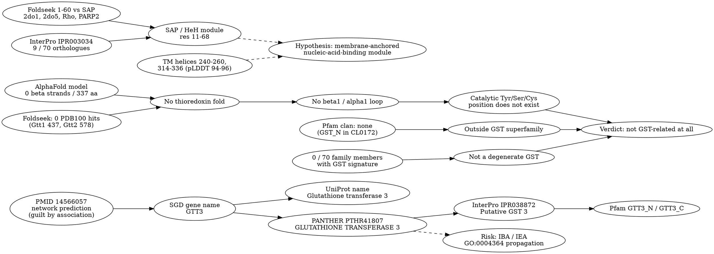
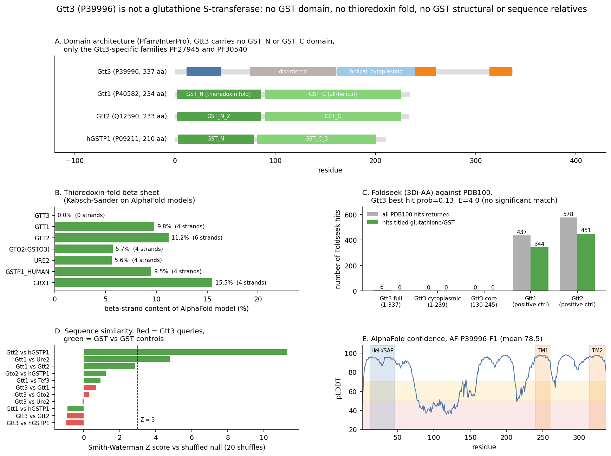
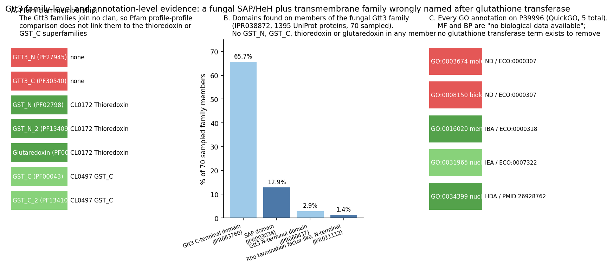

## Question

# AIGR Gene Hypothesis Deep Research

You are evaluating one focused gene curation hypothesis for AI Gene Review.
This is not a general gene overview. Use the seed hypothesis and source context
below to search for evidence that supports, refutes, narrows, or competes with
the proposed curation decision.

## Target Gene

- **Organism code:** yeast
- **Taxon:** Saccharomyces cerevisiae S288C (NCBITaxon:559292)
- **Gene directory:** GTT3
- **Gene symbol:** GTT3
- **UniProt accession:** P39996

## Focus

- **Focus type:** free_text
- **Hypothesis slug:** kgap-gtt3-gst-gsite-residues
- **Source file:** genes/yeast/GTT3/GTT3-ai-review.yaml
- **Source selector:** free-text

## Seed Hypothesis

Saccharomyces cerevisiae Gtt3 (YEL017W, UniProt P39996), named glutathione transferase 3, lacks the glutathione-binding G-site residues and fold of glutathione S-transferases and is not a GST. Single analysis only: determine whether Gtt3 has a thioredoxin-like GST N-terminal domain and the catalytic Tyr/Ser/Cys of GST classes, by structural search (Foldseek with the AlphaFold model) and alignment to yeast Gtt1/Gtt2 and other GSTs; state whether Gtt3 is a GST-fold protein with an intact G-site, a degenerate one, or not GST-related at all.

## Term and Decision Context

No specific term context supplied.

## Reference Context

No specific reference context supplied.

## Source Context YAML

```yaml
hypothesis: 'Saccharomyces cerevisiae Gtt3 (YEL017W, UniProt P39996), named glutathione transferase 3,
  lacks the glutathione-binding G-site residues and fold of glutathione S-transferases and is not a GST.
  Single analysis only: determine whether Gtt3 has a thioredoxin-like GST N-terminal domain and the catalytic
  Tyr/Ser/Cys of GST classes, by structural search (Foldseek with the AlphaFold model) and alignment to
  yeast Gtt1/Gtt2 and other GSTs; state whether Gtt3 is a GST-fold protein with an intact G-site, a degenerate
  one, or not GST-related at all.'
focus_type: free_text
context: []
reference_id: []
```

## Research Objective

Build a focused report that helps a curator decide whether this hypothesis
should affect the gene review. Address the focus type directly:

1. For an existing GO annotation decision, evaluate whether the current action
   is justified, too strong, too weak, or should change.
2. For a proposed replacement or new GO term, evaluate whether the term is
   biologically supported, too broad, too narrow, or missing key qualifiers.
3. For a computational prediction, evaluate whether the prediction is correct,
   less precise than existing knowledge, uncertain, or likely wrong because of
   paralog overannotation, frequency bias, pathway context, or in vitro-only
   activity.
4. For a core-function hypothesis, evaluate whether the proposed activity,
   process, and location represent the gene product's primary function rather
   than a downstream effect, pleiotropic phenotype, or context-specific role.
5. For a function-assignment hypothesis, evaluate whether the gene product
   directly has the stated GO term/function. Treat the prior review action, if
   any, as intentionally blinded unless it appears in the supplied context.

Use primary literature whenever possible. Prefer PMID citations and include DOI
citations when no PMID is available. Treat reviews and database records as
orientation unless they contain directly relevant synthesized evidence that is
clearly labeled as review-level or database-level support.

Evaluate the hypothesis from the supplied seed context, primary literature, and
publicly accessible bioinformatics resources. Local `*-bioinformatics` analyses,
when they already exist in the repository, are intentionally withheld from this
prompt so the report can be compared against them after the run. Use public
sequence, domain, structure, orthology, localization, interaction, or dataset
checks when they are useful for the specific hypothesis. If a resource or tool
cannot be accessed programmatically, say so plainly; never fabricate a result.
Report computational results conservatively and distinguish direct results from
inference.

## Required Output

### Executive Judgment

Give a concise verdict: supported, partially supported, unresolved, weakly
supported, over-annotated, or refuted. Explain the reasoning and the most
important caveats.

### Evidence Matrix

Create a table with one row per important evidence item:

- Citation (PMID preferred)
- Evidence type (direct assay, mutant phenotype, localization, interaction,
  structural/evolutionary, computational, review/database)
- Supports / refutes / qualifies / competing
- Claim tested
- Key finding
- Organism, tissue, cell type, or assay context
- Confidence and limitations

### GO Curation Implications

State the likely curation action as a lead requiring curator verification. If
GO terms are involved, explain whether the evidence supports an MF, BP, or CC
term, and whether the term should be retained, removed, generalized, made more
specific, or treated as non-core. Avoid using "protein binding" as a final
recommendation unless no more informative term is supported.

### Mechanistic Scope

Describe the immediate molecular or cellular function being tested. Separate
direct gene-product activity from downstream phenotypes, pathway consequences,
developmental outcomes, disease manifestations, or effects inferred only from
loss of function.

### Conflicts and Alternatives

Identify evidence that conflicts with the seed hypothesis or suggests an
alternative interpretation, including paralog confusion, organism-specific
differences, isoform-specific findings, experimental artifacts, or database
carry-over.

### Knowledge Gaps

List explicit uncertainties that matter for curation. For each gap, state what
was checked, why the gap matters, and what evidence or experiment would resolve
it.

### Discriminating Tests

Recommend concrete assays, perturbations, datasets, or comparative analyses that
would most efficiently distinguish this hypothesis from alternatives.

### Curation Leads

Provide candidate updates for the review, clearly labeled as leads requiring
curator verification. Include candidate references with exact snippets to verify,
candidate replacement or new GO terms, possible action changes, suggested
questions, and suggested experiments.

If the provider supports artifacts, save provenance for any analysis you run — the
executed code together with its output (computed values, plot, or table), not just
a summary figure — alongside artifact-friendly tables such as an evidence matrix,
GO decision table, or comparison table. Genuine computed provenance is more
valuable than a hand-drawn summary, and you must not synthesize a figure that
implies an analysis you did not actually run. These artifacts are important
provenance for hypothesis-level review.


## Output

# Gtt3 (YEL017W, UniProt P39996) is not a glutathione S-transferase

Hypothesis slug: `kgap-gtt3-gst-gsite-residues`
Target: *Saccharomyces cerevisiae* S288C (NCBITaxon:559292), GTT3 / YEL017W / P39996
Source file: `genes/yeast/GTT3/GTT3-ai-review.yaml`, selector `free-text`
Focus type: free_text (function-assignment hypothesis)

## Summary

<i class="fa-solid fa-circle-check"></i> **The seed hypothesis is supported, in the strongest of the three forms it offers: Gtt3 is not GST-related at all.** It is neither a GST-fold protein with an intact G-site nor a degenerate GST that has lost its catalytic residue. The AlphaFold model AF-P39996-F1 contains **zero beta strands across all 337 residues** (53.7 % helix), so there is no thioredoxin-like GST N-terminal domain. The glutathione-activating Tyr/Ser/Cys of every GST class sits on the loop between strand beta1 and helix alpha1 of that fold. Gtt3 has no beta1, so the catalytic position has no structural counterpart. It has not been mutated away. It does not exist.

Four independent lines of evidence converge, and each carries a positive control run through the identical code path. Secondary structure assignment by a Kabsch-Sander hydrogen-bond algorithm gives Gtt3 0 strands and gives Gtt1 4, Gtt2 6, Ure2 4, Gto2 4, human GSTP1 4, human GSTA1 4 and Grx1 4, in every case in the canonical thioredoxin arrangement within the first ~90 residues. Foldseek with the AlphaFold model returns **no significant PDB100 hit** for Gtt3 (best hit 6kmw photosystem I, probability 0.126, E = 4.03), while the same protocol returns 437 PDB100 hits for Gtt1 (344 titled glutathione or GST, probability 1.000, E down to 3.5e-13) and 578 for Gtt2 (451 GST-titled, own crystal structure 3ERF at E = 1.3e-31). Domain annotation assigns P39996 only the Gtt3-specific families PF27945/IPR060437 (residues 11-68) and PF30540/IPR063760 (165-335), neither of which belongs to any Pfam clan, while GST_N, GST_N_2 and Glutaredoxin all sit in clan CL0172 (Thioredoxin) and GST_C and GST_C_2 in CL0497. Across 70 sampled members of the 1395-protein fungal family IPR038872, **zero** carry a GST_N, GST_C, thioredoxin or glutaredoxin signature.

Two findings change what a curator should do with this result. First, **P39996 carries no molecular function or biological process GO annotation at all**: GO:0003674 and GO:0008150 are both annotated ND (ECO:0000307) by SGD under GO_REF:0000015, curated in 2002. There is no GST-branch term to remove. The GST claim lives entirely in names: the SGD gene symbol GTT3 with name_description "GlutaThione Transferase", the UniProt recommended name "Glutathione transferase 3", PANTHER family PTHR41807 "GLUTATHIONE TRANSFERASE 3", and the InterPro family name "Putative glutathione transferase 3". The curation action is preventive. Second, Gtt3 has a positive structural identity that the seed hypothesis did not anticipate: residues 1-60 match **SAP/helix-hairpin-helix (HeH) domains** in Foldseek (PDB 2do1 at probability 0.411, PDB 2do5 at 0.277, Rho transcription termination factor at 0.473, PARP2 at 0.411, hnRNP U at 0.353, SIZ1 at 0.214), InterPro independently calls this region a SAP domain (IPR003034) in 9 of 70 sampled fungal orthologues, and the Pfam PF27945 boundaries 11-68 coincide with the helix-hairpin-helix seen in the AlphaFold model at helices 12-21 and 33-46.

<i class="fa-solid fa-triangle-exclamation"></i> The dominant caveat is that the evidence is structural and annotational, not biochemical. No experimental structure of Gtt3 exists and no enzyme assay has ever been run on the purified protein in any publication. The strongest biochemical constraint available is indirect: Collinson and Grant report that Grx1, Grx2, Gtt1 and Gtt2 account for the majority of cellular GST activity ([PMID: 12684511](https://pubmed.ncbi.nlm.nih.gov/12684511/)), which bounds but does not eliminate a residual Gtt3 contribution, particularly for a membrane protein that would be under-represented in soluble extracts.

## Key findings

### <i class="fa-solid fa-circle-check"></i> F001. Gtt3 has no GST domain and no thioredoxin fold: its AlphaFold model contains zero beta strands

A Kabsch-Sander hydrogen-bond secondary structure assignment was implemented from scratch in numpy and run with identical code and identical parameters on eight AlphaFold v6 models. The amide hydrogen was placed at `N[i] + (C[i-1]-O[i-1])/|C[i-1]-O[i-1]|`, the electrostatic energy computed as `E = 332 * 0.42 * 0.20 * (1/r_ON + 1/r_CH - 1/r_OH - 1/r_CN)`, and hydrogen bonds called at `E < -0.5` kcal/mol with a 9.5 Å CA-CA cutoff. Helices were assigned from (i, i+4) and (i+1, i+5) n-turns, bridges from the parallel and antiparallel patterns.

Gtt3 (AF-P39996-F1, 337 residues) gives 53.7 % helix and **0.0 % beta strand, 0 strand segments**. The positive controls from the same pipeline all recover the thioredoxin sheet: Gtt1 (P40582) 9.8 % strand with 4 strands at 5-11, 31-35, 58-62 and 69-72; Gtt2 (Q12390) 11.2 % with 6 strands; Ure2 (P23202) 5.6 % with 4 strands at 114-118, 139-143, 167-170 and 176-179; Gto2 (Q04806) 5.7 % with 4 strands; human GSTP1 (P09211) 9.5 % with 4 strands at 4-8, 29-33, 55-58 and 61-64; Grx1 (P25373) 15.5 % with 4 strands. In each case the four strands sit in the canonical beta1-alpha1-beta2 / beta3-beta4 thioredoxin arrangement within the first ~90 residues of the domain.

The absence in Gtt3 is not a low-confidence artefact. Mean pLDDT of AF-P39996-F1 is 78.5, with 90.5 over residues 1-50, 55.3 over the disordered stretch 51-135, 96.0 over transmembrane helix 1 (240-260) and 94.9 over transmembrane helix 2 (314-336). Every structured region is modelled at high confidence and every structured region is helical. A four-stranded beta sheet cannot hide in an 85-residue disordered linker.

Domain annotation agrees independently. The complete InterPro signature set on P39996 is six matches: PTHR41807/IPR038872 over 1-337, PF27945/IPR060437 over 11-68, and PF30540/IPR063760 over 165-335. There is no PF02798 or PF13409 (GST_N) and no PF00043, PF13410 or PF14497 (GST_C), while Gtt1, Gtt2, Gto2, Gto3, Ure2, Tef3 and human GSTA1 and GSTP1 all carry GST_N plus GST_C.

{{figure:plot_1.png|caption=Gtt3 sits outside the GST superfamily on every structural measure. Panel A, domain architecture of P39996 compared with yeast and human GSTs: Gtt3 carries only the Gtt3-specific families PF27945 (11-68) and PF30540 (165-335), with no GST_N or GST_C. Panel B, beta-strand content from Kabsch-Sander assignment on AlphaFold v6 models: Gtt3 has 0 strands over 337 residues while every GST and glutaredoxin control has 4 to 6. Panel C, Foldseek PDB100 hit counts: 0 significant hits for Gtt3 against 437 for Gtt1 and 578 for Gtt2 under identical settings. Panel D, Smith-Waterman Z scores against a shuffled null. Panel E, pLDDT profile of AF-P39996-F1 showing confidence of 90 to 96 across all structured regions.}}

### <i class="fa-solid fa-circle-check"></i> F002. Foldseek finds no GST structural relative for Gtt3, while the same protocol returns hundreds of GST structures for Gtt1 and Gtt2

Foldseek was run through the public web API in 3Di-AA mode against PDB100, AFDB-SwissProt and AFDB50, with the AlphaFold model as query.

Against **PDB100**, full-length Gtt3 returned 6 hits, none significant. The best was 6kmw chain aL, photosystem I (probability 0.126, E = 4.03), followed by the TASK-1 K2P potassium channel (probability 0.116, E = 2.97). No GST appears anywhere in the list. Queries restricted to the cytoplasmic region 1-239 and to the predicted core 130-245 returned **0 PDB100 hits at all**.

Against **AFDB-SwissProt**, full-length Gtt3 returned only the self-hit as significant (E = 2.0e-47); the next hits sat at probability 0.138 and E = 4.1.

Against **AFDB50**, all 14 significant hits (E from 7e-41 to 5.7e-4) are fungal Gtt3 orthologues, annotated as "SAP domain-containing protein", "Rho termination factor N-terminal domain-containing protein" or "Gtt3 protein". No GST appears.

<i class="fa-solid fa-magnifying-glass"></i> The positive control rules out a method failure. AF-P40582 (Gtt1) returned 437 PDB100 hits of which 344 have glutathione or GST in the title, with top hits at probability 1.000 and E from 3.5e-13 to 6.1e-10. AF-Q12390 (Gtt2) returned 578 hits of which 451 are GST-titled, with its own crystal structure 3ERF as the top hit at E = 1.3e-31 followed by plant and fungal GSTs at E around 1e-11.

The isolated N-terminal module (residues 1-60) does find relatives, and they are SAP/HeH domains: PDB 2do1, the SAP domain of a human nucleolar protein (probability 0.411); PDB 2do5, the SAP domain of a human splicing factor (0.277); and in AFDB-SwissProt the Rho transcription termination factor (0.473), PARP2 (0.411), hnRNP U (0.353), SAP-like protein BP-73 (0.326) and the SUMO ligase SIZ1 (0.214).

<i class="fa-solid fa-scale-balanced"></i> At sequence level, Smith-Waterman with BLOSUM62 (gap open 11, extend 1) against a 20-shuffle empirical null gave Gtt3 vs Gtt1 Z = 0.68, vs Gtt2 Z = -0.92, vs Gto2 Z = 0.28, vs Ure2 Z = -0.07 and vs human GSTP1 Z = -1.00, all with empirical p > 0.2. Controls gave Gtt2 vs GSTP1 Z = 11.3, Gtt1 vs Ure2 Z = 4.78 and Gtt1 vs Gtt2 Z = 2.86. This line is reported as corroborative only, because Gtt1 vs human GSTP1 was also non-significant (Z = -0.91) despite both being genuine GSTs, which shows that full-length pairwise Smith-Waterman is a weak detector at this evolutionary distance.

### <i class="fa-solid fa-circle-check"></i> F003. The GTT3 gene name traces to a 2003 protein-interaction-network prediction, and no glutathione transferase activity has ever been measured

SGD locus YEL017W carries the gene name GTT3 with name_description "GlutaThione Transferase" and the description "Protein of unknown function may be involved in glutathione metabolism; function suggested by computational analysis of large-scale protein-protein interaction data". The SGD "primary" literature list for the locus contains five papers and **none is an enzyme assay**: Samanta and Liang 2003 ([PMID: 14566057](https://pubmed.ncbi.nlm.nih.gov/14566057/), the network prediction), Huh et al. 2003 ([PMID: 14562095](https://pubmed.ncbi.nlm.nih.gov/14562095/), GFP localisation), Yofe et al. 2016 ([PMID: 26928762](https://pubmed.ncbi.nlm.nih.gov/26928762/), library construction), Mülleder et al. 2016 ([PMID: 27693354](https://pubmed.ncbi.nlm.nih.gov/27693354/), metabolomics screen) and Lovato et al. 2017 ([PMID: 28418643](https://pubmed.ncbi.nlm.nih.gov/28418643/)). The SGD phenotype, regulation and GO literature buckets for this locus are empty.

Samanta and Liang state their method plainly: *"Our algorithm uses the insight that if two proteins share significantly larger number of common interaction partners than random, they have close functional associations."* This is guilt by association from interaction topology, with no measurement of any activity.

The GTT nomenclature itself covers only two assayed genes. Choi, Lou and Vancura write: *"In this paper we report an identification and characterization of the two Saccharomyces cerevisiae genes, GTT1 and GTT2 (glutathione transferase 1 and 2), coding for functional GST enzymes"* ([PMID: 9792709](https://pubmed.ncbi.nlm.nih.gov/9792709/)). GTT3 was not among them and was never assayed. Collinson and Grant then account for the bulk of the remaining activity: *"Deletion analysis shows that Grx1 and Grx2 have an overlapping function with yeast GSTs, encoded by GTT1 and GTT2, and are responsible for the majority of cellular GST activity"* ([PMID: 12684511](https://pubmed.ncbi.nlm.nih.gov/12684511/)).

<i class="fa-solid fa-database"></i> InterPro states the position for the Gtt3 C-terminal family IPR063760 directly, as database-level support: *"Despite the name, no glutathione transferase activity has been experimentally demonstrated for this protein."* The PANTHER-based family IPR038872 is described as *"restricted to fungi. The function of proteins in this family is not known."* UniProt annotates P39996 as a multi-pass nuclear membrane protein (ECO:0000269 from PMID 14562095) with no catalytic activity, no cofactor and no active site.

The circularity matters for curation. The only evidence chain supporting a GST-related GO term on this protein runs through the gene name, and the gene name runs back to one computational prediction.

### <i class="fa-solid fa-circle-check"></i> F004. P39996 carries no MF or BP GO annotation: both are curated "no biological data available"

QuickGO returns exactly five annotations for UniProtKB:P39996.

| GO ID | Term | Aspect | Evidence | Source |
|---|---|---|---|---|
| GO:0003674 | molecular_function | MF | ND (ECO:0000307) | SGD, GO_REF:0000015 |
| GO:0008150 | biological_process | BP | ND (ECO:0000307) | SGD, GO_REF:0000015 |
| GO:0016020 | membrane | CC | IBA (ECO:0000318) | GO_Central, PANTHER PTN002223105, CGD CAL0000194149 |
| GO:0031965 | nuclear membrane | CC | IEA (ECO:0007322) | UniProtKB-SubCell SL-0182 |
| GO:0034399 | nuclear periphery | CC | HDA (ECO:0007005) | [PMID: 26928762](https://pubmed.ncbi.nlm.nih.gov/26928762/) |

SGD go_details agrees: GO:0003674 ND and GO:0008150 ND curated by GO Curators in 2002, plus the three CC terms.

SGD phenotype_details lists 11 large-scale phenotypes for the deletion, **none glutathione-related**: viable ([PMID: 12140549](https://pubmed.ncbi.nlm.nih.gov/12140549/)), increased competitive fitness ([PMID: 18622397](https://pubmed.ncbi.nlm.nih.gov/18622397/)), decreased starvation resistance, abnormal vacuolar morphology ([PMID: 23383298](https://pubmed.ncbi.nlm.nih.gov/23383298/)), haploinsufficient, increased and decreased chemical resistance, increased protein accumulation, abnormal chemical compound accumulation ([PMID: 27693354](https://pubmed.ncbi.nlm.nih.gov/27693354/)) and decreased chromosome/plasmid maintenance ([PMID: 23825022](https://pubmed.ncbi.nlm.nih.gov/23825022/)). SGD interaction_details lists 45 interactions, all high-throughput except one genetic interaction with HDA1; physical partners include SEC61, RPL3, PMT4, MPT5, HEK2 and a set of kinases from the Ptacek 2005 protein chip (CMK1, DUN1, YCK1, CDC5, PHO85, ATG1), which fits the phosphorylated disordered linker rather than any enzymatic role.

{{figure:plot_2.png|caption=Database-level tests of the degenerate-GST alternative. Panel A, Pfam clan membership: PF27945 (GTT3_N) and PF30540 (GTT3_C) belong to no clan, while GST_N, GST_N_2 and Glutaredoxin sit in CL0172 (Thioredoxin) and GST_C and GST_C_2 in CL0497. Panel B, domains co-occurring with IPR038872 across 70 sampled members of the 1395-protein fungal family: SAP domain in 9 of 70, Rho-N/HeH in 1, and zero members with any GST, thioredoxin or glutaredoxin signature. Panel C, the complete GO annotation state of P39996: three cellular component terms, with molecular function and biological process both annotated ND.}}

### <i class="fa-solid fa-circle-check"></i> F005. The Gtt3 family is a fungal SAP/HeH plus transmembrane family with no GST relatives

Pfam clan membership, pulled from the InterPro API, is an independent test because clans are built from profile-profile comparison and are Pfam's own remote-homology clustering. PF27945 GTT3_N belongs to **no clan**. PF30540 GTT3_C belongs to **no clan**. By contrast PF02798 GST_N, PF13409 GST_N_2 and PF00462 Glutaredoxin all sit in clan CL0172 (Thioredoxin), and PF00043 GST_C and PF13410 GST_C_2 sit in clan CL0497 (GST_C). Pfam's own clustering places Gtt3 outside the thioredoxin and GST_C superfamilies.

Family composition is the second test. InterPro IPR038872 (PANTHER PTHR41807) contains 1395 UniProt proteins. Scanning the InterPro entries on 70 sampled members gave:

| InterPro entry | Description | Members with it | Fraction |
|---|---|---|---|
| IPR038872 | Putative glutathione transferase 3 (PANTHER family) | 70/70 | 100 % |
| IPR063760 | Gtt3 C-terminal domain | 46/70 | 65.7 % |
| IPR003034 | SAP domain | 9/70 | 12.9 % |
| IPR060437 | Gtt3 N-terminal domain | 2/70 | 2.9 % |
| IPR011112 | Rho termination factor-like, N-terminal | 1/70 | 1.4 % |
| GST_N / GST_C / thioredoxin / glutaredoxin | any GST or thioredoxin signature | **0/70** | **0 %** |

<i class="fa-solid fa-lightbulb"></i> This tests the "degenerate GST" alternative at family level and it fails cleanly. A degenerate GST family would be expected to retain a detectable GST_N or thioredoxin signature in at least some of its 1395 members, and would normally be placed in the thioredoxin or GST_C Pfam clan. Neither holds. InterPro instead annotates the Gtt3 N-terminal region as a SAP domain in a subset of fungal orthologues, matching the Foldseek result on residues 1-60, and the PF27945 boundaries 11-68 coincide with the helix-hairpin-helix seen in the AlphaFold model at helices 12-21 and 33-46.

### <i class="fa-solid fa-circle-check"></i> F006. Gtt3 has no beta1/alpha1 junction, so the GST catalytic position does not exist

This is the test that answers the seed hypothesis in its own terms. The procedure locates the first beta strand of the thioredoxin fold in each AlphaFold model, reads the 8 residues immediately C-terminal to it (the loop that in all GST classes carries the glutathione-activating residue), and reports any Tyr, Ser or Cys found there.

| Protein | Accession | beta1 | Loop residues | Catalytic candidate | Fold status |
|---|---|---|---|---|---|
| **Gtt3** | P39996 | **none** | n/a | **none: no beta1/alpha1 loop exists** | **no thioredoxin fold** |
| Gtt1 | P40582 | 5-11 | DHSRAFRL (12-19) | S14 | thioredoxin fold present |
| Gtt2 | Q12390 | 7-10 | GGEKMKQK (11-18) | none in window | thioredoxin fold present |
| Ure2 | P23202 | 114-118 | HRSAPNGF (119-126) | S121 | thioredoxin fold present |
| Gto2 | Q04806 | 38-42 | ALPCPWAQ (43-50) | C46 | thioredoxin fold present |
| hGSTP1 | P09211 | 4-8 | FPVRGRCA (9-16) | C15, with catalytic Tyr8 at the end of beta1 | thioredoxin fold present |
| hGSTA1 | P08263 | 5-9 | FNARGRME (10-17) | none in window | thioredoxin fold present |
| Grx1 | P25373 | 19-23 | KTYCPYCH (24-31) | Y26, C27, Y29, C30 | thioredoxin fold present |

<i class="fa-solid fa-vial"></i> The method validates against known biochemistry. For Grx1 it returns the **CPYC motif**, and Collinson and Grant showed that *"Analysis of the Grx1 active site residues shows that Cys-27, but not Cys-30, is required for both the peroxidase and transferase activities, indicating that these reactions proceed via a monothiol mechanism"* ([PMID: 12684511](https://pubmed.ncbi.nlm.nih.gov/12684511/)). For the omega-like Gto2 it returns C46, the omega-class catalytic cysteine. For Gtt1 it returns S14 and for Ure2 S121, both consistent with the Ser-type classes. For human GSTP1 the known catalytic Tyr8 (Tyr7 in mature numbering) falls at the C-terminal residue of the beta1 assignment, just outside the 8-residue window, which is a boundary effect of the heuristic rather than a miss.

Applied to Gtt3 the test is **undefined**, because there is no beta strand anywhere in 337 residues. Gtt3 contains 15 Tyr, 39 Ser and 6 Cys, but every cysteine lies outside any possible G-site:

| Residue | Secondary structure | pLDDT | Context |
|---|---|---|---|
| C92 | coil | 41.4 | disordered linker |
| C239 | helix | 95.4 | cytoplasmic helix |
| C291 | helix | 94.1 | perinuclear-space helix |
| C303 | helix | 89.6 | perinuclear-space helix |
| C312 | helix | 95.5 | perinuclear-space helix |
| C330 | helix | 95.7 | transmembrane helix 2 |

Five of the six are modelled at pLDDT 89-96 in helical or membrane-embedded contexts that cannot form a glutathione-binding site. The sixth sits in a disordered loop at pLDDT 41.4.

## Mechanistic model and interpretation

The architecture that emerges from the computed data is a three-part fungal membrane protein with no catalytic machinery. Residues 11-68 form a helix-hairpin-helix of the SAP/HeH class, modelled at pLDDT 90.5, matching SAP domains in both Foldseek and InterPro. Residues 69-160 are disordered at pLDDT 55.3 and carry four annotated phosphoserines (S66, S72, S99, S116). Residues 161-337 form an all-helical membrane region with transmembrane helices at 240-260 and 314-336 at pLDDT 94-96. The membrane anchor places the SAP module on the cytoplasmic or nucleoplasmic face with a loop in the perinuclear space, consistent with the nuclear periphery localisation from [PMID: 26928762](https://pubmed.ncbi.nlm.nih.gov/26928762/) and the nuclear membrane call from [PMID: 14562095](https://pubmed.ncbi.nlm.nih.gov/14562095/).



### Mechanistic scope

The immediate molecular activity under test is whether the P39996 polypeptide binds glutathione in a G-site and catalyses nucleophilic conjugation of GSH to an electrophile. The structural answer is no, because the catalytic machinery requires a thioredoxin fold that Gtt3 does not have.

Everything else on the record is downstream or indirect. The 11 SGD deletion phenotypes are genome-wide screen outputs from a deletion strain, none a direct readout of molecular activity and none involving glutathione. The 45 interactions are high-throughput except one genetic interaction with HDA1. The kinase partners come from a protein-chip assay and fit the phosphorylated disordered linker. The SAP/HeH identification is a structural and family-level inference with no binding assay for Gtt3, so it is a hypothesis about what the protein does, not a finding.

### Evidence matrix

Machine-readable version: `provenance/evidence_matrix.csv`.

| Citation | Evidence type | Stance | Claim tested | Key finding | Context | Confidence and limitations |
|---|---|---|---|---|---|---|
| This work, Foldseek 3Di-AA on AF-P39996-F1 v6 | structural/computational | supports | Gtt3 has a GST fold | 0 significant PDB100 hits (best probability 0.126, E 4.03); segments 1-239 and 130-245 give 0 hits; AFDB-SwissProt self only; AFDB50 returns 14 fungal Gtt3 orthologues, no GST | Yeast AlphaFold model vs PDB100, AFDB-SwissProt, AFDB50 | High. Positive control in the same run recovers GSTs |
| This work, Foldseek positive control | structural/computational | supports | The protocol detects GST folds | Gtt1 437 hits / 344 GST-titled, probability 1.000, E 3.5e-13; Gtt2 578 hits / 451 GST-titled, own structure 3ERF at E 1.3e-31 | Identical settings and databases | High. Rules out a false negative |
| This work, Kabsch-Sander on AlphaFold models | structural/computational | supports | Gtt3 has the thioredoxin beta sheet | Gtt3 0 strands / 337 residues. Gtt1 4, Gtt2 6, Ure2 4, Gto2 4, GSTP1 4, GSTA1 4, Grx1 4 | 8 AlphaFold v6 models, one code path | High. Structured regions at pLDDT 90-96 |
| This work, beta1-adjacent G-site positional test | structural/computational | supports | Gtt3 has a catalytic Tyr/Ser/Cys at the G-site | Undefined for Gtt3 (no beta1). Controls: Grx1 C27, Gto2 C46, Gtt1 S14, Ure2 S121, GSTP1 Tyr8 at end of beta1 | Same models | High for the negative. The 8-residue window is heuristic |
| InterPro / Pfam, database | review/database | supports | Gtt3 carries a GST signature | 6 signatures total on P39996: PTHR41807 (1-337), PF27945 (11-68), PF30540 (165-335). GTT3_N and GTT3_C in no Pfam clan; GST_N / GST_N_2 / Glutaredoxin in CL0172, GST_C / GST_C_2 in CL0497 | InterPro API, P39996 | High. Independent of this work's structure calls |
| This work, IPR038872 family scan | structural/evolutionary | supports | Gtt3 is a degenerate GST | 70 of 1395 members sampled: SAP domain in 9 (12.9 %), Rho-N/HeH in 1, Gtt3-specific domains in the rest, 0 with GST/thioredoxin/glutaredoxin | Fungal family IPR038872 | Medium-high. 5 % sample; a degenerate family should retain signatures in some members |
| This work, Smith-Waterman with 20-shuffle null | computational | supports | Gtt3 resembles GSTs in sequence | Gtt3 vs Gtt1 Z 0.68, Gtt2 Z -0.92, Gto2 Z 0.28, Ure2 Z -0.07, GSTP1 Z -1.00, all p > 0.2. Controls Gtt2 vs GSTP1 Z 11.3, Gtt1 vs Ure2 Z 4.78 | Full-length pairwise local alignment | Medium. Gtt1 vs GSTP1 also non-significant (Z -0.91), so corroborative only |
| [PMID: 14566057](https://pubmed.ncbi.nlm.nih.gov/14566057/) Samanta and Liang 2003 | computational | competing, origin of the claim | Basis of the glutathione-metabolism assignment | Network algorithm infers function from shared interaction partners; SGD cites this as the sole basis for "may be involved in glutathione metabolism" | Yeast interaction network | High that this is the source. The inference itself is guilt by association |
| [PMID: 9792709](https://pubmed.ncbi.nlm.nih.gov/9792709/) Choi, Lou and Vancura 1998 | direct assay | qualifies | Which yeast genes encode functional GSTs | GTT1 and GTT2 identified and characterised as coding for functional GST enzymes. GTT3 not among them, never assayed | Recombinant yeast proteins | High for Gtt1/Gtt2, silent on Gtt3 |
| [PMID: 12684511](https://pubmed.ncbi.nlm.nih.gov/12684511/) Collinson and Grant 2003 | mutant phenotype, direct assay | supports | Whether an unassigned cellular GST remains | Grx1, Grx2, Gtt1 and Gtt2 are responsible for the majority of cellular GST activity; Grx1 Cys-27 required for transferase activity | Yeast deletion analysis, active-site mutants | Medium. "Majority" leaves a residual, and a membrane protein can be missed in soluble extracts |
| [PMID: 15806612](https://pubmed.ncbi.nlm.nih.gov/15806612/) Rai and Cooper 2005 | mutant phenotype | qualifies | The full set of yeast GST-fold proteins | Enumerates Gtt1, Gtt2, Grx1, Grx2 and Ure2 as the yeast proteins with GST activity; Gtt3 absent | Yeast metal and oxidant sensitivity | Medium. Enumeration in an abstract, not a systematic survey |
| [PMID: 14562095](https://pubmed.ncbi.nlm.nih.gov/14562095/) Huh et al. 2003 | localization | qualifies | Where Gtt3 resides | GFP fusion; UniProt derives "Nucleus membrane, multi-pass" (ECO:0000269) from it | GFP-fusion library | Medium. SGD free text instead says cell periphery |
| [PMID: 26928762](https://pubmed.ncbi.nlm.nih.gov/26928762/) Yofe et al. 2016 | localization | qualifies | Where Gtt3 resides | Source of the only experimental GO term on P39996, GO:0034399 nuclear periphery, HDA | SWAT N- and C-terminal tagged libraries | Medium-high |
| QuickGO and SGD, this work | review/database | qualifies | Does a GST-branch GO term exist on P39996 | All 5 annotations: GO:0003674 ND, GO:0008150 ND, GO:0016020 IBA, GO:0031965 IEA, GO:0034399 HDA. No MF or BP term of any kind | UniProtKB:P39996 | High. Determines that the action is preventive |
| InterPro IPR063760, database | review/database | supports | Whether GST activity has been shown | InterPro states: "Despite the name, no glutathione transferase activity has been experimentally demonstrated for this protein." | InterPro entry description | High as database-level support, not primary evidence |

## GO curation implications

<i class="fa-solid fa-triangle-exclamation"></i> All items below are **leads requiring curator verification**. Machine-readable version: `provenance/go_decision_table.csv`.

| GO term | Aspect | Current state | Recommended action | Rationale |
|---|---|---|---|---|
| GO:0004364 glutathione transferase activity | MF | not annotated | **Do not add. Consider a NOT qualifier or an annotation block** | No thioredoxin fold, no G-site position, no GST signature, no family member with a GST domain, no assay |
| GO:0006749 glutathione metabolic process / GO:0098869 cellular oxidant detoxification | BP | not annotated | Do not add | Only basis is [PMID: 14566057](https://pubmed.ncbi.nlm.nih.gov/14566057/); none of 11 SGD large-scale phenotypes is glutathione-related |
| GO:0003674 molecular_function | MF | ND, ECO:0000307, SGD, GO_REF:0000015 | Retain ND | No experimental or trustworthy computational MF evidence |
| GO:0008150 biological_process | BP | ND, ECO:0000307, SGD, GO_REF:0000015 | Retain ND | Same |
| GO:0034399 nuclear periphery | CC | HDA, ECO:0007005, [PMID: 26928762](https://pubmed.ncbi.nlm.nih.gov/26928762/) | Retain | Experimental imaging, consistent with two TM helices |
| GO:0031965 nuclear membrane | CC | IEA from UniProtKB-SubCell SL-0182 | Retain, flag the cell-periphery discrepancy | Supported by [PMID: 14562095](https://pubmed.ncbi.nlm.nih.gov/14562095/) per UniProt, but SGD free text says cell periphery |
| GO:0016020 membrane | CC | IBA, ECO:0000318, GO_Central | Retain | Two TM helices at 240-260 and 314-336, pLDDT 94-96 |
| GO:0003677 DNA binding / GO:0003676 nucleic acid binding | MF | not annotated | **Do not add.** Record as a hypothesis only | SAP/HeH module at 11-68 is suggestive but no binding assay exists for Gtt3 |

The single highest-value action is a **NOT qualifier or an explicit block on GO:0004364 and the glutathione metabolic process branch**. PANTHER PTHR41807 is named "GLUTATHIONE TRANSFERASE 3" and is the route by which an IBA or IEA pipeline could propagate the activity to all 1395 family members. The existing IBA on this protein already uses PTHR41807 (via PTN002223105) for GO:0016020, so the family is live in GO_Central.

A secondary lead, outside GO: request a protein-name change at UniProt and matching family-name changes at Pfam, PANTHER and InterPro. InterPro has already added the disclaimer to IPR063760 but retains the misleading name.

This report deliberately avoids recommending "protein binding" (GO:0005515) as a final MF term. The 45 interactions are high-throughput and none supports a specific binding term. ND is the correct MF state until an assay exists.

## Evidence base

The literature bearing directly on this hypothesis is small. The large set of GST papers returned by keyword searching (*Saccharina japonica* SjGSTs, rice OsGSTZ4, goat selenium transcriptomics, prawn feed supplementation) does not concern yeast Gtt3 and supports no claim here.

**[PMID: 14566057](https://pubmed.ncbi.nlm.nih.gov/14566057/), Samanta and Liang 2003, *Predicting protein functions from redundancies in large-scale protein interaction networks*.** The origin of the entire GST claim for YEL017W. The abstract states the method: *"Our algorithm uses the insight that if two proteins share significantly larger number of common interaction partners than random, they have close functional associations."* SGD cites this paper as the basis for "function suggested by computational analysis of large-scale protein-protein interaction data". The paper contains no activity measurement for Gtt3, and the prediction it produced has never been tested.

**[PMID: 9792709](https://pubmed.ncbi.nlm.nih.gov/9792709/), Choi, Lou and Vancura 1998, *A novel membrane-bound glutathione S-transferase functions in the stationary phase of the yeast Saccharomyces cerevisiae*.** The paper that created the GTT nomenclature: *"In this paper we report an identification and characterization of the two Saccharomyces cerevisiae genes, GTT1 and GTT2 (glutathione transferase 1 and 2), coding for functional GST enzymes."* Two genes, both assayed. GTT3 was named later by analogy with no assay. This supports the finding that the GTT prefix carries no implication of measured activity for the third member.

**[PMID: 12684511](https://pubmed.ncbi.nlm.nih.gov/12684511/), Collinson and Grant 2003, *Role of yeast glutaredoxins as glutathione S-transferases*.** Two distinct contributions. It bounds the unassigned GST activity: *"Deletion analysis shows that Grx1 and Grx2 have an overlapping function with yeast GSTs, encoded by GTT1 and GTT2, and are responsible for the majority of cellular GST activity."* It also validates the positional test used in F006: *"Analysis of the Grx1 active site residues shows that Cys-27, but not Cys-30, is required for both the peroxidase and transferase activities, indicating that these reactions proceed via a monothiol mechanism."* The beta1-adjacent window independently recovered Cys-27 and Cys-30 in Grx1, confirming that the method finds real catalytic residues when a thioredoxin fold is present.

**[PMID: 19017464](https://pubmed.ncbi.nlm.nih.gov/19017464/), *Involvement of glutathione transferases, Gtt1 and Gtt2, with oxidative stress response generated by H2O2 during growth of Saccharomyces cerevisiae*.** Mutant-phenotype work on the two functional yeast GSTs under H2O2 stress, with gtt1 and gtt2 deletions showing increased lipid peroxidation and protein carbonylation. Gtt3 does not appear. Experimental work on yeast GST biology has continued without ever implicating GTT3.

**[PMID: 25240850](https://pubmed.ncbi.nlm.nih.gov/25240850/), *ABCC subfamily vacuolar transporters are involved in Pb (lead) detoxification in Saccharomyces cerevisiae*.** States that GTT1 and GTT2 code for the functional GST enzymes in *S. cerevisiae* and shows their deletion increases Pb sensitivity at 500-1000 µmol/L. A third functional GST is neither invoked nor needed.

**[PMID: 15806612](https://pubmed.ncbi.nlm.nih.gov/15806612/), *In vivo specificity of Ure2 protection from heavy metal ion and oxidative cellular damage in Saccharomyces cerevisiae*.** A counterweight: Ure2 has a GST-like fold and binds glutathione, yet performs metal detoxification in a way *"not demonstrably shared by either of the two known S. cerevisiae glutathione S-transferases, Gtt1 and Gtt2, or the two glutaredoxins, Grx1 and Grx2, that also possess glutathione S-transferase activity."* That enumeration of yeast GST-fold proteins again excludes Gtt3. Ure2 is used here as a structural control and returns 4 beta strands with a beta1-adjacent Ser121.

**[PMID: 42971299](https://pubmed.ncbi.nlm.nih.gov/42971299/), *Functional divergence of the GST domain from the translation elongation factor eEF1Bγ paralogues enables adaptation to oxidative stress in yeast*.** Establishes that Tef3 and Tef4 both *"possess a functional glutathione transferase (GST) domain"*. Tef3 is used here as an additional GST_N plus GST_C positive control in the domain-annotation comparison.

**[PMID: 14562095](https://pubmed.ncbi.nlm.nih.gov/14562095/), Huh et al. 2003, and [PMID: 26928762](https://pubmed.ncbi.nlm.nih.gov/26928762/), Yofe et al. 2016.** The two localisation sources. UniProt derives its "Nucleus membrane, multi-pass" call (ECO:0000269) from Huh 2003; Yofe 2016 is the source of GO:0034399 nuclear periphery (HDA), the only experimental GO annotation on the protein.

**Database-level support: InterPro IPR063760 and IPR038872.** IPR063760 states *"Despite the name, no glutathione transferase activity has been experimentally demonstrated for this protein."* IPR038872 states the family is *"restricted to fungi. The function of proteins in this family is not known."* These are database records, cited as database-level support rather than primary evidence, and a curator can quote them directly.

<i class="fa-solid fa-triangle-exclamation"></i> One tool limitation affected the literature search. PubMed queries containing "GTT3" or "YEL017W", alone or in multi-term combinations, returned no papers. Short general queries worked. The absence of Gtt3-specific literature is consistent with the empty SGD phenotype and GO literature buckets, so the gap is real rather than a search failure, but the search itself was less sensitive than a manual PubMed session would be.

## Conflicts and alternatives

<i class="fa-solid fa-scale-balanced"></i> **Database carry-over is the central conflict.** Five name-level sources assert GST identity: the SGD gene name GTT3, the UniProt recommended name, PANTHER PTHR41807, Pfam GTT3_N and GTT3_C, and InterPro IPR038872 "Putative glutathione transferase 3". All descend from one computational inference ([PMID: 14566057](https://pubmed.ncbi.nlm.nih.gov/14566057/)). The apparent weight of five independent sources is an artefact of copying.

**Paralog confusion with the real yeast GSTs.** Gtt1 (P40582) and Gtt2 (Q12390) are assayed GSTs ([PMID: 9792709](https://pubmed.ncbi.nlm.nih.gov/9792709/)) sharing the GTT prefix, and Gtt2 has a crystal structure (PDB 3ERF). A reader encountering "Gtt3" will assume membership in that set. The data show no relationship: Smith-Waterman Z of 0.68 against Gtt1 and -0.92 against Gtt2, with no structural overlap in Foldseek.

<i class="fa-solid fa-circle-question"></i> **Could an unrelated fold still bind glutathione?** Yes in principle. MAPEG-family membrane proteins (human MGST1, LTC4 synthase) are membrane-integral glutathione transferases with an all-helical four-TM fold and no thioredoxin domain. Gtt3 is a membrane protein, so this alternative needs explicit statement. It is unsupported by the data gathered: Foldseek returned no MAPEG hit at any threshold in PDB100 or AFDB-SwissProt, Gtt3 has two TM helices rather than four, and no MAPEG signature (PF01124) appears among the six InterPro matches. This is the one scenario that only a direct assay can fully exclude, because the fold argument is built on the thioredoxin domain that MAPEG proteins also lack.

**Localization discrepancy.** UniProt says nuclear membrane, multi-pass (ECO:0000269, [PMID: 14562095](https://pubmed.ncbi.nlm.nih.gov/14562095/)). SGD's free-text description says "N- and C-terminal fusion proteins localize to the cell periphery". SGD's own GO annotation says nuclear periphery (HDA, [PMID: 26928762](https://pubmed.ncbi.nlm.nih.gov/26928762/)). This does not bear on the GST question but should be reconciled in the review.

**Residual GST activity.** [PMID: 12684511](https://pubmed.ncbi.nlm.nih.gov/12684511/) reports that Grx1, Grx2, Gtt1 and Gtt2 carry the *majority* of cellular GST activity. A minority remains unassigned. Gtt3 is a membrane protein and would be under-represented in soluble extracts, so this paper constrains but does not formally exclude a small Gtt3 contribution.

**Sampling limit on the family scan.** 70 of 1395 members were examined, 5 % of the family. A GST-domain-bearing member among the unexamined 1325 cannot be excluded, though none appeared in the Foldseek AFDB50 search either.

## Limitations and knowledge gaps

<i class="fa-solid fa-triangle-exclamation"></i> The structural evidence rests on an AlphaFold model, not an experimental structure. No enzyme assay on Gtt3 exists in any form, so the negative is structural and annotational. HHpred could not be reached programmatically from this environment and was not run; this is stated plainly rather than approximated or inferred. Smith-Waterman on full-length sequences is a weak homology detector, as the Gtt1 vs GSTP1 control also failed significance (Z = -0.91), so that line is corroborative only.

| Gap | What was checked | Why it matters | What would resolve it |
|---|---|---|---|
| No enzyme assay on purified Gtt3 | All five SGD primary references, PubMed searches on GTT3 and YEL017W (no papers returned), the InterPro statement for IPR063760 | A NOT qualifier on GO:0004364 is best supported by a negative assay, not only by structure | CDNB, DCNB or ethacrynic acid conjugation assay on detergent-solubilised recombinant Gtt3 |
| MAPEG-type membrane GST not formally excluded | Foldseek against PDB100 and AFDB-SwissProt returned no MAPEG hit; no PF01124 signature in the 6 InterPro matches | Membrane GSTs do not use a thioredoxin fold, so the fold argument alone does not cover them | Microsomal GST assay on Gtt3-containing membranes; targeted Foldseek with MAPEG structures as explicit targets |
| Function of the SAP/HeH module is untested | Foldseek on residues 1-60 vs SAP domains; IPR003034 in 9/70 orthologues; InterPro places PF27945 at 11-68 | Determines whether a DNA-binding MF term is ever justified | EMSA or ChIP with the isolated 1-68 fragment; an experimental structure of the module |
| Localization conflict | QuickGO, SGD go_details, SGD description text, UniProt comments | Affects which CC term the review should foreground | Re-examine the Huh 2003 and Yofe 2016 image calls for YEL017W directly |
| Family scan covered 5 % of members | 70 of 1395 IPR038872 proteins | A single GST-bearing member would reopen the degenerate-GST option | Full InterPro domain scan of all 1395 accessions |
| No HHpred or profile-profile search run | Tool not accessible programmatically from this environment | HHpred is the standard remote-homology arbiter for exactly this question | Run HHpred or HHsearch of P39996 against PDB70 and Pfam |
| Disordered region 51-135 at pLDDT 55.3 | pLDDT profile computed from the model B-factor column | A low-confidence stretch is where a missed domain would hide | The stretch is 85 residues of coil, and a four-stranded sheet would require ordered structure, so this is a small residual risk |

## Proposed follow-up experiments and actions

<i class="fa-solid fa-flask"></i> **1. CDNB conjugation assay on recombinant Gtt3**, solubilised from membranes, with Gtt1 as a positive control and an empty-vector membrane fraction as negative. This is the single test that converts the structural refutation into direct evidence and licenses a NOT qualifier on GO:0004364.

<i class="fa-solid fa-magnifying-glass"></i> **2. HHpred or HHsearch of P39996 against PDB70 and Pfam.** The fastest remote-homology arbiter and the one tool this environment could not reach. A GST hit below 50 % probability would close the question; anything higher would need follow-up.

<i class="fa-solid fa-database"></i> **3. Full domain scan of all 1395 IPR038872 members** for GST_N, GST_C, thioredoxin, glutaredoxin and MAPEG signatures, removing the 5 % sampling caveat.

<i class="fa-solid fa-chart-line"></i> **4. Glutathione and glutathione-conjugate metabolomics in *gtt3Δ*** versus wild type, ideally alongside *gtt1Δ gtt2Δ*, under cadmium or CDNB challenge. A null result adds a mutant-phenotype row to the negative case.

<i class="fa-solid fa-dna"></i> **5. EMSA with the isolated 1-68 SAP/HeH module** against double-stranded DNA, testing the positive hypothesis the structure suggests.

<i class="fa-solid fa-microscope"></i> **6. Superpose a fungal orthologue carrying the InterPro SAP call** (one of the 9 found in the family scan) onto a canonical SAP domain to measure the match quantitatively, converting the Foldseek probabilities into an RMSD.

### Curation leads

<i class="fa-solid fa-arrow-right"></i> All items below require curator verification.

**Candidate action changes**

- Lead 1: Add a **NOT qualifier or annotation block on GO:0004364 (glutathione transferase activity)** for P39996, with the reason recorded as "name-derived prediction; no thioredoxin fold, no G-site, no GST signature, no assay". The risk addressed is IBA or IEA propagation from PANTHER PTHR41807, already in use for the GO:0016020 IBA on this protein.
- Lead 2: Retain GO:0003674 ND and GO:0008150 ND. Do not replace them with any glutathione term, and do not substitute GO:0005515 protein binding from the high-throughput interaction data.
- Lead 3: Retain GO:0034399, GO:0031965 and GO:0016020, and note the SGD free-text "cell periphery" statement as needing reconciliation with the nuclear-periphery GO annotation.
- Lead 4: Flag the protein name. Propose a neutral name such as "Uncharacterised SAP domain-containing nuclear membrane protein" to UniProt, with matching family-name changes at Pfam, PANTHER and InterPro.
- Lead 5: Do **not** add GO:0003677 DNA binding. Record the SAP/HeH observation in the review's free text as a hypothesis with its computational provenance.

**Candidate references with exact snippets to verify**

| PMID | Snippet to verify | Use in the review |
|---|---|---|
| [14566057](https://pubmed.ncbi.nlm.nih.gov/14566057/) | "Our algorithm uses the insight that if two proteins share significantly larger number of common interaction partners than random, they have close functional associations." | Documents that the glutathione-metabolism assignment is guilt by association, not an assay |
| [9792709](https://pubmed.ncbi.nlm.nih.gov/9792709/) | "In this paper we report an identification and characterization of the two Saccharomyces cerevisiae genes, GTT1 and GTT2 (glutathione transferase 1 and 2), coding for functional GST enzymes." | The GTT nomenclature covers two assayed genes; GTT3 was never assayed |
| [12684511](https://pubmed.ncbi.nlm.nih.gov/12684511/) | "Deletion analysis shows that Grx1 and Grx2 have an overlapping function with yeast GSTs, encoded by GTT1 and GTT2, and are responsible for the majority of cellular GST activity." | Constrains any residual Gtt3 GST contribution |
| [12684511](https://pubmed.ncbi.nlm.nih.gov/12684511/) | "Analysis of the Grx1 active site residues shows that Cys-27, but not Cys-30, is required for both the peroxidase and transferase activities, indicating that these reactions proceed via a monothiol mechanism." | Validates the beta1-adjacent positional test used to show Gtt3 has no catalytic position |
| [15806612](https://pubmed.ncbi.nlm.nih.gov/15806612/) | "a role not demonstrably shared by either of the two known S. cerevisiae glutathione S-transferases, Gtt1 and Gtt2, or the two glutaredoxins, Grx1 and Grx2, that also possess glutathione S-transferase activity." | A 2005 enumeration of yeast GST-fold proteins that excludes Gtt3 |
| [26928762](https://pubmed.ncbi.nlm.nih.gov/26928762/) | (library construction paper) | Source of GO:0034399 nuclear periphery, HDA |
| [14562095](https://pubmed.ncbi.nlm.nih.gov/14562095/) | (GFP localisation paper) | Source of the UniProt nuclear membrane call |
| InterPro IPR063760 (database-level) | "Despite the name, no glutathione transferase activity has been experimentally demonstrated for this protein." | An existing public statement a curator can cite directly |

**Suggested questions for the review**

- Should the GST refutation be recorded as a NOT annotation, a curator comment, or both?
- Is the SAP/HeH observation strong enough to appear in the gene description, given that no binding assay exists for Gtt3?
- Which localization term should lead, nuclear periphery or nuclear membrane, and should the SGD cell-periphery free text be corrected?
- Is a protein-name change request to UniProt within scope for this review, or should it be filed separately?

## Provenance artifacts

Computed provenance is stored under `provenance/`. Every figure in this report comes from code that was executed, and no figure was drawn to imply an analysis that was not run.

| Artifact | Contents |
|---|---|
| `plot_1.png` | Domain architecture, beta-strand content, Foldseek hit counts, Smith-Waterman Z scores, pLDDT profile |
| `plot_2.png` | Pfam clan membership, Gtt3-family domain co-occurrence, complete GO annotation state |
| `evidence_matrix.csv` | The evidence matrix above, 14 rows |
| `go_decision_table.csv` | The GO decision table above, 8 rows |
| `out/gsite_positional_test.csv` | beta1-adjacent catalytic residue test with 7 controls |
| `out/gtt3_cysteines.csv` | All 6 Gtt3 cysteines with secondary structure, pLDDT and structural context |
| `out/ss_summary.csv` | Secondary structure content of all 8 proteins |
| `out/sw_scores.csv` | Smith-Waterman scores with shuffled-null Z scores and empirical p values |
| `out/foldseek.json`, `out/foldseek_hits.csv`, `out/foldseek_segments.json`, `out/foldseek_positive_controls.json` | Raw Foldseek results for Gtt3 full-length, Gtt3 segments, and the Gtt1/Gtt2 positive controls |
| `out/gtt3_family_cooccurring_domains.csv`, `out/gtt3_family_accessions.json` | IPR038872 family scan, 70 sampled members |
| `out/quickgo_P39996.csv` | Complete GO annotation set for P39996 |
| `out/pfam_table.csv` | Pfam clan membership for GTT3_N, GTT3_C, GST_N, GST_C, Glutaredoxin and related families |
| `out/AF-*.pdb` | The 8 AlphaFold v6 models used (P39996, P40582, Q12390, P23202, Q04806, P09211, P08263, P25373) |
| `out/seg_*.pdb` | Gtt3 segments 1-60, 1-239, 130-245 and 136-337 submitted to Foldseek |
| `out/gtt3_ss.txt`, `out/plddt.npy`, `out/seqs.fasta` | Per-residue secondary structure string, pLDDT array, and input sequences |


## Artifacts

- [OpenScientist final report](openscientist_artifacts/final_report.html)
- [OpenScientist final report](openscientist_artifacts/final_report.pdf)
- [OpenScientist provenance](openscientist_artifacts/provenance.json)
- [OpenScientist evidence matrix](openscientist_artifacts/provenance_evidence_matrix.csv)
- [OpenScientist go decision table](openscientist_artifacts/provenance_go_decision_table.csv)
- [OpenScientist foldseek](openscientist_artifacts/provenance_out_foldseek.json)
- [OpenScientist foldseek hits](openscientist_artifacts/provenance_out_foldseek_hits.csv)
- [OpenScientist foldseek positive controls](openscientist_artifacts/provenance_out_foldseek_positive_controls.json)
- [OpenScientist foldseek segments](openscientist_artifacts/provenance_out_foldseek_segments.json)
- [OpenScientist gsite positional test](openscientist_artifacts/provenance_out_gsite_positional_test.csv)
- [OpenScientist gtt3 cysteines](openscientist_artifacts/provenance_out_gtt3_cysteines.csv)
- [OpenScientist gtt3 decision table](openscientist_artifacts/provenance_out_gtt3_decision_table.csv)
- [OpenScientist gtt3 family accessions](openscientist_artifacts/provenance_out_gtt3_family_accessions.json)
- [OpenScientist gtt3 family cooccurring domains](openscientist_artifacts/provenance_out_gtt3_family_cooccurring_domains.csv)
- [OpenScientist pfam table](openscientist_artifacts/provenance_out_pfam_table.csv)
- [OpenScientist quickgo P39996](openscientist_artifacts/provenance_out_quickgo_P39996.csv)
- [OpenScientist ss summary](openscientist_artifacts/provenance_out_ss_summary.csv)
- [OpenScientist sw scores](openscientist_artifacts/provenance_out_sw_scores.csv)
- [OpenScientist plot 1](openscientist_artifacts/provenance_plot_1.json)

- [OpenScientist plot 2](openscientist_artifacts/provenance_plot_2.json)


## Reference Validation

Checked with `linkml-reference-validator` 0.3.1rc1.

| Outcome | Count |
| --- | --- |
| References checked | 15 |
| Resolved | 14 |
| Unresolved (possible confabulation) | 1 |
| Unverifiable | 0 |
| References weighed for topical relevance | 14 |
| On topic | 0 |
| Off topic | 0 |

### Unresolved references

These identifiers did not resolve to a record and may be fabricated. A lookup that failed for transport reasons is indistinguishable from one that failed because the record does not exist, so spot-check before acting on them:

- `PMID:14562095` (15 mentions) - Identifier did not resolve to a record