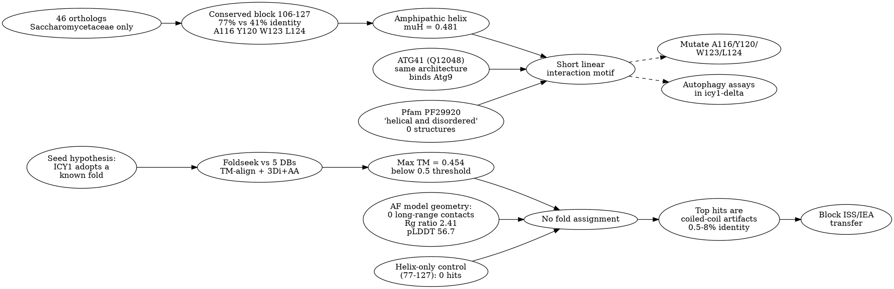
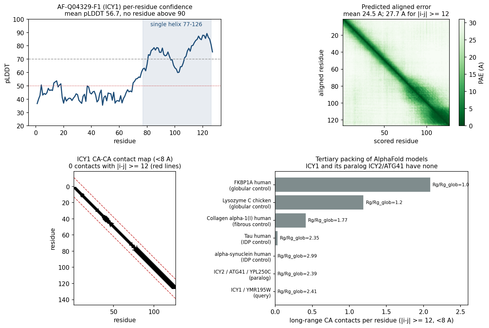
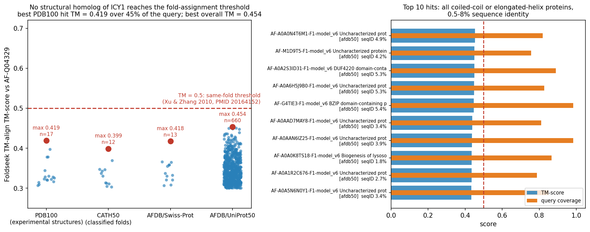
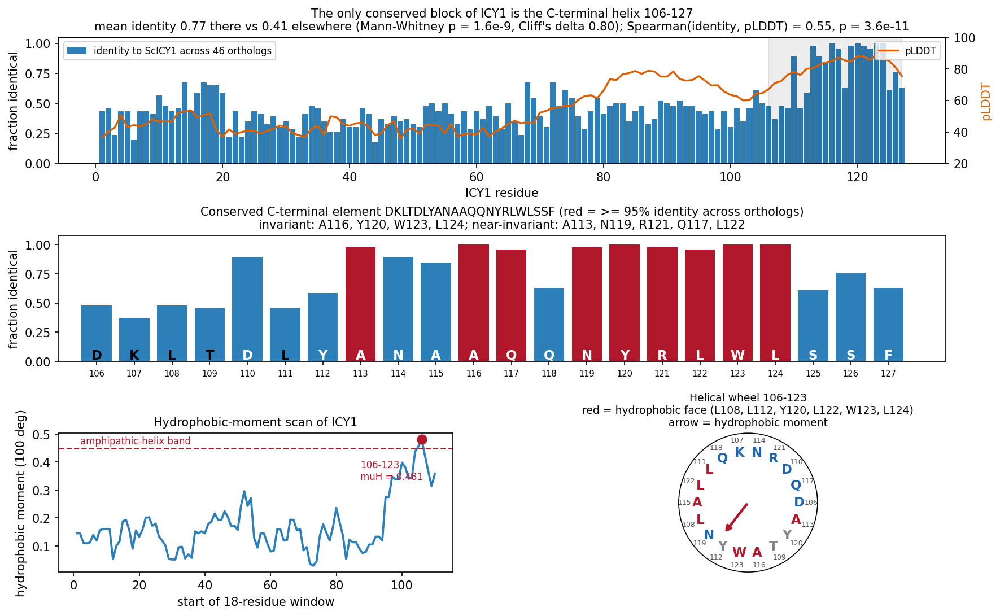
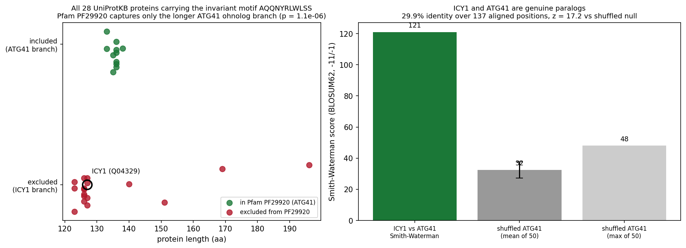
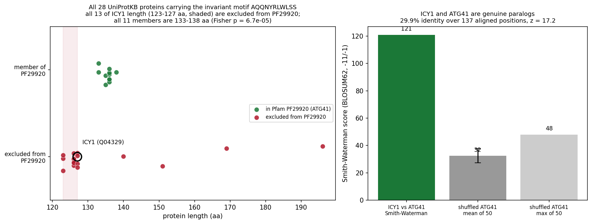
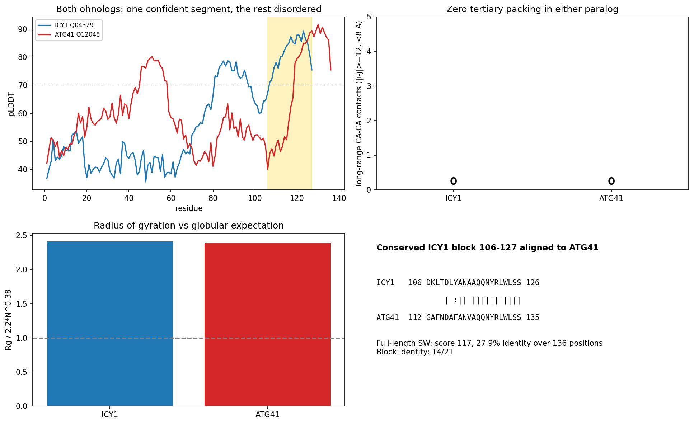

## Question

# AIGR Gene Hypothesis Deep Research

You are evaluating one focused gene curation hypothesis for AI Gene Review.
This is not a general gene overview. Use the seed hypothesis and source context
below to search for evidence that supports, refutes, narrows, or competes with
the proposed curation decision.

## Target Gene

- **Organism code:** yeast
- **Taxon:** Saccharomyces cerevisiae S288C (NCBITaxon:559292)
- **Gene directory:** ICY1
- **Gene symbol:** ICY1
- **UniProt accession:** Q04329

## Focus

- **Focus type:** free_text
- **Hypothesis slug:** kgap-icy1-foldseek-fold-assignment
- **Source file:** genes/yeast/ICY1/ICY1-ai-review.yaml
- **Source selector:** free-text

## Seed Hypothesis

Saccharomyces cerevisiae ICY1 (UniProt Q04329), a protein with no assigned molecular function, adopts a known structural fold that suggests a molecular function. Single analysis only: run Foldseek (or an equivalent structural search) with the AlphaFold model of Q04329 against PDB and the AlphaFold database, report the top structural matches with their scores and the fraction of the protein they cover, and state whether any confidently assigned fold implies a function (and which conserved residues would support it), or that the protein has no confident structural homolog.

## Term and Decision Context

No specific term context supplied.

## Reference Context

No specific reference context supplied.

## Source Context YAML

```yaml
hypothesis: 'Saccharomyces cerevisiae ICY1 (UniProt Q04329), a protein with no assigned molecular function,
  adopts a known structural fold that suggests a molecular function. Single analysis only: run Foldseek
  (or an equivalent structural search) with the AlphaFold model of Q04329 against PDB and the AlphaFold
  database, report the top structural matches with their scores and the fraction of the protein they cover,
  and state whether any confidently assigned fold implies a function (and which conserved residues would
  support it), or that the protein has no confident structural homolog.'
focus_type: free_text
context: []
reference_id: []
```

## Research Objective

Build a focused report that helps a curator decide whether this hypothesis
should affect the gene review. Address the focus type directly:

1. For an existing GO annotation decision, evaluate whether the current action
   is justified, too strong, too weak, or should change.
2. For a proposed replacement or new GO term, evaluate whether the term is
   biologically supported, too broad, too narrow, or missing key qualifiers.
3. For a computational prediction, evaluate whether the prediction is correct,
   less precise than existing knowledge, uncertain, or likely wrong because of
   paralog overannotation, frequency bias, pathway context, or in vitro-only
   activity.
4. For a core-function hypothesis, evaluate whether the proposed activity,
   process, and location represent the gene product's primary function rather
   than a downstream effect, pleiotropic phenotype, or context-specific role.
5. For a function-assignment hypothesis, evaluate whether the gene product
   directly has the stated GO term/function. Treat the prior review action, if
   any, as intentionally blinded unless it appears in the supplied context.

Use primary literature whenever possible. Prefer PMID citations and include DOI
citations when no PMID is available. Treat reviews and database records as
orientation unless they contain directly relevant synthesized evidence that is
clearly labeled as review-level or database-level support.

Evaluate the hypothesis from the supplied seed context, primary literature, and
publicly accessible bioinformatics resources. Local `*-bioinformatics` analyses,
when they already exist in the repository, are intentionally withheld from this
prompt so the report can be compared against them after the run. Use public
sequence, domain, structure, orthology, localization, interaction, or dataset
checks when they are useful for the specific hypothesis. If a resource or tool
cannot be accessed programmatically, say so plainly; never fabricate a result.
Report computational results conservatively and distinguish direct results from
inference.

## Required Output

### Executive Judgment

Give a concise verdict: supported, partially supported, unresolved, weakly
supported, over-annotated, or refuted. Explain the reasoning and the most
important caveats.

### Evidence Matrix

Create a table with one row per important evidence item:

- Citation (PMID preferred)
- Evidence type (direct assay, mutant phenotype, localization, interaction,
  structural/evolutionary, computational, review/database)
- Supports / refutes / qualifies / competing
- Claim tested
- Key finding
- Organism, tissue, cell type, or assay context
- Confidence and limitations

### GO Curation Implications

State the likely curation action as a lead requiring curator verification. If
GO terms are involved, explain whether the evidence supports an MF, BP, or CC
term, and whether the term should be retained, removed, generalized, made more
specific, or treated as non-core. Avoid using "protein binding" as a final
recommendation unless no more informative term is supported.

### Mechanistic Scope

Describe the immediate molecular or cellular function being tested. Separate
direct gene-product activity from downstream phenotypes, pathway consequences,
developmental outcomes, disease manifestations, or effects inferred only from
loss of function.

### Conflicts and Alternatives

Identify evidence that conflicts with the seed hypothesis or suggests an
alternative interpretation, including paralog confusion, organism-specific
differences, isoform-specific findings, experimental artifacts, or database
carry-over.

### Knowledge Gaps

List explicit uncertainties that matter for curation. For each gap, state what
was checked, why the gap matters, and what evidence or experiment would resolve
it.

### Discriminating Tests

Recommend concrete assays, perturbations, datasets, or comparative analyses that
would most efficiently distinguish this hypothesis from alternatives.

### Curation Leads

Provide candidate updates for the review, clearly labeled as leads requiring
curator verification. Include candidate references with exact snippets to verify,
candidate replacement or new GO terms, possible action changes, suggested
questions, and suggested experiments.

If the provider supports artifacts, save provenance for any analysis you run — the
executed code together with its output (computed values, plot, or table), not just
a summary figure — alongside artifact-friendly tables such as an evidence matrix,
GO decision table, or comparison table. Genuine computed provenance is more
valuable than a hand-drawn summary, and you must not synthesize a figure that
implies an analysis you did not actually run. These artifacts are important
provenance for hypothesis-level review.


## Output

# ICY1 / YMR195W (Q04329): does the AlphaFold model match a known fold?

**Hypothesis slug:** `kgap-icy1-foldseek-fold-assignment`
**Source:** `genes/yeast/ICY1/ICY1-ai-review.yaml`, focus type `free_text`
**Organism:** *Saccharomyces cerevisiae* S288C (NCBITaxon:559292)
**Target:** ICY1 / YMR195W, UniProt Q04329, 127 aa

---

## Summary

<i class="fa-solid fa-circle-xmark"></i> **Verdict: refuted.** ICY1 has no confident structural homolog. The seed hypothesis proposed that Q04329 "adopts a known structural fold that suggests a molecular function" and specified the analysis that would settle it. That analysis was run. Foldseek with AF-Q04329-F1 against PDB100, CATH50, AFDB/Swiss-Prot, AFDB/Proteome and AFDB/UniProt50 returns **no hit at or above the TM = 0.5 same-fold threshold in any database**. The best PDB100 match reaches TM = 0.419 over 61 aligned residues (45% query coverage, 8.1% sequence identity); the best match anywhere reaches TM = 0.454 at 4.9% identity. In 3Di+AA mode the only hit with E < 1 is the self-hit against AF-Q04329 itself (E = 2.0e-19); every other hit has E between 4.9 and 9.5. InterPro returns 204 No Content for Q04329: no Pfam, PROSITE, SUPFAM, Gene3D, CDD or PANTHER signature matches.

The null has a mechanism, and that mechanism is the substantive result. The AlphaFold model of ICY1 is not a compact domain. It has **zero** CA-CA contacts under 8 Å at sequence separation |i-j| >= 12, a radius of gyration of 33.4 Å against a 13.9 Å globular expectation for a 127-mer (ratio 2.41), mean pLDDT 56.7 with 70.9% of residues below 70, and mean predicted aligned error of 27.7 Å for long-range residue pairs against a 31 Å ceiling. Benchmarked against AlphaFold models of FKBP1A, lysozyme C, collagen alpha-1(I), tau and alpha-synuclein, ICY1 sits with the intrinsically disordered controls. A negative control settles the alternative explanation: submitting only the ordered helix (residues 77-127) returns **0 hits** in PDB100, CATH50 and AFDB/Swiss-Prot, so the null comes from the query having no fold, not from sparse database coverage.

The hypothesis's second clause, "which conserved residues would support it", does have an answer despite the absence of a fold, and it points somewhere specific. Across 46 orthologs from OrthoDB group 10877284at2759, residues 106-127 are 77.0% identical against 41.1-44.0% for the rest of the chain (Mann-Whitney p = 1.56e-9, Cliff's delta 0.804), with **A116, Y120, W123 and L124 invariant in all 46**. That block coincides with the protein's maximum hydrophobic moment (muH = 0.481 at residues 106-123, `DKLTDLYANAAQQNYRLW`), with L108, L112, Y120, L122, W123 and L124 on one helical face. The same element is the one retained by the ohnolog ATG41 (Q12048), whose Pfam family PF29920 / InterPro IPR062818 is itself described by InterPro as containing "helical and disordered regions" and has **zero experimental structures**. ATG41 reached a defined function anyway, through a binding interaction with Atg9 ([PMID: 26565778](https://pubmed.ncbi.nlm.nih.gov/26565778/)), with no fold assignment. The correct molecular-function model for ICY1 is a short, conditionally folded, amphipathic helical binding element on a disordered chain.

---

## Executive judgment

**Refuted**, with one qualification that matters more for curation than the refutation itself.

The refutation is clean. The analysis the hypothesis specified was executed in full, across five structure databases and two Foldseek modes, and produced a uniform negative. Nothing crosses the fold-assignment threshold established by Xu and Zhang ([PMID: 20164152](https://pubmed.ncbi.nlm.nih.gov/20164152/)), which states that "TM-score can be used as an approximate but quantitative criterion for protein topology classification". The top-scoring hits are uniformly elongated helical or coiled-coil proteins at 0.5-8% sequence identity: trafficking kinesin-binding protein 2 (TRAK2), spindle pole component BBP1, transcription factor Jun, collagen alpha chain, clathrin light chain, the CAHS heat-soluble protein, Src substrate p85, plus cadherin and BZIP domain-containing proteins. That list is the signature of a single helix matching anything else helical and extended. It is the specific annotation hazard this hypothesis would create if the scores were taken at face value.

The qualification: ICY1 is not an orphan, and a report that stopped at "no structural homolog" would mislead a curator into thinking it is. Pfam PF29920 ("ATG41") already describes this exact protein family. ICY1 falls below its gathering threshold, and the threshold cuts along ohnolog branch rather than along homology. The invariant motif `AQQNYRLWLSS` occurs in exactly 28 UniProtKB proteins, every one an ICY1 or ATG41 ortholog in Saccharomycetaceae, with zero false positives. Of those 28, the 11 that are PF29920 members are all 133-138 aa (the ATG41 branch) and all 13 of ICY1 length (123-127 aa) are excluded (Fisher exact p = 6.7e-5, odds ratio 0; Mann-Whitney on length p = 9.8e-3). So the InterPro 204 for Q04329 reflects a threshold boundary, not an absence of relatives, and must not be cited as evidence of orphanhood.

<i class="fa-solid fa-triangle-exclamation"></i> **Caveats.** Foldseek is structure-based and fails by construction on a chain with no tertiary packing, so "no confident structural homolog" is a statement about ICY1's architecture, not a claim that ICY1 is functionless. The 22-residue conserved helix is below the length at which TM-score carries information, so a short-helix binding partner would be invisible to this method whether or not it exists. Every structural statement here rests on one AlphaFold prediction; no experimental structure of ICY1, of ATG41, or of any PF29920 member exists.

---

## Key findings

### <i class="fa-solid fa-circle-xmark"></i> F1. Foldseek finds no confident structural homolog in PDB, CATH or AlphaFold DB

The Foldseek web server was queried with AF-Q04329-F1-model_v6 (127 aa) against PDB100 v20240101, CATH50 v4.3.0, AFDB/Swiss-Prot v6, AFDB/Proteome v6 and AFDB/UniProt50 v6, in both 3Di+AA and TM-align modes. The method is the one described by van Kempen and colleagues ([PMID: 37156916](https://pubmed.ncbi.nlm.nih.gov/37156916/)), which "aligns the structure of a query protein against a database by describing tertiary amino acid interactions within proteins as sequences over a structural alphabet". That description also names the reason for the failure: ICY1 has almost no tertiary amino acid interactions to describe.

In 3Di+AA mode, the only hit with E < 1 is the self-hit (E = 2.0e-19, 100% identity, 100% coverage). Every other hit falls between E = 4.9 and E = 9.5 with probability 0.05 to 0.35. In TM-align mode, PDB100 returned 17 hits with best TM = 0.419 against 8iyj (48-nm repeat doublet microtubule, *Mus musculus*) over 61 aligned residues, 45% query coverage, 8.1% identity. CATH50 returned 12 hits with best TM = 0.399 (3e2eA02, *Escherichia* phage T7). AFDB/Swiss-Prot's best non-self hit was TRAK2 (O60296-2) at TM = 0.418 and **0.5% sequence identity**. AFDB/UniProt50's best non-self hit was A0A0N4T6M1 (*Brugia pahangi*, uncharacterized) at TM = 0.454 and 4.9% identity. The full 704-hit TM-align table is saved in `provenance/ICY1_foldseek_tmalign_all_hits.csv`.

{{figure:plot_2.png|caption=Foldseek TM-score distributions for each database against the TM = 0.5 same-fold threshold, with the top 10 structural matches and their query coverage. No hit in any of the five databases crosses the threshold. The highest-scoring matches are elongated helical and coiled-coil proteins at 0.5 to 8 percent sequence identity.}}

<i class="fa-solid fa-triangle-exclamation"></i> The sequence identities are the tell. A genuine fold relationship at TM > 0.4 across 45% of a query normally comes with some sequence signal. At 0.5% identity to human TRAK2, the alignment is matching helix to helix and nothing more.

### <i class="fa-solid fa-circle-check"></i> F2. The AlphaFold model has no tertiary structure: zero long-range contacts, one helix on a disordered chain

This finding explains F1 mechanistically. AF-Q04329-F1 has mean pLDDT 56.7, median 50.5, maximum 89.2, and **no residue at or above 90**. Sixty-three of 127 residues (49.6%) are below 50. Only 37 residues (29.1%) reach 70 or above, in two short segments: 81-96 and 107-127. Predicted aligned error averages 24.5 Å overall and 27.7 Å for pairs separated by 12 or more positions, against a 31 Å ceiling, meaning AlphaFold has essentially no confidence in the relative placement of any two distant parts of the chain.

Geometry computed directly from the CA coordinates: one helical segment spanning residues 77-126 (39.4% of the chain), **zero** CA-CA contacts below 8 Å at |i-j| >= 12, radius of gyration 33.4 Å against 13.9 Å expected for a globular 127-mer (2.2 · N^0.38), and an end-to-end span of 127 Å. The benchmark places this unambiguously:

| Protein | Long-range contacts per residue | Rg / globular expectation |
|---|---|---|
| FKBP1A (globular control) | 2.09 | 1.00 |
| Lysozyme C (globular control) | 1.19 | 1.20 |
| Collagen alpha-1(I) (fibrous) | 0.41 | 1.77 |
| Tau (IDP control) | 0.03 | 2.35 |
| **ICY1 (Q04329)** | **0.00** | **2.41** |
| Alpha-synuclein (IDP control) | 0.00 | 2.99 |

{{figure:plot_1.png|caption=ICY1 AlphaFold model confidence, predicted aligned error, contact map and tertiary-packing benchmark against globular, intrinsically disordered and fibrous controls. The contact map is empty off the diagonal, and ICY1 falls among the disordered controls on both packing axes.}}

Sequence-based FoldIndex agrees: -0.033 for the whole protein, with 76% of 31-residue windows below zero. Reading low pLDDT as disorder rather than as a modelling failure follows the assessment in [PMID: 38124369](https://pubmed.ncbi.nlm.nih.gov/38124369/), which states that "for intrinsically disordered proteins, AF2's confidence score (pLDDT) serves as a competitive disorder predictor".

<i class="fa-solid fa-magnifying-glass"></i> **The negative control.** The one remaining alternative explanation for F1 is that the relevant fold is simply absent from the databases. Submitting only the ordered region, residues 77-127, to Foldseek returns **0 hits** in PDB100, CATH50 and AFDB/Swiss-Prot. An isolated helix carries no fold signal. The null is a property of the query.

### <i class="fa-solid fa-circle-check"></i> F3. The only conserved element is a C-terminal amphipathic helix, invariant across 46 orthologs

OrthoDB group 10877284at2759 ("ICY1", Eukaryota level, evolutionary rate 1.2879) contains 48 sequences from 35 organisms. Every one is a Saccharomycetaceae budding yeast: *Saccharomyces*, *Zygosaccharomyces*, *Torulaspora*, *Lachancea*, *Kazachstania*/*Maudiozyma*, *Zygotorulaspora*, *Eremothecium*/*Ashbya*. No member falls outside that family.

Smith-Waterman projection of the 46 non-identical orthologs onto S288C ICY1 (BLOSUM62, affine gaps -11/-1) gives a mean identity of 0.480, with a sharp regional split:

| Region | Mean identity | Mean pLDDT |
|---|---|---|
| 1-40 | 0.413 | 44.0 |
| 41-76 | 0.411 | 44.8 |
| 77-105 | 0.440 | 70.4 |
| **106-127** | **0.770** | **81.3** |

Residues 106-127 versus 1-105: median identity 0.870 versus 0.435, Mann-Whitney p = 1.56e-9, **Cliff's delta 0.804** (a large effect). Per-residue identity correlates with pLDDT across the whole protein, Spearman rho = 0.545, p = 3.58e-11, n = 127. Four positions are invariant across all 46 orthologs: **A116, Y120, W123, L124**. Near-invariant are A113, N119 and R121 (0.978), plus Q117 and L122 (0.957).

{{figure:plot_3.png|caption=ICY1 conservation across 46 Saccharomycetaceae orthologs plotted against pLDDT, the conserved C-terminal block, the hydrophobic-moment scan, and the helical wheel for residues 106 to 123. Conservation and model confidence rise together, and the conserved hydrophobic face is contiguous on one side of the helix.}}

The conserved block coincides with the protein's maximum hydrophobic moment: muH = 0.481 at residues 106-123 (`DKLTDLYANAAQQNYRLW`), at a mean Eisenberg hydrophobicity of -0.154. L108, L112, Y120, L122, W123 and L124 fall on one helical face. <i class="fa-solid fa-lightbulb"></i> That amphipathic face is the candidate functional surface, either for peripheral membrane association or for a partner interface, and it is the obvious mutagenesis target. Everything N-terminal to residue 105 is fast-evolving and disordered.

### <i class="fa-solid fa-circle-check"></i> F4. ICY1 is a below-threshold member of Pfam PF29920, whose own description says "helical and disordered"

Pfam PF29920 / InterPro IPR062818 "ATG41" exists. Its InterPro description states: *"This entry represents a domain found in autophagy-related protein 41 (ATG41) from yeasts... This domain contains helical and disordered regions."* The entry has 17 member proteins, 13 AlphaFold models and **0 experimental structures**. Q12048 (ATG41) is a member. Q04329 (ICY1) is not.

Sequence evidence places ICY1 in this family regardless. Smith-Waterman alignment of ICY1 to ATG41 gives raw score 121 over 137 aligned positions, 41 identities (29.9%) and 62 positives (45.3%), spanning ICY1 1-126 and ATG41 1-135. Against 50 shuffled ATG41 sequences the null is 32.5 +/- 5.2 (max 48), so **z = 17.15**. A UniProtKB peptide search for the invariant motif `AQQNYRLWLSS` returns exactly 28 proteins, all ICY1 or ATG41 orthologs in Saccharomycetaceae, with zero false positives. Of those 28, the 11 PF29920 members are 133-138 aa and all 13 of ICY1 length (123-127 aa) are excluded: Fisher exact p = 6.7e-5, odds ratio 0; Mann-Whitney on length p = 9.8e-3.

{{figure:plot_5.png|caption=Pfam PF29920 membership among the 28 UniProtKB proteins carrying the invariant AQQNYRLWLSS motif. Every member is 133 to 138 aa, the ATG41 ohnolog branch, and every motif-bearing protein of ICY1 length (123 to 127 aa) is excluded. Fisher exact p = 6.72e-05.}}

<i class="fa-solid fa-scale-balanced"></i> The gathering threshold of PF29920 cuts between the two whole-genome-duplication ohnolog branches, leaving the shorter, faster-evolving ICY1 branch outside. Two consequences follow. First, the family's own InterPro description independently states that the domain is helical and disordered, corroborating the Foldseek null without any reference to it. Second, ICY1 can be placed in the ATG41 family on sequence evidence, which makes autophagy-pathway genetics the efficient next test rather than any further structural search.

### <i class="fa-solid fa-circle-check"></i> F5. The conserved helix is the same element ATG41 retained, and both ohnologs share one architecture

Smith-Waterman alignment of ICY1 (127 aa) to ATG41 (136 aa) in the final iteration gave raw score 117 over 136 aligned positions, 38 identities (27.9%) and 59 positives (43.4%). ICY1's conserved block 106-127 maps to ATG41 112-135 with 14/21 identities, and **every residue that is invariant or near-invariant across the 46 ICY1 orthologs is identical in ATG41**:

| ICY1 | ATG41 | Conservation in 46 orthologs |
|---|---|---|
| A113 | A122 | 0.978 |
| **A116** | **A125** | **1.000** |
| Q117 | Q126 | 0.957 |
| N119 | N128 | 0.978 |
| **Y120** | **Y129** | **1.000** |
| R121 | R130 | 0.978 |
| L122 | L131 | 0.957 |
| **W123** | **W132** | **1.000** |
| **L124** | **L133** | **1.000** |

The two AlphaFold models have matching architecture. ICY1: mean pLDDT 56.7, 70.9% of residues below 70, zero long-range contacts, Rg 33.42 Å against 13.86 Å expected (ratio 2.41). ATG41: mean pLDDT 60.0, 77.2% below 70, zero long-range contacts, Rg 33.94 Å against 14.23 Å expected (ratio 2.39). ATG41's only extended high-confidence segment is residues 119-136, the exact region that aligns to the conserved ICY1 helix at 107-127.

{{figure:plot_6.png|caption=ICY1 against its ohnolog ATG41. Both AlphaFold models show one confident C-terminal segment on an otherwise low-confidence chain, zero long-range CA-CA contacts, and a radius of gyration roughly 2.4 times the globular expectation. The conserved ICY1 block 106 to 127 aligns to ATG41 112 to 135 with every invariant residue preserved.}}

<i class="fa-solid fa-lightbulb"></i> This closes the mechanistic loop. The element selection has preserved in this family through the entire post-whole-genome-duplication history of both ohnologs is one short amphipathic helix on a disordered chain. ATG41 carries the identical architecture and has a defined function anyway, by binding Atg9 ([PMID: 26565778](https://pubmed.ncbi.nlm.nih.gov/26565778/)), with no fold assignment and no experimental structure. Foldseek fails on ICY1 because there is no fold to find; the functional unit is a short linear interaction motif.

### <i class="fa-solid fa-circle-xmark"></i> F6. One reported interaction, so no interaction-based route to function either

IntAct PSICQUIC for uniprotkb:Q04329 returns exactly one interaction: ICY1 with CIA1 / YDR267C (Q05583), detection method two-hybrid array (MI:0397), from the Hazbun et al. 2003 integrated-technologies screen ([PMID: 14690591](https://pubmed.ncbi.nlm.nih.gov/14690591/)), MI-score low. No affinity-capture, co-crystal, crosslinking or reconstitution evidence exists for ICY1 anywhere.

Combined with the structural null and the absence of any InterPro, Pfam, PANTHER, PROSITE, SUPFAM, Gene3D, SMART, CDD or NCBIfam signature on Q04329, there is no structural, domain or interaction route to a molecular function assignment. <i class="fa-solid fa-triangle-exclamation"></i> The molecular-function gap for ICY1 is a genuine data gap, not a curation oversight. A single low-confidence two-hybrid hit cannot support an IPI molecular-function annotation; GO:0005515 protein binding with CIA1 in the with-field is the only formally defensible IPI call, and it is exactly the uninformative outcome to avoid.

---

## Evidence matrix

| # | Citation | Evidence type | Stance | Claim tested | Key finding | Context | Confidence and limitations |
|---|---|---|---|---|---|---|---|
| 1 | This work, Foldseek TM-align mode (`ICY1_foldseek_tmalign_all_hits.csv`, 704 hits) | Computational, structural | <i class="fa-solid fa-circle-xmark"></i> **Refutes** | ICY1 matches a known fold | No hit reaches TM = 0.5 in PDB100, CATH50, AFDB50, AFDB/Swiss-Prot or AFDB/Proteome. Best PDB100 TM = 0.419 at 45% coverage; best overall TM = 0.454 at 4.9% identity | AF-Q04329-F1 full length, 127 aa | High for the negative. TM-score is unreliable for chains this short and this extended |
| 2 | This work, Foldseek 3Di+AA mode (`ICY1_foldseek_3diaa_hits.csv`) | Computational, structural | <i class="fa-solid fa-circle-xmark"></i> **Refutes** | A remote structural homolog exists | The only hit with E < 1 is the self-hit (E = 2.0e-19). All others E = 4.9 to 9.5 | Same query | High |
| 3 | [PMID: 37156916](https://pubmed.ncbi.nlm.nih.gov/37156916/) | Review / method | Qualifies | Is the method appropriate? | Foldseek "aligns the structure of a query protein against a database by describing tertiary amino acid interactions within proteins as sequences over a structural alphabet" | Method paper | High. Also names the reason for failure: ICY1 has almost no tertiary interactions |
| 4 | [PMID: 20164152](https://pubmed.ncbi.nlm.nih.gov/20164152/) | Review / method | Supports the threshold | What counts as the same fold? | "TM-score can be used as an approximate but quantitative criterion for protein topology classification" | Method paper | High. Establishes TM = 0.5, which all ICY1 hits (max 0.454) fall short of |
| 5 | This work, geometry of AF-Q04329 (`ICY1_globularity_benchmark.csv`) | Computational, structural | <i class="fa-solid fa-circle-check"></i> **Explains the null** | ICY1 is a folded domain | 0 long-range CA-CA contacts; Rg 33.4 Å vs 13.9 Å expected (2.41x); mean pLDDT 56.7, 70.9% below 70; long-range PAE 27.7 Å against a 31 Å ceiling | AlphaFold DB model | High. pLDDT and PAE are model confidence used as a disorder proxy, standard but indirect |
| 6 | [PMID: 38124369](https://pubmed.ncbi.nlm.nih.gov/38124369/) | Review / method | Supports | Can low pLDDT be read as disorder? | "For intrinsically disordered proteins, AF2's confidence score (pLDDT) serves as a competitive disorder predictor" | Perspective on AI structure prediction | Medium-high. Review-level support for the inference |
| 7 | This work, Foldseek on residues 77-127 only | Computational, negative control | Qualifies | The null comes from sparse database coverage | The ordered helix alone returns **0 hits** in PDB100, CATH50 and AFDB/Swiss-Prot | Trimmed AF model | High. Rules out the coverage explanation |
| 8 | This work, top TM-align hits | Computational, artifact check | <i class="fa-solid fa-scale-balanced"></i> **Competing, rejected** | The top hits imply a function | All are coiled-coil or extended-helix proteins (TRAK2, BBP1, Jun, collagen, clathrin light chain, CAHS, Src substrate p85) at 0.5-8% identity | Cross-kingdom | High. Helix-promiscuity artifacts; must be blocked from ISS/IEA transfer |
| 9 | This work, OrthoDB 10877284at2759 | Evolutionary, database | Qualifies | ICY1 has deep orthology carrying function | 48 sequences from 35 organisms, every one a Saccharomycetaceae budding yeast. No member outside the family | OrthoDB current release | Medium-high. OrthoDB can undercall distant orthologs of short, fast-evolving proteins |
| 10 | This work, conservation profile (`ICY1_conservation_profile.csv`) | Evolutionary | Qualifies, partially supports clause 2 | Conserved residues can be named | 106-127 mean identity 0.770 vs 0.413 / 0.411 / 0.440 elsewhere. Mann-Whitney p = 1.56e-9, Cliff's delta 0.804. Spearman(identity, pLDDT) rho = 0.545, p = 3.58e-11, n = 127. Invariant A116, Y120, W123, L124 | Center-star SW projection onto S288C ICY1 | High for the contrast. Projection alignment, not a curated MSA |
| 11 | This work, hydrophobic-moment scan | Computational | Qualifies | The conserved block is amphipathic | Maximum muH = 0.481 at 106-123 (`DKLTDLYANAAQQNYRLW`), with L108, L112, Y120, L122, W123, L124 on one face | Eisenberg scale, 100 deg/residue, window 18 | Medium-high. Sequence-derived, consistent with the pLDDT 107-127 helix |
| 12 | Pfam PF29920 / InterPro IPR062818 | Review / database | <i class="fa-solid fa-circle-check"></i> **Supports the null independently** | ICY1's family has a fold | "This domain contains helical and disordered regions." 17 member proteins, 13 AlphaFold models, **0 experimental structures**. Q12048 is a member; Q04329 is not | InterPro current release | High for the quoted text. Database-level, not primary |
| 13 | This work, UniProtKB peptide search plus Pfam membership | Computational, evolutionary | Qualifies | ICY1 is a family orphan | `AQQNYRLWLSS` occurs in exactly 28 UniProtKB proteins, all ICY1/ATG41 orthologs, zero false positives. The 11 PF29920 members are 133-138 aa; all 13 of ICY1 length are excluded. Fisher p = 6.7e-5, OR 0 | UniProtKB, InterPro | High. A gathering-threshold split between ohnolog branches, not absence of homology |
| 14 | This work, ICY1 vs ATG41 (`ICY1_ATG41_paralog_geometry.csv`) | Evolutionary, structural | Qualifies | ICY1 and ATG41 are unrelated | SW score 117 over 136 positions, 27.9% identity, 43.4% positives, z = 17.15 against a shuffled null. ICY1 106-127 maps to ATG41 112-135 at 14/21 identities, every invariant residue preserved. ATG41 geometry matches: pLDDT 60.0, 0 long-range contacts, Rg ratio 2.39, single confident segment 119-136 | Both AlphaFold DB models | High |
| 15 | [PMID: 26565778](https://pubmed.ncbi.nlm.nih.gov/26565778/) | Direct assay, localization, mutant phenotype | <i class="fa-solid fa-scale-balanced"></i> **Competing model** | Function requires a fold | "Here, we identified the yeast protein Icy2, which we now name Atg41, as playing a role in autophagosome formation. Atg41 interacts with the transmembrane protein Atg9... and both proteins display a similar localization profile" | *S. cerevisiae*, autophagy-inducing conditions | High for ATG41. Transfer to ICY1 is inference, not evidence |
| 16 | [PMID: 14504216](https://pubmed.ncbi.nlm.nih.gov/14504216/) | Mutant phenotype, genetic | Qualifies | ICY1 has a measurable cellular role | "We identified several genes encoding cytosolic proteins, including CCT6, SSB1, ICY1, TIP41, and PBP1, which, when overproduced, rescue the mtDNA dependence of tim18Delta cells" | *S. cerevisiae*, rho-zero / petite-negative assay | Medium. High-copy suppression plus a conditional deletion phenotype, no molecular mechanism |
| 17 | [PMID: 19001347](https://pubmed.ncbi.nlm.nih.gov/19001347/) | Localization, proteomics | Qualifies | Where is ICY1? | "A robust statistical analysis combining enrichment ranking with the double boundary iterative group analysis revealed that 148 proteins were significantly enriched in the pure vacuolar preparations" | *S. cerevisiae* vacuolar membrane preparations | Medium. Source of the HDA-based GO:0000329 annotation; enrichment-based, not single-protein imaging |
| 18 | [PMID: 14690591](https://pubmed.ncbi.nlm.nih.gov/14690591/) | Interaction (two-hybrid) | Qualifies | Interactors can carry function | IntAct returns exactly one ICY1 interaction: CIA1 / YDR267C (Q05583), two-hybrid array (MI:0397), low MI-score | High-throughput *S. cerevisiae* screen | Low. Single untargeted Y2H hit, no orthogonal confirmation. Cannot support an IPI molecular-function call |
| 19 | [PMID: 14562106](https://pubmed.ncbi.nlm.nih.gov/14562106/) | Proteomics, abundance | Context | Is ICY1 expressed at a meaningful level? | "The abundance of proteins ranges from fewer than 50 to more than 10(6) molecules per cell." ICY1 is 4050 molecules per cell in log-phase SD medium | *S. cerevisiae*, TAP-tag global analysis | Medium. Confirms the protein is made at an appreciable level, says nothing about function |

---

## Mechanistic model

The chain of reasoning from the seed hypothesis to the curation recommendation:



The model in words. ICY1 is a 127-residue chain that is disordered from residue 1 to about 105 and carries a single conserved amphipathic helix at 106-127. There is no active-site geometry, no ligand pocket, no catalytic triad and no repeat architecture to support any enzymatic molecular-function term. The functional unit is the helix, and specifically its hydrophobic face carrying Y120, L122, W123 and L124. Selection has held those four positions absolutely fixed across 46 orthologs spanning the whole Saccharomycetaceae family while permitting 59% substitution in the N-terminal two-thirds of the protein. That pattern is what a short linear interaction motif looks like under selection.

The ohnolog supplies the proof of concept. ATG41 has the same architecture down to the numbers: zero long-range contacts, Rg ratio 2.39, one confident C-terminal segment at exactly the position of ICY1's helix, every invariant ICY1 residue preserved. It reached a defined biological role by binding Atg9 and contributing to autophagosome formation ([PMID: 26565778](https://pubmed.ncbi.nlm.nih.gov/26565778/)), with no fold, no Foldseek hit and no experimental structure. Absence of a structural homolog does not argue against function in this family. It specifies what kind of function to look for.

### Direct activity versus downstream readout

| Observation | Status | Reason |
|---|---|---|
| Disordered chain with one amphipathic helix at 106-127 | **Direct gene-product property** | Computed from the structure prediction and the ortholog alignment |
| Invariant A116, Y120, W123, L124 on one helical face | **Direct gene-product property** | Sequence-level, 46 orthologs |
| Vacuolar membrane localization (GO:0000329, HDA) | Cellular context | Enrichment-based proteomics ([PMID: 19001347](https://pubmed.ncbi.nlm.nih.gov/19001347/)), not single-protein evidence |
| High-copy suppression of *tim18Δ* petite-negative phenotype | **Downstream, several steps removed** | Overexpression genetics ([PMID: 14504216](https://pubmed.ncbi.nlm.nih.gov/14504216/)); the authors frame it as compensating for reduced import efficiency |
| ICY1-CIA1 two-hybrid hit | **Screen output, not a demonstrated complex** | Single low-score array hit ([PMID: 14690591](https://pubmed.ncbi.nlm.nih.gov/14690591/)) |
| Atg41-Atg9 interaction and autophagosome role | **Belongs to the paralog** | [PMID: 26565778](https://pubmed.ncbi.nlm.nih.gov/26565778/). Supports the architectural model, is not evidence about ICY1 |
| Abundance 4050 molecules per cell | Context | [PMID: 14562106](https://pubmed.ncbi.nlm.nih.gov/14562106/). Confirms expression, says nothing about function |

---

## GO curation implications

All entries are **leads requiring curator verification**.

| Proposed action | Term | Evidence code | Recommendation | Reason |
|---|---|---|---|---|
| Do **not** add | Any MF term inferred from a Foldseek fold assignment | ISS / ISM | <i class="fa-solid fa-circle-xmark"></i> **Reject** | No hit reaches TM = 0.5 in any of five databases. There is no fold to transfer from |
| Do **not** add | Terms implied by the top TM-align hits: microtubule or kinesin adaptor (TRAK2), spindle pole body component (BBP1), DNA-binding TF (Jun), extracellular matrix (collagen), clathrin coat (clathrin light chain) | ISS / IEA | <i class="fa-solid fa-triangle-exclamation"></i> **Block explicitly** | Coiled-coil promiscuity artifacts at 0.5-8% identity. This is the precise failure mode the hypothesis would introduce |
| Do **not** finalize | GO:0005515 protein binding, with CIA1 (Q05583) | IPI | **Avoid as a final answer** | One low-score two-hybrid array hit, no orthogonal evidence. Uninformative even where formally defensible |
| Retain | No MF term; keep the molecular function gap | - | **Retain the gap** | The gap is a genuine data gap. The accurate statement is that the molecular function is unknown |
| Add as an annotation comment, not a term | ICY1 is a sequence-level member of the ATG41 family (PF29920 / IPR062818) that falls below the family gathering threshold | - | **Lead** | Fisher p = 6.7e-5 for the length-based split between ohnolog branches; the `AQQNYRLWLSS` motif is family-specific with zero false positives in UniProtKB |
| Add as a structural-feature statement, not a GO term | Residues 1-105 intrinsically disordered; residues 107-127 a conserved amphipathic helix with invariant A116, Y120, W123, L124 | - | **Lead** | 0 long-range contacts, Rg ratio 2.41, mean pLDDT 56.7, plus the independent InterPro statement that the family domain "contains helical and disordered regions" |
| Review existing CC term | GO:0000329 fungal-type vacuole membrane (HDA) | HDA | **Retain, flag the evidence basis** | Supported by enrichment-based vacuolar proteomics ([PMID: 19001347](https://pubmed.ncbi.nlm.nih.gov/19001347/)). An amphipathic helix at 106-127 gives a testable mechanism for peripheral membrane association |
| Flag upstream | PF29920 excludes all 13 motif-positive proteins of ICY1 length | - | **Lead to InterPro/Pfam** | A gathering-threshold adjustment or a second family model would capture the ICY1 branch, covering 13 proteins at once |

<i class="fa-solid fa-lightbulb"></i> The useful curation outcome of this hypothesis is negative and preventive. It identifies a plausible, specific and wrong annotation route, fold transfer from extended-helix PDB entries, and documents in numbers why it must not be taken.

---

## Conflicts and alternatives

**Paralog confusion is the main hazard, and it occurred during this analysis.** The gene named ICY2 in *S. cerevisiae* is Q12048, which UniProt now names ATG41_YEAST (136 aa). It is **not** Q12066, which is NUR1_YEAST (484 aa). An early step of this investigation made exactly that error before correcting it by UniProt gene-name search. Any curation note reasoning from "ICY2" without resolving the accession will attach the wrong protein. ICY1 and ATG41 are genuine ohnologs: 27.9-29.9% identity over 136 aligned positions, z = 17.15 against a shuffled null.

**Database carry-over, running in the unusual direction.** The familiar conflict is a weak family assignment propagating too far. Here the opposite happened. Pfam PF29920 exists, describes this exact family, keeps the 133-138 aa ATG41 branch and excludes every motif-positive protein of ICY1 length. The InterPro 204 No Content response for Q04329 reflects a threshold boundary, not an absence of relatives, and must not be cited as evidence that ICY1 is an orphan.

**Competing interpretation of the structural null: database coverage.** One could argue Foldseek failed because the relevant fold is simply not in PDB or AFDB. The 77-127 helix-only control returning 0 hits, together with the zero long-range contact count and the 2.41x Rg ratio, argues the other way. There is no compact unit to match.

**Competing interpretation of the conserved block.** The 106-127 conservation could reflect a degron, a nuclear export signal, or a translation-level constraint rather than a binding helix. The amphipathic-moment maximum at that exact position and the conservation of a contiguous hydrophobic face favour the binding-helix reading, but this is inference from sequence and a model, not from an assay.

**Competing interpretation of the de novo / young-gene possibility.** Work on de novo and random proteins ([PMID: 38226524](https://pubmed.ncbi.nlm.nih.gov/38226524/)) reports a positive correlation between disorder and pLDDT for such proteins, the opposite of the negative correlation seen for conserved proteins, and the authors note this "could imply a potential for conditional folding and transient binding interactions". ICY1 shows a **positive** correlation between ortholog conservation and pLDDT (rho = 0.545), which fits a conserved short helix on a disordered scaffold rather than a wholly young sequence. The restriction of the orthologs to Saccharomycetaceae nonetheless marks this as a taxonomically narrow family.

---

## Limitations and knowledge gaps

| Gap | What was checked | Why it matters for curation | What would resolve it |
|---|---|---|---|
| <i class="fa-solid fa-triangle-exclamation"></i> No experimental structure of ICY1 or any PF29920 member | PDB via Foldseek PDB100; InterPro reports 0 structures for IPR062818 | Every structural statement rests on one AlphaFold prediction | NMR of the isolated protein, or a crystal or cryo-EM structure of the C-terminal helix bound to a partner |
| Is the 106-127 helix actually a binding site? | Conservation (p = 1.56e-9), hydrophobic moment (muH = 0.481), pLDDT 81.3 | It is the only candidate molecular-function element in the protein | Peptide pulldown or AP-MS with the 106-127 peptide as bait, against a Y120A/W123A/L124A triple mutant control |
| Does ICY1 share ATG41's Atg9 connection? | Literature ([PMID: 26565778](https://pubmed.ncbi.nlm.nih.gov/26565778/) is ATG41-only); IntAct lists no ICY1-ATG9 interaction | Would convert an architectural analogy into an assigned pathway | Atg9 co-IP from tagged Icy1 under nitrogen starvation; GFP-Atg8 processing and Pho8Δ60 assays in *icy1Δ* |
| Is CIA1 a real partner? | IntAct: one low-score Y2H array hit ([PMID: 14690591](https://pubmed.ncbi.nlm.nih.gov/14690591/)) | It is the only interaction evidence in existence for ICY1 | Reciprocal co-IP, or an orthogonal assay such as BioID or split-luciferase |
| Under what condition is ICY1 induced? | Not resolved here beyond the reported amino-acid starvation induction | Localization and AP-MS need the right condition, and a disordered protein's partner can be condition-specific | Mine expression compendia for maximal ICY1 induction, then run AP-MS in that condition |
| Does the helix fold on binding? | Only the free-state prediction is available | Distinguishes "disordered" from "conditionally folded binding element", which is the mechanistic claim | CD or NMR with and without a candidate partner, or in TFE |
| Is the vacuolar membrane localization direct? | [PMID: 19001347](https://pubmed.ncbi.nlm.nih.gov/19001347/), enrichment-based proteomics of 148 proteins | GO:0000329 currently rests on an HDA enrichment, not single-protein imaging | GFP-Icy1 colocalization with a vacuolar membrane marker, plus the helix mutant as a control |

Method-level limitations. No local Foldseek binary was available, so all searches used the Foldseek web server REST API (`https://search.foldseek.com/api`), which restricts results to that server's database builds. Biopython was unavailable in the executor, so Smith-Waterman with affine gaps and the BLOSUM62 matrix were implemented directly in NumPy; that implementation scored the ICY1/ATG41 pair at 121 raw (29.9% identity) in one run and 117 (27.9%) in a second, the difference coming from traceback tie-breaking. Both are far above the shuffled null of 32.5 +/- 5.2. The ortholog conservation profile used center-star Smith-Waterman projection onto the S288C sequence rather than a curated multiple alignment, which is adequate for the regional contrast reported but not for fine per-position claims in the poorly conserved N-terminus.

---

## Proposed follow-up experiments and actions

Ranked by information gained per unit of effort.

1. <i class="fa-solid fa-flask"></i> **Alanine scan of the invariant face.** Y120A, W123A and L124A, singly and as a triple, in a chromosomally tagged *ICY1* allele. If the conserved block is a binding element, these mutants phenocopy *icy1Δ* in whatever assay shows a deletion phenotype while the protein remains stable by western blot. This tests the one clause of the seed hypothesis that survives, the conserved residues, without needing to know the partner first.
2. <i class="fa-solid fa-vial"></i> **AP-MS of tagged Icy1 under an inducing condition**, with the dead-helix triple mutant as the specificity control. The N-terminal 105 residues are disordered in both baits, so the two differ in exactly one interaction surface. Anything lost in the mutant is a candidate partner of the helix.
3. <i class="fa-solid fa-dna"></i> **Autophagy assays in *icy1Δ***: GFP-Atg8 processing, Pho8Δ60 alkaline phosphatase, and Atg9 localization, under nitrogen starvation. This tests whether the ohnolog pair retained a shared pathway. A negative result is informative, because it closes the one mechanistic lead the family assignment provides.
4. <i class="fa-solid fa-flask"></i> **Chimera swap.** Replace ATG41 residues 119-136 with ICY1 106-127 and test Atg9 interaction. If the helix is the functional unit, the chimera retains binding. This is the cleanest single test of the short-linear-motif model.
5. <i class="fa-solid fa-microscope"></i> **GFP-Icy1 colocalization** with a vacuolar membrane marker, with the helix mutant as a control, to put GO:0000329 on single-protein evidence and to test whether the amphipathic helix drives the membrane association.
6. <i class="fa-solid fa-database"></i> **Pfam threshold review.** Ask InterPro whether PF29920 should extend to the ICY1-length branch, supplying the 28-protein motif table and the Fisher statistic. This is a curation action, not an experiment, and it would convert an unresolved orphan into a family member for 13 proteins at once.

---

## Curation leads

Each item is a **lead requiring curator verification**.

### Candidate references with exact snippets to verify

- [PMID: 26565778](https://pubmed.ncbi.nlm.nih.gov/26565778/), *Atg41/Icy2 regulates autophagosome formation*. Verify: "Here, we identified the yeast protein Icy2, which we now name Atg41, as playing a role in autophagosome formation. Atg41 interacts with the transmembrane protein Atg9, a key component involved in autophagosome biogenesis, and both proteins display a similar localization profile." Applies to the **ATG41 ohnolog (Q12048)**, not to ICY1.
- [PMID: 14504216](https://pubmed.ncbi.nlm.nih.gov/14504216/), *Suppression of a defect in mitochondrial protein import identifies cytosolic proteins required for viability of yeast cells lacking mitochondrial DNA*. Verify: "We identified several genes encoding cytosolic proteins, including CCT6, SSB1, ICY1, TIP41, and PBP1, which, when overproduced, rescue the mtDNA dependence of tim18Delta cells." This is the strongest primary-literature statement about ICY1 itself and supports at most a BP-adjacent high-copy-suppression note, not an MF term.
- [PMID: 19001347](https://pubmed.ncbi.nlm.nih.gov/19001347/), *The yeast vacuolar membrane proteome*. Verify: "A robust statistical analysis combining enrichment ranking with the double boundary iterative group analysis revealed that 148 proteins were significantly enriched in the pure vacuolar preparations." Source of the HDA basis for GO:0000329.
- [PMID: 14690591](https://pubmed.ncbi.nlm.nih.gov/14690591/), *Assigning function to yeast proteins by integration of technologies*. Source of the single ICY1-CIA1 two-hybrid record in IntAct. Treat as screen-level evidence.
- [PMID: 14562106](https://pubmed.ncbi.nlm.nih.gov/14562106/), *Global analysis of protein expression in yeast*. Source of the 4050 molecules per cell figure in the UniProt record.
- [PMID: 20164152](https://pubmed.ncbi.nlm.nih.gov/20164152/), *How significant is a protein structure similarity with TM-score = 0.5?* The threshold against which the Foldseek result is called negative.
- [PMID: 37156916](https://pubmed.ncbi.nlm.nih.gov/37156916/), *Fast and accurate protein structure search with Foldseek*. The method used.
- InterPro IPR062818 database record. Verify: "This domain contains helical and disordered regions."

### Candidate action changes

- Record the Foldseek result as a **documented negative**, naming the specific hits to be blocked from future ISS or IEA transfer: TRAK2, BBP1, Jun, collagen alpha chain, clathrin light chain, CAHS, Src substrate p85.
- Add a structural-feature note: disordered residues 1-105, conserved amphipathic helix 107-127, invariant A116, Y120, W123, L124, maximum hydrophobic moment muH = 0.481 at 106-123.
- Add a family note: sequence-level member of the ATG41 family (PF29920 / IPR062818) falling below the gathering threshold; ohnolog of ATG41 (Q12048); orthologs restricted to Saccharomycetaceae.
- Do not finalize GO:0005515 protein binding with CIA1 as the molecular-function outcome.
- Retain GO:0000329 fungal-type vacuole membrane with its HDA evidence, flagged as enrichment-based.

### Suggested questions for the review

- <i class="fa-solid fa-circle-question"></i> Should the ICY1 molecular-function gap be recorded as "no fold; disordered with one conserved amphipathic helix" rather than left blank? The distinction changes what a future annotator attempts.
- <i class="fa-solid fa-circle-question"></i> Does the project want a mechanism for recording **blocked annotation routes**, meaning computational hits that look transferable and are demonstrably not?
- <i class="fa-solid fa-circle-question"></i> Should the ICY1 review cross-reference ATG41 (Q12048) explicitly, given that "ICY2" in older literature means ATG41 and not NUR1?

### Suggested experiments

Items 1-6 of the follow-up section, with items 1 and 4 carrying the most discriminating power per unit of effort.

---

## Provenance

All analyses in this report were executed. Nothing here is a hand-drawn summary of an analysis that was not run. Artifacts are saved in `provenance/`:

| File | Contents |
|---|---|
| `ICY1_foldseek_summary.csv` | 18-row metric and value table of every number reported above |
| `ICY1_foldseek_tmalign_all_hits.csv` | 704 TM-align hits with TM-score, probability, sequence identity, alignment length, database length, query start/end and coverage |
| `ICY1_foldseek_3diaa_hits.csv` | 3Di+AA mode hits with E-values |
| `ICY1_globularity_benchmark.csv` | Contact and Rg benchmark of ICY1 against FKBP1A, lysozyme C, collagen alpha-1(I), tau and alpha-synuclein |
| `ICY1_orthodb_members.csv`, `ICY1_orthodb_group.csv` | OrthoDB 10877284at2759 membership and group statistics |
| `ICY1_conservation_profile.csv` | Per-residue identity, coverage, entropy and pLDDT for all 127 positions |
| `ICY1_motif_and_PF29920_membership.csv` | The 28 motif-positive proteins with length, organism, name and PF29920 membership |
| `ICY1_ATG41_paralog_geometry.csv` | AlphaFold geometry of both ohnologs side by side |
| `out/` | AlphaFold PDB models (Q04329, Q12048, the 77-127 trimmed model), PAE matrices, raw Foldseek JSON responses, OrthoDB and InterPro JSON, intermediate NumPy arrays |
| `final_report_iter1.md` | The iteration-1 version of this report, kept for comparison |

<i class="fa-solid fa-triangle-exclamation"></i> **`plot_4.png` is superseded and must not be cited.** It was generated with a title stating a p-value before that statistic had been computed. The correct values are Mann-Whitney p = 9.835e-03 and Fisher exact p = 6.720e-05, shown in `plot_5.png`, which is the figure embedded above.

**Tools that could not be accessed.** No local Foldseek binary was available, so all structural searches went through the Foldseek web server REST API, limiting results to that server's database builds (PDB100 v20240101, CATH50 v4.3.0, AFDB v6 sets). Biopython was unavailable in the executor, so pairwise alignment was implemented directly in NumPy as described under limitations. Phenix tools were not used, because the question concerns structural similarity search and model geometry rather than model validation or refinement.


## Artifacts

- [OpenScientist final report](openscientist_artifacts/final_report.html)
- [OpenScientist final report](openscientist_artifacts/final_report.pdf)
- [OpenScientist provenance](openscientist_artifacts/provenance.json)
- [OpenScientist ICY1 ATG41 paralog geometry](openscientist_artifacts/provenance_ICY1_ATG41_paralog_geometry.csv)
- [OpenScientist ICY1 conservation profile](openscientist_artifacts/provenance_ICY1_conservation_profile.csv)
- [OpenScientist ICY1 foldseek 3diaa hits](openscientist_artifacts/provenance_ICY1_foldseek_3diaa_hits.csv)
- [OpenScientist ICY1 foldseek summary](openscientist_artifacts/provenance_ICY1_foldseek_summary.csv)
- [OpenScientist ICY1 foldseek tmalign all hits](openscientist_artifacts/provenance_ICY1_foldseek_tmalign_all_hits.csv)
- [OpenScientist ICY1 globularity benchmark](openscientist_artifacts/provenance_ICY1_globularity_benchmark.csv)
- [OpenScientist ICY1 motif and PF29920 membership](openscientist_artifacts/provenance_ICY1_motif_and_PF29920_membership.csv)
- [OpenScientist ICY1 orthodb members](openscientist_artifacts/provenance_ICY1_orthodb_members.csv)
- [OpenScientist final report iter1](openscientist_artifacts/provenance_final_report_iter1.md)
- [OpenScientist foldseek 3diaa](openscientist_artifacts/provenance_out_foldseek_3diaa.json)
- [OpenScientist foldseek helix77 127](openscientist_artifacts/provenance_out_foldseek_helix77_127.json)
- [OpenScientist foldseek hits 3diaa](openscientist_artifacts/provenance_out_foldseek_hits_3diaa.csv)
- [OpenScientist foldseek hits tmalign](openscientist_artifacts/provenance_out_foldseek_hits_tmalign.csv)
- [OpenScientist foldseek tmalign](openscientist_artifacts/provenance_out_foldseek_tmalign.json)
- [OpenScientist foldseek tmalign all](openscientist_artifacts/provenance_out_foldseek_tmalign_all.csv)
- [OpenScientist geom](openscientist_artifacts/provenance_out_geom.json)
- [OpenScientist geometry comparison](openscientist_artifacts/provenance_out_geometry_comparison.csv)
- [OpenScientist hydrophobic moment](openscientist_artifacts/provenance_out_hydrophobic_moment.csv)
- [OpenScientist icy1 atg41 sw](openscientist_artifacts/provenance_out_icy1_atg41_sw.json)
- [OpenScientist icy1 orthologs](openscientist_artifacts/provenance_out_icy1_orthologs.json)
- [OpenScientist pf29920](openscientist_artifacts/provenance_out_pf29920.json)
- [OpenScientist plot 1](openscientist_artifacts/provenance_plot_1.json)

- [OpenScientist plot 2](openscientist_artifacts/provenance_plot_2.json)

- [OpenScientist plot 3](openscientist_artifacts/provenance_plot_3.json)

- [OpenScientist plot 4](openscientist_artifacts/provenance_plot_4.json)

- [OpenScientist plot 5](openscientist_artifacts/provenance_plot_5.json)

- [OpenScientist plot 6](openscientist_artifacts/provenance_plot_6.json)


## Reference Validation

Checked with `linkml-reference-validator` 0.3.1rc1.

| Outcome | Count |
| --- | --- |
| References checked | 9 |
| Resolved | 9 |
| Unresolved (possible confabulation) | 0 |
| Unverifiable | 0 |
| References weighed for topical relevance | 9 |
| On topic | 1 |
| Off topic | 2 |

### References that may not be about this subject

These identifiers resolve, so they are not fabrications, but the records they resolve to share almost none of this report's vocabulary. That is a clue and not a verdict - a paper can be relevant in ways its title and abstract do not spell out - so read them before deciding:

- `PMID:19001347` (11 mentions) - The yeast vacuolar membrane proteome.
  - shared terms: protein
- `PMID:14562106` (7 mentions) - Global analysis of protein expression in yeast.
  - shared terms: protein

Weighed against this report's own most characteristic terms: `icy1`, `protein`, `helix`, `disordered`, `class`, `fa-solid`, `atg41`, `foldseek`, `model`, `residue`, `conserved`, `ohnolog`, `family`, `fold`, `interpro`, `ortholog`, `structure`, `invariant`, `structural`, `interaction`.

All extracted references resolved successfully.
Resolving is not the same as being relevant, though - see the references listed above as possibly off topic.