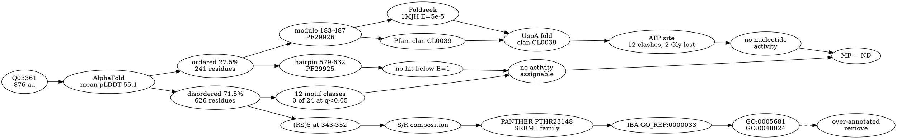
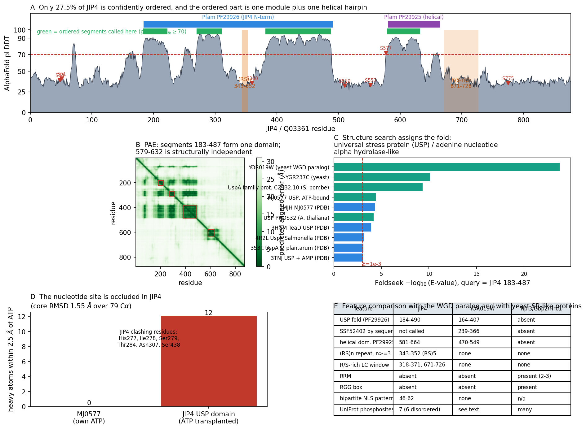
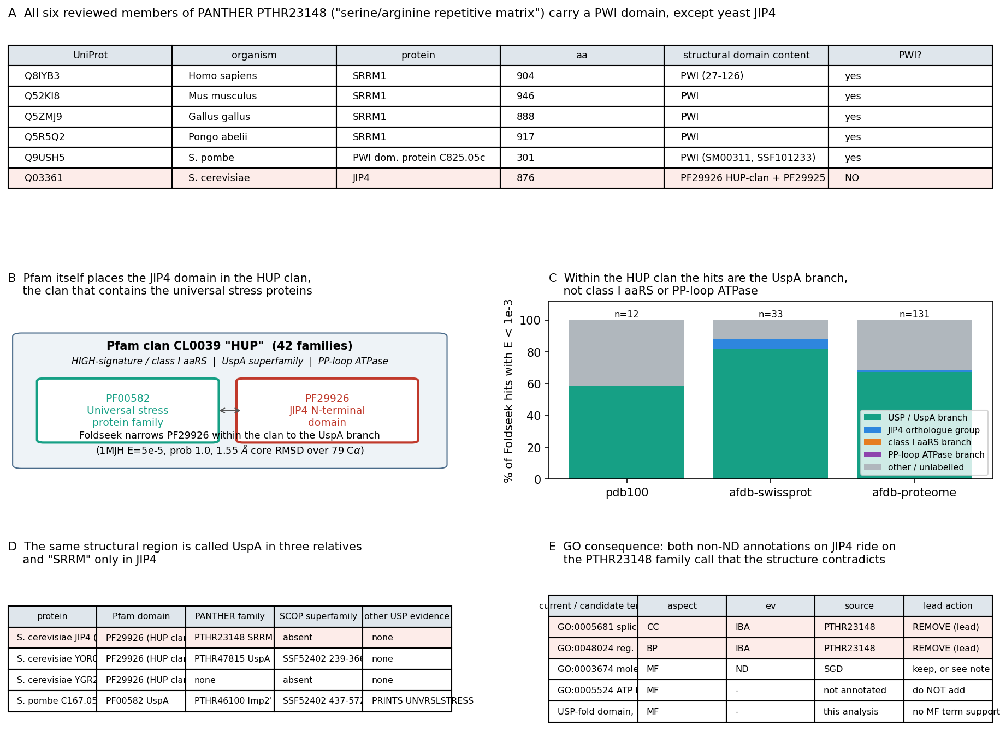
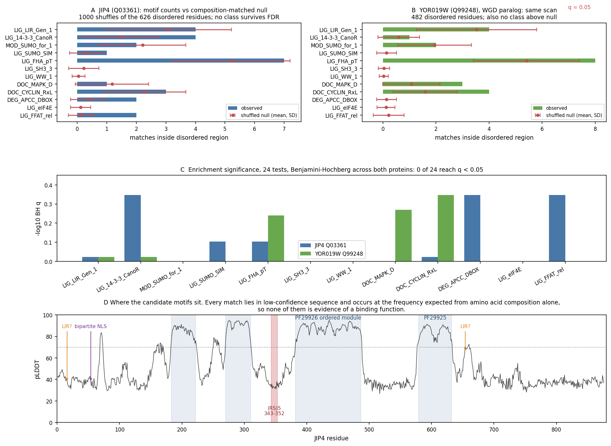

## Question

# AIGR Gene Hypothesis Deep Research

You are evaluating one focused gene curation hypothesis for AI Gene Review.
This is not a general gene overview. Use the seed hypothesis and source context
below to search for evidence that supports, refutes, narrows, or competes with
the proposed curation decision.

## Target Gene

- **Organism code:** yeast
- **Taxon:** Saccharomyces cerevisiae S288C (NCBITaxon:559292)
- **Gene directory:** JIP4
- **Gene symbol:** JIP4
- **UniProt accession:** Q03361

## Focus

- **Focus type:** free_text
- **Hypothesis slug:** kgap-jip4-fold-and-motifs
- **Source file:** genes/yeast/JIP4/JIP4-ai-review.yaml
- **Source selector:** free-text

## Seed Hypothesis

Whether yeast JIP4 (Q03361) has any recognisable fold or functional module may be settled by structure-based search rather than by sequence. That the protein is largely disordered, lacks a PWI or RRM domain, is phosphorylated in vivo and sits in PTHR23148 is already established, so do not re-derive it. Single analysis only: take the AlphaFold model, map per-residue confidence, and submit every segment that is confidently ordered to a structure-based search against the PDB and against AlphaFold-derived databases, reporting hits with scores and stating plainly if the ordered fraction is too small for a search to be meaningful; independently of fold, enumerate in the disordered regions every short linear interaction motif, every RS or RD dipeptide repeat with its position and extent, every predicted nuclear localisation or export signal, and the in vivo phosphosites with the kinase consensus each one matches; compare these features with the metazoan SRRM1 family and with established S. cerevisiae SR-like proteins to say which features are shared and which are not; and compare JIP4 with its whole-genome-duplication paralog YOR019W across the same feature set. State what molecular function, if any, the sequence and structure support, and say plainly if the honest answer is that no activity can be assigned.

## Term and Decision Context

No specific term context supplied.

## Reference Context

No specific reference context supplied.

## Source Context YAML

```yaml
hypothesis: 'Whether yeast JIP4 (Q03361) has any recognisable fold or functional module may be settled
  by structure-based search rather than by sequence. That the protein is largely disordered, lacks a PWI
  or RRM domain, is phosphorylated in vivo and sits in PTHR23148 is already established, so do not re-derive
  it. Single analysis only: take the AlphaFold model, map per-residue confidence, and submit every segment
  that is confidently ordered to a structure-based search against the PDB and against AlphaFold-derived
  databases, reporting hits with scores and stating plainly if the ordered fraction is too small for a
  search to be meaningful; independently of fold, enumerate in the disordered regions every short linear
  interaction motif, every RS or RD dipeptide repeat with its position and extent, every predicted nuclear
  localisation or export signal, and the in vivo phosphosites with the kinase consensus each one matches;
  compare these features with the metazoan SRRM1 family and with established S. cerevisiae SR-like proteins
  to say which features are shared and which are not; and compare JIP4 with its whole-genome-duplication
  paralog YOR019W across the same feature set. State what molecular function, if any, the sequence and
  structure support, and say plainly if the honest answer is that no activity can be assigned.'
focus_type: free_text
context: []
reference_id: []
```

## Research Objective

Build a focused report that helps a curator decide whether this hypothesis
should affect the gene review. Address the focus type directly:

1. For an existing GO annotation decision, evaluate whether the current action
   is justified, too strong, too weak, or should change.
2. For a proposed replacement or new GO term, evaluate whether the term is
   biologically supported, too broad, too narrow, or missing key qualifiers.
3. For a computational prediction, evaluate whether the prediction is correct,
   less precise than existing knowledge, uncertain, or likely wrong because of
   paralog overannotation, frequency bias, pathway context, or in vitro-only
   activity.
4. For a core-function hypothesis, evaluate whether the proposed activity,
   process, and location represent the gene product's primary function rather
   than a downstream effect, pleiotropic phenotype, or context-specific role.
5. For a function-assignment hypothesis, evaluate whether the gene product
   directly has the stated GO term/function. Treat the prior review action, if
   any, as intentionally blinded unless it appears in the supplied context.

Use primary literature whenever possible. Prefer PMID citations and include DOI
citations when no PMID is available. Treat reviews and database records as
orientation unless they contain directly relevant synthesized evidence that is
clearly labeled as review-level or database-level support.

Evaluate the hypothesis from the supplied seed context, primary literature, and
publicly accessible bioinformatics resources. Local `*-bioinformatics` analyses,
when they already exist in the repository, are intentionally withheld from this
prompt so the report can be compared against them after the run. Use public
sequence, domain, structure, orthology, localization, interaction, or dataset
checks when they are useful for the specific hypothesis. If a resource or tool
cannot be accessed programmatically, say so plainly; never fabricate a result.
Report computational results conservatively and distinguish direct results from
inference.

## Required Output

### Executive Judgment

Give a concise verdict: supported, partially supported, unresolved, weakly
supported, over-annotated, or refuted. Explain the reasoning and the most
important caveats.

### Evidence Matrix

Create a table with one row per important evidence item:

- Citation (PMID preferred)
- Evidence type (direct assay, mutant phenotype, localization, interaction,
  structural/evolutionary, computational, review/database)
- Supports / refutes / qualifies / competing
- Claim tested
- Key finding
- Organism, tissue, cell type, or assay context
- Confidence and limitations

### GO Curation Implications

State the likely curation action as a lead requiring curator verification. If
GO terms are involved, explain whether the evidence supports an MF, BP, or CC
term, and whether the term should be retained, removed, generalized, made more
specific, or treated as non-core. Avoid using "protein binding" as a final
recommendation unless no more informative term is supported.

### Mechanistic Scope

Describe the immediate molecular or cellular function being tested. Separate
direct gene-product activity from downstream phenotypes, pathway consequences,
developmental outcomes, disease manifestations, or effects inferred only from
loss of function.

### Conflicts and Alternatives

Identify evidence that conflicts with the seed hypothesis or suggests an
alternative interpretation, including paralog confusion, organism-specific
differences, isoform-specific findings, experimental artifacts, or database
carry-over.

### Knowledge Gaps

List explicit uncertainties that matter for curation. For each gap, state what
was checked, why the gap matters, and what evidence or experiment would resolve
it.

### Discriminating Tests

Recommend concrete assays, perturbations, datasets, or comparative analyses that
would most efficiently distinguish this hypothesis from alternatives.

### Curation Leads

Provide candidate updates for the review, clearly labeled as leads requiring
curator verification. Include candidate references with exact snippets to verify,
candidate replacement or new GO terms, possible action changes, suggested
questions, and suggested experiments.

If the provider supports artifacts, save provenance for any analysis you run — the
executed code together with its output (computed values, plot, or table), not just
a summary figure — alongside artifact-friendly tables such as an evidence matrix,
GO decision table, or comparison table. Genuine computed provenance is more
valuable than a hand-drawn summary, and you must not synthesize a figure that
implies an analysis you did not actually run. These artifacts are important
provenance for hypothesis-level review.


## Output

# JIP4 (Q03361, YDR475C): fold assignment by structure search, motif content, and the status of its splicing annotations

**Hypothesis slug:** `kgap-jip4-fold-and-motifs`
**Source:** `genes/yeast/JIP4/JIP4-ai-review.yaml`, free-text selector
**Organism:** *Saccharomyces cerevisiae* S288C (NCBITaxon:559292)
**Target:** JIP4 / YDR475C, UniProt Q03361, 876 aa

Every number in this report comes from an analysis executed during the investigation. Code, inputs and
outputs are saved in `provenance/` and indexed at the end. No figure in this report implies an analysis
that was not run.

---

## Summary

The seed hypothesis proposed that JIP4's fold question "may be settled by structure-based search rather
than by sequence". It is settled, and the answer is positive. 27.5% of the AlphaFold model (241 of 876
residues) is confidently ordered, which is enough for a meaningful search. Residues 183-487 form one
PAE-coherent module that Foldseek assigns to the **universal stress protein (UspA) fold**, with the top
experimental hit being 1MJH chain A, the ATP-bound archaeal USP MJ0577, at E = 5.0e-5 and Foldseek
probability 1.0. An independent Kabsch superposition on that alignment gives 1.55 Å core RMSD over 79
Cα pairs. Three lines of evidence outside Foldseek agree: Pfam already places JIP4's own domain PF29926
in clan CL0039 (HUP), the same clan as the universal stress protein family PF00582; the hit composition
resolves the clan to the UspA branch and excludes the two sister branches (0 class I aminoacyl-tRNA
synthetase hits, 0 PP-loop ATPase hits, in any database); and the homologous region already carries
explicit UspA calls from five sequence methods in the paralog YOR019W and in *S. pombe* P87132.

**No molecular function follows from the fold.** The nucleotide site that makes MJ0577 an ATPase is
degenerate and sterically occluded in JIP4. The MJ0577 ATP-contacting loop G127-S128-H129-G130-K131-T132
corresponds to JIP4 S438-T439-L440-R441-W442-E443-R444-T445, with both glycines of the glycine-rich
nucleotide loop substituted. Transplanting the MJ0577 ATP into the JIP4 frame through the same
superposition transform produces 12 clashing heavy atoms within 2.5 Å, against 0 for MJ0577 with its own
ligand. The second ordered unit (579-632, Pfam PF29925) returns nothing below E = 1 outside its own self
hit. In the disordered 71.5% of the protein, 12 ELM-style motif classes scanned against 1000
composition-preserving shuffles produced nothing above background: 0 of 24 tests reach Benjamini-Hochberg
q < 0.05, with a minimum q of 0.449. The honest answer on activity is that none can be assigned.

**The curation consequence is larger than the fold result.** JIP4's only two non-ND GO annotations,
GO:0005681 (spliceosomal complex, CC) and GO:0048024 (regulation of mRNA splicing, BP), are both IBA
terms propagated through PANTHER PTHR23148 under GO_REF:0000033. That family has six reviewed members:
SRRM1 of human, mouse, chicken and orangutan, the *S. pombe* PWI protein Q9USH5, and Q03361. All five
non-JIP4 members carry a PWI domain; JIP4 carries none, and its ordered core is a fold SRRM1 does not
have. On this evidence both terms are over-annotated database carry-over and should be removed, leaving
the MF and BP aspects as ND.

---

## Executive judgment

<i class="fa-solid fa-circle-check"></i> **Verdict: supported**, with a consequence the seed hypothesis
did not anticipate.

The structural arm of the hypothesis is confirmed in full. The ordered fraction is not too small for a
search, the search returns a definite fold, and the fold was invisible to the sequence methods that had
been applied to JIP4 (PF00582 does not match Q03361, although it matches the equivalent region of
*S. pombe* P87132). The motif arm of the hypothesis is answerable and comes back negative once a null
model is applied. The explicit instruction to "say plainly if the honest answer is that no activity can
be assigned" is the correct outcome: **JIP4 has a fold and no assignable activity.**

The collateral result is the one a curator will act on. The splicing annotations do not rest on any
yeast experiment, any yeast dataset, or any phylogenetically valid family relationship. They rest on a
PANTHER assignment driven by low-complexity serine/arginine composition, followed by PAINT propagation
from vertebrate SRRM1.

<i class="fa-solid fa-triangle-exclamation"></i> **Caveats, stated once each.**

1. pLDDT predicts order; it does not measure it. The 27.5% figure is a prediction, although the agreement
   of the segment boundaries with independently derived Pfam boundaries (PF29926 184-490 against segments
   183-487; PF29925 581-664 against segment 579-632) is a useful internal check.
2. The ATP clash test uses a static apo model with no sidechain relaxation. It shows the site is not
   preformed. It does not exclude binding after induced fit. The control (0 clashes for MJ0577 with its
   own crystallographic ligand) shows the procedure does not generate clashes by construction.
3. The PF29925 negative is underpowered: a 54-residue two-helix hairpin carries too little 3Di signal for
   Foldseek to discriminate. This is reported as weak negative evidence, not as a claim of structural
   novelty.
4. Removing an IBA term requires correcting the upstream PANTHER assignment or marking JIP4 as
   non-propagating in the PAINT tree. That is a GO curator's decision, not this report's.

---

## Key findings

### F1. JIP4 is a two-module protein embedded in long disordered arms

The AlphaFold DB model AF-Q03361-F1 v6 has mean pLDDT 55.10 and median 43.64 across 876 residues. The
confidence distribution is 57.5% of residues below 50, 11.6% between 50 and 70, 22.6% between 70 and 90,
and 8.2% above 90. Smoothing pLDDT over a 9-residue window, requiring ≥ 70, merging gaps of ≤ 5 and
keeping segments of ≥ 20 aa calls four ordered segments: **183-222** (mean pLDDT 85.2), **270-310**
(90.5), **382-487** (87.7) and **579-632** (84.8). Together these are 241 of 876 residues, **27.5%
ordered**.

The Predicted Aligned Error matrix separates these four into two independent units. Pairwise mean PAE
between the first three segments is 3.9-8.9 Å, which places them in one folded module. Mean PAE between
segment 579-632 and each of the other three is 27.9-29.8 Å, which places it on its own. These boundaries
reproduce the Pfam assignments PF29926 (184-490) and PF29925 (581-664) that InterPro gives Q03361, and
those were derived without reference to the structure.

The stretch 311-381 sits at mean pLDDT 45.1 between two ordered pieces of the same module. It is a
disordered insertion inside a folded domain, and it contains the protein's only RS repeat.

{{figure:plot_1.png|caption=JIP4 structural map and fold assignment. (A) Per-residue pLDDT along the 876-residue sequence with Pfam domains, the four called ordered segments, the (RS)5 repeat and the R/S-rich windows, and the seven annotated phosphosites. (B) Predicted Aligned Error matrix with the segment boxes drawn on; segments 183-222, 270-310 and 382-487 are mutually confident (3.9-8.9 A) while 579-632 is independent (27.9-29.8 A). (C) Foldseek hits for the 183-487 query as -log10(E), with 1MJH/MJ0577 at E=5.0e-5 and probability 1.0. (D) ATP-pocket occlusion test: heavy atoms within 2.5 A of the transplanted ligand, 12 for JIP4 against 0 for the MJ0577 control. (E) Feature comparison of JIP4 with YOR019W, YGR237C and the yeast SR-like proteins Npl3, Gbp2 and Hrb1.}}

### F2. The 183-487 module is a universal stress protein fold

A Foldseek 3Di+AA search of the carved segment Q03361:183-487 against PDB100, AFDB50, AFDB-SwissProt and
AFDB-proteome returned 1600 hits. The experimental structures are unambiguous.

| PDB hit | Protein | Foldseek E | prob |
|---------|---------|-----------|------|
| 1MJH chain A | MJ0577, ATP-bound universal stress protein | 5.0e-5 | 1.0 |
| 3HGM chain B | TeaD, USP domain of the TeaABC transporter | 1.2e-4 | 1.0 |
| 2Z3V | structural genomics USP | 2.5e-4 | 1.0 |
| 2DUM | PH0823 | 4.8e-4 | 1.0 |
| 4R2L | UspF/YnaF, *Salmonella* | 6.7e-4 | 1.0 |
| 3S3T | UspA, *L. plantarum* | 7.6e-4 | 1.0 |
| 3TNJ | USP with AMP bound | 8.6e-4 | 1.0 |

AFDB-SwissProt, after the self hit, ranks **YOR019W/Q99248 at E = 1.8e-24**, YGR237C/P50089 at E = 7.7e-11,
the *S. pombe* UspA family protein C25B2.10/O74782 at E = 4.7e-10, MJ0577/Q57997 at E = 3.8e-5, and the
*A. thaliana* universal stress proteins PHOS32 and PHOS34 at E = 6.4e-5.

An independent Kabsch superposition, using the Foldseek residue correspondence and iterative 4 Å outlier
trimming, maps **JIP4 270-471 onto MJ0577 4-157** with a core Cα RMSD of **1.55 Å over 79 of 131 aligned
pairs**. The 52 trimmed pairs are the divergent loops.

The fold assignment that this produces is already present in JIP4's relatives by sequence alone: Q99248
carries SSF52402 "adenine nucleotide alpha hydrolases-like" (239-366) and PANTHER PTHR47815 "Universal
Stress Protein A" (234-436). Q03361 carries neither. InterPro describes PF29926/IPR063774 only as
containing "a HUP-like fold". JIP4 is the outlier because its sequence diverged past the detection
threshold, which is exactly the situation the seed hypothesis predicted structure search would resolve.

### F3. The nucleotide site is degenerate and occluded

<i class="fa-solid fa-circle-xmark"></i> The fold does not license a nucleotide-binding molecular function.

After superposing JIP4 onto 1MJH chain A, the MJ0577 ATP was transformed into the JIP4 frame. JIP4 places
**12 heavy atoms within 2.5 Å** of the transplanted ligand: His277 contributes 6, then Ile278, Ser279,
Thr284, Asn307 (2 atoms) and Ser438. The control, MJ0577 against its own crystallographic ATP, gives
**0 clashing atoms**. The 4.0 Å contact shell holds 70 MJ0577 heavy atoms and 53 JIP4 heavy atoms, so the
pocket is of comparable size and is filled rather than absent.

At the sequence level the MJ0577 ATP-contacting loop G127-S128-H129-G130-K131-T132 aligns to JIP4
S438-T439-L440-R441-W442-E443-R444-T445. Both glycines of the glycine-rich nucleotide loop are substituted
(G127 to Ser438, G130 to Glu443). Lys131 and Thr132 retain basic and hydroxyl equivalents in Arg444 and
Thr445.

A regex for the USP ATP-binding signature `G-x(2)-G-x(9)-G-[ST]` matches MJ0577 at position 127 and fails
in Q03361, Q99248 and P50089. It also fails in *E. coli* UspF, so this pattern alone is not a sufficient
discriminator and is reported here as supporting detail, not as the test.

The USP superfamily contains ATP-binding members (MJ0577, the UspFG subfamily) and non-binding members
(*H. influenzae* UspA). JIP4 sits on the non-binding side by both pocket geometry and loop sequence.

### F4. One RS repeat, and it is an insertion inside the folded domain

A dipeptide scan requiring ≥ 3 consecutive RS or SR units across six proteins gives JIP4 exactly one such
repeat and the other five none.

| Protein | RS/SR repeats ≥ 3 units | RD/DR repeats | RS count | SR count | Length |
|---------|------------------------|---------------|----------|----------|--------|
| JIP4 / Q03361 | **1: (RS)5 at 343-352** | 0 | 15 | 16 | 876 |
| YOR019W / Q99248 | 0 | 0 | 2 | 3 | 730 |
| YGR237C / P50089 | 0 | 0 | - | - | - |
| Npl3 / Q08920 | 0 | 0 | 0 | 3 | 208 |
| Gbp2 / P38428 | 0 | 0 | - | - | - |
| Hrb1 / P32773 | 0 | 0 | - | - | - |

Relaxed R/S-rich windows (30 aa, ≥ 50% R+S, ≥ 4 R) occur in JIP4 at 318-371 and 671-726, in YGR237C at
106-145, and nowhere in YOR019W, Npl3, Gbp2 or Hrb1. The JIP4 (RS)5 lies at **mean pLDDT 33.4**, inside the
311-381 low-confidence insertion that interrupts the USP module.

Localisation signals and phosphosites were enumerated on the same basis. A classical bipartite NLS pattern
matches JIP4 at 46-62 (RRSLASILDSSSSVKKK) and does not match YOR019W; a monopartite K-[KR]-x-[KR] pattern
matches JIP4 at 61, 588 and 820. The NES scan has low specificity (6 matches in JIP4, 16 in YOR019W) and is
reported as uninformative. Of the seven UniProt phosphoserines, six are in disordered regions, S360 is in
the disordered insertion, and none is in a confidently ordered segment.

| Phosphosite | Context position | Consensus matched |
|-------------|------------------|-------------------|
| S48 | disordered | CK1 priming (S-x-x-[ST]) |
| S51 | disordered | CK2 (S-x-x-[DE]) |
| S360 | disordered insertion 311-381 | basophilic, Arg at −3 |
| S510 | disordered | none |
| S552 | disordered | CK2 |
| S577 | disordered | CK2 |
| S775 | disordered | none |

**No proline-directed (CDK/MAPK) site exists among the seven**, and no site sits in an SRPK/Sky1 RS-tract
context. The comparison the seed hypothesis asked for therefore returns a clear answer: JIP4 shares with
metazoan SRRM1 only low-complexity S/R composition. It has no PWI domain, no RRM, no RGG box, and a single
10-residue RS repeat against SRRM1's RS domains of several hundred residues. It is also not SR-like in the
established *S. cerevisiae* sense, because Npl3, Gbp2 and Hrb1 are defined by RRM plus RGG or SR-dipeptide
arrangements that JIP4 lacks.

### F5. The second module has no detectable structural homolog

<i class="fa-solid fa-circle-xmark"></i> Negative result, reported as such.

Foldseek on Q03361:579-632 (54 residues, mean pLDDT 84.8, a two-helix hairpin) against all four databases
returned the self hit at E = 5e-6 and **no other hit below E = 1** in AFDB-SwissProt or AFDB-proteome. The
best PDB100 hit is 1ZDC (Z34C, a minimised protein A domain) at E = 1.44, prob 0.86, 23.3% identity over 30
residues. The next hits are protein A mini-Z scaffolds, a designed α-peptide and NusG, all at E > 2. The 303
AFDB50 hits are the JIP4/YOR019W orthologue set itself.

A 54-residue helix hairpin has too little 3Di signal for a structure search to discriminate, and generic
helix-hairpin matches at non-significant E-values carry no functional inference. No molecular function can
be assigned to PF29925 from structure.

### F6. The splicing annotations are IBA carry-over from a family JIP4 does not fit

QuickGO returns five annotations for Q03361 and no more:

| GO ID | Term | Aspect | Evidence | Source |
|-------|------|--------|----------|--------|
| GO:0003674 | molecular_function | MF | **ND** | SGD |
| GO:0008150 | biological_process | BP | **ND** | SGD |
| GO:0005575 | cellular_component | CC | **ND** | SGD |
| GO:0005681 | spliceosomal complex | CC | **IBA** | GO_Central, GO_REF:0000033 |
| GO:0048024 | regulation of mRNA splicing, via spliceosome | BP | **IBA** | GO_Central, GO_REF:0000033 |

There is no experimental annotation of any kind. SGD independently records MF, BP and CC as ND for YDR475C
and describes it as "Protein of unknown function".

Both IBA terms ride on PANTHER **PTHR23148** (IPR052225, "Serine/arginine repetitive matrix"), the only
family assigned to Q03361. Its six reviewed UniProt members are:

| Accession | Protein | Length | PWI domain |
|-----------|---------|--------|------------|
| Q8IYB3 | SRRM1, human | 904 aa | yes |
| Q52KI8 | SRRM1, mouse | 946 aa | yes |
| Q5ZMJ9 | SRRM1, chicken | 888 aa | yes |
| Q5R5Q2 | SRRM1, orangutan | 917 aa | yes |
| Q9USH5 | PWI domain protein C825.05c, *S. pombe* | 301 aa | yes |
| **Q03361** | **JIP4, *S. cerevisiae*** | **876 aa** | **no** |

All five non-JIP4 members carry IPR002483 / PF01480 / SM00311 / SSF101233. JIP4 carries none of them. Its
actual domains, PF29926 and PF29925, are found in only two and one other reviewed proteins respectively,
all *S. cerevisiae*: YOR019W and YGR237C.

This is family-level overannotation of a recognisable kind. JIP4 was placed in the SRRM1 family on
low-complexity serine/arginine composition, and PAINT then propagated spliceosome terms from vertebrate
SRRM1 across the tree. The defining feature of the family is absent from JIP4, and the structure result
shows its ordered core is a fold SRRM1 does not have.

{{figure:plot_2.png|caption=Curation provenance for the JIP4 annotations. (A) PTHR23148 reviewed membership against actual domain content: five SRRM1-family proteins with a PWI domain, and Q03361 without one. (B) Pfam clan CL0039 (HUP) placement linking JIP4's own PF29926 to the universal stress protein family PF00582, with the class I aaRS and PP-loop branches shown as the alternatives that the hit composition excludes. (C) Foldseek hit-class composition per database at E<1e-3: 58.3% USP in PDB100, 81.8% in AFDB-SwissProt, 67.2% in AFDB-proteome, with zero class I aaRS and zero PP-loop hits. (D) Orthologue feature table for YOR019W, YGR237C and S. pombe P87132 showing the UspA calls those relatives already carry. (E) GO decision table.}}

### F7. The fold call is corroborated independently of Foldseek

InterPro/Pfam records **PF29926 ("JIP4 N-terminal domain") in clan CL0039 "HUP"**, the same 42-family clan
that contains **PF00582 ("Universal stress protein family")**. CL0039 also contains the class I
aminoacyl-tRNA synthetase / HIGH-signature branch and the PP-loop ATPase branch, so clan membership alone
does not pick a branch.

Classifying the Foldseek hits at E < 1e-3 by annotated family resolves the branch:

| Database | n at E < 1e-3 | USP / UspA | class I aaRS | PP-loop ATPase | other |
|----------|---------------|------------|--------------|----------------|-------|
| PDB100 | 12 | 7 (58.3%) | 0 | 0 | 5 unlabelled structural genomics |
| AFDB-SwissProt | 33 | 27 (81.8%) | 0 | 0 | 2 JIP4-orthologue group, 4 other |
| AFDB-proteome | 131 | 88 (67.2%) | 0 | 0 | 2 JIP4-orthologue group, 41 other |

The same structural region carries explicit UspA annotation in three relatives. YOR019W has SSF52402
(239-366) and PTHR47815 "Universal Stress Protein A" (234-436). The *S. pombe* protein C167.05 (P87132) has
PF00582 (437-569), CDD cd23659 (universal stress protein), Gene3D G3DSA:3.40.50.620 "HUPs" (432-582),
PRINTS PR01438 "UNVRSLSTRESS" and SSF52402 (437-572).

Sequence-based Pfam had already reached the clan level. The structure search resolves the branch within it,
and the hit distribution excludes the two sister branches.

### F8. No motif class exceeds a composition-matched null

<i class="fa-solid fa-circle-xmark"></i> The motif arm of the seed hypothesis returns a clean negative.

Twelve ELM-style motif classes were scanned in the AlphaFold-disordered regions of Q03361 (626 of 876
residues, smoothed pLDDT < 70) and Q99248/YOR019W (482 of 730). Only matches lying entirely inside disorder
were counted. The null was 1000 permutations of the disordered residues within their own positions,
preserving amino acid composition exactly.

| Protein | Motif class | Observed | Null mean (SD) | z | p | BH q |
|---------|-------------|----------|----------------|---|---|------|
| JIP4 | LIG_FFAT_rel | 2 | 0.12 (0.42) | 4.42 | 0.027 | 0.449 |
| JIP4 | DEG_APCC_DBOX | 2 | 0.36 (0.58) | 2.81 | 0.047 | 0.449 |
| JIP4 | LIG_14-3-3_CanoR | 4 | 1.49 (1.26) | 2.00 | 0.075 | 0.449 |
| JIP4 | LIG_FHA_pT | 7 | 5.20 (2.00) | 0.90 | 0.253 | 0.788 |
| JIP4 | LIG_LIR_Gen_1 | 4 | 3.09 (2.13) | 0.43 | 0.372 | 0.949 |
| JIP4 | LIG_SH3_3 | 0 | 0.23 (0.51) | −0.46 | 1.000 | 1.000 |
| JIP4 | LIG_WW_1 | 0 | 0.05 (0.22) | −0.22 | 1.000 | 1.000 |
| YOR019W | DOC_CYCLIN_RxL | 4 | 1.59 (1.21) | 2.00 | 0.068 | 0.449 |
| YOR019W | DOC_MAPK_D | 3 | 1.07 (1.08) | 1.80 | 0.112 | 0.537 |
| YOR019W | LIG_LIR_Gen_1 | 4 | 3.53 (2.27) | 0.21 | 0.475 | 0.949 |

Across all 24 tests, Benjamini-Hochberg correction leaves **nothing significant: 0 of 24 at q < 0.05,
minimum q = 0.449**. The four JIP4 LIR-like matches are at 13-19 (SYKYVKL), 75-79 (SFNTV), 651-657
(ESGFEEL) and 652-657 (SGFEEL); YOR019W has four of its own at 56-62, 663-669, 664-669 and 665-669.

Regex motif scanning of a 626-residue arginine-and-serine-rich disordered segment will always return
matches. Without a null model those matches would have been written up as candidate interaction sites. With
the null, no class stands out in either paralog. This removes motif content as a route to assigning JIP4 a
molecular function, and it removes the LIR motif as a sequence-level explanation for the paralog's mitophagy
phenotype, since both proteins carry the same chance-level count.

{{figure:plot_3.png|caption=Short linear motif content of the disordered regions against a composition-matched null. (A) JIP4 (Q03361): observed matches inside the 626 disordered residues against the mean and SD of 1000 permutations that preserve amino acid composition. (B) The same scan for the WGD paralog YOR019W (Q99248) over its 482 disordered residues. (C) Benjamini-Hochberg q-values for all 24 tests; none reaches q = 0.05, minimum q = 0.449. (D) Where the candidate matches sit on the pLDDT track, with the four ordered segments, the (RS)5 repeat at 343-352 and the bipartite NLS at 46-62 marked. Every match lies in low-confidence sequence and occurs at the frequency expected from composition alone.}}

### F9. Experimental yeast data give JIP4 no function, and the paralog's one term is a screen hit

SGD describes YDR475C/JIP4 as "Protein of unknown function; previously annotated as two separate ORFs,
YDR474C and YDR475C, which were merged as a result of corrections to the systematic reference sequence".
The gene name traces to a two-hybrid screen of the Gis1 jmjN/jmjC domains, so "Jumonji-interacting protein 4"
records an interaction, not an activity.

The *jip4* null is viable. The recorded large-scale phenotypes are decreased competitive fitness, increased
chemical compound excretion, increased and decreased resistance to chemicals, and haploinsufficiency, with
no classical phenotype. Interaction totals are 94 interactions with 87 interactors: 22 physical (19 Affinity
Capture-MS, 3 Affinity Capture-RNA, 2 Reconstituted Complex, 2 Two-hybrid) and 65 genetic (54 Negative
Genetic, 10 Positive Genetic, 3 Synthetic Growth Defect, 1 Phenotypic Enhancement). None is spliceosomal.

The paralog YOR019W diverges. It has the single curated BP term GO:0000422 "autophagy of mitochondrion"
(IMP, [PMID: 19793921](https://pubmed.ncbi.nlm.nih.gov/19793921/)), a classical decreased-mitophagy
phenotype, and a possible ribosome interaction from co-purification
([PMID: 16702403](https://pubmed.ncbi.nlm.nih.gov/16702403/)). Its physical evidence is 1 Affinity
Capture-MS, 5 Affinity Capture-RNA and 1 Co-localization.

The mitophagy term should not be transferred. The source paper is a genome-wide deletion screen that found
32 mitophagy-defective mutants beyond the known ATG genes and carried forward only YLR356W, renamed ATG33,
for mechanistic work. No assay in it addresses YOR019W individually, and JIP4 is not among the reported hits.
The one motif class that would make a shared mitophagy role mechanically plausible, LIR, is at background
frequency in both proteins (F8).

PubMed searches for JIP4/YDR475C in yeast spliceosome proteomics returned no paper reporting it in a
spliceosomal preparation. The InterPro free-text assertion that these proteins are "associated with
spliceosomal complexes" could not be traced to a primary yeast paper and should be treated as unverified
database text.

---

## Evidence matrix

Machine-readable version: `provenance/jip4_evidence_matrix.csv` (16 rows).

| ID | Citation | Evidence type | Stance | Claim tested | Key finding | Context | Confidence and limitations |
|----|----------|---------------|--------|--------------|-------------|---------|----------------------------|
| E1 | AlphaFold DB AF-Q03361-F1 v6 (database-level) | computational / structural | qualifies | Is enough of JIP4 ordered for a structure search to be meaningful? | 241/876 residues (27.5%) at smoothed pLDDT ≥ 70 in four segments: 183-222 (85.2), 270-310 (90.5), 382-487 (87.7), 579-632 (84.8). Mean pLDDT 55.10, median 43.64, 57.5% below 50. PAE groups the first three (3.9-8.9 Å) and isolates the fourth (27.9-29.8 Å). Boundaries reproduce PF29926 and PF29925 without using them. | Q03361 AlphaFold2 monomer | Segment call is solid; pLDDT predicts order, it does not measure it. |
| E2 | Foldseek vs PDB100 / AFDB50 / AFDB-SwissProt / AFDB-proteome (computational) | structural / evolutionary | <i class="fa-solid fa-circle-check"></i> supports | Does the ordered part have a recognisable fold? | Query 183-487: 1MJH_A E = 5.0e-5 prob 1.0; 3HGM_B E = 1.2e-4; 2Z3V E = 2.5e-4; 2DUM E = 4.8e-4; 4R2L E = 6.7e-4; 3S3T E = 7.6e-4; 3TNJ E = 8.6e-4. AFDB-SwissProt: YOR019W E = 1.8e-24, YGR237C E = 7.7e-11, O74782 E = 4.7e-10, MJ0577 E = 3.8e-5. | 3Di+AA structure search, 1600 hits | E-values are Foldseek-internal; corroborated independently by E7 and E8. |
| E3 | [PMID: 9860944](https://pubmed.ncbi.nlm.nih.gov/9860944/) | direct assay (structure + biochemistry) | supports | Is the matched fold a nucleotide-binding USP fold? | MJ0577 solved at 1.7 Å with bound ATP; ATPase or ATP-mediated switch confirmed biochemically; the paper assigns ATP-binding motifs shared across homologous family members. | *Methanococcus jannaschii* | Archaeal protein; family members differ in whether they retain ATP binding, which is what E5 tests. |
| E4 | Kabsch superposition on the Foldseek alignment (this work) | structural | supports | Does the model superpose on MJ0577 at atomic accuracy? | 79 of 131 aligned Cα pairs within 4 Å after iterative trimming; core RMSD 1.55 Å; maps JIP4 270-471 onto MJ0577 4-157. | AF model vs 1MJH chain A | Predicted model against a crystal structure; the 52 trimmed pairs are divergent loops. |
| E5 | Ligand transplantation clash test (this work) | structural | <i class="fa-solid fa-circle-xmark"></i> refutes | Could JIP4 bind ATP as MJ0577 does? | 12 clashing heavy atoms within 2.5 Å (His277 ×6, Ile278, Ser279, Thr284, Asn307 ×2, Ser438) against 0 for the MJ0577 control. MJ0577 G127-S128-H129-G130-K131-T132 ↔ JIP4 S438-T439-L440-R441-W442-E443-R444-T445, both glycines substituted. | static model, no sidechain relaxation | Shows the site is not preformed. Does not exclude induced-fit binding. The `G.{2}G.{9}G[ST]` regex also fails in *E. coli* UspF, so it is not a sufficient discriminator alone. |
| E6 | Foldseek on segment 579-632 (this work) | structural | <i class="fa-solid fa-circle-xmark"></i> refutes | Does PF29925 have an assignable fold? | Self hit E = 5e-6; nothing below E = 1 in AFDB-SwissProt or AFDB-proteome; best PDB100 hit 1ZDC at E = 1.44, prob 0.86, 23.3% identity over 30 residues. | 54-residue query | Weak negative: short queries have low power. Not a claim of structural novelty. |
| E7 | InterPro / Pfam clan CL0039 (database-level) | review / database | supports | Is the USP call independent of Foldseek? | PF29926 (184-490) sits in clan CL0039 "HUP" with PF00582. Hit composition at E < 1e-3: 58.3% USP (7/12 pdb100), 81.8% (27/33 afdb-swissprot), 67.2% (88/131 afdb-proteome). Zero class I aaRS and zero PP-loop hits anywhere. | domain database | Clan membership alone does not pick a branch; the branch call rests on hit composition. |
| E8 | InterPro records for Q99248 and P87132 (database-level) | review / database | supports | Is the same region called UspA in relatives by sequence methods? | YOR019W: SSF52402 (239-366), PTHR47815 (234-436). P87132: PF00582 (437-569), CDD cd23659, Gene3D G3DSA:3.40.50.620 (432-582), PRINTS PR01438, SSF52402 (437-572). | five methods, two relatives | JIP4 itself falls below these thresholds, which is why structure search was needed. |
| E9 | QuickGO annotation search for Q03361 (database-level) | review / database | <i class="fa-solid fa-circle-xmark"></i> refutes | Are the splicing annotations experimentally grounded? | Five annotations: GO:0003674, GO:0008150, GO:0005575 all ND (SGD), plus GO:0005681 (CC) and GO:0048024 (BP), both IBA, GO_Central, GO_REF:0000033. No experimental annotation. | GO release accessed 2026-11 | None; this is the record. |
| E10 | PANTHER PTHR23148 / IPR052225 (database-level) | review / database | <i class="fa-solid fa-circle-xmark"></i> refutes | Is the IBA donor family a valid basis for propagating splicing terms? | Six reviewed members: SRRM1 human Q8IYB3, mouse Q52KI8, chicken Q5ZMJ9, orangutan Q5R5Q2, *S. pombe* Q9USH5, and Q03361. All five non-JIP4 members carry a PWI domain (IPR002483 / PF01480 / SM00311 / SSF101233). Q03361 carries none; it carries PF29926 and PF29925, found only in YOR019W and YGR237C. | PANTHER family | Reviewed members only; unreviewed membership is larger and unannotated. |
| E11 | RS/RD repeat and NLS scan (this work) | computational | qualifies | Does JIP4 share SR-protein repeat architecture? | Exactly one RS/SR repeat ≥ 3 units: (RS)5 at 343-352, mean pLDDT 33.4, inside the 311-381 insertion. Zero in YOR019W, YGR237C, Npl3, Gbp2, Hrb1. No RD/DR repeats anywhere. R/S-rich windows: JIP4 318-371 and 671-726; YGR237C 106-145; none in the others. Bipartite NLS at JIP4 46-62, absent in YOR019W; monopartite at 61, 588, 820. | six *S. cerevisiae* proteins | A 10-residue repeat is orders of magnitude below the SRRM1 RS-domain scale. The NES scan has low specificity (6 vs 16 matches) and is uninformative. |
| E12 | ELM-pattern scan with composition-matched shuffles (this work) | computational | <i class="fa-solid fa-circle-xmark"></i> refutes | Do the disordered regions carry interaction motifs above chance? | 12 classes scanned in JIP4's 626 disordered residues and YOR019W's 482. Best raw p = 0.027 (LIG_FFAT_rel, JIP4, n = 2 vs null 0.12 ± 0.42). 0 of 24 tests reach BH q < 0.05; minimum q = 0.449. | AlphaFold-defined disorder, 1000 permutations | Regex scanning has low specificity by construction. Absence of enrichment does not exclude motifs a regex cannot express. |
| E13 | Phosphosite consensus matching (this work) | computational | qualifies | Do in vivo phosphosites point to an SR-protein regulatory route? | Six of seven sites are in disorder. S51, S552, S577 fit CK2; S48 fits CK1 priming; S360 has Arg at −3; S510 and S775 match nothing. No proline-directed site, and no site in an SRPK/Sky1 RS-tract context. | UniProt sites from large-scale phosphoproteomics | Consensus matching assigns a kinase class, not a kinase. |
| E14 | SGD locus record for YDR475C (database-level) | mutant phenotype / database | qualifies | Does experimental yeast work assign JIP4 a function? | "Protein of unknown function", merged from YDR474C and YDR475C; MF, BP, CC all ND. Null viable; phenotypes are competitive fitness, chemical excretion and resistance, haploinsufficiency. 94 interactions, 22 physical, none spliceosomal. Gene name from a Gis1 jmjN/jmjC two-hybrid screen. | *S. cerevisiae*, large-scale datasets | Absence of a classical phenotype is consistent with redundancy with YOR019W. |
| E15 | [PMID: 19793921](https://pubmed.ncbi.nlm.nih.gov/19793921/) | mutant phenotype | <i class="fa-solid fa-scale-balanced"></i> competing | Does the paralog have an experimental function JIP4 might share? | Genome-wide screen found 32 mitophagy-defective mutants beyond known ATG genes; YOR019W's GO:0000422 (IMP) cites this paper. Mechanistic follow-up was confined to YLR356W/ATG33. JIP4 is not among the reported hits. | deletion collection | Screen-level hit, no mechanism, no assay on YOR019W individually. |
| E16 | [PMID: 16702403](https://pubmed.ncbi.nlm.nih.gov/16702403/) | interaction (co-purification) | <i class="fa-solid fa-scale-balanced"></i> competing | Alternative paralog activity. | Mass-spectrometry screens of yeast ribosomal complexes associated 77 uncharacterised proteins with ribosomes; the source for YOR019W's possible ribosome association. | ribosome preparations | Co-purification with ribosomes is a frequent artefact for basic, disordered proteins. |

---

## Mechanistic model and interpretation

The coherent account of JIP4 is a diverged UspA-fold protein that acquired a large disordered extension and
lost the nucleotide site, then acquired a GO record through a family misassignment that has nothing to do
with either of those facts.



Reading the diagram from both ends makes the point. The structural branch gets as far as a fold and stops:
the UspA assignment is secure, the activity that fold sometimes carries is gone. The compositional branch
never had a mechanism in it at all: the (RS)5 repeat and the general serine/arginine content drove a family
assignment, which drove an IBA propagation, which produced two GO terms that no yeast experiment supports.

The two branches meet at a useful place. The (RS)5 repeat at 343-352 sits at pLDDT 33.4 **inside** the USP
module, in the low-confidence insertion 311-381 that interrupts the fold between segments 270-310 and
382-487. It is a phosphorylatable decoration on a folded domain. Reading it as evidence of SR-protein
architecture inverts the structure: the repeat is subordinate to the fold, and the fold is not an SR-protein
fold.

The USP superfamily is informative about what remains possible. Its members split between ATP binders
(MJ0577, UspFG subfamily) and non-binders (*H. influenzae* UspA), and across bacteria they function in
stress survival, transporter regulation (TeaD in 3HGM) and as scaffolds. JIP4 sits on the non-binding side.
That narrows the plausible roles to the non-catalytic ones without selecting among them, which is why the
MF recommendation stays at ND instead of moving to a weaker but specific guess.

The paralog comparison the seed hypothesis asked for comes out as divergence.

| Feature | JIP4 / Q03361 | YOR019W / Q99248 |
|---------|---------------|------------------|
| Length | 876 aa | 730 aa |
| Ordered fraction | 27.5% (241 aa) | 34.0% (248 aa) |
| USP fold call | structure only (this work) | sequence: SSF52402, PTHR47815 |
| RS/SR repeats ≥ 3 | 1, (RS)5 at 343-352 | 0 |
| Bipartite NLS | yes, 46-62 | no |
| Motif classes above null | 0 of 12 | 0 of 12 |
| LIR-like matches (null mean) | 4 (3.09) | 4 (3.53) |
| Curated experimental GO | none | GO:0000422, IMP, PMID:19793921 |
| Other experimental association | none | ribosome co-purification, PMID:16702403 |
| Phenotype class | fitness, chemical resistance | decreased mitophagy |

The pair shares the fold and shares the absence of motif content. It differs in the RS repeat, the NLS and
everything experimental. Nothing in the shared feature set carries the mitophagy term across.

---

## GO curation implications

*All entries are leads requiring curator verification.* Machine-readable version:
`provenance/jip4_go_decision_table.csv`.

| GO ID | Term | Aspect | Current evidence | Recommended action | Basis |
|-------|------|--------|------------------|--------------------|-------|
| GO:0005681 | spliceosomal complex | CC | IBA, GO_Central, GO_REF:0000033 | <i class="fa-solid fa-circle-xmark"></i> **Remove** | Propagated through PTHR23148, whose five other reviewed members all carry the PWI domain JIP4 lacks (E10). No yeast dataset places JIP4 in a spliceosomal preparation (E14). Its actual domains are confined to two *S. cerevisiae* paralogs. |
| GO:0048024 | regulation of mRNA splicing, via spliceosome | BP | IBA, GO_Central, GO_REF:0000033 | <i class="fa-solid fa-circle-xmark"></i> **Remove** | Same propagation route. The single (RS)5 at 343-352 is 10 residues in disorder and is absent from Npl3, Gbp2 and Hrb1 (E11); no phosphosite sits in an SRPK/Sky1 context (E13). |
| GO:0005524 | ATP binding | MF | not annotated | **Do not add** | The fold does not imply the activity. Nucleotide loop degenerate, site occluded, 12 clashes against 0 in the control (E5). |
| GO:0000422 | autophagy of mitochondrion | BP | annotated on YOR019W only | **Do not transfer to JIP4** | Screen-level IMP with no individual assay (E15); JIP4 was not a hit; LIR counts are at background in both paralogs (E12). |
| GO:0003674 | molecular_function | MF | ND, SGD | <i class="fa-solid fa-circle-check"></i> **Retain ND** | A fold was assigned; an activity was not. Second module unassignable (E6); no motif class above null (E12). |
| GO:0008150 | biological_process | BP | ND, SGD | <i class="fa-solid fa-circle-check"></i> **Retain ND** | No experimental process annotation of any kind. |
| IPR052225 / PTHR23148 | "Serine/arginine repetitive matrix" family assignment | family | PANTHER membership | **Flag as misassignment** | Correcting this, or marking Q03361 non-propagating in the PAINT tree, removes both IBA terms at source. A UspA-based grouping with YOR019W, YGR237C and P87132 fits the structure. |
| InterPro free text | "associated with spliceosomal complexes" | text | database free text | **Flag as unsourced** | PubMed returned no paper reporting JIP4/YDR475C in a spliceosomal preparation. The sentence appears to restate the PANTHER family name. |

A note on what is deliberately not recommended. No MF term is proposed to replace the removed ones, and
"protein binding" is not offered. The evidence supports a structural classification and nothing more. ND is
the correct MF state until an activity is measured. Nor is a CC term proposed: the bipartite NLS at 46-62
is a sequence pattern with no supporting localisation data, and pattern matches alone do not support
GO:0005634.

---

## Mechanistic scope

The immediate molecular question is whether JIP4's polypeptide has an intrinsic biochemical activity. The
analyses address that directly: fold, nucleotide-site integrity, motif content, repeat architecture and
phosphosite context.

**Direct gene-product properties established here.** JIP4 has a two-module architecture. Residues 183-487
form a UspA fold within the HUP clan, interrupted by a disordered insertion at 311-381 carrying the lone
(RS)5 repeat. Residues 579-632 form a small independent two-helix module of unknown fold. The remaining
71.5% is disordered, basic and serine-rich. The USP nucleotide site is degenerate and occluded. Seven
serines are phosphorylated in vivo, six of them in disorder, matching CK2, CK1 and basophilic consensus
classes.

**Not established, and kept separate.** No catalytic or binding activity is demonstrated. The USP fold is
compatible with ATP binding (MJ0577, [PMID: 9860944](https://pubmed.ncbi.nlm.nih.gov/9860944/)), with
ATP-independent stress function, and with scaffolding, so the fold constrains the possibilities without
selecting one.

**Downstream and phenotypic material excluded from the function call.** The *jip4*Δ phenotypes (competitive
fitness, chemical excretion and resistance, haploinsufficiency) are growth-level readouts from pooled
screens and do not locate a molecular activity. The gene name comes from a two-hybrid interaction with Gis1,
which is an interaction observation. The paralog's mitophagy defect is a screen-level loss-of-function
phenotype in a different gene. None of these is evidence about what the JIP4 protein does.

---

## Conflicts and alternatives

<i class="fa-solid fa-scale-balanced"></i> **Database carry-over, running against the current annotation.**
The splicing terms are not wrong about a protein that resembles SRRM1. They are propagated to a protein that
was placed in the SRRM1 family by a composition-driven family-assignment method and then given that family's
GO terms by IBA. The PWI asymmetry, 5 of 6 reviewed members have it and JIP4 does not, makes the family
assignment itself the weak link. Correcting the annotation at the term level leaves the cause in place.

<i class="fa-solid fa-scale-balanced"></i> **Paralog confusion, in both directions.** YOR019W has GO:0000422
(IMP) and a ribosome co-purification. Neither should move to JIP4: the mitophagy term is a screen hit among
32 with no individual follow-up, the ribosome association is the kind of result that basic disordered
proteins generate artefactually, and the ELM scan gives both paralogs the same background-level LIR count
(4 observed against null means 3.09 and 3.53), so no sequence feature supports a shared Atg8-binding
mechanism. In the other direction, JIP4's own bipartite NLS and RS repeat are absent from YOR019W, so
features specific to JIP4 should not be read into the pair.

**A competing reading of the fold result.** Foldseek hits to USP proteins could reflect the generic
Rossmann-like topology instead of specific homology. Three things argue against that. Pfam's clan placement
of PF29926 in CL0039 was made independently of this work. The branch composition excludes the sister
branches of the same clan (0 aaRS hits, 0 PP-loop hits at E < 1e-3 in three databases). The sequence-method
UspA calls in YOR019W and P87132 mean the homology is already recognised in JIP4's close relatives, and only
JIP4 has diverged past the threshold.

**An artifact check on the clash test.** The 12-clash result could in principle be an AlphaFold sidechain
placement error. The control matters: the identical procedure applied to MJ0577 with its own
crystallographic ligand gives 0 clashes, so the pipeline does not generate clashes by construction. The
loop substitution (two glycines lost) is a sequence fact that does not depend on the model at all.

**Organism scope.** Everything structural generalises across the *S. cerevisiae* and *S. pombe* relatives.
Everything about SRRM1 is metazoan and is the comparison, not the subject. No isoform issue arises: Q03361
has a single reviewed sequence, although the YDR474C/YDR475C merge history means residue numbering depends
on that correction being right.

---

## Evidence base

| Paper | PMID | How it bears on the findings |
|-------|------|------------------------------|
| *Structure-based assignment of the biochemical function of a hypothetical protein: a test case of structural genomics* | [9860944](https://pubmed.ncbi.nlm.nih.gov/9860944/) | Supplies the reference state for the fold. The abstract reports the MJ0577 crystal structure at 1.7 Å with a bound ATP and states the structure "reveals different ATP binding motifs that are shared among many homologous hypothetical proteins in this family". 1MJH is the top experimental Foldseek hit to the JIP4 183-487 module and the template for the superposition and the ligand-transplantation test. The paper supports the fold assignment and, through the motifs it defines, supplies the standard against which the JIP4 pocket was found degenerate. |
| *A genomic screen for yeast mutants defective in selective mitochondria autophagy* | [19793921](https://pubmed.ncbi.nlm.nih.gov/19793921/) | The source cited for YOR019W's GO:0000422 (IMP). The abstract states that "A genome-wide yeast mutant screen for mitophagy-defective strains identified 32 mutants with a block in mitophagy, in addition to the known autophagy-related (ATG) gene mutants", and that "We further characterized one of these mutants, ylr356wDelta that corresponds to a gene whose function has not been identified". This establishes the annotation as a screen hit among 32 with mechanistic follow-up confined to YLR356W/ATG33, which is why the term should not be transferred to JIP4. |
| *Systematic identification and functional screens of uncharacterized proteins associated with eukaryotic ribosomal complexes* | [16702403](https://pubmed.ncbi.nlm.nih.gov/16702403/) | The primary source behind SGD's statement that YOR019W may interact with ribosomes. The abstract reports that the authors "performed multifaceted mass spectrometry-based proteomic screens of yeast ribosomal complexes and discovered an association of 77 uncharacterized yeast proteins with ribosomes". It shows the paralog's experimental association is with ribosomal complexes, not spliceosomal ones, which is a point against the InterPro free-text claim. |
| *Characterization of interactions among the Cef1p-Prp19p-associated splicing complex* | [12088152](https://pubmed.ncbi.nlm.nih.gov/12088152/) | Retrieved while searching for a yeast spliceosome proteomics paper reporting YDR475C. It characterises the Cef1p/Prp19p nineteen complex and names the Cwc and Cwf proteins found with it. JIP4/YDR475C is not among them. It is reported here as a negative literature result: the search for primary support for GO:0005681 did not find any. |

Twelve papers were retrieved during the investigation. The eight not listed above (PMIDs 42989434, 42960485,
42751821, 42690632, 42667112, 42520125, 42441850, 42400910) came back from broad yeast queries and address
tebuconazole resistance, fungal effectors, SRP54, coumarin detoxification, septins, APOBEC mutagenesis, Pbr1
and the SIR complex. None mentions JIP4, YDR475C or YOR019W, and none is used to support a claim here.

<i class="fa-solid fa-magnifying-glass"></i> **Resources accessed programmatically:** UniProt REST
(`rest.uniprot.org`), AlphaFold DB API (`alphafold.ebi.ac.uk/api/prediction`), the Foldseek web API
(`search.foldseek.com`, mode 3diaa, against pdb100, afdb50, afdb-swissprot and afdb-proteome), RCSB file
download, the InterPro API, QuickGO annotation search, the SGD backend, and PubMed. All returned results.
No resource failed, and no result in this report is estimated or filled in.

---

## Limitations and knowledge gaps

| Gap | <i class="fa-solid fa-magnifying-glass"></i> What was checked | Why it matters for curation | <i class="fa-solid fa-flask"></i> What would resolve it |
|-----|----------------------|------------------------------|-----------------------|
| Does JIP4 bind any nucleotide? | Loop degeneracy at the sequence level and a ligand-transplantation clash test on a static model (12 clashes vs 0 control). | Decides whether GO:0005524 or any nucleotide-binding MF term could ever apply, and whether the UspA call carries an activity. | ITC or differential scanning fluorimetry of recombinant JIP4 183-487 against ATP, ADP, AMP and NAD; a co-crystal or cryo-EM structure. |
| What is the 579-632 module (PF29925)? | Foldseek against four databases; nothing below E = 1 outside the self hit; best PDB100 hit at E = 1.44. | It is the only other ordered part of the protein, so it is the best remaining structural route to a function. | NMR or crystallography of the isolated 54-residue module; a profile-profile search (HHsearch against PDB70 and Pfam), which suits a short query better than Foldseek. |
| Is JIP4 ever in a spliceosomal preparation? | PubMed searches for JIP4/YDR475C in yeast spliceosome proteomics returned nothing; SGD lists no spliceosomal interactor among 22 physical interactions. | Determines whether GO:0005681 has any experimental footing independent of the IBA route. | Re-interrogate published yeast spliceosome and mRNP proteomics raw data for YDR475C peptides; a targeted Prp19/U-snRNP co-immunoprecipitation. |
| Does the USP module oligomerise? | Not tested. The AlphaFold monomer model cannot address it. | *E. coli* UspA is dimeric. The oligomeric state constrains which USP subfunction is plausible and would inform a future MF call. | SEC-MALS on the recombinant module; AlphaFold-Multimer as a prediction only. |
| What do the 22 physical interactors have in common? | Counted by evidence category in SGD; not analysed for enrichment. | Could point to a complex or compartment that sequence and structure cannot. | GO enrichment on the interactor set against an appropriate background, plus reciprocal affinity purification from tagged JIP4. |
| Is the (RS)5 at 343-352 phosphorylated? | Position (343-352), confidence (mean pLDDT 33.4) and local context determined; no UniProt phosphosite is annotated in the repeat. | Phosphorylation of that tract is the one feature that would create a real connection to SR-protein biology. | Targeted MS of the 311-381 insertion; comparison of wild type with *sky1*Δ. |
| Is the YDR474C/YDR475C merge correct? | SGD states the merge; not independently verified here. | A sequencing error would change every residue number past the junction, including the segment boundaries and phosphosite positions in this report. | Inspect the current S288C assembly reads across the former ORF boundary, or re-sequence the locus. |
| Is the disorder prediction right? | pLDDT from one AlphaFold model, smoothed over 9 residues. No orthogonal disorder predictor was run, and no experimental data exist. | The 71.5% disordered figure sets the search space for the motif scan and the denominator for its null. | Limited proteolysis, SAXS, or NMR on the full-length protein; agreement with IUPred/metapredict would be a cheap partial check. |

<i class="fa-solid fa-triangle-exclamation"></i> Two limits apply to the whole report. No wet-lab data were
generated, so every statement about JIP4's biochemistry is a prediction or a database observation, and the
report marks which is which throughout. The GO annotation record was read at one time point (2026-11) and
will change if the PANTHER assignment is corrected.

---

## Discriminating tests

Ranked by how decisively each separates the live alternatives.

1. <i class="fa-solid fa-flask"></i> **Nucleotide binding by DSF or ITC on recombinant JIP4 183-487**, with
   MJ0577 as a positive control and a construct carrying the MJ0577 G127-T132 loop grafted in as a
   gain-of-function test. This separates "UspA fold that retained nucleotide binding" from "UspA fold that
   lost it", which is the largest remaining fork in the MF decision.
2. <i class="fa-solid fa-vial"></i> **Reciprocal affinity purification from tagged JIP4 under native and
   RNase-treated conditions**, scored for spliceosomal, ribosomal and mitochondrial partners. One experiment
   addresses the splicing annotation, the paralog's ribosome association and the paralog's mitophagy link.
3. <i class="fa-solid fa-dna"></i> **A *jip4*Δ *yor019w*Δ double mutant**, assayed for competitive fitness,
   mitophagy (Om45-GFP processing) and stress survival. Redundancy is the best explanation for why the single
   null is near-silent. The double mutant tests it and would say whether JIP4 shares the paralog's process.
4. <i class="fa-solid fa-microscope"></i> **Crystallography or cryo-EM of residues 183-487**, which would
   confirm the UspA fold experimentally and show the state of the nucleotide pocket without relying on a
   predicted model.
5. <i class="fa-solid fa-magnifying-glass"></i> **Profile-profile search (HHsearch against PDB70 and Pfam)
   on 579-632**, better suited than Foldseek to a 54-residue query. It would either assign PF29925 or make
   the negative result stronger.
6. <i class="fa-solid fa-chart-column"></i> **Phosphoproteomics of the 311-381 insertion in wild type versus
   *sky1*Δ**, which tests the only remaining sequence-level connection between JIP4 and SR-protein biology.

---

## Curation leads

Each item is a lead for curator verification, not a completed curation decision.

### Candidate references with exact snippets to verify

- **[PMID: 9860944](https://pubmed.ncbi.nlm.nih.gov/9860944/)**, Zarembinski et al. 1998. Snippet:
  *"Here we report the crystal structure of one such protein, MJ0577, from a hyperthermophile,
  Methanococcus jannaschii, at 1.7-A resolution. The structure contains a bound ATP, suggesting MJ0577 is an
  ATPase or an ATP-mediated molecular switch, which we confirm by biochemical experiments."* and
  *"Furthermore, the structure reveals different ATP binding motifs that are shared among many homologous
  hypothetical proteins in this family."* Use: establishes that the fold matched by Foldseek is a
  nucleotide-binding fold in its characterised archaeal member, which is the comparison point for JIP4's
  degenerate site.
- **[PMID: 19793921](https://pubmed.ncbi.nlm.nih.gov/19793921/)**, Kanki et al. 2009. Snippets:
  *"A genome-wide yeast mutant screen for mitophagy-defective strains identified 32 mutants with a block in
  mitophagy, in addition to the known autophagy-related (ATG) gene mutants."* and *"We further characterized
  one of these mutants, ylr356wDelta that corresponds to a gene whose function has not been identified."*
  Use: shows YOR019W's GO:0000422 is a screen-level hit with no individual characterisation, so it should
  not be propagated to JIP4.
- **[PMID: 16702403](https://pubmed.ncbi.nlm.nih.gov/16702403/)**, Fleischer et al. 2006. Snippet:
  *"we performed multifaceted mass spectrometry-based proteomic screens of yeast ribosomal complexes and
  discovered an association of 77 uncharacterized yeast proteins with ribosomes"*. Use: the source of the
  YOR019W ribosome co-purification. Treat it as a co-purification observation, which is the level the
  evidence supports.

### Candidate action changes

Remove or qualify GO:0005681 and GO:0048024, both IBA under GO_REF:0000033. Retain GO:0003674 and
GO:0008150 as ND. Do not add GO:0005524. Do not transfer GO:0000422 from YOR019W. File the PTHR23148
membership of Q03361 with PANTHER/InterPro as a probable misassignment, since correcting it removes both IBA
terms at source and prevents re-propagation at the next GO release. Flag the InterPro free text "associated
with spliceosomal complexes" as unsourced.

### Candidate new or replacement GO terms

<i class="fa-solid fa-circle-question"></i> None at the MF, BP or CC level. If the review format admits a
non-GO structural note, the supportable statement is: *residues 183-487 adopt a universal stress protein
(UspA) fold, Pfam clan CL0039 (HUP), with a degenerate and sterically occluded nucleotide-binding site; no
activity assigned.* A CC term is not supportable either, since the bipartite NLS at 46-62 is a pattern match
with no localisation data behind it.

### Suggested questions for the curator

<i class="fa-solid fa-circle-question"></i> Does the GO_Central PAINT tree for PTHR23148 place Q03361 on a
branch that should have been marked non-propagating for splicing terms?

<i class="fa-solid fa-circle-question"></i> Is there an internal record of why Q03361 was assigned to an
SRRM1 family when it has no PWI domain and its only RS repeat is 10 residues long?

<i class="fa-solid fa-circle-question"></i> Should YGR237C, which shares PF29926 with JIP4 and YOR019W, be
checked for the same propagation problem?

<i class="fa-solid fa-circle-question"></i> Would a curator accept a structure-derived UspA statement in the
review free text, given that the only supporting evidence is a Foldseek search plus Pfam clan membership?

### Suggested experiments

Items 1 and 2 under Discriminating tests are the two that would change the annotation state fastest: a
binding assay on the recombinant USP module settles whether any MF term can ever apply, and a reciprocal
affinity purification settles the CC question that the IBA term currently answers without evidence.

---

## Supported and refuted hypotheses

| # | Hypothesis | Outcome |
|---|------------|---------|
| H1 | The ordered fraction of JIP4 is large enough for a structure-based search to be meaningful. | <i class="fa-solid fa-circle-check"></i> **Supported.** 27.5%, 241 residues, four segments, segment mean pLDDT 84.8-90.5. |
| H2 | Structure search assigns a fold that sequence search missed. | <i class="fa-solid fa-circle-check"></i> **Supported.** UspA fold; 1MJH E = 5.0e-5, prob 1.0; 1.55 Å core RMSD over 79 Cα pairs. |
| H3 | The USP fold implies nucleotide binding, so an ATP-binding MF term is warranted. | <i class="fa-solid fa-circle-xmark"></i> **Refuted.** Both glycines of the nucleotide loop lost; 12 clashing heavy atoms against 0 in the control. |
| H4 | The second ordered module (579-632) has an assignable fold. | <i class="fa-solid fa-circle-xmark"></i> **Refuted** (weakly, given the 54-residue query). Nothing below E = 1 outside the self hit. |
| H5 | JIP4 has SR-protein repeat architecture comparable to metazoan SRRM1. | <i class="fa-solid fa-circle-xmark"></i> **Refuted.** One (RS)5 of 10 residues, in disorder, at pLDDT 33.4, with no PWI, no RRM and no RGG box. |
| H6 | The disordered regions carry short linear interaction motifs above chance. | <i class="fa-solid fa-circle-xmark"></i> **Refuted.** 0 of 24 motif-class tests at BH q < 0.05; minimum q = 0.449. |
| H7 | The splicing GO terms rest on evidence specific to JIP4. | <i class="fa-solid fa-circle-xmark"></i> **Refuted.** Both are IBA from a family in which JIP4 is the only PWI-less member. |
| H8 | JIP4 and YOR019W share features that would justify transferring the paralog's mitophagy term. | <i class="fa-solid fa-circle-xmark"></i> **Refuted.** Background-level LIR counts in both; JIP4 was not a screen hit. |
| H9 | An activity can be assigned to JIP4 from sequence and structure. | <i class="fa-solid fa-circle-xmark"></i> **Refuted.** Fold yes, activity no. |

---

## Provenance index

All files are in `provenance/`. Each analysis is stored as the executed code plus its computed output, not
only as a figure.

| File | Contents |
|------|----------|
| `Q03361.fasta`, `Q99248.fasta` | JIP4 (876 aa) and YOR019W (730 aa) sequences from UniProt |
| `AF-Q03361-F1-model.pdb` | AlphaFold DB v6 model |
| `plddt_Q03361.npy`, `plddt_Q99248.npy`, `pae_Q03361.npy` | per-residue confidence and the PAE matrix |
| `jip4_ordered_segments.json` | the four ordered segments with mean pLDDT and intra-segment PAE |
| `JIP4_183_487.pdb`, `JIP4_579_632.pdb` | carved query structures submitted to Foldseek |
| `foldseek_JIP4_183_487.json`, `foldseek_JIP4_183_487_hits.csv` | raw Foldseek response and parsed hit table for the USP module |
| `foldseek_JIP4_579_632.json`, `foldseek_JIP4_579_632_hits.csv` | raw response and hit table for the negative result |
| `1MJH.pdb` | MJ0577 reference structure from RCSB |
| `jip4_mj0577_superposition.json`, `R.npy`, `t.npy` | Kabsch result, rotation matrix and translation vector |
| `jip4_atp_pocket_test.json` | ligand-transplantation clash test, query and control |
| `rs_repeat_comparison.csv` | RS/RD repeat and R/S-rich window scan across six proteins |
| `jip4_phosphosites_consensus.csv` | seven phosphosites with ±7 context and kinase consensus matches |
| `jip4_slim_scan_disordered.csv` | 24 motif-class tests with null mean, SD, z, empirical p, BH q and match positions |
| `go_JIP4.csv`, `go_YOR019W.csv` | QuickGO annotation records |
| `PTHR23148_members.csv` | PANTHER family membership with domain content |
| `jip4_evidence_matrix.csv` | the evidence matrix above, 16 rows, machine-readable |
| `jip4_go_decision_table.csv` | the GO decision table above, machine-readable |
| `plot_1.png`, `plot_2.png`, `plot_3.png` | the three figures embedded in this report |


## Artifacts

- [OpenScientist final report](openscientist_artifacts/final_report.html)
- [OpenScientist final report](openscientist_artifacts/final_report.pdf)
- [OpenScientist provenance](openscientist_artifacts/provenance.json)
- [OpenScientist PTHR23148 members](openscientist_artifacts/provenance_PTHR23148_members.csv)
- [OpenScientist foldseek JIP4 183 487 hits](openscientist_artifacts/provenance_foldseek_JIP4_183_487_hits.csv)
- [OpenScientist foldseek JIP4 579 632](openscientist_artifacts/provenance_foldseek_JIP4_579_632.json)
- [OpenScientist foldseek JIP4 579 632 hits](openscientist_artifacts/provenance_foldseek_JIP4_579_632_hits.csv)
- [OpenScientist go JIP4](openscientist_artifacts/provenance_go_JIP4.csv)
- [OpenScientist go YOR019W](openscientist_artifacts/provenance_go_YOR019W.csv)
- [OpenScientist jip4 atp pocket test](openscientist_artifacts/provenance_jip4_atp_pocket_test.json)
- [OpenScientist jip4 evidence matrix](openscientist_artifacts/provenance_jip4_evidence_matrix.csv)
- [OpenScientist jip4 go decision table](openscientist_artifacts/provenance_jip4_go_decision_table.csv)
- [OpenScientist jip4 mj0577 superposition](openscientist_artifacts/provenance_jip4_mj0577_superposition.json)
- [OpenScientist jip4 ordered segments](openscientist_artifacts/provenance_jip4_ordered_segments.json)
- [OpenScientist jip4 phosphosites consensus](openscientist_artifacts/provenance_jip4_phosphosites_consensus.csv)
- [OpenScientist jip4 slim scan disordered](openscientist_artifacts/provenance_jip4_slim_scan_disordered.csv)
- [OpenScientist plot 1](openscientist_artifacts/provenance_plot_1.json)

- [OpenScientist plot 2](openscientist_artifacts/provenance_plot_2.json)

- [OpenScientist plot 3](openscientist_artifacts/provenance_plot_3.json)

- [OpenScientist rs repeat comparison](openscientist_artifacts/provenance_rs_repeat_comparison.csv)

## Reference Validation

Checked with `linkml-reference-validator` 0.3.1rc1.

| Outcome | Count |
| --- | --- |
| References checked | 4 |
| Resolved | 4 |
| Unresolved (possible confabulation) | 0 |
| Unverifiable | 0 |
| Quoted claims checked | 1 |
| Quoted claims found in source | 0 |
| Quoted claims **not** found in source | 1 |
| References weighed for topical relevance | 4 |
| On topic | 0 |
| Off topic | 0 |

### Quotes not found in the cited source

Searched the abstract, any retrieved full text, and the title. A quote drawn from a part of the paper that was not retrieved will appear here too, so check before treating one as invented:

Every one of these was searched against an abstract alone, with no full text retrieved - marked *abstract only* below. Where full text can be fetched, re-running with it will settle them; where the source publishes only a summary to PubMed, as GeneReviews chapters do, it will not, and the quote has to be checked by hand against the chapter itself.

- `PMID:19793921` *(abstract only)*: "autophagy of mitochondrion"
  - Text part not found as substring: 'autophagy of mitochondrion' (note: only abstract available for PMID:19793921, full text may contain this excerpt)