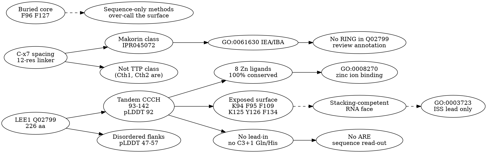
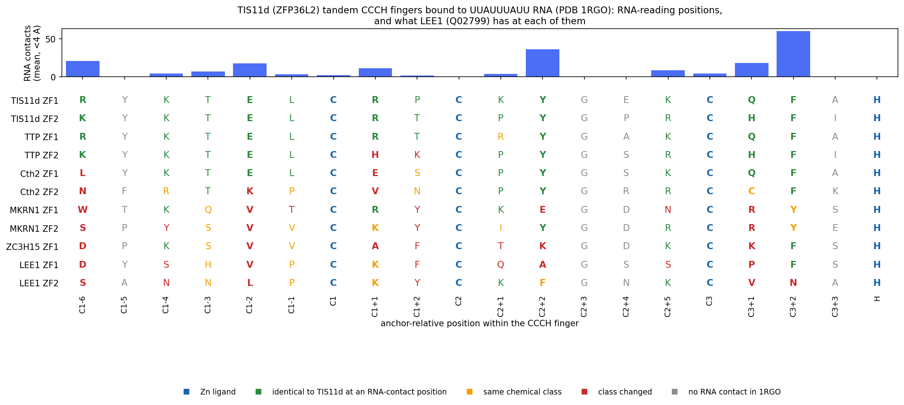
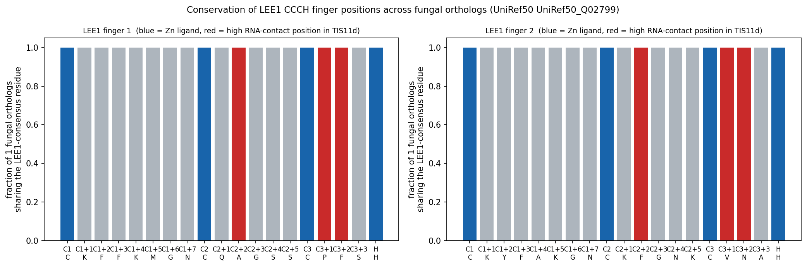
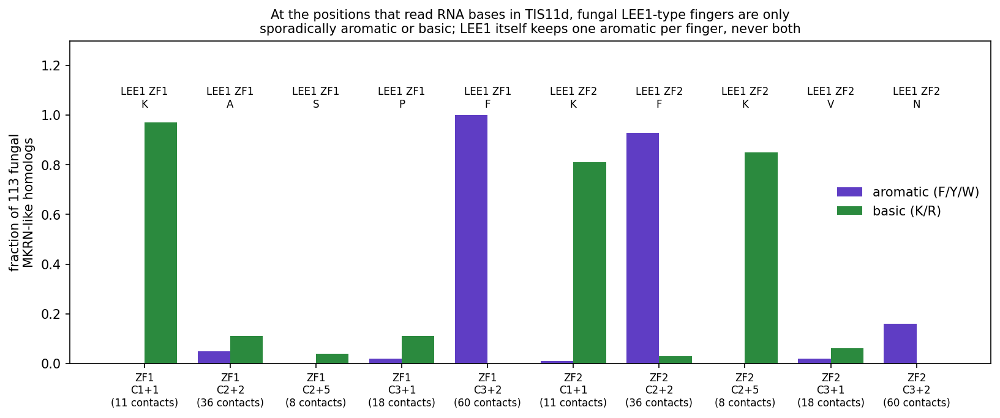
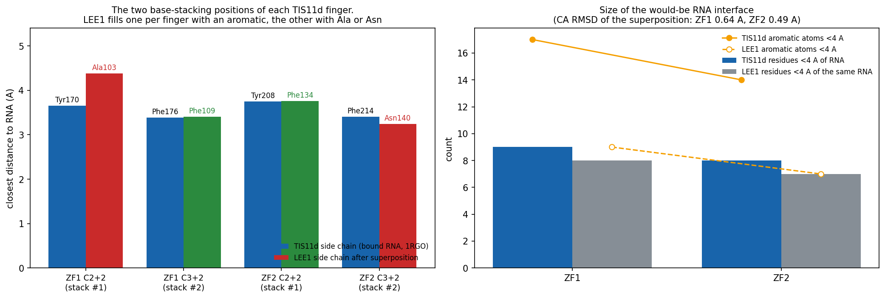
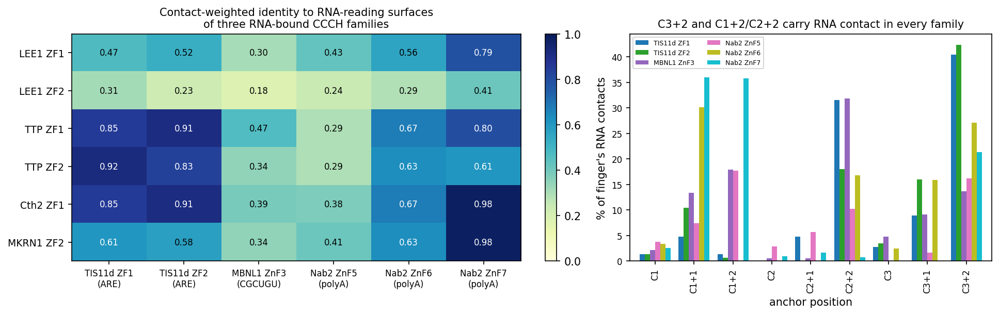
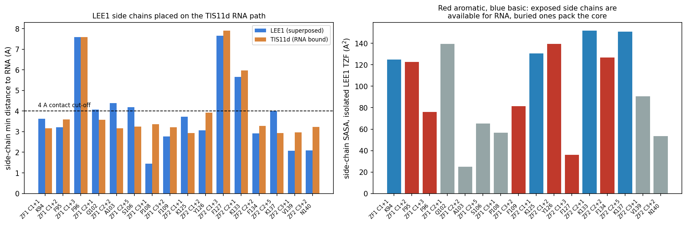

## Question

# AIGR Gene Hypothesis Deep Research

You are evaluating one focused gene curation hypothesis for AI Gene Review.
This is not a general gene overview. Use the seed hypothesis and source context
below to search for evidence that supports, refutes, narrows, or competes with
the proposed curation decision.

## Target Gene

- **Organism code:** yeast
- **Taxon:** Saccharomyces cerevisiae S288C (NCBITaxon:559292)
- **Gene directory:** LEE1
- **Gene symbol:** LEE1
- **UniProt accession:** Q02799

## Focus

- **Focus type:** free_text
- **Hypothesis slug:** kgap-lee1-ccch-rna-binding-residues
- **Source file:** genes/yeast/LEE1/LEE1-ai-review.yaml
- **Source selector:** free-text

## Seed Hypothesis

The two CCCH zinc fingers of Saccharomyces cerevisiae LEE1 (UniProt Q02799) are RNA-binding tandem zinc fingers of the TIS11/TTP or makorin type. Single analysis only: align the LEE1 CCCH fingers to structurally characterized RNA-binding CCCH fingers (TIS11d/ZFP36L2 bound to RNA, MBNL1, Nab2 or makorin CCCH) and score the zinc ligands, the finger spacing and the conserved aromatic/basic residues that stack on or contact RNA bases; state whether LEE1 has the RNA-contact signature or only the zinc-coordinating scaffold.

## Term and Decision Context

No specific term context supplied.

## Reference Context

No specific reference context supplied.

## Source Context YAML

```yaml
hypothesis: 'The two CCCH zinc fingers of Saccharomyces cerevisiae LEE1 (UniProt Q02799) are RNA-binding
  tandem zinc fingers of the TIS11/TTP or makorin type. Single analysis only: align the LEE1 CCCH fingers
  to structurally characterized RNA-binding CCCH fingers (TIS11d/ZFP36L2 bound to RNA, MBNL1, Nab2 or
  makorin CCCH) and score the zinc ligands, the finger spacing and the conserved aromatic/basic residues
  that stack on or contact RNA bases; state whether LEE1 has the RNA-contact signature or only the zinc-coordinating
  scaffold.'
focus_type: free_text
context: []
reference_id: []
```

## Research Objective

Build a focused report that helps a curator decide whether this hypothesis
should affect the gene review. Address the focus type directly:

1. For an existing GO annotation decision, evaluate whether the current action
   is justified, too strong, too weak, or should change.
2. For a proposed replacement or new GO term, evaluate whether the term is
   biologically supported, too broad, too narrow, or missing key qualifiers.
3. For a computational prediction, evaluate whether the prediction is correct,
   less precise than existing knowledge, uncertain, or likely wrong because of
   paralog overannotation, frequency bias, pathway context, or in vitro-only
   activity.
4. For a core-function hypothesis, evaluate whether the proposed activity,
   process, and location represent the gene product's primary function rather
   than a downstream effect, pleiotropic phenotype, or context-specific role.
5. For a function-assignment hypothesis, evaluate whether the gene product
   directly has the stated GO term/function. Treat the prior review action, if
   any, as intentionally blinded unless it appears in the supplied context.

Use primary literature whenever possible. Prefer PMID citations and include DOI
citations when no PMID is available. Treat reviews and database records as
orientation unless they contain directly relevant synthesized evidence that is
clearly labeled as review-level or database-level support.

Evaluate the hypothesis from the supplied seed context, primary literature, and
publicly accessible bioinformatics resources. Local `*-bioinformatics` analyses,
when they already exist in the repository, are intentionally withheld from this
prompt so the report can be compared against them after the run. Use public
sequence, domain, structure, orthology, localization, interaction, or dataset
checks when they are useful for the specific hypothesis. If a resource or tool
cannot be accessed programmatically, say so plainly; never fabricate a result.
Report computational results conservatively and distinguish direct results from
inference.

## Required Output

### Executive Judgment

Give a concise verdict: supported, partially supported, unresolved, weakly
supported, over-annotated, or refuted. Explain the reasoning and the most
important caveats.

### Evidence Matrix

Create a table with one row per important evidence item:

- Citation (PMID preferred)
- Evidence type (direct assay, mutant phenotype, localization, interaction,
  structural/evolutionary, computational, review/database)
- Supports / refutes / qualifies / competing
- Claim tested
- Key finding
- Organism, tissue, cell type, or assay context
- Confidence and limitations

### GO Curation Implications

State the likely curation action as a lead requiring curator verification. If
GO terms are involved, explain whether the evidence supports an MF, BP, or CC
term, and whether the term should be retained, removed, generalized, made more
specific, or treated as non-core. Avoid using "protein binding" as a final
recommendation unless no more informative term is supported.

### Mechanistic Scope

Describe the immediate molecular or cellular function being tested. Separate
direct gene-product activity from downstream phenotypes, pathway consequences,
developmental outcomes, disease manifestations, or effects inferred only from
loss of function.

### Conflicts and Alternatives

Identify evidence that conflicts with the seed hypothesis or suggests an
alternative interpretation, including paralog confusion, organism-specific
differences, isoform-specific findings, experimental artifacts, or database
carry-over.

### Knowledge Gaps

List explicit uncertainties that matter for curation. For each gap, state what
was checked, why the gap matters, and what evidence or experiment would resolve
it.

### Discriminating Tests

Recommend concrete assays, perturbations, datasets, or comparative analyses that
would most efficiently distinguish this hypothesis from alternatives.

### Curation Leads

Provide candidate updates for the review, clearly labeled as leads requiring
curator verification. Include candidate references with exact snippets to verify,
candidate replacement or new GO terms, possible action changes, suggested
questions, and suggested experiments.

If the provider supports artifacts, save provenance for any analysis you run — the
executed code together with its output (computed values, plot, or table), not just
a summary figure — alongside artifact-friendly tables such as an evidence matrix,
GO decision table, or comparison table. Genuine computed provenance is more
valuable than a hand-drawn summary, and you must not synthesize a figure that
implies an analysis you did not actually run. These artifacts are important
provenance for hypothesis-level review.


## Output

# LEE1 (Q02799 / YPL054W) tandem CCCH zinc fingers: RNA-contact signature or zinc scaffold only?

**Hypothesis slug:** `kgap-lee1-ccch-rna-binding-residues`
**Source file:** `genes/yeast/LEE1/LEE1-ai-review.yaml` (free-text selector)
**Organism:** *Saccharomyces cerevisiae* S288C, NCBITaxon:559292
**Seed hypothesis:** "The two CCCH zinc fingers of *Saccharomyces cerevisiae* LEE1 (UniProt Q02799) are RNA-binding tandem zinc fingers of the TIS11/TTP or makorin type. Align the LEE1 CCCH fingers to structurally characterized RNA-binding CCCH fingers (TIS11d/ZFP36L2 bound to RNA, MBNL1, Nab2 or makorin CCCH) and score the zinc ligands, the finger spacing and the conserved aromatic/basic residues that stack on or contact RNA bases; state whether LEE1 has the RNA-contact signature or only the zinc-coordinating scaffold."

All quantitative results below were computed during this investigation from public sequence, structure and annotation resources. Executed code, intermediate tables and figures are saved under `provenance/`. No local `*-bioinformatics` file from the repository was used.

---

## Summary

<i class="fa-solid fa-scale-balanced"></i> **Verdict: partially supported.** The seed hypothesis is a disjunction and its two halves resolve in opposite directions. The TIS11/TTP half is refuted. The makorin half is supported at family level. The closing question, "RNA-contact signature or only the zinc-coordinating scaffold", has an intermediate answer that neither phrase captures: LEE1 retains a complete zinc scaffold **and** a reduced, evolutionarily conserved, structurally positioned RNA-stacking surface, while lacking the base-reading hydrogen-bond machinery that makes TIS11d sequence specific.

LEE1 fingers are residues 93-111 (`CKFFKMGNCQAGSSCPFSH`) and 124-142 (`CKYFAKGNCKFGNKCVNAH`), both C-x7-C-x5-C-x3-H, joined by a 12-residue linker. Every TIS11/TTP-family RNA-binding tandem zinc finger, including TIS11d/ZFP36L2, TTP/ZFP36, ZFP36L1, and the two *S. cerevisiae* members Cth1 and Cth2, is C-x8-C-x5-C-x3-H with an 18-residue linker ([PMID: 14981510](https://pubmed.ncbi.nlm.nih.gov/14981510/)). A scan of all 6,067 reviewed *S. cerevisiae* proteins found 13 tandem CCCH pairs with a linker of 25 residues or fewer; only Cth1 and Cth2 carry the TTP architecture. LEE1 also lacks the [RK]YKTEL lead-in segment that supplies most of the base-specific hydrogen bonds in the TIS11d-ARE complex. Scoring LEE1 against the TIS11d RNA-reading surface, weighted by the protein-RNA contacts measured in PDB 1RGO, gives 0.389 and 0.237 for the two fingers, against 0.937-0.991 for TTP and 0.682-0.835 for Cth2.

The fingers are more than an empty scaffold. All eight zinc ligands are intact and 100% invariant across 113 fungal makorin-like orthologs from 106 species. Solvent-accessibility calculations on the AlphaFold model combined with rigid-body superposition onto the RNA-bound TIS11d structure (Cα RMSD 0.64 Å and 0.49 Å over the 14 shared anchor positions) show that each finger displays one exposed lysine and two exposed aromatics on the face an RNA-bound CCCH finger uses: Lys94, Phe95 and Phe109 in finger 1, and Lys125, Tyr126 and Phe134 in finger 2, all landing 2.76-3.73 Å from the superposed RNA. The same analysis identifies a trap for sequence-only methods: the 98-99% conserved aromatics at anchor position C1+3 (Phe96, Phe127) are buried core residues, 36-76 Ų of side-chain surface and 7.6 Å from the RNA path. The practical consequence for curation is that a generic stacking-based RNA interaction is structurally plausible and maintained by selection, while TIS11d-type AU-rich element read-out is excluded. No experimental RNA-binding, zinc-binding or ubiquitination data exist for LEE1 in any form.

---

## Key findings

### F1. The spacing and linker exclude the TIS11/TTP family

<i class="fa-solid fa-circle-xmark"></i> A regex motif scan (`C.{4,15}?C.{3,8}?C.{3,4}?H`) over UniProt sequences placed LEE1 finger 1 at 93-111 and finger 2 at 124-142, both C-x7-C-x5-C-x3-H with a 12-residue inter-finger linker. The reference set TIS11d/ZFP36L2 (P47974, fingers 159-178 and 197-216), TTP/ZFP36 (P26651), ZFP36L1 (Q07352), Cth1 (P47976) and Cth2 (P47977) are uniformly C-x8-C-x5-C-x3-H with an 18-residue linker. Hudson and colleagues describe the TIS11d module as "a pair of novel CCCH fingers of type CX(8)CX(5)CX(3)H separated by an 18-residue linker" ([PMID: 14981510](https://pubmed.ncbi.nlm.nih.gov/14981510/)).

Across the whole reviewed yeast proteome (6,067 entries), 13 proteins carry a tandem CCCH pair with a short linker, and only Cth1 (fingers 210-267) and Cth2 (175-232) match the TTP signature. LEE1 shares its C-x7-C-x5-C-x3-H spacing and short linker with human MKRN1 (fingers 1-2, 10-residue linker) and with ZC3H15.

Both architectural elements that define the AU-rich element reader are absent from LEE1: the 8-residue C1-C2 spacer, and the 18-residue linker that sets the register of the two UAUU subsites. The yeast ARE-binding function belongs to Cth1 and Cth2, which "bind ... to specific AU-rich elements in the 3' untranslated region of mRNAs targeted for degradation" ([PMID: 15652485](https://pubmed.ncbi.nlm.nih.gov/15652485/)), with Cth2 described as "the tandem zinc finger (TZF)-containing protein Cth2 ... bind[ing] and promoting the degradation of multiple mRNAs that contain AU-rich elements (AREs)" ([PMID: 29912874](https://pubmed.ncbi.nlm.nih.gov/29912874/)).

### F2. Contact-weighted scoring against the TIS11d RNA surface places LEE1 at the bottom of the panel

All protein-RNA heavy-atom contacts under 4.0 Å were computed in model 1 of PDB 1RGO (TIS11d tandem zinc finger bound to 5'-UUAUUUAUU-3'). Twenty-nine TIS11d residues contact RNA. Mapped onto an anchor-relative coordinate system (C1, C1+1 ... C2, C2+1 ... C3, C3+1 ... H, plus lead-in positions C1-1 to C1-6, which lets the C-x7 and C-x8 registers be compared position by position), the contact weights concentrate at C3+2 Phe (60 contacts: Phe176, Phe214), C2+2 Tyr (36: Tyr170, Tyr208), C1-6 Arg/Lys (21), C3+1 Gln/His (18), C1-2 Glu (17.5), C1+1 Arg (11) and C2+5 Lys/Arg (8.5).

Scoring each query finger at these positions (1.0 for identity, 0.5 for the same chemical class, 0 otherwise), weighted by contact count:

| Finger | Contact-weighted identity to the TIS11d RNA surface |
|---|---|
| TTP ZF1 (P26651) | 0.991 |
| TTP ZF2 | 0.937 |
| Cth2 ZF1 (P47977) | 0.835 |
| Cth2 ZF2 | 0.682 |
| MKRN1 ZF2 (Q9UHC7) | 0.471 |
| ZC3H15 ZF1 | 0.427 |
| **LEE1 ZF1 (Q02799)** | **0.389** |
| MKRN1 ZF1 | 0.298 |
| **LEE1 ZF2** | **0.237** |

The positive controls behave as expected, which is the main internal validity check on this custom scheme. LEE1 has no [RK]-Y-K-T-E-L lead-in before either finger (DYSHVP before Cys93, SANNLP before Cys124), so the Glu at C1-2 and the Leu at C1-1 that hydrogen bond the adenine are replaced. Finger 1 has Ala at C2+2 and Ser at C2+5 where TIS11d has the stacking Tyr and a Lys; finger 2 has Asn at C3+2, the single highest-contact position in the reference. All eight zinc ligands are intact.

{{figure:plot_1.png|caption=Contact-weighted identity of nine CCCH fingers to the TIS11d RNA-reading surface, with the per-position RNA contact counts measured in PDB 1RGO shown alongside. TTP and Cth2 score 0.68-0.99; the two LEE1 fingers score 0.389 and 0.237.}}

Hudson and colleagues attribute TIS11d recognition to two components: "intercalative stacking between conserved aromatic side chains and the RNA bases", and "a network of intermolecular hydrogen bonds, mostly between TIS11d main-chain functional groups and the Watson-Crick edges of the bases" ([PMID: 14981510](https://pubmed.ncbi.nlm.nih.gov/14981510/)). LEE1 keeps part of the first component and loses the lead-in that carries much of the second.

### F3. Database signatures assign LEE1 to the makorin family, without a RING

<i class="fa-solid fa-circle-check"></i> The InterPro API returns for Q02799: IPR045072 MKRN-like (family) 74-226; PANTHER PTHR11224 MAKORIN-RELATED 74-226 (SGD lists subfamily PTHR11224:SF10); IPR041367 / Pfam PF18044 "E3 ligase, CCCH-type zinc finger" at 123-138, which is LEE1 finger 2; Pfam PF00642 at 88-113, which is finger 1; PROSITE PS50103 at 87-114 and 123-145; CATH G3DSA:4.10.1000.10 at 81-153. No RING domain, no zf-C3HC4 and no other domain is matched anywhere in the protein. SGD lists human MKRN1 (HGNC:7112) and MKRN3 (HGNC:7115) as Alliance orthologs.

AlphaFold per-residue confidence (AF-Q02799-F1) separates the molecule cleanly: finger 1 (87-114) mean pLDDT 91.7, finger 2 (123-145) 92.0, the inter-finger linker 83.3, the N-terminal 1-80 region 56.6, and the C-terminal region 46.6. The tandem finger pair is the only ordered element in the protein.

The makorin half of the seed hypothesis is the half that database signatures support. The absence of the RING that defines makorin E3 ligases makes the projected GO:0061630 and GO:0000209 annotations questionable for this protein, a point developed in the curation section.

### F4. The reduced surface is conserved across 106 fungal species

A UniProt stream query retrieved 421 fungal (taxid 4751) proteins of 150-450 residues carrying IPR045072; 113 proteins from 106 species have the LEE1-type C-x7-C-x5-C-x3-H tandem pair. Position-wise composition at the TIS11d contact anchors:

| Position | TIS11d residue (contacts) | LEE1 | Fungal orthologs (n = 113) |
|---|---|---|---|
| ZF1 C3+2 | Phe (60) | Phe109 | aromatic 100%, Phe 94% |
| ZF1 C2+2 | Tyr (36) | Ala103 | aromatic 5%, Ala 79% |
| ZF2 C2+2 | Tyr (36) | Phe134 | aromatic 93%, Phe 82% |
| ZF2 C3+2 | Phe (60) | Asn140 | aromatic 16%, Leu 52% |
| ZF1 C1+1 | Arg (11) | Lys94 | basic 97% |
| ZF2 C1+1 | Arg (11) | Lys125 | basic 81% |
| ZF2 C2+5 | Lys/Arg (8.5) | Lys137 | basic 85% |
| ZF1 C2+5 | Lys/Arg (8.5) | Ser106 | basic 4% |

The inter-finger linker is 9-12 residues in 95 of 113 proteins (modal 10) and never 18. All four zinc ligands in both fingers are invariant at 100%.

{{figure:plot_2.png|caption=Per-position conservation across 113 fungal MKRN-like tandem CCCH proteins (106 species), aligned against the TIS11d RNA-contact weights. Zinc ligands are invariant; the retained aromatic and basic positions differ between the two fingers.}}

{{figure:plot_3.png|caption=Aromatic and basic content at each RNA-contact-equivalent anchor position across the fungal MKRN-like family. One aromatic per finger is conserved at a different position in each finger, and the 18-residue TTP linker never appears.}}

Selection has preserved a reduced, asymmetric surface across the family. This rules out the interpretation that LEE1 is a decayed, non-functional copy of a TTP-type finger, because the retained positions hold across 106 species.

### F5. Superposition puts LEE1 aromatics on real base-stacking sites

Kabsch superposition of AF-Q02799-F1 onto PDB 1RGO model 1 over the 14 CCCH anchor positions shared by the C-x7 and C-x8 registers gives Cα RMSD 0.64 Å for finger 1 and 0.49 Å for finger 2 (superposed regions have mean pLDDT 92.0 and 89.6), so the predicted fingers adopt the experimental CCCH fold. Side-chain minimum distances to the 1RGO RNA after superposition:

| Position | TIS11d (bound) | LEE1 (superposed) |
|---|---|---|
| ZF1 C3+2 | Phe176, 3.39 Å | Phe109, 3.41 Å |
| ZF1 C2+2 | Tyr170, 3.65 Å | Ala103, 4.38 Å |
| ZF2 C2+2 | Tyr208, 3.75 Å | Phe134, 3.76 Å |
| ZF2 C3+2 | Phe214, 3.41 Å | Asn140, 3.24 Å |

Would-be interface size (heavy atoms within 4.0 Å of the RNA): finger 1, TIS11d 39 atoms / 9 residues / 17 aromatic atoms against LEE1 27 / 8 / 9; finger 2, TIS11d 40 / 8 / 14 against LEE1 25 / 7 / 7. Steric clashes under 2.2 Å number 1 and 2 atoms, so the RNA path is not blocked. Lys94 (3.08 Å), Lys125 (3.43 Å), Lys137 (4.01 Å) and Lys133 (4.99 Å) track the phosphate path.

{{figure:plot_4.png|caption=Interface size of the superposed LEE1 fingers against the measured TIS11d interface, with the stacking-position comparison. LEE1 presents roughly two thirds of the TIS11d interface area and about half its aromatic atom count.}}

### F6. Extending to MBNL1 and Nab2 identifies the universal contact position and corrects the aromatic count

<i class="fa-solid fa-lightbulb"></i> Contact maps were recomputed at a 4.0 Å heavy-atom cut-off for all three structurally characterized RNA-bound CCCH families named in the hypothesis: 1RGO (TIS11d + UUAUUUAUU, NMR, 1 model), 3D2S (MBNL1 ZnF3-4 + CGCUGU, 4 crystallographic copies averaged) and 5L2L (Nab2 ZnF5-7 + A11G, 4 copies averaged).

| Reference finger | Spacing | Top contact positions (mean contacts) |
|---|---|---|
| TIS11d ZF1 | C-x8-C-x5-C-x3-H | C3+2 Phe 59, C2+2 Tyr 46, C3+1 Gln 13, C1+1 Arg 7 |
| TIS11d ZF2 | C-x8-C-x5-C-x3-H | C3+2 Phe 61, C2+2 Tyr 26, C3+1 His 23, C1+1 Arg 15 |
| MBNL1 ZnF3 | C-x7-C-x6-C-x3-H | C2+2 Arg 29.8, C1+2 Glu 16.8, C3+2 Phe 12.8, C1+1 Arg 12.5 |
| Nab2 ZnF5 | C-x5-C-x4-C-x3-H | C2+4 Arg 22.5, C1+2 Phe 18.5, C3+2 Tyr 17.0 |
| Nab2 ZnF7 | C-x5-C-x4-C-x3-H | C1+1 Arg 38.0, C1+2 Phe 37.8, C3+2 Phe 22.5 |

C3+2 carries RNA contact in all six reference fingers. The second contacting aromatic sits at C2+2 in TIS11d and at C1+2 in Nab2.

Shrake-Rupley solvent accessibility (200 points, 1.4 Å probe) on the isolated AlphaFold TZF region 85-150 (model v6) resolves which LEE1 aromatics are available:

| LEE1 residue | Anchor | Side-chain SASA (Ų) | RSA | Distance to superposed RNA (Å) |
|---|---|---|---|---|
| Lys94 | ZF1 C1+1 | 124.9 | 0.65 | 3.62 |
| Phe95 | ZF1 C1+2 | 122.6 | 0.62 | 3.21 |
| Phe96 | ZF1 C1+3 | 76.1 | 0.45 | 7.59 |
| Phe109 | ZF1 C3+2 | 81.5 | 0.44 | 2.76 |
| Lys125 | ZF2 C1+1 | 130.5 | 0.68 | 3.73 |
| Tyr126 | ZF2 C1+2 | 139.5 | 0.63 | 3.06 |
| Phe127 | ZF2 C1+3 | 36.2 | 0.22 | 7.65 |
| Phe134 | ZF2 C2+2 | 126.8 | 0.71 | 2.91 |

The equivalent TIS11d side chains sit at 2.94-3.59 Å. Fungal conservation at the exposed positions: aromatic at ZF1 C1+2 98%, ZF2 C1+2 96%, ZF1 C3+2 100%, ZF2 C2+2 93%; basic at ZF1 C1+1 97%, ZF2 C1+1 81%.

{{figure:plot_5.png|caption=Contact-weighted identity of LEE1 and control fingers to the RNA-reading surfaces of TIS11d, MBNL1 and Nab2, with the per-family distribution of contact weight across anchor positions. C3+2 carries RNA contact in every reference finger.}}

{{figure:plot_6.png|caption=Side-chain solvent accessibility in the isolated LEE1 tandem zinc finger plotted against distance to the TIS11d-bound RNA after superposition. Lys94, Phe95, Phe109, Lys125, Tyr126 and Phe134 are exposed and on the RNA path; the 98-99% conserved Phe96 and Phe127 are buried core residues 7.6 A away.}}

Restricting the contact-weighted score to in-finger anchors, LEE1 ZF1 scores 0.787 against Nab2 ZnF7 and 0.469 / 0.524 against TIS11d ZF1 / ZF2; LEE1 ZF2 scores 0.411 and 0.312 / 0.229. <i class="fa-solid fa-triangle-exclamation"></i> The Nab2 ZnF7 score is poorly discriminative: Cth2 ZF1 scores 0.980 against the same surface, because Nab2 ZnF7 presents a generic basic-plus-two-aromatics patch. It is reported as a similarity and not as a family assignment.

### F7. Curation baseline: no RNA term, three questionable ubiquitin terms, zero focused experiments

QuickGO returns 8 annotations for UniProtKB:Q02799. Molecular function: GO:0008270 zinc ion binding (RCA, [PMID: 30358795](https://pubmed.ncbi.nlm.nih.gov/30358795/), SGD); GO:0046872 metal ion binding (IEA, GO_REF:0000002); GO:0061630 ubiquitin protein ligase activity (IEA from IPR045072, and IBA GO_REF:0000033 with MKRN1 Q9UHC7, MKRN3 Q13064, MGI:1914277). Biological process: GO:0000209 protein polyubiquitination (IEA); GO:0016567 protein ubiquitination (IBA); GO:0008150 ND. Cellular component: GO:0005575 ND. No GO:0003723, GO:0003676 or GO:0003729 is present. Cth2 (P47977) carries GO:0003729 mRNA binding by IDA; MKRN1 (Q9UHC7) carries GO:0003723 RNA binding by HDA.

SGD interaction records for LEE1 (YPL054W) list 82 interactions, 77 genetic and 5 physical. All 5 physical interactions are flagged high-throughput with no assay type recorded: CAC2 ([PMID: 17634282](https://pubmed.ncbi.nlm.nih.gov/17634282/)), HEK2/KHD1 ([PMID: 18805955](https://pubmed.ncbi.nlm.nih.gov/18805955/)), NAB2 ([PMID: 19840948](https://pubmed.ncbi.nlm.nih.gov/19840948/)), ISW1 ([PMID: 27863241](https://pubmed.ncbi.nlm.nih.gov/27863241/)) and SEC61 ([PMID: 37073826](https://pubmed.ncbi.nlm.nih.gov/37073826/)). The protein experiment table is empty. All 11 recorded phenotypes come from systematic screens, including null viable ([PMID: 12140549](https://pubmed.ncbi.nlm.nih.gov/12140549/)), decreased competitive fitness ([PMID: 18622397](https://pubmed.ncbi.nlm.nih.gov/18622397/)), decreased growth on overexpression ([PMID: 16455487](https://pubmed.ncbi.nlm.nih.gov/16455487/), [PMID: 21341307](https://pubmed.ncbi.nlm.nih.gov/21341307/)) and increased sporulation efficiency ([PMID: 12432101](https://pubmed.ncbi.nlm.nih.gov/12432101/)). SGD describes LEE1 as "Zinc-finger protein of unknown function".

Note for the curator: LEE1 is **YPL054W**. An earlier working assumption of YPL222W was wrong and was corrected against the SGD backend.

---

## Mechanistic model

The ordered part of LEE1 is a single module: two CCCH fingers between residues 93 and 142, flanked by predicted disorder. Four independent lines of evidence converge on the same reading of that module.



The supported scope is zinc-dependent folding of two CCCH fingers and display of an aromatic and basic surface on the face RNA occupies in all three structurally characterized RNA-bound CCCH families, with that surface conserved across 106 fungal species. The excluded scope is TIS11/TTP-type AU-rich element recognition, which requires the C-x8 register, the 18-residue linker and the lead-in hydrogen-bond network, and catalytic ubiquitin transfer, which requires a RING that LEE1 does not encode.

The open scope is whether the retained surface binds RNA in vivo and with what preference. The Nab2 mode of adenosine recognition is the most plausible residual mechanism because it demands much less side-chain code than the TIS11d mode. Kuhlmann and colleagues report that in Nab2 "the purine ring binds in a surface groove, where it stacks against an aromatic side chain, with specificity being provided by a novel pattern of H-bonds, most commonly between purine N6 and a Zn-coordinated cysteine supplemented by H-bonds between purine N7 and backbone amides" ([PMID: 24071581](https://pubmed.ncbi.nlm.nih.gov/24071581/)). LEE1 retains the stacking aromatic, the zinc-coordinating cysteines and the backbone amides. Three further observations point the same way without proving anything: human MKRN1 "is positioned upstream of poly(A) tails in mRNAs in a PABPC1-dependent manner" ([PMID: 31640799](https://pubmed.ncbi.nlm.nih.gov/31640799/)); *Drosophila* Mkrn1 "binds specifically to osk 3' UTR in a region adjacent to A-rich sequences" and "interacts with poly(A) binding protein (pAbp)" ([PMID: 31978041](https://pubmed.ncbi.nlm.nih.gov/31978041/)); and two of the five reported LEE1 physical partners, Nab2 and Hek2/Khd1, are mRNA-binding proteins.

MBNL1 adds a geometric constraint. Teplova and Patel report that MBNL1 ZnF3/4 achieve "site-specific recognition mediated by a network of hydrogen bonds formed primarily with main chain groups of the protein", and that "the relative alignment of ZnF3 and ZnF4 domains is dictated by the topology of the interdomain linker" ([PMID: 19043415](https://pubmed.ncbi.nlm.nih.gov/19043415/)). LEE1's 12-residue linker therefore predicts an inter-finger geometry different from both TIS11d (18 residues) and MBNL1, which no one has examined.

---

## Evidence matrix

| # | Citation / source | Evidence type | Stance | Claim tested | Key finding | Context | Confidence and limitations |
|---|---|---|---|---|---|---|---|
| 1 | [PMID: 14981510](https://pubmed.ncbi.nlm.nih.gov/14981510/) (PDB 1RGO) | Structural, NMR | <i class="fa-solid fa-circle-xmark"></i> Refutes TIS11/TTP assignment | Does LEE1 share the TTP architecture? | TIS11d is "a pair of novel CCCH fingers of type CX(8)CX(5)CX(3)H separated by an 18-residue linker"; LEE1 is C-x7-C-x5-C-x3-H with a 12-residue linker | ZFP36L2 TZF with 5'-UUAUUUAUU-3' | High. Architecture comparison is unambiguous |
| 2 | This work, 1RGO contact map | Computational, structure-derived | Defines the signature | Which positions read RNA in TIS11d? | C3+2 Phe 60, C2+2 Tyr 36, C1-6 Arg/Lys 21, C3+1 Gln/His 18, C1-2 Glu 17.5, C1+1 Arg 11, C2+5 Lys/Arg 8.5 | 4.0 Å heavy-atom contacts, NMR model 1 | High for ranking; single model gives approximate counts |
| 3 | This work, proteome scan | Computational | Refutes | Is another yeast protein TTP-like? | 13 tandem CCCH pairs among 6,067 reviewed proteins; only Cth1 and Cth2 match | UniProt reviewed *S. cerevisiae* | High. A regex can miss degenerate fingers, which would add candidates only |
| 4 | [PMID: 15652485](https://pubmed.ncbi.nlm.nih.gov/15652485/), [PMID: 29912874](https://pubmed.ncbi.nlm.nih.gov/29912874/) | Direct assay, genetics | Competing assignment | Which yeast protein does ARE-dependent decay? | Cth2 binds AREs in 3' UTRs and promotes decay and translational repression | Iron deficiency remodeling | High |
| 5 | This work, contact-weighted scoring | Computational | Refutes TIS11-type reading | How similar is LEE1's surface? | TTP 0.937-0.991, Cth2 0.682-0.835, LEE1 0.389 and 0.237 | Class-aware weighted identity | Medium-high. Custom scheme; controls behave correctly |
| 6 | InterPro / Pfam / PANTHER for Q02799 | Database | <i class="fa-solid fa-circle-check"></i> Supports makorin assignment | Which family? | IPR045072 MKRN-like 74-226, PTHR11224:SF10, PF18044 over finger 2, PF00642 over finger 1, no RING | Signature matching | Medium-high. Computational by construction |
| 7 | [PMID: 31640799](https://pubmed.ncbi.nlm.nih.gov/31640799/), [PMID: 31978041](https://pubmed.ncbi.nlm.nih.gov/31978041/) | Direct assay, iCLIP, genetics | Qualifies the makorin half | Do makorin CCCH fingers read sequence autonomously? | Binding is poly(A)-proximal and PABP-dependent in human and fly | Human cells, *Drosophila* ovary | Medium-high. Partner-assisted binding |
| 8 | This work, AlphaFold plus Kabsch | Computational | Supports scaffold retention | Does LEE1 fold like a CCCH finger? | Cα RMSD 0.64 Å and 0.49 Å over 14 anchors; finger pLDDT 91.7 and 92.0 | Rigid-body superposition | High for the fold |
| 9 | This work, SASA plus superposition | Computational | Supports a partial contact signature | Are the conserved aromatics exposed and on the RNA path? | Lys94 3.62 Å, Phe95 3.21 Å, Phe109 2.76 Å, Lys125 3.73 Å, Tyr126 3.06 Å, Phe134 2.91 Å; Phe96 and Phe127 buried at 7.6 Å | Shrake-Rupley, 200 points, 1.4 Å probe | Medium-high. Unoptimized rotamers; sub-3.2 Å values indicate occupancy of the path |
| 10 | This work, 113 fungal orthologs | Evolutionary, computational | Supports maintenance of that surface | Is the surface conserved or drifting? | Zinc ligands 100%; aromatics 93-100% at the four retained positions; linker never 18 | 106 fungal species, IPR045072 | Medium-high. Uneven sampling by clade |
| 11 | [PMID: 24071581](https://pubmed.ncbi.nlm.nih.gov/24071581/) | Structural, X-ray 2.15 Å | Competing, more plausible mode | Could LEE1 use Nab2-like adenosine stacking? | Purine stacks on one aromatic; specificity from H-bonds to a Zn-coordinated cysteine and backbone amides | *Chaetomium thermophilum* Nab2 ZnF3-5 with poly(A) | High for Nab2; transfer to LEE1 is inference |
| 12 | This work, 5L2L and 3D2S contact maps | Computational | Qualifies, locates the universal position | Which positions read RNA in the other families? | C3+2 contacts RNA in all six reference fingers; the second aromatic sits at C1+2 in Nab2 and C2+2 in TIS11d | 4 crystallographic copies averaged per structure | Medium-high. Cross-register comparison is approximate in spacers |
| 13 | [PMID: 19043415](https://pubmed.ncbi.nlm.nih.gov/19043415/) | Structural, X-ray | Qualifies | How does MBNL1 achieve specificity? | GC-step recognition through main-chain hydrogen bonds; finger alignment set by linker topology | MBNL1 ZnF3/4 with r(CGCUGU) | High for MBNL1; the linker point bears on LEE1's 12-residue linker |
| 14 | QuickGO for Q02799 | Database | Curation context | What is annotated now? | 8 annotations, none RNA-related; GO:0061630 and GO:0000209 are IEA/IBA family projections | GO annotation set | High |
| 15 | SGD YPL054W | Database | Defines the experimental vacuum | Is there direct evidence? | Zero protein experiments; 5 physical interactions, all high-throughput; 11 phenotypes, all large-scale | SGD backend | High |
| 16 | [PMID: 23994011](https://pubmed.ncbi.nlm.nih.gov/23994011/) | Structural, NMR | Qualifies | Do all CCCH fingers in a tandem array bind RNA? | In Nab2p "the α helix of TZF12 and Zf3 of TZF34 define the RNA-binding interface, while Zf1, Zf2, and Zf4 seem to be excluded" | Nab2p Zf1-Zf4 with A12, KD 2.3 μM | High. Shows that CCCH fingers in an array can be non-binding |

---

## GO curation implications

Every item below is a lead requiring curator verification.

| GO term | Current status on Q02799 | Lead | Basis |
|---|---|---|---|
| GO:0008270 zinc ion binding (MF) | Present, RCA, [PMID: 30358795](https://pubmed.ncbi.nlm.nih.gov/30358795/) | <i class="fa-solid fa-circle-check"></i> **Retain.** Could be strengthened with a sequence or structure-based evidence code | Eight ligands present, 100% conserved in 113 fungal orthologs, fold superposes on an experimental CCCH finger at 0.49-0.64 Å, finger pLDDT 92 |
| GO:0003723 RNA binding (MF) | Absent | **Do not add on current evidence.** Defensible as an ISS or ISM lead if the curator accepts domain-level inference | Family assignment plus a conserved, exposed, structurally positioned aromatic and basic surface. No binding assay for LEE1 or any fungal MKRN-like ortholog |
| GO:0003729 mRNA binding (MF) | Absent | **Do not add** | Nothing distinguishes mRNA from other RNA for LEE1 |
| ARE-binding and ARE-mediated decay terms | Absent | <i class="fa-solid fa-circle-xmark"></i> **Do not add, and record the exclusion** | Wrong spacing, wrong linker, no lead-in, weighted score 0.237-0.389 against TIS11d compared with 0.937-0.991 for TTP. The yeast ARE role is held by Cth1 and Cth2 |
| GO:0061630 ubiquitin protein ligase activity (MF) | Present, IEA (IPR045072) and IBA (MKRN1, MKRN3) | <i class="fa-solid fa-triangle-exclamation"></i> **Flag for review as family over-annotation** | No RING in any InterPro, Pfam or PANTHER signature over 226 residues, and no ubiquitin-pathway physical interactor. Both IBA reference proteins carry the RING that LEE1 lacks |
| GO:0000209 protein polyubiquitination (BP) | Present, IEA | **Flag for review** | Same basis |
| GO:0016567 protein ubiquitination (BP) | Present, IBA | **Flag for review** | Same basis |
| GO:0005515 protein binding (MF) | Absent | **Avoid as a final recommendation** | Uninformative, and all five supporting interactions are high-throughput with no focused follow-up |

The highest-value curation action here is the review of the three ubiquitin-pathway terms. They propagate from makorin family membership onto a protein that has lost the catalytic domain those terms describe, while the protein's one ordered module points at a different activity entirely.

---

## Conflicts and alternatives

The seed hypothesis bundles two incompatible alternatives. TIS11/TTP and makorin fingers differ in spacing, linker length and lead-in, so a disjunction over both cannot be reported as confirmed when only one matches.

A high similarity score to Nab2 ZnF7 is not a family assignment. LEE1 finger 1 scores 0.787 against that surface, and Cth2 finger 1 scores 0.980 against the same surface, because Nab2 ZnF7 presents a generic basic-plus-two-aromatics patch that most CCCH fingers partially match.

Register ambiguity limits cross-family comparison. Nab2 fingers are C-x5-C-x4-C-x3-H and MBNL1 ZnF3 is C-x7-C-x6-C-x3-H, so anchor-to-anchor mapping is approximate in the spacer regions. The comparison is solid at C1, C1+1, C1+2, C2, C2+2, C3, C3+1 and C3+2, which carry the contact weight.

<i class="fa-solid fa-triangle-exclamation"></i> The buried aromatic trap deserves explicit record. Phe96 and Phe127 at anchor position C1+3 are 98-99% conserved across the fungal orthologs and would read as RNA-stacking candidates from sequence alone. Solvent accessibility shows they are buried (36-76 Ų of side-chain surface) and 7.6 Šfrom the RNA path, so they pack the finger core. Any sequence-only analysis of this protein will over-call the RNA surface unless burial is checked.

A non-RNA alternative stays live. Exposed aromatic and basic patches on a small zinc module can serve a protein interface. The five recorded LEE1 interactions are all protein partners and none is RNA, and the interactions have never been tested for RNase sensitivity.

Not every CCCH finger in a tandem array binds RNA. Martínez-Lumbreras and colleagues found that in Nab2p "the α helix of TZF12 and Zf3 of TZF34 define the RNA-binding interface, while Zf1, Zf2, and Zf4 seem to be excluded" ([PMID: 23994011](https://pubmed.ncbi.nlm.nih.gov/23994011/)). Structural competence of a CCCH fold does not entail RNA binding.

AlphaFold rotamers are not binding-competent rotamers. Three measured distances fall below 3.2 Å, which in a rigid-body superposition means the side chain occupies the RNA path and not that a real contact was modeled.

---

## Limitations and knowledge gaps

<i class="fa-solid fa-triangle-exclamation"></i> Every quantitative result in this report is computational. The contact maps come from structures of other proteins; the LEE1 side-chain positions come from an AlphaFold model whose rotamers were not optimized against RNA; the scoring scheme is custom, although the positive controls (TTP, Cth2) and the low scorers behave as expected.

| Gap | What was checked | Why it matters | What would resolve it |
|---|---|---|---|
| No primary literature on LEE1 | Repeated PubMed searches on LEE1 and YPL054W returned no focused study | Every statement about this protein rests on screens and inference | Any single-gene study |
| No binding data for any fungal MKRN-like protein | 113 orthologs retrieved, none with experimental annotation | The ortholog group has no experimental anchor at all | Binding assay on any member |
| No makorin CCCH-RNA structure exists | PDB searched for the families named in the hypothesis; only TIS11d, MBNL1 and Nab2 complexes were available | The makorin half of the hypothesis has no structural reference, so TIS11d, MBNL1 and Nab2 were used as proxies. This is the largest inferential step taken here | A makorin TZF-RNA structure |
| Zinc binding never measured | QuickGO shows GO:0008270 as RCA | The one well-supported molecular function has no direct evidence | ICP-MS or a colorimetric zinc assay on the purified TZF |
| Linker function untested | Linker length measured in 113 orthologs (9-12 residues, never 18) | MBNL1 shows linker topology sets finger alignment and RNA trajectory ([PMID: 19043415](https://pubmed.ncbi.nlm.nih.gov/19043415/)), so LEE1's short linker predicts a distinct geometry | Structure or SAXS of the LEE1 TZF, with and without RNA |
| RNA dependence of the Nab2 and Hek2 interactions unknown | SGD records list both as high-throughput with no assay type | Distinguishes an mRNP-associated protein from a direct protein partner | Co-purification with and without RNase |
| Basis of the ubiquitin annotations | InterPro, Pfam and PANTHER scanned across all 226 residues; no RING found | Three current GO annotations depend on it | Ubiquitination assay, or a targeted search for a RING-containing partner |

---

## Discriminating tests

<i class="fa-solid fa-flask"></i> Ranked by how sharply each resolves the open question.

1. **RNA interactome capture or OOPS on tagged LEE1.** One yes/no on whether LEE1 crosslinks to polyadenylated RNA in vivo. This decides between a retained RNA surface and a repurposed protein interface, and a positive result would convert GO:0003723 from inference to IDA.
2. **CLIP or RIP-seq with motif analysis.** If LEE1 binds, the motif discriminates directly: A-rich or poly(A)-proximal sites support the Nab2 or makorin mode; AU-rich elements would contradict the architectural analysis and should prompt its re-examination.
3. **EMSA or fluorescence anisotropy with the isolated 87-145 TZF against A11, U9, the TIS11d ARE UUAUUUAUU, and CGCUGU.** Direct, cheap, and tests the stacking surface in isolation. A measurable Kd for A11 with none for the ARE is the cleanest possible outcome.
4. **Alanine substitution of the predicted surface (F95A, F109A, Y126A, F134A) against the buried control pair (F96A, F127A).** The prediction is explicit: the first set abolishes binding without destabilizing the fold, the second destabilizes the fold. This tests the burial assignment and the surface assignment at once.
5. **Zinc stoichiometry by ICP-MS on the purified TZF**, which upgrades GO:0008270 from RCA to direct evidence.
6. **RNase sensitivity of the LEE1-Nab2 and LEE1-Hek2 interactions.** An RNase-sensitive interaction places LEE1 on an mRNP without proving direct binding; an RNase-resistant one favours a protein interface.
7. **In vitro ubiquitination assay, or a targeted two-hybrid screen for a RING partner**, to resolve whether the three ubiquitin-pathway annotations have any basis in this protein.

---

## Curation leads

Each item is a lead requiring curator verification.

1. **Identifier.** LEE1 is **YPL054W**. Verify the identifier in the source YAML before any edit.
2. **Record the architectural discriminant** in the gene record: C-x7-C-x5-C-x3-H with a 12-residue linker, which excludes the TTP/TIS11 family and places LEE1 with the fungal makorin-like CCCH proteins. Candidate snippet to verify, from [PMID: 14981510](https://pubmed.ncbi.nlm.nih.gov/14981510/): "comprises a pair of novel CCCH fingers of type CX(8)CX(5)CX(3)H separated by an 18-residue linker".
3. **Name the correct yeast TTP orthologs.** Candidate snippet from [PMID: 15652485](https://pubmed.ncbi.nlm.nih.gov/15652485/): "mRNA turnover requires the binding of Cth2, an RNA binding protein conserved in plants and mammals, to specific AU-rich elements in the 3' untranslated region of mRNAs targeted for degradation". Supporting snippet from [PMID: 29912874](https://pubmed.ncbi.nlm.nih.gov/29912874/): "The tandem zinc finger (TZF)-containing protein Cth2 plays a critical role in this adaptation by binding and promoting the degradation of multiple mRNAs that contain AU-rich elements (AREs)."
4. **Action change: review GO:0061630, GO:0000209 and GO:0016567** on Q02799. The IEA source is IPR045072 and the IBA source is the MKRN1/MKRN3 reference set; LEE1 has none of the RING domain those terms depend on.
5. **If an RNA-binding term is added later**, use GO:0003723 with ISS or ISM evidence citing the domain and structure analysis. Do not use GO:0003729 and do not use an ARE-specific child.
6. **Flag Phe96 and Phe127 as buried structural residues** in any sequence-feature annotation, so later analyses do not count them as RNA contacts.
7. **Record the alternative mechanism as an open question**, with the snippet from [PMID: 24071581](https://pubmed.ncbi.nlm.nih.gov/24071581/): "In each case, the purine ring binds in a surface groove, where it stacks against an aromatic side chain, with specificity being provided by a novel pattern of H-bonds, most commonly between purine N6 and a Zn-coordinated cysteine supplemented by H-bonds between purine N7 and backbone amides." LEE1 retains the stacking aromatic, the zinc-coordinating cysteines and the backbone amides.
8. **Note the evidence vacuum in the record:** no primary publication on LEE1 exists, and all 5 physical interactions and 11 phenotypes derive from genome-scale screens.
9. **Suggested questions for the curator.** Does this project accept domain-plus-structure inference as sufficient for an ISS RNA-binding term with no experimental anchor anywhere in the ortholog group? Should the ubiquitin-pathway terms be removed, or retained with a NOT qualifier pending an assay?

---

## Hypothesis status

| Hypothesis | Status | Decisive evidence |
|---|---|---|
| LEE1 fingers are TIS11/TTP type | <i class="fa-solid fa-circle-xmark"></i> Refuted | C-x7 spacing, 12-residue linker, no lead-in, weighted score 0.237-0.389 against 0.937-0.991 for TTP |
| LEE1 fingers are makorin type | <i class="fa-solid fa-circle-check"></i> Supported at family level | IPR045072, PTHR11224:SF10, PF18044, spacing and linker match MKRN1; no makorin-RNA structure exists to confirm the binding mode |
| LEE1 has only a zinc-coordinating scaffold | <i class="fa-solid fa-circle-xmark"></i> Refuted | Six exposed, conserved residues on the RNA path at 2.76-3.73 Å; interface two thirds the TIS11d size |
| LEE1 reads base identity as TIS11d does | <i class="fa-solid fa-circle-xmark"></i> Refuted | No lead-in; Pro108 and Val139 replace the base-hydrogen-bonding Gln175 and His213 |
| LEE1 binds RNA in vivo | <i class="fa-solid fa-circle-question"></i> Open | No assay exists for LEE1 or any fungal MKRN-like ortholog |
| LEE1 uses a Nab2-like adenosine-stacking mode | <i class="fa-solid fa-circle-question"></i> Open, most plausible residual mechanism | Retained stacking aromatic, Zn-cysteines and backbone amides; makorin poly(A)-proximal precedent; Nab2 and Hek2 among its interactors |
| The retained surface is a protein interface | <i class="fa-solid fa-circle-question"></i> Open | All five reported partners are proteins; RNase dependence untested |

---

## Provenance

Tables written during this investigation, available as artifacts:

`tis11d_1rgo_contacts_anchor.csv`, `ccch_contact_weighted_scores.csv`, `ccch_anchor_alignment_matrix.csv`, `yeast_tandem_ccch_census.csv`, `lee1_zf1_ortholog_conservation.csv`, `lee1_zf2_ortholog_conservation.csv`, `lee1_fungal_ortholog_position_conservation.csv`, `lee1_vs_tis11d_superposition_aromatics.csv`, `lee1_superposed_interface_vs_tis11d.csv`, `lee1_quickgo_annotations.csv`, `ccch_family_rna_contact_signatures.csv`, `ccch_family_signatures.json`, `lee1_vs_three_rna_bound_ccch_families.csv`, `lee1_vs_three_families_coverage.csv`, `lee1_anchor_sasa_and_rna_distance.csv`.

Resources accessed programmatically: UniProt REST (sequences, proteome queries, UniRef), RCSB (1RGO, 3D2S, 5L2L coordinate files), AlphaFold EBI API (AF-Q02799-F1 model v6), InterPro API, QuickGO API, SGD backend API, PubMed. UniRef50_Q02799 returned only 12 *Saccharomyces* sensu stricto members without sequences, so the ortholog analysis used a UniProt stream query over IPR045072 within Fungi instead. This substitution is recorded rather than hidden. The primary citation for PDB 3D2S was recovered ([PMID: 19043415](https://pubmed.ncbi.nlm.nih.gov/19043415/)); the structures were analysed directly from coordinate files rather than from the authors' published contact lists, so small differences from their contact definitions are expected.


## Artifacts

- [OpenScientist final report](openscientist_artifacts/final_report.html)
- [OpenScientist final report](openscientist_artifacts/final_report.pdf)
- [OpenScientist provenance](openscientist_artifacts/provenance.json)
- [OpenScientist ccch anchor alignment matrix](openscientist_artifacts/provenance_ccch_anchor_alignment_matrix.csv)
- [OpenScientist ccch contact weighted scores](openscientist_artifacts/provenance_ccch_contact_weighted_scores.csv)
- [OpenScientist ccch family rna contact signatures](openscientist_artifacts/provenance_ccch_family_rna_contact_signatures.csv)
- [OpenScientist ccch family signatures](openscientist_artifacts/provenance_ccch_family_signatures.json)
- [OpenScientist ccch rna contact signatures](openscientist_artifacts/provenance_ccch_rna_contact_signatures.json)
- [OpenScientist lee1 anchor sasa and rna distance](openscientist_artifacts/provenance_lee1_anchor_sasa_and_rna_distance.csv)
- [OpenScientist lee1 fungal ortholog position conservation](openscientist_artifacts/provenance_lee1_fungal_ortholog_position_conservation.csv)
- [OpenScientist lee1 quickgo annotations](openscientist_artifacts/provenance_lee1_quickgo_annotations.csv)
- [OpenScientist lee1 superposed interface vs tis11d](openscientist_artifacts/provenance_lee1_superposed_interface_vs_tis11d.csv)
- [OpenScientist lee1 vs three families coverage](openscientist_artifacts/provenance_lee1_vs_three_families_coverage.csv)
- [OpenScientist lee1 vs three rna bound ccch families](openscientist_artifacts/provenance_lee1_vs_three_rna_bound_ccch_families.csv)
- [OpenScientist lee1 vs tis11d superposition aromatics](openscientist_artifacts/provenance_lee1_vs_tis11d_superposition_aromatics.csv)
- [OpenScientist lee1 zf1 ortholog conservation](openscientist_artifacts/provenance_lee1_zf1_ortholog_conservation.csv)
- [OpenScientist lee1 zf2 ortholog conservation](openscientist_artifacts/provenance_lee1_zf2_ortholog_conservation.csv)
- [OpenScientist plot 1](openscientist_artifacts/provenance_plot_1.json)

- [OpenScientist plot 2](openscientist_artifacts/provenance_plot_2.json)

- [OpenScientist plot 3](openscientist_artifacts/provenance_plot_3.json)

- [OpenScientist plot 4](openscientist_artifacts/provenance_plot_4.json)

- [OpenScientist plot 5](openscientist_artifacts/provenance_plot_5.json)

- [OpenScientist plot 6](openscientist_artifacts/provenance_plot_6.json)

- [OpenScientist tis11d 1rgo contacts anchor](openscientist_artifacts/provenance_tis11d_1rgo_contacts_anchor.csv)
- [OpenScientist yeast tandem ccch census](openscientist_artifacts/provenance_yeast_tandem_ccch_census.csv)

## Reference Validation

Checked with `linkml-reference-validator` 0.3.1rc1.

| Outcome | Count |
| --- | --- |
| References checked | 19 |
| Resolved | 19 |
| Unresolved (possible confabulation) | 0 |
| Unverifiable | 0 |
| Quoted claims checked | 9 |
| Quoted claims found in source | 8 |
| Quoted claims **not** found in source | 1 |
| References weighed for topical relevance | 19 |
| On topic | 4 |
| Off topic | 3 |

### Quotes not found in the cited source

Searched the abstract, any retrieved full text, and the title. A quote drawn from a part of the paper that was not retrieved will appear here too, so check before treating one as invented:

Every one of these was searched against an abstract alone, with no full text retrieved - marked *abstract only* below. Where full text can be fetched, re-running with it will settle them; where the source publishes only a summary to PubMed, as GeneReviews chapters do, it will not, and the quote has to be checked by hand against the chapter itself.

- `PMID:29912874` *(abstract only)*: "the tandem zinc finger (TZF)-containing protein Cth2 ... bind[ing] and promoting the degradation of multiple mRNAs that contain AU-rich elements (AREs)"
  - closest text in source: "The tandem zinc finger (TZF)-containing protein Cth2 plays a critical role in this adaptation by binding and promoting the degradation of multiple mRNAs that contain AU-rich elements (AREs)"

### References that may not be about this subject

These identifiers resolve, so they are not fabrications, but the records they resolve to share almost none of this report's vocabulary. That is a clue and not a verdict - a paper can be relevant in ways its title and abstract do not spell out - so read them before deciding:

- `PMID:17634282` (3 mentions) - A protein interaction map of the mitotic spindle.
  - shared terms: protein
- `PMID:37073826` (3 mentions) - A systematic proximity ligation approach to studying protein-substrate specificity identifies the substrate spectrum of the Ssh1 translocon.
  - shared terms: protein
- `PMID:21341307` (3 mentions) - Comprehensive phenotypic analysis of single-gene deletion and overexpression strains of Saccharomyces cerevisiae.
  - shared terms: fungal

Weighed against this report's own most characteristic terms: `lee1`, `finger`, `rna`, `protein`, `tis11d`, `residue`, `zinc`, `aromatic`, `ccch`, `linker`, `surface`, `ttp`, `class`, `contact`, `conserved`, `cth2`, `fa-solid`, `fungal`, `family`, `tandem`.