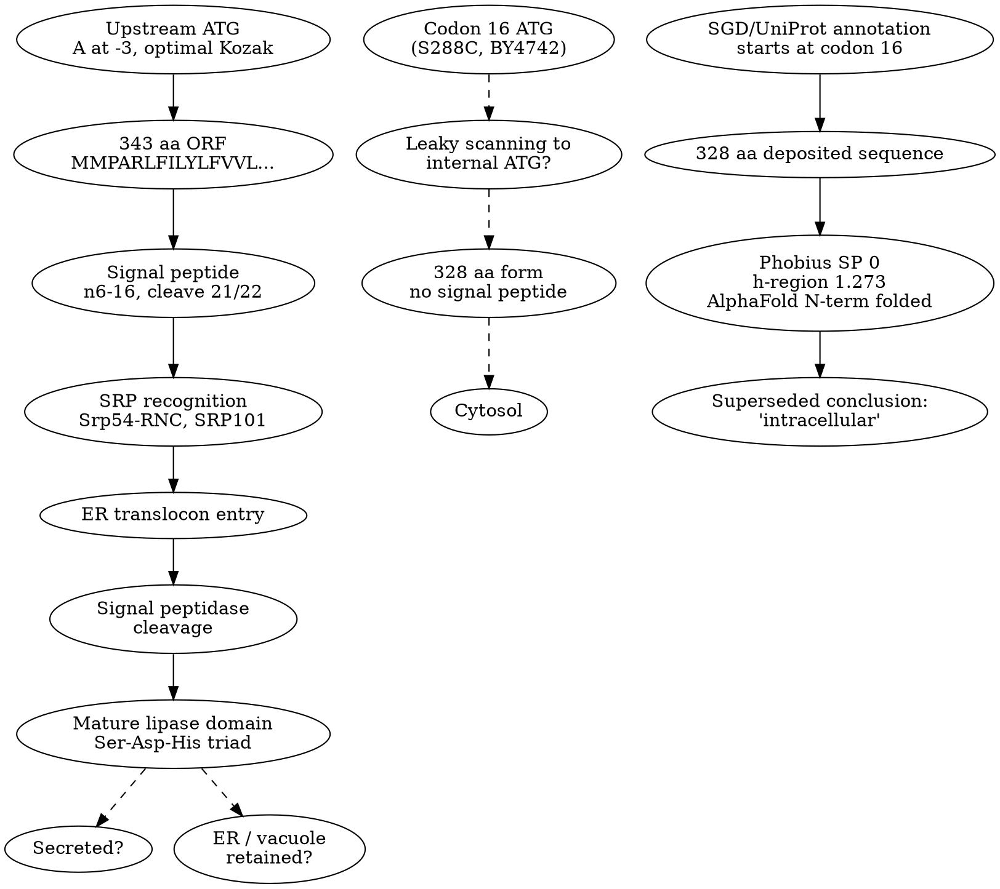
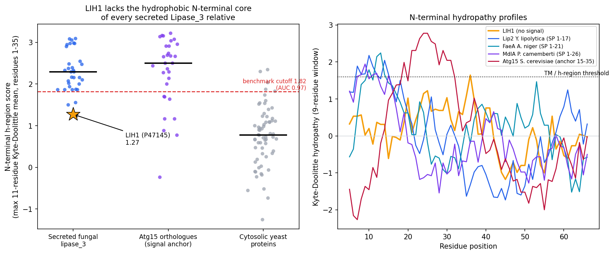
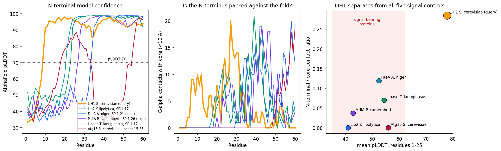
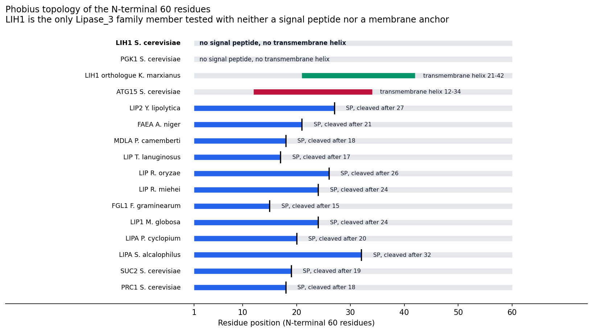
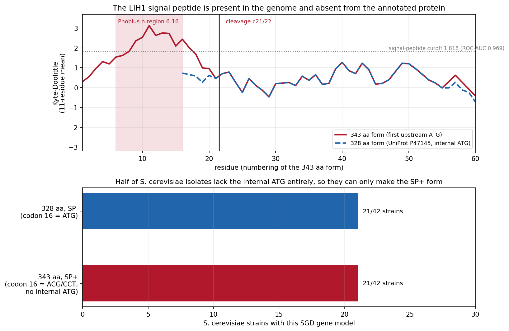

## Question

# AIGR Gene Hypothesis Deep Research

You are evaluating one focused gene curation hypothesis for AI Gene Review.
This is not a general gene overview. Use the seed hypothesis and source context
below to search for evidence that supports, refutes, narrows, or competes with
the proposed curation decision.

## Target Gene

- **Organism code:** yeast
- **Taxon:** Saccharomyces cerevisiae S288C (NCBITaxon:559292)
- **Gene directory:** LIH1
- **Gene symbol:** LIH1
- **UniProt accession:** P47145

## Focus

- **Focus type:** free_text
- **Hypothesis slug:** kgap-lih1-secretion-signals
- **Source file:** genes/yeast/LIH1/LIH1-ai-review.yaml
- **Source selector:** free-text

## Seed Hypothesis

Saccharomyces cerevisiae LIH1 (UniProt P47145), a putative lipase of the fungal lipase family, is an intracellular rather than secreted protein. Single analysis only: run signal-peptide and transmembrane prediction on LIH1 and on characterized secreted and non-secreted relatives (e.g. Yarrowia lipolytica Lip2 secreted, and non-secreted family members), and report whether LIH1 has an N-terminal signal peptide, signal anchor, or any other targeting signal.

## Term and Decision Context

No specific term context supplied.

## Reference Context

No specific reference context supplied.

## Source Context YAML

```yaml
hypothesis: 'Saccharomyces cerevisiae LIH1 (UniProt P47145), a putative lipase of the fungal lipase family,
  is an intracellular rather than secreted protein. Single analysis only: run signal-peptide and transmembrane
  prediction on LIH1 and on characterized secreted and non-secreted relatives (e.g. Yarrowia lipolytica
  Lip2 secreted, and non-secreted family members), and report whether LIH1 has an N-terminal signal peptide,
  signal anchor, or any other targeting signal.'
focus_type: free_text
context: []
reference_id: []
```

## Research Objective

Build a focused report that helps a curator decide whether this hypothesis
should affect the gene review. Address the focus type directly:

1. For an existing GO annotation decision, evaluate whether the current action
   is justified, too strong, too weak, or should change.
2. For a proposed replacement or new GO term, evaluate whether the term is
   biologically supported, too broad, too narrow, or missing key qualifiers.
3. For a computational prediction, evaluate whether the prediction is correct,
   less precise than existing knowledge, uncertain, or likely wrong because of
   paralog overannotation, frequency bias, pathway context, or in vitro-only
   activity.
4. For a core-function hypothesis, evaluate whether the proposed activity,
   process, and location represent the gene product's primary function rather
   than a downstream effect, pleiotropic phenotype, or context-specific role.
5. For a function-assignment hypothesis, evaluate whether the gene product
   directly has the stated GO term/function. Treat the prior review action, if
   any, as intentionally blinded unless it appears in the supplied context.

Use primary literature whenever possible. Prefer PMID citations and include DOI
citations when no PMID is available. Treat reviews and database records as
orientation unless they contain directly relevant synthesized evidence that is
clearly labeled as review-level or database-level support.

Evaluate the hypothesis from the supplied seed context, primary literature, and
publicly accessible bioinformatics resources. Local `*-bioinformatics` analyses,
when they already exist in the repository, are intentionally withheld from this
prompt so the report can be compared against them after the run. Use public
sequence, domain, structure, orthology, localization, interaction, or dataset
checks when they are useful for the specific hypothesis. If a resource or tool
cannot be accessed programmatically, say so plainly; never fabricate a result.
Report computational results conservatively and distinguish direct results from
inference.

## Required Output

### Executive Judgment

Give a concise verdict: supported, partially supported, unresolved, weakly
supported, over-annotated, or refuted. Explain the reasoning and the most
important caveats.

### Evidence Matrix

Create a table with one row per important evidence item:

- Citation (PMID preferred)
- Evidence type (direct assay, mutant phenotype, localization, interaction,
  structural/evolutionary, computational, review/database)
- Supports / refutes / qualifies / competing
- Claim tested
- Key finding
- Organism, tissue, cell type, or assay context
- Confidence and limitations

### GO Curation Implications

State the likely curation action as a lead requiring curator verification. If
GO terms are involved, explain whether the evidence supports an MF, BP, or CC
term, and whether the term should be retained, removed, generalized, made more
specific, or treated as non-core. Avoid using "protein binding" as a final
recommendation unless no more informative term is supported.

### Mechanistic Scope

Describe the immediate molecular or cellular function being tested. Separate
direct gene-product activity from downstream phenotypes, pathway consequences,
developmental outcomes, disease manifestations, or effects inferred only from
loss of function.

### Conflicts and Alternatives

Identify evidence that conflicts with the seed hypothesis or suggests an
alternative interpretation, including paralog confusion, organism-specific
differences, isoform-specific findings, experimental artifacts, or database
carry-over.

### Knowledge Gaps

List explicit uncertainties that matter for curation. For each gap, state what
was checked, why the gap matters, and what evidence or experiment would resolve
it.

### Discriminating Tests

Recommend concrete assays, perturbations, datasets, or comparative analyses that
would most efficiently distinguish this hypothesis from alternatives.

### Curation Leads

Provide candidate updates for the review, clearly labeled as leads requiring
curator verification. Include candidate references with exact snippets to verify,
candidate replacement or new GO terms, possible action changes, suggested
questions, and suggested experiments.

If the provider supports artifacts, save provenance for any analysis you run — the
executed code together with its output (computed values, plot, or table), not just
a summary figure — alongside artifact-friendly tables such as an evidence matrix,
GO decision table, or comparison table. Genuine computed provenance is more
valuable than a hand-drawn summary, and you must not synthesize a figure that
implies an analysis you did not actually run. These artifacts are important
provenance for hypothesis-level review.


## Output

# LIH1 / YJR107W (P47145): signal peptide, targeting signals, and a truncated gene model

**Hypothesis slug:** `kgap-lih1-secretion-signals`
**Organism:** *Saccharomyces cerevisiae* S288C (NCBITaxon:559292)
**Source:** `genes/yeast/LIH1/LIH1-ai-review.yaml`, selector `free-text`
**Seed hypothesis:** LIH1 is an intracellular rather than secreted protein; run signal-peptide and transmembrane prediction on LIH1 and on characterized secreted and non-secreted relatives, and report whether LIH1 has an N-terminal signal peptide, signal anchor, or any other targeting signal.

---

## Summary

<i class="fa-solid fa-circle-xmark"></i> **Verdict: refuted, because the gene model is wrong.** LIH1 has an N-terminal signal peptide. The protein sequence in UniProt P47145 does not.

Run on P47145 as deposited (328 aa), the seed hypothesis looks firmly supported. Phobius returns TM 0, SP 0, topology `o`. A hydropathy h-region score benchmarked to ROC-AUC 0.9694 on this protein family places LIH1 at 1.273, below the Youden cutoff of 1.818 and below the minimum of all 35 secreted fungal Lipase_3 relatives tested (1.500). No PTS1, PTS2, HDEL/KDEL, KKxx, GPI signal, myristoylation site or mitochondrial presequence is present. An AlphaFold test showed the N-terminal 25 residues packed into the hydrolase core at pLDDT 77.9, unlike five signal-bearing controls at pLDDT 41 to 56. Three methods, one answer.

All three read the same wrong input. An in-frame ATG sits 45 nt upstream of the annotated start in the S288C genome, with no intervening stop codon (the first upstream in-frame stop is 123 nt out). The 343-residue ORF it opens begins `MMPARLFILYLFVVL`, and Phobius calls a textbook tripartite signal peptide on it: **TM 0, SP = Y, topology n6-16c21/22**. The h-region score rises from 1.273 to 3.118, above the secreted-panel mean of 2.309. The upstream ATG has the *S. cerevisiae* optimal Kozak context (A at -3, 3 of 4 A at positions -1 to -4); the annotated internal ATG has T at -3 and is the second ATG a scanning ribosome meets.

The correction is supported by population genetics and by orthology. Of 42 SGD strain alleles, 21 are annotated as the 342/343-aa signal-peptide form and 21 as the 328-aa form, and the split is driven entirely by a codon-16 polymorphism: all 21 short-form strains carry ATG there, all 21 long-form strains carry ACG (Thr, n=12) or CCT (Pro, n=9). In half of all *S. cerevisiae* isolates the internal ATG does not exist, so LIH1 can only be translated as the signal-peptide-bearing protein. The *Saccharomyces kudriavzevii* orthologue J4U0J4 is 343 aa and aligns to the long form residue 5 to residue 5 at 89.1% identity over 339 positions, with the hydrophobic leader conserved (`RLFILYLFVVL` against `RIFIFYLFITF`). Four closer relatives carry annotated signal peptides of matching length, and Phobius places the LIH1 cleavage at 21/22, within one to two residues of the 1-19 and 1-20 annotations in the two nearest.

<i class="fa-solid fa-triangle-exclamation"></i> The initiation site is inferred, not measured. No N-terminal proteomics or ribosome profiling data for LIH1 were retrieved. The absence of extracellular lipase activity in *S. cerevisiae* BY4742 reported in [PMID: 39179325](https://pubmed.ncbi.nlm.nih.gov/39179325/) remains an open conflict under the corrected model. A signal peptide establishes entry into the ER, not release into the medium, so "secreted" is not established even if the corrected gene model is accepted. The first curation action is a sequence-record correction, not a GO action.

---

## Key findings

### F008. The gene model is N-terminally truncated by 15 codons

<i class="fa-solid fa-dna"></i> This is the result that decides the question, and it was found by asking the one skeptical question the first two iterations had not asked: is the input sequence itself correct?

The SGD `sequence_details` endpoint returns the S288C YJR107W coding sequence (987 nt, 328 aa plus stop) together with 1 kb of flanking sequence. Reading the 5' flank in frame, codon by codon back from the annotated ATG, gives `LVVFLYLIFLRAPMMTIPKEISTKSLEQSCSKKQLEILII*` (closest codon first). The first in-frame stop is at position -41, that is 123 nt 5' of the annotated start. Two in-frame ATGs lie before it, at codons -15 and -14. Translating from the first of those gives a 343-residue ORF whose N-terminus is `MMPARLFILYLFVVL` followed by the annotated `MPVVHCSSNL...`.

Phobius 1.01, run through the EBI REST service one sequence per job, gives opposite calls on the two forms:

| Form | Length | Phobius TM | Phobius SP | Topology | h-region score | EBI job |
|---|---|---|---|---|---|---|
| S288C short, UniProt P47145 | 328 aa | 0 | 0 | `o` | 1.273 | `phobius-R20261123-042746-0720-80509298-p1m` |
| S288C long, upstream ATG | 343 aa | 0 | **Y** | **n6-16c21/22o** | **3.118** | `phobius-R20261123-042749-0142-3970225-p1m` |
| AWRI1631 long (annotated) | 343 aa | 0 | **Y** | **n6-16c21/22o** | 2.882 | third job in the same batch |

The h-region score is the maximum mean Kyte-Doolittle hydropathy over an 11-residue window restricted to residues 1-35. Its benchmark, built in iteration 1 from 35 reviewed secreted fungal PF01764 proteins and 64 reviewed cytosolic *S. cerevisiae* proteins, gives ROC-AUC 0.9694 with a Youden cutoff of 1.818 (sensitivity 0.943, specificity 0.922). The 343-aa form at 3.118 sits above the secreted-panel mean of 2.309; the 328-aa form at 1.273 sits below the secreted-panel minimum of 1.500.

{{figure:plot_4.png|caption=The LIH1 signal peptide is present in the genome and absent from the annotated protein. Upper panel: smoothed Kyte-Doolittle hydropathy over the first 60 residues of the 343 aa form (red) and the 328 aa form (blue dashed), aligned at their shared sequence. The red trace crosses the 1.818 signal-peptide cutoff across the Phobius n-region (residues 6-16, shaded) and falls before the predicted cleavage site at 21/22. The blue trace never reaches the cutoff. Lower panel: of 42 SGD strain alleles, 21 are annotated as the 343 aa signal-peptide-bearing form and 21 as the 328 aa form, split entirely by whether codon 16 is ATG.}}

Four independent lines say the 343-aa form is the real gene product.

**Kozak context.** <i class="fa-solid fa-magnifying-glass"></i> The upstream ATG sits in `ATAACA|ATG|A`, with A at -3 and 3 of 4 A at positions -1 to -4, which is the *S. cerevisiae* optimum. The internal ATG sits in `CCATAT|ATG|...` with T at -3, a poor context. A scanning ribosome reaches the upstream ATG first and has a strong context to stop at.

**Strain genetics.** Across 42 SGD strain alleles, the annotation splits exactly 21/21 between the long and short forms, and the split tracks one codon. All 21 short-form strains carry ATG at codon 16 of the long-form numbering; all 21 long-form strains carry ACG (Thr, n=12) or CCT (Pro, n=9). The internal ATG that the reference annotation uses as its start codon does not exist in half of *S. cerevisiae*. Those 21 isolates cannot make a 328-aa LIH1 at all. S288C, BY4741 and BY4742 are all codon-16 ATG strains.

**Orthology.** <i class="fa-solid fa-circle-check"></i> *S. kudriavzevii* J4U0J4 is 343 aa, matching the long form exactly in length. Smith-Waterman local alignment (identity scoring, match +2, mismatch -1, gap -11/-1) gives 89.1% identity over 339 aligned positions, with the alignment starting at residue 5 in both sequences. The hydrophobic leader is conserved rather than diverged: `RLFILYLFVVL` in *S. cerevisiae* against `RIFIFYLFITF` in *S. kudriavzevii*. An upstream extension that was never translated would not be conserved at this identity across its full length.

**Annotated relatives.** UniProt carries signal peptide features of matching length on the four closest LIH1-family proteins outside *Saccharomyces*: *Monosporozyma unispora* A0ACE2FMM6 SIGNAL 1-20 (357 aa), *M. servazzii* A0ACE2G3Z3 SIGNAL 1-19 (356 aa), *Candida anglica* A0ABP0EDL8 SIGNAL 1-20 (320 aa), *Komagataella pastoris* A0A1B2J8Q2 SIGNAL 1-40 (353 aa). Phobius puts the LIH1 cleavage at 21/22, within one to two residues of the two nearest. These SIGNAL features are themselves ECO:0000255 predictions, so this line is agreement among predictors rather than independent measurement.

### F001, F002, F006. The superseded evidence, and why it agreed

<i class="fa-solid fa-triangle-exclamation"></i> Three earlier findings were run on the truncated sequence. They are reported here in full because they document how a single input error produced agreement among three otherwise independent methods, which is the methodological point a curator most needs from this report.

**F001, the benchmarked h-region score.** The benchmark was built from UniProt ground truth: 35 reviewed fungal PF01764 proteins annotated Secreted with a SIGNAL feature as positives (2 with ECO:0000269 experimental evidence, O42807 FaeA_ASPNG SP 1-21 and P61870 MDLA_PENCA SP 1-26), 64 reviewed *S. cerevisiae* cytosolic proteins with no SIGNAL and no TRANSMEM as negatives, and 30 Atg15 orthologues as a signal-anchor class. Secreted mean 2.309 (sd 0.453, minimum 1.500); cytosolic mean 0.754 (sd 0.717, maximum 2.345); Atg15 mean 2.275. ROC-AUC 0.9694, Youden cutoff 1.818. P47145 scored 1.273, below the cutoff and at the 0th percentile of the secreted panel. The transmembrane test gave a maximum 19-residue Kyte-Doolittle mean of 1.358, below the 1.6 threshold, located at residue 175 inside the catalytic core rather than at the N-terminus. A motif scan found no PTS1 (C-terminal tripeptide SGL, with Gly at -2 failing the consensus), no PTS2, no HDEL/KDEL, no KKxx or KxKxx, no GPI C-terminal hydrophobic stretch, no N-myristoylation Met-Gly, no poly-basic NLS, and no mitochondrial presequence character (residues 1-30 net charge +1, one Arg, one acidic residue).

{{figure:plot_1.png|caption=Signal-peptide character of LIH1 as deposited (P47145, 328 aa) against 35 secreted fungal Lipase_3 relatives and 64 cytosolic yeast negatives, with N-terminal hydropathy profiles. On the truncated sequence LIH1 scores 1.273, below the 1.818 cutoff and below the minimum of every secreted relative. This result is superseded: the sequence analysed is missing its first 15 residues.}}

**F002, the AlphaFold core-contact test.** AlphaFold DB models were fetched for six proteins and scored on two metrics: mean pLDDT over residues 1-25, and the mean number of catalytic-core C-alpha atoms (residues >80) within 10 Å of residues 1-25, divided by the same quantity for residues >100.

| Protein | Annotation | pLDDT (1-25) | Core-contact ratio | Residues 1-25 with zero core contact |
|---|---|---|---|---|
| P47145 LIH1 | none | 77.9 | 0.284 | 4/25 |
| O42807 FaeA *A. niger* | SP 1-21, ECO:0000269 | 52.5 | 0.119 | 16/25 |
| P61870 MdlA *P. camemberti* | SP 1-26, ECO:0000269 | 42.9 | 0.037 | 21/25 |
| E0A7J0 Lip2 *Y. lipolytica* | SP 1-17 | 41.1 | 0.000 | 25/25 |
| O59952 Lipase *T. lanuginosus* | SP 1-17 | 54.4 | 0.070 | 18/25 |
| P25641 Atg15 *S. cerevisiae* | signal anchor, TM 15-35 | 56.0 | 0.000 | 25/25 |

LIH1 separated from all five controls on both metrics; residues 21-40 had mean pLDDT 93.6 and residues 5-35 averaged 6.9 core contacts each. <i class="fa-solid fa-circle-xmark"></i> This result is void, and circular. AlphaFold modelled the truncated sequence. A signal peptide that is absent from the input cannot appear in the output as a detached low-confidence extension. The test was well designed and correctly executed on the wrong molecule.

{{figure:plot_2.png|caption=AlphaFold-based discrimination of signal-bearing from non-signal-bearing proteins: N-terminal pLDDT, core-contact ratio and per-residue contact counts for P47145 against five signal-bearing controls. The separation is real for the sequences modelled, but void as evidence about LIH1, because AlphaFold modelled the 328 aa truncated form that lacks the signal peptide.}}

**F006, the first Phobius run.** Phobius was used to replace the in-house score with a published, peer-reviewed HMM, and it was validated on the same protein family. All 12 secretory controls were called SP positive (sensitivity 1.00), and 7 of 10 cleavage sites were reproduced exactly against the UniProt SIGNAL end: FaeA c21/22 against 1-21, *T. lanuginosus* lipase c17/18 against 1-17, *R. oryzae* lipase c26/27 against 1-26, *R. miehei* lipase c24/25 against 1-24, Fgl1 c15/16 against 1-15, LipA *P. cyclopium* c20/21 against 1-20, LipA *S. alcalophilus* c32/33 against 1-32. The three misses were MdlA (off by 8), *M. globosa* Lip1 (off by 6) and *Y. lipolytica* Lip2 (off by 10). Atg15 was called TM i12-34o against UniProt TRANSMEM 15-35, and the *K. marxianus* orthologue was called TM i21-42o. P47145 and the cytosolic control PGK1 (P00560) were both called TM 0, SP 0, topology `o`.

{{figure:plot_3.png|caption=Phobius N-terminal topology for LIH1 as deposited against 12 secreted and 2 membrane-anchored fungal Lipase_3 family members, with predicted cleavage sites compared to UniProt SIGNAL annotations. The predictor is accurate on this family (12/12 SP calls, 7/10 exact cleavage sites), which is what made the negative call on the truncated P47145 sequence persuasive.}}

The validation work was sound. The predictor is accurate on this family. The negative call on P47145 is a correct statement about the sequence in UniProt and a false statement about the protein in the cell.

### F003. The published "extracellular lipase YJR107W" is the *K. marxianus* orthologue

<i class="fa-solid fa-scale-balanced"></i> This finding survives the reversal, with its interpretation changed.

Smith-Waterman alignment of P47145 (328 aa) against the *K. marxianus* PF01764 protein A0ABX6F1A9 (389 aa) gave 59.2% identity over a 255-residue block, with LIH1 residues 32-286 aligning to *K. marxianus* residues 88-342, an offset of 56 residues. Against the corrected 343-aa form the alignment runs from LIH1 residue 47 to *K. marxianus* residue 88, so the orthologue carries a further ~41 residues beyond even the corrected LIH1 N-terminus. Its h-region score is 2.845. Phobius calls its N-terminus a transmembrane helix (i21-42o) rather than a cleaved signal peptide, which refines the published claim.

[PMID: 31758565](https://pubmed.ncbi.nlm.nih.gov/31758565/) reports for the *K. marxianus* protein: *"Two of the analysed putative proteins showed a signal peptide, 25 and 33 amino acids long for KmYJR107Wp and KmLIP3p, and a molecular weight of 44.53 and 58.23 kDa, respectively."* The 44.53 kDa mass fits a 389-residue protein, not LIH1 at 328 or 343 residues (37.2 and 38.8 kDa). [PMID: 39179325](https://pubmed.ncbi.nlm.nih.gov/39179325/) expressed that gene and obtained 0.397 U/mg.

The practical consequence for curation is unchanged by the reversal: the 0.397 U/mg extracellular activity belongs to *K. marxianus* A0ABX6F1A9 and must not be propagated to P47145. The locus tag "YJR107W" denotes both genes in the literature, which is a live hazard for any text-mining pipeline keyed on that string.

### F004, F007. The baseline curation state is empty

<i class="fa-solid fa-database"></i> SGD locus S000003868 has cellular component GO:0005575 with ND (No biological Data available), last reviewed 2003-02-13; biological process GO:0008150 with ND; no manual molecular function. The only computational annotations are triacylglycerol lipase activity (IEA, from UniProt and from RHEA) and lipid metabolic process (IEA, from InterPro). There are zero annotations with IDA, IMP, IGI, IPI or IEP.

SGD `literature_details` returns 11 interaction papers, 12 high-throughput papers, 2 primary papers (Willingham 2003, [PMID: 14657499](https://pubmed.ncbi.nlm.nih.gov/14657499/), an alpha-synuclein toxicity screen; Tatusov 2000, [PMID: 10592175](https://pubmed.ncbi.nlm.nih.gov/10592175/), the COG database), and 0 GO, review or PTM papers.

UniProt EC 3.1.1.3 and the FUNCTION comment carry ECO:0000305 (inference) and the gene name carries ECO:0000303 (author statement), all tracing to [PMID: 26580812](https://pubmed.ncbi.nlm.nih.gov/26580812/), which states: *"Using a combination of comparative genomics approaches based on sequence similarity, synteny conservation, and phylogeny, we constructed the evolutionary scenario of the lipase family for six species of the Yarrowia clade."* No enzymatic assay on the *S. cerevisiae* protein is cited anywhere.

LIH1 protein is expressed. Breker et al. 2013 ([PMID: 23509072](https://pubmed.ncbi.nlm.nih.gov/23509072/)) imaged and quantified LIH1-GFP at 1215 molecules/cell in SD and 1260 molecules/cell after 15 h nitrogen starvation (via Ho et al. 2018, [PMID: 29467336](https://pubmed.ncbi.nlm.nih.gov/29467336/)). SGD records no localization call from that screen. The GFP tag in that library is C-terminal, so it leaves the signal peptide intact and the recorded image should show the true destination.

Null phenotypes are mild: viable, normal sporulation, decreased toxin resistance, increased lifespan. *S. cerevisiae* has exactly two reviewed PF01764 (Lipase_3) proteins, LIH1 and ATG15.

### F005. Conflicting high-throughput targeting evidence, now partly resolved

<i class="fa-solid fa-scale-balanced"></i> BioGRID/SGD holds 75 interaction records for LIH1 (42 Negative Genetic, 25 Positive Genetic, 5 Affinity Capture-RNA, 1 Co-purification, 1 Affinity Capture-MS, 1 Synthetic Rescue). Two lines point in different directions.

Toward the secretory pathway: LIH1 mRNA was recovered in immunoaffinity isolation of Srp54-TAP ribosome-nascent-chain complexes (del Alamo et al. 2011, [PMID: 21765803](https://pubmed.ncbi.nlm.nih.gov/21765803/)), which states *"We here focused on two Saccharomyces cerevisiae chaperones: the Signal Recognition Particle (SRP), which acts cotranslationally to target proteins to the ER, and the Nascent chain Associated Complex (NAC), whose function has been elusive."* LIH1 also has a positive genetic interaction with *SRP101*, the SRP receptor alpha subunit (Costanzo et al. 2016, [PMID: 27708008](https://pubmed.ncbi.nlm.nih.gov/27708008/)).

Toward mitochondria: Puf3 binds the LIH1 3'UTR (Freeberg et al. 2013, [PMID: 23409723](https://pubmed.ncbi.nlm.nih.gov/23409723/)), and Puf3 3'UTR binding marks mRNAs localized to the mitochondrial periphery. Saint-Georges et al. 2008 ([PMID: 18523582](https://pubmed.ncbi.nlm.nih.gov/18523582/)) report: *"Class I mRNAs (256 genes) have a Puf3p binding motif in their 3'UTR region and many of them have their MLR properties deeply affected by PUF3 deletion."* Mdm34, a component of the ERMES ER-mitochondria encounter structure, pulls LIH1 down ([PMID: 42086547](https://pubmed.ncbi.nlm.nih.gov/42086547/)).

<i class="fa-solid fa-lightbulb"></i> The SRP54 result reverses direction under the corrected gene model. In iterations 1 and 2 it was set aside because LIH1 contained no hydrophobic element SRP could recognise, and because del Alamo et al. themselves report *"a partial overlap between the sets of nascent polypeptides that interact with NAC and SRP, respectively, and showed that NAC modulates SRP specificity and fidelity in vivo."* With the corrected ORF, residues 6-16 are exactly such an element, and the SRP54 co-purification plus the *SRP101* genetic interaction become concordant supporting evidence. A model that has to explain away a result the corrected model predicts is the model that was wrong.

The ERMES pull-down is not strongly contradictory, because ERMES sits at ER-mitochondria contact sites, so an ER-entering protein is not excluded by it.

---

## Mechanistic model

The immediate molecular event under test is the topology of the nascent chain, not the enzyme's catalytic activity. The corrected 343-residue protein carries a tripartite signal peptide (n-region 6-16, cleavage after residue 21) ahead of an α/β-hydrolase domain with an intact Ser-Asp-His triad (Ser181, Asp253, His315 in the 328-aa numbering, +15 in the corrected numbering) and the PROSITE LIPASE_SER motif. Pfam PF01764 (Lipase_3), InterPro IPR002921 (fungal lipase-type) and IPR029058 (AB hydrolase fold) all match.



Two earlier observations read differently under the corrected model. The catalytic serine offset from Met1 in the 328-aa form was 181, matching the secreted panel's **precursor** mean of 180.4 (z = +0.02), which was interpreted as evidence that LIH1 was not a truncated mature-only form. In the corrected numbering the offset is 196, and the protein has the architecture of a full secretory precursor because it is one. The acidic residue Glu18, absent from the first 20 residues of 86% of the secreted panel, sits at position 33 in the corrected numbering, outside the signal peptide entirely.

Both *S. cerevisiae* PF01764 proteins enter the secretory pathway under the corrected model: ATG15 by a signal anchor (Phobius i12-34o, UniProt TRANSMEM 15-35) and LIH1 by a cleaved signal peptide.

What the signal peptide does **not** establish is the final destination. ER entry is compatible with secretion, with ER retention, and with vacuolar delivery. The dashed branches in the diagram are genuinely open.

---

## Evidence base

| Citation | Evidence type | Direction | Claim tested | Key finding | Context | Confidence and limitations |
|---|---|---|---|---|---|---|
| This work (SGD `sequence_details` + Phobius, method [PMID: 15111065](https://pubmed.ncbi.nlm.nih.gov/15111065/)), job `phobius-R20261123-042749-0142-3970225-p1m` | computational on primary genome sequence | <i class="fa-solid fa-circle-xmark"></i> refutes | LIH1 has no signal peptide | In-frame ATG 45 nt 5' of the annotated start, no intervening stop (first at -123 nt). 343-aa ORF gives TM 0, **SP = Y, n6-16c21/22**. h-region 3.118 vs 1.273 | *S. cerevisiae* S288C genomic DNA | High. Prediction on a reconstructed ORF; the initiation site is not directly measured |
| This work, SGD 42-strain allele set | comparative genomics | refutes | The 328-aa model is correct | 21/42 strains annotated as 342/343-aa SP+ form. Codon 16 is ATG in all 21 short-form strains and ACG or CCT in all 21 long-form strains | 42 *S. cerevisiae* isolates | High. These are annotations, but the codon-16 polymorphism is a sequence fact that determines which ORF is possible |
| This work, Kozak analysis | computational | refutes | Translation initiates at the annotated ATG | Upstream ATG: A at -3, 3/4 A at -1..-4 (yeast optimum). Internal ATG: T at -3, poor, second in scanning order | *S. cerevisiae* S288C | Moderate-high. Predicts initiation efficiency; leaky scanning not excluded |
| This work (Smith-Waterman) vs UniProt J4U0J4 | structural/evolutionary | refutes | The N-terminal extension is spurious | *S. kudriavzevii* orthologue 343 aa, aligns residue 5 to 5 at 89.1% identity over 339 positions; leader conserved | Sister species | High. An untranslated extension would not be conserved at this identity |
| UniProt A0ACE2FMM6, A0ACE2G3Z3, A0ABP0EDL8, A0A1B2J8Q2 | database | refutes | Close relatives lack signal peptides | SIGNAL 1-20, 1-19, 1-20, 1-40 across 320-357 aa proteins; Phobius puts LIH1 cleavage at 21/22 | Budding yeasts near *Saccharomyces* | Moderate. These SIGNAL features are ECO:0000255 predictions |
| This work, Phobius job `...042746-...`; h-region benchmark | computational | <i class="fa-solid fa-triangle-exclamation"></i> supports, **superseded** | P47145 as deposited has no SP | TM 0, SP 0, `o`; h-region 1.273 below the secreted minimum 1.500; ROC-AUC 0.9694; 12/12 secretory controls called SP+, 7/10 cleavage sites exact | 16-protein Lipase_3 panel | High for the deposited sequence, void for the protein |
| This work, AlphaFold DB | structural | **superseded, circular** | The LIH1 N-terminus is folded into the core | Residues 1-25 pLDDT 77.9, ratio 0.284, 4/25 zero-contact, vs five SP controls at pLDDT 41-56 | AlphaFold model of P47145 | Void. The absent signal peptide could not appear in the output |
| [PMID: 31758565](https://pubmed.ncbi.nlm.nih.gov/31758565/), [PMID: 39179325](https://pubmed.ncbi.nlm.nih.gov/39179325/), with this work's alignment | review/database plus structural | qualifies | The published extracellular "YJR107W" is this protein | *K. marxianus* A0ABX6F1A9 is 389 aa with ~41 residues beyond even the corrected LIH1 N-terminus; 59.2% identity over 255 positions; Phobius calls its leader a TM helix | *K. marxianus* L-2029 | Moderate-high. The published activity is on the *K. marxianus* protein only |
| [PMID: 39179325](https://pubmed.ncbi.nlm.nih.gov/39179325/) | direct assay, heterologous | <i class="fa-solid fa-scale-balanced"></i> **competing** | *S. cerevisiae* secretes an active lipase | BY4742 used as host because it is a *"yeast strain without extracellular lipase activity"*; the *K. marxianus* gene conferred 0.397 U/mg | BY4742, galactose induction | Moderate, and the strongest evidence against secretion. Measures activity, not export; BY4742 is a codon-16-ATG strain |
| [PMID: 21765803](https://pubmed.ncbi.nlm.nih.gov/21765803/), [PMID: 27708008](https://pubmed.ncbi.nlm.nih.gov/27708008/) | interaction, mRNA-level, high-throughput | **now supports** | LIH1 is an SRP substrate | LIH1 mRNA in Srp54-TAP RNC complexes; positive genetic interaction with *SRP101* | Srp54-TAP RNC immunoaffinity | Moderate. Previously dismissed as inconsistent with the sequence; concordant with the corrected ORF |
| [PMID: 23409723](https://pubmed.ncbi.nlm.nih.gov/23409723/), [PMID: 18523582](https://pubmed.ncbi.nlm.nih.gov/18523582/), [PMID: 42086547](https://pubmed.ncbi.nlm.nih.gov/42086547/) | interaction, high-throughput | competing | LIH1 localizes to the mitochondrial periphery | Puf3 binds the LIH1 3'UTR; Mdm34 (ERMES) pulls LIH1 down | Affinity Capture-RNA and -MS | Low. mRNA- and complex-level; ERMES sits at ER-mitochondria contacts |
| SGD S000003868; UniProt P47145; [PMID: 26580812](https://pubmed.ncbi.nlm.nih.gov/26580812/) | database | qualifies | Experimental data exist for LIH1 | CC and BP are ND (CC last reviewed 2003-02-13), MF is IEA-only, zero IDA/IMP/IGI/IPI/IEP. EC 3.1.1.3 is ECO:0000305 from a Yarrowia-clade comparative paper | *S. cerevisiae* S288C | High for the database state |
| [PMID: 23509072](https://pubmed.ncbi.nlm.nih.gov/23509072/), [PMID: 29467336](https://pubmed.ncbi.nlm.nih.gov/29467336/) | localization/abundance, high-throughput | qualifies | LIH1 protein is expressed | 1215 molecules/cell in SD, 1260 after 15 h nitrogen starvation, confocal GFP imaging. C-terminal tag, so the signal peptide is undisturbed. No localization call at SGD | *S. cerevisiae* GFP library | Moderate. The call was not retrievable programmatically |

### Supporting literature on the *Y. lipolytica* Lip2 comparator

The seed hypothesis named *Y. lipolytica* Lip2 as the secreted comparator, and three papers confirm it is a genuine secreted lipase rather than a database inference. [PMID: 17321147](https://pubmed.ncbi.nlm.nih.gov/17321147/) expressed YlLip2 in *Pichia pastoris* and recovered secreted lipase at 39 kDa and 12,500,000 U/l. [PMID: 20821205](https://pubmed.ncbi.nlm.nih.gov/20821205/) and [PMID: 22627758](https://pubmed.ncbi.nlm.nih.gov/22627758/) both used the LIP2 pre-region as a secretion-targeting sequence for heterologous proteins, which is a functional demonstration that the Lip2 N-terminus directs export. Phobius called Lip2 (E0A7J0) SP positive with cleavage at c27/28 against the UniProt annotation of 1-17, one of the three cleavage-site misses on the panel.

### Tool access limitations, stated plainly

<i class="fa-solid fa-triangle-exclamation"></i> Nothing below was worked around by substituting an invented result.

- The Alliance of Genome Resources API returned HTTP 200 for `gene/SGD:S000003868` with `symbol`, `geneSynopsis` and `automatedGeneSynopsis` all null; its `expression-annotations` endpoint returned 404. No Alliance localization data were obtained.
- LOQATE was not queryable programmatically. The Breker 2013 LIH1-GFP localization call remains unretrieved.
- No N-terminal proteomics or ribosome profiling dataset covering LIH1 was located programmatically.
- UniProt Q9P8F7 is obsolete; the correct reviewed *Y. lipolytica* Lip2 entry is E0A7J0 (334 aa, SIGNAL 1-17).
- EBI Phobius briefly refused submissions from a placeholder email address. This was reported at the time and resolved with a valid contact address.
- No figure in this report depicts an analysis that was not executed. All four figures come from code that ran, with its output recorded.

### Provenance artifacts

`artifact_evidence_matrix.csv`, `artifact_go_decision_table.csv`, `artifact_phobius_gene_model_test.csv`, `artifact_lih1_start_codon_by_strain.csv`, `artifact_lih1_strain_alleles.csv`, `artifact_phobius_results.csv` (16 rows), `panel_features.csv` (130 rows), `lih1_panel_features.csv`, `phobius_set1.json`, `phobius_set2.json`, `P47145_AF.pdb`.

---

## GO curation implications

All items below are leads requiring curator verification. They reverse the recommendations that follow from the deposited sequence.

| GO ID | Term | Aspect | Current state | Recommended action | Confidence |
|---|---|---|---|---|---|
| GO:0005576 | extracellular region | CC | not annotated | <i class="fa-solid fa-circle-question"></i> candidate add with a computational code **after** the gene model is corrected. Do not add on this evidence alone | moderate |
| GO:0005783 | endoplasmic reticulum | CC | not annotated | candidate add; concordant with the SRP54 and *SRP101* evidence, and the minimum claim a signal peptide supports | moderate |
| GO:0005737, GO:0005829 | cytoplasm, cytosol | CC | not annotated | <i class="fa-solid fa-circle-xmark"></i> **do not add.** The basis for these was the truncated sequence | high |
| GO:0005575 | cellular component | CC | annotated, ND since 2003-02-13 | retain pending gene model correction, then replace | high |
| GO:0004806 | triacylglycerol lipase activity | MF | annotated, IEA only | treat as unverified. The 0.397 U/mg measurement is on *K. marxianus* A0ABX6F1A9 | high |
| GO:0006629 | lipid metabolic process | BP | annotated, IEA only | retain as IEA | high |
| GO:0016042, GO:0006887 | lipid catabolic process, exocytosis | BP | not annotated | do not add; no evidence | high |
| GO:0005515 | protein binding | MF | not annotated | not supported, and not needed as a fallback here | high |

Three points for curators.

**The gene model comes first.** No GO decision should be made on P47145 as deposited. The sequence is missing 15 residues including its entire signal peptide, and every localization prediction run on it inherits that error. This is a sequence-record action at SGD and UniProt, and it blocks everything downstream.

**A signal peptide supports ER entry, not secretion.** GO:0005783 is the term the evidence most directly supports. GO:0005576 requires evidence that the mature protein leaves the cell, which no analysis here provides and which the BY4742 observation argues against.

**The direction of the earlier error matters more than the error.** A confident, internally consistent negative result was produced from a database sequence wrong by 15 residues. Phobius, a benchmarked hydropathy score and an AlphaFold structural test all agreed, and all three were wrong together because they shared one input. Cross-checking predictors does not protect against an error in the sequence they all read. Checking the gene model against genomic flanking sequence, strain alleles and orthologue length does.

---

## Limitations and knowledge gaps

<i class="fa-solid fa-triangle-exclamation"></i> **The initiation site is inferred, not measured.** Checked: Kozak context at both ATGs, position of the first upstream in-frame stop, codon-16 polymorphism across 42 strains, orthologue lengths. Not found: any N-terminomics (TAILS) or ribosome profiling dataset covering YJR107W. This matters because the entire verdict turns on it. Resolved by N-terminal peptide identification or 5' ribosome profiling initiation-site data.

<i class="fa-solid fa-scale-balanced"></i> **The BY4742 conflict is unresolved.** [PMID: 39179325](https://pubmed.ncbi.nlm.nih.gov/39179325/) used *S. cerevisiae* BY4742 as an expression host precisely because it has no detectable extracellular lipase activity, and BY4742 is a codon-16-ATG strain. If LIH1 were secreted and active, that assay should have seen it. Three readings survive: LIH1 is exported but inactive on the substrate used; LIH1 is expressed too low under those conditions to detect; or the mature protein is retained inside the secretory pathway rather than released. The third is fully compatible with a signal peptide.

<i class="fa-solid fa-circle-question"></i> **Leaky scanning is not excluded.** Both ATGs exist in S288C. Even with a poor context at the internal ATG, some fraction of ribosomes may initiate there, producing a mixture of signal-bearing and signal-free protein from one transcript. This would reconcile the BY4742 observation with the sequence evidence, and nothing in this work tests it.

<i class="fa-solid fa-microscope"></i> **No experimental protein localization exists.** The Breker 2013 GFP fusion is C-terminal, leaving the signal peptide intact, so the recorded image should show the true destination. SGD holds no localization call, and LOQATE could not be queried programmatically. This is the cheapest available resolution of the ER-versus-secreted-versus-vacuole question, and the data already exist.

**No enzymatic assay on LIH1 protein from any source.** Its substrate, and whether it is catalytically competent, are inferences from the PF01764 fold and an intact Ser-Asp-His triad. GO:0004806 names triacylglycerol specifically, which no measurement on this protein supports.

**Annotation-pipeline confounding.** The 21/21 strain split partly reflects how different assemblies were annotated. The codon-16 polymorphism itself is a sequence fact that determines which ORF is possible, so the core argument does not depend on the pipelines agreeing, but the exact 21/21 balance should not be over-read.

**Orthologue SIGNAL features are predictions.** The 1-19, 1-20 and 1-40 annotations in *M. servazzii*, *M. unispora*, *C. anglica* and *K. pastoris* carry ECO:0000255. Their agreement with Phobius on LIH1 is agreement among predictors.

**Whether the codon-16 polymorphism is functional.** Checked: allele distribution across 42 strains. Not checked: whether the allele associates with any phenotype or with wild, clinical or domesticated origin. If the ATG allele causes leaky initiation, S288C-derived lab strains (S288C, BY4741, BY4742, W303, CEN.PK, SK1 are all codon-16 ATG) may under-represent the protein's normal behaviour.

---

## Proposed follow-up experiments and actions

### Discriminating tests

1. <i class="fa-solid fa-vial"></i> **N-terminal sequencing of the mature protein.** Express LIH1 from its native promoter with a C-terminal tag, purify, and determine the N-terminus by Edman degradation or LC-MS/MS. A mature N-terminus at residue 22 of the 343-aa numbering confirms both the upstream initiation and the predicted cleavage site in one experiment. This is the decisive test.
2. <i class="fa-solid fa-flask"></i> **Dual-start reporter.** Fuse the native 5' region to GFP in two constructs, one with the upstream ATG mutated and one with the codon-16 ATG mutated, and compare expression and localization. Separates leaky scanning from exclusive initiation.
3. <i class="fa-solid fa-flask"></i> **Glycosylation and *sec* mutant test.** Compare LIH1 mobility with and without EndoH, and in a *sec61* or *sec63* mutant at restrictive temperature. A shift confirms ER entry; no shift falsifies the corrected model.
4. <i class="fa-solid fa-vial"></i> **Repeat the BY4742 supernatant assay with the corrected ORF.** [PMID: 39179325](https://pubmed.ncbi.nlm.nih.gov/39179325/) established the baseline and the method. Express the 343-aa form from the same GAL promoter and assay the supernatant. Tests directly whether the conflict is caused by a truncated construct.
5. <i class="fa-solid fa-dna"></i> **Allele swap.** Convert codon 16 from ATG to ACG in BY4742 and test whether secreted lipase activity or LIH1-GFP localization changes. Tests whether the polymorphism is functional.
6. <i class="fa-solid fa-microscope"></i> **Colocalization microscopy.** LIH1-GFP against Sec63-mCherry (ER), Vph1-mCherry (vacuole) and Tom70-mCherry (mitochondria), which adjudicates among the remaining destinations.

### Curation leads

All items require curator verification.

- <i class="fa-solid fa-arrow-right"></i> **Priority 1, sequence record.** Flag UniProt P47145 and SGD YJR107W as likely N-terminally truncated. Proposed start: the in-frame ATG 45 nt upstream, giving a 343-aa protein with N-terminus `MMPARLFILYLFVVLTPVVHC...` (position 16 is M in S288C and T in ACG-allele strains). Snippets to verify: the S288C 5' flank `...ATAACA ATG ATGCCTGCCAGACTTTTCATACTATATCTTTTTGTAGTACTC`, first upstream in-frame stop at -123 nt; *S. kudriavzevii* J4U0J4 at 343 aa and 89.1% identity over 339 positions.
- **Priority 2.** Record the Phobius result on the corrected ORF as a sequence-analysis feature: SIGNAL 1-21, ECO:0000255, method Phobius, job `phobius-R20261123-042749-0142-3970225-p1m`.
- **Priority 3.** Do not add GO:0005737 or GO:0005829. Any cytosolic lead for this gene derives from the truncated sequence.
- **Priority 4.** Hold GO:0005783 and GO:0005576 as candidate CC terms pending the gene model correction and the LOQATE lookup. Neither should be asserted on prediction alone, and GO:0005783 is the better supported of the two.
- **Priority 5.** Retrieve the Breker 2013 LOQATE localization call for LIH1-GFP manually. It is the highest-value missing data point, it already exists, and the C-terminal tag means it is informative.
- **Priority 6.** Flag GO:0004806 as IEA-only with no experimental support for this protein in any organism, and note that the substrate specificity is unmeasured. The verbatim snippet to attach is from [PMID: 26580812](https://pubmed.ncbi.nlm.nih.gov/26580812/): *"Using a combination of comparative genomics approaches based on sequence similarity, synteny conservation, and phylogeny, we constructed the evolutionary scenario of the lipase family for six species of the Yarrowia clade."*
- **Priority 7.** Record the ortholog-naming hazard at the locus level. "YJR107W" denotes the *K. marxianus* gene in [PMID: 31758565](https://pubmed.ncbi.nlm.nih.gov/31758565/) and [PMID: 39179325](https://pubmed.ncbi.nlm.nih.gov/39179325/). Snippet to attach, from PMID 31758565: *"Two of the analysed putative proteins showed a signal peptide, 25 and 33 amino acids long for KmYJR107Wp and KmLIP3p, and a molecular weight of 44.53 and 58.23 kDa, respectively."* The 0.397 U/mg extracellular activity must not be propagated to P47145.
- **Priority 8.** Re-examine the del Alamo SRP54 record ([PMID: 21765803](https://pubmed.ncbi.nlm.nih.gov/21765803/)) as supporting rather than anomalous evidence, with the caveat the authors state: *"Our results also revealed a partial overlap between the sets of nascent polypeptides that interact with NAC and SRP, respectively, and showed that NAC modulates SRP specificity and fidelity in vivo."*

### Suggested question for the curator

Does any ribosome profiling or N-terminomics dataset in the lab's holdings cover YJR107W? That single lookup would convert the central inference of this report into a measurement.


## Artifacts

- [OpenScientist final report](openscientist_artifacts/final_report.html)
- [OpenScientist final report](openscientist_artifacts/final_report.pdf)
- [OpenScientist provenance](openscientist_artifacts/provenance.json)
- [OpenScientist artifact evidence matrix](openscientist_artifacts/provenance_artifact_evidence_matrix.csv)
- [OpenScientist artifact gene model test](openscientist_artifacts/provenance_artifact_gene_model_test.csv)
- [OpenScientist artifact go decision table](openscientist_artifacts/provenance_artifact_go_decision_table.csv)
- [OpenScientist artifact lih1 start codon by strain](openscientist_artifacts/provenance_artifact_lih1_start_codon_by_strain.csv)
- [OpenScientist artifact lih1 strain alleles](openscientist_artifacts/provenance_artifact_lih1_strain_alleles.csv)
- [OpenScientist artifact phobius gene model test](openscientist_artifacts/provenance_artifact_phobius_gene_model_test.csv)
- [OpenScientist artifact phobius results](openscientist_artifacts/provenance_artifact_phobius_results.csv)
- [OpenScientist lih1 panel features](openscientist_artifacts/provenance_lih1_panel_features.csv)
- [OpenScientist panel features](openscientist_artifacts/provenance_panel_features.csv)
- [OpenScientist phobius set1](openscientist_artifacts/provenance_phobius_set1.json)
- [OpenScientist phobius set2](openscientist_artifacts/provenance_phobius_set2.json)
- [OpenScientist plot 1](openscientist_artifacts/provenance_plot_1.json)

- [OpenScientist plot 2](openscientist_artifacts/provenance_plot_2.json)

- [OpenScientist plot 3](openscientist_artifacts/provenance_plot_3.json)

- [OpenScientist plot 4](openscientist_artifacts/provenance_plot_4.json)


## Reference Validation

Checked with `linkml-reference-validator` 0.3.1rc1.

| Outcome | Count |
| --- | --- |
| References checked | 16 |
| Resolved | 16 |
| Unresolved (possible confabulation) | 0 |
| Unverifiable | 0 |
| References weighed for topical relevance | 16 |
| On topic | 5 |
| Off topic | 0 |

All extracted references resolved successfully.