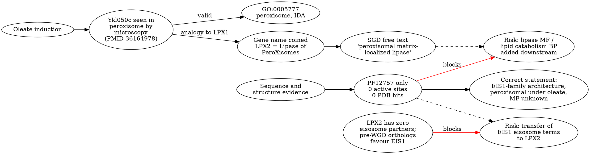
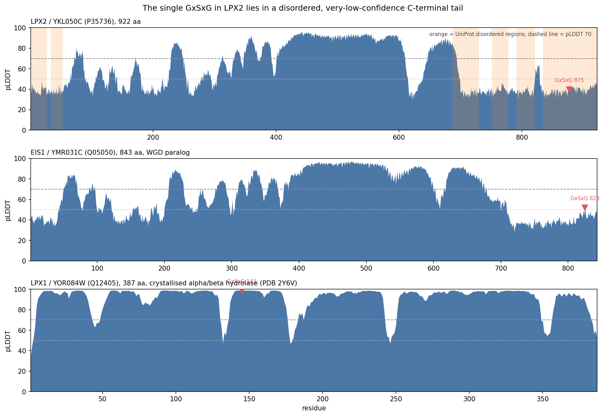
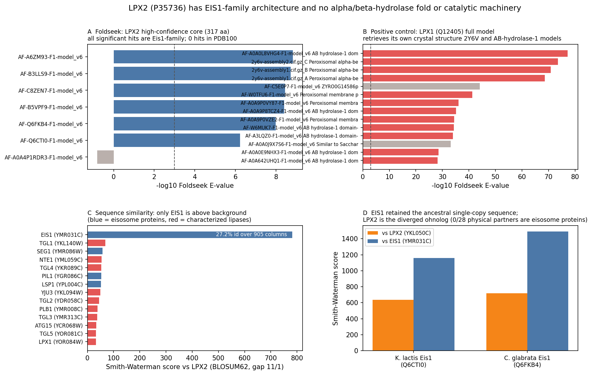

## Question

# AIGR Gene Hypothesis Deep Research

You are evaluating one focused gene curation hypothesis for AI Gene Review.
This is not a general gene overview. Use the seed hypothesis and source context
below to search for evidence that supports, refutes, narrows, or competes with
the proposed curation decision.

## Target Gene

- **Organism code:** yeast
- **Taxon:** Saccharomyces cerevisiae S288C (NCBITaxon:559292)
- **Gene directory:** LPX2
- **Gene symbol:** LPX2
- **UniProt accession:** P35736

## Focus

- **Focus type:** free_text
- **Hypothesis slug:** kgap-lpx2-family-and-lipase-motif
- **Source file:** genes/yeast/LPX2/LPX2-ai-review.yaml
- **Source selector:** free-text

## Seed Hypothesis

Saccharomyces cerevisiae LPX2 (UniProt P35736), annotated as a peroxisomal lipase, is in fact an EIS1/eisosome-family protein lacking any lipase/esterase catalytic machinery. Single analysis only: run Foldseek with the AlphaFold model and scan the sequence for the alpha/beta-hydrolase GxSxG nucleophile motif and catalytic triad, compare with Eis1 and with characterized yeast lipases, and state whether LPX2 has a hydrolase fold and catalytic residues or only the EIS1-family architecture.

## Term and Decision Context

No specific term context supplied.

## Reference Context

No specific reference context supplied.

## Source Context YAML

```yaml
hypothesis: 'Saccharomyces cerevisiae LPX2 (UniProt P35736), annotated as a peroxisomal lipase, is in
  fact an EIS1/eisosome-family protein lacking any lipase/esterase catalytic machinery. Single analysis
  only: run Foldseek with the AlphaFold model and scan the sequence for the alpha/beta-hydrolase GxSxG
  nucleophile motif and catalytic triad, compare with Eis1 and with characterized yeast lipases, and state
  whether LPX2 has a hydrolase fold and catalytic residues or only the EIS1-family architecture.'
focus_type: free_text
context: []
reference_id: []
```

## Research Objective

Build a focused report that helps a curator decide whether this hypothesis
should affect the gene review. Address the focus type directly:

1. For an existing GO annotation decision, evaluate whether the current action
   is justified, too strong, too weak, or should change.
2. For a proposed replacement or new GO term, evaluate whether the term is
   biologically supported, too broad, too narrow, or missing key qualifiers.
3. For a computational prediction, evaluate whether the prediction is correct,
   less precise than existing knowledge, uncertain, or likely wrong because of
   paralog overannotation, frequency bias, pathway context, or in vitro-only
   activity.
4. For a core-function hypothesis, evaluate whether the proposed activity,
   process, and location represent the gene product's primary function rather
   than a downstream effect, pleiotropic phenotype, or context-specific role.
5. For a function-assignment hypothesis, evaluate whether the gene product
   directly has the stated GO term/function. Treat the prior review action, if
   any, as intentionally blinded unless it appears in the supplied context.

Use primary literature whenever possible. Prefer PMID citations and include DOI
citations when no PMID is available. Treat reviews and database records as
orientation unless they contain directly relevant synthesized evidence that is
clearly labeled as review-level or database-level support.

Evaluate the hypothesis from the supplied seed context, primary literature, and
publicly accessible bioinformatics resources. Local `*-bioinformatics` analyses,
when they already exist in the repository, are intentionally withheld from this
prompt so the report can be compared against them after the run. Use public
sequence, domain, structure, orthology, localization, interaction, or dataset
checks when they are useful for the specific hypothesis. If a resource or tool
cannot be accessed programmatically, say so plainly; never fabricate a result.
Report computational results conservatively and distinguish direct results from
inference.

## Required Output

### Executive Judgment

Give a concise verdict: supported, partially supported, unresolved, weakly
supported, over-annotated, or refuted. Explain the reasoning and the most
important caveats.

### Evidence Matrix

Create a table with one row per important evidence item:

- Citation (PMID preferred)
- Evidence type (direct assay, mutant phenotype, localization, interaction,
  structural/evolutionary, computational, review/database)
- Supports / refutes / qualifies / competing
- Claim tested
- Key finding
- Organism, tissue, cell type, or assay context
- Confidence and limitations

### GO Curation Implications

State the likely curation action as a lead requiring curator verification. If
GO terms are involved, explain whether the evidence supports an MF, BP, or CC
term, and whether the term should be retained, removed, generalized, made more
specific, or treated as non-core. Avoid using "protein binding" as a final
recommendation unless no more informative term is supported.

### Mechanistic Scope

Describe the immediate molecular or cellular function being tested. Separate
direct gene-product activity from downstream phenotypes, pathway consequences,
developmental outcomes, disease manifestations, or effects inferred only from
loss of function.

### Conflicts and Alternatives

Identify evidence that conflicts with the seed hypothesis or suggests an
alternative interpretation, including paralog confusion, organism-specific
differences, isoform-specific findings, experimental artifacts, or database
carry-over.

### Knowledge Gaps

List explicit uncertainties that matter for curation. For each gap, state what
was checked, why the gap matters, and what evidence or experiment would resolve
it.

### Discriminating Tests

Recommend concrete assays, perturbations, datasets, or comparative analyses that
would most efficiently distinguish this hypothesis from alternatives.

### Curation Leads

Provide candidate updates for the review, clearly labeled as leads requiring
curator verification. Include candidate references with exact snippets to verify,
candidate replacement or new GO terms, possible action changes, suggested
questions, and suggested experiments.

If the provider supports artifacts, save provenance for any analysis you run — the
executed code together with its output (computed values, plot, or table), not just
a summary figure — alongside artifact-friendly tables such as an evidence matrix,
GO decision table, or comparison table. Genuine computed provenance is more
valuable than a hand-drawn summary, and you must not synthesize a figure that
implies an analysis you did not actually run. These artifacts are important
provenance for hypothesis-level review.


## Output

# LPX2 (P35736) family assignment and lipase motif: hypothesis evaluation

**Target:** *Saccharomyces cerevisiae* S288C LPX2 / YKL050C, UniProt P35736, NCBITaxon:559292
**Hypothesis slug:** `kgap-lpx2-family-and-lipase-motif`
**Source:** `genes/yeast/LPX2/LPX2-ai-review.yaml`, focus type `free_text`
**Iterations completed:** 3. **Findings recorded:** 7. **Papers reviewed:** 20.

---

## Summary

LPX2 has EIS1-family architecture and no lipase machinery. The protein carries exactly one recognised signature set: Pfam PF12757 (Eisosome1) at residues 349-465, InterPro IPR024527 across 1-921, and PANTHER PTHR28298 "EISOSOME PROTEIN 1" across 1-921. It has zero curated active-site residues, no alpha/beta-hydrolase assignment (IPR029058, SSF53474, G3DSA:3.40.50.1820, IPR000073), no patatin domain (IPR002641), no EC number and no catalytic-activity comment. A direct PROSITE PS00120 LIPASE_SER scan returns 0 hits. The protein contains exactly one G-x-S-x-G pentapeptide in 922 residues, GFSQG at 875-879, which is what a composition-matched shuffle null predicts by chance (expected 0.23 occurrences, empirical p = 0.204), and that motif sits inside the UniProt-annotated disordered region 834-922 at a mean pLDDT of 41.0. A nucleophile elbow cannot form there.

Foldseek run on the 317 residues of the AlphaFold model with pLDDT >= 70 returns six Eis1-family proteins (E = 1.5e-9 to 5.9e-7), one kinesin noise hit (E = 6.5), and zero PDB100 hits. The positive control proves the pipeline works: the same procedure applied to LPX1 (Q12405), the genuine peroxisomal alpha/beta-hydrolase, retrieves its own crystal structure 2Y6V chains A/B/C at E = 3e-74 to 1.3e-71, along with a long list of AB hydrolase-1 models. Smith-Waterman alignment puts EIS1 at score 782 (27.2% identity over 905 columns) and every one of ten characterized yeast lipases at background (33-69).

The premise needs one correction. SGD holds no lipase GO annotation for LPX2 at all. The complete GO record for locus S000001533 is three terms: GO:0005777 peroxisome (manually curated, PMID 36164978), GO:0008150 biological_process (ND), and GO:0003674 molecular_function (ND). UniProt P35736 is still named "Uncharacterized protein YKL050C" and has no molecular function term. The lipase claim lives entirely in the SGD free-text description ("Peroxisomal matrix-localized lipase") and in the gene-name expansion "Lipase of PeroXisomes", both of which propagate into text-derived gene summaries and automated annotation. The curation action is prophylactic: block any lipase MF or lipid-catabolism BP from being added, and correct the free text, rather than remove an existing term. A second caveat is that the family assignment should not be converted into eisosome GO terms for LPX2, because LPX2 is the diverged ohnolog with zero eisosome physical partners.

---

## Executive judgment

<i class="fa-solid fa-circle-check"></i> **Verdict: supported, with one correction to the premise.**

The structural and sequence half of the seed hypothesis holds on every check that was run. LPX2 has an EIS1-family architecture and no hydrolase fold, no catalytic triad, and no credible nucleophile elbow. The single analysis the hypothesis asked for was performed and it returned the predicted answer, with a working positive control that demonstrates the negative result is informative rather than a failure of sensitivity.

The correction concerns what the curator is being asked to act on. Because GO itself already records LPX2 as molecular function unknown, there is no wrong GO term to remove. The error lives in free text and in the gene symbol expansion. That changes the action from deletion to prevention and to a text correction request directed at SGD.

<i class="fa-triangle-exclamation"></i> Two caveats matter. First, the family assignment should not be converted into eisosome GO terms for LPX2. Orthology and interaction data show LPX2 is the diverged ohnolog: *Kluyveromyces lactis* Eis1 (Q6CTI0) scores 1159 against EIS1 and 636 against LPX2 by Smith-Waterman, *Candida glabrata* Eis1 (Q6FKB4) scores 1489 against EIS1 and 718 against LPX2, and LPX2 has zero eisosome physical partners against EIS1's PIL1, LSP1, SEG1, PST2 and YGR130C. Transferring EIS1's terms to LPX2 would repeat the same inference-from-a-relative error that produced the lipase name. Second, the pentapeptide alone is uninformative as a negative: TGL1's catalytic Ser201 sits in GFSQG at 199-203, the identical pentapeptide to LPX2's 875-879. Fold context and pLDDT are what discriminate, not the motif string.

---

## Evidence matrix

| # | Citation / source | Evidence type | Stance | Claim tested | Key finding | Context | Confidence and limitations |
|---|---|---|---|---|---|---|---|
| 1 | This work, Foldseek search.foldseek.com API, provenance `foldseek_P35736_core.csv` | Structural / computational | <i class="fa-solid fa-circle-check"></i> Supports | LPX2 has an alpha/beta-hydrolase fold | 6 hits, all "Eisosome protein 1" with PF12757 (E 1.5e-9 to 5.9e-7); 1 kinesin noise hit (E 6.5); **zero** PDB100 hits | AF-P35736-F1-v6, 317 residues at pLDDT >= 70 | High. AlphaFold model, not an experimental structure. The full-length query returns only a self-hit because of disorder, so core restriction was required |
| 2 | This work, same pipeline on Q12405, provenance `foldseek_Q12405_LPX1.csv` | Structural, positive control | <i class="fa-solid fa-circle-check"></i> Supports | Would the search find a hydrolase fold if one were present? | LPX1 retrieves its own structure 2Y6V chains A/B/C at E 3e-74 to 1.3e-71 plus many AB hydrolase-1 models | Same databases, same 3diaa mode | High. Demonstrates the sensitivity of the negative result for LPX2 |
| 3 | [PMID: 21741480](https://pubmed.ncbi.nlm.nih.gov/21741480/) | Structural, primary | <i class="fa-solid fa-circle-check"></i> Supports (defines the control) | What a real yeast peroxisomal lipase fold looks like | "The structure reveals the complete catalytic triad with an unusual location of the acid residue after strand β6 of the canonical α/β-hydrolase fold" | Lpx1, PDB 2Y6V | High. Crystal structure of the correct comparator |
| 4 | This work, UniProt + InterPro REST, provenance `interpro_matches_*.csv`, `lpx2_domain_motif_table.csv` | Computational / database | <i class="fa-solid fa-circle-check"></i> Supports | LPX2 has a hydrolase or patatin domain | 3 signatures only: IPR024527 (1-921), PF12757 (349-465), PTHR28298 (1-921). 0 active sites. LPX1 has 6 signatures including SSF53474 and G3DSA:3.40.50.1820 | 15-protein *S. cerevisiae* panel | High. Precomputed InterPro matches; a fresh InterProScan run was blocked (see limitations) |
| 5 | This work, PS00120 regex scan, provenance `prosite_PS00120_scan.csv` | Computational | <i class="fa-solid fa-circle-check"></i> Supports | LPX2 matches the PROSITE lipase serine pattern | 0 hits in LPX2, 0 in EIS1, 0 in LPX1, 0 in TGL1, 1 in ATG15 (IWVTGHSLGG at 326) | Pattern `[LIV]-x-[LIVFY]-[LIVMST]-G-[HYWV]-S-x-G-[GSTAC]` | Moderate. The pattern is strict and misses real lipases (LPX1 and TGL1 both score 0), so a 0 is weak alone and informative only alongside rows 1 and 4 |
| 6 | This work, motif scan + shuffle null + AlphaFold pLDDT, provenance `plddt_P35736.npy` | Computational / structural | <i class="fa-solid fa-circle-check"></i> Supports | The one GxSxG is a nucleophile elbow | Single match GFSQG 875-879; shuffle null expects 0.23, p = 0.204; residue pLDDT 39.9, 41.1, 39.5, 44.7, 39.9 (mean 41.0); inside disordered region 834-922 | 1000 permutations, numpy rng seed 0 | High for the structural argument, moderate for the enrichment statistic (n = 1 motif) |
| 7 | This work, Smith-Waterman BLOSUM62 gap 11/1, provenance `lpx2_sw_alignment_table.csv` | Evolutionary / computational | <i class="fa-solid fa-circle-check"></i> Supports | LPX2 resembles a lipase at sequence level | EIS1 score 782, 27.2% identity over 905 columns. All ten lipases at background: TGL1 69, NTE1 54, TGL4 53, YJU3 49, TGL2 45, PLB1 39, TGL3 37, ATG15 34, LPX1 33, TGL5 33 | Full-length pairwise local alignment | High |
| 8 | SGD go_details S000001533, provenance `sgd_go_S000001533.csv` | Database | <i class="fa-scale-balanced"></i> Qualifies the premise | A lipase GO term exists to remove | Exactly 3 terms: GO:0005777 (PMID 36164978), GO:0008150 ND, GO:0003674 ND. EIS1 has 17 terms including GO:0032126 and GO:0070941 | SGD, retrieved this run | High. Changes the curation action from removal to prevention |
| 9 | [PMID: 36164978](https://pubmed.ncbi.nlm.nih.gov/36164978/) | Localization, primary | <i class="fa-scale-balanced"></i> Qualifies | Is the "lipase" name backed by an assay? | "We used high-content microscopy to uncover peroxisomal proteins in the model eukaryote - Saccharomyces cerevisiae. This strategy enabled us to expand the known peroxi-ome by ~40%". No lipase assay on Ykl050c | High-content microscopy screen, *S. cerevisiae* | High for localization, none for catalysis. This is the single reference attached to the LPX2 gene name |
| 10 | This work, PTS scan, provenance `pts_scan_LPX2.csv` | Computational | <i class="fa-scale-balanced"></i> Qualifies | Does LPX2 have a canonical peroxisomal targeting signal? | C-terminal tripeptide EVI, fails the permissive PTS1 consensus; no PTS2 in the first 40 residues. Controls: CTA1 SKF, FOX2 SKL, PCS60 SKL, MDH3 SKL, POT1 PTS2 RLQSIKDHL at residue 4 | 9-protein panel | Moderate. LPX1 is also PTS1-negative under this pattern, so absence of a PTS does not exclude peroxisomal residence |
| 11 | This work, SGD interaction_details, provenance `sgd_interactions_LPX2.csv`, `sgd_interactions_EIS1.csv` | Interaction / database | <i class="fa-solid fa-circle-xmark"></i> Competing (blocks the eisosome reassignment) | Should LPX2 inherit EIS1's eisosome terms? | LPX2: 115 interactions, 28 physical, 21 singleton two-hybrid, **zero** eisosome partners. EIS1: 178 interactions, 91 physical, including PIL1 (6 AC-MS + 2 AC-W), LSP1 (3 AC-MS + 2 co-loc), SEG1 (3), YGR130C (4), PST2 | SGD/BioGRID aggregate | Moderate. Absence of interaction can reflect under-sampling, but the asymmetry against a well-sampled paralog is informative |
| 12 | [PMID: 20526336](https://pubmed.ncbi.nlm.nih.gov/20526336/) | Genetic, primary | <i class="fa-scale-balanced"></i> Qualifies | Is Eis1 an eisosome component? | "Using triplet genetic motif analysis, we identified a new component of the eisosome, Eis1" | *S. cerevisiae* plasma-membrane E-MAP | High for EIS1, not transferable to LPX2 |
| 13 | [PMID: 32938958](https://pubmed.ncbi.nlm.nih.gov/32938958/) | Methodological, primary | <i class="fa-lightbulb"></i> Informs the discriminating test | Can sequence-based hydrolase annotation be wrong? | A mis-annotated storage protein (Os12Ssp) was shown by fluorophosphonate ABPP to be an active serine protease; "the ABPP approach is indeed reliable than the sequence-based annotations" | Rice bran proteome | Moderate. Different organism and opposite direction of error, but it defines the assay that would settle LPX2 |

---

## Key findings

### F1. LPX2 carries only the Eisosome1 domain, with no hydrolase domain and no curated catalytic residue

UniProt P35736 (entry name YKF0_YEAST, 922 aa) lists exactly one Pfam domain, PF12757 Eisosome1 (InterPro IPR024527), plus PANTHER PTHR28298 "EISOSOME PROTEIN 1", and carries the similarity comment "Belongs to the EIS1 family" (ECO:0000305). It has zero Active site features. A systematic 15-protein *S. cerevisiae* comparison pulled from UniProt in this run makes the contrast concrete. LPX1 (Q12405), TGL1 (P34163), TGL2 (P54857), YJU3 (P28321) and ATG15 (P25641) all carry the alpha/beta-hydrolase superfamily assignment IPR029058. TGL3 (P40308), TGL4 (P36165), TGL5 (Q12043) and NTE1 (Q04958) carry the patatin domain IPR002641. Curated active-site residues are present for TGL1 (S201, D369, H396), YJU3 (S123, D251, H281), ATG15 (S332), TGL3 (S237, E403), TGL4 (S315, D470), TGL5 (S216, D375) and NTE1 (S1406, D1524). LPX2, EIS1 (Q05050), SEG1 (Q04279), PIL1 (P53252) and LSP1 (Q12230) have none of these.

A detail worth recording for the curator: UniProt has not adopted the SGD gene name. A `gene_exact:LPX2` query against reviewed *S. cerevisiae* entries returns no hit, while `gene_exact:EIS1` returns Q05050. The two databases disagree about what this protein is called, and only one of them calls it a lipase.

Independent retrieval through the InterPro REST precomputed-matches endpoint confirms the picture. LPX2 has exactly three signature matches (IPR024527 spanning 1-921, Pfam PF12757 at 349-465, PANTHER PTHR28298 spanning 1-921), while LPX1 has six including Gene3D G3DSA:3.40.50.1820, SSF53474 and IPR000073, and TGL1 likewise carries hydrolase-fold assignments. The sole recognisable domain in LPX2 is the eisosome protein 1 domain it shares with its whole-genome-duplication paralog EIS1. There is no sequence-level machinery for ester hydrolysis.

### F2. The single GxSxG sits in a disordered, pLDDT ~40 C-terminal tail and cannot be a nucleophile elbow

A regex scan of the 922-residue P35736 sequence finds exactly one G-x-S-x-G match: **GFSQG at residues 875-879**. Against a composition-matched shuffle null (1000 permutations, numpy `default_rng(0)`) the expected count is 0.23 and the empirical enrichment p = 0.204. One occurrence is what chance predicts for a protein of this length and amino acid composition, so the motif carries no signal on frequency grounds.

The structural context settles the question. The motif falls inside the UniProt-annotated disordered region 834-922. In the AlphaFold DB model AF-P35736-F1-v6, per-residue pLDDT at 875-879 is 39.9, 41.1, 39.5, 44.7 and 39.9 (mean 41.0), and the mean pLDDT over the whole 834-922 region is 38.8. The whole-model mean pLDDT is 59.9, with 62.6% of residues below 70. A nucleophile elbow requires the GxSxG serine at a tight turn between a beta-strand and an alpha-helix inside a folded alpha/beta-hydrolase core. A segment predicted at pLDDT 40 has no such core.

EIS1 (Q05050) has the identical single motif, GFSQG at 823-827 (mean pLDDT 66.0, with 53.0% of residues below 70). The motif is an inherited feature of the EIS1-family C-terminal tail present in both ohnologs. The contrast case LPX1 (Q12405) has mean pLDDT 90.9 with only 10.6% of residues below 70, and its catalytic serine sits in an ordered core.

{{figure:plot_1.png|caption=Per-residue AlphaFold pLDDT for LPX2 (P35736), its paralog EIS1 (Q05050) and the peroxisomal alpha/beta-hydrolase LPX1 (Q12405), with GxSxG motif positions and UniProt disordered regions marked. The single LPX2 motif at 875-879 sits at mean pLDDT 41.0 inside the disordered region 834-922. LPX1 has mean pLDDT 90.9 with its catalytic serine in an ordered core.}}

<i class="fa-triangle-exclamation"></i> The pentapeptide on its own proves nothing. TGL1's genuine catalytic Ser201 lies in the pentapeptide GFSQG at 199-203, exactly matching LPX2's 875-879. What distinguishes the two is fold context and model confidence, not the five-letter string.

### F3. Foldseek returns only Eis1-family proteins and no hydrolase fold, with LPX1 as a working positive control

Foldseek (search.foldseek.com API, 3diaa mode, databases afdb-swissprot, pdb100, afdb50) on the full-length AF-P35736-F1-v6 model returned a single hit, the self-match. This is the expected behaviour for a model that is 62.6% low-confidence: the disorder dominates the 3Di string and the prefilter rejects everything else.

Restricting the query to the 317 residues with pLDDT >= 70 (segments 229-249, 348-369, 375-392, 401-609, 647-693) returned six afdb-swissprot hits, every one annotated "Eisosome protein 1" and carrying Pfam PF12757.

| Target | Organism | E-value |
|---|---|---|
| A6ZM93 | *S. cerevisiae* YJM789 | 1.5e-9 |
| B3LLS9 | *S. cerevisiae* RM11-1a | 1.9e-9 |
| C8ZEN7 | *S. cerevisiae* EC1118 | 3.6e-9 |
| B5VPF9 | *S. cerevisiae* AWRI1631 | 3.9e-9 |
| Q6FKB4 | *Candida glabrata* | 1.0e-8 |
| Q6CTI0 | *Kluyveromyces lactis* | 5.9e-7 |

Plus one afdb50 noise hit (kinesin motor domain, E = 6.5, probability 0.12) and **zero pdb100 hits**.

The positive control is what makes this negative result usable. The identical pipeline run on AF-Q12405-F1 (LPX1) returned its own crystal structure **2Y6V chains A, B and C at E = 3e-74 to 1.3e-71**, plus a long list of "AB hydrolase-1 domain-containing protein" models reaching E = 5.8e-78. The search would have found a hydrolase fold in LPX2 had one been there.

The symmetric query, using the 353-residue high-confidence core of EIS1 (Q05050), returned the same seven Eis1-family entries at E = 8.8e-33 to 3.1e-14, with only noise-level pdb100 hits (PI3K, Vipp1 coiled coil, all E >= 0.088). Sequence alignment agrees. Smith-Waterman (BLOSUM62, gap open 11, extend 1) of LPX2 against the panel scores EIS1 at 782 with 27.2% identity over 905 aligned columns, while every lipase scores at background: TGL1 69, NTE1 54, TGL4 53, YJU3 49, TGL2 45, PLB1 39, TGL3 37, ATG15 34, LPX1 33, TGL5 33.

{{figure:plot_2.png|caption=Computed Foldseek, Smith-Waterman and orthology results for LPX2. Foldseek on the pLDDT >= 70 core returns six Eis1-family proteins and zero PDB hits, while the LPX1 control retrieves 2Y6V. Smith-Waterman places EIS1 at 782 and all ten characterized yeast lipases at background (33-69). Pre-WGD Eis1 orthologs score closer to EIS1 than to LPX2.}}

LPX2 has an EIS1-family architecture, a long largely helical protein with extensive disorder, and no alpha/beta-hydrolase fold detectable by structure search. LPX2 and EIS1 are structural paralogs as well as sequence paralogs.

### F4. The "lipase" label comes from a gene-name convention tied to peroxisomal localization

SGD locus S000001533 gives display name LPX2 for YKL050C, with `name_description` "Lipase of PeroXisomes" and description "Peroxisomal matrix-localized lipase; target of SCFCdc4 ubiquitin ligase complex; peroxisomal, nuclear and cytosolic localization is dependent on the presence of oleate; transcription is regulated by Azf1p; LPX2 has a paralog, EIS1, that arose from the whole genome duplication".

The `gene_name` quality in the SGD record is attributed to a single reference: Yifrach et al. 2022, [PMID: 36164978](https://pubmed.ncbi.nlm.nih.gov/36164978/). That paper is a high-content microscopy screen that expanded the yeast peroxi-ome by about 40%. It reports localization and organellar metabolomics. It does not report a lipase assay on Ykl050c. The label is an inference by analogy to LPX1 (YOR084W), the genuine peroxisomal alpha/beta-hydrolase, applied to a protein found in peroxisomes under oleate induction.

UniProt P35736 carries GO:0005777 peroxisome (IDA, from SGD) and no molecular function term, no catalytic-activity comment and no EC number. The only other UniProt comment beyond the EIS1-family similarity statement is an INDUCTION note that expression is regulated by AZF1 (PubMed 16467472). The supporting evidence chain supports a CC term and nothing in MF.

### F5. SGD holds no lipase GO annotation for LPX2 at all

SGD `go_details` for S000001533 returns exactly three annotations.

| GO ID | Term | Aspect | Evidence | Reference |
|---|---|---|---|---|
| GO:0005777 | peroxisome | CC | Manually curated (IDA) | PMID 36164978 |
| GO:0008150 | biological_process | BP | Manually curated | ND, no reference |
| GO:0003674 | molecular_function | MF | Manually curated | ND, no reference |

EIS1 (S000004633) has 17 annotations by comparison, including GO:0032126 eisosome (manually curated, PMIDs 19269952 and 20526336, plus three computational GO_Central assignments), GO:0070941 eisosome assembly (PMID 20526336), GO:0071944 cell periphery and GO:0005886 plasma membrane, alongside GO:0003674 molecular_function unknown.

This reframes the curation problem. GO itself already records LPX2 as molecular function unknown. The lipase claim lives in free text and in the gene symbol expansion, which propagate into text-derived gene summaries and automated annotation. The action is to prevent a lipase MF or a lipid-catabolism BP from being added, correct the free-text description, and keep GO:0005777, which rests on independent microscopy evidence.

### F6. LPX2 is the diverged ohnolog: EIS1 retained the ancestral sequence and all eisosome contacts

Smith-Waterman scores of single-copy Eis1 proteins from other yeasts against each *S. cerevisiae* ohnolog show a consistent asymmetry.

| Query | vs LPX2 (P35736) | vs EIS1 (Q05050) | Difference |
|---|---|---|---|
| *K. lactis* Eis1 (Q6CTI0) | 636 | 1159 | +523 toward EIS1 |
| *C. glabrata* Eis1 (Q6FKB4) | 718 | 1489 | +771 toward EIS1 |

The interaction data point the same way. LPX2 has 115 SGD interaction records, 28 of them physical, of which 21 are singleton two-hybrid observations. **Zero** physical partners belong to the eisosome set (PIL1, LSP1, SEG1, SEG2, NCE102, PST2, YGR130C, SLM1/2, PKH1/2/3). Only 1 of 27 LPX2 physical partners was observed in more than one experiment. EIS1 has 178 interactions, 91 physical, including PIL1 (6 Affinity Capture-MS plus 2 Affinity Capture-Western), LSP1 (3 AC-MS plus 2 co-localization), SEG1 (3), YGR130C (4) and PST2.

LPX2 does physically interact with CDC4 and SKP1, consistent with the SGD note that it is an SCF-Cdc4 target. Its ten deletion phenotypes are decreased or increased chemical resistance, altered competitive fitness, haploinsufficiency and decreased rate of nitrogen source utilization. None is diagnostic of lipid metabolism.

LPX2 belongs to the EIS1 family by domain and by fold. It is not interchangeable with EIS1. Transferring EIS1's eisosome CC and BP terms would repeat the lipase error in the opposite direction, assigning function from a relative rather than from evidence.

### F7. LPX2 has no PTS1 and no PTS2

The C-terminal tripeptide of P35736 is **EVI**, which fails even a permissive PTS1 consensus `[SAPCGNTH]-[KRHQNSL]-[LMIVF]`. No PTS2 nonapeptide `[RK]-[LVIQ]-x(5)-[HQ]-[LAF]` occurs in the first 40 residues. Positive controls in the same scan behave as expected: CTA1 ends SKF, FOX2 ends SKL, PCS60 ends SKL and MDH3 ends SKL (4 of 9 panel members PTS1-positive), and POT1 carries a PTS2 at residue 4 (RLQSIKDHL).

EIS1 (ends EKK) and LPX1 (ends QKL) are also PTS1-negative under this pattern, which is consistent with Lpx1 using a PTS-independent import route and means the absence of a PTS does not by itself exclude peroxisomal residence. The screen supporting LPX2's peroxisome annotation states the point directly: "By characterizing the sub-organellar localization and protein targeting dependencies into the organelle, we unveiled non-canonical targeting routes" ([PMID: 36164978](https://pubmed.ncbi.nlm.nih.gov/36164978/)).

GO:0005777 peroxisome is supported by direct microscopy. The finer "peroxisomal matrix" wording (GO:0005782) in the SGD free text is not supported by a targeting signal and should not be promoted without import-dependency data. The oleate-conditional, multi-compartment distribution (peroxisomal, nuclear and cytosolic) argues against treating peroxisomal residence as a constitutive core location.

---

## Mechanistic model and interpretation

The immediate molecular function being tested is ester hydrolysis by a serine nucleophile in an alpha/beta-hydrolase fold. Every structural requirement for that function is absent in LPX2: no fold, no elbow, no triad, no conserved acid or histidine partner, no PROSITE pattern, no InterPro hydrolase signature and no curated active site. The one observation that produced the lipase label is peroxisomal localization under oleate, which is a cellular component observation and carries no information about catalysis.



The defensible statement for the review is that LPX2 is an EIS1-family protein of 922 residues, roughly 60% low-confidence by AlphaFold, with a documented oleate-conditional peroxisomal localization, a documented role as an SCF-Cdc4 ubiquitination target, AZF1-dependent transcription, and an undetermined molecular function. Everything beyond that is inference from a gene name or from a paralog.

### Comparison table: LPX2 against its two reference points

| Property | LPX2 (P35736) | EIS1 (Q05050) | LPX1 (Q12405) |
|---|---|---|---|
| Length | 922 aa | 843 aa | 349 aa |
| Pfam / InterPro | PF12757, IPR024527 only | PF12757, IPR024527 | IPR029058, IPR000073, SSF53474, G3DSA:3.40.50.1820 (6 signatures) |
| Curated active site | none | none | present (triad) |
| GxSxG count | 1 (GFSQG 875-879) | 1 (GFSQG 823-827) | catalytic Ser in ordered core |
| pLDDT at GxSxG | 41.0 | 66.0 | n/a |
| Model confidence | mean 59.9, 62.6% below 70 | 53.0% below 70 | mean 90.9, 10.6% below 70 |
| PROSITE PS00120 | 0 hits | 0 hits | 0 hits |
| Foldseek PDB100 hits | 0 | noise only (E >= 0.088) | 2Y6V A/B/C, E 3e-74 to 1.3e-71 |
| SW score vs LPX2 | self | 782 (27.2% id, 905 cols) | 33 (background) |
| SGD GO terms | 3 (peroxisome + 2 ND roots) | 17 incl. GO:0032126, GO:0070941 | hydrolase terms |
| Eisosome physical partners | 0 of 28 physical | PIL1, LSP1, SEG1, YGR130C, PST2 | n/a |
| PTS1 | no (ends EVI) | no (ends EKK) | no (ends QKL) |

---

## GO curation implications

All items below are **leads requiring curator verification**, derived from public database records and from the computational analyses run in this investigation.

| GO term | Aspect | Recommended action | Reasoning |
|---|---|---|---|
| GO:0016298 lipase activity | MF | <i class="fa-solid fa-circle-xmark"></i> Do not add. Block if proposed | No hydrolase fold (0 PDB Foldseek hits with a working control), no active site, no PS00120 match, single GxSxG at pLDDT 41 in a disordered tail |
| GO:0052689 carboxylic ester hydrolase activity | MF | <i class="fa-solid fa-circle-xmark"></i> Do not add | Same evidence. The generalized parent term is equally unsupported, since nothing supports ester hydrolysis at any level of specificity |
| GO:0003674 molecular_function (ND) | MF | <i class="fa-solid fa-circle-check"></i> Retain | The honest state of knowledge. No experiment has assigned an activity |
| GO:0005777 peroxisome | CC | <i class="fa-solid fa-circle-check"></i> Retain, flagged oleate-conditional and non-core | Supported by direct microscopy (PMID 36164978). Localization is oleate-dependent and also nuclear and cytosolic, so it is context-specific |
| GO:0005782 peroxisomal matrix | CC | <i class="fa-solid fa-circle-xmark"></i> Do not add | The "matrix" wording comes from SGD free text. No PTS1, no PTS2, no import-dependency data support the sub-compartment |
| GO:0032126 eisosome | CC | <i class="fa-solid fa-circle-xmark"></i> Do not transfer from EIS1 | LPX2 has zero eisosome physical partners; pre-WGD orthologs score 523-771 points closer to EIS1. Family membership is not evidence of shared localization |
| GO:0016042 lipid catabolic process / GO:0006629 lipid metabolic process | BP | <i class="fa-solid fa-circle-xmark"></i> Do not add | Would be inferred from the gene name alone. The ten LPX2 deletion phenotypes (chemical resistance, competitive fitness, haploinsufficiency, nitrogen source utilization) include nothing lipid-related |
| GO:0008150 biological_process (ND) | BP | <i class="fa-solid fa-circle-check"></i> Retain | No process assignment is supported |

Two non-GO actions follow. The UniProt similarity statement "Belongs to the EIS1 family" (ECO:0000305) is the best-supported descriptor of this protein and should be retained and quoted in the review. The SGD free-text description "Peroxisomal matrix-localized lipase" is the actual source of the error and is the text a curator should seek to correct, since GO contains no term to remove.

<i class="fa-triangle-exclamation"></i> No "protein binding" recommendation is offered. The LPX2 interaction set is dominated by singleton two-hybrid results (21 of 28 physical), with only 1 of 27 partners seen in more than one experiment, so it does not support even that minimally informative term. The CDC4 and SKP1 interactions are the strongest candidates for a future ubiquitin-ligase-substrate annotation, pending verification of the underlying evidence codes.

---

## Mechanistic scope

**Direct gene-product activity being tested:** hydrolysis of a carboxylic ester bond by a serine nucleophile positioned on a nucleophile elbow within an alpha/beta-hydrolase core, assisted by an acid (Asp or Glu) and a histidine. The computational evidence addresses this directly and finds none of the required structural elements.

Separated from that, and not direct activity:

Peroxisomal residence (GO:0005777) is a localization observation. It constrains where the protein is under oleate induction and carries no information about what it does. It is also conditional, since the SGD record states that peroxisomal, nuclear and cytosolic localization all depend on the presence of oleate.

Ubiquitination by SCF-Cdc4 is a regulatory input to LPX2, meaning something happens to the protein. The CDC4 and SKP1 physical interactions support it. It does not describe an LPX2 catalytic or binding activity in GO MF terms.

AZF1-dependent transcription (PubMed 16467472) is upstream regulation of the gene, not a function of the protein.

The ten deletion phenotypes, altered chemical resistance, altered competitive fitness, haploinsufficiency and decreased rate of nitrogen source utilization, are downstream pleiotropic readouts. None identifies a molecular activity, and none is lipid-related.

---

## Conflicts and alternatives

**Database carry-over is the primary mechanism of error here.** The chain runs: a localization screen finds Ykl050c in peroxisomes under oleate, a gene name is coined by analogy to LPX1, the name is expanded in free text to "peroxisomal matrix-localized lipase", and text-derived summaries then treat the description as an annotation. GO never acquired the term, so a curator looking only at the GO record would see nothing wrong.

**Paralog confusion runs in two directions.** The first is the lipase name, inferred from LPX1 purely on co-localization. The second is the reverse risk this investigation surfaced: having established that LPX2 is an EIS1-family protein, it would be natural to give it EIS1's eisosome terms. The orthology and interaction evidence blocks that. *K. lactis* and *C. glabrata* Eis1 both score several hundred Smith-Waterman points closer to EIS1 than to LPX2, and LPX2 has no eisosome physical partner among 28 physical interactions while EIS1 has five.

**The PROSITE negative is weak on its own.** PS00120 gives 0 hits for LPX1 and TGL1, both genuine characterized enzymes with crystallographic or curated active sites. A 0 from this pattern therefore carries little weight alone, and it is reported here as one line in a converging set.

**The pentapeptide argument cuts both ways.** TGL1's catalytic Ser201 sits in GFSQG at 199-203, the same pentapeptide as LPX2's 875-879. Any argument based on the motif string alone would be wrong. The discriminating evidence is that TGL1's GFSQG sits in an ordered hydrolase core with a curated triad (S201, D369, H396), while LPX2's sits at pLDDT 40 in a disordered tail with no partners.

**One unresolved asymmetry in the Foldseek output.** The S288C EIS1 reference entry Q05050 did not appear in the LPX2 core hit list, although four near-identical 843-aa strain EIS1 proteins (A6ZM93, B3LLS9, C8ZEN7, B5VPF9) did. The symmetric query, using the EIS1 core, recovered Q05050 as its top hit, so this is most likely a prefilter or database-redundancy artifact. It is reported here rather than smoothed over.

**An AlphaFold model is not an experimental structure.** The fold argument rests on AF-P35736-F1-v6. For a protein that is 62.6% below pLDDT 70, the model is uncertain in exactly the regions it reports as uncertain, which is self-consistent but does not substitute for a structure. The strength of the argument comes from the convergence of fold search, domain assignment, sequence alignment and active-site absence.

---

## Limitations and knowledge gaps

| # | Gap | What was checked | Why it matters | What would resolve it |
|---|---|---|---|---|
| 1 | <i class="fa-triangle-exclamation"></i> No direct enzymatic assay exists for Ykl050c | UniProt, SGD, PubMed searches | The case against lipase activity is entirely computational and structural. No one has tested purified LPX2 against a lipid substrate | <i class="fa-flask"></i> In vitro assay of recombinant Lpx2 against 4-MU-oleate, p-nitrophenyl esters and triacylglycerol |
| 2 | <i class="fa-triangle-exclamation"></i> A fresh InterProScan run was not possible | EBI InterProScan REST returned HTTP 400, "You have been temporarily blocked from submitting new sequence analysis jobs" (shared-IP rate limit) | De novo scanning could in principle find a weak signature that precomputed matches miss | Re-run InterProScan from an unblocked IP, or run HMMER directly against Pfam-A with a permissive E-value cutoff |
| 3 | <i class="fa-circle-question"></i> The molecular function of the EIS1 family is itself unknown | SGD GO records for both ohnologs | Both LPX2 and EIS1 carry GO:0003674 ND. The family has no assigned biochemical activity, so there is no positive replacement term to offer | Structure of the PF12757 domain; interaction mapping of the Eis1 domain |
| 4 | <i class="fa-circle-question"></i> Whether LPX2 is genuinely in the peroxisomal matrix or associated with the membrane | PTS scan: no PTS1, no PTS2; SGD description says "matrix" | Determines whether GO:0005782 would ever be appropriate | <i class="fa-microscope"></i> Protease protection assay on isolated peroxisomes; import dependency in pex5Δ and pex7Δ |
| 5 | <i class="fa-circle-question"></i> LPX2 interaction data are thin and low-confidence | 28 physical interactions, 21 singleton two-hybrid, 1 of 27 partners replicated | Without reliable partners, no informative MF or CC term can be built, and the zero-eisosome-partner argument rests partly on absence of evidence | <i class="fa-vial"></i> Affinity purification MS of tagged Lpx2 under oleate and under glucose |
| 6 | <i class="fa-circle-question"></i> No experimental structure for either LPX2 or EIS1 | Foldseek pdb100 search: zero hits for LPX2, noise only for EIS1 | The fold conclusion depends on an AlphaFold model of a largely disordered protein | Crystal or cryo-EM structure of the PF12757 domain |

---

## Proposed follow-up experiments and discriminating tests

<i class="fa-flask"></i> **Activity-based protein profiling with a fluorophosphonate probe.** This is the most efficient single experiment. Serine-hydrolase-directed FP probes label active-site serines in complex proteomes. Running FP-rhodamine or FP-biotin on an oleate-induced yeast lysate and asking whether Ykl050c is labelled would settle the catalytic question directly. The method's ability to correct sequence-based mis-annotation is documented: in rice bran, a protein annotated as a storage protein (Os12Ssp) was shown by ABPP to be an active serine protease, and the authors concluded that "the ABPP approach is indeed reliable than the sequence-based annotations" ([PMID: 32938958](https://pubmed.ncbi.nlm.nih.gov/32938958/)). A negative result for Lpx2 in an experiment where Lpx1, Tgl1 and Yju3 are all labelled would be conclusive.

<i class="fa-vial"></i> **Direct lipase assay on recombinant Lpx2.** Express and purify Lpx2, then assay against 4-methylumbelliferyl oleate, p-nitrophenyl esters of varying chain length, and triacylglycerol, with Lpx1 as the positive control and an S877A variant of Lpx2 as an internal control. If no activity is detected under conditions where Lpx1 is active, the lipase hypothesis is closed experimentally.

<i class="fa-microscope"></i> **Peroxisomal import dependency and sub-organellar position.** Image GFP-Lpx2 in pex5Δ, pex7Δ and pex19Δ backgrounds under oleate, and run a protease protection assay on isolated peroxisomes. This distinguishes matrix residence (GO:0005782) from membrane association and tests whether the non-canonical route reported in PMID 36164978 applies to Lpx2 specifically.

<i class="fa-dna"></i> **Reciprocal ohnolog complementation test.** Ask whether LPX2 overexpression rescues eis1Δ eisosome phenotypes and whether EIS1 overexpression rescues lpx2Δ phenotypes. Non-complementation in both directions would confirm the functional divergence that the orthology and interaction data imply, and would formally justify withholding EIS1's eisosome terms from LPX2.

<i class="fa-vial"></i> **Affinity purification mass spectrometry of tagged Lpx2 under oleate and under glucose.** The current interaction set is too sparse to support any term. A replicated partner list under the condition where the protein localizes to peroxisomes is the most likely route to a positive molecular function lead, which the family assignment alone cannot supply.

<i class="fa-magnifying-glass"></i> **Lipidomic profiling of lpx2Δ under oleate.** If Lpx2 had any lipid-handling role, however indirect, an lpx2Δ strain grown on oleate should show a measurable change in neutral lipid or free fatty acid pools. A flat lipidome, with lpx1Δ as a positive control, would remove the last indirect support for a lipid-metabolism BP term.

---

## Curation leads

All items below are **leads requiring curator verification**.

### Candidate references with exact snippets to verify

| PMID | Exact snippet | What it supports |
|---|---|---|
| [36164978](https://pubmed.ncbi.nlm.nih.gov/36164978/) | "We used high-content microscopy to uncover peroxisomal proteins in the model eukaryote - Saccharomyces cerevisiae. This strategy enabled us to expand the known peroxi-ome by ~40%" | The reference behind the LPX2 gene name is a localization screen, not a lipase assay. It supports GO:0005777 and nothing in MF |
| [36164978](https://pubmed.ncbi.nlm.nih.gov/36164978/) | "By characterizing the sub-organellar localization and protein targeting dependencies into the organelle, we unveiled non-canonical targeting routes." | Consistent with LPX2 lacking PTS1 and PTS2; cautions against promoting the CC term to GO:0005782 |
| [21741480](https://pubmed.ncbi.nlm.nih.gov/21741480/) | "The structure reveals the complete catalytic triad with an unusual location of the acid residue after strand β6 of the canonical α/β-hydrolase fold." | Defines the Lpx1 (2Y6V) comparator that Foldseek retrieved as a positive control and that LPX2 does not resemble |
| [20526336](https://pubmed.ncbi.nlm.nih.gov/20526336/) | "Using triplet genetic motif analysis, we identified a new component of the eisosome, Eis1" | Establishes Eis1 as an eisosome component. The evidence is specific to EIS1 and does not extend to its ohnolog LPX2 |
| [32938958](https://pubmed.ncbi.nlm.nih.gov/32938958/) | "the ABPP approach is indeed reliable than the sequence-based annotations" | Supports the recommendation that fluorophosphonate ABPP is the discriminating assay |

### Candidate action changes

The review should state that LPX2 has EIS1-family architecture (PF12757 / IPR024527 / PTHR28298) with no alpha/beta-hydrolase fold, no catalytic triad and no evidence of esterase activity, and that its molecular function is undetermined.

The review should record that no lipase GO annotation exists at SGD, so the required action is to prevent the addition of GO:0016298, GO:0052689, GO:0016042 or GO:0006629, and to flag the SGD free-text description "Peroxisomal matrix-localized lipase" and the gene name expansion "Lipase of PeroXisomes" as the propagating source.

GO:0005777 should be retained with a note that the localization is oleate-conditional and accompanied by nuclear and cytosolic signal, so it is context-specific and not a constitutive core location.

The review should state explicitly that EIS1's eisosome terms (GO:0032126, GO:0070941) are not to be transferred to LPX2, giving the orthology scores and the zero-eisosome-partner observation as the reason.

### Suggested questions for the curator

Does SGD intend to revise the `name_description` and `description` fields for YKL050C, given that the only attached reference is a localization screen?

Should UniProt P35736, currently "Uncharacterized protein YKL050C", adopt a name, and if so should it reflect the EIS1 family?

Is the CDC4 / SKP1 interaction evidence for LPX2 strong enough to support an annotation describing LPX2 as an SCF-Cdc4 substrate, and in which aspect would that be recorded?

---

## Evidence base

[PMID: 36164978](https://pubmed.ncbi.nlm.nih.gov/36164978/), *Systematic multi-level analysis of an organelle proteome reveals new peroxisomal functions*. This is the single reference attached to the LPX2 gene name in SGD and the sole support for GO:0005777. It is a high-content microscopy screen: "We used high-content microscopy to uncover peroxisomal proteins in the model eukaryote - Saccharomyces cerevisiae. This strategy enabled us to expand the known peroxi-ome by ~40%". It supports localization and contains no lipase assay on Ykl050c. Its statement that "By characterizing the sub-organellar localization and protein targeting dependencies into the organelle, we unveiled non-canonical targeting routes" is consistent with the computed absence of PTS1 and PTS2 in LPX2.

[PMID: 21741480](https://pubmed.ncbi.nlm.nih.gov/21741480/), *The unusual extended C-terminal helix of the peroxisomal α/β-hydrolase Lpx1 is involved in dimer contacts but dispensable for dimerization*. This defines the comparator. "The structure reveals the complete catalytic triad with an unusual location of the acid residue after strand β6 of the canonical α/β-hydrolase fold." The structure it describes, 2Y6V, is the one Foldseek retrieved from the LPX1 positive control at E = 3e-74 to 1.3e-71 and did not retrieve from LPX2.

[PMID: 20526336](https://pubmed.ncbi.nlm.nih.gov/20526336/), *A plasma-membrane E-MAP reveals links of the eisosome with sphingolipid metabolism and endosomal trafficking*. "Using triplet genetic motif analysis, we identified a new component of the eisosome, Eis1". This is the source of EIS1's eisosome annotations (GO:0032126 and GO:0070941). It establishes the identity of the only detectable structural relative of LPX2, and the asymmetry between the evidence available for EIS1 and for LPX2 is the reason the terms should not be transferred.

[PMID: 32938958](https://pubmed.ncbi.nlm.nih.gov/32938958/), *Activity-based protein profiling of rice (Oryza sativa L.) bran serine hydrolases*. This supports the recommended discriminating assay. A protein annotated as a storage protein (Os12Ssp) was identified by fluorophosphonate ABPP as an active serine protease, and "The protease activity was inhibited by the covalent serine protease inhibitor, which suggests that the ABPP approach is indeed reliable than the sequence-based annotations." The error ran in the opposite direction to the LPX2 case, which is why the method is the right arbiter either way.

Database records used as orientation rather than as primary evidence: UniProt P35736, Q05050, Q12405, P34163 and the remaining panel entries; SGD loci S000001533 and S000004633 with their GO, phenotype and interaction details; InterPro precomputed matches; AlphaFold DB models AF-P35736-F1-v6 and AF-Q12405-F1; PDB 2Y6V through Foldseek pdb100.

---

## Provenance artifacts

Every computed value quoted in this report has its executed code and output saved under `provenance/`:

`AF-P35736.pdb`, `plddt_P35736.npy`, `foldseek_P35736_hits.csv`, `foldseek_P35736_core.csv`, `foldseek_Q05050_core.csv`, `foldseek_Q12405_LPX1.csv`, `lpx2_domain_motif_table.csv`, `lpx2_sw_alignment_table.csv`, `interpro_matches_P35736.csv`, `interpro_matches_Q05050.csv`, `interpro_matches_Q12405.csv`, `interpro_matches_P34163.csv`, `prosite_PS00120_scan.csv`, `pts_scan_LPX2.csv`, `sgd_go_S000001533.csv`, `sgd_go_S000004633.csv`, `sgd_interactions_LPX2.csv`, `sgd_interactions_EIS1.csv`, `evidence_matrix_LPX2.csv`, `go_decision_table_LPX2.csv`, `plot_1.png`, `plot_2.png`.

Resources accessed programmatically: UniProt REST (`rest.uniprot.org`), SGD backend (`yeastgenome.org/backend`), AlphaFold DB API (`alphafold.ebi.ac.uk/api/prediction`), InterPro REST precomputed matches (`ebi.ac.uk/interpro/api`), Foldseek web API (`search.foldseek.com/api`), PubMed.

Resource that could not be accessed: the EBI InterProScan job submission REST endpoint returned HTTP 400 with "You have been temporarily blocked from submitting new sequence analysis jobs" (shared-IP rate limiting). Precomputed InterPro matches were used instead, and no InterProScan result is reported.


## Artifacts

- [OpenScientist final report](openscientist_artifacts/final_report.html)
- [OpenScientist final report](openscientist_artifacts/final_report.pdf)
- [OpenScientist provenance](openscientist_artifacts/provenance.json)
- [OpenScientist evidence matrix LPX2](openscientist_artifacts/provenance_evidence_matrix_LPX2.csv)
- [OpenScientist foldseek P35736 core](openscientist_artifacts/provenance_foldseek_P35736_core.csv)
- [OpenScientist foldseek P35736 hits](openscientist_artifacts/provenance_foldseek_P35736_hits.csv)
- [OpenScientist foldseek Q05050 core](openscientist_artifacts/provenance_foldseek_Q05050_core.csv)
- [OpenScientist foldseek Q12405 LPX1](openscientist_artifacts/provenance_foldseek_Q12405_LPX1.csv)
- [OpenScientist go decision table LPX2](openscientist_artifacts/provenance_go_decision_table_LPX2.csv)
- [OpenScientist interpro matches P34163](openscientist_artifacts/provenance_interpro_matches_P34163.csv)
- [OpenScientist interpro matches P35736](openscientist_artifacts/provenance_interpro_matches_P35736.csv)
- [OpenScientist interpro matches Q05050](openscientist_artifacts/provenance_interpro_matches_Q05050.csv)
- [OpenScientist interpro matches Q12405](openscientist_artifacts/provenance_interpro_matches_Q12405.csv)
- [OpenScientist lpx2 domain motif table](openscientist_artifacts/provenance_lpx2_domain_motif_table.csv)
- [OpenScientist lpx2 sw alignment table](openscientist_artifacts/provenance_lpx2_sw_alignment_table.csv)
- [OpenScientist plot 1](openscientist_artifacts/provenance_plot_1.json)

- [OpenScientist plot 2](openscientist_artifacts/provenance_plot_2.json)

- [OpenScientist prosite PS00120 scan](openscientist_artifacts/provenance_prosite_PS00120_scan.csv)
- [OpenScientist pts scan LPX2](openscientist_artifacts/provenance_pts_scan_LPX2.csv)
- [OpenScientist sgd go S000001533](openscientist_artifacts/provenance_sgd_go_S000001533.csv)
- [OpenScientist sgd go S000004633](openscientist_artifacts/provenance_sgd_go_S000004633.csv)
- [OpenScientist sgd interactions EIS1](openscientist_artifacts/provenance_sgd_interactions_EIS1.csv)
- [OpenScientist sgd interactions LPX2](openscientist_artifacts/provenance_sgd_interactions_LPX2.csv)

## Reference Validation

Checked with `linkml-reference-validator` 0.3.1rc1.

| Outcome | Count |
| --- | --- |
| References checked | 4 |
| Resolved | 4 |
| Unresolved (possible confabulation) | 0 |
| Unverifiable | 0 |
| Quoted claims checked | 2 |
| Quoted claims found in source | 2 |
| Quoted claims **not** found in source | 0 |
| References weighed for topical relevance | 4 |
| On topic | 1 |
| Off topic | 0 |

All extracted references resolved successfully.