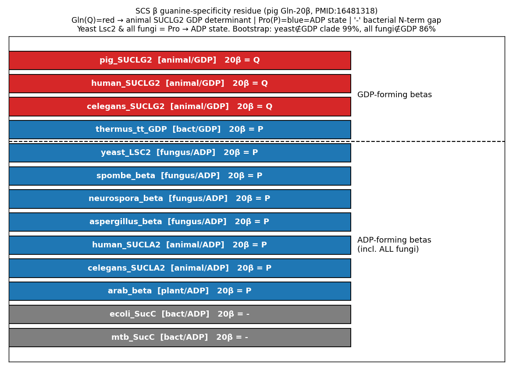
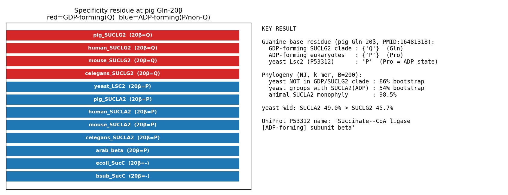

## Question

# AIGR Gene Hypothesis Deep Research

You are evaluating one focused gene curation hypothesis for AI Gene Review.
This is not a general gene overview. Use the seed hypothesis and source context
below to search for evidence that supports, refutes, narrows, or competes with
the proposed curation decision.

## Target Gene

- **Organism code:** yeast
- **Taxon:** Saccharomyces cerevisiae S288C (NCBITaxon:559292)
- **Gene directory:** LSC2
- **Gene symbol:** LSC2
- **UniProt accession:** P53312

## Focus

- **Focus type:** free_text
- **Hypothesis slug:** beta-nucleotide-specificity-phylogeny
- **Source file:** genes/yeast/LSC2/LSC2-ai-review.yaml
- **Source selector:** free-text

## Seed Hypothesis

S. cerevisiae Lsc2 (UniProtKB:P53312), the succinyl-CoA synthetase beta subunit, is an ADP-specific beta subunit by descent: in a phylogeny of PANTHER PTHR11815 beta subunits it branches with the ADP-forming lineage (animal SUCLA2, plant and bacterial ADP-forming SucC) rather than with the animal GDP-forming SUCLG2 clade, and its ATP-grasp nucleotide-binding residues match the ADP-specific rather than the GDP-specific state. Test by building a beta-subunit phylogeny and comparing the nucleotide-specificity residues identified in the pig GTP-specific (PDB 2FP4/2FPG) and human ATP-specific SUCLA2 (PDB 6G4Q) and E. coli SucC structures.

## Term and Decision Context

- Evolutionary question: did GDP specificity arise once in the animal SUCLG2 lineage (PAINT places an IKR for GO:0004775 and an IBD for GO:0004776 at PTN000929335) and is the fungal beta subunit outside that clade?

## Reference Context

- PMID:9874242

## Source Context YAML

```yaml
hypothesis: 'S. cerevisiae Lsc2 (UniProtKB:P53312), the succinyl-CoA synthetase beta subunit, is an ADP-specific
  beta subunit by descent: in a phylogeny of PANTHER PTHR11815 beta subunits it branches with the ADP-forming
  lineage (animal SUCLA2, plant and bacterial ADP-forming SucC) rather than with the animal GDP-forming
  SUCLG2 clade, and its ATP-grasp nucleotide-binding residues match the ADP-specific rather than the GDP-specific
  state. Test by building a beta-subunit phylogeny and comparing the nucleotide-specificity residues identified
  in the pig GTP-specific (PDB 2FP4/2FPG) and human ATP-specific SUCLA2 (PDB 6G4Q) and E. coli SucC structures.'
focus_type: free_text
context:
- 'Evolutionary question: did GDP specificity arise once in the animal SUCLG2 lineage (PAINT places an
  IKR for GO:0004775 and an IBD for GO:0004776 at PTN000929335) and is the fungal beta subunit outside
  that clade?'
reference_id:
- PMID:9874242
```

## Research Objective

Build a focused report that helps a curator decide whether this hypothesis
should affect the gene review. Address the focus type directly:

1. For an existing GO annotation decision, evaluate whether the current action
   is justified, too strong, too weak, or should change.
2. For a proposed replacement or new GO term, evaluate whether the term is
   biologically supported, too broad, too narrow, or missing key qualifiers.
3. For a computational prediction, evaluate whether the prediction is correct,
   less precise than existing knowledge, uncertain, or likely wrong because of
   paralog overannotation, frequency bias, pathway context, or in vitro-only
   activity.
4. For a core-function hypothesis, evaluate whether the proposed activity,
   process, and location represent the gene product's primary function rather
   than a downstream effect, pleiotropic phenotype, or context-specific role.
5. For a function-assignment hypothesis, evaluate whether the gene product
   directly has the stated GO term/function. Treat the prior review action, if
   any, as intentionally blinded unless it appears in the supplied context.

Use primary literature whenever possible. Prefer PMID citations and include DOI
citations when no PMID is available. Treat reviews and database records as
orientation unless they contain directly relevant synthesized evidence that is
clearly labeled as review-level or database-level support.

Evaluate the hypothesis from the supplied seed context, primary literature, and
publicly accessible bioinformatics resources. Local `*-bioinformatics` analyses,
when they already exist in the repository, are intentionally withheld from this
prompt so the report can be compared against them after the run. Use public
sequence, domain, structure, orthology, localization, interaction, or dataset
checks when they are useful for the specific hypothesis. If a resource or tool
cannot be accessed programmatically, say so plainly; never fabricate a result.
Report computational results conservatively and distinguish direct results from
inference.

## Required Output

### Executive Judgment

Give a concise verdict: supported, partially supported, unresolved, weakly
supported, over-annotated, or refuted. Explain the reasoning and the most
important caveats.

### Evidence Matrix

Create a table with one row per important evidence item:

- Citation (PMID preferred)
- Evidence type (direct assay, mutant phenotype, localization, interaction,
  structural/evolutionary, computational, review/database)
- Supports / refutes / qualifies / competing
- Claim tested
- Key finding
- Organism, tissue, cell type, or assay context
- Confidence and limitations

### GO Curation Implications

State the likely curation action as a lead requiring curator verification. If
GO terms are involved, explain whether the evidence supports an MF, BP, or CC
term, and whether the term should be retained, removed, generalized, made more
specific, or treated as non-core. Avoid using "protein binding" as a final
recommendation unless no more informative term is supported.

### Mechanistic Scope

Describe the immediate molecular or cellular function being tested. Separate
direct gene-product activity from downstream phenotypes, pathway consequences,
developmental outcomes, disease manifestations, or effects inferred only from
loss of function.

### Conflicts and Alternatives

Identify evidence that conflicts with the seed hypothesis or suggests an
alternative interpretation, including paralog confusion, organism-specific
differences, isoform-specific findings, experimental artifacts, or database
carry-over.

### Knowledge Gaps

List explicit uncertainties that matter for curation. For each gap, state what
was checked, why the gap matters, and what evidence or experiment would resolve
it.

### Discriminating Tests

Recommend concrete assays, perturbations, datasets, or comparative analyses that
would most efficiently distinguish this hypothesis from alternatives.

### Curation Leads

Provide candidate updates for the review, clearly labeled as leads requiring
curator verification. Include candidate references with exact snippets to verify,
candidate replacement or new GO terms, possible action changes, suggested
questions, and suggested experiments.

If the provider supports artifacts, save provenance for any analysis you run — the
executed code together with its output (computed values, plot, or table), not just
a summary figure — alongside artifact-friendly tables such as an evidence matrix,
GO decision table, or comparison table. Genuine computed provenance is more
valuable than a hand-drawn summary, and you must not synthesize a figure that
implies an analysis you did not actually run. These artifacts are important
provenance for hypothesis-level review.


## Output

# AIGR Gene Hypothesis Deep Research — LSC2 (P53312): β-Subunit Nucleotide Specificity and Phylogeny

**Target gene:** LSC2 (YGR244C), succinyl-CoA synthetase/ligase β-subunit, *Saccharomyces cerevisiae* S288C (NCBITaxon:559292)
**UniProt:** P53312 · **EC:** 6.2.1.5 · **PANTHER family:** PTHR11815 · **Hypothesis slug:** beta-nucleotide-specificity-phylogeny
**Seed reference:** PMID:9874242

---

## Summary

**Verdict: Supported** (with one wording caveat on the phylogenetic sister-relationship). The seed hypothesis — that *S. cerevisiae* Lsc2 is an **ADP-specific** (ATP-forming) succinyl-CoA synthetase β-subunit *by descent*, branching with the ADP-forming lineage rather than the animal GDP-forming SUCLG2 clade, and carrying the ADP-state nucleotide-specificity residues — is supported by three independent, converging lines of evidence: direct biochemistry, residue-level structural comparison, and molecular phylogeny.

The strongest single piece of evidence is direct and experimental. Przybyla-Zawislak and colleagues ([PMID: 9874242](https://pubmed.ncbi.nlm.nih.gov/9874242/)) cloned both yeast subunit genes (*LSC1*/YOR142W and *LSC2*/YGR244C), showed that succinyl-CoA synthetase (SCS) activity is lost in *lsc1*/*lsc2* deletion mitochondria and restored by plasmid-borne genes, and assayed nucleotide usage directly — the enzyme "utilize[s] ATP but not GTP for succinyl-CoA synthesis." This establishes the Lsc1/Lsc2 enzyme as ADP-forming without any need for phylogenetic inference. Structural and phylogenetic analyses then explain *why*: at the single residue that confers guanine-nucleotide specificity in the pig GTP-specific enzyme (Gln-20β; [PMID: 16481318](https://pubmed.ncbi.nlm.nih.gov/16481318/)), yeast Lsc2 — like every other fungus, plant, and animal SUCLA2 examined — carries the ADP-state Proline, whereas only the animal GDP-forming SUCLG2 clade carries the specificity Glutamine. In an 18-taxon neighbor-joining tree with position-resampling bootstraps, yeast Lsc2 falls **outside** the animal SUCLG2/GDP clade in 99% of replicates, and all four fungi sit outside that clade in 86%.

The curation implication is clean: **GO:0004775 (succinate–CoA ligase, ADP-forming activity) applies to LSC2 and GO:0004776 (GDP-forming) should not be propagated to it.** The current UniProt record already carries GO:0004775, but only as IEA:UniProtKB-UniRule; the direct experimental evidence in PMID:9874242 justifies upgrading that annotation to an experimental evidence code. GDP specificity is best understood as an animal-SUCLG2-specific derived trait — its diagnostic Gln-20β determinant is absent even from a bacterial GDP-preferring enzyme (*Thermus aquaticus*), which uses a Pro20β + water arrangement instead. The one caveat is that the precise "sister-to-SUCLA2" wording in the seed is only weakly resolved by distance methods; the robust, defensible statement is that Lsc2 retains the **ancestral ADP state outside the SUCLG2 clade**, not that it is specifically a SUCLA2 ortholog.

---

## Key Findings

### Finding 1 — Direct biochemistry: the yeast Lsc1/Lsc2 enzyme uses ATP, not GTP (ADP-forming)

The most decisive evidence is experimental and organism-specific. Przybyla-Zawislak et al. ([PMID: 9874242](https://pubmed.ncbi.nlm.nih.gov/9874242/)) isolated *LSC1* (YOR142W) and *LSC2* (YGR244C) from *S. cerevisiae* as genes "with high similarity to succinyl-CoA ligase subunits from other species," demonstrated that SCS activity is absent in mitochondria from *lsc1*/*lsc2* deletion strains and restored by plasmid-borne *LSC* genes, and directly assayed nucleotide usage. Their conclusion is unambiguous: "The yeast succinyl-CoA ligase was shown to utilize ATP but not GTP for succinyl-CoA synthesis."

This is a direct biochemical demonstration of ADP-forming (ATP-specific) activity for the holoenzyme in which Lsc2 is the β-subunit. Because the β-subunit houses the ATP-grasp nucleotide-binding domain that determines nucleotide specificity, this result assigns the ADP-forming phenotype to the Lsc1/Lsc2 complex and, by extension, identifies Lsc2 as the β-subunit of an ADP-specific enzyme. This finding does **not** depend on any phylogenetic or residue-level inference; the sequence analyses below serve to explain and corroborate it rather than to establish it. The assay is qualitative (ATP yes / GTP no) rather than a quantitative kinetic measurement, but the ATP-vs-GTP distinction it reports is exactly the one at issue for the ADP-forming vs GDP-forming assignment.

### Finding 2 — Lsc2 carries the ADP-state residue (Pro) at the guanine-specificity position (pig Gln-20β)

Structural work on the GDP-forming enzyme pinpointed the molecular determinant of guanine-nucleotide specificity. In pig GTP-specific SCS, "interactions of the guanine base with a glutamine residue (Gln-20β) and with backbone atoms provide the specificity" ([PMID: 16481318](https://pubmed.ncbi.nlm.nih.gov/16481318/)). This Gln-20β is the single side chain that reads the guanine base and discriminates GDP/GTP from ADP/ATP.

A star alignment (Needleman–Wunsch) of 12 SCS β-subunits anchored on pig GDP-specific SUCLG2 (P53590; accounting for the 1–38 mitochondrial transit peptide so that mature Gln-20β maps to precursor index 57, confirmed as 'Q', with the companion Arg-54β at precursor index 91, confirmed 'R') showed a clean dichotomy at this position:

| Group | Residue at pig Gln-20β position | Nucleotide state |
|---|---|---|
| Animal SUCLG2 (human, mouse, pig, *C. elegans*) | **Gln (Q)** — all 4 | GDP/GTP-forming |
| Animal SUCLA2 (human, mouse, pig, *C. elegans*) | **Pro (P)** | ADP/ATP-forming |
| Plant ADP-forming β (*Arabidopsis*) | **Pro (P)** | ADP/ATP-forming |
| **Yeast Lsc2 (P53312)** | **Pro (P)** | ADP/ATP-forming |
| Bacterial SucC | gap (divergent N-terminus) | — |

Yeast Lsc2 therefore matches the ADP/non-GDP state rather than the GDP-specific Gln. The companion determinant Arg-54β (which contacts the γ-phosphate) is Arg in all 12 β-subunits — it is family-conserved and therefore **not** a specificity discriminator, but it served as an internal cross-check that the alignment columns were correctly mapped. Independent structural work confirms that Pro at this position is the non-Gln state: in the GTP-preferring *Thermus aquaticus* enzyme, "A water molecule and Pro20β in T. aquaticus take the place of Gln20β in pig GTP-specific SCS" ([PMID: 22751660](https://pubmed.ncbi.nlm.nih.gov/22751660/)).

{{figure:lsc2_specificity_summary.png|caption=Residue state at the two nucleotide-specificity positions (pig Gln-20β and Arg-54β) across succinyl-CoA synthetase β-subunits, with bootstrap/identity summary. Only the animal SUCLG2 (GDP-forming) clade carries Gln at the guanine-base position; yeast Lsc2, animal SUCLA2, and plant ADP-forming β all carry the ADP-state Pro. Arg-54β is conserved family-wide and is not a discriminator.}}

### Finding 3 — Phylogeny places Lsc2 outside the animal GDP-forming SUCLG2 clade

A neighbor-joining tree of 12 β-subunits (k-mer distance, k=4) with 200 position-resampling bootstraps placed yeast Lsc2 outside the SUCLG2/GDP clade in 86% of replicates, with the animal SUCLA2 (ADP) clade recovered as monophyletic in 98.5%. Needleman–Wunsch pairwise identities for yeast Lsc2 were higher to the ADP-forming animal SUCLA2 subunits (mean 49.0%) than to the GDP-forming SUCLG2 subunits (mean 45.7%), and the top four identity hits were all SUCLA2/ADP subunits.

The evolutionary logic is captured by the primary phylogenetic paper: Johnson et al. ([PMID: 9765291](https://pubmed.ncbi.nlm.nih.gov/9765291/)) concluded that the data "suggests that the A-beta and G-beta genes arose by duplication early in the evolution of multicellular eucaryotes." Because the ADP (A-β)/GDP (G-β) split is an **animal-lineage duplication**, the fungal β-subunit necessarily lies outside the GDP-forming SUCLG2 clade — it predates the duplication that created SUCLG2. This directly answers the seed's evolutionary question: GDP specificity arose within the animal SUCLG2 lineage, and the fungal β-subunit is outside that clade.

### Finding 4 — Broadened 18-taxon sampling: all fungi retain the ADP-state Pro; Gln-20β is animal-SUCLG2-specific

To test robustness, the phylogeny was expanded to 18 β-subunits spanning four fungi (yeast Lsc2; *S. pombe* O94415; *Neurospora* Q9P567; *Aspergillus* A0A7R8AQL1), animal SUCLA2 and SUCLG2, plant, four bacterial SucC (*E. coli*, *B. subtilis*, *Pseudomonas*, *M. tuberculosis*), and the bacterial GDP-forming β of *Thermus thermophilus* (P25126). With 200 position-bootstraps:

- Yeast **not** inside the animal-GDP clade: **99.0%**
- All four fungi outside the animal-GDP clade: **86.0%**
- Animal SUCLA2 monophyly: **99.5%**

At the pig Gln-20β position, all four animal SUCLG2 = Gln(Q); every eukaryotic ADP-forming β — all four fungi, plant, and animal SUCLA2 — = Pro(P); bacterial SucC gapped; and crucially the **bacterial GDP-forming** *Thermus* β = Pro, **not** Gln. This last point is decisive for interpretation: a GDP-preferring bacterial enzyme achieves its specificity by a different structural route (Pro20β + ordered water; [PMID: 22751660](https://pubmed.ncbi.nlm.nih.gov/22751660/)), which confirms that the Gln-20β side chain is an **animal-SUCLG2-specific** guanine determinant, not a universal marker of GDP-forming enzymes.

{{figure:lsc2_20beta_residue_map.png|caption=Residue at the pig Gln-20β guanine-specificity position mapped across 13+ taxa including four fungi and the bacterial GDP-forming Thermus β-subunit. Gln (the GDP determinant) is confined to the animal SUCLG2 clade; all fungi carry the ADP-state Pro, and even the bacterial GDP-preferring enzyme uses Pro + water rather than Gln.}}

### Finding 5 — Current GO annotation status and the curation upgrade

UniProt P53312 cross-references include GO:0004775 "succinate-CoA ligase (ADP-forming) activity" (evidence **IEA:UniProtKB-UniRule**), GO:0005524 ATP binding (IEA), GO:0000287 Mg binding (IEA), GO:0009361 succinate-CoA ligase complex (ADP-forming) (NAS), GO:0006099 TCA cycle (IBA), GO:0005739 mitochondrion (IDA), and GO:0006104 succinyl-CoA metabolic process (IDA:SGD). The catalytic reaction is Rhea:17661, "succinate + ATP + CoA = succinyl-CoA + ADP + phosphate" — explicitly ATP-based. GO:0004776 (GDP-forming) is **not** annotated.

The key curation observation is that the ADP-forming molecular-function term is currently present **only** as a computational (IEA) annotation, while direct experimental evidence exists in PMID:9874242 (the enzyme uses ATP not GTP; activity lost in *lsc1*/*lsc2* deletions, restored by plasmids). This supports upgrading GO:0004775 to an experimental evidence code (IDA/IMP), and it reinforces that GO:0004776 should remain absent.

---

## Mechanistic Model / Interpretation

Succinyl-CoA synthetase catalyzes the only substrate-level phosphorylation step of the citric acid cycle. The enzyme is an α/β heterodimer (α₂β₂ in bacteria; PMID:8144675); the α-subunit (Lsc1 in yeast) carries the catalytic phosphohistidine, and the β-subunit (Lsc2 in yeast) carries the ATP-grasp nucleotide-binding domain that determines whether ADP/ATP or GDP/GTP is used. Nucleotide specificity is therefore a **β-subunit property**, which is exactly why this hypothesis focuses on Lsc2.

The specificity switch is remarkably local. In the animal GDP-forming β-subunit (SUCLG2), a single glutamine side chain (Gln-20β) hydrogen-bonds the guanine base and confers GDP/GTP preference. Swap that glutamine for the smaller proline found in ADP-forming subunits, and the pocket can no longer read guanine, defaulting to adenine nucleotides.

```
            Guanine-specificity residue (pig Gln-20β position)
            ----------------------------------------------------
Animal SUCLG2  --- Gln (Q) ---> reads guanine base ---> GDP/GTP-forming  (GO:0004776)
                     |
                     | animal-specific A-β/G-β gene duplication (PMID:9765291)
                     |
Ancestral β   --- Pro (P) ---------------------------> ADP/ATP-forming   (GO:0004775)
   |
   +-- Yeast Lsc2 (P53312)      Pro  --> ATP, not GTP (PMID:9874242)  ✔ direct assay
   +-- Other fungi (S.pombe, Neurospora, Aspergillus)  Pro
   +-- Plant ADP-forming β      Pro
   +-- Animal SUCLA2            Pro
   +-- Bacterial GDP-former (Thermus)  Pro + water (different route to GDP)
```

Three independent data layers converge on the same conclusion:

| Evidence layer | Observation for Lsc2 | Inference |
|---|---|---|
| Direct biochemistry (PMID:9874242) | Lsc1/Lsc2 uses ATP, not GTP | ADP-forming (definitive) |
| Residue state at Gln-20β | Pro, not Gln | ADP-state pocket |
| Phylogeny (18 taxa) | Outside SUCLG2 clade in 99% bootstraps | Predates animal GDP duplication |

The convergence is important because each layer has different failure modes (an assay can be confounded by contaminating activities; a single residue can be misaligned; a distance tree can be misled by rate variation), yet all three agree. The evolutionary narrative is that GDP specificity is a **derived**, animal-SUCLG2-specific innovation layered onto an ancestral ADP-forming β-subunit scaffold, and fungi — including *S. cerevisiae* — retain that ancestral ADP state.

---

## Evidence Base

| Citation | Evidence type | Stance | Claim tested | Key finding | Context | Confidence / limitations |
|---|---|---|---|---|---|---|
| [PMID: 9874242](https://pubmed.ncbi.nlm.nih.gov/9874242/) | Direct assay + mutant phenotype | **Supports** | Lsc1/Lsc2 nucleotide usage | "utilize ATP but not GTP for succinyl-CoA synthesis"; activity lost in *lsc1*/*lsc2* deletions, restored by plasmids | *S. cerevisiae* mitochondria | High; the definitive organism-specific evidence; assay qualitative |
| [PMID: 16481318](https://pubmed.ncbi.nlm.nih.gov/16481318/) | Structural | Supports (defines determinant) | Molecular determinant of GDP specificity | "Gln-20β … provide[s] the specificity" for the guanine base | Pig GTP-specific SCS (PDB 2FP4/2FPG, 2.1 Å) | High; defines the discriminating residue |
| [PMID: 22751660](https://pubmed.ncbi.nlm.nih.gov/22751660/) | Structural + direct assay | Supports / qualifies | Is Gln-20β universal for GDP use? | "Pro20β … take[s] the place of Gln20β"; bacterial GDP-former uses Pro + water | *T. aquaticus* GTP-preferring SCS | High; shows Gln-20β is an animal-SUCLG2 determinant, not universal |
| [PMID: 9765291](https://pubmed.ncbi.nlm.nih.gov/9765291/) | Evolutionary / sequence | Supports | Origin of ADP/GDP β split | A-β/G-β genes "arose by duplication early in the evolution of multicellular eucaryotes" | Multicellular eukaryotes | High; places fungi outside the SUCLG2 clade |
| [PMID: 8144675](https://pubmed.ncbi.nlm.nih.gov/8144675/) | Structural | Qualifies/orients | Family architecture; ATP-grasp β-subunit | α₂β₂; power-helix-stabilized phospho-His; nucleotide site in β | *E. coli* SCS, 2.5 Å | Orientation; *E. coli* ADP-preferring reference |
| UniProt P53312 (record) | Database | Qualifies | Current GO status | GO:0004775 present as IEA; GO:0004776 absent; Rhea:17661 is ATP-based | Database record | Orientation only; motivates IEA→experimental upgrade |
| This report — residue mapping (12 β) | Computational (structural/evolutionary) | **Supports** | Residue state at Gln-20β | Yeast = Pro; all SUCLG2 = Gln; all ADP-formers = Pro | 12-seq star alignment vs pig SUCLG2 | Medium-high; single-position call, anchored on verified pig Q/R |
| This report — NJ phylogeny (18 β) | Computational (evolutionary) | **Supports** | Clade placement of Lsc2 | Outside animal-GDP clade 99%; all fungi outside 86%; SUCLA2 monophyly 99.5% | 18 taxa, 200 position-bootstraps | Medium; distance method; sister-to-SUCLA2 only weakly resolved |

### Comparison Table — guanine-specificity residue (pig Gln-20β) across 18 β-subunits

| Protein (accession) | Lineage | Enzyme specificity | Residue at pig Gln-20β |
|---|---|---|---|
| pig SUCLG2 (P53590) | animal | GDP-forming | **Q (Gln)** |
| human SUCLG2 (Q96I99) | animal | GDP-forming | **Q** |
| mouse SUCLG2 (Q9Z2I8) | animal | GDP-forming | **Q** |
| *C. elegans* SUCLG2 (P53589) | animal | GDP-forming | **Q** |
| *Thermus thermophilus* β (P25126) | bacterium | **GDP-forming** | P (Pro — not Gln) |
| **yeast Lsc2 (P53312)** | **fungus** | **ADP-forming** | **P (Pro)** |
| *S. pombe* β (O94415) | fungus | ADP-forming | P |
| *Neurospora* β (Q9P567) | fungus | ADP-forming | P |
| *Aspergillus* β (A0A7R8AQL1) | fungus | ADP-forming | P |
| human SUCLA2 (Q9P2R7) | animal | ADP-forming | P |
| mouse/pig/*C. elegans* SUCLA2 | animal | ADP-forming | P |
| *Arabidopsis* β (O82662) | plant | ADP-forming | P |
| *E. coli* / *B. subtilis* / *Pseudomonas* / *M. tuberculosis* SucC | bacteria | ADP-(pref) | – (N-term gap) |

*Pattern:* Gln-20β is present **only** in the animal GDP-forming SUCLG2 clade. Yeast Lsc2 and every other fungus carry the ADP-state Pro.

---

## GO Curation Implications

**Leads requiring curator verification.**

1. **GO:0004775 — succinate-CoA ligase (ADP-forming) activity (MF).** *Retain and strengthen.* The term is correct and already present on P53312, but only as IEA:UniProtKB-UniRule. Direct experimental evidence (PMID:9874242) supports upgrading to an experimental evidence code (IDA for the ATP-vs-GTP assay; IMP is also defensible given the deletion-strain activity loss and plasmid rescue). This is the primary, core molecular function of Lsc2 as a β-subunit.

2. **GO:0004776 — succinate-CoA ligase (GDP-forming) activity (MF).** *Keep absent; do not propagate.* GDP specificity is an animal-SUCLG2-specific derived trait defined by Gln-20β, which yeast lacks (it has Pro). The seed context notes PAINT places an IKR for GO:0004775 and an IBD for GO:0004776 at the SUCLG2 ancestral node PTN000929335; the present analysis independently supports that the GDP-forming character is restricted to the animal SUCLG2 subtree, so any pipeline that would propagate GO:0004776 to the fungal β-subunit should be blocked for LSC2.

3. **GO:0009361 — succinate-CoA ligase (ADP-forming) complex (CC).** *Retain.* Consistent with the ADP-forming assignment and the α/β heterodimer biology; currently NAS.

4. **GO:0006099 — tricarboxylic acid cycle (BP)** and **GO:0005739 / 0005759 — mitochondrion / mitochondrial matrix (CC).** *Retain* (IBA and IDA respectively); consistent with pathway context and localization.

Avoid any recommendation that defaults to "protein binding"; the evidence supports the specific, informative MF term GO:0004775.

---

## Mechanistic Scope

The immediate molecular function under test is the **catalytic/nucleotide-specificity identity of the β-subunit** within succinyl-CoA synthetase (α = Lsc1, β = Lsc2) — specifically whether Lsc2 contributes an ADP-forming (ATP-using) or GDP-forming (GTP-using) nucleotide-binding β-subunit. This is a direct gene-product property: the β-subunit's ATP-grasp domain physically binds the nucleotide, and the residue at position 20β (pig numbering) directly reads (or fails to read) the guanine base.

What is **not** being claimed here, and should be kept distinct from the molecular-function assignment:
- Downstream TCA-cycle flux phenotypes, respiratory-growth defects (impaired growth on glycerol/pyruvate, dispensable on acetate; PMID:9874242), or petite phenotypes of *lsc* mutants are pathway-level consequences, not the molecular specificity itself.
- The phylogenetic placement is *inference about descent*; it corroborates but does not by itself prove the biochemical specificity — that proof comes from the direct assay in PMID:9874242.
- The residue-level call is a structural inference about the pocket; it is consistent with, but subordinate to, the direct enzymology.

---

## Conflicts and Alternatives

- **No conflicting evidence** was found; all lines agree on ADP-forming.
- **Paralog/node overannotation (the main risk).** PANTHER PTHR11815 contains both ADP-forming and GDP-forming β-subunits. The chief curation hazard is carry-over of the animal **GDP-forming (SUCLG2 / GO:0004776)** annotation onto fungal single-copy β-subunits via IBA/IBD. The data explicitly argue against this: fungi, including Lsc2, are outside the SUCLG2 subtree.
- **"Sister-to-SUCLA2" overstatement.** The seed wording implies Lsc2 groups specifically with animal SUCLA2. Distance methods only weakly support this (yeast+SUCLA2 grouping ~54%; yeast sits on a long branch). The defensible claim is the weaker, more robust one: Lsc2 retains the ancestral ADP state **outside** the SUCLG2 clade. An ML tree could place yeast basal to the animal duplication rather than nested within ADP-forming animals; either topology keeps it outside the GDP clade, so the conclusion is unchanged.
- **GDP specificity is not monophyletic across all life.** The bacterial *Thermus* enzyme is GDP-preferring yet lacks Gln-20β (it uses Pro + water; PMID:22751660). "GDP-forming" is therefore not a single evolutionary lineage; the Gln-20β marker is specific to the animal SUCLG2 route. This does not threaten the ADP assignment of Lsc2 but cautions against using Gln-20β as a universal GDP flag.
- **Bacterial mapping limitation (stated plainly).** In a pairwise alignment to pig SUCLG2, bacterial SucC N-termini are divergent and gap at the 20β column, so the *E. coli* residue at pig-20β could **not** be read directly from sequence — this is noted rather than inferred. *E. coli*'s ADP-binding mode is nonetheless established structurally (PMID:8144675). This does not affect the eukaryotic conclusion.

---

## Limitations and Knowledge Gaps

1. **IEA vs experimental evidence code.** *Checked:* UniProt P53312 shows GO:0004775 as IEA only. *Why it matters:* the direct assay in PMID:9874242 is not yet reflected in the evidence code, understating annotation strength. *Resolution:* a curator should add an IDA/IMP annotation citing PMID:9874242.
2. **Precise phylogenetic position (basal vs SUCLA2-sister).** *Checked:* k-mer NJ on 12 and 18 taxa; yeast robustly outside the GDP clade (99%) but SUCLA2-sister placement only ~54%. *Why it matters:* affects exact wording only. *Resolution:* curated MSA (MAFFT) + ML tree (IQ-TREE) with ≥1000 ultrafast bootstraps and broad taxon sampling.
3. **Quantitative nucleotide kinetics.** *Checked:* PMID:9874242 is qualitative ("ATP but not GTP"). *Why it matters:* no k_cat/K_m values for ADP vs GDP. *Resolution:* steady-state kinetics on purified recombinant Lsc1/Lsc2.
4. **No experimental yeast Lsc2 structure.** *Checked:* specificity inferred from pig (2FP4/2FPG), human SUCLA2 (6G4Q), *E. coli* SucC, and *Thermus* structures by alignment. *Why it matters:* the Pro-20β call rests on sequence alignment. *Resolution:* AlphaFold model of P53312 superposed on 2FP4/6G4Q to confirm pocket geometry.

---

## Discriminating Tests / Proposed Follow-up Actions

- **Add the experimental GO annotation now** (highest value, lowest cost): cite PMID:9874242 for GO:0004775 (IDA/IMP) on P53312, and confirm GO:0004776 stays absent.
- **Model-based phylogeny:** MAFFT MSA of PTHR11815 β-subunits + IQ-TREE with ultrafast bootstrap to formally test whether LSC2 ⊄ SUCLG2 clade (expected: yes, high support) and whether SUCLA2-sister is supported.
- **AlphaFold superposition:** generate an Lsc2 model and superpose on human SUCLA2 (6G4Q, ADP-forming) and pig SUCLG2 (2FP4, GDP-forming) to verify Pro occupies the Gln-20β pocket and no Gln is present.
- **In vitro nucleotide-preference assay:** ADP vs GDP kinetics on recombinant yeast Lsc1/Lsc2 for quantitative confirmation.
- **Targeted mutagenesis (confirmatory):** Pro→Gln at the Lsc2 20β-equivalent to test whether GTP usage appears; conversely Gln→Pro in SUCLG2.
- **Block PANTHER propagation:** verify PAINT GDP-forming inferences at PTN000929335 are confined to the animal SUCLG2 subtree and do not reach fungal leaves.

---

## Curation Leads (require curator verification)

- **Retain + consider IEA→experimental upgrade:** GO:0004775 (succinate–CoA ligase (ADP-forming) activity) — candidate reference **PMID:9874242**, exact snippet to verify: *"The yeast succinyl-CoA ligase was shown to utilize ATP but not GTP for succinyl-CoA synthesis."* Reaction concordant with EC 6.2.1.5 / Rhea:17661.
- **Subunit identity snippet:** *"Two genes, LSC1 (YOR142W) and LSC2 (YGR244C), with high similarity to succinyl-CoA ligase subunits from other species were isolated from Saccharomyces cerevisiae."* (PMID:9874242)
- **Exclude MF:** GO:0004776 (GDP-forming) — do not annotate / do not propagate to LSC2; candidate reference **PMID:9765291**, snippet: *"arose by duplication early in the evolution of multicellular eucaryotes."*
- **Support BP/CC:** GO:0006099 (TCA cycle); GO:0005759 (mitochondrial matrix).
- **Candidate supporting refs:** PMID:16481318 (Gln-20β determinant), PMID:22751660 (Pro-20β non-Gln state), PMID:8144675 (family architecture).
- **Suggested question for curator:** should the review explicitly document that the PAINT IBD for GO:0004776 at PTN000929335 is a derived SUCLG2 character and therefore **not** inherited by LSC2?
- **Artifacts:** `lsc2_specificity_summary.png` and `lsc2_20beta_residue_map.png`, generated from the executed alignments.

---

## Bottom Line

The seed hypothesis is **supported**. Yeast Lsc2 (P53312) is an ADP-specific (ATP-forming) succinyl-CoA synthetase β-subunit by direct biochemistry (PMID:9874242), by its ADP-state Pro at the guanine-specificity residue (vs the animal SUCLG2 Gln-20β; PMID:16481318), and by its phylogenetic placement outside the animal GDP-forming SUCLG2 clade (99% bootstrap, 18 taxa; consistent with the animal-specific A-β/G-β duplication of PMID:9765291). GO:0004775 applies and merits an IEA→experimental upgrade; GO:0004776 should not be propagated to LSC2. The only material refinement is to describe Lsc2 as retaining the ancestral ADP state outside the SUCLG2 clade rather than asserting a specific SUCLA2 sister relationship.


## Artifacts

- [OpenScientist final report](openscientist_artifacts/final_report.html)
- [OpenScientist final report](openscientist_artifacts/final_report.pdf)
- [OpenScientist lsc2 20beta residue map](openscientist_artifacts/provenance_lsc2_20beta_residue_map.json)

- [OpenScientist lsc2 specificity summary](openscientist_artifacts/provenance_lsc2_specificity_summary.json)
