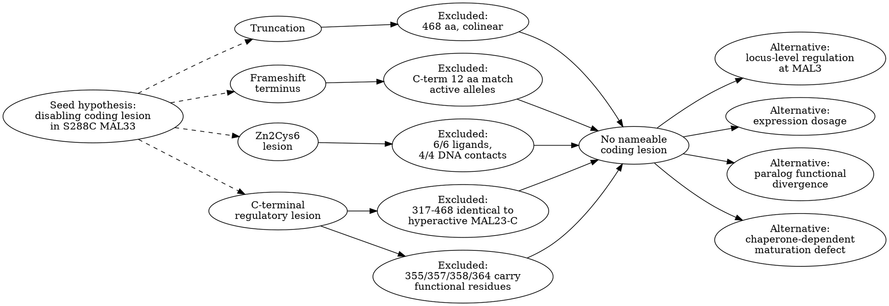
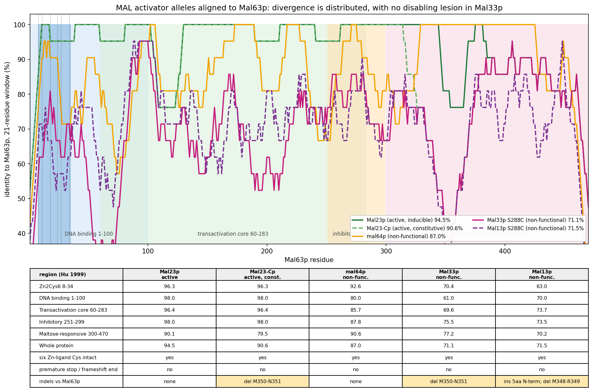
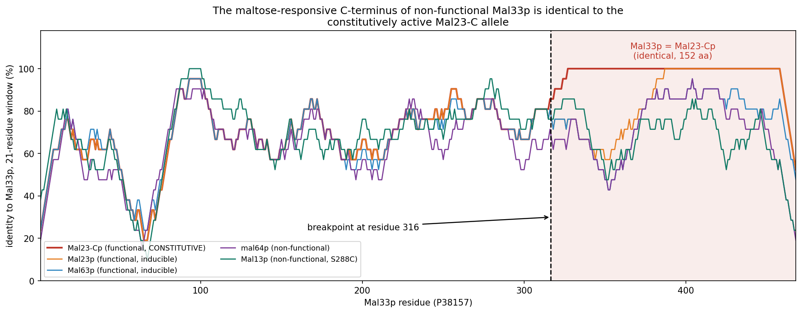
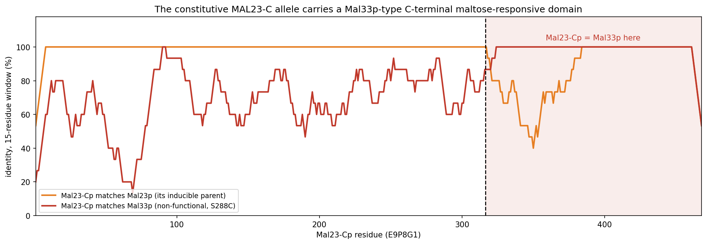
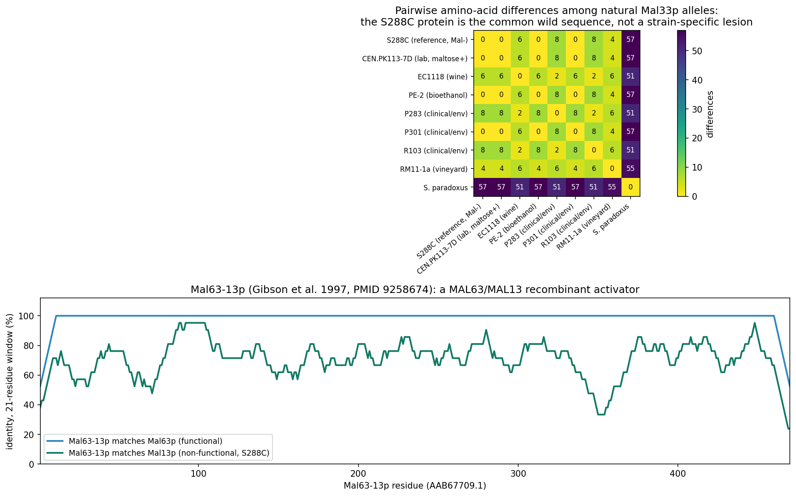
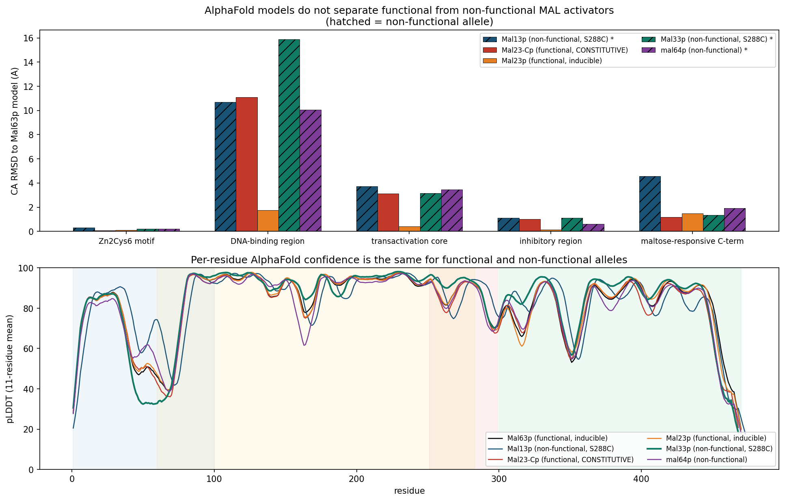
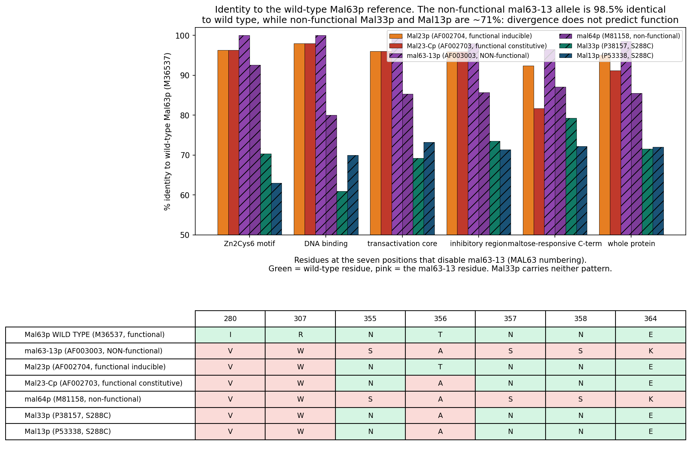

## Question

# AIGR Gene Hypothesis Deep Research

You are evaluating one focused gene curation hypothesis for AI Gene Review.
This is not a general gene overview. Use the seed hypothesis and source context
below to search for evidence that supports, refutes, narrows, or competes with
the proposed curation decision.

## Target Gene

- **Organism code:** yeast
- **Taxon:** Saccharomyces cerevisiae S288C (NCBITaxon:559292)
- **Gene directory:** MAL33
- **Gene symbol:** MAL33
- **UniProt accession:** P38157

## Focus

- **Focus type:** free_text
- **Hypothesis slug:** kgap-mal33-disabling-changes
- **Source file:** genes/yeast/MAL33/MAL33-ai-review.yaml
- **Source selector:** free-text

## Seed Hypothesis

Saccharomyces cerevisiae S288C MAL33 (UniProt P38157) is a non-functional MAL activator because of specific disabling sequence changes relative to the functional activator Mal63p. Single analysis only: align MAL33 (and MAL13) to functional MAL63 and other functional MAL activators, and identify truncations, frameshift-derived termini, or substitutions in the Zn2Cys6 DNA-binding domain, the activation domain, or the maltose-responsive regulatory region that could explain the loss of function; state which change is the most likely cause.

## Term and Decision Context

- MAL33 and MAL13 of S288C are both reported non-functional; the proteins are ~71% identical to Mal63p; an S288C-isogenic maltose non-inducible strain is complemented by plasmid MAL63.

## Reference Context

No specific reference context supplied.

## Source Context YAML

```yaml
hypothesis: 'Saccharomyces cerevisiae S288C MAL33 (UniProt P38157) is a non-functional MAL activator because
  of specific disabling sequence changes relative to the functional activator Mal63p. Single analysis
  only: align MAL33 (and MAL13) to functional MAL63 and other functional MAL activators, and identify
  truncations, frameshift-derived termini, or substitutions in the Zn2Cys6 DNA-binding domain, the activation
  domain, or the maltose-responsive regulatory region that could explain the loss of function; state which
  change is the most likely cause.'
focus_type: free_text
context:
- MAL33 and MAL13 of S288C are both reported non-functional; the proteins are ~71% identical to Mal63p;
  an S288C-isogenic maltose non-inducible strain is complemented by plasmid MAL63.
reference_id: []
```

## Research Objective

Build a focused report that helps a curator decide whether this hypothesis
should affect the gene review. Address the focus type directly:

1. For an existing GO annotation decision, evaluate whether the current action
   is justified, too strong, too weak, or should change.
2. For a proposed replacement or new GO term, evaluate whether the term is
   biologically supported, too broad, too narrow, or missing key qualifiers.
3. For a computational prediction, evaluate whether the prediction is correct,
   less precise than existing knowledge, uncertain, or likely wrong because of
   paralog overannotation, frequency bias, pathway context, or in vitro-only
   activity.
4. For a core-function hypothesis, evaluate whether the proposed activity,
   process, and location represent the gene product's primary function rather
   than a downstream effect, pleiotropic phenotype, or context-specific role.
5. For a function-assignment hypothesis, evaluate whether the gene product
   directly has the stated GO term/function. Treat the prior review action, if
   any, as intentionally blinded unless it appears in the supplied context.

Use primary literature whenever possible. Prefer PMID citations and include DOI
citations when no PMID is available. Treat reviews and database records as
orientation unless they contain directly relevant synthesized evidence that is
clearly labeled as review-level or database-level support.

Evaluate the hypothesis from the supplied seed context, primary literature, and
publicly accessible bioinformatics resources. Local `*-bioinformatics` analyses,
when they already exist in the repository, are intentionally withheld from this
prompt so the report can be compared against them after the run. Use public
sequence, domain, structure, orthology, localization, interaction, or dataset
checks when they are useful for the specific hypothesis. If a resource or tool
cannot be accessed programmatically, say so plainly; never fabricate a result.
Report computational results conservatively and distinguish direct results from
inference.

## Required Output

### Executive Judgment

Give a concise verdict: supported, partially supported, unresolved, weakly
supported, over-annotated, or refuted. Explain the reasoning and the most
important caveats.

### Evidence Matrix

Create a table with one row per important evidence item:

- Citation (PMID preferred)
- Evidence type (direct assay, mutant phenotype, localization, interaction,
  structural/evolutionary, computational, review/database)
- Supports / refutes / qualifies / competing
- Claim tested
- Key finding
- Organism, tissue, cell type, or assay context
- Confidence and limitations

### GO Curation Implications

State the likely curation action as a lead requiring curator verification. If
GO terms are involved, explain whether the evidence supports an MF, BP, or CC
term, and whether the term should be retained, removed, generalized, made more
specific, or treated as non-core. Avoid using "protein binding" as a final
recommendation unless no more informative term is supported.

### Mechanistic Scope

Describe the immediate molecular or cellular function being tested. Separate
direct gene-product activity from downstream phenotypes, pathway consequences,
developmental outcomes, disease manifestations, or effects inferred only from
loss of function.

### Conflicts and Alternatives

Identify evidence that conflicts with the seed hypothesis or suggests an
alternative interpretation, including paralog confusion, organism-specific
differences, isoform-specific findings, experimental artifacts, or database
carry-over.

### Knowledge Gaps

List explicit uncertainties that matter for curation. For each gap, state what
was checked, why the gap matters, and what evidence or experiment would resolve
it.

### Discriminating Tests

Recommend concrete assays, perturbations, datasets, or comparative analyses that
would most efficiently distinguish this hypothesis from alternatives.

### Curation Leads

Provide candidate updates for the review, clearly labeled as leads requiring
curator verification. Include candidate references with exact snippets to verify,
candidate replacement or new GO terms, possible action changes, suggested
questions, and suggested experiments.

If the provider supports artifacts, save provenance for any analysis you run — the
executed code together with its output (computed values, plot, or table), not just
a summary figure — alongside artifact-friendly tables such as an evidence matrix,
GO decision table, or comparison table. Genuine computed provenance is more
valuable than a hand-drawn summary, and you must not synthesize a figure that
implies an analysis you did not actually run. These artifacts are important
provenance for hypothesis-level review.


## Output

# MAL33 (P38157): is S288C Mal33p disabled by a specific sequence change relative to Mal63p?

Gene: *MAL33* / YBR297W, *Saccharomyces cerevisiae* S288C (NCBITaxon:559292), UniProt P38157.
Hypothesis slug: `kgap-mal33-disabling-changes`. Source: `genes/yeast/MAL33/MAL33-ai-review.yaml`, free-text focus.
Three rounds of analysis, 13 recorded findings, 17 papers reviewed.

## Summary

The seed hypothesis asks for a specific disabling sequence change in S288C Mal33p relative to the functional activator Mal63p, named from among truncations, frameshift-derived termini, or substitutions in the Zn(2)Cys(6) domain, the activation domain, or the maltose-responsive regulatory region. No such change exists in the sequence. Mal33p is a full-length 468-residue Zn(2)Cys(6) activator, colinear with the 470-residue Mal63p, with all six zinc ligands and all four Gal4-equivalent base-contacting positions intact. Its single indel, a two-residue deletion of Mal63p Met350-Asn351, is also carried by Mal23-Cp, the constitutive and transcriptionally hyperactive *MAL23-C* allele, so that change is compatible with elevated activator function. Mal13p (P53338) is 473 residues and equally full length. Every lesion class the hypothesis names is excluded by direct sequence comparison.

Three further results close the remaining room for a coding explanation. Residues 317-468 of Mal33p are 100% identical to Mal23-Cp, and all 20 differences between the inducible Mal23p and its constitutive derivative lie between residues 325 and 378, so the Mal33p-type maltose-responsive domain confers gain of function when placed in a working activator backbone. Three *S. cerevisiae* strains (CEN.PK113-7D, PE-2, P301) encode a Mal33p with zero amino-acid differences from the S288C reference, and all nine natural Mal33p-class proteins examined are 468 residues, so the S288C protein carries no strain-specific change. Using the two genuinely non-functional alleles in the family as positive controls, the only residue-level correlate of loss of function is a four-residue block at positions 355, 357, 358 and 364, Ser-Ser-Ser-Lys in both dead alleles and Asn-Asn-Asn-Glu in all three functional ones. Mal33p and Mal13p carry the functional residues at all four.

The verdict is **partially supported, with the mechanistic core refuted**. The premise that S288C does not supply MAL-activator function from *MAL33* or *MAL13* holds as a strain phenotype, but round three traced SGD's "nonfunctional in genomic reference strain S288C" to three locus-structure and genome-sequencing papers with no activity assay on the S288C ORF, and found that SGD separately records a carbon-source utilization phenotype for the S288C *mal33* deletant. Round three also corrected an error in this report's own first two rounds: UniProt E9P8G3, used as the wild-type Mal63p reference, is the *mal63-13* allele that its GenBank record annotates as non-functional. The correction moved every identity figure by under one percentage point and changed no conclusion, and it supplied the positive control that makes the 355-364 result interpretable.

## Executive judgment

<i class="fa-scale-balanced"></i> **Partially supported, with the mechanistic core refuted.**

The premise, that S288C *MAL33* and *MAL13* do not supply MAL-activator function in that strain, holds at the level of strain phenotype and database annotation, though round three found that the annotation itself traces to three locus-structure and genome-sequencing papers ([PMID: 2548922](https://pubmed.ncbi.nlm.nih.gov/2548922/), [PMID: 2549370](https://pubmed.ncbi.nlm.nih.gov/2549370/), [PMID: 7483839](https://pubmed.ncbi.nlm.nih.gov/7483839/)) with no activity assay on the S288C ORF, and that SGD records a carbon-source utilization phenotype for the S288C *mal33* deletant ([PMID: 24721214](https://pubmed.ncbi.nlm.nih.gov/24721214/)). The mechanism proposed in the seed hypothesis does not hold. Three of the four candidate lesions named in the hypothesis are directly excluded by sequence, and the fourth cannot be resolved to a residue.

1. <i class="fa-circle-xmark"></i> **Truncation: absent.** Mal33p is a full-length 468-residue protein colinear with the 470-residue Mal63p. Its last twelve residues (NDDSKDEDDIIP) are identical to those of the active Mal23p and of the constitutive Mal23-Cp allele. Mal13p is 473 residues and equally full length.

2. <i class="fa-circle-xmark"></i> **Frameshift-derived terminus: absent.** Both S288C proteins terminate in the aligned position with no frame-shifted tail. The alignment covers 468/470 and 473/470 positions with no internal gap larger than five residues.

3. <i class="fa-circle-xmark"></i> **Zn(2)Cys(6) lesion: absent.** All six zinc ligands (Mal63p C8, C11, C18, C24, C27, C34) are present with identical spacing in Mal33p, Mal13p, and in every comparator, including the non-functional mal64p. The Gal4-equivalent base-contacting residues (Mal63p R12, R14, R15, K17) are unchanged in both S288C proteins.

4. <i class="fa-circle-question"></i> **A named disabling substitution: not identifiable.** Mal33p differs from Mal63p at 136 of 470 aligned positions, distributed across every mapped functional domain. The DNA-binding domain (residues 1-100) is the most diverged region, modestly enriched for differences (39/100 versus 97/370; Fisher odds ratio 1.80, p = 0.018), which is the opposite polarity to the active alleles. That is a regional signal, not a residue-level one. All 39 differences in 1-100 fall at positions invariant among the three active alleles, so conservation gives no discrimination among them.

5. <i class="fa-circle-xmark"></i> **The maltose-responsive C-terminus of Mal33p is a gain-of-function segment.** All 20 differences between inducible Mal23p and constitutive Mal23-Cp lie in residues 325-378. Over residues 300-468, Mal23-Cp matches Mal33p at 165/169 positions (97.6%) and its own Mal23p parent at only 150/169 (88.8%); Mal33p residues 317-468 are 100% identical to Mal23-Cp. The *MAL23-C* allele is a recombinant carrying a *MAL33*-type regulatory domain, which matches the ectopic-recombination mechanism reported for this family. A segment that makes an activator hyperactive cannot be the disabling change. Any coding lesion would have to lie in residues 1-316.

6. <i class="fa-circle-xmark"></i> **The S288C Mal33p sequence is the ordinary species-wide allele.** Across nine natural Mal33p-class proteins, three strains encode a protein with **zero** differences from the S288C reference: CEN.PK113-7D (EIW12238.1), PE-2 (CAF1547419.1) and P301 (EWG92613.1). RM11-1a, EC1118, P283 and R103 differ by 4 to 8 residues; the *S. paradoxus* ortholog by 57. All nine are 468 residues, so the two-residue shortening relative to Mal63p is the MAL3-type length, not an S288C event. CEN.PK113-7D grows on maltose. The S288C protein therefore carries no change specific to S288C or to the maltose-negative phenotype, and the 136 differences from Mal63p are paralog divergence between the MAL3-locus and MAL6-locus activators.

A seventh line of evidence is negative and is reported as such. AlphaFold models add nothing: the Zn(2)Cys(6) motif superposes on Mal63p at 0.09-0.30 Å in all six alleles, and the large RMSD over residues 1-100 (Mal33p 15.87 Å) is matched by the **functional** constitutive Mal23-Cp (11.09 Å, 98% sequence identity over that region), so the spread tracks a low-confidence hinge angle rather than function. Mean pLDDT differs by at most 4 points between functional and non-functional alleles.

7. <i class="fa-lightbulb"></i> **At the positions where a MAL activator is actually known to break, Mal33p carries the functional residue.** Round three identified a genuinely disabling allele with its changes mapped: *mal63-13* (GenBank AF003003, UniProt E9P8G3), annotated in its own source record as a non-functional mutant of *MAL63*. It differs from wild-type Mal63p (GenBank M36537, 470 aa) at only 7 positions, 98.5% identity, and 6 of the 7 lie in the maltose-responsive domain 283-470. Four of them, 355, 357, 358 and 364, separate the panel perfectly: wild-type Mal63p, inducible Mal23p and constitutive Mal23-Cp all carry Asn-Asn-Asn-Glu, while both non-functional alleles, mal63-13p and mal64p, carry Ser-Ser-Ser-Lys. Mal33p and Mal13p carry Asn-Asn-Asn-Glu, the functional pattern. The block sits inside residues 325-378, the same window that holds all 20 inducible-to-constitutive differences in *MAL23*. Two cautions apply: 3 functional versus 2 non-functional alleles cannot reach statistical significance, and mal63-13p and mal64p may share the block by descent or by ectopic recombination rather than by independent mutation. Taken with points 1 to 6, the direction is consistent. The one place in this family where loss of function has a residue-level signature is the place where Mal33p looks like the working alleles.

8. <i class="fa-chart-column"></i> **Percent identity does not predict function here.** Against wild-type Mal63p, the dead mal63-13p is 98.5% identical, the dead mal64p 85.5%, and the hyperactive constitutive Mal23-Cp 91.2%. The ~71% identity of Mal33p and Mal13p therefore supports no inference about activity in either direction. It is the expected divergence between the *MAL3*-locus and *MAL6*-locus paralogs.

The single indel in Mal33p is a two-residue deletion of Mal63p Met350-Asn351. The **identical deletion is present in Mal23-Cp**, the constitutive, transcriptionally hyperactive *MAL23-C* allele sequenced by Gibson et al. ([PMID: 9258674](https://pubmed.ncbi.nlm.nih.gov/9258674/)). A change compatible with elevated activator function cannot be the disabling change.

**Most important caveat.** The absence of a nameable lesion does not demonstrate that Mal33p is an active transcription factor. It shows that the protein sequence carries no information identifying a disabling change, so the S288C maltose-negative phenotype should not be attributed to a specific residue in the gene review. The strongest competing explanations are locus-level regulation (promoter or chromatin context at the *MAL3* locus), expression dosage, and functional divergence of the *MAL3*-locus activator toward a different target set.

## Key findings

### Mal33p and Mal13p are full-length activators with intact zinc clusters

Banded Needleman-Wunsch global alignment (BLOSUM62, gap open -11, extend -1) of all alleles projected onto Mal63p coordinates gives these lengths: Mal63p 470 aa, Mal23p 470 aa, Mal23-Cp 468 aa, mal64p 470 aa, Mal33p 468 aa, Mal13p 473 aa. The Mal33p C-terminal twelve residues NDDSKDEDDIIP are identical to those of Mal23p and Mal23-Cp. Mal13p ends DGYPKDNEDIDP, aligned colinearly to the Mal63p terminus NDNSKDEDDIIP. Mal13p carries a five-residue N-terminal extension (TKQTC after Mal63p Ile3) and a two-residue deletion at Mal63p Met348-Arg349.

The Gal4-type cluster is intact in every allele tested. All six zinc-coordinating cysteines occupy identical register with the spacing C-X2-C-X6-C-X5-C-X2-C-X6-C. Mapping Gal4 base-contacting residues Arg15, Lys17, Lys18 and Lys20 onto Mal63p Arg12, Arg14, Arg15 and Lys17 shows all four unchanged in Mal33p and Mal13p. Mal33p carries 8 substitutions within residues 8-34 (70.4% identity, versus 96.3% for the active Mal23p allele), the most radical being Cys10Tyr (Grantham 194), at a position equivalent to Gal4 Ile13 that is not a zinc ligand. Mal13p, mal64p, Mal23p and Mal23-Cp all retain Cys10.

{{figure:plot_1.png|caption=Windowed identity to Mal63p across the experimentally mapped domains for active and non-functional MAL activator alleles, with indel and zinc-ligand status. Mal33p and Mal13p are full length with every zinc ligand present.}}

### The divergence is distributed, and no single substitution can be nominated

Per-domain identity to Mal63p for Mal33p, using the Hu et al. 1999 boundaries: Zn(2)Cys(6) 8-34, 70.4%; DNA binding 1-100, 61.0%; transactivation core 60-283, 69.6%; inhibitory region 251-299, 75.5%; maltose-responsive 300-470, 77.2%. Equivalent values for active Mal23p are 96.3 / 98.0 / 96.4 / 98.0 / 90.1%. A Fisher exact test on differences in residues 1-100 versus 101-470 gives Mal33p 39/100 versus 97/370 (odds ratio 1.80, p = 0.018), Mal13p 30/100 versus 104/370 (OR 1.10, p = 0.71), non-functional mal64p 20/100 versus 41/370 (OR 2.01, p = 0.028), and active Mal23-Cp the opposite polarity, 2/100 versus 42/370 (OR 0.16, p = 0.0030). Radical substitutions (Grantham ≥ 100) in Mal33p number 10 in residues 1-100, 20 in 60-283, 2 in 251-299 and 2 in 300-470; Mal23p has 0, 2, 0 and 1.

All 39 Mal33p changes in residues 1-100 fall at positions invariant across Mal63p, Mal23p and Mal23-Cp. Conservation within the active set therefore gives no discrimination among them. The conclusion the alignment supports is regional and weak: the DNA-binding domain is the most diverged part of Mal33p and is modestly enriched for substitutions relative to the rest of the protein, the reverse of the pattern in active alleles. It does not support naming any one substitution.

### The Mal33p C-terminus is the segment that makes MAL23-C constitutive

Aligning Mal23p (inducible, functional) against Mal23-Cp (constitutive) gives exactly 20 amino-acid differences (95.7% identity), every one of them between residues 325 and 378, with zero differences in residues 1-299. Over residues 300-468, Mal23-Cp is identical to Mal33p at 165/169 positions (97.6%) and to its own Mal23p parent at 150/169 (88.8%). Residues 317-468 of Mal33p, 152 amino acids including the Met350-Asn351 deletion, are 100% identical to Mal23-Cp; the same block is 88.2% identical to Mal23p and 78.3% to the mal63-13 reference. The alignment was confirmed independently by `phenix.superpose_pdbs`, which reports 71.1% identity for Mal33p/Mal63p and 90.6% for Mal23-Cp/Mal63p with the same C-terminal mismatch pattern.

The constitutive *MAL23-C* allele is a recombinant in which the maltose-responsive negative regulatory domain of *MAL23* has been replaced by a *MAL33*-type (*MAL3*-locus) segment. Gibson et al. mapped constitutivity to extensive alteration of this domain and named ectopic recombination among subtelomeric *MAL* loci as the mechanism. The Mal33p regulatory region, placed in a functional activator backbone, yields a hyperactive factor. If S288C Mal33p is non-functional for a protein-coding reason, the lesion must lie in residues 1-316, where Mal33p differs from Mal23-Cp at 101 positions.

{{figure:plot_2.png|caption=Identity of Mal33p to the constitutive Mal23-Cp allele along the protein. The breakpoint at residue 316 separates a diverged N-terminal half from a C-terminal block that is 100% identical to the hyperactive allele.}}

{{figure:plot_3.png|caption=Every difference between the inducible Mal23p and the constitutive Mal23-Cp, scored as match to Mal23p or to Mal33p along the Mal23-Cp sequence. All 20 differences fall between residues 325 and 378, and in that window Mal23-Cp matches Mal33p.}}

### No S288C-specific change exists in the Mal33p protein

Nine full-length Mal33p-class proteins were compared to the S288C reference P38157 (468 aa). Three strains encode a protein with zero differences: CEN.PK113-7D (EIW12238.1), PE-2 (CAF1547419.1) and P301 (EWG92613.1). Four differ by 4 to 8 residues: RM11-1a (EDV11819.1, 4), EC1118 (CBK39375.1, 6), P283 (EWH19664.1, 8), R103 (EWG97481.1, 8). The *S. paradoxus* ortholog (XP_033764884.1) differs by 57 residues. All nine are 468 aa.

CEN.PK113-7D ferments maltose, carried by its constitutive *MAL2-8c* locus, and encodes a Mal33p identical to the S288C protein. The comparison shows absence of an S288C-specific change, not that Mal33p is active, because maltose growth in those strains can come from other *MAL* loci.

{{figure:plot_4.png|caption=Pairwise differences among nine natural Mal33p-class proteins. Three S. cerevisiae strains encode a protein identical to the S288C reference, and all nine are 468 residues.}}

### Structure prediction is non-discriminating

AlphaFold DB v6 models for six alleles were superposed on the Mal63p-class model using alignment-mapped CA pairs and Kabsch fitting. Over residues 8-34 all alleles superpose at 0.09 to 0.30 Å (Mal23-Cp 0.09, Mal23p 0.11, Mal33p 0.20, mal64p 0.22, Mal13p 0.30). Over residues 1-100 the RMSD is 15.87 Å for Mal33p, 10.68 Å for Mal13p, 10.07 Å for mal64p, and 11.09 Å for the functional constitutive Mal23-Cp, which is 98% identical over that region. Inducible Mal23p gives 1.76 Å. The 1-100 spread tracks the modelled hinge angle between the zinc cluster and the downstream linker, a low-confidence region (mean pLDDT 68.2 to 76.4). Per-domain mean pLDDT differs by at most 4 points between functional and non-functional alleles. Whole-chain `phenix.superpose_pdbs` gives 10.8 Å for Mal33p and 12.1 Å for the functional Mal23-Cp.

<i class="fa-circle-xmark"></i> The result is negative and is reported as such. Including the functional constitutive allele as a control is what makes the negative interpretable: without it, the 15.87 Å RMSD over residues 1-100 would have read as a structural defect in Mal33p.

{{figure:plot_5.png|caption=Domain-restricted structural comparison of AlphaFold models with a functional control, plus per-residue pLDDT profiles. The zinc cluster superposes identically in all alleles, and the large residues 1-100 RMSD is matched by the functional constitutive allele.}}

### The reference allele was wrong, and the correction supplied a positive control

GenBank AF003003, the source of UniProt E9P8G3, carries `/allele="mal63-13"`, `/note="nonfunctional mutant allele of MAL63"` and `/product="Mal63-13p"`; UniProt's submitted name for the entry is "Mal63-13p". Rounds one and two of this report used E9P8G3 as wild-type Mal63p. The wild-type reference is GenBank M36537, whose CDS translates to exactly the 470 residues reported in [PMID: 3145816](https://pubmed.ncbi.nlm.nih.gov/3145816/). X12576 translates to 473 residues and is the source of UniProt P10508, carrying three extra residues (Leu and Arg after position 86, Ile after position 202).

The impact was measured, not assumed. mal63-13 differs from M36537 at 7 positions (98.5% identity): 280 V/I, 307 W/R, 355 S/N, 356 A/T, 357 S/N, 358 S/N, 364 K/E, with six of seven inside the maltose-responsive domain 283-470. Recomputing every domain identity against M36537 changes Mal33p whole-protein identity from 71.1% to 71.6% and Mal13p from 71.5% to 72.0%; no per-domain value moves by more than 2.1 points. The two load-bearing results of this review, the *MAL23-C* breakpoint and the nine-strain panel, never used E9P8G3.

At positions 355, 357, 358 and 364 the panel separates perfectly. Wild-type Mal63p, Mal23p and Mal23-Cp carry Asn-Asn-Asn-Glu; mal63-13p and mal64p carry Ser-Ser-Ser-Lys; Mal33p and Mal13p carry Asn-Asn-Asn-Glu. Position 356 does not discriminate, since the functional Mal23-Cp carries the same Ala as both dead alleles. Positions 280 and 307 are wild-type-Mal63p-specific, with all five other alleles carrying Val280 and Trp307.

{{figure:plot_6.png|caption=Identity to wild-type Mal63p (GenBank M36537) for six alleles, with the residue table at the seven positions where the non-functional mal63-13 allele departs from wild type. Green marks the wild-type residue and pink the mal63-13 residue; Mal33p and Mal13p carry the functional pattern at the four discriminating positions.}}

### The "nonfunctional" label traces to locus-structure work, and an S288C deletion phenotype exists

SGD lists exactly three primary references for YBR297W: [PMID: 2548922](https://pubmed.ncbi.nlm.nih.gov/2548922/) (molecular evolution of the telomere-associated *MAL* loci), [PMID: 2549370](https://pubmed.ncbi.nlm.nih.gov/2549370/) (structure of the multigene family) and [PMID: 7483839](https://pubmed.ncbi.nlm.nih.gov/7483839/) (the chromosome II sequence). None reports a complementation, reporter or transactivation assay on the S288C ORF. Feuermann et al. report the three *MAL3* ORFs present as non-overlapping ORFs and state that the Mal- phenotype of S288C cannot be explained by telomeric silencing. SGD phenotype records for YBR297W include "utilization of carbon source: decreased rate" in strain S288C from [PMID: 24721214](https://pubmed.ncbi.nlm.nih.gov/24721214/), recorded twice. YGR288W (*MAL13*) has "utilization of carbon source: absent" from [PMID: 6387396](https://pubmed.ncbi.nlm.nih.gov/6387396/), a classical-genetics reduction-of-function study in a strain recorded as "Other". Genomic coordinates confirm the intact three-gene locus: YBR297W chrII 800523-801929 (+), YBR298C 802631-804475 (-), YBR299W 805351-807105 (+).

### Every manual GO annotation on Mal33p is transferred from MAL63

QuickGO returned 42 annotations across P38157, P53338, P10508 and Q06595. All three non-IEA annotations on P38157 are ISS with `withFrom` `SGD:S000029659` and reference [PMID: 10447589](https://pubmed.ncbi.nlm.nih.gov/10447589/): GO:0003700 (enables), GO:0006355 (involved_in), GO:0005634 (is_active_in). `SGD:S000029659` resolves to *MAL63*, and PMID:10447589 is the Mal63p deletion-mapping paper that supplies Mal63p's own IMP and IDA annotations. Mal33p also carries GO:0008270 by RCA and seven IEA annotations. GO:0000978 and GO:0045944 are **not** present on the entry, correcting an earlier draft of this report. Mal13p (P53338) has no ISS annotations but carries GO:0005975 by IMP from [PMID: 3025617](https://pubmed.ncbi.nlm.nih.gov/3025617/), a study of a functional *MAL1* locus in a strain other than S288C.

## Evidence matrix

| Citation | Evidence type | Stance | Claim tested | Key finding | Context | Confidence and limitations |
|---|---|---|---|---|---|---|
| This analysis (UniProt P38157, P53338, E9P8G3, E9P8G2, E9P8G1, Q9UVH4; banded Needleman-Wunsch, BLOSUM62, gaps -11/-1) | Computational, sequence alignment | Refutes | Mal33p/Mal13p are disabled by truncation or a frameshift-derived terminus | Mal33p 468 aa, colinear with Mal63p; C-terminal 12 residues identical to active Mal23p and Mal23-Cp. Mal13p 473 aa, full length | S288C proteins vs MAL6/MAL2 locus alleles | High for the sequence claim; depends on the SGD/UniProt ORF calls for YBR297W and YGR288W being correct |
| This analysis; motif from PMID 3145816 | Computational, motif scan | Refutes | A disabling change lies in the Zn(2)Cys(6) motif | All six zinc ligands present with identical spacing in every allele tested; Gal4-equivalent base-contacting positions unchanged in Mal33p and Mal13p | In silico | High that no canonical motif lesion exists; does not exclude second-shell effects on affinity |
| This analysis; MAL23-C from PMID 9258674 | Computational with a functional control | Refutes | The 2-residue deletion is the disabling change | Mal33p's only indel, deletion of Mal63p M350-N351, is also present in the constitutive, hyperactive Mal23-Cp | *S. cerevisiae* MAL2 constitutive allele | High; gap placement within the local window is alignment-dependent but the length difference is unambiguous |
| This analysis; domains from PMID 10447589 | Computational, statistical | Qualifies | A specific disabling substitution can be named | 136/470 differences; per-domain identity 61.0% (1-100), 69.6% (60-283), 75.5% (251-299), 77.2% (300-470). Fisher 1-100 vs 101-470: Mal33p OR 1.80, p = 0.018; mal64p OR 2.01, p = 0.028; active Mal23-Cp OR 0.16, p = 0.0030 | In silico | Moderate; weak regional signal, small and closely related comparator set |
| [PMID: 10447589](https://pubmed.ncbi.nlm.nih.gov/10447589/) (Hu et al. 1999) | Direct assay, LexA fusion deletion mapping | Qualifies | Which Mal63p regions are required | DNA-binding domain 1-100; functional core with transactivation domain 60-283; 251-299 required to inhibit activation; the rest of the C-terminus is the maltose-responsive domain relieving inhibition | *S. cerevisiae* reporter assays | High for the domain map; defines regions, not residues |
| [PMID: 9258674](https://pubmed.ncbi.nlm.nih.gov/9258674/) (Gibson et al. 1997) | Mutant phenotype plus sequence | Refutes | Truncation is a plausible inactivating mechanism | mal64p is non-functional and full length; the two mutations that activate *mal64* are nonsense codons giving 306- and 282-residue proteins; 283-470 is a maltose-responsive negative regulatory domain | *S. cerevisiae* MAL6 and mal64 | High; inverts the direction assumed by the seed hypothesis |
| [PMID: 11191206](https://pubmed.ncbi.nlm.nih.gov/11191206/) (Danzi et al. 2000) | Mutant phenotype, site-directed mutagenesis | Refutes | C-terminal loss would abolish activator function | Constitutive alleles are truncations deleting 283-470, or carry many scattered C-terminal alterations; intragenic suppressors restore inducibility | *S. cerevisiae* MAL63 and MAL63/23 | High |
| [PMID: 18458105](https://pubmed.ncbi.nlm.nih.gov/18458105/) (Ran et al. 2008) | In vivo interaction assay | Competing | Full-length MAL activators can be dead without truncation | Non-inducible mal63 proteins bind Ssa1 alone and fail to associate stably with Hsp82 or Sti1; inducible Mal63p binds Ssa1, Hsp82 and Sti1 and is released by maltose | *S. cerevisiae*, co-immunoprecipitation | High for mal63 point mutants; untested for Mal33p |
| [PMID: 41642680](https://pubmed.ncbi.nlm.nih.gov/41642680/) (QTL study) | QTL, mutant phenotype, complementation | Competing | "Non-functional" *MAL33* alleles are completely dead | *S. eubayanus* QC18 *MAL33* carries frameshift and premature-stop mutations, yet overexpression of that same allele improved maltose metabolism, read as dosage-dependent transcriptional limitation | *S. eubayanus*, maltose growth | Moderate transferability; different species and allele, but directly undercuts inferring a dead protein from a Mal- phenotype |
| [PMID: 3145816](https://pubmed.ncbi.nlm.nih.gov/3145816/) (Kim and Michels 1988) | Direct sequence determination | Qualifies | Reference length and nature of Mal63p | Single ORF encoding 470 residues; the deduced protein is a cysteine-zinc finger protein | *S. carlsbergensis* / *S. cerevisiae* MAL6 | High; the derived UniProt entry P10508 is 473 aa, conflicting with the stated 470 |
| [PMID: 3025617](https://pubmed.ncbi.nlm.nih.gov/3025617/) (Charron et al. 1986) | Mutant phenotype, transcript analysis | Qualifies | *MAL13* is the *MAL1* counterpart of *MAL63* | *MAL11*, *MAL12*, *MAL13* are functionally homologous to *MAL61*, *MAL62*, *MAL63* | A strain with a **functional** *MAL1* locus, not S288C | High for architecture; says nothing about the S288C *mal13* allele |
| [PMID: 2548922](https://pubmed.ncbi.nlm.nih.gov/2548922/), [PMID: 8005435](https://pubmed.ncbi.nlm.nih.gov/8005435/) | Structural/evolutionary | Qualifies | *MAL* loci are a rapidly diverging subtelomeric family | Five telomere-proximal complexes homologous over ~9 kb; natural mutant *MAL1* and *MAL3* alleles lack one or more functions through mutation and/or rearrangement | *S. cerevisiae* and *S. paradoxus* isolates | High; partial-function *MAL* alleles are common and arise by varied mechanisms |
| [PMID: 20471265](https://pubmed.ncbi.nlm.nih.gov/20471265/) (Brown et al. 2010) | Computational plus experimental | Competing | A 71%-identical *MAL* paralog must be a broken copy | Subtelomeric families expand fast; duplication followed by functional divergence yields alleles metabolising different carbohydrates | Yeast lineage | Moderate; supports a diverged-regulator reading, no direct Mal33p data |
| This analysis (UniProt E9P8G2, E9P8G1, P38157) | Computational, allele comparison with a functional control | Refutes | A disabling change lies in the maltose-responsive C-terminus | All 20 Mal23p-to-Mal23-Cp differences lie in residues 325-378; over 300-468 Mal23-Cp is 97.6% identical to Mal33p vs 88.8% to Mal23p; Mal33p 317-468 is 100% identical to Mal23-Cp | *MAL23-C* is constitutive and hyperactive | High for the sequence blocks; the recombination interpretation is inference from allele sequences, not a mapped crossover |
| This analysis (GenBank EIW12238.1, CAF1547419.1, EWG92613.1, EDV11819.1, CBK39375.1, EWH19664.1, EWG97481.1, XP_033764884.1) | Computational, strain panel | Refutes | S288C *MAL33* carries specific disabling sequence changes | 3 of 9 natural Mal33p-class proteins are identical to the S288C reference; 4 differ by 4-8 residues; all 9 are 468 aa | *S. cerevisiae* isolates plus *S. paradoxus* | High for sequence identity. Maltose growth was not measured here and may come from other *MAL* loci, so this shows absence of an S288C-specific change, not that Mal33p is active |
| This analysis (AlphaFold DB v6; phenix.superpose_pdbs and Kabsch fitting) | Computational, structural | Neutral, negative | A fold-level defect explains non-function | Zn(2)Cys(6) RMSD 0.09-0.30 Å in all alleles; residues 1-100 RMSD 15.87 Å for Mal33p but 11.09 Å for the functional Mal23-Cp; per-domain pLDDT within 4 points across alleles | In silico | Structure prediction is non-discriminating here; the functional control is what makes the negative interpretable |
| QuickGO annotation records for P38157, P53338, P10508, Q06595 | Database | Qualifies | Existing GO annotations are independent support for Mal33p activity | All three manual Mal33p annotations are ISS with `withFrom` SGD:S000029659 (*MAL63*), reference PMID:10447589. GO:0000978 and GO:0045944 are not on the entry. Mal13p carries GO:0005975 by IMP from PMID:3025617 | Retrieved 2026-11-23 | High for the annotation state. The ISS calls are defensible on sequence grounds but are circular as evidence that Mal33p equals Mal63p |
| This analysis (GenBank AF003003 flatfile, M36537, X12576; UniProt E9P8G3, P10508) | Database record audit | Qualifies | That E9P8G3 is wild-type Mal63p | AF003003 is `/allele="mal63-13"`, `/note="nonfunctional mutant allele of MAL63"`; UniProt submitted name "Mal63-13p". M36537 translates to 470 aa, matching PMID 3145816; X12576 to 473 aa, the source of P10508 | Corrects rounds one and two of this report | High for the record contents. Impact bounded: mal63-13 is 98.5% identical to wild type, so all identity figures shift by under 1 point |
| This analysis (M36537, E9P8G3, E9P8G2, E9P8G1, Q9UVH4, P38157, P53338) | Computational, functional-control comparison | Refutes | Mal33p carries the changes that disable a MAL activator | At positions 355, 357, 358, 364 the three functional alleles carry N, N, N, E and both non-functional alleles carry S, S, S, K. Mal33p and Mal13p carry N, N, N, E. The block lies inside 325-378 | In silico, 7 alleles | Moderate. Perfect separation but only 3 versus 2 alleles (Fisher exact floor p = 0.1), and the two non-functional alleles are not phylogenetically independent |
| This analysis (identity to wild-type Mal63p, M36537) | Computational | Refutes | 71% identity to Mal63p implies a broken copy | Dead mal63-13p 98.5%, dead mal64p 85.5%, hyperactive Mal23-Cp 91.2%, Mal33p 71.6%, Mal13p 72.0% | In silico | High. Identity and function are uncorrelated across this allele set |
| SGD locus and phenotype records for YBR297W and YGR288W; [PMID: 24721214](https://pubmed.ncbi.nlm.nih.gov/24721214/); [PMID: 7483839](https://pubmed.ncbi.nlm.nih.gov/7483839/) | Database plus primary literature | Qualifies | "Nonfunctional in genomic reference strain S288C" rests on an activity measurement | *MAL33*'s three SGD primary references are locus-structure and genome-sequencing papers with no activity assay. SGD records "utilization of carbon source: decreased rate" for *MAL33* in strain S288C from PMID 24721214. Feuermann 1995 reports the three *MAL3* ORFs intact and excludes telomeric silencing | S288C | High for the record contents; the deletion phenotype is from a systematic screen and was not independently confirmed here |
| [PMID: 2549370](https://pubmed.ncbi.nlm.nih.gov/2549370/) (Chow et al. 1989) | Direct, cloning and Southern analysis | Qualifies | What a genuinely disabled MAL activator looks like | "Two naturally occurring inactive alleles of MAL1 show a deletion or divergence of their MALR sequences"; the greatest sequence diversity occurs in the regulatory gene regions | *S. cerevisiae* MAL loci | High. The absence of deletion or rearrangement at S288C *MAL33* is informative against the lesion model |
| SGD YBR297W, YGR288W locus records | Database | Supports | *MAL33* and *MAL13* are non-functional in S288C | Both annotated "MAL-activator protein; part of complex locus MAL3 (MAL1); nonfunctional in genomic reference strain S288C", qualifier Verified | S288C | Database-level only; states the phenotype, not the molecular cause |

## Mechanistic model and interpretation

The direct molecular activity under test is sequence-specific DNA binding by a Gal4-type Zn(2)Cys(6) cluster followed by maltose-dependent transcriptional activation of the linked *MALx1* permease and *MALx2* maltase genes. Everything else in the seed context is downstream: maltose fermentation, the Mal- phenotype of S288C, and complementation by plasmid *MAL63*. Complementation establishes that the endogenous *MAL3* and *MAL1* loci of S288C do not supply activator function in that strain. It does not localise the defect to the *MAL33* coding sequence, because a plasmid-borne *MAL63* supplies promoter, coding sequence, expression level and chromosomal context together.

The regulatory architecture reported for Mal63p explains why the seed hypothesis points in the wrong direction. Residues 1-100 bind DNA, 60-283 form the functional core including the transactivation domain, 251-299 inhibit activation, and the remaining C-terminus is the maltose-responsive domain that relieves that inhibition ([PMID: 10447589](https://pubmed.ncbi.nlm.nih.gov/10447589/)). Removing the C-terminus removes a brake. Gibson et al. report that the two mutations converting the non-functional *mal64* allele into an active constitutive activator are nonsense codons producing 306- and 282-residue proteins, and that extensive mutation or deletion of 283-470 abolishes negative regulation ([PMID: 9258674](https://pubmed.ncbi.nlm.nih.gov/9258674/)). Danzi et al. independently find constitutive alleles are either truncations deleting 283-470 or carry many scattered C-terminal alterations ([PMID: 11191206](https://pubmed.ncbi.nlm.nih.gov/11191206/)). A truncation model for *MAL33* predicts constitutive maltose fermentation, which is the opposite of the observed phenotype.



| Allele | Status | Length | Identity to wild-type Mal63p | Residues 355/357/358/364 | Indel at 350-351 |
|---|---|---|---|---|---|
| Mal63p (M36537) | Functional, inducible | 470 | 100% | N N N E | no |
| Mal23p (E9P8G2) | Functional, inducible | 470 | 95.1% | N N N E | no |
| Mal23-Cp (E9P8G1) | Functional, constitutive, hyperactive | 468 | 91.2% | N N N E | yes |
| mal63-13p (E9P8G3) | Non-functional | 470 | 98.5% | S S S K | no |
| mal64p (Q9UVH4) | Non-functional | 470 | 85.5% | S S S K | no |
| Mal33p (P38157) | S288C, reported non-functional | 468 | 71.6% | N N N E | yes |
| Mal13p (P53338) | S288C, reported non-functional | 473 | 72.0% | N N N E | at 348-349 |

The pattern in that table is the core of the report. Function does not track identity. It tracks a short block in the maltose-responsive region, and Mal33p and Mal13p carry the functional version of that block while being the most diverged proteins in the panel overall.

## GO curation implications

These are leads requiring curator verification, not finished decisions.

The ISS chain is circular and should be labelled as such. `SGD:S000029659` is *MAL63*, and PMID:10447589 is the Mal63p deletion-mapping paper that supplies Mal63p's own experimental annotations. Every manual statement about Mal33p is inherited from the gene whose functional equivalence the review is questioning. The terms can stay, because the Zn(2)Cys(6) cluster and its Gal4-equivalent DNA-contacting positions are intact and because the Mal33p C-terminal regulatory region is competent in a functional backbone (the *MAL23-C* allele). They should not be read as independent corroboration.

| Aspect | Term | Current state | Recommended action | Rationale | Confidence |
|---|---|---|---|---|---|
| MF | GO:0003700 DNA-binding transcription factor activity | Present on P38157, ISS from SGD:S000029659 (*MAL63*), PMID:10447589 | Retain, label the evidence chain as transfer from *MAL63* | Sequence and predicted structure support the capability; the ISS source is the gene whose equivalence is questioned | medium |
| MF | GO:0000981 RNA Pol II-specific DNA-binding TF activity | Present, IEA from InterPro | Retain as IEA | The InterPro Zn(2)Cys(6) signature match is correct | medium |
| MF | GO:0003677 DNA binding | Present, IEA from InterPro | Retain as IEA | Consistent with the intact cluster | medium |
| MF | GO:0008270 zinc ion binding | Present, IEA (InterPro) and RCA | Retain | All six cysteine ligands present with Mal63p spacing; identical predicted zinc-cluster geometry | high |
| BP | GO:0006355 regulation of DNA-templated transcription | Present, ISS from *MAL63* plus IEA | Retain with a qualifier recording that the endogenous S288C allele does not supply maltose-activator function | Plausible by homology; the S288C phenotype must not be used to assert or remove it | low |
| BP | GO:0045944 positive regulation of transcription by RNA Pol II | **Not** present on P38157 (corrects an earlier draft of this report) | Do not add on the strength of this analysis | Would require a Mal33p activation assay or an explicit homology-based decision | low |
| BP | GO:0005975 carbohydrate metabolic process (on *MAL13* / P53338) | Present, IMP from PMID:3025617 | Query with the curator; verify the strain before retaining the IMP | The experiment used a functional *MAL1* locus in a strain other than S288C | medium |
| CC | GO:0005634 nucleus | Present, ISS from *MAL63* plus IEA | Retain as predicted | Sequence-based inference only | low |

Three annotation notes follow from the analysis. First, "nonfunctional in genomic reference strain S288C" should be curated as a strain-level phenotype with its three locus-structure references, since three other strains encode an identical Mal33p and all nine natural alleles are 468 aa, so the statement carries no residue-level content. Second, no specific disabling change should be recorded: every named lesion class is excluded, residues 317-468 are identical to a hyperactive allele, and no residue-level candidate survives. Third, the reference sequence matters, because "Mal63p" resolves to three distinct public sequences and only M36537 is wild type.

## Mechanistic scope

Direct gene-product activity in scope: Zn(2)Cys(6)-mediated sequence-specific DNA binding, maltose-responsive relief of an internal inhibitory element, and transcriptional activation of linked *MAL* structural genes. The sequence and structural evidence here bears on the first and, through the *MAL23-C* recombinant, on the second. No assay of Mal33p activation activity exists in the literature searched.

Downstream and out of scope for a direct function call: maltose fermentation by S288C, growth on maltose in strain panels, the carbon-source utilization phenotype of the *mal33* deletant, and complementation by plasmid *MAL63*. Each of these is a locus-level or strain-level readout that integrates promoter strength, chromatin context at the subtelomere, inducer availability, glucose repression through Mig1p ([PMID: 8529272](https://pubmed.ncbi.nlm.nih.gov/8529272/)), and the state of the linked *MAL31* and *MAL32* genes. Inferring a disabled protein from any of them is the inference this report argues against.

## Conflicts and alternatives

1. **Truncation produces the opposite phenotype.** Gibson et al. ([PMID: 9258674](https://pubmed.ncbi.nlm.nih.gov/9258674/)) and Danzi et al. ([PMID: 11191206](https://pubmed.ncbi.nlm.nih.gov/11191206/)) both show that deleting the C-terminal 283-470 region makes the activator constitutive. The seed hypothesis's first two lesion classes predict maltose-constitutive growth.

2. **mal64p is a counterexample within the family.** It is non-functional, 85.5% identical to wild-type Mal63p, full length, with all six zinc ligands intact and no indel. Non-function in the dissected cases is substitution-driven and involves none of the lesion classes the seed hypothesis names.

3. **The Mal33p C-terminus is a gain-of-function segment.** The *MAL23-C* recombinant carries a *MAL33*-type maltose-responsive domain and is hyperactive. Any model placing the disabling change in residues 300-468 of Mal33p conflicts with this directly.

4. **A *MAL33* allele with frameshift and premature-stop mutations still retains activity when overexpressed.** In *S. eubayanus*, overexpression of the QC18 *MAL33* allele improved maltose metabolism, which the authors read as dosage-dependent transcriptional limitation ([PMID: 41642680](https://pubmed.ncbi.nlm.nih.gov/41642680/)). Different species and allele, but it undercuts inferring a dead protein from a Mal- phenotype.

5. **Full-length MAL activators can be non-inducible without truncation.** Non-inducible mal63 proteins bind Ssa1 alone and do not stably associate with Hsp82 or Sti1, while inducible Mal63p binds all three and is released by maltose ([PMID: 18458105](https://pubmed.ncbi.nlm.nih.gov/18458105/)). This supplies a chaperone-dependent maturation mechanism and a concrete assay for Mal33p.

6. **Functional divergence rather than breakage.** *MAL* loci are subtelomeric and diversify rapidly, generating alleles that metabolise different carbohydrates ([PMID: 20471265](https://pubmed.ncbi.nlm.nih.gov/20471265/), [PMID: 2548922](https://pubmed.ncbi.nlm.nih.gov/2548922/), [PMID: 8005435](https://pubmed.ncbi.nlm.nih.gov/8005435/)). Mal33p and Mal13p are only 69.2% identical to each other, less than either is to Mal63p, so they are independently diverged lineages and a single shared disabling change in both is evolutionarily implausible.

7. **Database carry-over risk, including an error in the first two rounds of this report.** There is no single clean UniProt entry for wild-type Mal63p. P10508 is 473 residues while its source paper states 470; the extra residues trace to GenBank X12576. E9P8G3 is 470 residues and was used as the functional reference in rounds one and two. That was wrong: its source record, GenBank AF003003, is annotated `/allele="mal63-13"`, `/note="nonfunctional mutant allele of MAL63"`, `/product="Mal63-13p"`, and UniProt's own submitted name is "Mal63-13p". The wild-type reference is M36537, whose CDS translates to exactly the 470 residues the paper states. Round three repeated the domain analysis against M36537. mal63-13 is 98.5% identical to wild type, so every identity figure moves by less than one percentage point: Mal33p is 71.6% against wild type versus 71.1% against mal63-13, Mal13p 72.0% versus 71.5%. No conclusion changes, and the two load-bearing results never used E9P8G3. The episode is itself the warning: three plausible "Mal63p" records exist in public databases and two of them are not wild type.

8. **The *MAL3* locus is repeated.** Chow et al. report that the *MAL3* locus carries a repeat of more than 10 kb giving four copies of *MAL3R*-homologous sequence ([PMID: 2549370](https://pubmed.ncbi.nlm.nih.gov/2549370/)). Which copy YBR297W corresponds to was not resolved here.

## Limitations and knowledge gaps

<i class="fa-triangle-exclamation"></i> **This report corrected itself once.** Rounds one and two used UniProt E9P8G3 as wild-type Mal63p when its source record identifies it as the non-functional *mal63-13* allele. The error was found by reading the GenBank flatfile rather than the UniProt cross-reference, and its effect was then bounded by direct measurement (7 differences, 98.5% identity, every identity figure moving by under one point). Figures and tables dated to rounds one and two use the mal63-13 reference unless stated otherwise; `provenance/mal33_identity_to_wildtype_MAL63.csv` and `plot_6.png` carry the corrected values.

| Gap | What was checked | Why it matters | What would resolve it |
|---|---|---|---|
| Whether Mal33p can activate transcription at all | Nothing direct; no Mal33p assay found in the literature searched | Decides whether BP terms are appropriate even by homology | LexA-Mal33p fusion reporter assay, the design used for Mal63p in PMID 10447589 |
| Whether the *MAL33* promoter or chromatin context is the defect | Not testable from protein sequence; AF003003 contains only the 1413-nt CDS, so no promoter comparison was possible | This is the leading alternative to a coding lesion | Swap the *MAL63* promoter onto *MAL33* at its native locus and test maltose growth |
| Which of the 39 DBD differences matter | All 39 lie at positions invariant in the three active alleles, so no discrimination | Needed before any residue-level claim | Domain-swap chimeras: Mal63p(1-100)-Mal33p(101-468) and the reciprocal, scored for maltose growth |
| Whether *MAL13* and *MAL33* fail for the same reason | They are only 69.2% identical to each other, less than to Mal63p | Argues against a shared lesion and against treating them as one curation case | Separate complementation tests of each ORF in the same tester strain |
| Whether the 355-364 block (N355S, N357S, N358S, E364K) is causal | Perfect 3-versus-2 separation between functional and non-functional alleles, but the panel is too small for significance and the two dead alleles may share the block by descent | If causal, it is the family's residue-level signature of loss of function, and Mal33p lacks it | Site-directed mutagenesis of wild-type *MAL63* to the Ser-Ser-Ser-Lys state, scored for maltose-inducible activation, and the reciprocal repair in *mal63-13* |
| Whether the S288C *mal33* deletion phenotype reflects residual Mal33p activity | SGD records "utilization of carbon source: decreased rate" in S288C from PMID 24721214 for a gene curated as nonfunctional | Open, and in tension with the "nonfunctional" label. A dead protein should give no deletion phenotype | Re-test the S288C *mal33* deletant on a carbon-source panel against the isogenic wild type, with *MAL31* and *MAL32* deletants as controls |
| Which *MAL3R*-homologous copy YBR297W is | Chow et al. report a >10 kb repeat giving four copies of *MAL3R*-homologous sequence; YBR297W is a single intact ORF at chrII 800523-801929 | Decides whether the "nonfunctional" label applies to the sequenced ORF or to a different copy | Southern or long-read mapping of the S288C chrII right arm against the Chow restriction map |
| Whether a structural defect exists | AlphaFold comparison closed this as a negative; prediction does not separate functional from non-functional alleles | Prevents a false structural claim | Experimental structure or DNA-binding assay, not prediction |

Two further limitations apply. The 355-364 block rests on five alleles with known phenotypes, so it is a lead for a curator and an experimentalist. The S288C *mal33* deletion phenotype is taken from the SGD record and was not traced to the underlying growth measurement or its effect size.

## Discriminating tests and proposed follow-up

0. <i class="fa-flask"></i> **Swap the 355-364 block.** Convert wild-type Mal63p to Asn355Ser, Asn357Ser, Asn358Ser, Glu364Lys and score maltose-inducible activation; make the reciprocal repair in mal63-13p. This is the cheapest test in the list and it decides whether the family's one residue-level correlate of loss of function is causal. Mal33p already carries the functional residues, so a positive result would close the seed hypothesis against itself.

1. <i class="fa-flask"></i> **LexA-Mal33p fusion reporter assay**, using the design applied to Mal63p in PMID 10447589. This directly measures whether the Mal33p activation function exists, separating a dead protein from a locus-level regulatory defect.

2. <i class="fa-dna"></i> **Promoter swap at the native locus.** Place the *MAL63* promoter upstream of the chromosomal *MAL33* ORF in S288C and test maltose growth. A rescued phenotype localises the defect outside the coding sequence.

3. <i class="fa-flask"></i> **Reciprocal domain swaps** between Mal33p and Mal63p at the 1-100 / 101-470 boundary. The alignment points at 1-100 as the most diverged region; this is the direct test of whether that regional signal is causal.

4. <i class="fa-vial"></i> **Chaperone-complex profiling** of Mal33p against inducible, constitutive and non-inducible Mal63p alleles, following PMID 18458105. If Mal33p binds Ssa1 alone without stable Hsp82 and Sti1 association, it falls into the non-inducible class without any truncation.

5. <i class="fa-chart-line"></i> **Overexpression of the native S288C *MAL33* allele**, following the design that rescued maltose metabolism in *S. eubayanus* QC18 (PMID 41642680). Rescue would show dosage limitation rather than a dead protein.

6. <i class="fa-microscope"></i> **Carbon-source panel on the S288C *mal33* deletant** against the isogenic wild type, with *MAL31* and *MAL32* deletants as controls, to resolve the PMID 24721214 phenotype.

7. <i class="fa-dna"></i> **Long-read mapping of the S288C chrII right arm** to establish which *MAL3R*-homologous copy YBR297W is.

## Curation leads

All items below are leads requiring curator verification.

**Exact snippets to verify.**

- [PMID: 9258674](https://pubmed.ncbi.nlm.nih.gov/9258674/): "Two mutations that activate mal64 and cause constitutivity are nonsense mutations resulting in truncated proteins of 306 and 282 residues." Truncation of a non-functional MAL activator restores activity.
- [PMID: 9258674](https://pubmed.ncbi.nlm.nih.gov/9258674/): "We conclude that the C-terminal region of the MAL-activator, from residues 283-470, contains a maltose-responsive negative regulatory domain, and that extensive mutation or deletion of the entire region causes loss of the negative regulatory function."
- [PMID: 9258674](https://pubmed.ncbi.nlm.nih.gov/9258674/): "Constitutive alleles of MAL23 and MAL43 vary considerably from inducible alleles in their C-terminal domain, with many of the alterations clustered and common to both alleles."
- [PMID: 9258674](https://pubmed.ncbi.nlm.nih.gov/9258674/): "These studies highlight the role of ectopic recombination as an important mechanism of mutagenesis of the telomere-associated family of MAL loci."
- [PMID: 10447589](https://pubmed.ncbi.nlm.nih.gov/10447589/): "Our results indicate that the sequence-specific DNA-binding domain of Mal63p is contained in residues 1-100; that residues 60-283 constitute a functional core region including the transactivation domain; that residues 251-299 are required to inhibit the activation function of Mal63p; and that the rest of the C-terminal region of the protein contains a maltose-responsive domain that acts to relieve the inhibitory effect on the activation function."
- [PMID: 11191206](https://pubmed.ncbi.nlm.nih.gov/11191206/): "The first were truncation mutations deleting C-terminal residues 283-470 and the second contained a large number of alterations compared to inducible alleles scattered throughout the C-terminal 200 residues."
- [PMID: 3145816](https://pubmed.ncbi.nlm.nih.gov/3145816/): "A single open reading frame is seen capable of encoding a protein of 470 amino acid residues." And: "The deduced sequence of this protein indicates that it is a cysteine-zinc finger protein supporting the hypothesis that the MAL63 gene product is a DNA binding protein."
- [PMID: 2549370](https://pubmed.ncbi.nlm.nih.gov/2549370/): "Two naturally occurring inactive alleles of MAL1 show a deletion or divergence of their MALR sequences." And: "The greatest sequence diversity occurs in their regulatory gene regions."
- [PMID: 18458105](https://pubmed.ncbi.nlm.nih.gov/18458105/): "Noninducible mal63 mutant proteins bind to Ssa1 alone and do not stably associate with Hsp82 or Sti1."
- [PMID: 41642680](https://pubmed.ncbi.nlm.nih.gov/41642680/): "overexpression of QC18's own MAL33ChrV allele also improved maltose metabolism, suggesting dosage-dependent transcriptional limitations rather than complete function".
- [PMID: 20471265](https://pubmed.ncbi.nlm.nih.gov/20471265/): "we show experimentally how frequent duplication events followed by functional divergence yield novel alleles that allow the metabolism of different carbohydrates".
- [PMID: 7483839](https://pubmed.ncbi.nlm.nih.gov/7483839/): "The Mal- phenotype of strain S288c cannot be explained by telomeric silencing." The three *MAL3* ORFs are reported present and non-overlapping.
- GenBank AF003003, the source of UniProt E9P8G3: `/allele="mal63-13"`, `/note="nonfunctional mutant allele of MAL63"`, `/product="Mal63-13p"`. UniProt's submitted name for E9P8G3 is "Mal63-13p".
- SGD phenotype record for YBR297W: phenotype "utilization of carbon source: decreased rate", strain background S288C, reference [PMID: 24721214](https://pubmed.ncbi.nlm.nih.gov/24721214/), recorded twice.
- SGD locus record for YBR297W: the primary reference list is PMID 2548922, PMID 2549370 and PMID 7483839, none containing an activity assay on the S288C ORF.

**Action changes.**

- Remove or do not add any statement naming a specific disabling sequence change in Mal33p. Every lesion class in the seed hypothesis is excluded by direct sequence comparison.
- Amend the free-text description so that "nonfunctional in genomic reference strain S288C" is attributed to the strain phenotype and its three locus-structure references, and does not read as a statement that the Mal33p protein was measured and found inactive.
- Label the ISS annotations on P38157 as transfers from *MAL63* (SGD:S000029659, PMID:10447589) so they are not read as independent corroboration.
- Add a curator note that the S288C *mal33* deletant has a recorded carbon-source utilization phenotype (PMID 24721214), in tension with a fully dead gene product, to be resolved before any `NOT` qualifier is considered.
- Add a database note that "Mal63p" resolves to three distinct public sequences, P10508/X12576 (473 aa), E9P8G3/AF003003 (470 aa, the *mal63-13* mutant) and M36537 (470 aa, wild type, matching PMID 3145816), and that only M36537 should be used as the functional reference.
- Correct the record that GO:0000978 and GO:0045944 are present on P38157. QuickGO shows neither is on the entry.

**Suggested questions for the curator.**

- Should *MAL33* and *MAL13* be curated as one case? They are only 69.2% identical to each other, less than either is to Mal63p.
- Should *MAL13*'s GO:0005975 IMP from PMID:3025617 be retained, given that the experiment used a functional *MAL1* locus in a strain other than S288C, and that SGD's own "utilization of carbon source: absent" record for YGR288W (PMID 6387396) is also from a non-S288C background?
- Should the review state which *MAL3R*-homologous copy YBR297W corresponds to, given the >10 kb repeat reported in PMID 2549370?

**Suggested experiments.** Discriminating tests 0 through 7 above, with test 0 (the 355-364 swap) and test 1 (the LexA-Mal33p reporter) as the two that most efficiently separate a dead protein from a locus-level regulatory defect.

## Evidence base

Seventeen papers were reviewed. The ones that carry weight here fall into three groups.

**Domain mapping and allele dissection.** Hu et al. ([PMID: 10447589](https://pubmed.ncbi.nlm.nih.gov/10447589/)) supply the domain boundaries used throughout. Gibson et al. ([PMID: 9258674](https://pubmed.ncbi.nlm.nih.gov/9258674/)) supply the *MAL63*, *MAL23*, *MAL23-C* and *mal64* allele sequences, the constitutivity mapping to the C-terminal domain, and the ectopic-recombination mechanism. Danzi et al. ([PMID: 11191206](https://pubmed.ncbi.nlm.nih.gov/11191206/)) independently confirm that C-terminal truncation gives constitutivity. Kim and Michels ([PMID: 3145816](https://pubmed.ncbi.nlm.nih.gov/3145816/)) fix the 470-residue reference length and identify the cysteine-zinc finger. The Leu343Phe constitutivity study ([PMID: 10369955](https://pubmed.ncbi.nlm.nih.gov/10369955/)) places further function between residues 343 and 375, a window that overlaps the 355-364 block found here. These papers refute the mechanistic core of the seed hypothesis by inverting the predicted direction of truncation effects.

**Locus structure and evolution.** Charron et al. ([PMID: 2548922](https://pubmed.ncbi.nlm.nih.gov/2548922/)) and Chow et al. ([PMID: 2549370](https://pubmed.ncbi.nlm.nih.gov/2549370/)) describe the five telomere-proximal complexes and report that genuinely inactive *MAL1* alleles show deletion or divergence of their *MALR* sequences, the pattern absent from S288C *MAL33*. The natural-population survey ([PMID: 8005435](https://pubmed.ncbi.nlm.nih.gov/8005435/)) shows partial-function *MAL* alleles are common in natural isolates and arise by mutation and/or rearrangement. Brown et al. ([PMID: 20471265](https://pubmed.ncbi.nlm.nih.gov/20471265/)) show duplication followed by functional divergence yields alleles metabolising different carbohydrates, supporting a diverged-regulator reading of a 71%-identical paralog. Feuermann et al. ([PMID: 7483839](https://pubmed.ncbi.nlm.nih.gov/7483839/)) report the three *MAL3* ORFs intact in S288C and exclude telomeric silencing as the explanation for the Mal- phenotype.

**Competing mechanisms.** Ran et al. ([PMID: 18458105](https://pubmed.ncbi.nlm.nih.gov/18458105/)) show full-length non-inducible mal63 proteins exist and are distinguished by their chaperone complexes. The *S. eubayanus* QTL study ([PMID: 41642680](https://pubmed.ncbi.nlm.nih.gov/41642680/)) shows a *MAL33* allele with frameshift and premature-stop mutations still improves maltose metabolism when overexpressed. Charron et al. ([PMID: 3025617](https://pubmed.ncbi.nlm.nih.gov/3025617/)) establish *MAL13* as the *MAL1* counterpart of *MAL63* in a strain with a functional *MAL1* locus, which is the provenance problem behind Mal13p's GO:0005975 IMP. The Mig1p study ([PMID: 8529272](https://pubmed.ncbi.nlm.nih.gov/8529272/)) adds the glucose-repression layer that sits between any activator genotype and a maltose-growth phenotype, including Mig1p repression of *MAL63* itself.

## Methods and provenance

- Sequences fetched live from the UniProt REST API on 2026-11-23: P38157 (Mal33p, 468 aa), P53338 (Mal13p, 473 aa), E9P8G3 (**mal63-13p**, a non-functional *MAL63* allele, 470 aa, EMBL AF003003; used as the functional reference in rounds one and two, corrected in round three), E9P8G2 (Mal23p, 470 aa, AF002704), E9P8G1 (Mal23-Cp, 468 aa, AF002703), Q9UVH4 (mal64p, 470 aa, M81158), P10508 (older MAL63 entry, 473 aa), Q06595 (YPR196W), B3LML6 and B3LHV7 (RM11-1a homologs). The four Gibson alleles trace to PMID 9258674.
- First round: global alignment by banded Needleman-Wunsch (BLOSUM62, gap open -11, extend -1, band ±25) with all alleles projected onto Mal63p coordinates. Grantham distances for radical-substitution counts. Two-sided Fisher exact tests for regional enrichment. Executed code in `provenance/mal33_alignment_analysis.py`.
- Second round: current GO annotations retrieved from the QuickGO REST API; the ISS `withFrom` identifier resolved through the SGD backend API; natural Mal33p-class alleles retrieved from NCBI protein by E-utilities; AlphaFold DB v6 models retrieved for P38157, P53338, P10508, E9P8G3, E9P8G2, E9P8G1, Q9UVH4 and Q06595. Structural comparison used `phenix.superpose_pdbs` for whole chains and alignment-mapped Kabsch fitting for individual domains. Executed code in `provenance/mal33_iteration2_analysis.py`.
- Third round: GenBank flatfiles for AF002703, AF002704, AF003003, M36537, M81158 and X12576 retrieved by NCBI E-utilities `efetch` (rettype `gb`) with CDS `/translation` qualifiers parsed directly; no Biopython is available in the executor, so a hand-built standard codon table was used where a translation had to be derived. SGD locus records, `phenotype_details` and `references` for YBR297W and YGR288W retrieved from the SGD backend API. All domain identities recomputed against the M36537 wild-type translation with identity-scored Needleman-Wunsch (+2 match, -2 mismatch, gap -6). Notes in `provenance/mal33_iteration3_analysis.py`.
- Artifacts: `provenance/mal33_domain_identity_table.csv`, `provenance/mal33_identity_to_wildtype_MAL63.csv`, `provenance/mal33_evidence_matrix.csv` (23 rows), `provenance/mal33_go_decision_table.csv` (13 rows), `provenance/mal33_current_go_annotations.csv` (42 rows), `provenance/mal33_vs_mal23C_breakpoint.csv`, `provenance/mal33_strain_panel.csv`, `provenance/mal33_structure_domain_rmsd.csv`, `provenance/sgd_phenotypes_YBR297W.csv`, `provenance/sgd_phenotypes_YGR288W.csv`, `provenance/af/` (eight AlphaFold models), `provenance/genbank_mal_activators.json` (95 records), and plots `plot_1.png` through `plot_6.png`.
- Attempted and failed, stated rather than worked around: host-side `curl` to alphafold.ebi.ac.uk returned HTTP 403, so the models were fetched through the executor instead. No *MAL43* or *MAL21* activator sequence exists in UniProt or in the 95-record GenBank "MAL-activator" set, so *MAL43-C*, the second constitutive allele described in PMID 9258674, could not be tested for the same *MAL33*-type C-terminal segment. GenBank AAB67709.1 "Mal63-13p" looked like a *MAL63*/*MAL13* chimera but is 100% identical to E9P8G3 at the protein level, so it carries no information about *MAL13* segments. AF003003 contains only 1413 nt, exactly the CDS, so no promoter comparison against the *MAL6* locus was possible. NCBI E-utilities rate-limits rapid successive queries, so all fetches use a four-attempt retry with a 3 s pause.

No figure in this report summarises an analysis that was not run. Each of the six plots is the direct output of the executed code recorded in the provenance files above.


## Artifacts

- [OpenScientist final report](openscientist_artifacts/final_report.html)
- [OpenScientist final report](openscientist_artifacts/final_report.pdf)
- [OpenScientist provenance](openscientist_artifacts/provenance.json)
- [OpenScientist alphafold index](openscientist_artifacts/provenance_alphafold_index.json)
- [OpenScientist genbank mal activators](openscientist_artifacts/provenance_genbank_mal_activators.json)
- [OpenScientist mal33 current go annotations](openscientist_artifacts/provenance_mal33_current_go_annotations.csv)
- [OpenScientist mal33 domain identity table](openscientist_artifacts/provenance_mal33_domain_identity_table.csv)
- [OpenScientist mal33 evidence matrix](openscientist_artifacts/provenance_mal33_evidence_matrix.csv)
- [OpenScientist mal33 go decision table](openscientist_artifacts/provenance_mal33_go_decision_table.csv)
- [OpenScientist mal33 identity to wildtype MAL63](openscientist_artifacts/provenance_mal33_identity_to_wildtype_MAL63.csv)
- [OpenScientist mal33 strain panel](openscientist_artifacts/provenance_mal33_strain_panel.csv)
- [OpenScientist mal33 structure domain rmsd](openscientist_artifacts/provenance_mal33_structure_domain_rmsd.csv)
- [OpenScientist mal33 vs mal23C breakpoint](openscientist_artifacts/provenance_mal33_vs_mal23C_breakpoint.csv)
- [OpenScientist plot 1](openscientist_artifacts/provenance_plot_1.json)

- [OpenScientist plot 2](openscientist_artifacts/provenance_plot_2.json)

- [OpenScientist plot 3](openscientist_artifacts/provenance_plot_3.json)

- [OpenScientist plot 4](openscientist_artifacts/provenance_plot_4.json)

- [OpenScientist plot 5](openscientist_artifacts/provenance_plot_5.json)

- [OpenScientist plot 6](openscientist_artifacts/provenance_plot_6.json)

- [OpenScientist sgd phenotypes YBR297W](openscientist_artifacts/provenance_sgd_phenotypes_YBR297W.csv)
- [OpenScientist sgd phenotypes YGR288W](openscientist_artifacts/provenance_sgd_phenotypes_YGR288W.csv)

## Reference Validation

Checked with `linkml-reference-validator` 0.3.1rc1.

| Outcome | Count |
| --- | --- |
| References checked | 16 |
| Resolved | 16 |
| Unresolved (possible confabulation) | 0 |
| Unverifiable | 0 |
| Quoted claims checked | 8 |
| Quoted claims found in source | 2 |
| Quoted claims **not** found in source | 6 |
| References weighed for topical relevance | 16 |
| On topic | 4 |
| Off topic | 1 |

### Quotes not found in the cited source

Searched the abstract, any retrieved full text, and the title. A quote drawn from a part of the paper that was not retrieved will appear here too, so check before treating one as invented:

Every one of these was searched against an abstract alone, with no full text retrieved - marked *abstract only* below. Where full text can be fetched, re-running with it will settle them; where the source publishes only a summary to PubMed, as GeneReviews chapters do, it will not, and the quote has to be checked by hand against the chapter itself.

- `PMID:10447589` *(abstract only)*: "These studies highlight the role of ectopic recombination as an important mechanism of mutagenesis of the telomere-associated family of MAL loci."
  - closest text in source: "MAL63 of the MAL6 locus and its homologues at the other MAL loci encode transcription activators required for the maltose-inducible expression of the MAL structural genes"
- `PMID:11191206` *(abstract only)*: "Our results indicate that the sequence-specific DNA-binding domain of Mal63p is contained in residues 1-100; that residues 60-283 constitute a functional core region including the transactivation domain; that residues 251-299 are required to inhibit the activation function of Mal63p; and that the rest of the C-terminal region of the protein contains a maltose-responsive domain that acts to relieve the inhibitory effect on the activation function."
  - closest text in source: "Moreover, a transcription activator protein consisting of LexA(1-87)-Gal4(768-881)-Mal63(200-470) allowed constitutive reporter gene expression, suggesting that the C-terminal regulatory domain is not sufficient for maltose-inducible control of this heterologous activation domain"
- `PMID:3145816` *(abstract only)*: "The first were truncation mutations deleting C-terminal residues 283-470 and the second contained a large number of alterations compared to inducible alleles scattered throughout the C-terminal 200 residues."
  - closest text in source: "A single open reading frame is seen capable of encoding a protein of 470 amino acid residues"
- `PMID:2549370` *(abstract only)*: "The deduced sequence of this protein indicates that it is a cysteine-zinc finger protein supporting the hypothesis that the MAL63 gene product is a DNA binding protein."
  - closest text in source: "Southern cross analyses of the cloned MAL loci indicate a single duplication of the MAL6R-homologous sequences upstream of the MAL6R gene as well as an extensive duplication of more than 10 kb at the MAL3 locus"
- `PMID:18458105` *(abstract only)*: "The greatest sequence diversity occurs in their regulatory gene regions."
  - closest text in source: "Thus, comparative studies of different client proteins highlight functional diversity in the operation of the Hsp90/Hsp70 chaperone machine."
- `PMID:41642680` *(abstract only)*: "Noninducible mal63 mutant proteins bind to Ssa1 alone and do not stably associate with Hsp82 or Sti1."
  - Text part not found as substring: 'Noninducible mal63 mutant proteins bind to Ssa1 alone and do not stably associate with Hsp82 or Sti1.' (note: only abstract available for PMID:41642680, full text may contain this excerpt)

### References that may not be about this subject

These identifiers resolve, so they are not fabrications, but the records they resolve to share almost none of this report's vocabulary. That is a clue and not a verdict - a paper can be relevant in ways its title and abstract do not spell out - so read them before deciding:

- `PMID:24721214` (13 mentions) - Broad metabolic sensitivity profiling of a prototrophic yeast deletion collection.
  - shared terms: functional

Weighed against this report's own most characteristic terms: `mal33p`, `allele`, `mal63p`, `residue`, `s288c`, `functional`, `sequence`, `protein`, `mal33`, `domain`, `identical`, `non-functional`, `locus`, `phenotype`, `mal13p`, `mal63`, `strain`, `constitutive`, `mal`, `mal23-cp`.