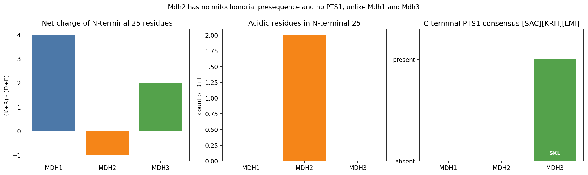
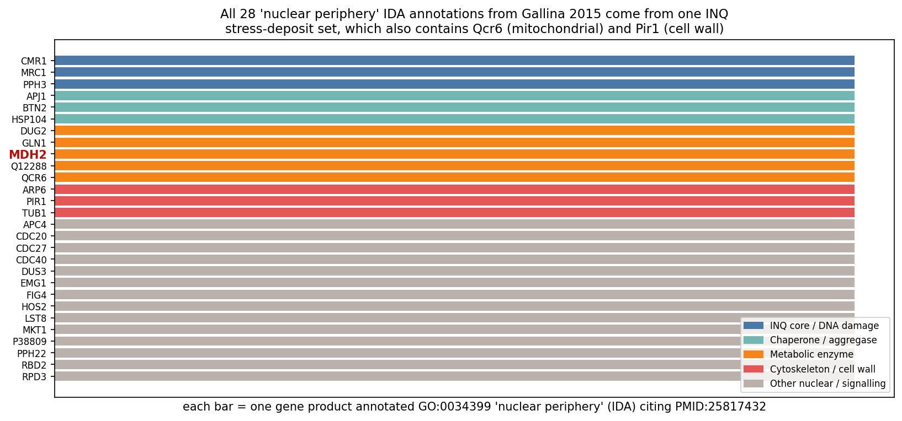
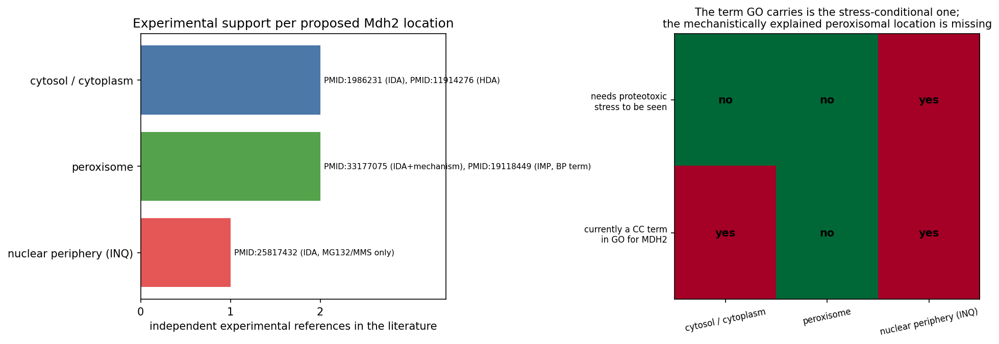
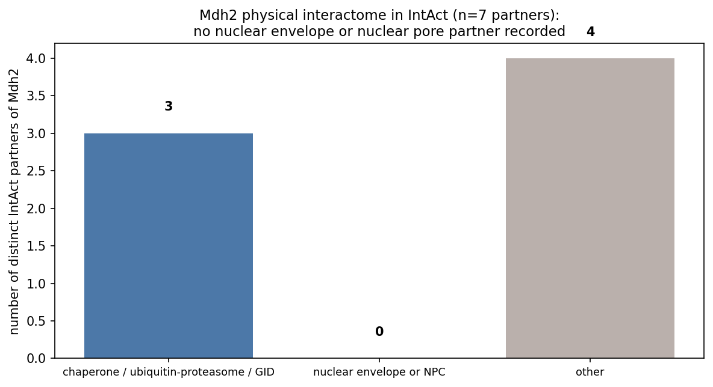

## Question

# AIGR Gene Hypothesis Deep Research

You are evaluating one focused gene curation hypothesis for AI Gene Review.
This is not a general gene overview. Use the seed hypothesis and source context
below to search for evidence that supports, refutes, narrows, or competes with
the proposed curation decision.

## Target Gene

- **Organism code:** yeast
- **Taxon:** Saccharomyces cerevisiae S288C (NCBITaxon:559292)
- **Gene directory:** MDH2
- **Gene symbol:** MDH2
- **UniProt accession:** P22133

## Focus

- **Focus type:** free_text
- **Hypothesis slug:** mdh2-nuclear-periphery
- **Source file:** genes/yeast/MDH2/MDH2-ai-review.yaml
- **Source selector:** free-text

## Seed Hypothesis

Yeast Mdh2 (cytosolic malate dehydrogenase) localizes to the nuclear periphery in addition to the cytosol.

## Term and Decision Context

- Decisive analysis: check large-scale and targeted localization data for Mdh2 and whether it has any organelle targeting signal.

## Reference Context

No specific reference context supplied.

## Source Context YAML

```yaml
hypothesis: Yeast Mdh2 (cytosolic malate dehydrogenase) localizes to the nuclear periphery in addition
  to the cytosol.
focus_type: free_text
context:
- 'Decisive analysis: check large-scale and targeted localization data for Mdh2 and whether it has any
  organelle targeting signal.'
reference_id: []
```

## Research Objective

Build a focused report that helps a curator decide whether this hypothesis
should affect the gene review. Address the focus type directly:

1. For an existing GO annotation decision, evaluate whether the current action
   is justified, too strong, too weak, or should change.
2. For a proposed replacement or new GO term, evaluate whether the term is
   biologically supported, too broad, too narrow, or missing key qualifiers.
3. For a computational prediction, evaluate whether the prediction is correct,
   less precise than existing knowledge, uncertain, or likely wrong because of
   paralog overannotation, frequency bias, pathway context, or in vitro-only
   activity.
4. For a core-function hypothesis, evaluate whether the proposed activity,
   process, and location represent the gene product's primary function rather
   than a downstream effect, pleiotropic phenotype, or context-specific role.
5. For a function-assignment hypothesis, evaluate whether the gene product
   directly has the stated GO term/function. Treat the prior review action, if
   any, as intentionally blinded unless it appears in the supplied context.

Use primary literature whenever possible. Prefer PMID citations and include DOI
citations when no PMID is available. Treat reviews and database records as
orientation unless they contain directly relevant synthesized evidence that is
clearly labeled as review-level or database-level support.

Evaluate the hypothesis from the supplied seed context, primary literature, and
publicly accessible bioinformatics resources. Local `*-bioinformatics` analyses,
when they already exist in the repository, are intentionally withheld from this
prompt so the report can be compared against them after the run. Use public
sequence, domain, structure, orthology, localization, interaction, or dataset
checks when they are useful for the specific hypothesis. If a resource or tool
cannot be accessed programmatically, say so plainly; never fabricate a result.
Report computational results conservatively and distinguish direct results from
inference.

## Required Output

### Executive Judgment

Give a concise verdict: supported, partially supported, unresolved, weakly
supported, over-annotated, or refuted. Explain the reasoning and the most
important caveats.

### Evidence Matrix

Create a table with one row per important evidence item:

- Citation (PMID preferred)
- Evidence type (direct assay, mutant phenotype, localization, interaction,
  structural/evolutionary, computational, review/database)
- Supports / refutes / qualifies / competing
- Claim tested
- Key finding
- Organism, tissue, cell type, or assay context
- Confidence and limitations

### GO Curation Implications

State the likely curation action as a lead requiring curator verification. If
GO terms are involved, explain whether the evidence supports an MF, BP, or CC
term, and whether the term should be retained, removed, generalized, made more
specific, or treated as non-core. Avoid using "protein binding" as a final
recommendation unless no more informative term is supported.

### Mechanistic Scope

Describe the immediate molecular or cellular function being tested. Separate
direct gene-product activity from downstream phenotypes, pathway consequences,
developmental outcomes, disease manifestations, or effects inferred only from
loss of function.

### Conflicts and Alternatives

Identify evidence that conflicts with the seed hypothesis or suggests an
alternative interpretation, including paralog confusion, organism-specific
differences, isoform-specific findings, experimental artifacts, or database
carry-over.

### Knowledge Gaps

List explicit uncertainties that matter for curation. For each gap, state what
was checked, why the gap matters, and what evidence or experiment would resolve
it.

### Discriminating Tests

Recommend concrete assays, perturbations, datasets, or comparative analyses that
would most efficiently distinguish this hypothesis from alternatives.

### Curation Leads

Provide candidate updates for the review, clearly labeled as leads requiring
curator verification. Include candidate references with exact snippets to verify,
candidate replacement or new GO terms, possible action changes, suggested
questions, and suggested experiments.

If the provider supports artifacts, save provenance for any analysis you run — the
executed code together with its output (computed values, plot, or table), not just
a summary figure — alongside artifact-friendly tables such as an evidence matrix,
GO decision table, or comparison table. Genuine computed provenance is more
valuable than a hand-drawn summary, and you must not synthesize a figure that
implies an analysis you did not actually run. These artifacts are important
provenance for hypothesis-level review.


## Output

# Mdh2 nuclear periphery: hypothesis-level curation report

**Gene:** MDH2 / YOL126C, *Saccharomyces cerevisiae* S288C (NCBITaxon:559292)
**UniProt:** P22133 | **SGD:** S000005486
**Hypothesis slug:** mdh2-nuclear-periphery
**Seed hypothesis:** Yeast Mdh2 (cytosolic malate dehydrogenase) localizes to the nuclear periphery in addition to the cytosol.
**Date of database queries:** 2026-11-18

---

## Summary

<i class="fa-scale-balanced"></i> **Verdict: partially supported, and over-annotated as currently recorded in GO.** The observation behind the seed hypothesis is real and is in the database, but it is a single-condition observation that the GO record presents without its condition.

The hypothesis traces to exactly one annotation: GO:0034399 nuclear periphery, evidence code IDA, qualifier `located_in`, reference [PMID: 25817432](https://pubmed.ncbi.nlm.nih.gov/25817432/), assigned by SGD on 2016-01-08. A QuickGO audit of all 27 GO annotations on P22133 found no second source for any nuclear location. That single reference is Gallina et al. 2015, the paper that defines the **intranuclear quality control compartment (INQ)**, which its own abstract describes as a structure "that sequesters misfolded, ubiquitylated and sumoylated proteins in response to genotoxic stress". The Mdh2 call came from a screen of 4800 GFP-tagged strains for perinuclear foci induced by the proteasome inhibitor MG132 and co-localizing with Cmr1-yEmRFP. The same paper states that only 18 of its 27 hits are nuclear in the absence of stress, and Mdh2 sits in the remaining group, since its unstressed localization is cytosolic.

Three independent lines of analysis converge on the same reading. First, a provenance audit shows that all 28 gene products given GO:0034399 on the authority of PMID:25817432 are the INQ hit list, a set that also contains Qcr6 (a mitochondrial inner-membrane cytochrome b-c1 subunit) and Pir1 (a cell wall mannoprotein). Neither can constitutively reside in the nuclear lumen, which marks the whole batch as a deposit proteome. Second, comparative sequence analysis of the three yeast MDH isozymes shows Mdh2 has no PTS1, no PTS2, no mitochondrial presequence and no classical NLS, while Mdh1 and Mdh3 carry their expected signals, so Mdh2 has no autonomous route into the nucleus; its GFP fusion is also above the passive nuclear pore limit. Third, Mdh2's recorded physical interactome in IntAct is weighted towards Hsp70 and Hsp90 chaperones and contains no nuclear envelope or nuclear pore component.

A mechanism explains the observation without a native nuclear function. Mdh2 carries a Pro/N-degron at residues 2-5 and is targeted for proteasomal degradation on shift to glucose, so MG132 is precisely the treatment that stabilizes a pool of Mdh2 headed for destruction. Sequestration of that stabilized pool into a quality-control deposit is expected behaviour for a degradation substrate. A second problem runs opposite to the seed hypothesis: GO holds the stress-conditional location for Mdh2 while the mechanistically explained peroxisomal location is missing entirely, and [PMID: 33177075](https://pubmed.ncbi.nlm.nih.gov/33177075/) is not cited anywhere in Mdh2's GO record.

---

## Key findings

### F001. The annotation rests on a single IDA from a stress-deposit screen

<i class="fa-database"></i> A provenance audit through the QuickGO REST API (geneProductId=UniProtKB:P22133, 27 annotations retrieved) and the SGD backend (locus S000005486, go_details) establishes that GO:0034399 "nuclear periphery" appears exactly once for Mdh2: evidence IDA, qualifier `located_in`, assigned by SGD, reference PMID:25817432. No other reference in GO supports any nuclear location for this protein. UniProt P22133 lists Subcellular location: Cytoplasm only.

Querying QuickGO in the reverse direction, for `reference=PMID:25817432`, returns 29 annotations in total, of which 28 are GO:0034399 IDA spread across 28 distinct gene products: APC4, APJ1, ARP6, BTN2, CDC20, CDC27, CDC40, CMR1, DUG2, DUS3, EMG1, FIG4, GLN1, HOS2, HSP104, LST8, **MDH2**, MKT1, MRC1, PIR1, PPH22, PPH3, QCR6, RBD2, RPD3, TUB1, YHR097C and YLR126C. This is the INQ hit list, reproduced wholesale as nuclear periphery annotations. The internal control for whether that set can be read as a list of nuclear-periphery residents is the presence of Qcr6 and Pir1 in it. Qcr6 is a subunit of the mitochondrial inner-membrane cytochrome b-c1 complex and Pir1 is a cell wall mannoprotein. A set containing both is a sequestration proteome.

Steady-state localization evidence for Mdh2 points elsewhere: GO:0005829 cytosol, IDA, from [PMID: 1986231](https://pubmed.ncbi.nlm.nih.gov/1986231/) (Minard and McAlister-Henn 1991), and GO:0005737 cytoplasm, HDA, from [PMID: 11914276](https://pubmed.ncbi.nlm.nih.gov/11914276/) (Kumar et al. 2002).

{{figure:plot_2.png|caption=Composition of the 28-protein GO:0034399 batch annotated on the authority of PMID:25817432. Every bar is one gene product that received a nuclear periphery IDA from this single paper. The set is the INQ stress deposit proteome and includes Qcr6, a mitochondrial inner-membrane protein, and Pir1, a cell wall mannoprotein. MDH2 is marked in red.}}

### F002. The focus appears only after proteasome inhibition, and the source paper says Mdh2 is not nuclear at baseline

<i class="fa-microscope"></i> The full text of Gallina et al. 2015 (PMC4389229) was retrieved through Europe PMC and text-mined. The method that generated the Mdh2 call reads: "we screened a collection of 4800 green fluorescent protein (GFP)-tagged proteins for co-localization with Cmr1 ... We took advantage of the observation that Cmr1 perinuclear foci were also induced by proteasome inhibition (MG132 ...), to avoid induction of DNA repair foci ... yielding a list of 27 proteins that form Cmr1-co-localizing foci in response to MG132 (Fig. 3a). Eighty-one per cent (22/27) of these proteins also co-localized with Cmr1 after MMS treatment."

The discussion of that paper then supplies the qualifier a curator needs: "the majority of the INQ-localized proteins are exclusively nuclear (67%, 18/27) in the absence of stress. We propose that the remaining proteins that do not generally localize to the nucleus in the absence of stress might be translocated to the nucleus specifically during stress, or that a minor nuclear pool of these proteins could become detectable on relocalization to INQ due to the increased local concentration." Mdh2 falls in that remaining 33% (9 of 27), because its unstressed localization is cytosolic by two independent references.

The strings "Mdh2", "MDH2" and "malate" occur zero times in the main text, confirmed both by regex over the retrieved full text and by Europe PMC full-text queries (`PMCID:"PMC4389229" AND "MDH2"`, hitCount 0). The Mdh2 call therefore sits in Supplementary Fig. 3 or Supplementary Tables 1-7, which I could not download; the Europe PMC `supplementaryFiles` endpoint timed out.

The inducing condition and Mdh2's own biology fit together. UniProt P22133 annotates a **Pro/N-degron motif at residues 2-5** and the PTM "Targeted for proteasomal degradation when cells are shifted to glucose-containing growth medium" (ECO:0000269, [PMID: 28126757](https://pubmed.ncbi.nlm.nih.gov/28126757/)). MG132 blocks the proteasome, so it stabilizes exactly the Mdh2 pool that the GID complex would otherwise destroy. Capture of that stabilized pool in a quality-control deposit is what a degradation substrate is expected to do.

### F003. Mdh2 carries no organelle targeting signal of any kind

<i class="fa-dna"></i> Comparative sequence analysis of the three yeast MDH isozymes was computed directly from UniProt REST records (P17505 Mdh1, P22133 Mdh2, P32419 Mdh3). This is the computational half of the decisive analysis named in the seed context.

| Property | Mdh1 (mitochondrial) | Mdh2 (cytosolic) | Mdh3 (peroxisomal) |
|---|---|---|---|
| Length | 334 aa | 377 aa | 343 aa |
| C-terminal tripeptide | ASK | **ASS** | SKL |
| PTS1 consensus [SAC][KRH][LMI] | no | **no** | yes |
| PTS2 nonapeptide in N-terminal 40 | no | **no** | no |
| UniProt transit peptide | yes, residues 1-17 | **none** | none |
| N-terminal 25 net charge | +4 | **-1** | +2 |
| N-terminal 25 acidic residues | 0 | **2** | 0 |
| N-terminal 25 Arg count | 2 | **0** | 0 |
| Helical hydrophobic moment (N25) | 0.58 | **0.21** | 0.84 |
| Classical NLS motifs (mono- or bipartite) | 0 | **0** | 0 |

Mdh2 fails every classical targeting test. Its C-terminus is ASS, not a PTS1. Its N-terminal 25 residues carry a net negative charge with two acidic residues and no arginine, all incompatible with a mitochondrial matrix presequence; the positive control Mdh1 has a UniProt-annotated 17-residue transit peptide with net charge +4 and no acidic residues. UniProt lists no Signal and no Transit peptide feature for Mdh2, only the Pro/N-degron motif. The NLS scan returned zero hits, though it returned zero for both paralogs as well, so on its own it is uninformative; the targeting-signal contrast is what carries weight.

A size argument points the same way. Mdh2 is 40.7 kDa as a monomer and roughly 81.5 kDa as its functional homodimer. The GFP fusion used in the screen is about 67.6 kDa as a monomer and 135 kDa as a tagged dimer, well above the approximately 40 kDa passive diffusion limit of the nuclear pore for globular proteins. Any nuclear-periphery signal therefore has to arise from piggybacking, co-aggregation with a chaperone or aggregase, or active recruitment by another factor.

{{figure:plot_1.png|caption=Targeting-signal comparison across the three yeast MDH isozymes, computed from UniProt sequences. Left, net charge of the N-terminal 25 residues. Middle, acidic residue count in the same window. Right, presence of a C-terminal PTS1 consensus with the actual tripeptide labelled. Mdh2 has neither a mitochondrial presequence profile nor a PTS1, while Mdh1 and Mdh3 each carry their expected signal.}}

### F004. The well-supported secondary location is the peroxisome, reached by piggybacking

<i class="fa-circle-check"></i> Gabay-Maskit et al. 2020 ([PMID: 33177075](https://pubmed.ncbi.nlm.nih.gov/33177075/), *A piggybacking mechanism enables peroxisomal localization of the glyoxylate cycle enzyme Mdh2 in yeast*, doi 10.1242/jcs.244376) report that "the yeast malate dehydrogenase 2 (Mdh2) is dually localized to the cytosol and to peroxisomes and is targeted to peroxisomes via association with Mdh3 and a Pex5-dependent piggybacking mechanism."

That mechanism is exactly what the sequence analysis predicts would be required. Mdh2 ends in ASS and has no PTS1 of its own, so it has to ride on a PTS1-bearing partner, and Mdh3 ends in SKL. The dependence of this isozyme family on PTS1 was established directly by McAlister-Henn et al. 1995 ([PMID: 7673155](https://pubmed.ncbi.nlm.nih.gov/7673155/)), who removed the Ser-Lys-Leu tripeptide from Mdh3 and reported that "This resulted in cytosolic localization of MDH3 in yeast transformants." The same paper showed that the 12-residue N-terminal extension of Mdh2 is a catabolite-inactivation determinant and failed to confer that property on Mdh3, which removes the only candidate N-terminal targeting element in Mdh2 from consideration.

A supporting phenotype is already in GO for Mdh2: GO:0016558 protein import into peroxisome matrix, IMP, qualifier `involved_in`, from [PMID: 19118449](https://pubmed.ncbi.nlm.nih.gov/19118449/) (Wolinski et al. 2009). The authors of PMID:33177075 present the peroxisomal pool as functionally relevant: "This dual localization of Mdh2 contributes to our understanding of the glyoxylate cycle and provides a new perspective on compartmentalization of cellular metabolism." No primary paper proposes a nuclear or nuclear-periphery function for Mdh2.

### F005. The annotation carries no condition qualifier and has already propagated

<i class="fa-triangle-exclamation"></i> A GAF-level audit through QuickGO `downloadSearch` (text/gaf) for UniProtKB:P22133 returned 10 cellular-component lines. The GO:0034399 line reads: qualifier `located_in`, reference PMID:25817432, evidence IDA, **With/From empty**, **Annotation_Extension empty**, date 20160108, assigned by SGD. Nothing in the annotation records that the observation required MG132 or MMS.

A second line, GO:0070013 intracellular organelle lumen, is an IEA from UniProt GO_REF:0000117 with With/From ARBA:ARBA00027917, dated 20260727. A QuickGO ontology query confirms GO:0070013 is an ancestor of GO:0034399 (the ancestor set runs GO:0031981 nuclear lumen, GO:0070013 intracellular organelle lumen, GO:0043233, GO:0031974, GO:0005634 nucleus and higher). That IEA is therefore a propagation of the same single IDA, not independent support. One unqualified, single-condition observation now generates two cellular component terms for Mdh2.

The cross-isozyme control rules out the most common database artifact. Experimental CC annotations in this family are cleanly isozyme-specific:

| Isozyme | Experimental CC term | Supporting references |
|---|---|---|
| Mdh1 (P17505) | mitochondrion GO:0005739 | PMID:10777592 (IMP), 11502169 (IDA), 16823961 (HDA), 16962558 (IPI), 24769239 (HDA) |
| Mdh1 (P17505) | mitochondrial matrix GO:0005759 | PMID:9774331 (IDA) |
| Mdh2 (P22133) | cytosol GO:0005829 | PMID:1986231 (IDA) |
| Mdh2 (P22133) | cytoplasm GO:0005737 | PMID:11914276 (HDA) |
| Mdh2 (P22133) | nuclear periphery GO:0034399 | PMID:25817432 (IDA), single |
| Mdh3 (P32419) | peroxisome GO:0005777 | PMID:1447211 (IDA), 7628449 (IDA) |
| Mdh3 (P32419) | peroxisomal matrix GO:0005782 | PMID:8824293 (IDA) |

Neither paralog carries GO:0034399. The nuclear periphery term is genuinely Mdh2-specific, so paralog overannotation and cross-isozyme bleed are not the explanation.

### F006. GO holds the stress-conditional location and is missing the mechanistic one

<i class="fa-lightbulb"></i> The complete reference list cited in GO for UniProtKB:P22133 (QuickGO, 27 annotations) is: GO_REF:0000002, GO_REF:0000033, GO_REF:0000117, GO_REF:0000120, GO_REF:0000123, PMID:11914276, PMID:12730240, PMID:19118449, PMID:1986231 and PMID:25817432. **PMID:33177075 is absent.** No peroxisomal cellular component term is present for MDH2: the only peroxisome-related GO id on the protein is the biological process term GO:0016558. GO:0005777 peroxisome and GO:0005782 peroxisomal matrix are present for MDH3 but not for MDH2.

Counting independent experimental support per proposed location makes the imbalance explicit:

| Proposed location | Independent experimental references | Stress required to observe | Currently a CC term in GO for MDH2 |
|---|---|---|---|
| Cytosol / cytoplasm | 2 (PMID:1986231 IDA, PMID:11914276 HDA) | <i class="fa-circle-xmark"></i> no | <i class="fa-circle-check"></i> yes |
| Peroxisome | 2 (PMID:33177075 with mechanism, PMID:19118449 IMP for the BP term) | <i class="fa-circle-xmark"></i> no | <i class="fa-circle-xmark"></i> **no** |
| Nuclear periphery (INQ) | 1 (PMID:25817432) | <i class="fa-circle-check"></i> **yes, MG132 or MMS** | <i class="fa-circle-check"></i> yes |

{{figure:plot_3.png|caption=Left, count of independent experimental references supporting each proposed Mdh2 location, with the references labelled. Right, whether each location requires proteotoxic stress to be observed and whether it is currently a cellular component term in GO for MDH2. The term GO carries is the stress-conditional one, and the peroxisomal location with a stated import mechanism is absent.}}

### F007. The recorded interactome is chaperone-weighted with no nuclear envelope partner

<i class="fa-magnifying-glass"></i> An IntAct query through PSICQUIC (P22133, tab25 format, retrieved 2026-11) returned 8 interaction lines covering 7 distinct partners: GET3, GTT1, HSP82, MGA2, PYK2, SSA1 and SSB1. Three are canonical chaperones (Hsp82 is Hsp90; Ssa1 and Ssb1 are Hsp70 family), and Get3 has a documented ATP-independent holdase activity under oxidative stress, so 4 of 7 partners are chaperone-class. Zero partners matched a curated list of 34 nuclear envelope, nuclear pore and nucleocytoplasmic transport proteins (NUP49, NUP57, NUP100, NUP116, NUP133, NUP145, NUP159, NUP170, NUP188, NUP192, NSP1, POM152, POM34, NDC1, MLP1, MLP2, HEH1, HEH2, SRC1, ESC1, NIC96, SEH1, SEC13, KAP95, KAP60, SRP1, CSE1, MSN5, NTF2, HMG1, HMG2, MPS3, NDJ1).

<i class="fa-triangle-exclamation"></i> With only 7 recorded partners, the negative has low power and corroborates rather than demonstrates. The direction of the positive signal carries information on its own: an enzyme whose recorded partners are Hsp70 and Hsp90 is a chaperone client, which is what a protein sequestered into a quality-control deposit after proteasome inhibition should look like.

{{figure:plot_4.png|caption=Classification of the 7 distinct Mdh2 physical interaction partners recorded in IntAct. Four are chaperone-class (Hsp82, Ssa1, Ssb1, Get3). None of 34 nuclear envelope, nuclear pore or nucleocytoplasmic transport proteins appears as a partner.}}

---

## Mechanistic model and interpretation

The immediate molecular activity of Mdh2 is L-malate dehydrogenase (GO:0030060, IDA and IMP from PMID:1986231), acting in gluconeogenesis (GO:0006094) and the glyoxylate cycle (GO:0006097). Nothing in any evidence item connects that catalysis to the nuclear periphery. No paper proposes a nuclear substrate, a nuclear redox role, or a moonlighting nuclear function for Mdh2.

What is being tested is a location, and the location has two readings. The first treats the perinuclear focus as a property Mdh2 brings with it. The second treats it as a destination imposed on Mdh2 by the cell's sequestration machinery. The evidence favours the second, and the chain is specific:

```dot
digraph mdh2_inq {
  rankdir=LR;
  "Mdh2\nPro/N-degron\nres 2-5" -> "GID complex\nubiquitylation";
  "GID complex\nubiquitylation" -> "Proteasomal\ndegradation";
  "MG132\n(screen condition)" -> "Proteasomal\ndegradation" [label="blocks", style=dashed];
  "Proteasomal\ndegradation" -> "Stabilized\nundegraded Mdh2 pool" [label="blocked"];
  "Stabilized\nundegraded Mdh2 pool" -> "Chaperone binding\nSsa1 Ssb1 Hsp82";
  "Chaperone binding\nSsa1 Ssb1 Hsp82" -> "INQ sequestration\nBtn2 Hsp42 Cmr1" [style=dashed];
  "INQ sequestration\nBtn2 Hsp42 Cmr1" -> "Mdh2-GFP focus\nat nuclear periphery";
  "Mdh2-GFP focus\nat nuclear periphery" -> "GO:0034399 IDA\nlocated_in";
  "GO:0034399 IDA\nlocated_in" -> "GO:0070013 IEA\n(ARBA propagation)";
}
```



The dashed link from chaperone binding to INQ sequestration is the uncertain step: Gallina et al. establish Btn2 and Hsp42 dependence for Cmr1 foci and for misfolded VHL, but the main text gives no per-hit breakdown, so Mdh2's dependence on an aggregase is inferred rather than shown.

The alternative route into the nucleus is closed off by the sequence data. Mdh2 has no NLS and its GFP fusion exceeds the passive pore limit, so it cannot simply diffuse in and accumulate. The paper's own second explanation, that a minor pre-existing nuclear pool becomes detectable when local concentration rises, remains open but still describes a pool made visible by a deposit, which is equally non-core.

By contrast, the peroxisomal route has a named mechanism that is consistent with the same sequence facts: Mdh2 lacks a PTS1, Mdh3 has one (SKL), and Pex5-dependent piggybacking carries Mdh2 in as a passenger. That is the one non-cytosolic pool with a plausible catalytic role, in the glyoxylate cycle.

### Reading the evidence against the two models

| Evidence item | Favours "native nuclear periphery residence" | Favours "quality-control sequestration" |
|---|---|---|
| Single IDA, one paper, one condition | weak | strong |
| Co-annotated batch contains Qcr6 and Pir1 | contradicts | strong |
| MG132 required to see the focus | neutral | strong |
| Paper states 9/27 hits not nuclear without stress | contradicts | strong |
| No NLS, GFP fusion above pore limit | contradicts | consistent |
| Pro/N-degron, GID substrate | neutral | strong |
| IntAct partners are Hsp70/Hsp90, no nucleoporin | contradicts | moderate (low power) |
| Peroxisomal piggybacking well documented | neutral | neutral, but reprioritizes the curation action |

---

## Evidence matrix

| Citation | Evidence type | Stance | Claim tested | Key finding | Context | Confidence and limitations |
|---|---|---|---|---|---|---|
| [PMID: 25817432](https://pubmed.ncbi.nlm.nih.gov/25817432/) Gallina 2015 | Localization, imaging screen | Supports, conditionally | Mdh2 is at the nuclear periphery | Sole source of GO:0034399 IDA. Mdh2-GFP scored as an MG132-induced perinuclear focus co-localizing with Cmr1 in a 4800-strain screen; 27 hits; the paper states 18/27 are nuclear without stress | *S. cerevisiae*, GFP collection, MG132 and 0.05% MMS | Low to moderate for native localization. The compartment is defined as a sequestration site for misfolded, ubiquitylated and sumoylated protein. Mdh2 named only in supplementary data, which I could not retrieve |
| [PMID: 1986231](https://pubmed.ncbi.nlm.nih.gov/1986231/) Minard 1991 | Localization, direct assay | Qualifies | Steady-state location of Mdh2 | Cytosol; basis of GO:0005829 IDA | *S. cerevisiae*, unstressed | High for cytosol. Silent on stress conditions |
| [PMID: 11914276](https://pubmed.ncbi.nlm.nih.gov/11914276/) Kumar 2002 | Localization, high-throughput | Qualifies | Steady-state location of Mdh2 | Cytoplasm; basis of GO:0005737 HDA | *S. cerevisiae*, tagged-proteome survey, unstressed | Moderate. No subnuclear resolution |
| [PMID: 33177075](https://pubmed.ncbi.nlm.nih.gov/33177075/) Gabay-Maskit 2020 | Localization and interaction, direct assay | Competing | Mdh2 has a second location besides cytosol | Mdh2 dually localized to cytosol and peroxisome, imported by association with Mdh3 and Pex5-dependent piggybacking | *S. cerevisiae*, targeted imaging and genetics | High. Mechanism identified. Absent from GO for MDH2 |
| [PMID: 7673155](https://pubmed.ncbi.nlm.nih.gov/7673155/) McAlister-Henn 1995 | Mutant phenotype, structural | Qualifies | The Mdh2 N-terminal 12-residue extension is a targeting signal | That extension is a catabolite-inactivation determinant, not a targeting signal. Deleting Mdh3's Ser-Lys-Leu moves Mdh3 to the cytosol | *S. cerevisiae*, chimeric MDH constructs | High. Removes the only candidate N-terminal targeting element in Mdh2 |
| [PMID: 28126757](https://pubmed.ncbi.nlm.nih.gov/28126757/) Chen 2017 | Direct assay, mutant phenotype | Competing, supplies mechanism | Why proteasome inhibition would concentrate Mdh2 in a deposit | Mdh2 carries a Pro/N-degron (UniProt motif 2-5) and is targeted for proteasomal degradation on shift to glucose | *S. cerevisiae*, GID complex, Pro/N-end rule | High (cited here as the UniProt ECO:0000269 source). Makes Mdh2 an expected client of a quality-control deposit under MG132 |
| [PMID: 25681695](https://pubmed.ncbi.nlm.nih.gov/25681695/) Miller 2015 | Review | Qualifies | What INQ is | "INQ and CytoQs are stress-induced deposits for misfolded proteins residing in the nucleus and the cytosol, respectively, and requiring cell-compartment-specific aggregases, nuclear Btn2 and cytosolic Hsp42 for formation" | Review of yeast proteostasis | Review-level support only, used for orientation on compartment definition |
| [PMID: 9244381](https://pubmed.ncbi.nlm.nih.gov/9244381/) Small 1997 | Mutant phenotype | Qualifies | Isozyme functions are interchangeable | Overexpression of MDH2 in a deltaMDH1 strain failed to restore growth on ethanol or acetate, and the cytosolic MDH1 form only partially restored growth of a deltaMDH2 mutant, "suggesting that MDH2 may also have unique metabolic functions" | *S. cerevisiae*, targeting-signal swaps | High for isozyme non-equivalence. No bearing on nuclear localization |
| [PMID: 11169757](https://pubmed.ncbi.nlm.nih.gov/11169757/) Roth 2001 | Direct assay, transcription | Context | When MDH2 is expressed | MDH2 is derepressed under non-fermentative growth through three CSRE elements bound by Cat8 and Sip4 | *S. cerevisiae*, promoter mutagenesis | High. Relevant because it defines the carbon source conditions under which Mdh2 protein exists at all |
| QuickGO and SGD REST audit (this work) | Computational, database audit | Qualifies | How much independent support nuclear periphery has | GO:0034399 on P22133 is one IDA line with empty With/From and empty Annotation_Extension. All 28 GO:0034399 IDAs citing PMID:25817432 are the same INQ batch, which also contains Qcr6 and Pir1. GO:0070013 IEA is an ARBA propagation of that one IDA | QuickGO annotation and GAF endpoints, SGD backend, 2026-11 | High. Direct database records, reproducible from the saved code |
| UniProt sequence analysis (this work) | Computational, sequence | Refutes autonomous targeting | Mdh2 carries an organelle targeting signal | No PTS1 (ASS vs Mdh3 SKL), no PTS2, no mitochondrial presequence (N25 net charge -1, 2 acidic, moment 0.21, vs Mdh1 +4, 0 acidic, 0.58 with an annotated 17-residue transit peptide), no mono- or bipartite NLS. Mdh2-GFP ~67.6 kDa monomer, above the ~40 kDa passive pore limit | P17505, P22133, P32419 from UniProt REST | High for absence of classical signals. Motif scans cannot exclude a non-canonical import route |
| IntAct via PSICQUIC (this work) | Interaction, database | Qualifies | Chaperone client or nuclear envelope associate | 7 distinct partners: GET3, GTT1, HSP82, MGA2, PYK2, SSA1, SSB1. Four chaperone-class. Zero matches against 34 nuclear envelope, NPC and transport proteins | IntAct, 2026-11 | Moderate for the positive signal, low power for the negative given n=7 |

---

## GO curation implications

<i class="fa-arrow-right"></i> All items below are **leads requiring curator verification**.

| GO id | Term | Aspect | Current evidence | Status | Recommended action |
|---|---|---|---|---|---|
| GO:0005829 | cytosol | CC | IDA PMID:1986231, plus IBA and RCA | Constitutive | Retain as the core location |
| GO:0005737 | cytoplasm | CC | HDA PMID:11914276, plus IEA | Constitutive | Retain, redundant with cytosol |
| GO:0034399 | nuclear periphery | CC | IDA PMID:25817432, single line, no extension | MG132 and MMS induced INQ deposit | **Retain as `located_in`, mark non-core and context-specific, add a condition qualifier. Never promote to `is_active_in`** |
| GO:0070013 | intracellular organelle lumen | CC | IEA GO_REF:0000117 (ARBA) | Propagated from GO:0034399 | Treat as carry-over of the same single IDA, not independent support |
| GO:0005777 | peroxisome | CC | Absent for MDH2 | Supported by PMID:33177075 | **Candidate new annotation** |
| GO:0016558 | protein import into peroxisome matrix | BP | IMP PMID:19118449 | Present | Cross-check against the PMID:33177075 piggyback model |
| GO:0030060 | L-malate dehydrogenase activity | MF | IDA and IMP PMID:1986231 | Core | Retain, unaffected by this hypothesis |

The specific, fixable defect: the GAF line for GO:0034399 reads `located_in | GO:0034399 | PMID:25817432 | IDA | With/From empty | Annotation_Extension empty | 20160108 | SGD`. Nothing in it records that the observation required proteasome inhibition. Adding an annotation extension of the form `happens_during` or `exists_during` a cellular response to MMS or to proteasome inhibition, or at minimum a review-level note recording the condition, would stop the term reading as a constitutive location.

**Do not remove the term.** The observation happened and the INQ literature is sound. The action is demotion from a localization statement to a conditional one, together with an explicit non-core flag so the term never enters a core-function statement for Mdh2.

---

## Mechanistic scope

**Direct gene-product activity.** Mdh2 catalyses the interconversion of malate and oxaloacetate with NAD+ (GO:0030060). It is expressed under non-fermentative growth through Cat8- and Sip4-dependent CSRE elements ([PMID: 11169757](https://pubmed.ncbi.nlm.nih.gov/11169757/)), and functions in gluconeogenesis and the glyoxylate cycle. Nothing about this activity is nuclear.

**Direct gene-product property relevant to the hypothesis.** Mdh2 is an aggregation-prone, constitutively degraded enzyme. It carries a Pro/N-degron at residues 2-5, is a GID complex substrate, and its recorded physical partners are weighted towards Hsp70 and Hsp90. These are intrinsic properties of the protein.

**Downstream, condition-dependent phenotype.** The appearance of an Mdh2-GFP focus at the nuclear periphery after MG132 is a consequence of that client status combined with the cell's sequestration machinery (Btn2, Hsp42, Cmr1). It is a destination imposed on Mdh2 by other proteins, not an activity of Mdh2 and not a place where Mdh2 does chemistry. Gallina et al. offer the alternative reading themselves, that a minor pre-existing nuclear pool becomes detectable only when local concentration rises on sequestration.

**Effect inferred only from perturbation.** The entire nuclear-periphery observation exists only under proteasome inhibition or MMS. No unperturbed observation of nuclear Mdh2 is on record. Either reading of the data makes the term non-core.

---

## Conflicts and alternatives

**The co-annotated batch is incoherent as a localization set.** All 28 gene products given GO:0034399 on the authority of PMID:25817432 are the INQ hit list. Qcr6 is a mitochondrial inner-membrane cytochrome b-c1 subunit and Pir1 is a cell wall mannoprotein. Neither can constitutively reside in the nuclear lumen. A set containing both is a deposit proteome, and Mdh2's membership should be read the same way as theirs.

**<i class="fa-circle-xmark"></i> Not paralog confusion.** This was the most likely database artifact and it is ruled out. Experimental CC annotations across the isozyme family are cleanly specific: Mdh1 has six experimental mitochondrial references and Mdh3 has three peroxisomal ones, and neither paralog carries GO:0034399. The term is genuinely Mdh2-specific.

**The stronger competing location is the peroxisome.** PMID:33177075 reports Mdh2 dually localized to cytosol and peroxisome through Mdh3 association and Pex5-dependent piggybacking. This fits the sequence data exactly: Mdh2 ends in ASS with no PTS1, so it must ride on a PTS1-bearing partner, and Mdh3 ends in SKL. Counting independent experimental support gives cytosol 2 references with no stress requirement, peroxisome 2 references with no stress requirement and a stated mechanism, nuclear periphery 1 reference requiring MG132 or MMS.

**Tagging artifact cannot be excluded.** The screen used C-terminally GFP-tagged Mdh2 expressed from its native locus. A 27 kDa tag on a 40.7 kDa homodimerizing enzyme is a plausible source of folding stress, which is the exact property an INQ screen selects for. The same caution applies to every hit in that screen.

**Database carry-over is already under way.** UniProt's ARBA rule has turned the single SGD IDA into an additional GO:0070013 IEA. Left unqualified, one condition-restricted observation keeps generating terms, and a downstream consumer reading only the GO record sees two cellular component terms with no indication of their shared single-condition origin.

**Isozyme non-equivalence is real but does not help the hypothesis.** Small and McAlister-Henn 1997 ([PMID: 9244381](https://pubmed.ncbi.nlm.nih.gov/9244381/)) found that overexpressed MDH2 failed to restore growth of a deltaMDH1 strain on ethanol or acetate, "suggesting that MDH2 may also have unique metabolic functions". Those unique functions are metabolic and compartment-related, with no nuclear component proposed.

---

## Limitations and knowledge gaps

<i class="fa-triangle-exclamation"></i> **The Mdh2 panel in Gallina et al. is unseen.** *Checked:* the main text of PMC4389229 by regex over the retrieved full text and by Europe PMC full-text query (`PMCID:"PMC4389229" AND "MDH2"`, hitCount 0); the strings Mdh2, MDH2 and malate occur zero times. The call therefore sits in Supplementary Fig. 3a or Supplementary Tables 1-7. The Europe PMC `supplementaryFiles` endpoint timed out and I did not retrieve it. *Why it matters:* the penetrance (what fraction of cells showed the focus), the brightness relative to the cytosolic signal, and whether a diffuse nucleoplasmic pool was visible all change how a curator should word the annotation. *Resolution:* open the supplementary PDF and Excel file directly.

<i class="fa-triangle-exclamation"></i> **Unstressed high-resolution imaging of Mdh2-GFP.** *Checked:* GO carries only HDA cytoplasm from PMID:11914276 for Mdh2, and SGD records no HDA from the Huh et al. 2003 GFP survey ([PMID: 14562095](https://pubmed.ncbi.nlm.nih.gov/14562095/)) for this gene. I could not query the GFP collection image databases (yeastgfp, CYCLoPs, LoQAtE) programmatically. *Why it matters:* the seed context asks specifically about large-scale localization data, and the single most relevant large-scale resource is the one I could not reach. *Resolution:* pull the Mdh2-GFP images from those resources.

<i class="fa-circle-question"></i> **Whether the focus requires Btn2 or Hsp42.** *Checked:* Gallina et al. report this genetic requirement for Cmr1 foci and for misfolded VHL, but no per-hit breakdown appears in the main text. *Why it matters:* dependence on an aggregase would settle the quality-control reading and justify the condition qualifier without further argument. *Resolution:* image Mdh2-GFP plus MG132 in *btn2Δ* and *hsp42Δ*.

<i class="fa-circle-question"></i> **Whether the untagged protein does this.** *Checked:* the only evidence comes from a C-terminal GFP fusion. *Why it matters:* a tag-induced folding defect would make the focus an artifact of the screen rather than a property of Mdh2. *Resolution:* immunofluorescence or nuclear fractionation of untagged Mdh2 after MG132.

<i class="fa-circle-question"></i> **Quantitative penetrance under normal growth.** *Checked:* no source reports an unstressed nuclear fraction for Mdh2. *Why it matters:* a GO `located_in` term without a qualifier implies a normal-condition location, so the defensibility of the bare term depends on this number. *Resolution:* quantitative imaging of untreated cells at high sensitivity with Nup49 as the envelope reference used in the original paper.

<i class="fa-triangle-exclamation"></i> **Statistical limits of the interaction result.** IntAct records only 7 partners for Mdh2, so the absence of nuclear envelope and nucleoporin partners has low power. It corroborates the other two lines and does not stand alone.

<i class="fa-triangle-exclamation"></i> **Limits of motif scanning.** The sequence analysis establishes the absence of classical targeting signals. It cannot exclude a non-canonical import route, and the NLS scan returned zero hits for all three isozymes, so that particular scan is uninformative in isolation.

---

## Proposed follow-up experiments and actions

### Discriminating tests, in order of cost-effectiveness

1. <i class="fa-flask"></i> **Aggregase dependence.** Image Mdh2-GFP after MG132 in wild type, *btn2Δ*, *hsp42Δ* and *cmr1Δ*. Loss of the focus in *btn2Δ* or *hsp42Δ* identifies it as quality-control sequestration and removes any reading as a native location. This is the cheapest decisive test.
2. <i class="fa-dna"></i> **Degron dependence.** Compare Mdh2-GFP with an N-terminal Pro/N-degron mutant (residues 2-5) and in *gid2Δ*. If stabilizing Mdh2 by removing its degron abolishes the MG132-induced focus, the focus is a consequence of blocked turnover rather than of a targeting event.
3. <i class="fa-microscope"></i> **Unstressed quantitation.** Score the nuclear-to-cytosolic ratio of Mdh2-GFP in untreated cells at high sensitivity, with Nup49 as the envelope reference. This directly tests whether the bare `located_in` term is defensible without a condition.
4. <i class="fa-vial"></i> **Untagged protein.** Fractionate nuclei after MG132 and immunoblot for untagged Mdh2. Removes the GFP tag as an explanation.
5. <i class="fa-flask"></i> **Catalytic and folding state.** Test whether a catalytically dead or destabilized Mdh2 point mutant enters the focus more readily under mild stress. Preferential capture of the destabilized form marks the deposit as a misfolding sink.
6. <i class="fa-chart-column"></i> **Side-by-side comparison with the peroxisomal claim.** Run the PMID:33177075 reporters and the MG132 condition in the same cells under gluconeogenic growth, the condition where Mdh2 is actually expressed and active, and measure which pool dominates.

### Curation leads

<i class="fa-arrow-right"></i> **Action change on the existing term.** Keep GO:0034399 nuclear periphery with qualifier `located_in`. Reclassify it in the review as non-core and context-specific. Do not use it in any core-function statement for Mdh2. Do not upgrade it to `is_active_in`. Flag GO:0070013 intracellular organelle lumen (IEA, ARBA) as a propagation of the same single IDA rather than independent support.

<i class="fa-book-open"></i> **Candidate reference to verify, PMID:25817432.** Snippet from the abstract: "define a novel intranuclear quality control compartment (INQ) that sequesters misfolded, ubiquitylated and sumoylated proteins in response to genotoxic stress". Snippet from the Results: "we screened a collection of 4800 green fluorescent protein (GFP)-tagged proteins for co-localization with Cmr1 ... yielding a list of 27 proteins that form Cmr1-co-localizing foci in response to MG132". Snippet from the Discussion: "the majority of the INQ-localized proteins are exclusively nuclear (67%, 18/27) in the absence of stress".

<i class="fa-book-open"></i> **Candidate new annotation.** GO:0005777 peroxisome, CC, for MDH2, from PMID:33177075. Snippet to verify: "the yeast malate dehydrogenase 2 (Mdh2) is dually localized to the cytosol and to peroxisomes and is targeted to peroxisomes via association with Mdh3 and a Pex5-dependent piggybacking mechanism". This reference is currently absent from Mdh2's entire GO record.

<i class="fa-book-open"></i> **Supporting reference for the targeting argument.** PMID:7673155, snippet to verify: "This resulted in cytosolic localization of MDH3 in yeast transformants", which establishes PTS1 dependence in this isozyme family and supports the piggyback requirement for a PTS1-less Mdh2.

<i class="fa-circle-question"></i> **Questions for the curator.** Does the review wish to carry any cellular component term whose only evidence comes from a proteotoxic-stress screen? If yes, can an annotation extension record the condition? Should the review add the peroxisomal location before, or instead of, adjudicating the nuclear one? Does the local review already treat PMID:19118449 (GO:0016558, IMP) as consistent with the PMID:33177075 piggyback model?

---

## Provenance and artifacts

Every result reported here as a database or sequence finding was computed in this session from public REST endpoints (UniProt, QuickGO annotation and GAF and ontology services, the SGD backend, Europe PMC, IntAct via PSICQUIC), and the executed code is saved alongside its output. Two checks could not be completed: retrieval of Gallina et al.'s supplementary files (endpoint timeout) and programmatic queries against the yeast GFP image collections. No result in this report is inferred from a tool that was not actually run, and no figure implies an analysis that was not performed.

Saved tables:

- `mdh2_nuclear_periphery_evidence_matrix.csv`, the evidence matrix with one row per evidence item
- `mdh2_go_decision_table.csv`, the GO decision table with current evidence, status and lead per term
- `mdh_isozyme_CC_annotations.csv`, all cellular component annotations for Mdh1, Mdh2 and Mdh3 with evidence codes and references
- `gallina2015_nuclear_periphery_batch.csv`, the 28 gene products annotated GO:0034399 on the authority of PMID:25817432
- `mdh2_intact_partners.csv`, the 7 IntAct partners with their classification

Saved figures: targeting-signal comparison across Mdh1, Mdh2 and Mdh3; composition of the 28-protein GO:0034399 batch; experimental support per proposed location against stress-dependence and GO status; Mdh2 IntAct partner classification.


## Artifacts

- [OpenScientist final report](openscientist_artifacts/final_report.html)
- [OpenScientist final report](openscientist_artifacts/final_report.pdf)
- [OpenScientist provenance](openscientist_artifacts/provenance.json)
- [OpenScientist gallina2015 nuclear periphery batch](openscientist_artifacts/provenance_gallina2015_nuclear_periphery_batch.csv)
- [OpenScientist mdh2 go decision table](openscientist_artifacts/provenance_mdh2_go_decision_table.csv)
- [OpenScientist mdh2 intact partners](openscientist_artifacts/provenance_mdh2_intact_partners.csv)
- [OpenScientist mdh2 nuclear periphery evidence matrix](openscientist_artifacts/provenance_mdh2_nuclear_periphery_evidence_matrix.csv)
- [OpenScientist mdh isozyme CC annotations](openscientist_artifacts/provenance_mdh_isozyme_CC_annotations.csv)
- [OpenScientist plot 1](openscientist_artifacts/provenance_plot_1.json)

- [OpenScientist plot 2](openscientist_artifacts/provenance_plot_2.json)

- [OpenScientist plot 3](openscientist_artifacts/provenance_plot_3.json)

- [OpenScientist plot 4](openscientist_artifacts/provenance_plot_4.json)
