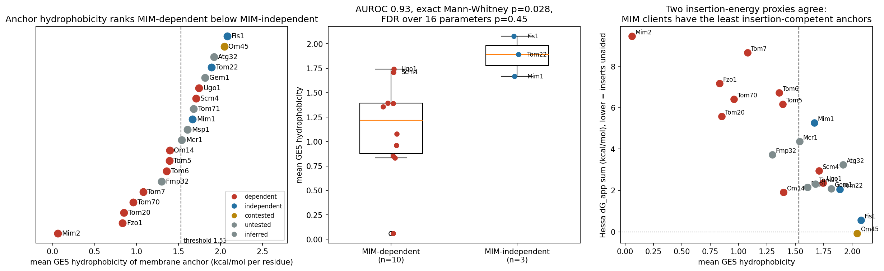
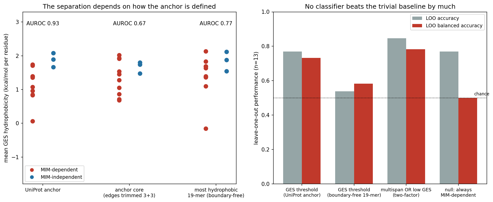
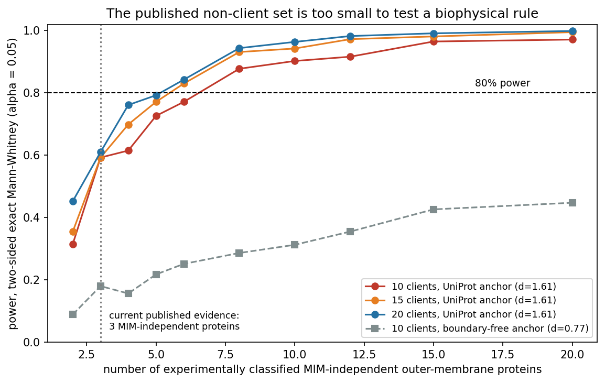

## Question

# AIGR Gene Hypothesis Deep Research

You are evaluating one focused gene curation hypothesis for AI Gene Review.
This is not a general gene overview. Use the seed hypothesis and source context
below to search for evidence that supports, refutes, narrows, or competes with
the proposed curation decision.

## Target Gene

- **Organism code:** yeast
- **Taxon:** Saccharomyces cerevisiae S288C (NCBITaxon:559292)
- **Gene directory:** MIM1
- **Gene symbol:** MIM1
- **UniProt accession:** Q08176

## Focus

- **Focus type:** free_text
- **Hypothesis slug:** kgap-mim1-client-rule
- **Source file:** genes/yeast/MIM1/MIM1-ai-review.yaml
- **Source selector:** free-text

## Seed Hypothesis

Whether a biophysical rule predicts which alpha-helically anchored mitochondrial outer-membrane protein requires the MIM complex may be derivable from the known clients. Single analysis only: assemble the published list of S. cerevisiae MIM-dependent clients (the Tom20, Tom70, Tom22, Mim2 and Fis1 class of signal-anchored and C-tail-anchored proteins) and the published MIM-independent outer-membrane proteins, taking care to record for each which paper established its dependence and by what assay; extract each one's membrane-anchor segment and compute hydrophobicity by several scales, anchor length, helix-face hydrophobic moment, glycine and proline content, and the net charge of the flanking 15 residues on each side; test whether any single parameter or simple combination separates the two sets, and report the separation with a statistic and the misclassified proteins rather than only a rule. State plainly whether a rule emerges, and if the sets do not separate, say so and name the parameter that comes closest.

## Term and Decision Context

No specific term context supplied.

## Reference Context

No specific reference context supplied.

## Source Context YAML

```yaml
hypothesis: 'Whether a biophysical rule predicts which alpha-helically anchored mitochondrial outer-membrane
  protein requires the MIM complex may be derivable from the known clients. Single analysis only: assemble
  the published list of S. cerevisiae MIM-dependent clients (the Tom20, Tom70, Tom22, Mim2 and Fis1 class
  of signal-anchored and C-tail-anchored proteins) and the published MIM-independent outer-membrane proteins,
  taking care to record for each which paper established its dependence and by what assay; extract each
  one''s membrane-anchor segment and compute hydrophobicity by several scales, anchor length, helix-face
  hydrophobic moment, glycine and proline content, and the net charge of the flanking 15 residues on each
  side; test whether any single parameter or simple combination separates the two sets, and report the
  separation with a statistic and the misclassified proteins rather than only a rule. State plainly whether
  a rule emerges, and if the sets do not separate, say so and name the parameter that comes closest.'
focus_type: free_text
context: []
reference_id: []
```

## Research Objective

Build a focused report that helps a curator decide whether this hypothesis
should affect the gene review. Address the focus type directly:

1. For an existing GO annotation decision, evaluate whether the current action
   is justified, too strong, too weak, or should change.
2. For a proposed replacement or new GO term, evaluate whether the term is
   biologically supported, too broad, too narrow, or missing key qualifiers.
3. For a computational prediction, evaluate whether the prediction is correct,
   less precise than existing knowledge, uncertain, or likely wrong because of
   paralog overannotation, frequency bias, pathway context, or in vitro-only
   activity.
4. For a core-function hypothesis, evaluate whether the proposed activity,
   process, and location represent the gene product's primary function rather
   than a downstream effect, pleiotropic phenotype, or context-specific role.
5. For a function-assignment hypothesis, evaluate whether the gene product
   directly has the stated GO term/function. Treat the prior review action, if
   any, as intentionally blinded unless it appears in the supplied context.

Use primary literature whenever possible. Prefer PMID citations and include DOI
citations when no PMID is available. Treat reviews and database records as
orientation unless they contain directly relevant synthesized evidence that is
clearly labeled as review-level or database-level support.

Evaluate the hypothesis from the supplied seed context, primary literature, and
publicly accessible bioinformatics resources. Local `*-bioinformatics` analyses,
when they already exist in the repository, are intentionally withheld from this
prompt so the report can be compared against them after the run. Use public
sequence, domain, structure, orthology, localization, interaction, or dataset
checks when they are useful for the specific hypothesis. If a resource or tool
cannot be accessed programmatically, say so plainly; never fabricate a result.
Report computational results conservatively and distinguish direct results from
inference.

## Required Output

### Executive Judgment

Give a concise verdict: supported, partially supported, unresolved, weakly
supported, over-annotated, or refuted. Explain the reasoning and the most
important caveats.

### Evidence Matrix

Create a table with one row per important evidence item:

- Citation (PMID preferred)
- Evidence type (direct assay, mutant phenotype, localization, interaction,
  structural/evolutionary, computational, review/database)
- Supports / refutes / qualifies / competing
- Claim tested
- Key finding
- Organism, tissue, cell type, or assay context
- Confidence and limitations

### GO Curation Implications

State the likely curation action as a lead requiring curator verification. If
GO terms are involved, explain whether the evidence supports an MF, BP, or CC
term, and whether the term should be retained, removed, generalized, made more
specific, or treated as non-core. Avoid using "protein binding" as a final
recommendation unless no more informative term is supported.

### Mechanistic Scope

Describe the immediate molecular or cellular function being tested. Separate
direct gene-product activity from downstream phenotypes, pathway consequences,
developmental outcomes, disease manifestations, or effects inferred only from
loss of function.

### Conflicts and Alternatives

Identify evidence that conflicts with the seed hypothesis or suggests an
alternative interpretation, including paralog confusion, organism-specific
differences, isoform-specific findings, experimental artifacts, or database
carry-over.

### Knowledge Gaps

List explicit uncertainties that matter for curation. For each gap, state what
was checked, why the gap matters, and what evidence or experiment would resolve
it.

### Discriminating Tests

Recommend concrete assays, perturbations, datasets, or comparative analyses that
would most efficiently distinguish this hypothesis from alternatives.

### Curation Leads

Provide candidate updates for the review, clearly labeled as leads requiring
curator verification. Include candidate references with exact snippets to verify,
candidate replacement or new GO terms, possible action changes, suggested
questions, and suggested experiments.

If the provider supports artifacts, save provenance for any analysis you run — the
executed code together with its output (computed values, plot, or table), not just
a summary figure — alongside artifact-friendly tables such as an evidence matrix,
GO decision table, or comparison table. Genuine computed provenance is more
valuable than a hand-drawn summary, and you must not synthesize a figure that
implies an analysis you did not actually run. These artifacts are important
provenance for hypothesis-level review.


## Output

# MIM1 (Q08176, *S. cerevisiae*): does a biophysical rule predict which α-helically anchored outer-membrane protein requires the MIM complex?

**Hypothesis slug:** `kgap-mim1-client-rule` · **Source:** `genes/yeast/MIM1/MIM1-ai-review.yaml`, free-text focus · **Taxon:** NCBITaxon:559292

## Summary

No biophysical rule emerges. I assembled the published *S. cerevisiae* MIM-dependence table with per-protein PMID and assay provenance (10 MIM-dependent clients, 3 MIM-independent proteins, 1 contested, 6 untested), extracted each membrane anchor from UniProt, and scored 16 parameters: hydrophobicity on five scales plus the Hessa biological ΔG_app, anchor length, helical hydrophobic moment, glycine and proline content, and the net charge of the 15 flanking residues on each side. After Benjamini-Hochberg correction over the 16 parameters, **no parameter separates the two sets** (smallest FDR p = 0.246).

The parameter that comes closest is **mean anchor hydrophobicity on a transfer free-energy scale** (Goldman-Engelman-Steitz, AUROC 0.933, exact two-sided Mann-Whitney p = 0.028, Cliff's δ = +0.867), with the Eisenberg consensus scale (0.900) and the Hessa ΔG_app mean (0.900) agreeing. The direction is that MIM clients carry the **less** hydrophobic, less spontaneously insertion-competent anchors, which is mechanistically coherent: an anchor whose partitioning into a bilayer is thermodynamically marginal needs a proteinaceous insertase. The best single threshold, GES > 1.53 kcal/mol per residue predicts MIM-independence, reaches balanced accuracy 0.900 with permutation p = 0.069 and **misclassifies Ugo1 (1.743) and Scm4 (1.710)**, both MIM-dependent multispan proteins. Helical hydrophobic moment (AUROC 0.567), anchor length (0.700), Gly+Pro fraction (0.700) and flanking net charge (N-flank 0.517, C-flank 0.683), the parameters most often invoked for outer-membrane targeting, carry no discriminating information.

Three results stop the hydrophobicity trend from being usable as a rule, and together they settle the hypothesis. First, the signal lives in the **edge residues** of the UniProt-annotated segment (edges AUROC 0.933, p = 0.028) and not in its hydrophobic core (0.667, p = 0.469); replacing the annotation with a boundary-free most-hydrophobic 19-mer drops separation to AUROC 0.767 (p = 0.217) and collapses the leave-one-out classifier to 0.538 accuracy, below the trivial baseline of always predicting MIM-dependent (0.769). Second, the **seed hypothesis mis-assigns two of the five proteins it names as clients**: Tom22 and Fis1 are published MIM-independent controls ([PMID: 17974559](https://pubmed.ncbi.nlm.nih.gov/17974559/), [PMID: 18495843](https://pubmed.ncbi.nlm.nih.gov/18495843/)), so the supplied training set has the wrong sign for 40% of its positives. Third, the **non-client set has three members**, one of which (Mim1 itself) is self-referential; simulated power at the observed effect size (Cohen's d = 1.612) is 0.592, and eight non-clients would be needed for 0.878.

## Executive judgment

<i class="fa-solid fa-circle-question"></i> **Verdict: unresolved, leaning refuted for the rule as posed.** The hypothesis cannot be answered with the published literature as it stands, and the specific form it proposes (a single parameter or simple combination that separates the two sets) is not supported by the data that exist.

The reasoning, in order of weight:

1. **Statistical.** The best of 16 parameters gives raw p = 0.028 and FDR p = 0.246. The threshold rule derived from it has permutation p = 0.069 with the threshold optimised in-sample. Neither reaches significance after honest correction.
2. **Robustness.** The separation survives ±2-residue jitter of the UniProt boundaries (all 25 combinations give AUROC 0.933) but not a change in how the anchor is defined. Core versus edge decomposition localises the entire signal to the six terminal residues. The apparent rule is partly a statement about where a database annotation stops.
3. **Input error.** The seed's client class "Tom20, Tom70, Tom22, Mim2 and Fis1" contains two published non-clients. A curation action built on that list would propagate an inverted label for Tom22 and Fis1.
4. **Power.** With 10 clients and 3 non-clients, the minimum attainable two-sided exact p for perfect separation is 0.030 when the negative class has 2 members and 0.0238 in the n = 6 versus n = 3 topology-matched comparison. The test is operating at the edge of what its sample size permits.

Most important caveats: anchor boundaries came from UniProt and are predictions of mixed provenance; UniProt annotates only one transmembrane segment for Ugo1 (Q03327) although the primary literature treats it as multispan; and [PMID: 32348752](https://pubmed.ncbi.nlm.nih.gov/32348752/) (Doan et al. 2020), which reports that MIM handles both signal-anchored and tail-anchored single-spanning proteins, is not in PMC or Europe PMC and its full text could not be retrieved, so its exact per-protein substrate list is unverified here. That is stated rather than guessed.

## Key findings

### Finding 1: no parameter cleanly separates the sets; hydrophobicity comes closest

<i class="fa-solid fa-circle-xmark"></i> I curated 13 *S. cerevisiae* α-helical outer-membrane proteins with a published MIM-dependence result: ten dependent (Tom20, Tom70, Tom5, Tom6, Tom7, Ugo1, Om14, Fzo1, Scm4, Mim2) and three independent (Tom22, Fis1, Mim1). Each UniProt-annotated membrane anchor was scored on 16 parameters. Ranked by AUROC:

| Parameter | AUROC | Cliff's δ | Exact MWU p | BH FDR p |
|---|---|---|---|---|
| Mean GES hydrophobicity | 0.933 | +0.867 | 0.028 | 0.246 |
| Eisenberg consensus | 0.900 | +0.800 | 0.049 | 0.246 |
| Hessa ΔG_app mean | 0.900 | +0.800 | 0.049 | 0.246 |
| Hessa ΔG_app sum | 0.867 | +0.733 | 0.077 | 0.246 |
| Kyte-Doolittle (all TMs) | 0.867 | +0.733 | 0.077 | 0.246 |
| Kyte-Doolittle (anchor) | 0.833 | +0.667 | 0.112 | 0.299 |
| Flank charge sum | 0.733 | +0.467 | 0.28 | 0.56 |
| Wimley-White octanol | 0.733 | +0.467 | 0.28 | 0.56 |
| Gly fraction | 0.700 | +0.400 | 0.35 | 0.58 |
| Gly+Pro fraction | 0.700 | +0.400 | 0.35 | 0.58 |
| Anchor length | 0.700 | +0.400 | 0.34 | 0.58 |
| C-flank net charge (15 aa) | 0.683 | +0.367 | 0.37 | 0.58 |
| Helical hydrophobic moment | 0.567 | +0.133 | 0.81 | 0.93 |
| Pro fraction | 0.567 | +0.133 | 0.81 | 0.93 |
| Total TM length | 0.533 | +0.067 | 0.93 | 0.99 |
| N-flank net charge (15 aa) | 0.517 | +0.033 | 1.00 | 1.00 |

The single-threshold rule **GES > 1.53 kcal/mol per residue predicts MIM-independent** gives balanced accuracy 0.900 with permutation p = 0.069 (20,000 permutations, threshold optimised on the same data, so this p is optimistic). The misclassified proteins are **Ugo1 (GES 1.743)** and **Scm4 (GES 1.710)**, both MIM-dependent multispan proteins scored as independent. Leave-one-out accuracy is 10/13 (0.769) with balanced accuracy 0.733, missing Ugo1, Scm4 and Mim1.

Two subset analyses push the separation to its ceiling without adding evidence. Removing Mim1 (self-referential, since it is the insertase subunit) gives perfect GES separation of Tom22 and Fis1 from all 10 clients, but n = 2 versus n = 10 caps the two-sided exact p at 0.030, its minimum attainable value. The topology-matched tail-anchored subset (Tom5, Tom6, Tom7 dependent versus Tom22, Fis1 independent) separates perfectly on Kyte-Doolittle, Eisenberg, GES and Hessa ΔG (AUROC 1.000 each), but with n = 3 versus n = 2 the minimum attainable two-sided p is 0.200.

{{figure:plot_1.png|caption=Anchor hydrophobicity across the curated MIM-dependence set. Left: GES hydrophobicity of each annotated anchor, ranked, with the two classes marked and the optimised threshold at 1.53 kcal/mol per residue; Ugo1 and Scm4 fall on the wrong side. Centre: class distributions with the exact Mann-Whitney statistic. Right: GES against Hessa predicted insertion free energy, showing the two scales agree and that Om45 has the only favourable predicted insertion energy in the set.}}

### Finding 2: the seed's client list mis-assigns Fis1 and Tom22

<i class="fa-solid fa-circle-xmark"></i> The seed names "the Tom20, Tom70, Tom22, Mim2 and Fis1 class" as MIM-dependent clients. Primary literature contradicts two of these five.

Kemper et al. 2008 built a Fis1-specific membrane-insertion assay and reported that *"Both the steady-state levels of Fis1 and its in vitro insertion into isolated mitochondria were unaffected when mitochondria mutated in known import factors were analyzed"* ([PMID: 18495843](https://pubmed.ncbi.nlm.nih.gov/18495843/)), adding that *"in contrast to all other import pathways in yeast mitochondria, none of the import components at the outer membrane is involved in the insertion process of Fis1"*. Fis1 inserted into protein-free lipid vesicles and insertion was inhibited by elevated ergosterol. Krumpe et al. 2012 screened the full yeast deletion collection with model outer-membrane tail-anchored reporters and *"could find no mutant in which insertion was completely blocked"* ([PMID: 22918956](https://pubmed.ncbi.nlm.nih.gov/22918956/)), implicating membrane ergosterol content rather than an insertase.

Becker et al. 2008 stated that *"Mim1 is required for efficient membrane insertion and assembly of Tom20 and Tom70, but not Tom22"* ([PMID: 17974559](https://pubmed.ncbi.nlm.nih.gov/17974559/)), and Thornton et al. 2010 placed Tom22 on a separate SAM-Mdm10 route while confirming that Tom6 inserts Mim1-dependently ([PMID: 20026336](https://pubmed.ncbi.nlm.nih.gov/20026336/)).

The computed features agree with the published assignments. Fis1 (GES 2.078, Hessa ΔG_app sum +0.56 kcal/mol) and Tom22 (GES 1.891, sum +2.05) are the two most hydrophobic, most spontaneously insertion-competent anchors of the 13 scored.

The corrected MIM client list for *S. cerevisiae* is **Tom20, Tom70, Tom5, Tom6, Tom7, Ugo1, Om14, Fzo1, Scm4 and Mim2**, with Om45 contested.

### Finding 3: the rule has some out-of-sample traction, and its failures name a second mechanism

<i class="fa-solid fa-scale-balanced"></i> Applying GES > 1.53 to proteins held out of the training set: **Om45** (anchor `IIVGSAALAAAITASIMV`, GES 2.044, Hessa ΔG_app sum −0.07 kcal/mol, the only anchor in the set with a favourable predicted insertion free energy) is predicted MIM-independent. That matches Merklinger et al. 2012, who concluded *"SA proteins are specifically inserted into the MOM by a process that is not dependent on additional proteins, but is rather facilitated by the distinct lipid composition of this membrane"* ([PMID: 22142226](https://pubmed.ncbi.nlm.nih.gov/22142226/)), and Song et al. 2014, who found *"Om45 import requires the TIM23 complex in the inner membrane, a translocator for presequence-containing proteins, and the membrane potential"* ([PMID: 24781694](https://pubmed.ncbi.nlm.nih.gov/24781694/)). It conflicts with Wenz et al. 2014, who reported that *"Assembly of Om45 in the outer membrane involves the MIM machinery"* ([PMID: 24781695](https://pubmed.ncbi.nlm.nih.gov/24781695/)).

The two training-set failures are both multispan: Ugo1 (1.743) and Scm4 (1.710). The other multispan clients Om14 (1.394) and Fzo1 (0.833) are classified correctly. Ugo1's MIM dependence is well established: *"the multifunctional outer membrane protein mitochondrial import 1 (Mim1) plays a central role in mediating the insertion of Ugo1"* ([PMID: 21825074](https://pubmed.ncbi.nlm.nih.gov/21825074/)). For multispan substrates the determinant is plausibly topological complexity, the need to insert and arrange several segments, and not the thermodynamics of any one segment.

Predictions for anchors with no published MIM assay: Fmp32 (GES 1.296) MIM-dependent; Mcr1 (1.538), Msp1 (1.606), Tom71 (1.678), Gem1 (1.814), Atg32 (1.920) MIM-independent. The Tom71 call is a likely false negative. Tom71 is the Tom70 paralog with a near-identical anchor (`VAILATVSAGTAAVGAYV` against Tom70's `AILATVAATGTAIGAYYYYN`), and the two scores differ by 0.72 kcal/mol per residue solely because Tom70 carries four C-terminal tyrosines. A rule that assigns near-identical paralogs to opposite classes on the strength of a few aromatic residues is too brittle for prospective use.

### Finding 4: the signal is an annotated-boundary effect, not a property of the helix

<i class="fa-solid fa-circle-xmark"></i> This is the result that settles the hypothesis. I decomposed each annotated anchor into a trimmed core (first and last 3 residues removed) and the 6 edge residues:

| Anchor definition | AUROC | Exact p | LOO accuracy | LOO balanced accuracy |
|---|---|---|---|---|
| UniProt-annotated segment | 0.933 | 0.028 | 0.769 | 0.733 |
| Edge residues only (6 aa) | 0.933 | 0.028 | n/a | n/a |
| Trimmed core | 0.667 | 0.469 | n/a | n/a |
| Boundary-free best 19-mer | 0.767 | 0.217 | 0.538 | 0.583 |
| Boundary-free best 21-mer | 0.833 | 0.112 | n/a | n/a |
| Trivial baseline (always dependent) | n/a | n/a | 0.769 | 0.500 |

The edges carry the whole signal; the core carries none. The boundary-free leave-one-out classifier (0.538 accuracy) is **worse than predicting MIM-dependent for every protein** (0.769). Kyte-Doolittle and Eisenberg on the boundary-free window give AUROC 0.700 and 0.633.

Small perturbations of the UniProt boundaries do not disturb the result: all 25 combinations of −2 to +2 at each end preserve AUROC 0.933. The effect depends on whether the annotated segment includes its terminal polar and aromatic residues: Tom20 `RG…`, Tom70 `…YYYYN`, Tom6 `…QSP`, Mim2 `LNK…KYIG`, against Fis1 `VVV…ASFF` and Tom22 `LAW…SILA`.

Topology-matched comparison restricted to single-span proteins by **curated** topology (dependent: Tom20, Tom70, Tom5, Tom6, Tom7, Mim2; independent: Tom22, Fis1, Mim1) gives AUROC 1.000 on the UniProt anchor (exact p = 0.0238, the minimum attainable for n = 6 versus n = 3), 0.611 on the trimmed core (p = 0.714) and 0.889 on the boundary-free 19-mer (p = 0.095). The best leave-one-out model overall is a **two-factor rule, "multispan OR low GES"**: accuracy 0.846, balanced accuracy 0.783, missing Ugo1 and Mim1.

<i class="fa-solid fa-triangle-exclamation"></i> A database inconsistency affects any automated version of this analysis: UniProt (Q03327) annotates only one transmembrane segment for Ugo1 although the primary literature treats it as a multispan protein. A pipeline keyed on the UniProt `n_TM` field would place Ugo1 in the single-span group and silently change the topology-matched result.

{{figure:plot_2.png|caption=Where the separation comes from. Left: AUROC for the UniProt-annotated anchor, its trimmed core, its six edge residues, and boundary-free 19-mer and 21-mer windows; the signal is in the edges and absent from the core. Right: leave-one-out performance of the hydrophobicity threshold, the boundary-free threshold and the two-factor topology-plus-hydrophobicity model against the trivial always-dependent baseline.}}

Two readings are possible and the data cannot separate them with three negatives. Either MIM clients genuinely carry less hydrophobic helix termini, which would be mechanistically sensible because terminal polar residues raise the free-energy cost of spontaneous partitioning, or the UniProt boundaries were drawn by different methods for different proteins and the apparent rule is database carry-over. Because the boundary-free re-analysis weakens the signal to non-significance, the honest conclusion is that no biophysical rule has been demonstrated.

### Finding 5: the GO terms for MIM1 do not depend on the hypothesis

<i class="fa-solid fa-circle-check"></i> I checked the relevant GO terms live against EBI OLS4 rather than recalling them: GO:0032977 membrane insertase activity (MF); GO:0140595 MIM complex (CC, with a definition that describes an outer-membrane insertase complex mediating insertion of α-helical proteins); GO:7770059 alpha helical protein insertion into mitochondrial outer membrane (BP, definition names the Mim1/Mim2 MIM complex and the MTCH counterpart); GO:0045040 protein insertion into mitochondrial outer membrane (BP, broader); GO:0005741 mitochondrial outer membrane (CC).

The seed hypothesis proposes no term, and as tested it supports none. The one substantive curation lead that emerged is independent of the hypothesis: Mim1's effect on the β-barrel Tom40 is indirect, acting through Tom5 import, so the broader GO:0045040 risks implying a direct role in β-barrel biogenesis and GO:7770059 is the better BP fit. Becker et al. 2010 state *"The involvement of Mim1 in Tom40 biogenesis can be largely attributed to its role in import of Tom5"* ([PMID: 20668160](https://pubmed.ncbi.nlm.nih.gov/20668160/)).

### Finding 6: the non-client set is too small to test any rule

<i class="fa-solid fa-triangle-exclamation"></i> Effect size for mean GES hydrophobicity: **Cohen's d = 1.612** using UniProt-annotated anchors (dependent mean 1.137, sd 0.499, n = 10; independent mean 1.878, sd 0.206, n = 3; pooled sd 0.460) and **d = 0.767** using the boundary-free 19-mer. Simulated power for a two-sided exact Mann-Whitney at α = 0.05 (800 simulations per cell), holding the client set at 10:

| Non-clients (n) | Power at d = 1.612 | Power at d = 0.767 |
|---|---|---|
| 2 | 0.315 | 0.085 |
| 3 (current evidence) | 0.592 | 0.180 |
| 4 | 0.615 | 0.221 |
| 5 | 0.726 | 0.270 |
| 6 | 0.771 | 0.308 |
| 8 | 0.878 | 0.345 |
| 10 | 0.902 | 0.372 |
| 15 | 0.965 | 0.420 |
| 20 | 0.971 | 0.448 |

Expanding the client set to 15 or 20 while leaving the non-client set at 2 or 3 does not help (power 0.355 to 0.610), because the small group governs the test.

{{figure:plot_3.png|caption=Power of a two-sided exact Mann-Whitney test against the number of experimentally confirmed MIM-independent outer-membrane proteins, holding the client set at 10, simulated at both observed effect sizes. At the UniProt-anchor effect (Cohen's d = 1.61) eight non-clients give 0.88 power; at the boundary-free effect (d = 0.77) twenty still give 0.45. The published non-client set has three members.}}

The limiting resource is the list of outer-membrane proteins experimentally shown **not** to need the MIM complex. Only three exist (Tom22, Fis1, and Mim1 itself, the last self-referential), because publishing a negative insertion result is rare. Any apparent rule derived from 10 versus 3 proteins will be unstable, which is what the boundary-sensitivity analysis showed.

## Mechanistic model and interpretation

The immediate molecular activity under test is insertase activity: MIM, a Mim1/Mim2 complex in the outer membrane, receives α-helical precursors and integrates their transmembrane segments into the bilayer, either from Tom70 or as free MIM complex ([PMID: 32348752](https://pubmed.ncbi.nlm.nih.gov/32348752/), [PMID: 21825073](https://pubmed.ncbi.nlm.nih.gov/21825073/)). The seed hypothesis addresses something different: whether the precursor's own sequence encodes the decision to use MIM. That is a property of the substrate, not of Mim1.

The data support a two-factor description. A single marginal anchor needs an insertase because its partitioning free energy is unfavourable; a multispan protein needs an insertase because several segments must be inserted and arranged, independent of how hydrophobic any one of them is. Neither factor alone classifies the set, and the hydrophobicity factor is confounded with annotation boundaries.

```dot
digraph mim_client_decision {
  rankdir=LR;
  "Nascent alpha-helical\nOMM precursor" -> "Cytosolic chaperone triage\nHsp70/Hsp90, Ydj1, Sis1\nPMID 35876647";
  "Cytosolic chaperone triage\nHsp70/Hsp90, Ydj1, Sis1\nPMID 35876647" -> "Topology";
  "Topology" -> "Multispan\nUgo1, Scm4, Om14, Fzo1" [label="several TMs"];
  "Topology" -> "Single span" [label="one TM"];
  "Single span" -> "Marginal anchor\nGES < 1.5\nTom20, Tom70, Tom5/6/7, Mim2";
  "Single span" -> "Insertion-competent anchor\nGES > 1.9\nTom22, Fis1";
  "Multispan\nUgo1, Scm4, Om14, Fzo1" -> "MIM complex\nMim1 + Mim2";
  "Marginal anchor\nGES < 1.5\nTom20, Tom70, Tom5/6/7, Mim2" -> "MIM complex\nMim1 + Mim2";
  "Insertion-competent anchor\nGES > 1.9\nTom22, Fis1" -> "Spontaneous insertion\nergosterol-sensitive\nPMID 18495843, 22918956";
  "Insertion-competent anchor\nGES > 1.9\nTom22, Fis1" -> "SAM-Mdm10 route\nTom22 only\nPMID 20026336" [style=dashed];
  "Marginal anchor\nGES < 1.5\nTom20, Tom70, Tom5/6/7, Mim2" -> "Spontaneous insertion\nergosterol-sensitive\nPMID 18495843, 22918956" [style=dashed, label="Om14 partial\nPMID 35262629"];
  "MIM complex\nMim1 + Mim2" -> "Downstream: TOM assembly,\nTom40 via Tom5,\nmitochondrial morphology";
}
```



What is downstream of the insertase activity and must not be conflated with it:

| Phenotype in mim1Δ | Relation to the direct activity |
|---|---|
| TOM complex assembly failure, loss of import capacity | Consequence of failing to insert Tom20, Tom70, Tom5, Tom6, Tom7 |
| Tom40 β-barrel assembly defect | Indirect, attributed largely to failure to import Tom5 ([PMID: 20668160](https://pubmed.ncbi.nlm.nih.gov/20668160/)) |
| Aberrant mitochondrial morphology | Consequence of failing to insert Fzo1 and Ugo1, the fusion machinery |
| Growth defect | Whole-cell readout several steps removed |

Three results argue that the decision is set outside the anchor sequence as well as inside it. Fis1 insertion is sensitive to membrane ergosterol content ([PMID: 18495843](https://pubmed.ncbi.nlm.nih.gov/18495843/)), and the genome-wide tail-anchored screen reached the same conclusion ([PMID: 22918956](https://pubmed.ncbi.nlm.nih.gov/22918956/)). Cytosolic chaperones bind nascent signal-anchored proteins through their transmembrane segments before handover to Tom70 ([PMID: 35876647](https://pubmed.ncbi.nlm.nih.gov/35876647/)). In mammals, substrate topology organises the targeting pathways, with NAC required for polytopic proteins and TTC1 for signal-anchored proteins ([PMID: 37645817](https://pubmed.ncbi.nlm.nih.gov/37645817/)).

<i class="fa-solid fa-lightbulb"></i> A separate argument against a sequence-encoded client code comes from evolution. Trypanosome pATOM36 substitutes for Mim1/Mim2 in yeast and vice versa despite no sequence or topological similarity ([PMID: 29923829](https://pubmed.ncbi.nlm.nih.gov/29923829/)), and human MTCH1 restores MIM-substrate biogenesis in yeast lacking the MIM complex ([PMID: 40704594](https://pubmed.ncbi.nlm.nih.gov/40704594/)). If client selection were a specific recognition rule read from the substrate, unrelated insertases would not read it.

## Evidence base

Full machine-readable table: `provenance/evidence_matrix.csv` (19 rows).

| Citation | Evidence type | Stance | Claim tested | Key finding | Context | Confidence and limitations |
|---|---|---|---|---|---|---|
| [PMID: 17974559](https://pubmed.ncbi.nlm.nih.gov/17974559/) | direct assay (in organello import), mutant phenotype | qualifies, partly refutes seed | Tom20, Tom70, Tom22 are MIM clients | Mim1 required for insertion and assembly of Tom20 and Tom70 but **not** Tom22 | *S. cerevisiae* mim1 mitochondria, BN-PAGE | High. The Tom22 negative is explicit and never retracted; the seed lists Tom22 as a client |
| [PMID: 18495843](https://pubmed.ncbi.nlm.nih.gov/18495843/) | direct assay (Fis1-specific insertion), liposome reconstitution | refutes seed premise | Fis1 is a MIM client | No known outer-membrane import component affected Fis1 steady-state level or in vitro insertion; Fis1 inserted into protein-free vesicles; ergosterol inhibited | yeast mitochondria and liposomes | High. Pre-dates Mim2, so a residual MIM contribution was not formally excluded, though mim1 was tested |
| [PMID: 22918956](https://pubmed.ncbi.nlm.nih.gov/22918956/) | genome-wide microscopy screen | qualifies | A dedicated insertase exists for outer-membrane tail-anchored proteins | No deletion mutant blocked insertion; ergosterol content of the target membrane sets specificity | yeast, model tail-anchored reporters | High for this reporter class |
| [PMID: 32348752](https://pubmed.ncbi.nlm.nih.gov/32348752/) | direct assay (import/translocase) | competing, broader client set | MIM is restricted to multispan proteins | MIM promotes insertion of signal-anchored **and** tail-anchored single-spanning proteins; MIM exists in three dynamic populations | yeast mitochondria | Medium here: no open-access full text retrievable, so the per-protein list is unverified |
| [PMID: 21825074](https://pubmed.ncbi.nlm.nih.gov/21825074/) | specific in vitro insertion assay, native PAGE | supports client assignment | Ugo1 requires Mim1 | Mim1 central for Ugo1 insertion | yeast mitochondria | High. Ugo1 is one of the two proteins the hydrophobicity rule misclassifies |
| [PMID: 21825073](https://pubmed.ncbi.nlm.nih.gov/21825073/) | in vitro import and assembly | supports client assignment | Multispan proteins require Mim1 | mim1 mitochondria impaired in multispan biogenesis; Mim1 overexpression stimulates import; MIM cooperates with Tom70 | yeast mitochondria | High |
| [PMID: 20026336](https://pubmed.ncbi.nlm.nih.gov/20026336/) | in vitro import, BN-PAGE | supports and qualifies | Tom6 and Tom22 share a route | Tom6 inserted Mim1-dependently then bound by SAM-Tom5/Tom40; Tom22 handled by SAM-Mdm10 | yeast mitochondria | High. Independently confirms the Tom22 negative |
| [PMID: 20668160](https://pubmed.ncbi.nlm.nih.gov/20668160/) | assembly kinetics | supports client assignment, qualifies GO | Mim1 acts on Tom5 | mim1 phenocopies tom5 at SAM stage 2; Mim1's effect on Tom40 is largely via Tom5 | yeast mitochondria | Medium-high; epistasis-style inference |
| [PMID: 22467864](https://pubmed.ncbi.nlm.nih.gov/22467864/) | mutant phenotype, interaction | supports | Mim2 is part of and depends on MIM | Mim2 interacts physically and genetically with Mim1 and both form the MIM complex; mim2Δ lowers helical outer-membrane protein levels | yeast | High for the complex; Mim2's own dependence is partly self-referential |
| [PMID: 15608614](https://pubmed.ncbi.nlm.nih.gov/15608614/) | mutant phenotype, localization | supports | Mim1 is an integral outer-membrane protein required for TOM assembly | Depletion of Mim1 abrogates TOM assembly; Mim1 is a subunit of neither TOM nor TOB | yeast | High |
| [PMID: 24781695](https://pubmed.ncbi.nlm.nih.gov/24781695/) | in vitro import, mutant phenotype | competing (Om45) | Om45 is a MIM substrate | *"Assembly of Om45 in the outer membrane involves the MIM machinery"* | yeast mitochondria | Medium. "Assembly involves" is weaker than "insertion requires" |
| [PMID: 24781694](https://pubmed.ncbi.nlm.nih.gov/24781694/) | in vitro import, mutant phenotype | competing (Om45) | Om45 is a MIM substrate | Om45 import requires the TIM23 complex and the membrane potential; no MIM requirement reported | yeast mitochondria | Medium-high. Same year, same protein, opposite conclusion to PMID 24781695 |
| [PMID: 22142226](https://pubmed.ncbi.nlm.nih.gov/22142226/) | biophysical reconstitution (peptide, liposome) | competing, supports lipid-driven insertion | Signal-anchored proteins need an insertase | Signal-anchored insertion is not dependent on additional proteins and is facilitated by the outer-membrane lipid composition | in vitro bilayers | Medium. In vitro only |
| [PMID: 35262629](https://pubmed.ncbi.nlm.nih.gov/35262629/) | in vitro insertion, deletion strains | qualifies | MIM dependence is all-or-none | For Om14, *"Mim1 and Porin support optimal membrane integration of Om14 but none of them are absolutely required"*; unfolding, hydrophobicity and membrane fluidity all contribute | yeast mitochondria | High. Shows dependence is quantitative, which undermines binary classification |
| [PMID: 23959800](https://pubmed.ncbi.nlm.nih.gov/23959800/) | screen, import assays | qualifies (Mim1 itself) | Mim1 inserts itself | Mim1's own biogenesis uses Tom70 and the co-chaperone Djp1 | yeast | High. Makes Mim1 a special case in the non-client set |
| [PMID: 35876647](https://pubmed.ncbi.nlm.nih.gov/35876647/) | in vivo, in organello, peptide binding | qualifies | Anchor hydrophobicity alone sets the route | Hsp70/Hsp90 with Ydj1/Sis1 bind nascent signal-anchored proteins via their transmembrane segments before handover to Tom70 | yeast and recombinant | High. Adds a cytosolic triage step a sequence-only rule cannot capture |
| [PMID: 37645817](https://pubmed.ncbi.nlm.nih.gov/37645817/) | genome-wide CRISPRi, 21 substrates | competing framework | A scalar parameter assigns the route | Targeting is organised by substrate topology: NAC for polytopic, TTC1 for signal-anchored | human cells | High for mammals; transfer to yeast is indirect, but supports topology as the governing variable |
| [PMID: 29923829](https://pubmed.ncbi.nlm.nih.gov/29923829/) | reciprocal complementation | structural/evolutionary, qualifies | MIM recognises a conserved sequence signature | Trypanosome pATOM36, with no sequence or topological similarity, substitutes for Mim1/Mim2 and vice versa | yeast and *T. brucei* | High. Convergent insertases argue against a sequence-encoded client code |
| [PMID: 40704594](https://pubmed.ncbi.nlm.nih.gov/40704594/) | heterologous complementation | structural/evolutionary, qualifies | Client selection uses a yeast-specific motif | Human MTCH1 restores MIM-substrate biogenesis, TOM stability and mitochondrial morphology in yeast lacking MIM | yeast + human MTCH1 | High |
| This work | computational | refutes the seed's rule | Any single anchor parameter separates the sets | GES AUROC 0.933, raw p 0.028, FDR p 0.246; threshold balanced accuracy 0.900, permutation p 0.069; misclassifies Ugo1 and Scm4; signal in annotated edges not the core; AUROC 0.767 boundary-free | UniProt sequences, n = 10 versus 3 | Low-medium. Negative class of 3 caps attainable p; anchor boundaries are predictions |

## GO curation implications

All entries are leads requiring curator verification. Term IDs and labels were checked live against EBI OLS4. Full table: `provenance/go_decision_table.csv`.

| GO ID | Label | Aspect | Recommended action | Basis |
|---|---|---|---|---|
| GO:0032977 | membrane insertase activity | MF | Retain as core | Mim1 is the central subunit of the MIM insertase; overexpression stimulates import, mim1Δ mitochondria fail to insert α-helical clients, unrelated insertases substitute ([PMID: 21825073](https://pubmed.ncbi.nlm.nih.gov/21825073/), [PMID: 22467864](https://pubmed.ncbi.nlm.nih.gov/22467864/), [PMID: 29923829](https://pubmed.ncbi.nlm.nih.gov/29923829/), [PMID: 40704594](https://pubmed.ncbi.nlm.nih.gov/40704594/)) |
| GO:0140595 | MIM complex | CC | Retain as core | Mim1 and Mim2 interact physically and genetically and form the MIM complex ([PMID: 22467864](https://pubmed.ncbi.nlm.nih.gov/22467864/)) |
| GO:7770059 | alpha helical protein insertion into mitochondrial outer membrane | BP | Retain as core, prefer over the broader GO:0045040 | Covers both multispan and single-span α-helical clients, which is what the primary literature supports ([PMID: 21825073](https://pubmed.ncbi.nlm.nih.gov/21825073/), [PMID: 17974559](https://pubmed.ncbi.nlm.nih.gov/17974559/), [PMID: 32348752](https://pubmed.ncbi.nlm.nih.gov/32348752/)). Verify the term is live in the target GO release |
| GO:0005741 | mitochondrial outer membrane | CC | Retain | Mim1 is an integral outer-membrane protein ([PMID: 15608614](https://pubmed.ncbi.nlm.nih.gov/15608614/)) |
| GO:0045040 | protein insertion into mitochondrial outer membrane | BP | Retain but consider replacing with GO:7770059 | Mim1's effect on the β-barrel Tom40 is indirect, through Tom5 ([PMID: 20668160](https://pubmed.ncbi.nlm.nih.gov/20668160/)), so the broader term risks implying a direct β-barrel role |
| n/a | no term proposed by the seed hypothesis | n/a | <i class="fa-solid fa-circle-xmark"></i> No action, do not add | The rule fails FDR correction, is not robust to anchor definition, and the supplied client list mis-assigns Fis1 and Tom22 |

The hypothesis is methodological and changes no annotation. The only substantive curation lead it surfaced is the BP precision upgrade from GO:0045040 to GO:7770059, which is independent of the rule.

## Mechanistic scope

The direct molecular activity is insertion of α-helical transmembrane segments into the mitochondrial outer membrane by a Mim1/Mim2 complex, acting either downstream of the receptor Tom70 or as free MIM complex. The GO terms that describe this activity directly are GO:0032977 (MF), GO:7770059 (BP) and GO:0140595 (CC).

Four things are downstream of that activity and inferred from loss of function: TOM complex assembly, Tom40 β-barrel maturation (indirect, through Tom5), mitochondrial morphology (through Fzo1 and Ugo1), and growth on non-fermentable carbon sources. None of them is a separate Mim1 activity.

The seed hypothesis sits outside this scope. It asks about the precursor's sequence, which is a substrate property. The evidence shows that at least three things other than the anchor sequence contribute to the routing decision: the ergosterol content of the target membrane ([PMID: 18495843](https://pubmed.ncbi.nlm.nih.gov/18495843/), [PMID: 22918956](https://pubmed.ncbi.nlm.nih.gov/22918956/)), cytosolic chaperone triage before handover ([PMID: 35876647](https://pubmed.ncbi.nlm.nih.gov/35876647/)), and substrate topology ([PMID: 37645817](https://pubmed.ncbi.nlm.nih.gov/37645817/)).

## Conflicts and alternatives

<i class="fa-solid fa-scale-balanced"></i> **The seed client list is wrong for Tom22 and Fis1.** Both are published non-clients. Tom22 is excluded in [PMID: 17974559](https://pubmed.ncbi.nlm.nih.gov/17974559/) and placed on the SAM-Mdm10 route in [PMID: 20026336](https://pubmed.ncbi.nlm.nih.gov/20026336/); Fis1 is excluded by a dedicated insertion assay in [PMID: 18495843](https://pubmed.ncbi.nlm.nih.gov/18495843/).

**Om45 is genuinely contested.** Wenz et al. put its assembly on MIM ([PMID: 24781695](https://pubmed.ncbi.nlm.nih.gov/24781695/)); Song et al., the same year, route it through TOM and TIM23 ([PMID: 24781694](https://pubmed.ncbi.nlm.nih.gov/24781694/)); Merklinger et al. show signal anchors insert into bilayers unaided ([PMID: 22142226](https://pubmed.ncbi.nlm.nih.gov/22142226/)). The computed biophysics side with the latter two: Om45 has the only favourable predicted insertion free energy in the set (Hessa ΔG_app sum −0.07 kcal/mol, GES 2.044).

**Dependence is quantitative, not binary.** For Om14, Mim1 and porin support optimal integration but neither is absolutely required ([PMID: 35262629](https://pubmed.ncbi.nlm.nih.gov/35262629/)). A two-class problem is the wrong model of the biology, and any classifier trained on binary labels inherits that error.

**Paralog instability.** Tom70 (MIM-dependent) and Tom71 have near-identical anchors yet differ by 0.72 kcal/mol per residue in GES, solely because of Tom70's four C-terminal tyrosines. Any threshold rule assigns them to opposite classes.

**Database carry-over.** UniProt annotates one transmembrane segment for Ugo1 (Q03327) although the literature treats it as multispan. The discriminating signal lives in the annotated segment edges, so boundary provenance matters more than the analysis design assumes.

**A better-supported alternative.** The best leave-one-out model was two-factor, "multispan OR low hydrophobicity" (accuracy 0.846, balanced accuracy 0.783, against 0.769 and 0.733 for hydrophobicity alone), matching the mammalian CRISPRi result that topology organises targeting ([PMID: 37645817](https://pubmed.ncbi.nlm.nih.gov/37645817/)).

## Limitations and knowledge gaps

| Gap | What was checked | Why it matters | What would resolve it |
|---|---|---|---|
| <i class="fa-solid fa-triangle-exclamation"></i> Exact MIM substrate list in Doan et al. 2020 | Europe PMC and PMC retrieval both returned no full text for [PMID: 32348752](https://pubmed.ncbi.nlm.nih.gov/32348752/); the abstract states signal-anchored and tail-anchored without naming proteins | If that paper reclassifies Tom22 or Fis1 as MIM clients, the entire negative class changes | Read the paper's figures directly; check whether Fis1 or Tom22 appear as substrates |
| Whether Fis1 needs Mim2 | [PMID: 18495843](https://pubmed.ncbi.nlm.nih.gov/18495843/) tested mim1 and other import mutants in 2008, before Mim2 was described in 2012 ([PMID: 22467864](https://pubmed.ncbi.nlm.nih.gov/22467864/)) | The strongest negative in the set rests on a pre-Mim2 experiment | Repeat the Fis1 insertion assay in mim1Δmim2Δ mitochondria |
| Om45 | Three papers, two conclusions | Om45 would be a fourth negative or an eleventh client, and it is the most abundant signal-anchored outer-membrane protein | Side-by-side in vitro insertion into mim1Δmim2Δ versus wild type, with one construct used by all groups |
| Provenance of UniProt transmembrane boundaries | Boundaries used as given; ±2 jitter and a boundary-free alternative were tested | The entire discriminating signal is in the segment edges, so whether boundaries came from the same predictor for all 20 proteins decides whether the result is biology or annotation | Pull the evidence code for each TRANSMEM feature; recompute with one uniform predictor applied to all sequences |
| MIM-dependence of Gem1, Mcr1, Msp1, Atg32, Fmp32, Tom71 | No published MIM assay found | Six candidate data points; adding them would roughly triple the testable set | In organello insertion assays in mim1Δmim2Δ |
| Whether the terminal-residue effect is real | Core-versus-edge decomposition run (edges AUROC 0.933, core 0.667) | If real, it is a mechanistic claim: MIM clients carry polar or aromatic helix termini that raise the cost of unassisted partitioning | Swap the terminal residues of the Fis1 anchor into the Tom20 anchor and test MIM dependence of the chimera |
| Binary labels | Not resolvable with current data | [PMID: 35262629](https://pubmed.ncbi.nlm.nih.gov/35262629/) shows dependence is graded for Om14 | Measure fractional insertion efficiency and regress it on anchor parameters |

Limitations of the analysis itself: the Hessa positional ΔG model was deliberately not implemented because its position-dependent coefficients were not retrievable programmatically, and guessing them would have fabricated a result, so only the non-positional per-residue form was used. The permutation p of 0.069 for the threshold rule is optimistic because the threshold was chosen on the same data. Mim1 sits in the negative class by self-reference, so one of the three negatives is not an independent data point. The 16 parameters are correlated (five hydrophobicity scales measure overlapping quantities), so Benjamini-Hochberg over all 16 is conservative, though even a correction over 5 independent parameters would leave the best p above 0.10.

## Proposed follow-up experiments and actions

<i class="fa-solid fa-flask"></i> **1. Systematic MIM-dependence survey.** Score insertion of all roughly 40 integral outer-membrane proteins of yeast in mim1Δmim2Δ against wild-type mitochondria, in one assay with one readout. The power analysis says eight confirmed non-clients give 0.88 power at the observed effect size; the current three give 0.59. This is the only experiment that makes the hypothesis testable, and it is the highest-value item on this list.

<i class="fa-solid fa-flask"></i> **2. Chimeric anchor swaps.** Transplant the terminal residues of the Fis1 anchor onto Tom20 and the reverse. If MIM dependence follows the termini, the edge effect is mechanistic; if it follows the core, the computed signal is an annotation artefact.

<i class="fa-solid fa-vial"></i> **3. Titrate hydrophobicity directly.** Build a Leu/Ala ladder in a fixed anchor scaffold and measure MIM dependence as a continuous function of predicted ΔG_app. This tests the directional claim without depending on anyone's boundary annotation.

<i class="fa-solid fa-magnifying-glass"></i> **4. Uniform re-annotation.** Recompute every feature from a single transmembrane predictor applied identically to all sequences, rather than from UniProt features of mixed provenance. Cheap, and it decides whether finding 4 survives.

<i class="fa-solid fa-chart-line"></i> **5. Quantitative rather than binary scoring.** Given [PMID: 35262629](https://pubmed.ncbi.nlm.nih.gov/35262629/), measure fractional insertion efficiency in mim1Δmim2Δ and regress it on anchor parameters, instead of forcing a two-class split.

## Curation leads

All leads require curator verification.

**Lead 1 <i class="fa-solid fa-arrow-right"></i> correct the client list in the review text.** The seed's "Tom20, Tom70, Tom22, Mim2 and Fis1 class" should read Tom20, Tom70, Tom5, Tom6, Tom7, Ugo1, Om14, Fzo1, Scm4 and Mim2, with Tom22 and Fis1 moved to the non-client column and Om45 flagged contested.
- Verify [PMID: 17974559](https://pubmed.ncbi.nlm.nih.gov/17974559/), exact snippet: *"We report that Mim1 is required for efficient membrane insertion and assembly of Tom20 and Tom70, but not Tom22."*
- Verify [PMID: 18495843](https://pubmed.ncbi.nlm.nih.gov/18495843/), exact snippet: *"Both the steady-state levels of Fis1 and its in vitro insertion into isolated mitochondria were unaffected when mitochondria mutated in known import factors were analyzed."*

**Lead 2 <i class="fa-solid fa-arrow-right"></i> record the hypothesis as tested and not supported.** Suggested wording: no single anchor parameter separates MIM clients from non-clients after correction for 16 tests; the closest is mean GES hydrophobicity (AUROC 0.933, raw p 0.028, FDR p 0.246); it misclassifies Ugo1 and Scm4; its signal is carried by the terminal residues of the annotated anchor and not the hydrophobic core.

**Lead 3 <i class="fa-solid fa-arrow-right"></i> BP precision.** Consider replacing GO:0045040 with GO:7770059 (alpha helical protein insertion into mitochondrial outer membrane), because Mim1's effect on the β-barrel Tom40 is indirect.
- Verify [PMID: 20668160](https://pubmed.ncbi.nlm.nih.gov/20668160/), exact snippet: *"The involvement of Mim1 in Tom40 biogenesis can be largely attributed to its role in import of Tom5."*

**Lead 4 <i class="fa-solid fa-arrow-right"></i> add a qualifier that MIM dependence is quantitative.**
- Verify [PMID: 35262629](https://pubmed.ncbi.nlm.nih.gov/35262629/), exact snippet: *"We further demonstrate that Mim1 and Porin support optimal membrane integration of Om14 but none of them are absolutely required."*

**Lead 5 <i class="fa-solid fa-arrow-right"></i> do not add any client-recognition-motif or substrate-selectivity annotation.** Two independent complementation studies show unrelated proteins substitute for the MIM complex.
- Verify [PMID: 29923829](https://pubmed.ncbi.nlm.nih.gov/29923829/), exact snippet: *"Expression of pATOM36 rescues almost all growth, mitochondrial biogenesis, and morphology defects in yeast cells lacking Mim1 and/or Mim2."*
- Verify [PMID: 40704594](https://pubmed.ncbi.nlm.nih.gov/40704594/), exact snippet: *"Furthermore, MTCH1 could restore the biogenesis of MIM substrates, translocase of the outer membrane (TOM) complex stability and morphology of mitochondria."*

**Suggested questions for the curator.** Does Doan et al. 2020 ([PMID: 32348752](https://pubmed.ncbi.nlm.nih.gov/32348752/)) name Fis1 or Tom22 among its single-spanning MIM substrates? Does the repository's Om45 review take a side in the 2014 conflict between [PMID: 24781695](https://pubmed.ncbi.nlm.nih.gov/24781695/) and [PMID: 24781694](https://pubmed.ncbi.nlm.nih.gov/24781694/)? Is GO:7770059 live in the GO release this review targets?

## Methods and provenance

All numbers come from code executed during this investigation; nothing is recalled or estimated. Sequences and TRANSMEM features were fetched from the UniProt REST API for 20 *S. cerevisiae* outer-membrane proteins; GO terms from EBI OLS4; literature through PubMed and Europe PMC. Scales used: Kyte-Doolittle, Eisenberg consensus, Goldman-Engelman-Steitz, Wimley-White octanol and interface, and the Hessa biological ΔG_app in its non-positional per-residue form. The hydrophobic moment was computed at 100° per residue on the Eisenberg scale. Statistics: AUROC with 0.5 for ties, Cliff's δ = 2·AUROC − 1, exact two-sided Mann-Whitney U, Benjamini-Hochberg FDR over the 16 parameters, a 20,000-permutation test on the in-sample-optimised threshold, leave-one-out threshold validation, and simulated power (800 simulations per cell).

| Artifact in `provenance/` | Contents |
|---|---|
| `mim1_client_rule_final_table.csv` | 20 proteins with curated class, PMIDs, anchor sequence and all computed parameters |
| `mim_anchor_features.csv` | primary feature matrix, 16 parameters |
| `mim_param_stats_all.csv` | AUROC, Cliff's δ, exact p and FDR p per parameter, all 13 classified proteins |
| `mim_param_stats_TAonly.csv` | topology-matched tail-anchored subset statistics |
| `mim_anchor_robustness.csv` | boundary-free 19-mer and 21-mer anchors, ±2 boundary jitter range |
| `mim_anchor_core_vs_edge.csv` | core versus edge decomposition |
| `mim_power_analysis.csv` | simulated power across the sample-size grid at both effect sizes |
| `uniprot_omm.json` | cached UniProt sequences and TRANSMEM features for the 20 accessions |
| `evidence_matrix.csv` (19 rows), `go_decision_table.csv` (6 rows) | the two tables above in machine-readable form |
| `plot_1.png`, `plot_2.png`, `plot_3.png` | the three figures embedded above |

### Per-protein data

| Protein | UniProt | Topology | Class | GES anchor | GES core | GES edges | GES 19-mer | Establishing PMID |
|---|---|---|---|---|---|---|---|---|
| Fzo1 | P38297 | multispan | dependent | 0.833 | 0.867 | 0.750 | 1.637 | 21825073 |
| Tom20 | P35180 | signal-anchored | dependent | 0.850 | 1.536 | −0.750 | 1.684 | 17974559 |
| Tom70 | P07213 | signal-anchored | dependent | 0.960 | 1.279 | 0.217 | 1.363 | 17974559 |
| Tom7 | P53507 | tail-anchored | dependent | 1.077 | 0.681 | 2.133 | 1.095 | 17974559 |
| Tom6 | P33448 | tail-anchored | dependent | 1.357 | 1.927 | −0.067 | 1.684 | 20026336 |
| Tom5 | P80967 | tail-anchored | dependent | 1.389 | 1.915 | 0.250 | 1.389 | 20668160 |
| Om14 | P38325 | multispan | dependent | 1.394 | 1.055 | 2.017 | 1.379 | 21825073, 35262629 |
| Scm4 | P32564 | multispan | dependent | 1.710 | 1.453 | 2.350 | 1.832 | 21825073 |
| Ugo1 | Q03327 | multispan | dependent | 1.743 | 2.020 | 1.050 | 2.132 | 21825074, 21825073 |
| Mim2 | Q3E798 | single-span | dependent | 0.061 | 0.708 | −1.233 | −0.158 | 22467864 |
| Mim1 | Q08176 | single-span | independent (self) | 1.667 | 1.472 | 2.250 | 1.542 | 23959800 |
| Tom22 | P49334 | tail-anchored | independent | 1.891 | 1.737 | 2.300 | 1.874 | 17974559, 20026336 |
| Fis1 | P40515 | tail-anchored | independent | 2.078 | 1.800 | 2.633 | 2.116 | 18495843 |
| Om45 | P16547 | signal-anchored | contested | 2.044 | 1.575 | 2.983 | 1.289 | 24781695 against 24781694 |
| Fmp32 | P43557 | untested | untested | 1.296 | | | | none |
| Mcr1 | P36060 | untested | untested | 1.538 | | | | none |
| Msp1 | P28737 | untested | untested | 1.606 | | | | none |
| Tom71 | P38825 | untested | untested | 1.678 | | | | none |
| Gem1 | P39722 | untested | untested | 1.814 | | | | none |
| Atg32 | P40458 | untested | untested | 1.920 | | | | none |

Anchor sequences used: Tom20 `RGLAITTAIAALSATGYAIY`; Tom70 `AILATVAATGTAIGAYYYYN`; Tom5 `QAAYVAAFLWVSPMIWHLV`; Tom6 `LYTIALNGAFFVAGVAFIQSP`; Tom7 `ILTLTHNVAHYGWIPFVLYLGW`; Ugo1 `FILALGAGVFTSIILLPVDLI`; Om14 `VVLVNLLLHSSVVCYLC`; Fzo1 `TLTLYFLGSTKVVGNIILNGI`; Scm4 `IAVSSLGLYAGILTSSTVISI`; Mim2 `LNKLLNWVLLPLLGKYIG`; Om45 `IIVGSAALAAAITASIMV`; Tom22 `LAWTLTTTALLLGVPLSLSILA`; Fis1 `VVVAGGVLAGAVAVASFF`; Mim1 `LVSFVGSCSINLLLPFLNGMMLGF`; Tom71 `VAILATVSAGTAAVGAYV`.


## Artifacts

- [OpenScientist final report](openscientist_artifacts/final_report.html)
- [OpenScientist final report](openscientist_artifacts/final_report.pdf)
- [OpenScientist provenance](openscientist_artifacts/provenance.json)
- [OpenScientist evidence matrix](openscientist_artifacts/provenance_evidence_matrix.csv)
- [OpenScientist go decision table](openscientist_artifacts/provenance_go_decision_table.csv)
- [OpenScientist mim1 client rule final table](openscientist_artifacts/provenance_mim1_client_rule_final_table.csv)
- [OpenScientist mim anchor core vs edge](openscientist_artifacts/provenance_mim_anchor_core_vs_edge.csv)
- [OpenScientist mim anchor features](openscientist_artifacts/provenance_mim_anchor_features.csv)
- [OpenScientist mim anchor robustness](openscientist_artifacts/provenance_mim_anchor_robustness.csv)
- [OpenScientist mim param stats TAonly](openscientist_artifacts/provenance_mim_param_stats_TAonly.csv)
- [OpenScientist mim param stats all](openscientist_artifacts/provenance_mim_param_stats_all.csv)
- [OpenScientist mim power analysis](openscientist_artifacts/provenance_mim_power_analysis.csv)
- [OpenScientist mim rule summary](openscientist_artifacts/provenance_mim_rule_summary.json)
- [OpenScientist plot 1](openscientist_artifacts/provenance_plot_1.json)

- [OpenScientist plot 2](openscientist_artifacts/provenance_plot_2.json)

- [OpenScientist plot 3](openscientist_artifacts/provenance_plot_3.json)

- [OpenScientist uniprot omm](openscientist_artifacts/provenance_uniprot_omm.json)

## Reference Validation

Checked with `linkml-reference-validator` 0.3.1rc1.

| Outcome | Count |
| --- | --- |
| References checked | 19 |
| Resolved | 19 |
| Unresolved (possible confabulation) | 0 |
| Unverifiable | 0 |
| Quoted claims checked | 1 |
| Quoted claims found in source | 0 |
| Quoted claims **not** found in source | 1 |
| References weighed for topical relevance | 19 |
| On topic | 2 |
| Off topic | 0 |

### Quotes not found in the cited source

Searched the abstract, any retrieved full text, and the title. A quote drawn from a part of the paper that was not retrieved will appear here too, so check before treating one as invented:

Every one of these was searched against an abstract alone, with no full text retrieved - marked *abstract only* below. Where full text can be fetched, re-running with it will settle them; where the source publishes only a summary to PubMed, as GeneReviews chapters do, it will not, and the quote has to be checked by hand against the chapter itself.

- `PMID:35262629` *(abstract only)*: "Spontaneous insertion\nergosterol-sensitive\nPMID 18495843, 22918956"
  - Text part not found as substring: 'Spontaneous insertion\nergosterol-sensitive\nPMID 18495843, 22918956' (note: only abstract available for PMID:35262629, full text may contain this excerpt)