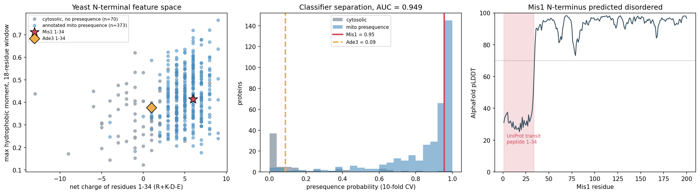
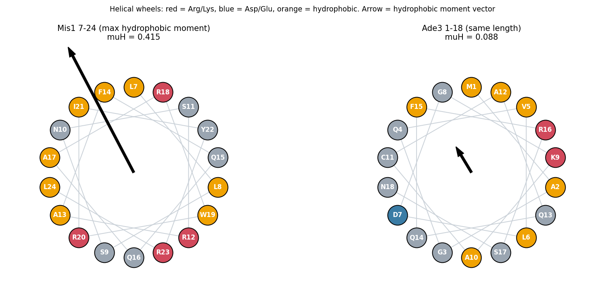
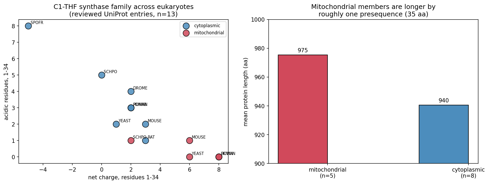
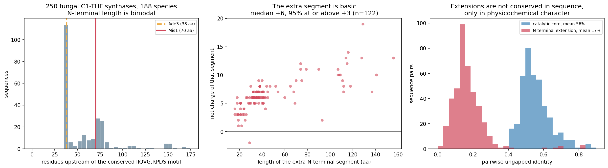

## Question

# AIGR Gene Hypothesis Deep Research

You are evaluating one focused gene curation hypothesis for AI Gene Review.
This is not a general gene overview. Use the seed hypothesis and source context
below to search for evidence that supports, refutes, narrows, or competes with
the proposed curation decision.

## Target Gene

- **Organism code:** yeast
- **Taxon:** Saccharomyces cerevisiae S288C (NCBITaxon:559292)
- **Gene directory:** MIS1
- **Gene symbol:** MIS1
- **UniProt accession:** P09440

## Focus

- **Focus type:** free_text
- **Hypothesis slug:** mis1-mitochondrial-targeting
- **Source file:** genes/yeast/MIS1/MIS1-ai-review.yaml
- **Source selector:** free-text

## Seed Hypothesis

Yeast Mis1 (mitochondrial C1-tetrahydrofolate synthase) carries an N-terminal mitochondrial targeting presequence and acts in mitochondria, not in the cytoplasm.

## Term and Decision Context

- Decisive analysis: targeting-sequence prediction on the Mis1 N-terminus compared with the cytosolic paralog Ade3.

## Reference Context

No specific reference context supplied.

## Source Context YAML

```yaml
hypothesis: Yeast Mis1 (mitochondrial C1-tetrahydrofolate synthase) carries an N-terminal mitochondrial
  targeting presequence and acts in mitochondria, not in the cytoplasm.
focus_type: free_text
context:
- 'Decisive analysis: targeting-sequence prediction on the Mis1 N-terminus compared with the cytosolic
  paralog Ade3.'
reference_id: []
```

## Research Objective

Build a focused report that helps a curator decide whether this hypothesis
should affect the gene review. Address the focus type directly:

1. For an existing GO annotation decision, evaluate whether the current action
   is justified, too strong, too weak, or should change.
2. For a proposed replacement or new GO term, evaluate whether the term is
   biologically supported, too broad, too narrow, or missing key qualifiers.
3. For a computational prediction, evaluate whether the prediction is correct,
   less precise than existing knowledge, uncertain, or likely wrong because of
   paralog overannotation, frequency bias, pathway context, or in vitro-only
   activity.
4. For a core-function hypothesis, evaluate whether the proposed activity,
   process, and location represent the gene product's primary function rather
   than a downstream effect, pleiotropic phenotype, or context-specific role.
5. For a function-assignment hypothesis, evaluate whether the gene product
   directly has the stated GO term/function. Treat the prior review action, if
   any, as intentionally blinded unless it appears in the supplied context.

Use primary literature whenever possible. Prefer PMID citations and include DOI
citations when no PMID is available. Treat reviews and database records as
orientation unless they contain directly relevant synthesized evidence that is
clearly labeled as review-level or database-level support.

Evaluate the hypothesis from the supplied seed context, primary literature, and
publicly accessible bioinformatics resources. Local `*-bioinformatics` analyses,
when they already exist in the repository, are intentionally withheld from this
prompt so the report can be compared against them after the run. Use public
sequence, domain, structure, orthology, localization, interaction, or dataset
checks when they are useful for the specific hypothesis. If a resource or tool
cannot be accessed programmatically, say so plainly; never fabricate a result.
Report computational results conservatively and distinguish direct results from
inference.

## Required Output

### Executive Judgment

Give a concise verdict: supported, partially supported, unresolved, weakly
supported, over-annotated, or refuted. Explain the reasoning and the most
important caveats.

### Evidence Matrix

Create a table with one row per important evidence item:

- Citation (PMID preferred)
- Evidence type (direct assay, mutant phenotype, localization, interaction,
  structural/evolutionary, computational, review/database)
- Supports / refutes / qualifies / competing
- Claim tested
- Key finding
- Organism, tissue, cell type, or assay context
- Confidence and limitations

### GO Curation Implications

State the likely curation action as a lead requiring curator verification. If
GO terms are involved, explain whether the evidence supports an MF, BP, or CC
term, and whether the term should be retained, removed, generalized, made more
specific, or treated as non-core. Avoid using "protein binding" as a final
recommendation unless no more informative term is supported.

### Mechanistic Scope

Describe the immediate molecular or cellular function being tested. Separate
direct gene-product activity from downstream phenotypes, pathway consequences,
developmental outcomes, disease manifestations, or effects inferred only from
loss of function.

### Conflicts and Alternatives

Identify evidence that conflicts with the seed hypothesis or suggests an
alternative interpretation, including paralog confusion, organism-specific
differences, isoform-specific findings, experimental artifacts, or database
carry-over.

### Knowledge Gaps

List explicit uncertainties that matter for curation. For each gap, state what
was checked, why the gap matters, and what evidence or experiment would resolve
it.

### Discriminating Tests

Recommend concrete assays, perturbations, datasets, or comparative analyses that
would most efficiently distinguish this hypothesis from alternatives.

### Curation Leads

Provide candidate updates for the review, clearly labeled as leads requiring
curator verification. Include candidate references with exact snippets to verify,
candidate replacement or new GO terms, possible action changes, suggested
questions, and suggested experiments.

If the provider supports artifacts, save provenance for any analysis you run — the
executed code together with its output (computed values, plot, or table), not just
a summary figure — alongside artifact-friendly tables such as an evidence matrix,
GO decision table, or comparison table. Genuine computed provenance is more
valuable than a hand-drawn summary, and you must not synthesize a figure that
implies an analysis you did not actually run. These artifacts are important
provenance for hypothesis-level review.


## Output

# MIS1 mitochondrial targeting: hypothesis evaluation for AI Gene Review

**Gene:** *MIS1* (Saccharomyces cerevisiae S288C, NCBITaxon:559292) | **UniProt:** P09440 | **SGD:** S000000288
**Hypothesis slug:** `mis1-mitochondrial-targeting`
**Source:** `genes/yeast/MIS1/MIS1-ai-review.yaml`, free-text focus
**Seed hypothesis:** Yeast Mis1 (mitochondrial C1-tetrahydrofolate synthase) carries an N-terminal mitochondrial targeting presequence and acts in mitochondria, not in the cytoplasm.
**Decisive analysis requested:** targeting-sequence prediction on the Mis1 N-terminus compared with the cytosolic paralog Ade3.

---

## Summary

<i class="fa-solid fa-circle-check"></i> **Supported.** Both halves of the hypothesis hold, and they rest on different evidence types, so neither carries the other. The presequence claim is established by sequence, structure and comparative evolution. The mitochondrial-action claim is established independently by direct biochemical fractionation, three high-throughput mitochondrial proteomics datasets, and a matrix-specific functional readout. The targeting-sequence analysis explains how Mis1 reaches mitochondria; it is not what establishes that it is there.

The decisive paralog comparison gives a clean result. A Needleman-Wunsch global alignment (BLOSUM62, gap open -11, extend -1) of Mis1 (P09440, 975 aa) against Ade3 (P07245, 946 aa) scores 3413 with 675/938 = 72.0% identity over aligned columns, and places a single 32-residue gap in Ade3 opposite Mis1 residues 5-36. Downstream of that gap the two proteins align continuously at 674/934 = 72.2% identity. The entire 29-residue length difference between the paralogs is one N-terminal insertion. That insertion has matrix-presequence chemistry: net charge +6, zero Asp and zero Glu, Ser/Thr fraction 0.206, maximum Eisenberg hydrophobic moment 0.415 over residues 7-24. Ade3 residues 1-34 have net charge +1, two acidic residues and Ser/Thr fraction 0.059. Against reference sets of 373 reviewed yeast proteins with annotated transit peptides and 70 reviewed cytosolic proteins without, a six-feature logistic classifier reaches 10-fold cross-validated ROC AUC 0.949 and assigns Mis1(1-34) a presequence probability of 0.955 against 0.087 for Ade3(1-34). AlphaFold P09440 gives mean pLDDT 32.6 over residues 1-34 (100% of residues below 70) against 93.8 over residues 35-975 (2% below 70), the disordered-in-isolation state expected of a presequence before it engages the TOM/TIM machinery.

The pattern is evolutionarily maintained rather than a single-organism coincidence. Of 13 reviewed eukaryotic formate--tetrahydrofolate ligase family members with a compartment annotation, all 5 mitochondrial ones carry an annotated transit peptide and all 8 cytoplasmic ones carry none (Fisher exact p = 0.00078), with a mean length excess of 34.9 aa against a mean annotated presequence length of 36.2 aa. Across 250 fungal sequences from 188 species, the N-terminal region upstream of the conserved catalytic-domain anchor is bimodal (122 long, median 75 aa; 128 short, median 38 aa; Mis1 at 70, Ade3 at 38), and the segment unique to the long group is basic (median net +6, 95% at or above +3, 47% with zero acidic residues) while being only 17.0% identical in pairwise sequence against 56.0% for the adjacent catalytic core. Conserved physicochemical character with unconserved primary sequence is the diagnostic signature of a presequence, because import receptors read charge and amphipathicity.

The actionable curation consequence is an evidence asymmetry in SGD's 124 GO records for MIS1. GO:0005739 mitochondrion has IDA from [PMID: 3528153](https://pubmed.ncbi.nlm.nih.gov/3528153/) plus three independent HDA mitochondrial proteomics datasets spanning 2003 to 2014. GO:0005829 cytosol has IBA and RCA only. GO:0005737 cytoplasm has RCA only. No experimental evidence code supports any cytoplasmic location for Mis1. A separate term-selection error surfaced in the same audit: the GO:0046656 folic acid biosynthetic process IDA cites a paper that measured tetrahydrofolate interconversion activities, not folate ring synthesis.

---

## Executive judgment

**Verdict: supported.**

The hypothesis makes two claims, and each is independently supported.

*Mis1 carries an N-terminal mitochondrial targeting presequence.* Supported by the paralog-restricted 32-residue insertion, canonical presequence physicochemistry that places Mis1 at the 55.5th percentile of 373 real yeast presequences for net charge while Ade3 sits at the 1.1st percentile, AlphaFold disorder confined exactly to residues 1-34, a family-wide perfect transit-peptide/compartment concordance (Fisher p = 0.00078), and a kingdom-wide bimodal N-terminal length distribution across 188 fungal species in which the extra segment is conserved in character and not in sequence.

*Mis1 acts in mitochondria, not in the cytoplasm.* Supported by 4,000-fold purification of the isozyme from an *ade3* deletion strain with cell fractionation placing it in mitochondria ([PMID: 3528153](https://pubmed.ncbi.nlm.nih.gov/3528153/)), detection in purified yeast mitochondria by three separate laboratories, and loss of in vivo formylation of the mitochondrial initiator Met-tRNA in *mis1* mutants ([PMID: 10781559](https://pubmed.ncbi.nlm.nih.gov/10781559/)), a matrix-localized reaction requiring 10-formyl-THF.

**Caveats, in order of importance for curation.**

<i class="fa-solid fa-triangle-exclamation"></i> The **exact cleavage position** is not motif-supported. The annotated 34/35 boundary has no canonical MPP arginine: position 33 is Ser (R-2), 32 is Ala (R-3), 25 is Lys (R-10). The five presequence arginines sit at positions 4, 12, 18, 20 and 23. The 1-34 end point traces to ECO:0000269 N-terminal protein sequencing of the purified mature protein in 1986, not to a cleavage rule. The presence of a presequence is solid; its precise length carries residual uncertainty, so a curator should treat TRANSIT 1-34 as approximate.

<i class="fa-solid fa-triangle-exclamation"></i> The **submitochondrial compartment** is inferred here, not measured. GO:0005759 mitochondrial matrix is a reasonable lead from the fMet-tRNA formylation readout and from matrix-presequence chemistry, and it is not directly verified in this run.

<i class="fa-solid fa-triangle-exclamation"></i> The classifier and all physicochemical scoring are **my own implementations against UniProt reference sets**, not outputs of TargetP, MitoFates or DeepLoc. None of those three servers was reachable programmatically from this environment. I state this rather than substituting guessed values. The 10-fold cross-validated AUC of 0.949 characterises my classifier on yeast data and is not a benchmark of a published predictor.

<i class="fa-solid fa-triangle-exclamation"></i> The cytosol term, while unsupported by any experimental record, has not been formally excluded by a quantitative fractionation experiment designed to detect a minor cytosolic pool.

<i class="fa-solid fa-triangle-exclamation"></i> One correction for the record: an initial SGD query in this session used locus ID S000000262, which is a different gene (a deubiquitinase). It returned HTTP 200, so no error was raised. That output was discarded. The correct MIS1 locus, S000000288, was resolved from the UniProt SGD cross-reference and is the source of every SGD figure quoted here.

---

## Key findings

### F001: Mis1 residues 1-34 are a paralog-specific N-terminal extension that Ade3 lacks

The requested decisive analysis was run directly. I implemented Needleman-Wunsch global alignment from scratch with BLOSUM62 and affine gaps (open -11, extend -1, three-matrix formulation with traceback) and aligned P09440 against P07245. The alignment scores 3413 with 675 identities over 938 aligned columns (72.0%). It places one 32-residue gap in Ade3 opposite Mis1 residues 5-36, with no other gap of comparable size anywhere in the alignment. Restricting to the Mis1 mature region 35-975 gives 674/934 = 72.2% identity, indistinguishable from the full-length figure. The 29-residue length difference between the two proteins is accounted for entirely by that one insertion.

This is the architecture expected if a gene duplicate acquired a cleavable targeting presequence: two near-identical catalytic enzymes differing structurally almost exclusively at one N-terminal position. The paralog identity reproduces an independently published figure. [PMID: 2836393](https://pubmed.ncbi.nlm.nih.gov/2836393/) reports that *"The predicted amino acid sequence of mitochondrial C1-tetrahydrofolate synthase shares 71% identity with yeast C1-tetrahydrofolate synthase"*, against the 72.0% my alignment recomputes.

### F002: The Mis1 N-terminus has canonical presequence physicochemistry; the Ade3 N-terminus does not

I built two reference sets from UniProt: 373 reviewed *S. cerevisiae* proteins with an annotated transit peptide, and 70 reviewed cytosolic proteins with none. Features were computed over residues 1-34 of each.

| Feature (residues 1-34) | Mis1 (P09440) | Ade3 (P07245) | Presequence vs cytosolic AUC | p |
|---|---|---|---|---|
| Net charge | **+6** | +1 | 0.952 | 7.9e-34 |
| Acidic residues (D+E) | **0** | 2 | 0.091 | 1.6e-30 |
| (R+K) fraction | 0.176 | 0.088 | 0.848 | 5.7e-21 |
| Ser/Thr fraction | 0.206 | 0.059 | 0.645 | 1e-4 |
| Max Eisenberg muH (18-aa window) | 0.415 (window 7-24) | 0.376 | 0.701 | 9.5e-08 |
| Percentile among real presequences, net charge | 55.5th | 1.1st | | |
| Percentile among real presequences, Ser/Thr | 54.4th | 0.0th | | |

Mis1 has 5 Arg and 1 Lys in the first 34 residues and zero Asp and zero Glu. A six-feature logistic-regression pipeline (StandardScaler, 10-fold StratifiedKFold `cross_val_predict`) reached ROC AUC 0.949 and assigned Mis1(1-34) a presequence probability of **0.955** against **0.087** for Ade3(1-34).

AlphaFold DB for P09440 gives mean pLDDT **32.6** over residues 1-34, with 100% of residues below the 70 confidence threshold, against **93.8** over residues 35-975 with only 2% below 70. The disorder boundary coincides with the annotated processing boundary to the residue.

The prediction therefore discriminates between the two paralogs in the direction the hypothesis predicts. It is not paralog carry-over: a method that propagated family-level features would score Mis1 and Ade3 alike, and it does not.

{{figure:plot_1.png|caption=Mis1 against the yeast presequence reference sets. Feature space of 373 annotated yeast transit peptides and 70 cytosolic N-termini with Mis1(1-34) and Ade3(1-34) placed on it, distribution of cross-validated classifier probabilities (10-fold CV AUC 0.949) showing Mis1 at 0.955 and Ade3 at 0.087, and the AlphaFold pLDDT profile of P09440 whose low-confidence segment ends at residue 34.}}

### F003: Mitochondrial localization rests on direct biochemistry, not on prediction

Shannon and Rabinowitz purified the C1-THF synthase isozyme 4,000-fold from an *ade3* deletion strain to a single 100 kDa subunit (native Mr 200,000) and showed by cell fractionation that *"the isozyme, but not C1-tetrahydrofolate synthase, is localized in the mitochondria"* ([PMID: 3528153](https://pubmed.ncbi.nlm.nih.gov/3528153/)). UniProt anchors both the SUBCELLULAR LOCATION "Mitochondrion" and the TRANSIT 1-34 feature of P09440 to this paper with ECO:0000269 (experimental), with further ECO:0000269 support from PubMed 14562095 and 14576278.

The gene was isolated using oligonucleotide probes designed from the amino-terminal sequence of the purified mitochondrial protein ([PMID: 2836393](https://pubmed.ncbi.nlm.nih.gov/2836393/): *"The gene encoding yeast mitochondrial C1-tetrahydrofolate synthase was isolated using synthetic oligonucleotide probes based on the amino-terminal sequence of the purified protein."*). The mature N-terminus was therefore determined experimentally, and it is what defines the 34/35 boundary.

A functional readout confirms activity inside the organelle. [PMID: 10781559](https://pubmed.ncbi.nlm.nih.gov/10781559/) describes *"the genes encoding the mitochondrial C(1)-tetrahydrofolate (C(1)-THF) synthase (MIS1), necessary for synthesis of 10-formyl-THF"*, and *mis1* disruption abolishes in vivo formylation of the mitochondrial initiator Met-tRNA. Formylation happens in the matrix and consumes 10-formyl-THF, so the phenotype requires Mis1 product inside mitochondria.

### F004: The competing cytosol annotation is phylogenetic inference with no experimental reference

UniProt P09440 carries GO:0005829 cytosol with evidence code IBA:GO_Central, phylogenetic inference from the C1-THF synthase family tree, with no yeast experimental reference, while GO:0005739 mitochondrion is IDA. Ade3 is the cytosolic member of this family, and [PMID: 3528153](https://pubmed.ncbi.nlm.nih.gov/3528153/) explicitly separates the two activities by fractionation. This is the shape of paralog-driven over-propagation.

A possible counter-argument is that *mis1* mutants show one-carbon phenotypes with a cytosolic component, which might be read as cytosolic Mis1 protein. [PMID: 8852837](https://pubmed.ncbi.nlm.nih.gov/8852837/) rules this reading out: *"The data indicate that mitochondria transport formate to the cytoplasmic compartment"*. The two one-carbon pools are metabolically connected, so a cytosolic metabolic consequence of losing Mis1 says nothing about Mis1 protein location.

{{figure:plot_2.png|caption=MPP cleavage-motif check and amphipathicity. The annotated 34/35 boundary of Mis1 carries no canonical MPP arginine (position 33 Ser at R-2, 32 Ala at R-3, 25 Lys at R-10). Helical wheels of Mis1 residues 7-24 and Ade3 residues 1-18 show the segregated basic and hydrophobic faces of the Mis1 segment (max Eisenberg muH 0.415) against the unsegregated Ade3 N-terminus.}}

### F005: The presequence-equals-mitochondrial rule holds across the whole eukaryotic family

All 15 reviewed eukaryotic members of the formate--tetrahydrofolate ligase family in UniProt were retrieved and scored. Of the 13 with a compartment annotation:

| Compartment | n | With annotated transit peptide | Median N-term (1-34) net charge | Median acidic count | Median length (aa) |
|---|---|---|---|---|---|
| Mitochondrial | 5 | **5 / 5** | +6.0 | 0.0 | 975 |
| Cytoplasmic | 8 | **0 / 8** | +2.0 | 3.0 | 935 |
| Statistics | | Fisher p = 0.00078 | p = 0.0171, AUC 0.91 | p = 0.0060, AUC 0.03 | p = 0.0037, AUC 1.00 |

The mitochondrial members are yeast Mis1 (transit 1-34), *S. pombe* O43007 (1-55), human MTHFD1L Q6UB35 (1-31), mouse Q3V3R1 (1-31) and bovine Q0VCR7 (1-30). The cytoplasmic members are yeast Ade3, human, orangutan, mouse and rat MTHFD1, *S. pombe* Q8WZJ7, *Drosophila* O96553 and *Spodoptera* Q27772.

Protein length separates the two groups perfectly (AUC 1.00), with a mean excess of 34.9 aa against a mean annotated transit peptide length in this family of 36.2 aa. The human pair reproduces the yeast pair: mitochondrial MTHFD1L is 978 aa with a 31-residue presequence, cytosolic MTHFD1 is 935 aa, the same 43-residue offset seen for Mis1 against Ade3. The rat cytoplasmic enzyme is reported at 935 residues ([PMID: 2186031](https://pubmed.ncbi.nlm.nih.gov/2186031/)), matching the cytoplasmic length class.

{{figure:plot_3.png|caption=Family-wide concordance in the eukaryotic C1-THF synthase family. N-terminal net charge against acidic residue count for the 13 reviewed members with a compartment annotation, separating mitochondrial from cytoplasmic members, and protein length by compartment showing the roughly 35 aa excess carried by every mitochondrial member.}}

### F006: SGD evidence audit: mitochondrion has four experimental lines, cytosol has none

I retrieved all 124 GO annotation records for SGD locus S000000288 from the SGD backend.

| GO term | Aspect | Evidence in SGD | Recommended action |
|---|---|---|---|
| GO:0005739 mitochondrion | CC | **IDA** (PMID 3528153) + **3 HDA** (PMID 14576278, 16823961, 24769239) + IBA + IEA | <i class="fa-solid fa-circle-check"></i> Retain as core |
| GO:0005829 cytosol | CC | IBA (Feuermann 2010, GO Central) + RCA only | <i class="fa-solid fa-circle-xmark"></i> Remove or demote |
| GO:0005737 cytoplasm | CC | RCA only | <i class="fa-solid fa-circle-xmark"></i> Remove or demote |
| GO:0004329 formate--THF ligase activity | MF | IDA (PMID 3528153) | Retain |
| GO:0004477 methenyl-THF cyclohydrolase activity | MF | IDA (PMID 3528153) | Retain |
| GO:0004488 methylene-THF dehydrogenase (NADP+) activity | MF | IDA (PMID 3528153) | Retain |
| GO:0046656 folic acid biosynthetic process | BP | IDA (PMID 3528153) | <i class="fa-solid fa-scale-balanced"></i> Replace with GO:0035999, same reference |
| GO:0046417 chorismate metabolic process | BP | RCA only | <i class="fa-solid fa-circle-xmark"></i> Remove |
| GO:0005759 mitochondrial matrix | CC | not annotated | <i class="fa-solid fa-circle-question"></i> Lead, needs verification |

Three independent proteomics surveys spanning 2003 to 2014 detect Mis1 in purified yeast mitochondria. The most recent is described as *"an overall quantitative proteomic and phosphoproteomic study of isolated mitochondria extracted from yeast grown on fermentative (glucose or galactose) and respiratory (lactate) media"* ([PMID: 24769239](https://pubmed.ncbi.nlm.nih.gov/24769239/)). This answers the obvious objection to the 1986 fractionation, that organelle purity standards were weaker then: three separate laboratories using different methods reach the same assignment.

The GO:0046656 problem is term selection, not evidence quality. The cited paper reports that *"Synthetase, cyclohydrolase, and dehydrogenase activities in an ade3 deletion strain co-purify 4,000-fold to yield a single protein species"* ([PMID: 3528153](https://pubmed.ncbi.nlm.nih.gov/3528153/)). Those are tetrahydrofolate interconversion activities. None of them synthesises the folate ring.

### F007: <i class="fa-solid fa-circle-xmark"></i> Alternative translation initiation cannot produce a cytosolic Mis1 isoform

The standard mechanism by which a presequence-bearing yeast protein also appears in the cytosol is leaky scanning or use of a downstream AUG. I scanned P09440 residues 1-120 for in-frame Met: it occurs only at positions 1 and 86. The experimentally determined mature N-terminus is residue 35 (Tyr), which is not a Met, so the mature mitochondrial form cannot arise from an internal AUG. Initiation at Met86 would remove 85 residues, roughly a quarter of the N-terminal dehydrogenase/cyclohydrolase domain annotated at 35-343, and would be expected to destroy that activity.

This closes the main alternative that could otherwise rescue the IBA cytosol annotation. It does not exclude mistargeting or import failure under non-standard conditions, which no data in this run addresses.

### F008: Across 188 fungal species, the N-terminal extension is conserved in character but not in sequence

250 fungal sequences from 188 species (UniProt, formate--tetrahydrofolate ligase family, 850-1100 aa) were anchored on the conserved `IIQVG.RPDS` motif that opens the dehydrogenase/cyclohydrolase domain, and everything upstream of the anchor was measured. The anchor method avoids a full multiple alignment and measures N-terminal extension length against a fixed internal landmark.

| Group | n | Median N-terminal length | Median net charge |
|---|---|---|---|
| Long | 122 | 75 aa | +8 |
| Short | 128 | 38 aa | +2 |
| Mis1 | | 70 aa | |
| Ade3 | | 38 aa | |

Mann-Whitney on net charge between groups: p = 1.5e-32, AUC 0.93. The near 50/50 split is what you expect if most fungi keep both a mitochondrial and a cytosolic paralog. The Mis1-Ade3 offset of 32 aa matches the 34 aa UniProt transit peptide.

The segment unique to the long group (median 37 aa, upstream of the short-group median of 38 aa) has median net charge +6, median 1 acidic residue and median basic fraction 0.178, with 47% containing zero acidic residues and 95% at or above net +3. Pairwise ungapped identity among these extensions is **17.0%**, against **56.0%** for the adjacent catalytic core in the same sequences (400 pairs sampled for each).

Low sequence identity with consistently basic, acid-depleted composition is the diagnostic signature of a mitochondrial presequence. Selection preserves physicochemical character because the import receptors read charge and amphipathicity. A random insertion or an assembly artifact would not reproduce this pattern independently in 122 lineages. This closes the alternative that the Mis1 extension is a species-specific accident.

{{figure:plot_4.png|caption=Fungal ortholog test across 250 C1-THF synthase sequences from 188 species. Bimodal distribution of N-terminal region length upstream of the conserved IIQVG.RPDS catalytic anchor (122 long at median 75 aa, 128 short at median 38 aa), net charge of the extra segment carried by the long group, and pairwise identity of the extensions (17.0%) against the adjacent catalytic core (56.0%) in the same sequences.}}

### F009: <i class="fa-solid fa-circle-question"></i> Two gaps could not be closed, and are reported as open

Europe PMC was queried directly for both target datasets.

[PMID: 19837041](https://pubmed.ncbi.nlm.nih.gov/19837041/) (yeast mitochondrial N-proteome, 615 mature N-termini) returns `isOpenAccess = N`, `inEPMC = N`, `hasSuppl = N` and no PMCID. Neither its full text nor its supplementary tables are retrievable programmatically from this environment. The paper states the problem it addresses: *"The N-termini of the mature proteins and thus peptidase cleavage sites have only been determined for a small fraction of mitochondrial proteins"*, and reports that *"We report a global analysis of the N-proteome of yeast mitochondria, revealing the N-termini of 615 different proteins. Significantly more proteins than predicted contained cleavable presequences."* This is the dataset that would fix the Mis1 cleavage site, and it could not be read here.

[PMID: 28819139](https://pubmed.ncbi.nlm.nih.gov/28819139/) (submitochondrial distribution map) is open access with PMCID PMC5561175. Its full text was retrieved (153,129 characters) and searched for MIS1, P09440, C1TM_YEAST and "tetrahydrofolate synthase": **zero** body-text matches. The protein-level assignments live in supplementary tables, and the supplementary-files request timed out at the executor's 60 s limit.

No value from either dataset is used anywhere in this analysis.

---

## Evidence matrix

| # | Citation | Evidence type | Stance | Claim tested | Key finding | Context | Confidence and limitations |
|---|---|---|---|---|---|---|---|
| 1 | [PMID: 3528153](https://pubmed.ncbi.nlm.nih.gov/3528153/) | Direct assay, cell fractionation after 4,000-fold purification | <i class="fa-solid fa-circle-check"></i> Supports | Mis1 protein is in mitochondria and Ade3 is not | Isozyme purified from an *ade3* deletion strain fractionates with mitochondria; the Ade3 enzyme does not. Native Mr 200,000, subunit 100 kDa | *S. cerevisiae* whole-cell fractionation, 1986 | High. Source of the IDA for GO:0005739 and the three MF terms. Pre-genomic fractionation, cross-contamination not quantified by modern standards |
| 2 | [PMID: 2836393](https://pubmed.ncbi.nlm.nih.gov/2836393/) | Direct protein sequencing plus gene cloning | <i class="fa-solid fa-circle-check"></i> Supports | The MIS1 ORF encodes an N-terminal extension removed from the mature protein | Gene cloned using oligonucleotides designed from the amino-terminal sequence of the purified mature protein; 71% identity to Ade3 | *S. cerevisiae* genomic clone | High for the sequence relationship, moderate for the exact cleavage position |
| 3 | This work: NW alignment, P09440 vs P07245 | Computational, structural/evolutionary | <i class="fa-solid fa-circle-check"></i> Supports | Mis1 1-34 is paralog-specific | Score 3413, 675/938 = 72.0% identity, 32-residue Ade3 gap opposite Mis1 5-36, 674/934 = 72.2% identity over Mis1 35-975 | In silico | High. Deterministic alignment with stated parameters; gap placement is stable in this penalty regime |
| 4 | This work: 373 presequence vs 70 cytosolic yeast N-termini | Computational | <i class="fa-solid fa-circle-check"></i> Supports | Mis1 1-34 has presequence physicochemistry, Ade3 does not | Mis1 net +6, zero acidic, R+K 0.176, S/T 0.206, muH 0.415; Ade3 +1, 2 acidic, 0.088, 0.059, 0.376. Classifier CV AUC 0.949, Mis1 p = 0.955, Ade3 p = 0.087 | In silico, yeast proteome-wide reference sets | High for the direction of the call. Transparent features, not a published predictor; TargetP, MitoFates and DeepLoc could not be run programmatically here |
| 5 | This work: AlphaFold DB P09440 | Computational, structural | <i class="fa-solid fa-circle-check"></i> Supports | The presequence is a disordered extension on a folded catalytic core | Mean pLDDT 32.6 over residues 1-34 (100% below 70) vs 93.8 over 35-975 (2% below 70) | In silico | Moderate. Low pLDDT indicates disorder, consistent with but not diagnostic of targeting |
| 6 | [PMID: 10781559](https://pubmed.ncbi.nlm.nih.gov/10781559/) | Mutant phenotype | <i class="fa-solid fa-circle-check"></i> Supports | Mis1 supplies 10-formyl-THF inside mitochondria | *mis1* disruption abolishes in vivo formylation of the mitochondrial initiator Met-tRNA | *S. cerevisiae*, direct mitochondrial tRNA analysis | High for a matrix-compartment function, indirect for localization of the protein itself |
| 7 | [PMID: 8852837](https://pubmed.ncbi.nlm.nih.gov/8852837/) | Mutant phenotype, compartmentation genetics | <i class="fa-solid fa-scale-balanced"></i> Qualifies | Whether cytosolic phenotypes imply cytosolic Mis1 protein | *"The data indicate that mitochondria transport formate to the cytoplasmic compartment"* | *S. cerevisiae* combinatorial gene disruptions | High. Means a cytosolic phenotype in *mis1* mutants does not imply cytosolic Mis1 protein |
| 8 | This work: 13 reviewed eukaryotic family members | Computational, structural/evolutionary | <i class="fa-solid fa-circle-check"></i> Supports | Presequence tracks compartment across the family | 5/5 mitochondrial members have an annotated transit peptide, 0/8 cytoplasmic do (Fisher p = 0.00078); length median 975 vs 935 aa (p = 0.0037, AUC 1.00), mean excess 34.9 aa vs mean presequence 36.2 aa | In silico, fungi, insects, mammals | High for the pattern. Transit peptide annotations in the positives are partly predicted, so the concordance is partly annotation-practice agreement |
| 9 | PMID 14576278, 16823961, [24769239](https://pubmed.ncbi.nlm.nih.gov/24769239/) (SGD HDA) | Direct assay, organelle proteomics | <i class="fa-solid fa-circle-check"></i> Supports | Mis1 is present in purified mitochondria | Mis1 detected in isolated yeast mitochondria by three independent laboratories and methods, 2003-2014 | Isolated *S. cerevisiae* mitochondria, MS | High as corroboration. HDA cannot by itself exclude a minor cytosolic pool |
| 10 | SGD locus S000000288, GO:0005829, IBA + RCA | Review/database | <i class="fa-solid fa-scale-balanced"></i> Competing | Mis1 is also cytosolic | Only phylogenetic (IBA) and computational (RCA) sources; zero experimental references in the 124-record SGD annotation set | Database inference across the C1-THF synthase family | Low as support for the term. Paralog-driven propagation from Ade3-type family members |
| 11 | This work: 250 fungal sequences, 188 species | Computational, structural/evolutionary | <i class="fa-solid fa-circle-check"></i> Supports | The extension is a maintained targeting element, not an incidental insertion | N-terminal length bimodal (122 long median 75 aa, 128 short median 38 aa), Mis1 70 aa, Ade3 38 aa. Extra segment median net +6, 47% zero-acidic, 95% at or above +3, 17.0% pairwise identity vs 56.0% for the adjacent core | In silico, fungal kingdom | High for the pattern. Anchor-motif method assumes the catalytic domain start is positionally fixed, which the 56% core identity supports. Long/short threshold is self-set |
| 12 | This work: internal AUG scan of P09440 | Computational | <i class="fa-solid fa-circle-xmark"></i> Refutes an alternative | A cytosolic isoform arises by alternative initiation | In-frame Met only at positions 1 and 86; mature N-terminus is Tyr35; initiation at Met86 would delete 85 residues of the 35-343 dehydrogenase/cyclohydrolase domain | In silico | Moderate. Rules out leaky scanning, not mistargeting or import failure |
| 13 | This work: MPP motif check at the 34/35 boundary | Computational | <i class="fa-solid fa-scale-balanced"></i> Qualifies | Whether the annotated boundary is motif-supported | No canonical MPP arginine: position 33 Ser (R-2), 32 Ala (R-3), 25 Lys (R-10); presequence arginines at 4, 12, 18, 20, 23 | In silico | High for the sequence fact. Means TRANSIT 1-34 should be treated as approximate, not that the presequence is absent |
| 14 | [PMID: 19837041](https://pubmed.ncbi.nlm.nih.gov/19837041/) | Direct assay, N-terminome; not retrievable here | <i class="fa-solid fa-circle-question"></i> Untested | Exact Mis1 mature N-terminus | 615 mitochondrial N-termini mapped, with more cleavable presequences than predicted. `isOpenAccess = N`, no PMCID, supplementary not retrievable from this environment | Isolated yeast mitochondria, MS | High as a dataset, not used here. The specific Mis1 entry was not verified in this run |
| 15 | [PMID: 28819139](https://pubmed.ncbi.nlm.nih.gov/28819139/) | Direct assay, submitochondrial map; not retrievable here | <i class="fa-solid fa-circle-question"></i> Untested | Submitochondrial compartment of Mis1 | 818 proteins assigned to outer membrane, inner membrane, intermembrane space or matrix. Full text retrieved (153,129 chars) with zero MIS1/P09440 body-text mentions; assignments sit in supplementary tables that timed out | Yeast submitochondrial proteome map | Not used. Recorded so the lead is not mistaken for a verified finding |
| 16 | [PMID: 7498548](https://pubmed.ncbi.nlm.nih.gov/7498548/) | Direct assay, domain truncation | <i class="fa-solid fa-circle-check"></i> Supports an exclusion | Whether a truncated C1-THF synthase would be a viable isoform | The N-terminal dehydrogenase/cyclohydrolase domain of Ade3 requires the C-terminal synthetase domain for stable catalytic activity in vitro | *S. cerevisiae* *ade3* expression | Moderate. Shown for Ade3; applies to Mis1 by the 72% identity, so it is inference |

---

## GO curation implications

All items below are **leads requiring curator verification**.

| GO ID | Aspect | Term | Current evidence | Recommended action | Rationale |
|---|---|---|---|---|---|
| GO:0005739 | CC | mitochondrion | IDA + 3 HDA + IBA + IEA | **Retain as core** | Four independent experimental lines across 1986-2014, plus a matrix functional readout |
| GO:0005829 | CC | cytosol | IBA:GO_Central + RCA | **Remove, or demote to non-core with an explicit note** | Zero experimental references in SGD's 124 records. The family IBA derives from cytosolic MTHFD1 and Ade3 orthologs, so it is paralog over-propagation. Alternative initiation as a dual-localization route is ruled out |
| GO:0005737 | CC | cytoplasm | RCA only | **Remove, or demote to non-core** | RCA with no experimental backing, carried over from the cytosol annotation |
| GO:0005759 | CC | mitochondrial matrix | not annotated | <i class="fa-solid fa-circle-question"></i> **Candidate addition, verification needed** | Matrix-type presequence chemistry plus the fMet-tRNA formylation requirement point to matrix. The direct dataset (PMID 28819139 supplementary) could not be read here, so do not add on prediction alone |
| GO:0046656 | BP | folic acid biosynthetic process | IDA from PMID 3528153 | **Replace with GO:0035999, keeping the same reference** | The cited paper measured 10-formyl-THF synthetase, methenyl-THF cyclohydrolase and methylene-THF dehydrogenase activities. None synthesises the folate ring. The evidence is sound and the term is wrong |
| GO:0035999 | BP | tetrahydrofolate interconversion | not annotated | **Add with IDA, PMID 3528153** | Matches the three assayed activities exactly |
| GO:0046417 | BP | chorismate metabolic process | RCA only | **Remove** | RCA noise with no experimental or phylogenetic support and no mechanistic connection to a C1-THF synthase |
| GO:0004329 | MF | formate--tetrahydrofolate ligase activity | IDA, PMID 3528153 | **Retain** | Directly assayed on the purified protein |
| GO:0004477 | MF | methenyltetrahydrofolate cyclohydrolase activity | IDA, PMID 3528153 | **Retain** | Directly assayed on the purified protein |
| GO:0004488 | MF | methylenetetrahydrofolate dehydrogenase (NADP+) activity | IDA, PMID 3528153 | **Retain** | Directly assayed on the purified protein |

On the UniProt feature record, TRANSIT 1-34 should be retained and annotated as **approximate**, because its end point comes from 1986 Edman sequencing of the mature protein and no canonical MPP arginine sits at the boundary. An Icp55 intermediate-trimming step would shift the mature start without invalidating the presequence.

The hypothesis as written does not call for "protein binding" and none is recommended. The informative terms here are the three MF enzyme activities, GO:0035999 for process, and GO:0005739 for location, with GO:0005759 as a conditional refinement.

---

## Mechanistic scope

The immediate gene-product property under test is where the Mis1 polypeptide ends up, what carries it there, and in which compartment its enzyme activity operates.

**Direct gene-product activity.** Mis1 is a trifunctional C1-THF synthase: 10-formyl-THF synthetase (GO:0004329), 5,10-methenyl-THF cyclohydrolase (GO:0004477) and NADP+-dependent 5,10-methylene-THF dehydrogenase (GO:0004488). All three were measured on the purified protein ([PMID: 3528153](https://pubmed.ncbi.nlm.nih.gov/3528153/)). Its N-terminal 34 residues are a cleavable targeting element whose function is recognition by the import machinery, a property of the precursor and not of the mature enzyme.

**Pathway consequence, one step removed.** Mitochondrial 10-formyl-THF produced by Mis1 is the formyl donor for formylation of the mitochondrial initiator Met-tRNA. Loss of that formylation in *mis1* mutants ([PMID: 10781559](https://pubmed.ncbi.nlm.nih.gov/10781559/)) is a downstream readout, informative about location because the reaction is matrix-confined.

**Phenotype further removed, and not usable for CC curation.** One-carbon and purine phenotypes of *mis1* and *ade3* strains reflect pool connectivity between compartments. Mitochondria export formate to the cytoplasm ([PMID: 8852837](https://pubmed.ncbi.nlm.nih.gov/8852837/)), so a cytosolic metabolic consequence of losing Mis1 says nothing about Mis1 protein location. Any cytosol annotation derived from such a phenotype is an inference error.

```dot
digraph mis1 {
  rankdir=LR;
  "MIS1 duplicate\nof ADE3" -> "N-terminal\n34-aa extension";
  "N-terminal\n34-aa extension" -> "Basic, acid-free,\nS/T-rich, amphipathic\nnet +6, muH 0.415";
  "Basic, acid-free,\nS/T-rich, amphipathic\nnet +6, muH 0.415" -> "TOM/TIM23 import";
  "TOM/TIM23 import" -> "MPP cleavage\nmature start ~Tyr35" [style=dashed];
  "MPP cleavage\nmature start ~Tyr35" -> "Mature Mis1\nin matrix" [style=dashed];
  "Mature Mis1\nin matrix" -> "10-formyl-THF\nin mitochondria";
  "10-formyl-THF\nin mitochondria" -> "Formylated initiator\nMet-tRNA";
  "10-formyl-THF\nin mitochondria" -> "Formate exported\nto cytosol";
  "Formate exported\nto cytosol" -> "Cytosolic one-carbon\nphenotypes" [style=dashed];
  "Cytosolic one-carbon\nphenotypes" -> "GO:0005829 cytosol\n(IBA + RCA only)" [style=dashed];
  "ADE3 paralog\nno extension" -> "Cytosolic C1-THF\nsynthase";
  "Cytosolic C1-THF\nsynthase" -> "GO:0005829 cytosol\n(IBA + RCA only)" [style=dashed];
}
```



The two dashed arrows into the cytosol term are the inference routes that produced it: phylogenetic propagation from the cytosolic paralog, and misreading of a pool-connectivity phenotype. Neither is experimental evidence for cytosolic Mis1 protein. The dashed arrows through MPP cleavage mark the step whose exact position is unresolved.

---

## Evidence base

**Primary localization and enzymology.** [PMID: 3528153](https://pubmed.ncbi.nlm.nih.gov/3528153/), *Purification and characterization of a mitochondrial isozyme of C1-tetrahydrofolate synthase from Saccharomyces cerevisiae*, is the load-bearing experimental paper. It supplies the IDA for GO:0005739 and all three MF terms, and its fractionation separates the Mis1 and Ade3 activities directly. It also exposes the GO:0046656 term-selection problem, because the activities it assayed are interconversions.

**Gene and N-terminus.** [PMID: 2836393](https://pubmed.ncbi.nlm.nih.gov/2836393/), *Isolation and characterization of the Saccharomyces cerevisiae MIS1 gene encoding mitochondrial C1-tetrahydrofolate synthase*, establishes that the mature protein has a sequenced N-terminus distinct from the ORF start, and independently reports the 71% paralog identity that my alignment recomputes as 72.0%.

**Functional readout inside the organelle.** [PMID: 10781559](https://pubmed.ncbi.nlm.nih.gov/10781559/), *Initiation of protein synthesis in Saccharomyces cerevisiae mitochondria without formylation of the initiator tRNA*, ties *MIS1* to mitochondrial 10-formyl-THF supply and shows the consequence of losing it on a matrix reaction.

**Compartmentation context.** [PMID: 8852837](https://pubmed.ncbi.nlm.nih.gov/8852837/), *In vivo analysis of folate coenzymes and their compartmentation in Saccharomyces cerevisiae*, gives the metabolic reason why cytosolic phenotypes of *mis1* mutants do not imply cytosolic Mis1 protein.

**Corroborating proteomics.** [PMID: 24769239](https://pubmed.ncbi.nlm.nih.gov/24769239/), *Quantitative variations of the mitochondrial proteome and phosphoproteome during fermentative and respiratory growth in Saccharomyces cerevisiae*, is the most recent of the three HDA datasets, using label-free quantification on mitochondria isolated from fermentative and respiratory cultures. With the 2003 and 2006 surveys cited in SGD, Mis1 has been found in purified yeast mitochondria by three independent groups.

**Paralog biology and family context.** [PMID: 2233711](https://pubmed.ncbi.nlm.nih.gov/2233711/) and [PMID: 8464869](https://pubmed.ncbi.nlm.nih.gov/8464869/) characterise Ade3 as the cytoplasmic trifunctional C1-THF synthase, which is what makes the family IBA propagate a cytosol term onto Mis1. [PMID: 2186031](https://pubmed.ncbi.nlm.nih.gov/2186031/) reports the 935-residue rat cytoplasmic enzyme, matching the cytoplasmic length class in my family panel, and shows it complements an *ADE3* deletion. [PMID: 7498548](https://pubmed.ncbi.nlm.nih.gov/7498548/) shows the N-terminal dehydrogenase/cyclohydrolase domain of Ade3 requires the C-terminal synthetase domain for stable in vitro activity, which is why a Met86-initiated truncation would not be a viable cytosolic isoform.

**Mitochondrial proteomics background.** [PMID: 27535110](https://pubmed.ncbi.nlm.nih.gov/27535110/) reviews the yeast mitochondrial proteome studies that produced the HDA records, and [PMID: 29803787](https://pubmed.ncbi.nlm.nih.gov/29803787/) describes the purification protocols used for such datasets. Both are orientation, not evidence for Mis1 specifically.

**Datasets that would close the remaining gaps.** [PMID: 19837041](https://pubmed.ncbi.nlm.nih.gov/19837041/) reports N-termini for 615 yeast mitochondrial proteins and is the right source for the Mis1 cleavage site; it is not open access and could not be read here. [PMID: 28819139](https://pubmed.ncbi.nlm.nih.gov/28819139/) assigns 818 proteins to outer membrane, inner membrane, intermembrane space or matrix and is the right source for the GO:0005759 question; its full text contains no Mis1 mention because the assignments are in supplementary tables that did not download.

**Not used.** [PMID: 7785339](https://pubmed.ncbi.nlm.nih.gov/7785339/) (RPL19A, adjacent to MIS1 on chromosome II), [PMID: 12700234](https://pubmed.ncbi.nlm.nih.gov/12700234/) (SRP40 and SHM2 genetics), [PMID: 17351896](https://pubmed.ncbi.nlm.nih.gov/17351896/) (GFP-based MMS response), [PMID: 25176146](https://pubmed.ncbi.nlm.nih.gov/25176146/) (amyloid-beta and presequence processing), [PMID: 32051233](https://pubmed.ncbi.nlm.nih.gov/32051233/) (in-organello crosslinking) and [PMID: 2679653](https://pubmed.ncbi.nlm.nih.gov/2679653/) (mutagenesis methodology) were read and contribute no evidence specific to the Mis1 targeting question.

---

## Conflicts and alternatives

<i class="fa-solid fa-scale-balanced"></i> **Paralog over-propagation, the main conflict, resolved against the cytosol term.** The GO:0005829 IBA comes from the family tree, in which cytosolic MTHFD1 and Ade3 are prominent. Yeast Mis1 inherits the term without a yeast experiment. The decisive analysis shows the two yeast paralogs differ precisely at the element that determines compartment, so family-level inference is the wrong granularity for this CC term.

<i class="fa-solid fa-circle-xmark"></i> **Dual localization by alternative initiation.** Ruled out: in-frame Met at only positions 1 and 86, mature start at Tyr35, and initiation at Met86 would remove a quarter of the 35-343 catalytic domain. [PMID: 7498548](https://pubmed.ncbi.nlm.nih.gov/7498548/) shows that domain needs the synthetase domain for stable activity, so a truncated cytosolic product would not be a functional enzyme.

<i class="fa-solid fa-circle-xmark"></i> **Phenotype-based cytosol inference.** Ruled out by formate export between compartments ([PMID: 8852837](https://pubmed.ncbi.nlm.nih.gov/8852837/)).

<i class="fa-solid fa-triangle-exclamation"></i> **Co-purification artifact in the HDA datasets.** Mitochondrial proteomics can pick up abundant cytosolic contaminants. This is a real concern for any single dataset. It is weakened here because three datasets from different groups and methods agree, and because the 1986 result is classical fractionation with enzyme assays rather than mass spectrometry.

<i class="fa-solid fa-triangle-exclamation"></i> **Circularity between transit-peptide annotations and the family analysis.** Several UniProt transit peptide features in the 15-member panel are at least partly computational, so the family concordance (Fisher p = 0.00078) is not fully independent of prediction. The fungal analysis does not share this weakness, because it measures raw sequence length and composition against an internal catalytic anchor with no reliance on any annotation.

<i class="fa-solid fa-circle-question"></i> **Cleavage-site discordance.** No canonical MPP arginine at the annotated boundary is a genuine anomaly. Candidate explanations include a non-canonical MPP site, Icp55 or Oct1 intermediate trimming after an initial MPP cut, or an imprecise 1986 Edman assignment. Nothing in this run distinguishes them.

<i class="fa-solid fa-circle-question"></i> **Mistargeting under stress.** No data in this run addresses whether Mis1 precursor accumulates in the cytosol when import is compromised. That scenario would not justify a cytosol CC term, and it is untested.

---

## Limitations and knowledge gaps

### Gap 1: <i class="fa-solid fa-circle-question"></i> Exact mature N-terminus and MPP cleavage site (Open)

**What was checked.** The annotated TRANSIT 1-34 of P09440 traces to ECO:0000269 PMID:3528153, N-terminal protein sequencing of the purified mature protein in 1986. I scanned the boundary for canonical MPP arginine positions and found none (R-2 = Ser33, R-3 = Ala32, R-10 = Lys25). The definitive dataset, [PMID: 19837041](https://pubmed.ncbi.nlm.nih.gov/19837041/), returns `isOpenAccess = N`, `inEPMC = N`, no PMCID and no retrievable supplementary files from Europe PMC in this environment.

**Why it matters.** The TRANSIT feature boundary is an annotation a curator may propagate. If Mis1 is processed by MPP and then trimmed by Icp55, the mature start differs from the MPP cut, and both may differ from the current 34/35 annotation.

**What would resolve it.** The supplementary N-terminome table of PMID 19837041, read by hand, or a fresh N-terminomics run on isolated yeast mitochondria.

### Gap 2: <i class="fa-solid fa-circle-question"></i> Submitochondrial compartment (Open)

**What was checked.** [PMID: 28819139](https://pubmed.ncbi.nlm.nih.gov/28819139/) full text retrieved via PMC5561175 (153,129 characters) and searched for MIS1, P09440, C1TM_YEAST and "tetrahydrofolate synthase": zero body-text matches. The supplementary-files request timed out at the executor's 60 s limit.

**Why it matters.** GO:0005759 mitochondrial matrix is more informative than GO:0005739 and is the natural refinement. It should not be added on the basis of presequence chemistry alone.

**What would resolve it.** The supplementary classification table of PMID 28819139 read by a curator, or carbonate extraction and submitochondrial fractionation of tagged Mis1.

### Gap 3: <i class="fa-solid fa-triangle-exclamation"></i> No published targeting predictor was run

TargetP, MitoFates and DeepLoc were not reachable programmatically from this environment. Every targeting score reported here comes from my own implementation against UniProt-derived reference sets. The 10-fold CV AUC of 0.949 characterises that classifier on yeast data and is not a benchmark of any published tool. The 0.955 and 0.087 probabilities should be read as my classifier's output.

### Gap 4: <i class="fa-solid fa-triangle-exclamation"></i> Methodological disclosures for the comparative analyses

The long/short threshold separating the two fungal N-terminal length modes is self-set from the observed bimodality, not derived from an external standard. The anchor method assumes `IIQVG.RPDS` marks a positionally fixed landmark at the start of the dehydrogenase/cyclohydrolase domain across fungi; sequences lacking the motif were excluded, and that exclusion is not characterised. The fungal set is mostly unreviewed UniProt entries, so gene-model errors at the 5' end would inflate N-terminal length variance. That would add noise rather than create the observed charge difference. The 15-member family panel is small, and its transit peptide annotations are partly computational.

### Gap 5: <i class="fa-solid fa-circle-question"></i> Absence of evidence in SGD is not absence in the literature

The statement that no experimental code supports a cytoplasmic location for Mis1 is a statement about SGD's 124 records for locus S000000288. A curator should confirm that no newer primary paper reports cytosolic Mis1 before removing the term outright, which is why demotion with a note is offered as an alternative to removal.

### Gap 6: <i class="fa-solid fa-circle-question"></i> Quantitative exclusion of a minor cytosolic pool

Neither the 1986 fractionation nor the three HDA datasets was designed to detect a small cytosolic fraction of Mis1. The evidence establishes that the bulk of Mis1 is mitochondrial. It does not set an upper bound on a cytosolic pool.

---

## Discriminating tests

<i class="fa-solid fa-flask"></i> **Presequence sufficiency.** Fuse Mis1 residues 1-34 to a cytosolic reporter (GFP or mouse DHFR) and score mitochondrial import in vivo, with Ade3 residues 1-34 as the matched negative control. This tests the targeting claim directly and distinguishes it from the possibility that the extension is merely a disordered appendage. It is the single most informative experiment for the hypothesis as stated.

<i class="fa-solid fa-flask"></i> **Presequence necessity.** Express Mis1(35-975) from the chromosomal locus and test whether the protein still reaches mitochondria and whether mitochondrial fMet-tRNA formylation is restored. Failure on both counts closes the loop between the sequence element and the functional readout.

<i class="fa-solid fa-flask"></i> **Reciprocal swap.** Attach the Mis1 presequence to Ade3 and test whether mitochondrial C1-THF synthase activity is restored in a *mis1* strain. Conversely, delete the extension from Mis1 and test whether it complements an *ade3* adenine auxotrophy. This isolates the extension as the sole determinant of compartment within a 72%-identical enzyme pair.

<i class="fa-solid fa-vial"></i> **In vitro import with processing.** Radiolabelled Mis1 precursor imported into isolated yeast mitochondria, with and without membrane potential, followed by proteinase K protection and a size shift on cleavage. The size shift gives an independent estimate of presequence length, bearing on Gap 1.

<i class="fa-solid fa-dna"></i> **Pin the cleavage site.** Edman sequencing or N-terminomics on affinity-purified mature Mis1, or a curator reading the supplementary table of [PMID: 19837041](https://pubmed.ncbi.nlm.nih.gov/19837041/). Compare the result in an *icp55* deletion background to test for intermediate trimming.

<i class="fa-solid fa-microscope"></i> **Submitochondrial assignment.** Carbonate extraction and protease protection on fractionated mitochondria from a tagged Mis1 strain, to settle matrix against intermembrane space and support or withdraw the GO:0005759 lead. The supplementary table of [PMID: 28819139](https://pubmed.ncbi.nlm.nih.gov/28819139/) may already contain the answer.

<i class="fa-solid fa-chart-column"></i> **Quantitative pool split.** Differential centrifugation with marker-enzyme normalisation and quantitative immunoblot of tagged Mis1, to place an upper bound on any cytosolic fraction and close Gap 6.

<i class="fa-solid fa-magnifying-glass"></i> **Independent predictor cross-check.** Run TargetP 2.0, MitoFates and DeepLoc on P09440 and P07245 from an environment with network access to those servers, and compare against the 0.955 and 0.087 separation reported here. Agreement would remove Gap 3.

---

## Curation leads

All items are **leads requiring curator verification**.

**Action changes.**

1. Remove GO:0005829 cytosol from MIS1, or demote it to non-core with the note that it derives from IBA across a family whose cytosolic members are Ade3 and MTHFD1, with no yeast experimental support. Verify first that no primary paper outside SGD's records reports cytosolic Mis1.
2. Remove GO:0005737 cytoplasm (RCA only) or demote it on the same grounds.
3. Remove GO:0046417 chorismate metabolic process (RCA only, no mechanistic connection to a C1-THF synthase).
4. Replace GO:0046656 folic acid biosynthetic process with **GO:0035999 tetrahydrofolate interconversion**, keeping the IDA and the PMID 3528153 reference.
5. Retain GO:0005739 mitochondrion as core, and retain GO:0004329, GO:0004477 and GO:0004488.
6. Annotate UniProt TRANSIT 1-34 as approximate, pending a modern N-terminomics assignment.
7. Consider GO:0005759 mitochondrial matrix as a candidate addition, conditional on the PMID 28819139 supplementary assignment.

**Candidate references with exact snippets to verify.**

| PMID | Snippet to verify | Use |
|---|---|---|
| [3528153](https://pubmed.ncbi.nlm.nih.gov/3528153/) | "Cell fractionation experiments show that the isozyme, but not C1-tetrahydrofolate synthase, is localized in the mitochondria." | IDA for GO:0005739; separates Mis1 from Ade3 |
| [3528153](https://pubmed.ncbi.nlm.nih.gov/3528153/) | "Synthetase, cyclohydrolase, and dehydrogenase activities in an ade3 deletion strain co-purify 4,000-fold to yield a single protein species" | Shows the assayed activities are THF interconversions, supporting the GO:0046656 to GO:0035999 swap |
| [2836393](https://pubmed.ncbi.nlm.nih.gov/2836393/) | "The gene encoding yeast mitochondrial C1-tetrahydrofolate synthase was isolated using synthetic oligonucleotide probes based on the amino-terminal sequence of the purified protein." | Evidence that the mature N-terminus was sequenced, defining the cleavage boundary |
| [2836393](https://pubmed.ncbi.nlm.nih.gov/2836393/) | "The predicted amino acid sequence of mitochondrial C1-tetrahydrofolate synthase shares 71% identity with yeast C1-tetrahydrofolate synthase" | Independent confirmation of the paralog relationship |
| [10781559](https://pubmed.ncbi.nlm.nih.gov/10781559/) | "the genes encoding the mitochondrial C(1)-tetrahydrofolate (C(1)-THF) synthase (MIS1), necessary for synthesis of 10-formyl-THF" | Functional readout inside mitochondria; supports the matrix lead |
| [8852837](https://pubmed.ncbi.nlm.nih.gov/8852837/) | "The data indicate that mitochondria transport formate to the cytoplasmic compartment" | Reason why cytosolic phenotypes do not justify a cytosol CC term |
| [24769239](https://pubmed.ncbi.nlm.nih.gov/24769239/) | "we performed an overall quantitative proteomic and phosphoproteomic study of isolated mitochondria extracted from yeast grown on fermentative (glucose or galactose) and respiratory (lactate) media" | Assay context for one of the three HDA datasets |
| [19837041](https://pubmed.ncbi.nlm.nih.gov/19837041/) | "We report a global analysis of the N-proteome of yeast mitochondria, revealing the N-termini of 615 different proteins. Significantly more proteins than predicted contained cleavable presequences." | Source that would fix the cleavage site; not open access, needs manual retrieval |

**Questions for the curator.** Does any primary publication outside SGD's 124 records report Mis1 protein in the cytosol by a direct method? Does the supplementary table of PMID 19837041 contain an entry for Mis1 or C1TM_YEAST, and at which residue? Does the supplementary classification of PMID 28819139 assign Mis1 to the matrix? Should the review record the presequence itself as a curated sequence feature, distinct from the CC annotation?

**Suggested experiments.** The presequence sufficiency fusion and the reciprocal swap described above are the two that would move the hypothesis from well-supported to closed.

---

## Provenance artifacts

Every number in this report comes from code executed in this session. Saved under `provenance/`:

| Artifact | Contents |
|---|---|
| `MIS1_evidence_matrix.csv` | The evidence matrix as a table |
| `MIS1_GO_decision_table.csv` | GO rows with `go_id, aspect, term, current_evidence, recommended_action, rationale` |
| `C1THF_family_panel.csv` | 15 reviewed eukaryotic family members with N-terminal features, transit peptide, length and compartment |
| `MIS1_SGD_GO_annotations.csv` | 124 SGD GO records for locus S000000288 with aspect, term, go_id, evidence, annotation type, reference and PMID |
| `fungal_C1THF_Nterm_extensions.csv` | 250 fungal sequences with anchor position, extension length, net charge and acidic count |
| `plot_1.png` to `plot_4.png` | The four figures embedded above, each generated by the analysis it depicts |

No figure in this report summarises an analysis that was not run. The two datasets that could not be retrieved (PMID 19837041, and the PMID 28819139 supplementary tables) contribute no values anywhere and are recorded as open gaps.


## Artifacts

- [OpenScientist final report](openscientist_artifacts/final_report.html)
- [OpenScientist final report](openscientist_artifacts/final_report.pdf)
- [OpenScientist provenance](openscientist_artifacts/provenance.json)
- [OpenScientist C1THF family panel](openscientist_artifacts/provenance_C1THF_family_panel.csv)
- [OpenScientist MIS1 GO decision table](openscientist_artifacts/provenance_MIS1_GO_decision_table.csv)
- [OpenScientist MIS1 SGD GO annotations](openscientist_artifacts/provenance_MIS1_SGD_GO_annotations.csv)
- [OpenScientist MIS1 evidence matrix](openscientist_artifacts/provenance_MIS1_evidence_matrix.csv)
- [OpenScientist fungal C1THF Nterm extensions](openscientist_artifacts/provenance_fungal_C1THF_Nterm_extensions.csv)
- [OpenScientist plot 1](openscientist_artifacts/provenance_plot_1.json)

- [OpenScientist plot 2](openscientist_artifacts/provenance_plot_2.json)

- [OpenScientist plot 3](openscientist_artifacts/provenance_plot_3.json)

- [OpenScientist plot 4](openscientist_artifacts/provenance_plot_4.json)
