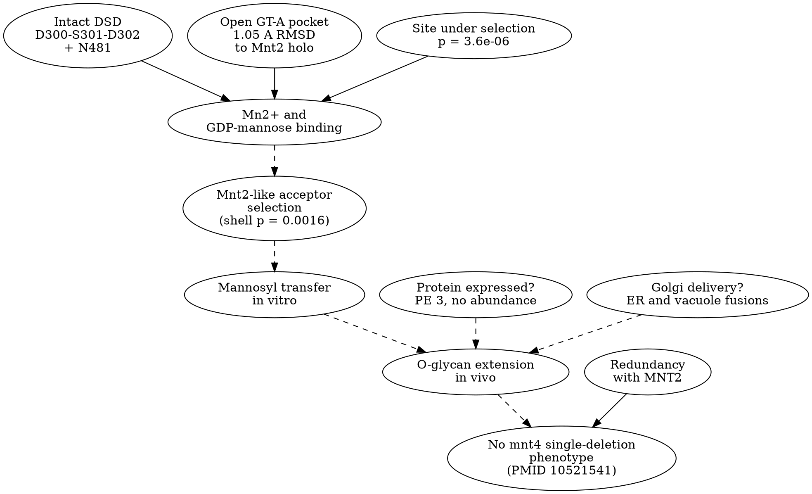
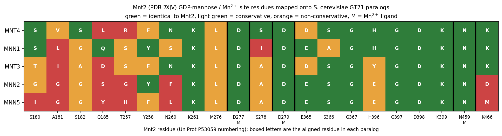
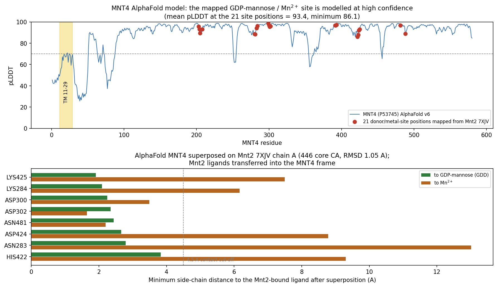
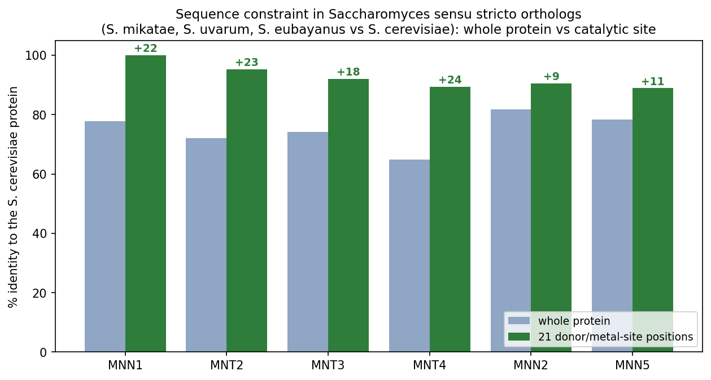
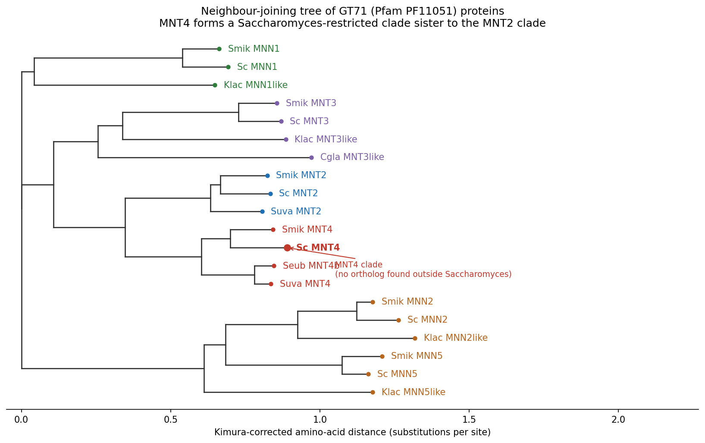
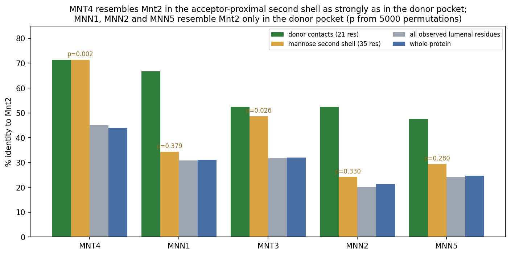
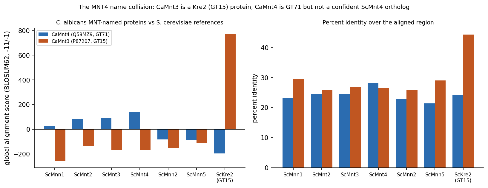

## Question

# AIGR Gene Hypothesis Deep Research

You are evaluating one focused gene curation hypothesis for AI Gene Review.
This is not a general gene overview. Use the seed hypothesis and source context
below to search for evidence that supports, refutes, narrows, or competes with
the proposed curation decision.

## Target Gene

- **Organism code:** yeast
- **Taxon:** Saccharomyces cerevisiae S288C (NCBITaxon:559292)
- **Gene directory:** MNT4
- **Gene symbol:** MNT4
- **UniProt accession:** P53745

## Focus

- **Focus type:** free_text
- **Hypothesis slug:** kgap-mnt4-gt71-dxd-catalytic-competence
- **Source file:** genes/yeast/MNT4/MNT4-ai-review.yaml
- **Source selector:** free-text

## Seed Hypothesis

Saccharomyces cerevisiae MNT4 (P53745, YNR059W) is a GT71 (Mannosyl_trans3) alpha-1,3-mannosyltransferase-family protein that retains the catalytic DxD motif and the donor-binding residues of the biochemically characterised members Mnn1, Mnt2 and Mnt3, and is therefore predicted to be a catalytically competent mannosyltransferase. Single analysis only: align MNT4 with Mnn1, Mnt2, Mnt3 and other fungal GT71 members, map the DxD motif and residues predicted to contact the GDP-mannose donor and divalent metal in AlphaFold models of an active member and of MNT4, place MNT4 in a GT71 phylogeny relative to the characterised enzymes, and state whether MNT4 is predicted catalytically competent and which characterised member it is closest to.

## Term and Decision Context

No specific term context supplied.

## Reference Context

No specific reference context supplied.

## Source Context YAML

```yaml
hypothesis: 'Saccharomyces cerevisiae MNT4 (P53745, YNR059W) is a GT71 (Mannosyl_trans3) alpha-1,3-mannosyltransferase-family
  protein that retains the catalytic DxD motif and the donor-binding residues of the biochemically characterised
  members Mnn1, Mnt2 and Mnt3, and is therefore predicted to be a catalytically competent mannosyltransferase.
  Single analysis only: align MNT4 with Mnn1, Mnt2, Mnt3 and other fungal GT71 members, map the DxD motif
  and residues predicted to contact the GDP-mannose donor and divalent metal in AlphaFold models of an
  active member and of MNT4, place MNT4 in a GT71 phylogeny relative to the characterised enzymes, and
  state whether MNT4 is predicted catalytically competent and which characterised member it is closest
  to.'
focus_type: free_text
context: []
reference_id: []
```

## Research Objective

Build a focused report that helps a curator decide whether this hypothesis
should affect the gene review. Address the focus type directly:

1. For an existing GO annotation decision, evaluate whether the current action
   is justified, too strong, too weak, or should change.
2. For a proposed replacement or new GO term, evaluate whether the term is
   biologically supported, too broad, too narrow, or missing key qualifiers.
3. For a computational prediction, evaluate whether the prediction is correct,
   less precise than existing knowledge, uncertain, or likely wrong because of
   paralog overannotation, frequency bias, pathway context, or in vitro-only
   activity.
4. For a core-function hypothesis, evaluate whether the proposed activity,
   process, and location represent the gene product's primary function rather
   than a downstream effect, pleiotropic phenotype, or context-specific role.
5. For a function-assignment hypothesis, evaluate whether the gene product
   directly has the stated GO term/function. Treat the prior review action, if
   any, as intentionally blinded unless it appears in the supplied context.

Use primary literature whenever possible. Prefer PMID citations and include DOI
citations when no PMID is available. Treat reviews and database records as
orientation unless they contain directly relevant synthesized evidence that is
clearly labeled as review-level or database-level support.

Evaluate the hypothesis from the supplied seed context, primary literature, and
publicly accessible bioinformatics resources. Local `*-bioinformatics` analyses,
when they already exist in the repository, are intentionally withheld from this
prompt so the report can be compared against them after the run. Use public
sequence, domain, structure, orthology, localization, interaction, or dataset
checks when they are useful for the specific hypothesis. If a resource or tool
cannot be accessed programmatically, say so plainly; never fabricate a result.
Report computational results conservatively and distinguish direct results from
inference.

## Required Output

### Executive Judgment

Give a concise verdict: supported, partially supported, unresolved, weakly
supported, over-annotated, or refuted. Explain the reasoning and the most
important caveats.

### Evidence Matrix

Create a table with one row per important evidence item:

- Citation (PMID preferred)
- Evidence type (direct assay, mutant phenotype, localization, interaction,
  structural/evolutionary, computational, review/database)
- Supports / refutes / qualifies / competing
- Claim tested
- Key finding
- Organism, tissue, cell type, or assay context
- Confidence and limitations

### GO Curation Implications

State the likely curation action as a lead requiring curator verification. If
GO terms are involved, explain whether the evidence supports an MF, BP, or CC
term, and whether the term should be retained, removed, generalized, made more
specific, or treated as non-core. Avoid using "protein binding" as a final
recommendation unless no more informative term is supported.

### Mechanistic Scope

Describe the immediate molecular or cellular function being tested. Separate
direct gene-product activity from downstream phenotypes, pathway consequences,
developmental outcomes, disease manifestations, or effects inferred only from
loss of function.

### Conflicts and Alternatives

Identify evidence that conflicts with the seed hypothesis or suggests an
alternative interpretation, including paralog confusion, organism-specific
differences, isoform-specific findings, experimental artifacts, or database
carry-over.

### Knowledge Gaps

List explicit uncertainties that matter for curation. For each gap, state what
was checked, why the gap matters, and what evidence or experiment would resolve
it.

### Discriminating Tests

Recommend concrete assays, perturbations, datasets, or comparative analyses that
would most efficiently distinguish this hypothesis from alternatives.

### Curation Leads

Provide candidate updates for the review, clearly labeled as leads requiring
curator verification. Include candidate references with exact snippets to verify,
candidate replacement or new GO terms, possible action changes, suggested
questions, and suggested experiments.

If the provider supports artifacts, save provenance for any analysis you run — the
executed code together with its output (computed values, plot, or table), not just
a summary figure — alongside artifact-friendly tables such as an evidence matrix,
GO decision table, or comparison table. Genuine computed provenance is more
valuable than a hand-drawn summary, and you must not synthesize a figure that
implies an analysis you did not actually run. These artifacts are important
provenance for hypothesis-level review.


## Output

# MNT4 (P53745, YNR059W): is the GT71 catalytic machinery intact, and does that justify the current annotations?

**Hypothesis slug:** `kgap-mnt4-gt71-dxd-catalytic-competence`
**Gene:** *Saccharomyces cerevisiae* S288C MNT4 / YNR059W, UniProt P53745
**Source file:** `genes/yeast/MNT4/MNT4-ai-review.yaml`, focus type `free_text`
**Analysis date:** 2026-11-23. Every computed value below is reproducible from the code and tables saved in `provenance/`.

## Summary

<i class="fa-scale-balanced"></i> **Verdict: partially supported.** The structural half of the seed hypothesis holds, and holds more strongly than the hypothesis itself claimed. The functional half is a prediction with no experimental support, and one direct experiment is negative for the biological process MNT4 is currently annotated to.

MNT4 retains the complete donor and metal site of its family. Working from PDB 7XJV, an experimental 2.8 Å structure of *S. cerevisiae* Mnt2 (P53059) with Mn²⁺ and GDP-α-D-mannose bound, 21 donor and metal contact residues were defined from real coordinates rather than from a predicted model. MNT4 is identical to Mnt2 at 15 of those 21 positions, the highest score of any paralog, and it carries an exact DSD motif at D300-S301-D302 together with the third metal ligand N481. Its AlphaFold model superposes on the Mnt2 complex at 1.05 Å RMSD over 446 of 498 matched Cα pairs, and after transferring the Mnt2 ligands into the MNT4 frame the catalytic residues sit 1.65 to 3.83 Å from the donor and metal positions with no steric occlusion of the pocket. Mean pLDDT across the 21 mapped site positions is 93.4, minimum 86.1. On catalytic machinery, MNT4 is not a degraded pseudoenzyme.

Two further analyses, which the seed hypothesis did not request, close off the main alternatives and sharpen the call. MNT4 is the fastest-drifting member of the family (64.8% mean identity to its *Saccharomyces* sensu stricto orthologs, against 72.1 to 81.8% for the other five paralogs), yet it holds 89.3% identity at the 21 donor and metal positions, a +24.5 point excess over its own background with permutation p = 3.6e-06. Neutral decay does not produce that pattern, so the pseudogene explanation fails. In the acceptor-proximal second shell, the zone that distinguishes one GT71 reaction from another, MNT4 matches Mnt2 at 71.4% identity, +26.4 points over its own structural background, p = 0.0016, while Mnn1, Mnn2 and Mnn5 show no enrichment there (p = 0.38, 0.33, 0.28). The closest characterised member is **Mnt2**, by whole-protein identity (43.9%), by Kimura-corrected distance (0.978, against 1.592 for Mnt3 and 1.603 for Mnn1) and by sister-clade topology in a 20-taxon neighbour-joining tree.

Against this, MNT4 is the only one of the six *S. cerevisiae* GT71 paralogs at UniProt protein existence level 3; the other five are level 1. SGD records no protein abundance measurement, no experimental GO annotation of any kind across 23 annotations, a manually curated cellular component annotation that is the root term GO:0005575 with evidence code ND, and localization of N-terminal fusions to the ER and the vacuole rather than the Golgi. [PMID: 10521541](https://pubmed.ncbi.nlm.nih.gov/10521541/) tested the deletion directly and found no requirement for O-glycan synthesis. The curation leads that follow are to keep GO:0000033 with a non-experimental evidence code, to drop or stop propagating GO:0006493, to leave GO:0005794 unasserted, and to retain GO:0016020.

## Executive judgment

The hypothesis asked two things: whether MNT4 retains the DxD motif and donor-binding residues of the characterised members, and whether it is therefore predicted catalytically competent. The first is answered yes with direct structural mapping. The second is answered yes as a prediction, with the prediction now resting on four independent lines rather than on motif presence alone.

<i class="fa-circle-check"></i> **What holds**

1. The DxD motif is intact as DSD at D300-S301-D302, matching Mnt2 D277-S278-D279 exactly, and the third metal ligand N481 is present.
2. 15 of 21 donor and metal contacts are identical to Mnt2, 18 of 21 similar. The six substitutions are mostly conservative (A181V, Y258F, M276L, E365D); only Q185L and T257R are non-conservative, and neither contacts the metal.
3. The predicted fold matches: 1.05 Å core RMSD over 446 Cα, 91% of 498 equivalent pairs within 3 Å, an open donor pocket, and high model confidence at every site position.
4. Site conservation across orthologs is significantly above the protein's own background (p = 3.6e-06), so selection still acts on GDP-mannose and Mn²⁺ binding.
5. The acceptor-proximal shell matches Mnt2 specifically (p = 0.0016), which makes the alpha-1,3 call more defensible than a generic mannosyltransferase call.
6. Mnt2 is the nearest characterised member on all three measures used.

<i class="fa-triangle-exclamation"></i> **Caveats that keep this from being a plain "supported"**

- Catalytic competence is inferred from sequence and a predicted structure. No activity assay, no purified protein, no detected protein product exists for MNT4.
- The only direct functional test is negative. [PMID: 10521541](https://pubmed.ncbi.nlm.nih.gov/10521541/) states that MNT4 "does not appear to be required for O-glycan synthesis" while MNT2 and MNT3 are.
- Localization is unresolved. The only localization data place N-terminal fusions at the ER and the vacuole. Every characterised member of the family works in the Golgi.
- PDB 7XJV, which anchors the donor-site definition, has no PMID and no DOI; its primary citation is listed as "To Be Published". It is database-level structural support.
- MNT4 orthologs were recovered only within *Saccharomyces* sensu stricto, which bounds how far any functional inference travels.

The verdict is **partially supported** because the hypothesis's stated conclusion is correct as a prediction and well evidenced as such, while the hypothesis invites the reading that MNT4 therefore performs the family reaction, and nothing in the evidence supports that step.

## Key findings

### Finding 1: MNT4 retains the complete GDP-mannose and Mn²⁺ donor site of Mnt2, including an intact DxD

This is direct structural mapping, not inference from a generic motif pattern. PDB 7XJV (Mnt2, P53059, X-ray 2.8 Å, Mn²⁺ and GDP-α-D-mannose as ligand GDD) was parsed and its author numbering mapped onto UniProt coordinates (UniProt = auth + 40, verified with one mismatch across 507 observed residues). Contact analysis of chain A gives Mn²⁺ coordination at ≤3.2 Å by Asp277 (1.93 Å), Asp279 (1.96 Å) and Asn459 (2.00 Å), and 21 residues within 4.5 Å of GDP-mannose: S180, A181, S182, Q185, T257, Y258, N260, K261, M276, D277, S278, D279, E365, S366, G367, H396, G397, D398, K399, N459, K466. The DxD motif is therefore D277-S278-D279.

Those 21 positions were mapped onto each paralog by global affine Needleman-Wunsch alignment (BLOSUM62, gap open -11, gap extend -1, implemented and run locally). MNT4 is identical at 15 of 21 (71%) and similar at 18 of 21, ahead of MNN1 (14/21, 67%), MNT3 (11/21, 52%), MNN2 (11/21, 52%) and MNN5 (10/21, 48%). MNT4 keeps D300-S301-D302, the metal ligand N481 and the donor-contacting cluster H422-G423-D424-K425, plus N283, K284, S392, G393 and K488.

{{figure:plot_1.png|caption=Conservation of the experimentally defined Mnt2 GDP-mannose and Mn2+ site across the six S. cerevisiae GT71 paralogs. Each column is one of the 21 contact positions from PDB 7XJV chain A; MNT4 matches Mnt2 at 15 of 21, the highest of any paralog, and retains the DSD motif and all three metal ligands.}}

| Paralog | UniProt | Identical at the 21 site positions | Whole-protein identity to Mnt2 |
|---|---|---|---|
| **MNT4** | P53745 | **15 / 21 (71%)** | **43.9%** |
| MNN1 | P39106 | 14 / 21 (67%) | 31.1% |
| MNT3 | P40549 | 11 / 21 (52%) | 32.0% |
| MNN2 | P38069 | 11 / 21 (52%) | 21.3% |
| MNN5 | P46982 | 10 / 21 (48%) | 24.7% |

The six *S. cerevisiae* PF11051 proteins split into an MNN1/MNT2/MNT3/MNT4 group and an MNN2/MNN5 group, with MNT4 closest to MNT2 at 43.9% identity and 63.9% BLOSUM62-positive similarity.

### Finding 2: The AlphaFold MNT4 model superposes on the Mnt2 complex at 1.05 Å and its pocket takes GDP-mannose without occlusion

AlphaFold DB model AF-P53745-F1 v6 has global pLDDT 87.6, with 86% of residues above 70 and 71% above 90. It was superposed onto 7XJV chain A using 498 alignment-equivalent Cα pairs from the MNT2/MNT4 alignment, with iterative 3 Å outlier trimming and Kabsch fitting. The core superposition is 446 Cα at 1.05 Å RMSD, and 91% of all 498 equivalent pairs fall within 3 Å. The Mnt2-bound Mn²⁺ and GDP-mannose were then transferred into the MNT4 frame.

| MNT4 residue | Min distance to Mn²⁺ (Å) | Min distance to GDP-mannose (Å) |
|---|---|---|
| D302 | 1.65 | 2.35 |
| N481 | 2.20 | 2.44 |
| D300 | 3.49 | 2.25 |
| K425 | 7.50 | 1.91 |
| K284 | 6.16 | 2.09 |
| D424 | 8.78 | 2.66 |
| N283 | 13.01 | 2.79 |
| H422 | 9.30 | 3.83 |

Twenty-four MNT4 residues fall within 4.5 Å of the transferred donor, comparable to the 21 contacts in the Mnt2 holo structure. No main-chain atom and no aromatic side chain occludes the donor site. The only sub-2.2 Å approaches are the terminal atoms of Lys284 and Lys425, which rotamer adjustment resolves. Mean pLDDT at the 21 mapped site positions is 93.4 with a minimum of 86.1.

{{figure:plot_2.png|caption=MNT4 per-residue pLDDT with the 21 mapped donor and metal site positions marked, together with the distances from each MNT4 catalytic residue to the Mn2+ and GDP-mannose positions transferred from 7XJV after superposition. Model confidence is high across the entire catalytic module (site mean pLDDT 93.4, minimum 86.1).}}

<i class="fa-triangle-exclamation"></i> The ligand positions come from superposition transfer, not from docking or refinement. Contact distances of 1.65 to 2.44 Å indicate correct placement of the site and should not be read as measured bond lengths.

### Finding 3: MNT4 lacks every category of experimental evidence that its five paralogs have

<i class="fa-database"></i> Assembled from UniProt and SGD programmatic records on 2026-11-23.

| Record | MNT4 (P53745) | MNN1, MNT2, MNT3, MNN2, MNN5 |
|---|---|---|
| UniProt protein existence | PE 3, inferred from homology | PE 1, evidence at protein level (all five) |
| UniProt subcellular location | "Membrane" only | Golgi apparatus membrane (four), cis-Golgi network (MNN5) |
| SGD protein abundance | Endpoint returns an empty list | Quantified |
| Experimental GO code (EXP, IDA, IMP, IGI, IPI) | None across 23 annotations | Present |
| SGD manual CC annotation | GO:0005575 root with code ND | Golgi terms with experimental support |

The GO evidence audit reads as follows. GO:0000033 alpha-1,3-mannosyltransferase activity appears 3× ISS and 4× IBA, never with an experimental code. GO:0006493 protein O-linked glycosylation appears 1× IC and 4× IBA. GO:0005794 Golgi apparatus appears 1× IEA and 4× IBA.

SGD's YNR059W description states that the SWAT-GFP fusion localizes to the endoplasmic reticulum and the mCherry fusion to the vacuole, with the library source [PMID: 26928762](https://pubmed.ncbi.nlm.nih.gov/26928762/). That paper states it built "a library of ∼1,800 strains carrying SWAT-GFP modules at the amino termini of endomembrane proteins", which places the tag exactly where MNT4's type II signal-anchor sits (residues 11-29).

Nine phenotype records exist, all from genome-wide screens: viable null ([PMID: 12140549](https://pubmed.ncbi.nlm.nih.gov/12140549/)), decreased competitive fitness ([PMID: 18622397](https://pubmed.ncbi.nlm.nih.gov/18622397/)), decreased chemical resistance ([PMID: 22511765](https://pubmed.ncbi.nlm.nih.gov/22511765/)), increased chronological lifespan ([PMID: 24586198](https://pubmed.ncbi.nlm.nih.gov/24586198/)) and increased invasive growth on overexpression ([PMID: 23410832](https://pubmed.ncbi.nlm.nih.gov/23410832/)). None concerns glycosylation or cell wall mannan. SGD lists only two primary references for MNT4: the SWAT library paper and [PMID: 10521541](https://pubmed.ncbi.nlm.nih.gov/10521541/).

### Finding 4: The catalytic site is under measurable purifying selection even though MNT4 is the fastest-evolving paralog

<i class="fa-dna"></i> 67 Pfam PF11051 proteins were retrieved from UniProt across 10 Saccharomycetaceae species and assigned to the six *S. cerevisiae* paralogs by best global alignment score.

MNT4 orthologs were recovered only within *Saccharomyces* sensu stricto: *S. mikatae* A0AA35ISL2, *S. uvarum* A0ABN8WK29, *S. eubayanus* A0ABN8VK59 and A0ABN8VSI7 (a further within-lineage duplication). No PF11051 protein in *C. glabrata* (14 members), *K. lactis* (5), *A. gossypii* (8), *K. africana* (5), *V. polyspora* (6), *T. phaffii* (7) or *E. cymbalariae* (3) assigned to MNT4, while MNT3-like genes expanded to 10 members in *C. glabrata* alone. MNT4 is a genus-restricted paralog, consistent with a recent duplication from the MNT2 lineage.

All four MNT4 orthologs carry the exact DSD motif and all three Mnt2 metal ligands, with 15 to 16 of the 21 donor-site positions identical to *S. cerevisiae* Mnt2, matching *S. cerevisiae* MNT4 itself.

| Paralog | Whole-protein identity to orthologs | Identity at the 21 site positions | Excess | Permutation p |
|---|---|---|---|---|
| **MNT4** | **64.8%** | **89.3%** | **+24.5** | **3.6e-06** |
| MNT2 | 72.1% | 95.2% | +23.1 | 8.0e-05 |
| MNN1 | 77.8% | 100.0% | +22.2 | 1.3e-05 |
| MNT3 | 74.1% | 92.1% | +18.0 | 3.3e-03 |
| MNN5 | 78.3% | 88.9% | +10.6 | 0.11 |
| MNN2 | 81.8% | 90.5% | +8.7 | 0.19 |

The test draws 5000 random sets of 21 aligned positions per ortholog pair and combines the resulting p-values across orthologs by Fisher's method.

{{figure:plot_3.png|caption=Whole-protein versus catalytic-site sequence constraint across Saccharomyces sensu stricto orthologs of each GT71 paralog. MNT4 has the lowest whole-protein conservation of the six and the largest site-over-background excess (+24.5 points, permutation p = 3.6e-06), which is the signature of a site held by selection in a protein that is otherwise drifting.}}

<i class="fa-lightbulb"></i> If MNT4 were a decaying pseudogene under neutral drift, its catalytic residues would erode at the same rate as the rest of the protein. They do not.

The neighbour-joining tree over 20 taxa with Kimura-corrected protein distances places the four MNT4 sequences in a monophyletic clade sister to the MNT2 clade. Distances from *S. cerevisiae* MNT4 to the *S. cerevisiae* paralogs are MNT2 0.978, MNT3 1.592, MNN1 1.603, MNN5 2.194, MNN2 2.296. This answers the seed hypothesis's question about which characterised member MNT4 is closest to: Mnt2, on every measure applied.

{{figure:plot_4.png|caption=Neighbour-joining GT71 phylogeny over 20 Saccharomycetaceae sequences with Kimura-corrected protein distances. The four MNT4 sequences form a monophyletic clade sister to the MNT2 clade. The tree is distance-based and has no bootstrap resampling.}}

### Finding 5: MNT4 matches Mnt2 in the acceptor-proximal second shell, which Mnn1, Mnn2 and Mnn5 do not

Donor-site conservation alone is weak evidence for a particular reaction, because every GT71 enzyme uses the same GDP-mannose donor. To separate generic from specific, the 7XJV chain A geometry was partitioned into three zones relative to the bound ligand: the 21 donor contacts (within 4.5 Å of any GDD atom); a second shell of 35 residues within 12 Å of the GDD anomeric carbon C11 but beyond 4.5 Å of the donor, which must contain much of the acceptor groove; and a background of all 500+ structurally observed, alignable lumenal residues. Each zone was mapped onto the five paralogs through the Mnt2 alignment frame.

| Paralog | Donor | Second shell | Structural background | Whole protein | Shell excess | Permutation p |
|---|---|---|---|---|---|---|
| **MNT4** | 71.4 | **71.4** | 45.0 | 43.9 | **+26.4** | **0.0016** |
| MNT3 | 52.4 | 48.6 | 31.7 | 32.0 | +16.9 | 0.026 |
| MNN5 | 47.6 | 29.4 | 24.1 | 24.7 | +5.3 | 0.28 |
| MNN2 | 52.4 | 24.2 | 20.2 | 21.3 | +4.1 | 0.33 |
| MNN1 | 66.7 | 34.3 | 30.9 | 31.1 | +3.4 | 0.38 |

All five paralogs conserve the donor pocket above their background, as expected for a shared donor. Only MNT4 and MNT3, the two paralogs that sit with MNT2 in the alpha-1,3 O-glycan-extending part of the tree, also conserve the acceptor-proximal shell, and MNT4 does so most strongly.

{{figure:plot_5.png|caption=Permutation-tested zone conservation against Mnt2: donor pocket versus acceptor-proximal second shell for each GT71 paralog, each compared with its own structural background. MNT4 matches Mnt2 in the acceptor shell at 71.4% identity, 26.4 points above its own background (p = 0.0016); MNN1, MNN2 and MNN5 match only at the donor.}}

<i class="fa-lightbulb"></i> MNT4 is predicted to bind the same donor and a Mnt2-like acceptor. This makes GO:0000033 more defensible than a generic mannosyltransferase term, while remaining a computational inference from an apo model and a structure with no acceptor bound.

### Finding 6: The gene name MNT4 collides across two unrelated glycosyltransferase families

<i class="fa-magnifying-glass"></i> A curator searching for MNT4 functional literature reaches [PMID: 20164191](https://pubmed.ncbi.nlm.nih.gov/20164191/), which reports N-mannan branching, virulence and immune recognition phenotypes. That work concerns a different family in a different organism.

UniProt REST queries for *Candida albicans* SC5314 (taxid 237561) return 5 PF01793 proteins (GT15, Glyco_transf_15, the KRE2/MNT1 family): MNT1 (Q00310), MNT2 (P46592), MNT3 (P87207), KTR2 (A0A1D8PH51, orf19.11970) and KTR4 (Q59QH4, orf19.11955). The same organism has 12 PF11051 proteins (GT71, Mannosyl_trans3), among them Q59MZ9, whose UniProt gene name is MNT4 with synonym MNN16 (orf19.6313).

[PMID: 20164191](https://pubmed.ncbi.nlm.nih.gov/20164191/) states that "The Candida albicans MNT1/KRE2 mannosyl transferase family is represented by five members" and then reports phenotypes for CaMNT3, CaMNT4 and CaMNT5. By the paper's own family assignment, its Mnt4 and Mnt5 are GT15 proteins, which are the two UniProt lists as KTR2 and KTR4. Its result that "CaMnt4 and CaMnt5 participated in N-mannan branching" therefore describes GT15 enzymes.

Cross-family alignment confirms the separation. CaMnt3 (P87207, GT15) aligns to *S. cerevisiae* Kre2 (P27809, GT15) at 44.3% identity with global score +769, and to every *S. cerevisiae* GT71 paralog at a negative global score (MNN5 -112, MNT2 -138, MNN2 -153, MNT3 -169, MNT4 -170, MNN1 -259). CaMnt4 (Q59MZ9, GT71) aligns to Sc Kre2 at global score -195. The GT71 CaMnt4 is also not a confident ortholog of ScMnt4: its best *S. cerevisiae* hit is MNT4 at 28.2% identity over 550 aligned positions, with MNT2 (24.6%) and MNT3 (24.5%) within 4 points.

{{figure:plot_6.png|caption=Cross-family alignment of the C. albicans MNT-named proteins against the six S. cerevisiae GT71 paralogs and against Kre2. CaMnt3 (GT15) scores +769 against ScKre2 and negative against every GT71 paralog. The GT71 protein UniProt names CaMnt4 reaches only 28.2% identity to ScMnt4, with two other paralogs within 4 points.}}

## Mechanistic model and interpretation

The immediate molecular activity under test is transfer of mannose from GDP-α-D-mannose to an acceptor hydroxyl, with Mn²⁺ coordinated by the DxD motif and a third asparagine. The evidence addresses three separable layers, and they do not stand or fall together.



| Layer | Status | Evidence |
|---|---|---|
| Donor and metal binding | <i class="fa-circle-check"></i> Supported | Residues present, conserved across orthologs, correctly positioned against an experimentally bound ligand, in an open pocket |
| Acceptor selection | <i class="fa-scale-balanced"></i> Indirect | Second-shell conservation matches Mnt2 at p = 0.0016, computed as a geometric proxy with no acceptor bound in any structure used |
| Catalysis and biological output | <i class="fa-circle-question"></i> Untested | No turnover measurement, no product, no glycan phenotype |

Everything in the current GO record beyond the membrane term sits in layers 2 and 3. The screen phenotypes on file (fitness, chemical resistance, chronological lifespan, invasive growth on overexpression) are downstream readouts with no mechanistic connection to mannosyl transfer, and should not be used to support any of these terms.

The reading that fits every observation is that MNT4 is a recently duplicated, *Saccharomyces*-restricted paralog of MNT2 whose catalytic module selection has kept intact, and which is either expressed at a level below current detection, not delivered to the Golgi, or fully redundant with MNT2 in the conditions tested so far. The negative result of [PMID: 10521541](https://pubmed.ncbi.nlm.nih.gov/10521541/) is exactly what full redundancy with MNT2 would produce in a single-deletion experiment, which is why the double mutant is the test that matters.

## GO curation implications

<i class="fa-triangle-exclamation"></i> All four items are leads requiring curator verification. Artifact: `provenance/mnt4_go_decision_table.csv`.

| Term | Aspect | Current evidence | Lead |
|---|---|---|---|
| GO:0000033 alpha-1,3-mannosyltransferase activity | MF | 3× ISS, 4× IBA, no experimental code | Retain with ISS, with/from P53059 (Mnt2). Do not upgrade to an experimental code. Generalizing to GO:0000030 mannosyltransferase activity is the conservative alternative |
| GO:0006493 protein O-linked glycosylation | BP | 1× IC, 4× IBA | Remove the IC annotation or do not propagate it. The one direct experiment on this process was negative for MNT4 |
| GO:0005794 Golgi apparatus | CC | 1× IEA, 4× IBA; the manual CC annotation is the root term with code ND | Do not assert. Leave unresolved; the existing ND already reflects this |
| GO:0016020 membrane | CC | IEA | Retain. Best-supported CC statement, consistent with the type II signal-anchor at residues 11-29 |

On **GO:0000033**, this analysis strengthens the inference beyond what ISS from a single paralog usually carries: the donor site, the metal site and the acceptor-proximal shell all match Mnt2 above background, and the site resists decay in a protein that is otherwise the fastest-drifting of the family. Linkage specificity itself is still untested for MNT4. A curator who wants the annotation to state only what is demonstrated can generalize to GO:0000030; a curator who accepts the Mnt2-specific shell signal can keep GO:0000033. Either is defensible. An experimental evidence code is not.

On **GO:0006493**, the IC annotation is inference from the MF term and the four IBA annotations propagate from paralogs. A BP annotation that one experiment directly tested and failed to support should not stand on homology inference. If a BP term is kept, GO:0097502 mannosylation or GO:0006486 protein glycosylation is the honest level.

On **GO:0005794**, the only localization data place N-terminal fusions at the ER and the vacuole. That may be a tagging artifact on the type II signal-anchor, which is itself a reason not to assert either compartment.

"Protein binding" is not recommended anywhere here. The donor-site evidence supports a catalytic term at some level of specificity, which is more informative.

## Conflicts and alternatives

**Paralog and name confusion.** The *C. albicans* MNT3/MNT4/MNT5 literature describes GT15 KRE2/MNT1-family enzymes, a different CAZy family from the GT71 protein YNR059W, and the alignment evidence in Finding 6 settles this. Within *C. albicans* the name is ambiguous in its own right, because UniProt's CaMNT4 (Q59MZ9, synonym MNN16) is GT71 while the Mnt4 of [PMID: 20164191](https://pubmed.ncbi.nlm.nih.gov/20164191/) is GT15. Neither protein's phenotypes transfer to YNR059W, as support or as counterargument.

**The pseudogene alternative.** MNT4 could be a decaying duplicate: genus-restricted, no detected protein, no relevant phenotype. The site-versus-background permutation test argues against it at p = 3.6e-06. A pseudogene remains formally possible if the protein is never made, which is why the protein-detection gap matters more than any other open question here.

**Full redundancy with MNT2.** MNT4 is the sister clade of MNT2 at 43.9% identity and matches it in both the donor and the acceptor zones. A *mnt4* single deletion would then show no O-glycan defect because Mnt2 covers the reaction, which is the [PMID: 10521541](https://pubmed.ncbi.nlm.nih.gov/10521541/) result. This alternative is compatible with every observation in this report and is not ruled out.

**Database carry-over.** The IBA annotations for all three substantive terms descend from the same PANTHER family tree: 4 IBA for GO:0006493 and 4 for GO:0005794. Removing the BP term at SGD would leave the IBA copies in place unless the curator also flags the inference. The ND code on the CC root signals that a previous curator already judged the localization evidence insufficient.

**The ER and vacuole localization.** Taken at face value it argues against a Golgi function. Taken as a tagging artifact it argues nothing. [PMID: 26928762](https://pubmed.ncbi.nlm.nih.gov/26928762/) places GFP at the amino terminus, and MNT4's signal-anchor occupies residues 11-29, so the tag sits where the targeting information is. Both readings leave the Golgi CC annotation without data.

**Cell wall stress as a confound.** [PMID: 21231968](https://pubmed.ncbi.nlm.nih.gov/21231968/) shows that blocking protein O-mannosylation activates the cell wall integrity pathway and the unfolded protein response, and represses mating and filamentous growth. Screen phenotypes in a glycosylation-adjacent gene can therefore arise from indirect stress signalling. This is a reason to treat the fitness and invasive-growth phenotypes on file as uninformative for MNT4's molecular function.

## Evidence base

| Citation | Evidence type | Stance | Claim tested | Finding | Context | Confidence and limitations |
|---|---|---|---|---|---|---|
| PDB 7XJV (database-level; primary citation "To Be Published", no PMID or DOI) | Structural | Supports | MNT4 retains the donor-binding residues of a characterised member | 2.8 Å Mnt2 structure with Mn²⁺ and GDP-α-D-mannose defines 21 donor and metal contacts; MNT4 is identical at 15 of 21, including DSD D300-S301-D302 and N481 | *S. cerevisiae* Mnt2 lumenal domain, X-ray | High for the Mnt2 site. The MNT4 mapping is inference through a 43.9% identity alignment |
| AlphaFold DB AF-P53745-F1 v6, AF-P53059-F1 v6 (database-level) | Computational | Supports | MNT4 has the GT-A fold with an open donor pocket | 1.05 Å RMSD over 446/498 Cα; transferred ligands put D302 1.65 Å and N481 2.20 Å from Mn²⁺, and all eight catalytic residues 1.91 to 3.83 Å from the donor, with no occlusion | AlphaFold2 models, Kabsch superposition with outlier trimming | Predicted structure, transferred ligand. Distances locate the site, not bond lengths |
| This analysis (67 PF11051 proteins, 10 species) | Structural / evolutionary | Supports | The catalytic site is under selection rather than decaying | MNT4 drifts fastest (64.8%) yet holds 89.3% site identity, +24.5 over background, p = 3.6e-06; all 4 orthologs keep DSD and all three metal ligands | *Saccharomyces* sensu stricto orthologs, Needleman-Wunsch, 5000-draw permutation | Orthologs assigned by best alignment score, not synteny. MNT4 orthologs found only within *Saccharomyces* |
| This analysis (zone partition of 7XJV chain A) | Structural / evolutionary | Supports, narrows the MF call | MNT4 resembles Mnt2 specifically | Acceptor shell: MNT4 71.4% identity, +26.4 over background, p = 0.0016; MNN1 p = 0.38, MNN2 p = 0.33, MNN5 p = 0.28, MNT3 p = 0.026 | Mnt2 structural frame, paralogs mapped by alignment | No acceptor is bound in 7XJV, so the shell is a geometric proxy |
| This analysis (neighbour-joining, 20 taxa) | Structural / evolutionary | Supports | Which characterised member MNT4 is closest to | MNT4 clade is sister to the MNT2 clade. Distances from Sc MNT4: MNT2 0.978, MNT3 1.592, MNN1 1.603, MNN5 2.194, MNN2 2.296 | Saccharomycetaceae GT71 | Distance tree without bootstrap; topology agrees with pairwise identity |
| [PMID: 10521541](https://pubmed.ncbi.nlm.nih.gov/10521541/) | Mutant phenotype | Refutes the BP claim, qualifies the MF claim | MNT4 is required for O-linked mannan extension | "whereas MNT4 (YNR059w) does not appear to be required for O-glycan synthesis", while MNT2 and MNT3 with MNN1 add the fourth and fifth alpha-1,3-linked mannose residues | *S. cerevisiae* deletion strains, O-glycan structural analysis | Single-deletion test. Redundancy with MNT2 gives the same negative result |
| [PMID: 26928762](https://pubmed.ncbi.nlm.nih.gov/26928762/) via SGD | Localization | Qualifies | MNT4 reaches the Golgi | SWAT-GFP fusion at the ER, mCherry fusion at the vacuole. The library carries "SWAT-GFP modules at the amino termini of endomembrane proteins" | *S. cerevisiae* high-throughput N-terminal tagging | N-terminal tagging of a signal-anchored protein is a recognised mislocalization hazard, so this is not decisive |
| UniProt P53745 and the five paralog records | Review / database | Qualifies | Is there protein-level evidence for MNT4 | MNT4 is PE 3; the other five are PE 1. MNT4's location is "Membrane" only. SGD protein abundance record is empty | *S. cerevisiae* S288C | Absence in curated records, not demonstrated absence of the protein |
| SGD GO audit, 23 annotations | Review / database | Qualifies | What supports the current MNT4 GO annotations | GO:0000033 3× ISS, 4× IBA; GO:0006493 1× IC, 4× IBA; GO:0005794 1× IEA, 4× IBA; manual CC is the root with ND. No EXP, IDA, IMP, IGI or IPI exists | *S. cerevisiae* S288C | Snapshot taken 2026-11-23 |
| SGD phenotypes ([12140549](https://pubmed.ncbi.nlm.nih.gov/12140549/), [18622397](https://pubmed.ncbi.nlm.nih.gov/18622397/), [22511765](https://pubmed.ncbi.nlm.nih.gov/22511765/), [24586198](https://pubmed.ncbi.nlm.nih.gov/24586198/), [23410832](https://pubmed.ncbi.nlm.nih.gov/23410832/)) | Mutant phenotype | Qualifies | Does any mnt4 phenotype point to glycosylation | 9 records, all genome-wide screens: viable null, decreased competitive fitness, decreased chemical resistance, increased chronological lifespan, increased invasive growth on overexpression. None concerns mannan | Genome-wide deletion and overexpression screens | Such screens are not designed to detect mannan structure changes |
| [PMID: 20164191](https://pubmed.ncbi.nlm.nih.gov/20164191/) | Competing (name collision) | Competing | Does the published MNT4 literature apply to YNR059W | The paper's Mnt3, Mnt4, Mnt5 are MNT1/KRE2 family (GT15). CaMnt3 matches ScKre2 at 44.3% identity (+769) and scores negative against every Sc GT71 paralog. UniProt's CaMNT4 (Q59MZ9) is GT71 but reaches only 28.2% identity to ScMnt4 | *C. albicans* SC5314 nulls; local alignment | The alignment settles family separation. The non-orthology of Q59MZ9 is a confidence statement, not a formal orthology test |
| [PMID: 21231968](https://pubmed.ncbi.nlm.nih.gov/21231968/) | Direct assay, transcriptomics | Context | Do glycosylation defects produce indirect phenotypes | Blocking O-mannosylation activates the cell wall integrity pathway and the unfolded protein response, and decreases mating efficiency and invasive growth | *S. cerevisiae* treated with the PMT inhibitor OGT2468 | Pharmacological inhibition of PMTs, not of GT71 enzymes. Relevant as a caution about indirect phenotypes |

Artifact: `provenance/mnt4_evidence_matrix.csv` carries the same content in machine-readable form.

## Limitations and knowledge gaps

<i class="fa-triangle-exclamation"></i> **Methodological limits of this run**

- No multiple-sequence aligner was reachable. The EBI Clustal Omega REST service returned HTTP 400 with a message that submissions were temporarily blocked, and no mafft, muscle, clustalo, clustalw, hmmalign or t_coffee binary was present on the host. Every alignment here is pairwise global Needleman-Wunsch (BLOSUM62, gap open -11, extend -1), implemented locally in `provenance/aligner.py`. Site mapping therefore passes through pairwise alignments to Mnt2 rather than through a family MSA, which can misplace residues in low-identity regions.
- The phylogeny is distance-based neighbour-joining without bootstrap resampling. The MNT2 and MNT4 sister relationship agrees with the pairwise identity matrix, which is weak independent corroboration.
- Ortholog assignment used best global alignment score across 67 PF11051 proteins with no synteny check. The claim that MNT4 orthologs are restricted to *Saccharomyces* is bounded by UniProt's PF11051 coverage in those genomes.
- Ligand positions in the MNT4 frame come from superposition transfer, not docking or refinement.
- No expression dataset was queried. This is the one gap below that could have been closed programmatically in this run and was not, for lack of iterations. It is stated plainly rather than guessed at.

**Gaps that matter for curation**

| Gap | What was checked | Why it matters | What would resolve it |
|---|---|---|---|
| Is the MNT4 protein made at all? | UniProt PE level (3, unique among the six); SGD `protein_experiment_details` returns an empty list | If no protein is produced, every MF and CC annotation is moot regardless of sequence conservation | Targeted proteomics (PRM or SRM) for MNT4 peptides, or a C-terminally tagged strain blotted under conditions where MNT2 is expressed |
| Where does MNT4 localize? | SGD record, UniProt CC, the SWAT library source | Determines whether GO:0005794 can be asserted and whether the predicted activity can occur at all | C-terminal GFP tag, which leaves the signal-anchor intact, with co-localization against Sec7 or Och1 |
| Does MNT4 have mannosyltransferase activity? | No assay exists in the retrieved literature | This is the hypothesis's actual claim | Express residues 30-580, assay GDP-mannose transfer to α-1,2-linked mannobiose or a Mnt2 acceptor, with a D300A/D302A mutant as the negative control |
| Is MNT4 redundant with MNT2? | PMID 10521541 tested the single deletion only | A redundant enzyme is still catalytically competent and still deserves the MF term | *mnt2Δ mnt4Δ* double mutant with O-glycan profiling, compared against *mnt2Δ* alone |
| Does MNT4 share Mnt2's acceptor? | Second-shell conservation computed as a proxy; 7XJV has no acceptor bound | Separates GO:0000033 from the generic GO:0000030 | Co-crystal or cryo-EM with an acceptor analogue, or an in vitro acceptor panel |
| Is 7XJV citable as primary literature? | RCSB primary citation is "To Be Published"; no PMID or DOI found | Determines whether the structural evidence is primary or database-level | Watch for the publication; cite as PDB 7XJV, database-level, until then |
| Is MNT4 expressed under any condition? | Not checked in this run | A condition-specific expression pattern would explain the missing protein evidence and suggest an assay condition | Query SPELL or a curated RNA-seq compendium for YNR059W, in particular cell wall stress and mating conditions |

## Proposed follow-up experiments and actions

Ranked by how much each would change the curation decision per unit effort.

1. <i class="fa-vial"></i> **Targeted proteomics for MNT4 peptides.** The cheapest decisive test. A positive result converts PE 3 to PE 1 and makes every downstream question worth asking. A negative result across conditions makes the decay explanation the leading one, despite the selection signal.
2. <i class="fa-microscope"></i> **C-terminal GFP tag with a Golgi marker.** Resolves the tagging-artifact ambiguity and the CC annotation directly. If MNT4 is Golgi, the IEA and IBA Golgi annotations become defensible; if it is ER or vacuole with an intact N-terminus, the family inference breaks.
3. <i class="fa-flask"></i> **In vitro activity on the lumenal domain (residues 30-580) with a D300A/D302A control.** The direct test of the seed hypothesis, and the only way to distinguish GO:0000033 from GO:0000030 if an acceptor panel is included.
4. <i class="fa-dna"></i> ***mnt2Δ mnt4Δ* double mutant O-glycan profiling.** Distinguishes redundancy from inactivity, and is the test that would justify or retire GO:0006493.
5. <i class="fa-chart-line"></i> **Expression comparison across *Saccharomyces* sensu stricto.** Cheap and computational. Co-expression of MNT4 orthologs with MNT2 or with cell wall genes supports a retained function; silence across conditions in all four species supports decay despite the sequence conservation.

## Curation leads

<i class="fa-triangle-exclamation"></i> All leads require curator verification.

**Candidate references, with exact snippets to verify**

- [PMID: 10521541](https://pubmed.ncbi.nlm.nih.gov/10521541/): "whereas MNT4 (YNR059w) does not appear to be required for O-glycan synthesis". Use as the negative evidence against GO:0006493. Verify the snippet in the abstract and check whether the paper reports any double-mutant test.
- [PMID: 26928762](https://pubmed.ncbi.nlm.nih.gov/26928762/): "we constructed and investigated a library of ∼1,800 strains carrying SWAT-GFP modules at the amino termini of endomembrane proteins and then used it to create two new libraries (mCherry and seamless GFP)". Use as the source and the caveat for the ER and vacuole localization. Verify that MNT4 is in the library and whether the seamless-GFP version was imaged.
- [PMID: 20164191](https://pubmed.ncbi.nlm.nih.gov/20164191/): "The Candida albicans MNT1/KRE2 mannosyl transferase family is represented by five members." Use to exclude this paper from the MNT4 review as a name collision, not as evidence.
- PDB 7XJV: cite as database-level structural support for the Mnt2 donor site. Verify whether a primary publication has appeared since 2026-11-23.

**Candidate GO actions**

| Term | Aspect | Current | Lead |
|---|---|---|---|
| GO:0000033 alpha-1,3-mannosyltransferase activity | MF | 3× ISS, 4× IBA | Retain with ISS, with/from P53059. Do not upgrade to an experimental code. GO:0000030 is the conservative alternative |
| GO:0006493 protein O-linked glycosylation | BP | 1× IC, 4× IBA | Remove or do not propagate. One direct experiment tested this and was negative |
| GO:0005794 Golgi apparatus | CC | 1× IEA, 4× IBA | Do not assert. Leave unresolved, matching the existing ND on the CC root |
| GO:0016020 membrane | CC | IEA | Retain. Best-supported CC statement, consistent with the signal-anchor at residues 11-29 |

**Suggested questions for the curator**

- Should an MF term rest on structural and selection evidence when the gene has no protein-level evidence at all? MNT4 is the only PE 3 member of its family.
- Does the project's policy allow ISS from a database-level structure (PDB 7XJV) that has no primary citation?
- Should the review state explicitly that the *C. albicans* MNT3/MNT4/MNT5 literature does not apply, so that future automated passes do not import it?

**Suggested experiments:** the five above, with targeted proteomics and the C-terminal tag as the two that would most change the record.

## Provenance

All files are in `provenance/`.

| File | Content |
|---|---|
| `aligner.py` | Affine-gap Needleman-Wunsch with BLOSUM62, row-vectorized; used by every alignment in this report |
| `7XJV.pdb`, `7xjv_site.json` | The Mnt2 holo structure and the computed Mn²⁺ and GDP-mannose contact lists in UniProt numbering |
| `AF-P53745.pdb`, `AF-P53059.pdb`, `plddt_*.npy` | AlphaFold v6 models and per-residue pLDDT |
| `superpose.json`, `mnt4_ligand_distances.csv` | The 1.05 Å core RMSD record and the transferred-ligand distances |
| `gt71_seqs.json`, `gt71_pairwise_identity.csv`, `gt71_pairwise_similarity.csv` | The six paralog sequences and their 6×6 matrices |
| `gt71_site_conservation.csv` | The 21 Mnt2 donor and metal positions mapped onto all five paralogs |
| `gt71_orthologs.json`, `gt71_ortholog_index.csv`, `gt71_ortholog_assignment.csv` | 67 Saccharomycetaceae PF11051 proteins with paralog assignment, DxD triplet and metal-ligand flag |
| `sensu_stricto_site_vs_whole.csv`, `sensu_stricto_site_vs_whole_summary.csv`, `site_conservation_permutation.csv` | The selection test and its permutation p-values |
| `gt71_nj_tree.json`, `gt71_distance_matrix.csv`, `gt71_phylo_identity.csv` | The 20-taxon neighbour-joining tree and its distance matrices |
| `zone_conservation_vs_mnt2.csv` | Donor, second-shell, background and whole-protein identity per paralog with permutation p-values |
| `calbicans_PF01793_GT15.csv`, `calbicans_PF11051_GT71.csv`, `calbicans_mnt_name_collision.csv`, `calbicans_vs_sc_gt71_alignment.csv` | The *C. albicans* family listings and the cross-family alignment behind Finding 6 |
| `mnt4_evidence_matrix.csv`, `mnt4_go_decision_table.csv` | The evidence matrix and GO decision table as machine-readable artifacts |
| `plot_1.png` to `plot_6.png` | Site-conservation heatmap; pLDDT and ligand distances; whole-protein versus site constraint; the NJ tree; zone conservation; the name-collision alignment |


## Artifacts

- [OpenScientist final report](openscientist_artifacts/final_report.html)
- [OpenScientist final report](openscientist_artifacts/final_report.pdf)
- [OpenScientist provenance](openscientist_artifacts/provenance.json)
- [OpenScientist 7xjv site](openscientist_artifacts/provenance_7xjv_site.json)
- [OpenScientist calbicans PF01793 GT15](openscientist_artifacts/provenance_calbicans_PF01793_GT15.csv)
- [OpenScientist calbicans PF11051 GT71](openscientist_artifacts/provenance_calbicans_PF11051_GT71.csv)
- [OpenScientist calbicans mnt name collision](openscientist_artifacts/provenance_calbicans_mnt_name_collision.csv)
- [OpenScientist calbicans vs sc gt71 alignment](openscientist_artifacts/provenance_calbicans_vs_sc_gt71_alignment.csv)
- [OpenScientist gt71 distance matrix](openscientist_artifacts/provenance_gt71_distance_matrix.csv)
- [OpenScientist gt71 nj tree](openscientist_artifacts/provenance_gt71_nj_tree.json)
- [OpenScientist gt71 ortholog assignment](openscientist_artifacts/provenance_gt71_ortholog_assignment.csv)
- [OpenScientist gt71 ortholog index](openscientist_artifacts/provenance_gt71_ortholog_index.csv)
- [OpenScientist gt71 orthologs](openscientist_artifacts/provenance_gt71_orthologs.json)
- [OpenScientist gt71 pairwise identity](openscientist_artifacts/provenance_gt71_pairwise_identity.csv)
- [OpenScientist gt71 pairwise similarity](openscientist_artifacts/provenance_gt71_pairwise_similarity.csv)
- [OpenScientist gt71 phylo identity](openscientist_artifacts/provenance_gt71_phylo_identity.csv)
- [OpenScientist gt71 seqs](openscientist_artifacts/provenance_gt71_seqs.json)
- [OpenScientist gt71 site conservation](openscientist_artifacts/provenance_gt71_site_conservation.csv)
- [OpenScientist mnt4 evidence matrix](openscientist_artifacts/provenance_mnt4_evidence_matrix.csv)
- [OpenScientist mnt4 go decision table](openscientist_artifacts/provenance_mnt4_go_decision_table.csv)
- [OpenScientist mnt4 ligand distances](openscientist_artifacts/provenance_mnt4_ligand_distances.csv)
- [OpenScientist plot 1](openscientist_artifacts/provenance_plot_1.json)

- [OpenScientist plot 2](openscientist_artifacts/provenance_plot_2.json)

- [OpenScientist plot 3](openscientist_artifacts/provenance_plot_3.json)

- [OpenScientist plot 4](openscientist_artifacts/provenance_plot_4.json)

- [OpenScientist plot 5](openscientist_artifacts/provenance_plot_5.json)

- [OpenScientist plot 6](openscientist_artifacts/provenance_plot_6.json)

- [OpenScientist sensu stricto site vs whole](openscientist_artifacts/provenance_sensu_stricto_site_vs_whole.csv)
- [OpenScientist sensu stricto site vs whole summary](openscientist_artifacts/provenance_sensu_stricto_site_vs_whole_summary.csv)
- [OpenScientist site conservation permutation](openscientist_artifacts/provenance_site_conservation_permutation.csv)
- [OpenScientist superpose](openscientist_artifacts/provenance_superpose.json)
- [OpenScientist zone conservation vs mnt2](openscientist_artifacts/provenance_zone_conservation_vs_mnt2.csv)

## Reference Validation

Checked with `linkml-reference-validator` 0.3.1rc1.

| Outcome | Count |
| --- | --- |
| References checked | 9 |
| Resolved | 9 |
| Unresolved (possible confabulation) | 0 |
| Unverifiable | 0 |
| References weighed for topical relevance | 9 |
| On topic | 1 |
| Off topic | 6 |

### References that may not be about this subject

These identifiers resolve, so they are not fabrications, but the records they resolve to share almost none of this report's vocabulary. That is a clue and not a verdict - a paper can be relevant in ways its title and abstract do not spell out - so read them before deciding:

- `PMID:26928762` (9 mentions) - One library to make them all: streamlining the creation of yeast libraries via a SWAp-Tag strategy.
  - shared terms: protein
- `PMID:12140549` (4 mentions) - Functional profiling of the Saccharomyces cerevisiae genome.
  - shared terms: protein
- `PMID:18622397` (4 mentions) - A comprehensive strategy enabling high-resolution functional analysis of the yeast genome.
  - shared terms: protein
- `PMID:22511765` (4 mentions) - Vacuolar H+-ATPase (V-ATPase) promotes vacuolar membrane permeabilization and nonapoptotic death in stressed yeast.
  - shared terms: protein
- `PMID:24586198` (4 mentions) - High-resolution profiling of stationary-phase survival reveals yeast longevity factors and their genetic interactions.
  - shared terms: protein
- `PMID:23410832` (4 mentions) - Genetic networks inducing invasive growth in Saccharomyces cerevisiae identified through systematic genome-wide overexpression.
  - shared terms: protein

Weighed against this report's own most characteristic terms: `mnt4`, `mnt2`, `protein`, `residue`, `paralog`, `class`, `donor`, `site`, `mnt3`, `family`, `ligand`, `identity`, `alignment`, `metal`, `support`, `golgi`, `negative`, `gt71`, `annotation`, `ortholog`.

All extracted references resolved successfully.
Resolving is not the same as being relevant, though - see the references listed above as possibly off topic.