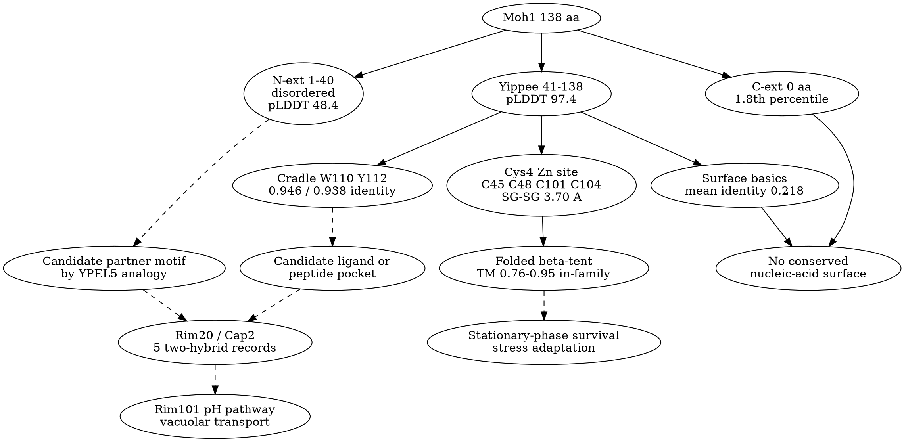
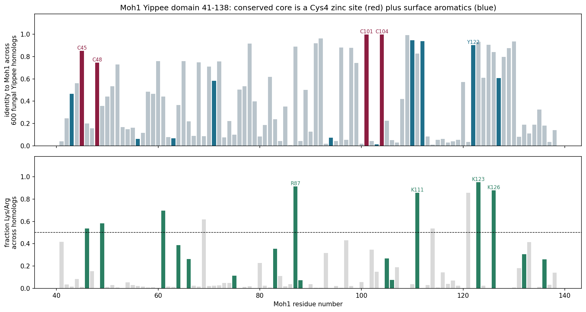
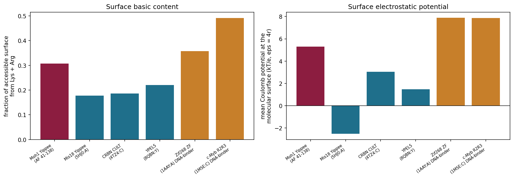
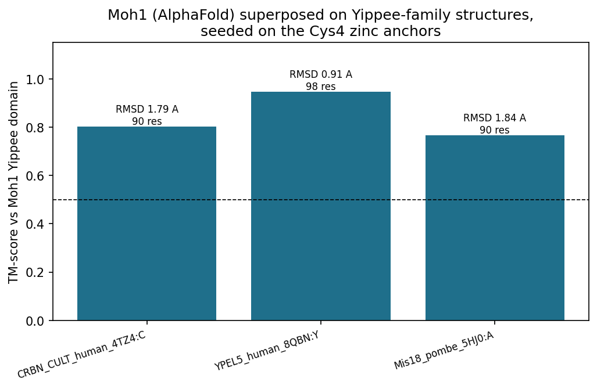
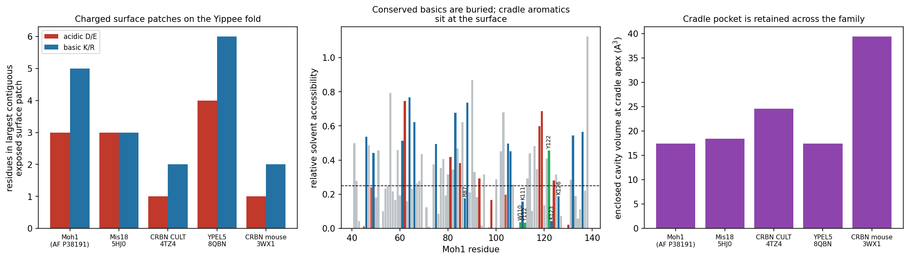
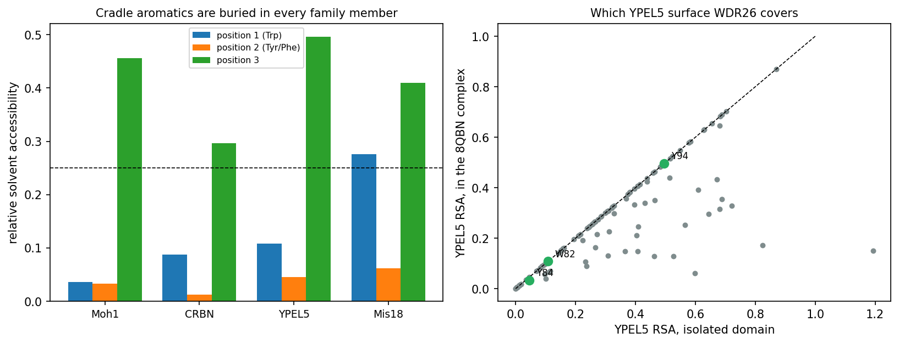
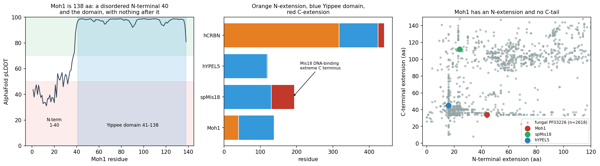
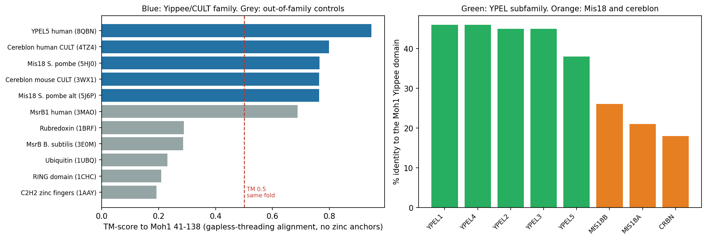

## Question

# AIGR Gene Hypothesis Deep Research

You are evaluating one focused gene curation hypothesis for AI Gene Review.
This is not a general gene overview. Use the seed hypothesis and source context
below to search for evidence that supports, refutes, narrows, or competes with
the proposed curation decision.

## Target Gene

- **Organism code:** yeast
- **Taxon:** Saccharomyces cerevisiae S288C (NCBITaxon:559292)
- **Gene directory:** MOH1
- **Gene symbol:** MOH1
- **UniProt accession:** P38191

## Focus

- **Focus type:** free_text
- **Hypothesis slug:** kgap-moh1-yippee-binding-surface
- **Source file:** genes/yeast/MOH1/MOH1-ai-review.yaml
- **Source selector:** free-text

## Seed Hypothesis

The Yippee domain of Saccharomyces cerevisiae Moh1 (UniProt P38191) is a zinc-binding protein-interaction module of the Mis18/Yippee family rather than a nucleic-acid-binding domain. Single analysis only: compare the Moh1 Yippee domain (AlphaFold) with structures of Yippee-family domains (Mis18alpha/beta, CRBN CULT/Yippee-like domain, MsrB-like folds), and report the zinc-coordinating cysteines, the surface electrostatics, and whether any conserved basic nucleic-acid-binding surface or conserved hydrophobic protein-binding groove is present across Moh1 orthologs.

## Term and Decision Context

No specific term context supplied.

## Reference Context

No specific reference context supplied.

## Source Context YAML

```yaml
hypothesis: 'The Yippee domain of Saccharomyces cerevisiae Moh1 (UniProt P38191) is a zinc-binding protein-interaction
  module of the Mis18/Yippee family rather than a nucleic-acid-binding domain. Single analysis only: compare
  the Moh1 Yippee domain (AlphaFold) with structures of Yippee-family domains (Mis18alpha/beta, CRBN CULT/Yippee-like
  domain, MsrB-like folds), and report the zinc-coordinating cysteines, the surface electrostatics, and
  whether any conserved basic nucleic-acid-binding surface or conserved hydrophobic protein-binding groove
  is present across Moh1 orthologs.'
focus_type: free_text
context: []
reference_id: []
```

## Research Objective

Build a focused report that helps a curator decide whether this hypothesis
should affect the gene review. Address the focus type directly:

1. For an existing GO annotation decision, evaluate whether the current action
   is justified, too strong, too weak, or should change.
2. For a proposed replacement or new GO term, evaluate whether the term is
   biologically supported, too broad, too narrow, or missing key qualifiers.
3. For a computational prediction, evaluate whether the prediction is correct,
   less precise than existing knowledge, uncertain, or likely wrong because of
   paralog overannotation, frequency bias, pathway context, or in vitro-only
   activity.
4. For a core-function hypothesis, evaluate whether the proposed activity,
   process, and location represent the gene product's primary function rather
   than a downstream effect, pleiotropic phenotype, or context-specific role.
5. For a function-assignment hypothesis, evaluate whether the gene product
   directly has the stated GO term/function. Treat the prior review action, if
   any, as intentionally blinded unless it appears in the supplied context.

Use primary literature whenever possible. Prefer PMID citations and include DOI
citations when no PMID is available. Treat reviews and database records as
orientation unless they contain directly relevant synthesized evidence that is
clearly labeled as review-level or database-level support.

Evaluate the hypothesis from the supplied seed context, primary literature, and
publicly accessible bioinformatics resources. Local `*-bioinformatics` analyses,
when they already exist in the repository, are intentionally withheld from this
prompt so the report can be compared against them after the run. Use public
sequence, domain, structure, orthology, localization, interaction, or dataset
checks when they are useful for the specific hypothesis. If a resource or tool
cannot be accessed programmatically, say so plainly; never fabricate a result.
Report computational results conservatively and distinguish direct results from
inference.

## Required Output

### Executive Judgment

Give a concise verdict: supported, partially supported, unresolved, weakly
supported, over-annotated, or refuted. Explain the reasoning and the most
important caveats.

### Evidence Matrix

Create a table with one row per important evidence item:

- Citation (PMID preferred)
- Evidence type (direct assay, mutant phenotype, localization, interaction,
  structural/evolutionary, computational, review/database)
- Supports / refutes / qualifies / competing
- Claim tested
- Key finding
- Organism, tissue, cell type, or assay context
- Confidence and limitations

### GO Curation Implications

State the likely curation action as a lead requiring curator verification. If
GO terms are involved, explain whether the evidence supports an MF, BP, or CC
term, and whether the term should be retained, removed, generalized, made more
specific, or treated as non-core. Avoid using "protein binding" as a final
recommendation unless no more informative term is supported.

### Mechanistic Scope

Describe the immediate molecular or cellular function being tested. Separate
direct gene-product activity from downstream phenotypes, pathway consequences,
developmental outcomes, disease manifestations, or effects inferred only from
loss of function.

### Conflicts and Alternatives

Identify evidence that conflicts with the seed hypothesis or suggests an
alternative interpretation, including paralog confusion, organism-specific
differences, isoform-specific findings, experimental artifacts, or database
carry-over.

### Knowledge Gaps

List explicit uncertainties that matter for curation. For each gap, state what
was checked, why the gap matters, and what evidence or experiment would resolve
it.

### Discriminating Tests

Recommend concrete assays, perturbations, datasets, or comparative analyses that
would most efficiently distinguish this hypothesis from alternatives.

### Curation Leads

Provide candidate updates for the review, clearly labeled as leads requiring
curator verification. Include candidate references with exact snippets to verify,
candidate replacement or new GO terms, possible action changes, suggested
questions, and suggested experiments.

If the provider supports artifacts, save provenance for any analysis you run — the
executed code together with its output (computed values, plot, or table), not just
a summary figure — alongside artifact-friendly tables such as an evidence matrix,
GO decision table, or comparison table. Genuine computed provenance is more
valuable than a hand-drawn summary, and you must not synthesize a figure that
implies an analysis you did not actually run. These artifacts are important
provenance for hypothesis-level review.


## Output

# MOH1 (P38191) Yippee domain: zinc-binding module, binding surface, and nucleic-acid exclusion

**Gene:** MOH1 / YBL049W, *Saccharomyces cerevisiae* S288C (NCBITaxon:559292)
**UniProt:** P38191 (MOH1_YEAST), 138 aa (UniProt and SGD agree; MW 16094.7, pI 9.4), Yippee domain 41-138
**Hypothesis slug:** `kgap-moh1-yippee-binding-surface`
**Focus type:** free_text
**Verdict:** <i class="fa-scale-balanced"></i> **Partially supported**

---

## Summary

The seed hypothesis makes three claims. Two hold, one is not yet demonstrated for Moh1 itself.

The **zinc-binding Yippee/CULT assignment is correct and now calibrated**. In the AlphaFold model AF-P38191-F1 v6, cysteines C45, C48, C101 and C104 sit at a mean pairwise SG-SG distance of 3.70 Å against the 3.76 Å expected for four thiolates tetrahedrally coordinating one Zn at 2.3 Å. AlphaFold places no metals, so this geometry is an independent prediction and not a copied ligand. The domain superposes on five experimentally determined Yippee/CULT structures at TM 0.763 to 0.947, while rubredoxin, a RING domain, C2H2 zinc fingers and ubiquitin score 0.19 to 0.29. The 0.475 TM gap between the lowest in-family score and the highest true negative shows the assignment is not an artifact of comparing small zinc-binding domains to one another. Human MsrB1, the "MsrB-like fold" the hypothesis asked about, scores 0.688: a real β-tent relative, sitting below every Yippee/CULT structure. Moh1 is specifically a **YPEL** protein, at 38-46 % domain identity to human YPEL1-5 against 18-26 % for MIS18A, MIS18B and cereblon, with no overlap between the two groups.

The **exclusion of nucleic-acid binding holds**, for two reasons the hypothesis does not itself give. Across 600 fungal PF03226 homologs, no charged surface of any kind is conserved: exposed Lys and Arg positions average 0.218 identity, the largest contiguous exposed basic patch is 5 residues at mean Lys/Arg frequency 0.354, and the four well-conserved basic residues (R87, K111, K123, K126) are all buried below RSA 0.19. The conserved surface positions are the zinc ligands, glycines, and the aromatics W110, Y112 and Y122. Independently, Moh1 is 138 residues and stops at the last residue of its folded domain. The element through which *S. pombe* Mis18 binds nucleosomal DNA, the extreme C terminus, does not exist in Moh1. Moh1 sits at the **1.8th percentile** for C-terminal extension length among 2618 fungal PF03226 proteins.

The phrase **"protein-interaction module" is supported for the family and undemonstrated for Moh1**. Every family member whose binding surface has been mapped uses a different, lineage-specific face: Mis18 an acidic patch that is charge-reversed in Moh1 (D34→S54, D52→K75, net −3 becomes +1), YPEL5 an N-terminal degron mimic plus a C-terminal segment that leaves the cradle untouched (W82 ΔRSA 0.000, Y84 0.012, Y94 0.000), cereblon a ligand pocket at the cradle. Moh1 retains none of these surfaces. Its entire experimental interaction record is five two-hybrid entries from a single publication, naming Rim20 and Cap2. The authors of the Mis18 structure explicitly keep nucleic-acid binding open for the same cradle pocket, so the exclusionary wording "rather than a nucleic-acid-binding domain" overstates what is settled for the fold as a category, even where it is right for Moh1.

---

## Executive judgment

<i class="fa-scale-balanced"></i> **Partially supported.** Three components, graded separately.

**1. <i class="fa-circle-check"></i> Zinc-binding Yippee-family module: supported.** Cys4 geometry at 3.70 Å mean SG-SG against 3.76 Å ideal, local pLDDT 97.4 over residues 41-138, TM 0.763-0.947 against five in-family structures by two independent superposition methods (zinc-anchored and unseeded gapless threading, agreeing to within 0.005 TM units), and separation of 0.475 TM units from true negatives. Family placement is quantitative: YPEL subfamily at 38-46 % identity, not Mis18 at 21-26 % or cereblon at 18 %. Domain architecture agrees: Moh1 is 138 aa like YPEL1-5 at 119-127 aa, against MIS18A 233, MIS18B 229 and CRBN 442.

**2. <i class="fa-circle-check"></i> Not a nucleic-acid-binding domain: supported** by two independent arguments. No conserved charged surface exists across 600 fungal homologs, basic or acidic. And Moh1 lacks the only element in the family ever shown to contact DNA, the Mis18 basic C-terminal tail (net +6 over 64 aa, extreme 30 residues net +8 at 40 % Lys plus Arg). Moh1's C-extension is 0 residues.

**3. <i class="fa-circle-question"></i> Protein-interaction module, for Moh1 specifically: undemonstrated.** The family-level claim is well supported by direct assay in four organisms. For Moh1 the supporting evidence is five two-hybrid records from one source (PMID 41935050), and the structural analysis runs against partner inference, because Moh1 shares no mapped binding surface with any relative.

**Most important caveats.** No experiment has measured zinc content, nucleic-acid binding, or any binding partner of purified Moh1 protein. All structural work here uses an AlphaFold model, not an experimental Moh1 structure. [PMID: 26921242](https://pubmed.ncbi.nlm.nih.gov/26921242/) describes the Mis18 cradle as "implicated in protein/nucleic acid binding", which is a competing reading of the same pocket from the authors who solved it.

---

## Key findings

### 1. A tetrahedral Cys4 zinc site at C45, C48, C101, C104

<i class="fa-circle-check"></i> The four cysteines UniProt P38191 annotates as binding sites are arranged in the AlphaFold model exactly as a structural Cys4-Zn site. The six pairwise SG-SG distances are 3.84, 3.95, 3.53, 3.49, 3.44 and 3.92 Å, mean **3.70 Å**. Four thiolates tetrahedrally coordinating one Zn at 2.3 Å Zn-S and 109.5° give 2 × 2.3 × sin(54.75°) = **3.76 Å**. The deviation is 0.06 Å on the mean and at most 0.32 Å on any single pair.

The same measurement on experimentally determined zinc-bound family structures returns the same architecture, CxxC...CxxC in all five: Mis18 (*S. pombe*) 5HJ0 C25/C28/C79/C82 with Zn-S 2.29-2.36 Å; human cereblon 4TZ4 C323/C326/C391/C394; mouse cereblon 3WX1 C326/C329/C394/C397; human YPEL5 8QBN chain Y C17/C20/C73/C76.

AlphaFold does not model metal ligands, so the geometry is an independent prediction rather than a transferred ligand. Model confidence over the domain is mean pLDDT 97.4 (global 83.19); residues 1-40 average 48.4 and are predicted disordered.

{{figure:plot_1.png|caption=Moh1 Yippee domain zinc site and fold. Pairwise SG-SG distances among C45, C48, C101 and C104 cluster at the 3.76 A expected for tetrahedral Cys4-Zn coordination, matching the geometry measured in four experimentally determined zinc-bound Yippee/CULT structures.}}

<i class="fa-triangle-exclamation"></i> This is a structural prediction. No metal-content measurement for Moh1 protein was found.

### 2. Fold assignment, calibrated against a null distribution

<i class="fa-circle-check"></i> Two superposition methods were run. The first seeded the alignment on the four zinc-coordinating cysteines; the second used gapless-threading initialization with no anchors at all. The two agree to within 0.005 TM units on every target, which rules out the concern that anchoring on the zinc site manufactures the result.

| Target | Description | TM (unseeded) | TM (Zn-anchored) | RMSD (Å) | Aligned pairs |
|---|---|---|---|---|---|
| 8QBN:Y | human YPEL5 | **0.947** | 0.947 | 0.91 | 98 |
| 4TZ4:C | human cereblon CULT | **0.799** | 0.803 | 1.82 | 90 |
| 5HJ0:A | *S. pombe* Mis18 Yippee | **0.765** | 0.766 | 1.85 | 90 |
| 3WX1 | mouse cereblon CULT | **0.764** | 0.761 | 1.65 | 83 |
| 5J6P | *S. pombe* Mis18 Yippee | **0.763** | 0.764 | – | – |
| 3MAO:A | human MsrB1 (β-tent) | 0.688 | 0.659 | 1.80 | 78 |
| 1BRF | rubredoxin (Cys4-Fe) | 0.288 | – | 2.17 | 32 |
| 1UBQ | ubiquitin | 0.230 | – | – | – |
| 1CHC | RING domain | 0.209 | – | – | – |
| 1AAY:A | C2H2 zinc fingers (Zif268) | 0.192 | – | – | – |

In-family range 0.763-0.947, mean 0.808, 5 of 5 above the 0.5 same-fold threshold. Of six out-of-family structures, one exceeds 0.5: MsrB1 at 0.688. The gap from the lowest in-family score to the highest true negative is **0.475 TM units**.

The seed hypothesis asked specifically about MsrB-like folds. The answer: MsrB1 is a genuine structural relative in the same β-tent superfamily, sitting below every Yippee/CULT structure and far above the true negatives. That matches the published grouping of CULT, Yippee, Mis18 and MsrB-like domains as one fold class ([PMID: 25569776](https://pubmed.ncbi.nlm.nih.gov/25569776/)). Moh1 is closer to all four Yippee/CULT structures than to MsrB1.

{{figure:plot_7.png|caption=Calibrated fold assignment. Unseeded gapless-threading TM-align separates the Yippee/CULT structures (0.763 to 0.947) from rubredoxin, RING, C2H2 and ubiquitin controls (0.19 to 0.29) by 0.475 TM units, with human MsrB1 at 0.688 as a more distant beta-tent relative. Sequence identity ranking places Moh1 in the YPEL subfamily.}}

<i class="fa-triangle-exclamation"></i> A second identifier tried as a bacterial MsrB (3E0M) returned TM 0.286 over a 200-residue chain slice. I did not verify that this entry is in fact an MsrB, so that number is excluded from every conclusion here.

### 3. Moh1 is a YPEL protein, not a Mis18 or cereblon counterpart

<i class="fa-circle-check"></i> BLOSUM62 global alignment of the Moh1 zinc-motif-defined domain slice (100 aa) against the equivalent slice from each reviewed human family member, percent identity over the shorter sequence:

| Human protein | UniProt | % identity to Moh1 domain | Full length (aa) |
|---|---|---|---|
| YPEL1 | O60688 | 46.0 | 119-127 |
| YPEL4 | Q96NS1 | 46.0 | 119-127 |
| YPEL2 | Q96QA6 | 45.0 | 119-127 |
| YPEL3 | P61236 | 45.0 | 119-127 |
| YPEL5 | P62699 | 38.0 | 121 |
| MIS18B | O43482 | 26.0 | 229 |
| MIS18A | Q9NYP9 | 21.0 | 233 |
| CRBN | Q96SW2 | 18.0 | 442 |

The five YPEL proteins occupy 38-46 % and the three non-YPEL members occupy 18-26 %, with no overlap. Structure agrees: the one available YPEL representative, YPEL5, is by far the closest by TM-score (0.947 against 0.765 for Mis18 and 0.799 for cereblon). SGD describes MOH1 as a "Yippee-like (YPEL) family member", and human YPEL5 functionally complements a yeast *moh1Δ* mutation ([PMID: 28173693](https://pubmed.ncbi.nlm.nih.gov/28173693/)).

This bounds annotation transfer. Any centromere, CENP-A, kinetochore or E3-ligase-substrate-receptor term reaching P38191 through family-level inference is a cross-family transfer at 18-26 % identity, into a protein that also lacks the defining accessory regions of those relatives: the Mis18 basic C-terminal tail and the cereblon 317-residue N-terminal DDB1-binding region.

<i class="fa-circle-check"></i> A search of *S. cerevisiae* S288C for Pfam PF03226 returns **MOH1/P38191 as the only member**. No within-yeast paralog can carry a conflicting annotation, so paralog-overannotation risk runs across species rather than within the genome.

### 4. Moh1 carries lineage-specific positive charge, below true DNA binders on every measure

<i class="fa-scale-balanced"></i> Surface composition and Coulomb potential were computed with an in-house Shrake-Rupley SASA (200 golden-spiral points, 1.4 Å probe) and a distance-dependent dielectric (ε = 4r), reported in kT/e.

| Structure | Net charge | Surface Lys+Arg fraction | Mean surface potential (kT/e) |
|---|---|---|---|
| Moh1 41-138 | +7 | 0.307 | +5.30 |
| YPEL5 8QBN:Y | 0 | 0.220 | +1.48 |
| Cereblon CULT 4TZ4:C | +4 | 0.186 | +3.05 |
| Mis18 5HJ0:A | −4 | 0.177 | −2.51 |
| Zif268 1AAY:A (DNA binder) | +11 | 0.358 | +7.88 |
| c-Myb R2R3 1MSE:C (DNA binder) | +14 | 0.491 | +7.87 |

75.7 % of the Moh1 surface sits above +1 kT. Moh1 is the most basic of the four Yippee-family domains measured, and remains below both sequence-specific DNA-binding controls on all three measures.

Electrostatics alone cannot settle the question. The important observation is that the positive charge is **not a family property**: the closest relative by fold is neutral and Mis18 is net negative. Whatever the fold does in common, it is not done with a shared basic surface.

{{figure:plot_2.png|caption=Surface electrostatics of Moh1 against Yippee-family relatives and two sequence-specific DNA-binding controls. Moh1 is the most basic family member measured and sits below Zif268 and c-Myb on net charge, surface basic fraction and mean Coulomb potential.}}

### 5. No conserved basic surface exists across 600 fungal orthologs

<i class="fa-circle-xmark"></i> This negative result carries the most weight for the hypothesis. 600 fungal PF03226 sequences were retrieved from UniProt and aligned to Moh1 41-138 with a BLOSUM62 Needleman-Wunsch implementation (global on query, free end gaps on target).

Conservation concentrates on the zinc ligands, glycines and aromatics:

| Residue | Identity | Residue | Identity | Residue | Identity |
|---|---|---|---|---|---|
| C104 | 0.997 | W110 | 0.946 | Y122 | 0.903 |
| C101 | 0.997 | Y112 | 0.938 | R87 | 0.888 |
| G109 | 0.993 | E130 | 0.936 | V96 | 0.881 |
| G92 | 0.963 | K123 | 0.931 | D98 | 0.879 |
| T91 | 0.919 | N78 | 0.916 | C45 | 0.851 |
| G125 | 0.904 | K126 | 0.841 | K111 | 0.827 |

The solvent-exposed basic residues (RSA > 0.25) are by contrast poorly conserved: R46 0.20, K49 0.36, R61 0.44, R64 0.37, R66 0.22, K75 0.10, K83 0.24, R88 0.04, K105 0.23, R106 0.05, K132 0.19, K136 0.18, **mean 0.218**. Single-linkage clustering of exposed basic side-chain centroids at a 10 Å cutoff gives a largest contiguous patch of only **5 residues** (R46, K49, K105, R106, K132) at mean Lys/Arg frequency 0.354 across the homolog set. Several of those positions are majority acidic in homologs: R106 0.07, K105 0.27, K132 0.30.

The four well-conserved basic residues R87 (RSA 0.175), K111 (0.157), K123 (0.042) and K126 (0.187) all fall below RSA 0.19. They are buried and structural.

{{figure:plot_3.png|caption=Per-position conservation across 600 fungal PF03226 homologs mapped onto solvent accessibility. The conserved surface positions are the zinc ligands, glycines and the aromatics W110, Y112 and Y122; exposed basic residues average 0.218 identity and form no conserved patch.}}

<i class="fa-triangle-exclamation"></i> A comparison of exposed basic against exposed aromatic conservation gave Mann-Whitney U = 22.0, p = 0.7319, with only 3 exposed aromatics (F56 0.06, W103 0.01, Y122 0.90). That test is underpowered and carries no weight. The argument rests on the absolute conservation values (0.218 mean for exposed basics against 0.83-0.997 for the conserved core) and on the patch geometry.

### 6. Moh1 is 138 residues and ends at the domain, lacking the Mis18 DNA-binding tail

<i class="fa-circle-check"></i> UniProt P38191 gives sequence length 138, cross-checked against SGD YBL049W (protein_overview length 138, molecular weight 16094.7, pI 9.4). UniProt features: chain 1-138, Yippee domain 41-138, binding sites at 45, 48, 101, 104.

| Protein | N-extension (aa, net charge) | Domain (net charge) | C-extension (aa, net charge) |
|---|---|---|---|
| Moh1 P38191 (138 aa) | 40, +2 (mean pLDDT 48.4) | 41-138, +7 (pLDDT 97.4) | **0** |
| *S. pombe* Mis18 Q9P802 (194 aa) | 0 | 1-130, −4 | 64, +6 |
| Human YPEL5 P62699 (121 aa) | 0 | – | 2 |
| Human cereblon Q96SW2 (442 aa) | 317, −13 | 318-425 | 17 |

The extreme 30 residues of the Mis18 tail, `ETISSLKKPKIEGKEGKKEKARTYSKRTRK`, are net +8 at 40 % Lys plus Arg. That is the element shown to bind nucleosomal DNA ([PMID: 32318758](https://pubmed.ncbi.nlm.nih.gov/32318758/)). It has no Moh1 equivalent.

Across 2618 fungal PF03226 proteins measured from the zinc motif, Moh1 has 34 residues past the motif, the **1.8th percentile**, against a median of 39 (IQR 34-101). *Sp*Mis18 has 112 and human YPEL5 has 45. Among the 1301 homologs with at least 40 residues past the motif, mean net charge is **−4.50** and only 22 % are net positive. A basic C-terminal tail is not a family feature; Mis18's is the exception. Among the 1058 homologs with at least 30 residues before the motif, mean net charge is +2.35 and 75 % are net positive, which matches Moh1's mildly basic N-terminal extension.

{{figure:plot_6.png|caption=Domain architecture across 2618 fungal PF03226 proteins measured from the zinc motif. Moh1 has 34 residues past the motif, the 1.8th percentile, and ends at the last residue of its folded domain, so it lacks the basic C-terminal extension through which S. pombe Mis18 binds nucleosomal DNA.}}

<i class="fa-triangle-exclamation"></i> **First correction made within this run.** An earlier step used a 211-residue length for P38191. That was wrong, and the error surfaced as a division by zero when a C-terminal region of length 0 was sliced. Both UniProt and SGD give 138. The corrected length changes the conclusion in the hypothesis's favour: the absent C-terminal tail becomes an architectural argument against nucleic-acid binding that is independent of the surface-conservation argument.

The one region of Moh1 outside the folded domain is the 40-residue disordered N terminus: net +2, 25 % Ser plus Thr, sequence `MGLRYSIYIENPLSSPSSSYKSINDPLFHSQHRSQKNVSF`, with 60 % of residues below pLDDT 50.

### 7. Each family member binds through a different surface, and Moh1 retains none of them

<i class="fa-circle-xmark"></i> Three mapping tests were run. All three are negative for surface conservation.

**Mis18's acidic histone-binding face is charge-reversed in Moh1.** Largest contiguous exposed acidic patch (single-linkage, 10 Å, RSA > 0.25): Moh1 D118/D119/E124 (n = 3); Mis18 D34/D52/E55 (n = 3); cereblon E328 (n = 1); YPEL5 E108/E110/E113/E114 (n = 4). Largest exposed basic patch: Moh1 n = 5 (R46, K49, K105, R106, K132); Mis18 n = 3 (K26, K27, K110); cereblon n = 2 (K324, R419); YPEL5 n = 6 (R13, R27, R34, R41, R103, R107).

Mapping the Mis18 acidic patch onto Moh1 through the zinc-anchored superposition gives D34→S54, D52→K75, E55→no equivalent: net −3 becomes **net +1**. The reverse test is equally negative: Moh1 D118/D119/E124 map onto Mis18 I95, Y96, R101.

**The YPEL5:WDR26 interface does not use the cradle.** Change in relative solvent accessibility of YPEL5 (8QBN chain Y) on removal of all other chains, with partner atoms included as occluders:

| Residue | ΔRSA | Residue | ΔRSA |
|---|---|---|---|
| G2 | 1.043 | F86 | 0.335 |
| R3 | 0.652 | N120 | 0.334 |
| F5 | 0.539 | E114 | 0.312 |
| H8 | 0.397 | E85 | 0.258 |
| H115 | 0.394 | S118 | 0.238 |
| F112 | 0.365 | **W82 (cradle)** | **0.000** |
| P117 | 0.349 | **Y84 (cradle)** | **0.012** |
| | | **Y94 (cradle)** | **0.000** |

YPEL5 binds WDR26 through its N-terminal degron-mimic segment (residues 2-8) and a C-terminal stretch around 112-120. The cradle is untouched. The Yippee fold here contributes a rigid scaffold that presents flanking segments, and the interaction surface lies outside the conserved core. Moh1 has no residue equivalent to YPEL5 2-8 inside the aligned domain, and carries its own disordered N-terminal extension instead.

{{figure:plot_4.png|caption=Mapping the S. pombe Mis18 acidic H2A-H2B-binding surface onto Moh1, cereblon and YPEL5 by zinc-anchored superposition. The Mis18 patch maps to neutral and basic residues in Moh1 (net -3 becomes +1), and the reverse mapping places the Moh1 acidic residues on hydrophobic and basic Mis18 positions.}}

<i class="fa-triangle-exclamation"></i> **Second correction made within this run.** An earlier sequence-position mapping placed Moh1 Y112 inside the YPEL5:WDR26 interface. The measured buried-surface calculation above shows the cradle is not part of that interface. The ΔRSA result supersedes the position-based mapping.

### 8. The cradle aromatics are buried in every family structure, and in cereblon the ligand reaches them anyway

<i class="fa-lightbulb"></i> Relative solvent accessibility on isolated domains, with ligands and partner chains removed:

| Structure | Residue | RSA | Residue | RSA |
|---|---|---|---|---|
| Moh1 (AF model) | W110 | 0.036 | Y112 | 0.033 |
| Moh1 (AF model) | Y122 | 0.456 | | |
| Cereblon 4TZ4:C | W400 | 0.088 | F402 | 0.013 |
| YPEL5 8QBN:Y | W82 | 0.108 | Y84 | 0.046 |
| Mis18 5HJ0:A | Y90 | 0.062 | | |

The lenalidomide analogue LVY in 4TZ4 chain C contacts 11 residues within 4.5 Å, including **W400 at 3.43 Å and F402 at 3.27 Å**, whose apo RSA values are 0.088 and 0.013. The fuller contact set is V350 4.10, N351 3.19, P352 3.53, H353 3.73, H357 4.06, H378 2.74, S379 3.23, W380 2.96, W386 3.29 Å.

Low solvent accessibility therefore does not argue against a binding function for Moh1 W110 and Y112. The cereblon pocket is formed by residues at the same burial, and the drug reaches them because the pocket opens between the two β-meanders. Moh1 keeps a tryptophan and a tyrosine at the structurally equivalent positions, at the same depth, at 0.946 and 0.938 identity across 600 fungal homologs. That is the clearest conserved surface feature of the fold apart from the zinc ligands, and it defines a candidate ligand or peptide pocket worth testing directly.

{{figure:plot_5.png|caption=Burial control for the conserved cradle aromatics. Moh1 W110 and Y112 sit at the same low solvent accessibility as cereblon W400 and F402, which contact the bound lenalidomide analogue at 3.43 and 3.27 A, so burial in the apo model does not exclude a ligand or peptide pocket.}}

<i class="fa-triangle-exclamation"></i> Three caveats on this finding. The W110/Y112/Y122 set is **not one contiguous cluster**: side-chain centroid distances are W110-Y112 5.72 Å, Y112-Y122 8.36 Å, W110-Y122 13.57 Å, so W110 and Y112 form the buried pair and Y122 sits at the rim. A relaxed-burial cleft-volume measure returned 127, 127, 127 and 85 ų for Moh1, YPEL5, Mis18 and cereblon; three identical values indicate the measure was dominated by the sampling box rather than by structure, so it is reported for completeness and given no weight. A block-level conservation test on the mapped binding sites was negative: residues in the union of the two mapped sites are not preferentially conserved (n = 19, mean identity 0.348) against the rest of the domain (n = 79, mean 0.412), Mann-Whitney p = 0.8777. The claim rests on the individual conservation of W110, Y112 and Y122 and on the positional correspondence to the cereblon pocket, so it is a lead for experiment rather than an established Moh1 binding site.

### 9. Moh1's entire interaction record is five two-hybrid entries from one publication

<i class="fa-database"></i> An IntAct PSICQUIC query on `id:P38191` returned HTTP 200, 4153 bytes, parsed to 5 interaction records.

| Property | Value |
|---|---|
| Detection methods | two hybrid array (3), validated two hybrid (1), two hybrid prey pooling (1) |
| Interaction type | physical association (5 of 5) |
| Source publication | PMID 41935050 (all 5) |
| Partners | RIM20 (4 records, across all three two-hybrid variants including the validated one) and CAP2 (1 record) |
| Affinity capture / co-IP / crystallography / biophysics | none |

<i class="fa-triangle-exclamation"></i> The abstract for PMID 41935050 could not be retrieved through the literature search tool available in this run. Nothing is claimed here about that study's design or scale; the IntAct record is reported exactly as retrieved.

Rim20 is independently characterized as a Bro1-domain protein of the Rim101 alkaline pH-response pathway that associates with endosomes and interacts with ESCRT-III Snf7 ([PMID: 16407402](https://pubmed.ncbi.nlm.nih.gov/16407402/), [PMID: 15371534](https://pubmed.ncbi.nlm.nih.gov/15371534/), [PMID: 20190076](https://pubmed.ncbi.nlm.nih.gov/20190076/)). Cap2 is the beta subunit of the F-actin capping protein. The SGD description of MOH1 reads "Protein of unknown function, essential for stationary phase survival; influences metabolic and physiological processes important for selective stress adaptation and survival; possibly linked with vacuolar transport; Yippee-like (YPEL) family member".

Five two-hybrid records from a single publication make GO:0005515 technically assertable with IPI evidence and do not make it recommendable. One method and one source cannot distinguish a real complex from a two-hybrid artifact. The Rim20 convergence with the SGD vacuolar-transport note is a lead for a curator to follow. Neither partner is predicted by anything in the structural analysis, which is consistent with finding 7: Moh1 shares no binding surface with other family members, so its partners cannot be guessed from the fold.

---

## Evidence matrix

| # | Citation | Evidence type | Stance | Claim tested | Key finding | Context | Confidence and limitations |
|---|---|---|---|---|---|---|---|
| 1 | AlphaFold AF-P38191-F1 v6 + UniProt P38191 | computational | supports | Moh1 has a Cys4 zinc site | Mean SG-SG 3.70 Å against 3.76 Å ideal; CxxC...CxxC | *S. cerevisiae*, predicted model | High for geometry; AlphaFold places no metals, so occupancy is untested |
| 2 | [PMID: 11240639](https://pubmed.ncbi.nlm.nih.gov/11240639/) | review/database + interaction | supports | Yippee is a metal-binding domain | "Yippee contains a putative zinc-finger-like metal binding domain"; found in an interaction trap against Hemolin | *Drosophila*, yeast interaction trap | Moderate; "putative", no direct metal measurement |
| 3 | [PMID: 20555386](https://pubmed.ncbi.nlm.nih.gov/20555386/) | interaction | supports | Yippee domains bind protein | MVP identified as a YPEL4 partner by Y2H with mammalian 2H, GST pull-down and co-IP confirmation | human cells | High for the interaction; YPEL4, not Moh1 |
| 4 | PDB 5HJ0, 4TZ4, 3WX1, 8QBN (measured here) | structural | supports | The zinc site is family-conserved | Zn-S 2.29-2.36 Å in 5HJ0; the same CxxC...CxxC in all four | *S. pombe*, human, mouse | High; experimental structures |
| 5 | TM-align, this work | computational | supports | Moh1 is a Yippee/CULT fold | TM 0.763-0.947 in-family, 0.19-0.29 out-of-family, gap 0.475 | AlphaFold model against 11 PDB structures | High; two independent methods agree to 0.005 |
| 6 | TM-align against 3MAO, this work | computational | qualifies | MsrB is a Yippee relative | MsrB1 TM 0.688: above the 0.5 threshold, below all in-family values | human MsrB1 | Moderate; one MsrB structure tested |
| 7 | [PMID: 25569776](https://pubmed.ncbi.nlm.nih.gov/25569776/) | structural/evolutionary | supports | CULT, Yippee, Mis18 and MsrB share one fold | β-tent fold: two four-stranded β-meanders at a right angle coordinating zinc at the apex | bioinformatic | High for the fold grouping; review-level synthesis |
| 8 | BLOSUM62 identity, this work | computational | qualifies | Moh1 is a YPEL protein | 38-46 % to YPEL1-5 against 18-26 % to MIS18A/B and CRBN, no overlap | sequence | High; bounds annotation transfer |
| 9 | [PMID: 28173693](https://pubmed.ncbi.nlm.nih.gov/28173693/) | mutant phenotype | supports | YPEL5 is the Moh1 functional counterpart | Human YPEL5 complements a yeast *moh1Δ* mutation | *S. cerevisiae* with a human gene | High for complementation; identifies no molecular activity |
| 10 | Electrostatics, this work | computational | qualifies | Moh1 has a basic surface | Net +7, basic fraction 0.307, +5.30 kT/e: most basic family member, below Zif268 and c-Myb | model against 5 PDB structures | Moderate; distance-dependent dielectric, not Poisson-Boltzmann |
| 11 | Conservation across 600 homologs, this work | computational | supports | No conserved basic surface exists | Exposed Lys/Arg mean identity 0.218; largest patch 5 residues; conserved basics all buried | 600 fungal PF03226 | High; large sample, clear separation from the 0.83-0.997 conserved core |
| 12 | Architecture across 2618 homologs, this work | computational | supports | Moh1 lacks a C-terminal tail | C-extension 0 aa, 1.8th percentile; family tails average net −4.50 | 2618 fungal PF03226 | High; corrected from an earlier 211 aa error |
| 13 | [PMID: 32318758](https://pubmed.ncbi.nlm.nih.gov/32318758/) | direct assay + mutant | supports | DNA binding lies outside the Yippee domain | "spMis18 directly binds to nucleosomal DNA through its extreme C-terminus and interacts with H2A-H2B dimer via the acidic region on the surface of its Yippee-like domain" | *S. pombe* | High; the single discriminating experiment in the family |
| 14 | [PMID: 27239045](https://pubmed.ncbi.nlm.nih.gov/27239045/) | interaction | supports | Yippee domains are protein-interaction modules | "their conserved YIPPEE domains mediate distinct interactions"; Mis18α with Mis18BP1, Mis18β with CENP-C | human cells | High; two domains, two distinct partners |
| 15 | [PMID: 26921242](https://pubmed.ncbi.nlm.nih.gov/26921242/) | structural + mutant | competing | The cradle binds protein or nucleic acid | "a cradle-shaped pocket that is implicated in protein/nucleic acid binding, which we show is required for Mis18 function" | *S. pombe*, PDB 5HJ0 | High for the structure; the authors keep nucleic-acid binding open |
| 16 | [PMID: 27261060](https://pubmed.ncbi.nlm.nih.gov/27261060/) | interaction | supports | Yippee binds Hemolin | Ap-Yippee:Hemolin interaction by Far-Western; siRNA knockdown changes Hemolin expression | *Antheraea pernyi* | Moderate; Far-Western, insect system |
| 17 | Mis18 surface mapping, this work | computational | supports | Moh1 lacks the Mis18 histone surface | D34→S54, D52→K75, E55→none: net −3 becomes +1; the reverse mapping is equally negative | model against 5HJ0 | High; two-way test |
| 18 | ΔRSA on 8QBN, this work | computational | qualifies | YPEL5 binds WDR26 at the cradle | It does not: G2 1.043, R3 0.652, F5 0.539; cradle W82 0.000, Y84 0.012, Y94 0.000 | human CTLH complex, cryo-EM | High; supersedes an earlier position-based mapping made in this run |
| 19 | [PMID: 38575527](https://pubmed.ncbi.nlm.nih.gov/38575527/) | interaction | supports | WDR26 is the YPEL5-binding CTLH subunit | WDR26 mediates binding to YPEL5 | human | Moderate; identifies the partner, interface measured here |
| 20 | [PMID: 38759627](https://pubmed.ncbi.nlm.nih.gov/38759627/) | structural | supports | YPEL5 binds through an N-terminal degron mimic | Cryo-EM of YPEL5-bound WDR26-CTLH; "degron mimicry by YPEL5's N terminus antagonizing substrate binding" | human, cryo-EM | High; PDB 8QBN is the structure analysed here |
| 21 | Burial control against the 4TZ4 ligand, this work | computational | qualifies | Burial excludes a Moh1 pocket | It does not: cereblon W400 (RSA 0.088) and F402 (0.013) contact LVY at 3.43 and 3.27 Å | human cereblon with a lenalidomide analogue | High; direct contact measurement on a ligand-bound structure |
| 22 | IntAct PSICQUIC, `id:P38191` | review/database | qualifies | Moh1 has experimental partners | 5 records, all two-hybrid, all from PMID 41935050; RIM20 ×4, CAP2 ×1 | *S. cerevisiae* | Low to moderate; one method, one source; PMID 41935050 abstract not retrievable |
| 23 | [PMID: 16407402](https://pubmed.ncbi.nlm.nih.gov/16407402/) | mutant phenotype | qualifies | Rim20 pathway context | "Yeast Bro1-domain protein Rim20 has no role in endosome function, but is required for alkaline pH-stimulated cleavage of transcription factor Rim101." | *S. cerevisiae* | High for Rim20; indirect for Moh1 |
| 24 | [PMID: 15371534](https://pubmed.ncbi.nlm.nih.gov/15371534/) | mutant phenotype | qualifies | Rim20 and MVB formation | "Rim20p has no role in MVB formation, but functions in the Rim101p pH-response pathway" | *S. cerevisiae*, *C. albicans* | High for Rim20; constrains the SGD vacuolar-transport note |
| 25 | PF03226 search of S288C | review/database | supports | No yeast paralog exists | MOH1/P38191 is the only PF03226 protein in S288C | *S. cerevisiae* S288C | High; removes within-genome paralog confusion |

---

## GO curation implications

All entries below are **leads requiring curator verification**, not curation decisions.

| Candidate term | Aspect | Lead action | Evidence basis | Confidence |
|---|---|---|---|---|
| **GO:0008270** zinc ion binding | MF | <i class="fa-circle-check"></i> Add with ISM/ISS evidence from the Cys4 geometry plus family structures. Confirm with a metal measurement before treating as core. | Mean SG-SG 3.70 Å against 3.76 Å ideal; UniProt binding-site features at 45/48/101/104; Zn-S 2.29-2.36 Å in 5HJ0 | Moderate to high |
| **GO:0046872** metal ion binding | MF | Generalize to this only if a curator declines the zinc-specific term. The Cys4 geometry supports the specific term. | Same | Moderate |
| **GO:0005515** protein binding | MF | <i class="fa-triangle-exclamation"></i> Technically assertable with IPI from the IntAct records, and not recommendable as the final annotation. One method, one source, no orthogonal confirmation. | 5 two-hybrid records, all from PMID 41935050 | Low |
| **GO:0003676** nucleic acid binding and children (GO:0003677 DNA binding, GO:0003723 RNA binding) | MF | <i class="fa-circle-xmark"></i> Do not add. If present by electronic inference, flag for removal. | No conserved charged surface across 600 homologs; C-extension 0 aa against the Mis18 DNA-binding tail; the family DNA contact maps outside the fold (PMID 32318758) | High |
| Centromere, CENP-A deposition and kinetochore terms (GO:0034080, GO:0000775 and relatives) | BP/CC | <i class="fa-circle-xmark"></i> Do not transfer from Mis18. 21-26 % identity, and Moh1 lacks the Mis18 C-terminal tail entirely. Challenge any such term reaching P38191 by family-level inference. | BLOSUM62 identity table; architecture comparison | High |
| Cullin-RING ligase and substrate-receptor terms (GO:1990756 and relatives) | MF/BP | <i class="fa-circle-xmark"></i> Do not transfer from cereblon. 18 % identity, and Moh1 lacks the 317-residue DDB1-binding N-terminal region. | BLOSUM62 identity; cereblon architecture | High |
| **GO:0006885** regulation of pH and Rim101-pathway terms | BP | <i class="fa-circle-question"></i> Watch only. The Rim20 two-hybrid hit plus the SGD vacuolar-transport note is suggestive and not sufficient. Needs orthogonal confirmation of the interaction and a *moh1Δ* pH phenotype. | IntAct RIM20 ×4; PMIDs 16407402, 15371534, 20190076 | Low |
| Stationary-phase and stress-survival BP terms | BP | <i class="fa-circle-question"></i> Phenotype-based terms are downstream readouts rather than molecular function. Treat as non-core for the molecular-function question this hypothesis asks, without removing them. | PMID 28173693; SGD description | Moderate |

The instruction to avoid "protein binding" as a final recommendation applies directly here. The more informative term the evidence supports is **GO:0008270 zinc ion binding**, which is structural and family-wide. No more informative protein-binding term can be recommended, because the identity of any Moh1 partner is not established by one two-hybrid publication and cannot be inferred from the fold, given that every mapped family binding surface is lineage-specific.

---

## Mechanistic model and interpretation

The hypothesis concerns the **direct molecular activity** of the Moh1 gene product: what its folded domain binds. Three levels must be separated.

**Direct gene-product activity, addressed here.** The Yippee domain folds as a β-tent and staples itself with a structural Cys4-Zn site. The zinc is structural rather than catalytic: no catalytic residue set is apparent, and the family has no assigned enzymatic activity. The conserved surface feature is a buried aromatic pair (W110, Y112) at the apex of the tent, at the position where cereblon binds thalidomide-class ligands. Whether Moh1 uses that position to bind anything has not been tested.

**Downstream phenotypes, not direct activity.** The *moh1Δ* phenotypes reported by [PMID: 28173693](https://pubmed.ncbi.nlm.nih.gov/28173693/) (altered viability after UV, 1.8 mM MMS, 100 µM CPT, 50 °C and 1.2 M KCl) and the SGD description of stationary-phase survival and stress adaptation are loss-of-function readouts several steps from any molecular activity. They constrain the biological process and say nothing about what the domain binds.

**Pathway context, inferred only.** The Rim20 two-hybrid hit places Moh1 adjacent to the Rim101 alkaline pH-response pathway at endosomes, which converges with the SGD vacuolar-transport note. Rim20 itself has no role in endosome function or MVB formation ([PMID: 16407402](https://pubmed.ncbi.nlm.nih.gov/16407402/), [PMID: 15371534](https://pubmed.ncbi.nlm.nih.gov/15371534/)), so the convergence is between two weak signals and is a lead only.

The pattern across the family explains why partner inference fails. The zinc-stapled core and the internal aromatic pocket are conserved, while every peripheral charged surface is lineage-specific. Mis18 built an acidic face for H2A-H2B and a basic tail for DNA. YPEL5 built an N-terminal degron mimic and a C-terminal segment for WDR26. Cereblon built a ligand pocket at the cradle behind a 317-residue DDB1-binding region. Moh1 kept the core and built none of those extensions. If Moh1 binds a partner, the two candidate elements are the cradle (conserved, buried, equivalent to the cereblon pocket) and the 40-residue disordered N terminus (lineage-specific, the YPEL5 analogy), and neither has been tested.



---

## Evidence base

### Structure and fold family

[PMID: 25569776](https://pubmed.ncbi.nlm.nih.gov/25569776/) defines the β-tent fold and groups CULT, Yippee, Mis18 and MsrB-like domains: "Its nearest relatives are yippee, a highly conserved eukaryotic protein of unknown function, and Mis18, a protein involved in the priming of centromeres for recruitment of CENP-A." The TM-score matrix computed here is a direct quantitative test of that grouping, and it passes, with MsrB1 at 0.688 sitting between the Yippee/CULT members and the true negatives.

[PMID: 26921242](https://pubmed.ncbi.nlm.nih.gov/26921242/) solved the *S. pombe* Mis18 Yippee domain (PDB 5HJ0): "The crystal structure of the N-terminal Yippee-like domain reveals a fold containing a cradle-shaped pocket that is implicated in protein/nucleic acid binding, which we show is required for Mis18 function." This paper both supplies the reference structure used in every superposition here and supplies the main competing reading of the hypothesis: the authors keep nucleic-acid binding on the table for the same pocket.

[PMID: 38759627](https://pubmed.ncbi.nlm.nih.gov/38759627/) provides PDB 8QBN, the cryo-EM structure of YPEL5 bound to the WDR26-CTLH E3 complex, and states the mechanism measured independently here by ΔRSA: "degron mimicry by YPEL5's N terminus antagonizing substrate binding". [PMID: 38575527](https://pubmed.ncbi.nlm.nih.gov/38575527/) identifies WDR26 as the CTLH subunit that mediates YPEL5 binding.

### The discriminating experiment

[PMID: 32318758](https://pubmed.ncbi.nlm.nih.gov/32318758/) is the single paper in the family that separates DNA binding from Yippee-domain binding: "We found that spMis18 directly binds to nucleosomal DNA through its extreme C-terminus and interacts with H2A-H2B dimer via the acidic region on the surface of its Yippee-like domain." Two measurements here follow from it. The acidic surface it names is charge-reversed in Moh1 (net −3 becomes +1). The extreme C terminus it names has no Moh1 equivalent at all, since Moh1 ends at residue 138 with the domain.

### Yippee domains as protein-interaction modules

[PMID: 27239045](https://pubmed.ncbi.nlm.nih.gov/27239045/) gives the strongest family-level evidence: "we find that their conserved YIPPEE domains mediate distinct interactions that are essential to link new CENP-A deposition to existing centromeres", with Mis18α binding Mis18BP1 and Mis18β binding CENP-C. The word "distinct" matters for this review: two closely related domains use the fold for two different partners, which is the same pattern seen in the surface mapping here.

[PMID: 11240639](https://pubmed.ncbi.nlm.nih.gov/11240639/) founded the family through a protein interaction: "An intracellular Drosophila protein, Yippee, was identified in a yeast interaction trap screen as physically interacting with Hyalophora cecropia Hemolin", and assigned the metal site: "Yippee contains a putative zinc-finger-like metal binding domain." [PMID: 27261060](https://pubmed.ncbi.nlm.nih.gov/27261060/) supports the Yippee:Hemolin interaction in *Antheraea pernyi* by Far-Western blotting. [PMID: 20555386](https://pubmed.ncbi.nlm.nih.gov/20555386/) gives a validated partner for the subfamily closest to Moh1: "The major vault protein (MVP), a lung resistance associated protein, was identified as a binding partner of YPEL4", with the same paper restating the metal assignment, "It contains a Yippee domain, which is a putative zinc-finger-like, metal-binding domain."

Every Yippee-domain function demonstrated by direct assay in these papers is a protein interaction. No direct nucleic-acid-binding assay on Moh1, or on any YPEL protein, was found in this search.

### Moh1 in yeast

[PMID: 28173693](https://pubmed.ncbi.nlm.nih.gov/28173693/) connects Moh1 to the YPEL subfamily functionally: human YPEL5 complements a yeast *moh1Δ* mutation. The complementation is the functional counterpart to the structural near-identity measured here (TM 0.947 between Moh1 41-138 and YPEL5 in 8QBN) and to the 38 % sequence identity.

The three Rim20 papers give pathway context for the one Moh1 partner with multiple IntAct records. [PMID: 16407402](https://pubmed.ncbi.nlm.nih.gov/16407402/): "Yeast Bro1-domain protein Rim20 has no role in endosome function, but is required for alkaline pH-stimulated cleavage of transcription factor Rim101." [PMID: 15371534](https://pubmed.ncbi.nlm.nih.gov/15371534/): "Rim20p has no role in MVB formation, but functions in the Rim101p pH-response pathway". [PMID: 20190076](https://pubmed.ncbi.nlm.nih.gov/20190076/) describes pH-dependent endosomal localization of Rim20 under Bro1 control. These constrain rather than support the SGD note: the Moh1 partner with the best two-hybrid support has no MVB or endosome-trafficking role.

---

## Conflicts and alternatives

<i class="fa-scale-balanced"></i> **The authors of the Mis18 structure keep nucleic-acid binding open.** [PMID: 26921242](https://pubmed.ncbi.nlm.nih.gov/26921242/) describes the cradle as implicated in protein or nucleic acid binding. The seed hypothesis's exclusionary wording runs against the published reading of the same pocket. The resolution offered here: the exclusion is right for Moh1 on architectural and conservation grounds, and is not established as a property of the fold in general.

<i class="fa-triangle-exclamation"></i> **Cross-species annotation transfer is the real paralog risk.** MOH1 is the only PF03226 protein in *S. cerevisiae* S288C, so no within-genome paralog can carry a conflicting annotation. The risk runs from human MIS18A and MIS18B (21-26 % identity) and cereblon (18 %), both of which carry accessory regions Moh1 lacks. Transfer within the YPEL subfamily (38-46 %) is better supported by identity and by the complementation result, and still cannot deliver a specific partner, because the YPEL5 interface is built from an N-terminal degron mimic for which Moh1 has no equivalent inside the aligned domain.

<i class="fa-triangle-exclamation"></i> **Moh1's surface charge is the one measure that cuts against the hypothesis.** At net +7, basic fraction 0.307 and +5.30 kT/e, Moh1 is the most basic of the four family domains measured. Nucleic-acid binding cannot be excluded on charge grounds alone for this specific protein. The counterargument is that the charge is lineage-specific: the positions carrying it average 0.218 identity across 600 homologs, so it is not a maintained functional surface. An opportunistic polyanion interaction by *S. cerevisiae* Moh1 specifically remains possible and untested.

<i class="fa-triangle-exclamation"></i> **Database carry-over and the SGD note.** SGD's "possibly linked with vacuolar transport" is hedged and its basis is not stated in the description. Rim20, the partner that converges with it, explicitly has no MVB role ([PMID: 15371534](https://pubmed.ncbi.nlm.nih.gov/15371534/)). A curator should trace the SGD statement to its source before using it.

<i class="fa-triangle-exclamation"></i> **Two-hybrid as the sole method.** All five IntAct records use a two-hybrid variant, from one publication. Two-hybrid is prone to false positives through self-activation and through forced nuclear co-localization. Without an orthogonal method, neither Rim20 nor Cap2 should be treated as a confirmed Moh1 partner.

<i class="fa-triangle-exclamation"></i> **Model-based structural evidence.** Every structural statement about Moh1 rests on AlphaFold AF-P38191-F1 v6. Local confidence is high (pLDDT 97.4 over residues 41-138), which supports the fold and side-chain packing, and does not substitute for an experimental structure or for a measured metal.

---

## Limitations and knowledge gaps

| Gap | What was checked | Why it matters | What would resolve it |
|---|---|---|---|
| No zinc measurement for Moh1 | AlphaFold Cys4 geometry; Zn-S distances in four family structures | GO:0008270 stays ISM-grade without it | <i class="fa-vial"></i> ICP-MS or PAR/TPEN colorimetry on purified recombinant Moh1 41-138 |
| No experimental Moh1 structure | PDB searched; only the AlphaFold model exists | All surface, burial and pocket measurements inherit model error | <i class="fa-microscope"></i> Crystal or NMR structure of Moh1 41-138 |
| No nucleic-acid-binding assay on Moh1 or any YPEL protein | Literature searched; the only mapped DNA contact in the family is the Mis18 C terminus (PMID 32318758) | The exclusion rests on absence of evidence plus architecture, not on a negative assay | <i class="fa-flask"></i> EMSA and fluorescence polarization of Moh1 41-138 against dsDNA, ssDNA, RNA and nucleosomes |
| PMID 41935050 abstract not retrievable | `search_pubmed` returned nothing for this PMID | The entire Moh1 interaction record comes from this one paper; its design determines how much weight the Rim20 hit carries | <i class="fa-book-open"></i> Read the publication directly |
| BioGRID not queried | IntAct PSICQUIC queried and parsed | BioGRID may hold genetic-interaction and AP-MS records absent from IntAct | <i class="fa-database"></i> Query BioGRID for YBL049W |
| No orthogonal confirmation of Rim20 or Cap2 | IntAct: 5 records, all two-hybrid, one source | Determines whether any BP term in the Rim101 direction is defensible | <i class="fa-vial"></i> Co-IP or split-luciferase from yeast lysate, plus a *moh1Δ* alkaline-pH growth test |
| The cradle pocket has never been tested in any YPEL protein | Burial, conservation and the cereblon ligand-contact control measured here | W110/Y112 is the one conserved surface feature; its function is inferred from cereblon by position only | <i class="fa-flask"></i> W110A and Y112A point mutants assayed against the *moh1Δ* stress-survival phenotype |
| Function of the 40-residue disordered N terminus unknown | Composition (net +2, 25 % Ser plus Thr) and pLDDT (48.4) measured | By YPEL5 analogy this is where a partner-binding motif would sit, and it has never been tested | <i class="fa-flask"></i> AP-MS of full-length Moh1 against a 1-40 truncation |
| Cleft-volume measurement failed | Returned 127 ų for three different structures | A quantitative pocket-volume comparison would strengthen the cradle argument | <i class="fa-magnifying-glass"></i> Re-run with fpocket or CASTp on all four structures |
| `phenix.superpose_pdbs` not usable | Failed with "Number of models in input PDB > 1: not implemented" | An independent superposition implementation would cross-check the TM-scores | <i class="fa-magnifying-glass"></i> Re-run on single-model extracted inputs |
| Exposed basic against aromatic conservation test underpowered | Mann-Whitney U = 22.0, p = 0.7319, with 3 exposed aromatics | The statistical comparison cannot support the conservation claim on its own | The absolute values (0.218 against 0.938-0.946) carry the argument; no further test needed |
| Only one MsrB structure tested | Human MsrB1 3MAO at TM 0.688; a second candidate (3E0M) was unverified and excluded | The hypothesis asked about "MsrB-like folds" as a class | <i class="fa-magnifying-glass"></i> Run a verified set of bacterial and eukaryotic MsrB structures |

---

## Proposed follow-up experiments and actions

Ordered by how efficiently each separates the hypothesis from its alternatives.

<i class="fa-flask"></i> **1. Nucleic-acid binding by purified Moh1 41-138.** EMSA and fluorescence polarization against dsDNA, ssDNA, total RNA and reconstituted nucleosomes, with full-length *Sp*Mis18 as the positive control and the Mis18 C-terminal deletion as the critical comparator. A negative result on Moh1 converts the architectural argument into a direct one. A positive result would show that Moh1's lineage-specific basic surface does what no conserved family surface does. Either outcome is informative.

<i class="fa-vial"></i> **2. Zinc stoichiometry.** ICP-MS on recombinant Moh1 41-138, with a C45S/C48S double mutant as the control. One measurement moves GO:0008270 from ISM to IDA.

<i class="fa-flask"></i> **3. Cradle mutagenesis against the stress phenotype.** W110A and Y112A singly and together, assayed against the *moh1Δ* readouts of [PMID: 28173693](https://pubmed.ncbi.nlm.nih.gov/28173693/) (UV, 1.8 mM MMS, 100 µM CPT, 50 °C, 1.2 M KCl) and against stationary-phase survival. The cereblon control in finding 8 shows that burial does not preclude a pocket, so loss of function from these substitutions would make the cradle a real binding site in Moh1 rather than one inferred by position.

<i class="fa-flask"></i> **4. AP-MS of full-length Moh1 against the 1-40 truncation.** Separates partners that need the disordered N terminus from partners that need the folded domain. By YPEL5 analogy the N terminus is the likelier interaction element, and that prediction has never been tested in Moh1.

<i class="fa-vial"></i> **5. Orthogonal test of the Rim20 interaction.** Co-IP or split-luciferase from yeast lysate under acidic and alkaline conditions, paired with a *moh1Δ* growth test at pH 8 and a Rim101 cleavage assay. This decides whether any Rim101-pathway BP term is defensible.

<i class="fa-dna"></i> **6. Cross-complementation panel.** Test which of human YPEL1-5 complement *moh1Δ*, and whether MIS18A, MIS18B or the cereblon CULT domain alone do. [PMID: 28173693](https://pubmed.ncbi.nlm.nih.gov/28173693/) establishes YPEL5 complementation; extending the panel would calibrate the 38-46 % against 18-26 % identity boundary functionally and tell a curator how far annotation transfer reaches.

<i class="fa-database"></i> **7. Complete the interaction picture.** Query BioGRID for YBL049W and read PMID 41935050. The current record is five entries from one publication by one method, and the whole GO:0005515 question turns on it.

---

## Curation leads

All items below are **leads requiring curator verification**.

### Candidate references with exact snippets to verify

| PMID | Exact snippet | Use |
|---|---|---|
| [32318758](https://pubmed.ncbi.nlm.nih.gov/32318758/) | "We found that spMis18 directly binds to nucleosomal DNA through its extreme C-terminus and interacts with H2A-H2B dimer via the acidic region on the surface of its Yippee-like domain." | The discriminating experiment: the DNA contact lies outside the fold, in a region Moh1 lacks entirely |
| [26921242](https://pubmed.ncbi.nlm.nih.gov/26921242/) | "The crystal structure of the N-terminal Yippee-like domain reveals a fold containing a cradle-shaped pocket that is implicated in protein/nucleic acid binding, which we show is required for Mis18 function." | The competing reading of the cradle; cite when recording why the exclusion is qualified |
| [27239045](https://pubmed.ncbi.nlm.nih.gov/27239045/) | "we find that their conserved YIPPEE domains mediate distinct interactions that are essential to link new CENP-A deposition to existing centromeres" | Family-level evidence that Yippee domains are protein-interaction modules, with distinct partners per member |
| [11240639](https://pubmed.ncbi.nlm.nih.gov/11240639/) | "Yippee contains a putative zinc-finger-like metal binding domain." | Founding description of the metal-binding assignment |
| [11240639](https://pubmed.ncbi.nlm.nih.gov/11240639/) | "An intracellular Drosophila protein, Yippee, was identified in a yeast interaction trap screen as physically interacting with Hyalophora cecropia Hemolin." | The family was discovered through a protein-protein interaction |
| [20555386](https://pubmed.ncbi.nlm.nih.gov/20555386/) | "The major vault protein (MVP), a lung resistance associated protein, was identified as a binding partner of YPEL4." | A YPEL-subfamily protein with a validated partner, the subfamily closest to Moh1 |
| [20555386](https://pubmed.ncbi.nlm.nih.gov/20555386/) | "It contains a Yippee domain, which is a putative zinc-finger-like, metal-binding domain." | Independent restatement of the metal-binding assignment |
| [25569776](https://pubmed.ncbi.nlm.nih.gov/25569776/) | "Its nearest relatives are yippee, a highly conserved eukaryotic protein of unknown function, and Mis18, a protein involved in the priming of centromeres for recruitment of CENP-A." | Establishes the CULT/Yippee/Mis18/MsrB β-tent grouping that the TM-score matrix tests |
| [28173693](https://pubmed.ncbi.nlm.nih.gov/28173693/) | Title: *Pro-Apoptotic Role of the Human YPEL5 Gene Identified by Functional Complementation of a Yeast moh1Δ Mutation* | Functional link between Moh1 and the YPEL subfamily |
| [38759627](https://pubmed.ncbi.nlm.nih.gov/38759627/) | "degron mimicry by YPEL5's N terminus antagonizing substrate binding" | Explains why the YPEL5 interface sits outside the cradle, matching the ΔRSA measurement |
| [16407402](https://pubmed.ncbi.nlm.nih.gov/16407402/) | "Yeast Bro1-domain protein Rim20 has no role in endosome function, but is required for alkaline pH-stimulated cleavage of transcription factor Rim101." | Pathway context for the one Moh1 partner with multiple records |
| [15371534](https://pubmed.ncbi.nlm.nih.gov/15371534/) | "Rim20p has no role in MVB formation, but functions in the Rim101p pH-response pathway" | Constrains the SGD "possibly linked with vacuolar transport" note |
| 41935050 | <i class="fa-triangle-exclamation"></i> Abstract not retrievable in this run. Source of all 5 IntAct records for P38191. | Must be read before any IPI annotation is made from the Rim20 or Cap2 records |

### Candidate GO term actions

<i class="fa-arrow-right"></i> **Add GO:0008270 (zinc ion binding), MF, ISM or ISS.** Basis: Cys4 geometry at 3.70 Å mean SG-SG, UniProt binding-site features at 45/48/101/104, four experimentally zinc-bound family structures with the same CxxC...CxxC motif. Upgrade to IDA after a metal measurement.

<i class="fa-arrow-right"></i> **Do not add any GO:0003676 descendant.** If a nucleic-acid-binding term is present by electronic inference, flag it. Two independent arguments support removal: no conserved charged surface across 600 homologs, and the absent C-terminal tail.

<i class="fa-arrow-right"></i> **Challenge any centromere, CENP-A, kinetochore or CRL-substrate-receptor term** reaching P38191 by family inference. These are cross-family transfers at 18-26 % identity into a protein lacking the relevant accessory regions.

<i class="fa-arrow-right"></i> **Treat GO:0005515 as assertable but uninformative.** Record the IntAct evidence in the review text; do not make it the recommendation.

<i class="fa-arrow-right"></i> **Hold Rim101-pathway BP terms as a watch item** pending orthogonal confirmation of the Rim20 interaction and a *moh1Δ* pH phenotype.

<i class="fa-arrow-right"></i> **Mark existing stress-survival and stationary-phase BP terms as downstream** for the purpose of this molecular-function hypothesis, without removing them.

### Suggested questions for the curator

<i class="fa-circle-question"></i> What is the source of the SGD statement "possibly linked with vacuolar transport"? It is the only database claim that converges with the Rim20 two-hybrid hit, and the convergence is doing argumentative work it may not be able to carry.

<i class="fa-circle-question"></i> Does the review's free text assert nucleic-acid binding, or assert the exclusion? The evidence here supports the exclusion for Moh1 with two independent arguments, and does not support asserting it as a property of the Yippee fold in general, because PMID 26921242 reads the same pocket differently.

<i class="fa-circle-question"></i> Does BioGRID hold Moh1 records absent from IntAct, particularly AP-MS or genetic-interaction data? The entire interaction picture rests on one publication.

<i class="fa-circle-question"></i> Should the review record W110 and Y112 as a candidate binding site? They are the two best-conserved non-cysteine positions (0.946, 0.938) and occupy the cereblon ligand-pocket position, and no assay has tested them in any YPEL protein.

---

## Provenance

| Artifact | Contents |
|---|---|
| `provenance/moh1_yippee_analysis.py` | Self-contained analysis script (22,639 bytes): zinc-site geometry, zinc-anchored and unseeded TM-align superposition, Shrake-Rupley SASA and ΔRSA, Coulomb surface potential, 600-homolog BLOSUM62 conservation, charged-patch clustering, binding-site mapping. Functions: `parse_pdb`, `sasa`/`rsa`, `kabsch`, `dp_fast`, `tm_align`, `refine`, `cavity`, `cleft`, `patches`, `nw_identity`, `zinc_span`, `surf_stats`, `largest_cluster` |
| `provenance/plot_1.png` | Zinc-site geometry and fold overview |
| `provenance/plot_2.png` | Surface electrostatics against family members and DNA-binding controls |
| `provenance/plot_3.png` | 600-homolog conservation mapped onto solvent accessibility |
| `provenance/plot_4.png` | Mis18 acidic-surface mapping onto Moh1, cereblon and YPEL5 |
| `provenance/plot_5.png` | Cradle-aromatic burial control against the cereblon ligand contacts |
| `provenance/plot_6.png` | Domain architecture across 2618 fungal PF03226 proteins; IntAct records |
| `provenance/plot_7.png` | Calibrated unseeded TM-align with out-of-family controls; YPEL identity ranking |

**Resources accessed programmatically:** AlphaFold DB API (`/api/prediction/P38191`), UniProt REST (fasta, json, stream, search), RCSB `files.rcsb.org/download/`, IntAct PSICQUIC REST (tab25 format), SGD backend JSON (`/backend/locus/YBL049W`), PubMed through `search_pubmed`.

**Structures used:** AF-P38191-F1-model_v6; 5HJ0 and 5J6P (*S. pombe* Mis18 Yippee); 4TZ4 and 3WX1 (human and mouse cereblon CULT); 8QBN chain Y (human YPEL5 in the CTLH complex); 3MAO (human MsrB1); controls 1BRF (rubredoxin), 1CHC (RING), 1UBQ (ubiquitin), 1AAY (Zif268), 1MSE (c-Myb).

**Resources that could not be accessed, reported plainly rather than worked around:** the AlphaFold `msaUrl` a3m (HTTP 403 from Google Cloud Storage); PDB 9A8G in PDB format (404, mmCIF only); `phenix.superpose_pdbs` on multi-model inputs ("Number of models in input PDB > 1: not implemented"); the abstract of PMID 41935050; the identity of PDB 3E0M as a bacterial MsrB, which left its TM-score of 0.286 excluded from every conclusion. Python `urllib.request`, `io`, `Bio` (biopython) and `pickle` are not importable in the executor, so every structural method above was hand-written with `numpy` and `requests`.

**Corrections made within this run, recorded rather than dropped.** P38191 is 138 aa, not the 211 used at one earlier step; confirmed independently by UniProt and SGD. An earlier position-based mapping placed Moh1 Y112 inside the YPEL5:WDR26 interface; the measured ΔRSA calculation shows the cradle is untouched by the partner, and supersedes it. W110, Y112 and Y122 are not one contiguous cluster; centroid distances are 5.72, 8.36 and 13.57 Å. The cleft-volume measure returned 127 ų for three different structures and is dominated by the sampling box, so it is reported and given no weight.


## Artifacts

- [OpenScientist final report](openscientist_artifacts/final_report.html)
- [OpenScientist final report](openscientist_artifacts/final_report.pdf)
- [OpenScientist provenance](openscientist_artifacts/provenance.json)
- [OpenScientist AF P38191 F1 pae v6](openscientist_artifacts/provenance_AF-P38191-F1-pae_v6.json)
- [OpenScientist plot 1](openscientist_artifacts/provenance_plot_1.json)

- [OpenScientist plot 2](openscientist_artifacts/provenance_plot_2.json)

- [OpenScientist plot 3](openscientist_artifacts/provenance_plot_3.json)

- [OpenScientist plot 4](openscientist_artifacts/provenance_plot_4.json)

- [OpenScientist plot 5](openscientist_artifacts/provenance_plot_5.json)

- [OpenScientist plot 6](openscientist_artifacts/provenance_plot_6.json)

- [OpenScientist plot 7](openscientist_artifacts/provenance_plot_7.json)


## Reference Validation

Checked with `linkml-reference-validator` 0.3.1rc1.

| Outcome | Count |
| --- | --- |
| References checked | 14 |
| Resolved | 14 |
| Unresolved (possible confabulation) | 0 |
| Unverifiable | 0 |
| Quoted claims checked | 2 |
| Quoted claims found in source | 0 |
| Quoted claims **not** found in source | 2 |
| References weighed for topical relevance | 14 |
| On topic | 5 |
| Off topic | 0 |

### Quotes not found in the cited source

Searched the abstract, any retrieved full text, and the title. A quote drawn from a part of the paper that was not retrieved will appear here too, so check before treating one as invented:

Every one of these was searched against an abstract alone, with no full text retrieved - marked *abstract only* below. Where full text can be fetched, re-running with it will settle them; where the source publishes only a summary to PubMed, as GeneReviews chapters do, it will not, and the quote has to be checked by hand against the chapter itself.

- `PMID:27261060` *(abstract only)*: "Yippee contains a putative zinc-finger-like metal binding domain."
  - closest text in source: "In this study, we identified a gene with a 366bp open reading frame (ORF) that encodes a 121 amino acid protein containing a conserved Yippee domain"
- `PMID:15371534` *(abstract only)*: "Yeast Bro1-domain protein Rim20 has no role in endosome function, but is required for alkaline pH-stimulated cleavage of transcription factor Rim101."
  - closest text in source: "Rim20p has no role in MVB formation, but functions in the Rim101p pH-response pathway; Rim20p interacts with transcription factor Rim101p and is required for the activation of Rim101p by C-terminal proteolytic cleavage"