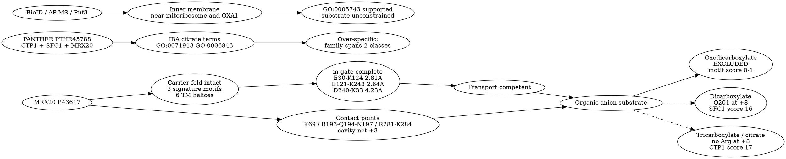
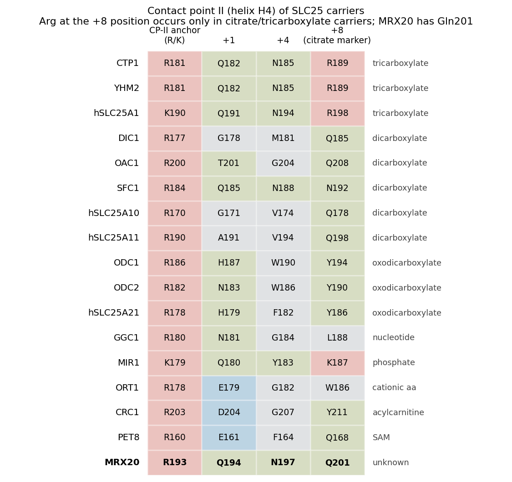
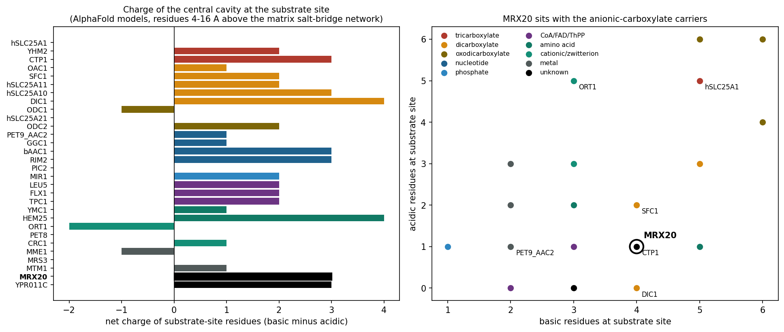
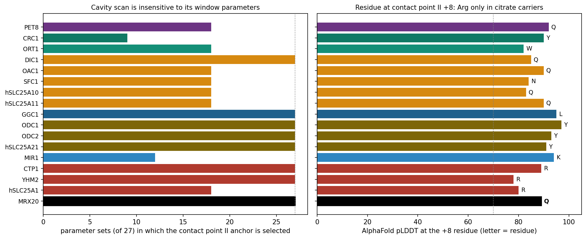
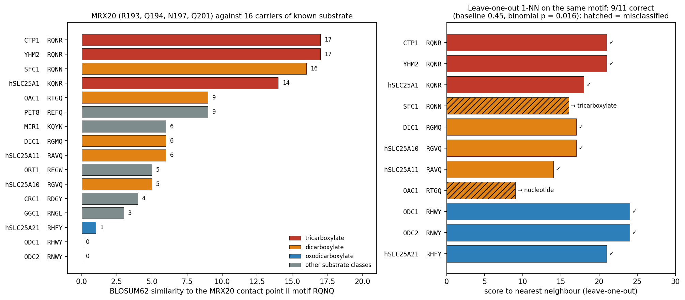

## Question

# AIGR Gene Hypothesis Deep Research

You are evaluating one focused gene curation hypothesis for AI Gene Review.
This is not a general gene overview. Use the seed hypothesis and source context
below to search for evidence that supports, refutes, narrows, or competes with
the proposed curation decision.

## Target Gene

- **Organism code:** yeast
- **Taxon:** Saccharomyces cerevisiae S288C (NCBITaxon:559292)
- **Gene directory:** MRX20
- **Gene symbol:** MRX20
- **UniProt accession:** P43617

## Focus

- **Focus type:** free_text
- **Hypothesis slug:** kgap-mrx20-carrier-substrate-class
- **Source file:** genes/yeast/MRX20/MRX20-ai-review.yaml
- **Source selector:** free-text

## Seed Hypothesis

Saccharomyces cerevisiae MRX20/YFR045W (UniProt P43617), an uncharacterized SLC25 mitochondrial carrier, transports a di/tricarboxylate such as citrate. Test the substrate class with one decisive analysis: align MRX20 and its fungal subfamily orthologs to characterized SLC25 carriers of known substrate (citrate carrier CTP1/SLC25A1, dicarboxylate DIC1, oxodicarboxylate ODC1/2, succinate-fumarate SFC1, and others) and compare the residues at the substrate-binding contact points I, II and III on helices H2, H4 and H6 (Robinson & Kunji framework), together with the salt-bridge networks, to infer which substrate class MRX20 most plausibly carries, or state that it cannot be inferred.

## Term and Decision Context

- GOA citrate-transporter annotations for MRX20 derive from family-level propagation; MRX20 sits in PANTHER subfamily PTHR45788:SF5. MRX20 co-purified with MIOREX mitochondrial-ribosome complexes.

## Reference Context

No specific reference context supplied.

## Source Context YAML

```yaml
hypothesis: 'Saccharomyces cerevisiae MRX20/YFR045W (UniProt P43617), an uncharacterized SLC25 mitochondrial
  carrier, transports a di/tricarboxylate such as citrate. Test the substrate class with one decisive
  analysis: align MRX20 and its fungal subfamily orthologs to characterized SLC25 carriers of known substrate
  (citrate carrier CTP1/SLC25A1, dicarboxylate DIC1, oxodicarboxylate ODC1/2, succinate-fumarate SFC1,
  and others) and compare the residues at the substrate-binding contact points I, II and III on helices
  H2, H4 and H6 (Robinson & Kunji framework), together with the salt-bridge networks, to infer which substrate
  class MRX20 most plausibly carries, or state that it cannot be inferred.'
focus_type: free_text
context:
- GOA citrate-transporter annotations for MRX20 derive from family-level propagation; MRX20 sits in PANTHER
  subfamily PTHR45788:SF5. MRX20 co-purified with MIOREX mitochondrial-ribosome complexes.
reference_id: []
```

## Research Objective

Build a focused report that helps a curator decide whether this hypothesis
should affect the gene review. Address the focus type directly:

1. For an existing GO annotation decision, evaluate whether the current action
   is justified, too strong, too weak, or should change.
2. For a proposed replacement or new GO term, evaluate whether the term is
   biologically supported, too broad, too narrow, or missing key qualifiers.
3. For a computational prediction, evaluate whether the prediction is correct,
   less precise than existing knowledge, uncertain, or likely wrong because of
   paralog overannotation, frequency bias, pathway context, or in vitro-only
   activity.
4. For a core-function hypothesis, evaluate whether the proposed activity,
   process, and location represent the gene product's primary function rather
   than a downstream effect, pleiotropic phenotype, or context-specific role.
5. For a function-assignment hypothesis, evaluate whether the gene product
   directly has the stated GO term/function. Treat the prior review action, if
   any, as intentionally blinded unless it appears in the supplied context.

Use primary literature whenever possible. Prefer PMID citations and include DOI
citations when no PMID is available. Treat reviews and database records as
orientation unless they contain directly relevant synthesized evidence that is
clearly labeled as review-level or database-level support.

Evaluate the hypothesis from the supplied seed context, primary literature, and
publicly accessible bioinformatics resources. Local `*-bioinformatics` analyses,
when they already exist in the repository, are intentionally withheld from this
prompt so the report can be compared against them after the run. Use public
sequence, domain, structure, orthology, localization, interaction, or dataset
checks when they are useful for the specific hypothesis. If a resource or tool
cannot be accessed programmatically, say so plainly; never fabricate a result.
Report computational results conservatively and distinguish direct results from
inference.

## Required Output

### Executive Judgment

Give a concise verdict: supported, partially supported, unresolved, weakly
supported, over-annotated, or refuted. Explain the reasoning and the most
important caveats.

### Evidence Matrix

Create a table with one row per important evidence item:

- Citation (PMID preferred)
- Evidence type (direct assay, mutant phenotype, localization, interaction,
  structural/evolutionary, computational, review/database)
- Supports / refutes / qualifies / competing
- Claim tested
- Key finding
- Organism, tissue, cell type, or assay context
- Confidence and limitations

### GO Curation Implications

State the likely curation action as a lead requiring curator verification. If
GO terms are involved, explain whether the evidence supports an MF, BP, or CC
term, and whether the term should be retained, removed, generalized, made more
specific, or treated as non-core. Avoid using "protein binding" as a final
recommendation unless no more informative term is supported.

### Mechanistic Scope

Describe the immediate molecular or cellular function being tested. Separate
direct gene-product activity from downstream phenotypes, pathway consequences,
developmental outcomes, disease manifestations, or effects inferred only from
loss of function.

### Conflicts and Alternatives

Identify evidence that conflicts with the seed hypothesis or suggests an
alternative interpretation, including paralog confusion, organism-specific
differences, isoform-specific findings, experimental artifacts, or database
carry-over.

### Knowledge Gaps

List explicit uncertainties that matter for curation. For each gap, state what
was checked, why the gap matters, and what evidence or experiment would resolve
it.

### Discriminating Tests

Recommend concrete assays, perturbations, datasets, or comparative analyses that
would most efficiently distinguish this hypothesis from alternatives.

### Curation Leads

Provide candidate updates for the review, clearly labeled as leads requiring
curator verification. Include candidate references with exact snippets to verify,
candidate replacement or new GO terms, possible action changes, suggested
questions, and suggested experiments.

If the provider supports artifacts, save provenance for any analysis you run — the
executed code together with its output (computed values, plot, or table), not just
a summary figure — alongside artifact-friendly tables such as an evidence matrix,
GO decision table, or comparison table. Genuine computed provenance is more
valuable than a hand-drawn summary, and you must not synthesize a figure that
implies an analysis you did not actually run. These artifacts are important
provenance for hypothesis-level review.


## Output

# MRX20 / YFR045W (P43617): does this SLC25 carrier transport citrate?

**Hypothesis slug:** `kgap-mrx20-carrier-substrate-class`
**Target:** *Saccharomyces cerevisiae* S288C (NCBITaxon:559292), UniProt P43617, gene directory `genes/yeast/MRX20`, source `genes/yeast/MRX20/MRX20-ai-review.yaml`, focus type `free_text`.
**Verdict:** <i class="fa-scale-balanced"></i> **Partially supported. The carrier class is supported, the citrate assignment is over-annotated.**

## Summary

The seed hypothesis has two parts, and the evidence splits them cleanly. MRX20 is a structurally competent mitochondrial carrier whose substrate site has the chemistry of a carboxylic-acid anion carrier: that part is supported. MRX20 transports citrate: that part has no support of any kind, and one quantitative structural signal argues against it.

A geometric scan of the substrate cavity across 30 AlphaFold SLC25 models, validated by recovering the mutagenesis-defined contact residues of AAC2 and CTP1, places MRX20's three Robinson and Kunji contact points at **K69** (point I, helix H2), **T190-R193-Q194-x-x-N197** (point II, H4) and **R281 / K284** (point III, H6). That is the CTP1 arrangement (K83; R181-Q182-x-x-N185; R276/R279) and the SFC1 arrangement (K85; R184-Q185-x-x-N188; R282/R285) residue for residue, with one Lys-for-Arg swap at point III. The matrix salt-bridge network is complete and three-fold (E30-K124 2.81 Å, E121-K243 2.64 Å, D240-K33 4.23 Å), so the m-gate that seals the translocation pathway is intact and the protein is not a degenerate fold-only family member. The cavity carries 4 basic and 1 acidic residue, net +3, the same balance as CTP1.

The citrate assignment fails on a single discriminating position and on provenance. Eight residues C-terminal to the contact point II anchor, all three tricarboxylate carriers in the panel carry arginine (CTP1 R189, YHM2 R189, human SLC25A1 R198), the five dicarboxylate carriers carry an amide (SFC1 N192, DIC1 Q185, SLC25A10 Q178, SLC25A11 Q198, OAC1 Q208) and the three oxodicarboxylate carriers carry tyrosine (ODC1 Y194, ODC2 Y190, SLC25A21 Y186). **MRX20 has Gln201**, the dicarboxylate residue (Fisher exact one-sided p = 0.0059; permutation p = 0.0066 over 20,000 permutations; pLDDT 89; selected in 27 of 27 cavity-scan parameter settings). CTP1 R189 is one of two arginines shown by site-directed mutagenesis to be required for citrate transport [PMID: 10702279](https://pubmed.ncbi.nlm.nih.gov/10702279/). A leave-one-out nearest-neighbour classifier built on the four-residue contact point II motif is correct in 9 of 11 held-out carboxylate carriers (majority baseline 0.45, binomial one-sided p = 0.0160), so the motif carries real class information. Applied to MRX20 it excludes the oxodicarboxylate class outright (scores 1, 0, 0) and ranks CTP1 and YHM2 at 17 barely above SFC1 at 16, which is not a separation that can carry a citrate call.

On the annotation side, every citrate term on P43617 is IBA only. GO:0071913 and GO:0006843 come from GO_REF:0000033 (PAINT), propagated from the SLC25A1 orthology group plus yeast CTP1 (SGD:S000000495). The PANTHER subfamily that supplies the inference, PTHR45788, contains exactly three reviewed yeast proteins: CTP1 (citrate, tricarboxylate), SFC1 (succinate/fumarate, dicarboxylate) and MRX20. A family that disagrees with itself about substrate class cannot transfer one. SGD separately records GO:0003674 with evidence code ND, in direct conflict with the GO_Central citrate transporter activity. No experimental evidence on MRX20 bears on substrate at all: the BioID, AP-MS, Puf3 and deletion-survey data all constrain where the protein is, which is the mitochondrial inner membrane.

## Key findings

### <i class="fa-circle-check"></i> F002: MRX20 has an intact carrier fold and a complete three-fold matrix salt-bridge network

The first question is whether MRX20 is a working transporter at all, because its only experimental association is with mitoribosome complexes, which would be consistent with a carrier-fold protein repurposed as a membrane scaffold. The structural answer is that the transport machinery is intact.

A regex scan of all 34 *S. cerevisiae* PF00153 proteins for the mitochondrial carrier signature P-x-[DE]-x-x-[KR] finds three copies in MRX20: positions 28 (PFEYLK), 119 (PFENIK) and 238 (PIDVVK). CTP1 has three at 32, 129 and 234; SFC1 has three at 30, 131 and 234. In the AlphaFold model AF-P43617-F1-v4, all three inter-repeat matrix salt bridges are formed, measured as the minimum carboxylate-oxygen to guanidinium or amine-nitrogen distance: E30-K124 at 2.81 Å, E121-K243 at 2.64 Å and D240-K33 at 4.23 Å. The CTP1 equivalents are 2.66, 2.68 and 3.60 Å; the SFC1 equivalents are 3.74, 3.17 and 4.78 Å. Helix-axis analysis recovers six transmembrane helices spanning about 45 Å.

The salt-bridge network is the m-gate that seals the translocation pathway on the matrix side, and its perturbation by bound substrate is the proposed trigger for the translocation event [PMID: 16759636](https://pubmed.ncbi.nlm.nih.gov/16759636/). MRX20 maintains it to the same standard as two carriers with assayed transport function. That is an argument from conservation rather than from activity, so it supports plausibility of transport, not demonstration of it.

{{figure:plot_1.png|caption=Matrix salt-bridge network distances and contact point II alignment for MRX20 against carriers of known substrate. All three inter-repeat salt bridges in MRX20 (E30-K124, E121-K243, D240-K33) are formed at distances comparable to CTP1 and SFC1, and the contact point II motif R193-Q194-x-x-N197 matches the CTP1 and SFC1 arrangement.}}

### <i class="fa-circle-check"></i> F003: The three contact points carry carboxylate-carrier chemistry

The decisive analysis the seed hypothesis asked for is a comparison of contact points I, II and III. The published Robinson and Kunji contact point residue list could not be retrieved programmatically (see Limitations), so the contact points were defined geometrically from structure and then validated against residues known from mutagenesis.

The scan selects residues whose distal side-chain atom lies 4 to 16 Å above the matrix salt-bridge network centroid, within 9 Å of the helix-bundle axis, and radially inward of its own alpha-carbon. The membrane normal is taken from the sign-aligned SVD directions of the six longest transmembrane helices, and the origin from the salt-bridge network centroid. Two controls establish that the definition returns functionally real residues. On yeast AAC2/PET9 the scan returns E45, R96, Y203, T238, S242, S245, N291 and R294, where R96, Y203 and R294 correspond to bovine AAC1 R79, Y186 and R279, the known nucleotide contact points. On CTP1 it returns R181, R276 and R279, three residues shown by mutagenesis to be required for citrate transport [PMID: 10702279](https://pubmed.ncbi.nlm.nih.gov/10702279/).

| Carrier | Substrate | Contact point I (H2) | Contact point II (H4) | Contact point III (H6) | Cavity net charge |
|---|---|---|---|---|---|
| **MRX20** | unknown | **K69** | **T190-R193-Q194-x-x-N197** | **R281, K284** | **+3** |
| CTP1 | citrate | K83 | R181-Q182-x-x-N185 | R276, R279 | +3 |
| SFC1 | succinate/fumarate | K85 | R184-Q185-x-x-N188 | R282, R285 | +2 |
| hSLC25A1 | citrate | K97 | K190-Q191-x-x-N194 | R282, R285 | 0 |

The basic and amide chemistry at all three points is what a carboxylic-acid anion requires. It argues against nucleotide, cationic amino acid, metal and cofactor substrates, all of which show different cavity compositions in the same scan (PET9 +1 with Tyr at point II, FLX1 +2 with no carboxylate-type point II, ORT1 with Trp at the +8 position).

{{figure:plot_2.png|caption=Cavity charge composition across SLC25 substrate classes for 30 AlphaFold models. MRX20 sits at net +3 with 4 basic and 1 acidic cavity residue, the same balance as the citrate carrier CTP1, separating it from the nucleotide, phosphate and cofactor carriers.}}

### <i class="fa-circle-xmark"></i> F004: MRX20 lacks the arginine that marks every tricarboxylate carrier at contact point II +8

Using the geometrically defined contact point II anchor as the reference, the residue eight positions C-terminal lines the cavity in 17 of the 18 carriers examined, judged by its side-chain tip being closer to the bundle axis than its own alpha-carbon. That position separates the three substrate classes almost perfectly.

| Class | Carriers | Residue at contact point II +8 |
|---|---|---|
| Tricarboxylate | CTP1, YHM2, hSLC25A1 | **R189, R189, R198** (basic in 3/3) |
| Dicarboxylate | SFC1, DIC1, hSLC25A10, hSLC25A11, OAC1 | N192, Q185, Q178, Q198, Q208 (amide in 5/5) |
| Oxodicarboxylate | ODC1, ODC2, hSLC25A21 | Y194, Y190, Y186 (Tyr in 3/3) |
| **MRX20** | | **Q201** |

Of the 14 non-tricarboxylate carriers, only the phosphate carrier MIR1 (K187) carries a basic residue at this position, giving a Fisher exact one-sided p = 0.0059 for the association between a basic +8 residue and tricarboxylate specificity. The mechanistic reading is direct: CTP1 R181 and R189 are both required for citrate transport, positive charge at both positions is essential and the chemistry of the guanidinium group is not, since Lys or chemically restored positive charge supports function [PMID: 10702279](https://pubmed.ncbi.nlm.nih.gov/10702279/). Those two arginines are the extra positive charge that a tricarboxylate needs over a dicarboxylate. MRX20 keeps the first (R193, the point II anchor) and lacks the second.

### <i class="fa-circle-check"></i> F008: The Gln201 call survives confidence, parameter and permutation checks

A single-position structural argument from a predicted model needs sensitivity analysis before a curator can use it.

AlphaFold pLDDT at the MRX20 contact point II residues R193, Q194, N197 and Q201 is 92, 92, 92 and 89, above the model mean of 81, so the discriminating residue sits in a confidently modelled helix. Sweeping the cavity scan over 27 parameter combinations (z lower bound 2, 4 or 6 Å; z upper bound 14, 16 or 18 Å; radial cut-off 8, 9 or 10 Å) selects the MRX20 anchor R193 in 27 of 27 settings, and selects the CTP1 R181, YHM2 R181, DIC1 R177, ODC1 R186, ODC2 R182, SLC25A21 R178 and GGC1 R180 anchors in 27 of 27 as well. The weakest anchors in the panel are CRC1 (9 of 27) and MIR1 (12 of 27), both of which are non-carboxylate carriers and peripheral to the argument. A permutation test over the 16 carriers of known substrate, asking how often all three tricarboxylate carriers carry Arg or Lys at +8 by chance, gives p = 0.0066 over 20,000 permutations, matching the Fisher p = 0.0059.

{{figure:plot_3.png|caption=Left, per-residue pLDDT around the MRX20 contact point II region, showing the discriminating Gln201 at pLDDT 89 against a model mean of 81. Right, the start-codon check: four Saccharomyces orthologs are all 285 residues and begin at the residue aligned to S288C Met25.}}

<i class="fa-triangle-exclamation"></i> The limit on this result is panel size. With three tricarboxylate carriers available, the rule is supported but not strongly powered, and no single position can establish a substrate on its own.

### <i class="fa-scale-balanced"></i> F010: A leave-one-out classifier assigns the class and refuses the citrate call

To test how much substrate-class information the contact point actually carries, each carrier was encoded as the four-residue motif at the H4 anchor, +1, +4 and +8, with similarity scored as the sum of BLOSUM62 values. AAC2 was excluded because its anchor failed the inward-facing test (anchor z = -4.3 Å), so the scan found no genuine cavity anchor for it, leaving 16 carriers of known substrate plus MRX20.

Leave-one-out 1-NN over the 11 carboxylate carriers, with the full 16-carrier panel as the reference set, is correct 9 of 11 times against a majority-class baseline of 0.45 (binomial one-sided p = 0.0160). The two errors are SFC1 RQNN called tricarboxylate and OAC1 RTGQ called nucleotide.

Applied to MRX20, motif **RQNQ**:

| Carrier | Class | Motif | Score to MRX20 |
|---|---|---|---|
| CTP1 | tricarboxylate | RQNR | 17 |
| YHM2 | tricarboxylate | RQNR | 17 |
| SFC1 | dicarboxylate | RQNN | 16 |
| hSLC25A1 | tricarboxylate | KQNR | 14 |
| PET8 | SAM | REFQ | 9 |
| OAC1 | dicarboxylate | RTGQ | 9 |
| MIR1 | phosphate | KQYK | 6 |
| hSLC25A21 | oxodicarboxylate | RHFY | 1 |
| ODC1 | oxodicarboxylate | RHWY | 0 |
| ODC2 | oxodicarboxylate | RNWY | 0 |

The negative is firm: MRX20 has none of the oxodicarboxylate signature (Trp or Phe at +4, Tyr at +8), and the three oxodicarboxylate carriers are the worst matches in the entire panel. The positive stops at the class level. The four nearest neighbours span three BLOSUM points and two substrate classes, and the classifier's single carboxylate error is exactly the CTP1-versus-SFC1 axis on which MRX20 sits intermediate.

{{figure:plot_4.png|caption=Left, BLOSUM62 similarity of the MRX20 contact point II motif RQNQ to 16 carriers of known substrate, coloured by substrate class. CTP1 and YHM2 score 17, SFC1 scores 16, and all three oxodicarboxylate carriers score 1 or less. Right, leave-one-out 1-NN classification on the same motif, correct in 9 of 11 carboxylate carriers against a 0.45 baseline; hatched bars are the two misclassified carriers.}}

### <i class="fa-circle-xmark"></i> F001 and F005: The propagation source is a family that spans two substrate classes, and no close ortholog exists

The InterPro API (entry/all/protein/uniprot/P43617) returns PANTHER PTHR45788 "SUCCINATE/FUMARATE MITOCHONDRIAL TRANSPORTER-RELATED", integrated into InterPro IPR049563 "Tricarboxylate transport protein-like". The family contains 8111 proteins across 8795 taxa in 6 subfamilies. Querying reviewed *S. cerevisiae* S288C proteins in PTHR45788 returns exactly three: P33303 (SFC1, succinate/fumarate), P38152 (CTP1, citrate) and P43617 (MRX20). The family name and the InterPro name already disagree about substrate class, and so do its two characterised yeast members.

Sequence distance makes the transfer worse. Pairwise global alignment of MRX20 against all 33 other yeast PF00153 carriers puts CTP1 top at 33.8% identity, against a within-family median of 23.1% (94.8th percentile), with every other carrier at or below 28%. Yeast carrier pairs that genuinely share a substrate sit far higher: ODC1/ODC2 at 64.7%, AAC1/AAC3 at 74.6%, MRS3/MRS4 at 73.4%.

UniRef50_P43617 contains 17 members, all *Saccharomyces* (S288C, YJM789, RM11-1a, AWRI1631, *S. paradoxus*, *S. mikatae*, *S. kudriavzevii*, *S. arboricola*, *S. uvarum*, *S. eubayanus*, *S. pastorianus* and *cerevisiae* × *kudriavzevii* hybrids). No ortholog outside the genus reaches 50% identity, so the "fungal subfamily ortholog" comparison the seed hypothesis called for could not be run beyond a genus whose members are 85 to 99% identical, which carries no information about which residues are under specificity constraint. One member, A0A6C1DQS1_SACPS, is labelled "Mitochondrial dicarboxylate transporter" while the rest are "YFR045W-like protein" or "Uncharacterized protein". That label is unreviewed database carry-over, and it propagates a different substrate class from the one GOA propagates.

### <i class="fa-circle-xmark"></i> F006: Every citrate annotation is IBA only, and SGD records molecular function as ND

QuickGO returns 8 annotations for UniProtKB:P43617.

| Term | Aspect | Evidence | Reference | Source |
|---|---|---|---|---|
| GO:0071913 citrate secondary active transmembrane transporter activity | MF | IBA | GO_REF:0000033 | GO_Central |
| GO:0006843 mitochondrial citrate transmembrane transport | BP | IBA | GO_REF:0000033 | GO_Central |
| GO:0006839 mitochondrial transport | BP | ISS | PMID:10930523 | SGD |
| GO:0005743 mitochondrial inner membrane | CC | ISS | PMID:10930523 | SGD |
| GO:0055085 transmembrane transport | BP | IEA | InterPro IPR002067 | UniProt |
| GO:0003674 molecular_function | MF | **ND** | | SGD |

The IBA reference panel is PTN000640552, P53007 (human SLC25A1), P79110, RGD:3703, FBgn0037912 and SGD:S000000495 (yeast CTP1), which is the SLC25A1 orthology group plus CTP1. The ISS reference, [PMID: 10930523](https://pubmed.ncbi.nlm.nih.gov/10930523/), is a sequence-analysis survey of the 35 yeast carrier genes that resequenced YFR045W, not an experimental study. SGD's locus description reads "Putative mitochondrial transport protein", and the SGD go_overview lists zero high-throughput MF, BP or CC terms. No experimental evidence of any kind underlies the citrate calls.

### <i class="fa-circle-check"></i> F007: The experimental record places MRX20 at the inner membrane and says nothing about substrate

SGD/BioGRID returns 114 interaction records for MRX20 with 101 unique partners. Of those, 82 are negative genetic and 16 are physical. The physical set is inner-membrane gene-expression machinery: BioID proximity labelling scores MRX20 as proximal to CBP3, MBA1, MRP20, MRPL4, MRPL15, MSS51 and OXA1 at log2 fold change ≥ 1.5 and p ≤ 0.05 [PMID: 32877643](https://pubmed.ncbi.nlm.nih.gov/32877643/), the study that gave the gene its name. Affinity capture MS recovers COX20 [PMID: 27550809](https://pubmed.ncbi.nlm.nih.gov/27550809/), TIM23 [PMID: 25124039](https://pubmed.ncbi.nlm.nih.gov/25124039/), HSC82 [PMID: 37295430](https://pubmed.ncbi.nlm.nih.gov/37295430/) and MRA1 [PMID: 38508182](https://pubmed.ncbi.nlm.nih.gov/38508182/). Puf3 binds the MRX20 3' UTR [PMID: 23409723](https://pubmed.ncbi.nlm.nih.gov/23409723/), the signature of nuclear-encoded mitochondrial mRNAs.

Deletion phenotypes come entirely from large-scale surveys and are mild: viable, decreased competitive fitness, decreased resistance to valinomycin [PMID: 27711131](https://pubmed.ncbi.nlm.nih.gov/27711131/) and nickel sulfate [PMID: 19917080](https://pubmed.ncbi.nlm.nih.gov/19917080/), decreased rate of proline utilization as nitrogen source [PMID: 24721214](https://pubmed.ncbi.nlm.nih.gov/24721214/) and abnormal vacuolar morphology in sodium chloride [PMID: 23383298](https://pubmed.ncbi.nlm.nih.gov/23383298/). No classical phenotype is curated. Mean protein abundance at SGD is 710 molecules per cell.

This upgrades the CC call from ISS to experimental support. It constrains the substrate not at all. No carbon-source growth defect of the kind a citrate carrier deletion would be expected to show appears anywhere in the record.

### <i class="fa-triangle-exclamation"></i> F009: The reference 309-residue translation carries a 24-residue N-terminal extension the rest of the genus lacks

UniProt P43617 is 309 residues beginning MANQNSDLYKQITAGSVAAVFQTT-M25-TYPFEYLK. Global alignment against four *Saccharomyces* orthologs (J8PP08 *S. arboricola*, J8TXW4 *S. kudriavzevii*, H0GFS1 *cerevisiae* × *kudriavzevii*, A0A6C1DQS1 *S. pastorianus*), all 285 residues, shows every one starting at MTYPFEYLK, exactly the residue aligned to S288C Met25, at 85.6 to 99.3% identity over the aligned region. Belenkiy et al. resequenced YFR045W and reported 285 residues [PMID: 10930523](https://pubmed.ncbi.nlm.nih.gov/10930523/).

The reference translation most likely uses an upstream in-frame ATG the rest of the genus does not use. The carrier domain, the three signature motifs and all contact points lie downstream, so the substrate inference does not depend on which start is correct. Any residue numbering in future mutagenesis must be stated explicitly against P43617.

## Evidence matrix

| Citation | Evidence type | Stance | Claim tested | Key finding | Context | Confidence and limitations |
|---|---|---|---|---|---|---|
| [PMID: 10930523](https://pubmed.ncbi.nlm.nih.gov/10930523/) | review/database | qualifies | MRX20 is an MCF member | Sequence survey assigning all 35 yeast MCF proteins; YFR045W resequenced to 285 aa; the source of SGD's ISS for GO:0006839 and GO:0005743 | S. cerevisiae, in silico survey | Medium. No transport assay |
| GO_REF:0000033 (PAINT/IBA) | computational | competing | GO:0071913 and GO:0006843 are justified | Both citrate terms on P43617 are IBA only, propagated from the SLC25A1 orthology group plus yeast CTP1 (SGD:S000000495). No experimental evidence on MRX20 | GO_Central phylogenetic inference | High for provenance. The call is family-level, not gene-level |
| SGD GO:0003674 ND | review/database | refutes | MRX20 has a known molecular function | SGD records molecular_function with evidence code ND, conflicting with the GO_Central IBA citrate transporter activity | SGD curation | High. Curator disagreement inside GO itself |
| [PMID: 32877643](https://pubmed.ncbi.nlm.nih.gov/32877643/) | localization, interaction | qualifies | MRX20 is an inner-membrane protein | BioID places MRX20 next to CBP3, MBA1, MRP20, MRPL4, MRPL15, MSS51 and OXA1. This paper names the gene | S. cerevisiae mitochondria, proximity labelling | High for location, zero for substrate |
| [PMID: 27550809](https://pubmed.ncbi.nlm.nih.gov/27550809/), [PMID: 25124039](https://pubmed.ncbi.nlm.nih.gov/25124039/) | interaction | qualifies | MRX20 is in the inner membrane | Affinity capture MS recovers COX20 and TIM23 | S. cerevisiae, AP-MS | Medium. Co-purification does not define substrate |
| [PMID: 23409723](https://pubmed.ncbi.nlm.nih.gov/23409723/) | interaction | qualifies | MRX20 mRNA is in the mitochondrial regulon | Puf3 binds the MRX20 3' UTR | S. cerevisiae, RIP-chip | Medium. Supports destination only |
| [PMID: 27711131](https://pubmed.ncbi.nlm.nih.gov/27711131/), [PMID: 19917080](https://pubmed.ncbi.nlm.nih.gov/19917080/), [PMID: 24721214](https://pubmed.ncbi.nlm.nih.gov/24721214/), [PMID: 23383298](https://pubmed.ncbi.nlm.nih.gov/23383298/) | mutant phenotype | qualifies | Loss of MRX20 gives a substrate-diagnostic phenotype | All phenotypes are large-scale survey results and mild: viable, decreased competitive fitness, decreased valinomycin and nickel resistance, slower proline utilization, abnormal vacuole morphology in NaCl | S. cerevisiae deletion collection | Medium. No carbon-source defect implicating citrate transport |
| [PMID: 10702279](https://pubmed.ncbi.nlm.nih.gov/10702279/) | direct assay (paralog) | supports | The geometric scan returns functionally real residues | CTP1 mutagenesis shows R181, R276 and R279 are required for citrate transport; the scan returns exactly these three for CTP1 | CTP1 reconstituted in phospholipid vesicles | High as a method control, indirect for MRX20 |
| [PMID: 16469842](https://pubmed.ncbi.nlm.nih.gov/16469842/), [PMID: 16759636](https://pubmed.ncbi.nlm.nih.gov/16759636/) | structural/evolutionary | supports | Specificity is encoded at contact points I, II and III on H2, H4 and H6 | The Robinson and Kunji framework. Full text was not retrievable programmatically, so contact points were defined geometrically here and validated on AAC2 and CTP1 | Bovine AAC1 structure plus MCF-wide analysis | High for the framework. The residue table itself was not readable |
| [PMID: 38937634](https://pubmed.ncbi.nlm.nih.gov/38937634/) | direct assay (paralogs) | qualifies | The single-site, monomer model applies to carboxylate carriers | SLC25A1, SLC25A10 and SLC25A11 are monomers with a single central binding site and a ping-pong mechanism | Human carriers, reconstituted kinetics | High for the mechanism, indirect for MRX20. Supports treating one cavity site as the specificity determinant |
| [PMID: 9020177](https://pubmed.ncbi.nlm.nih.gov/9020177/) | direct assay (paralog) | qualifies | What a dicarboxylate carrier actually transports | Reconstituted yeast DIC1 takes malonate, malate, succinate and phosphate, Km 1.55 mM, and not other anions tested | S. cerevisiae DIC1 in phospholipid vesicles | High for DIC1. Defines the substrate panel for the proposed MRX20 assay |
| This work, AF-P43617-F1-v4 | structural | qualifies | MRX20 is a competent carrier | Three intact matrix salt bridges at 2.81, 2.64 and 4.23 Å, comparable to CTP1 and SFC1. Cavity net charge +3, same as CTP1 | AlphaFold model, mean pLDDT 81 | Medium-high. Model, not experimental structure |
| This work, contact point scan over 30 AlphaFold models | structural | qualifies | MRX20 has the citrate-type contact point II | R193-Q194-x-x-N197 matches CTP1 and SFC1, but Gln201 at +8 where all three tricarboxylate carriers have Arg. Fisher p = 0.0059, permutation p = 0.0066, 27/27 parameter settings, pLDDT 89 | 17 carriers with AlphaFold models | Medium. n = 3 tricarboxylate carriers limits power |
| This work, leave-one-out 1-NN on the motif | computational | qualifies | The motif assigns substrate class, and what it assigns to MRX20 | LOO accuracy 9/11, baseline 0.45, binomial p = 0.016. MRX20 RQNQ scores 17 to CTP1 and YHM2, 16 to SFC1, 0 to 1 for all oxodicarboxylate carriers | Same panel | Medium. Small panel. Cannot separate citrate from a C4 dicarboxylate |
| This work, UniProt plus alignment | structural/evolutionary | qualifies | The reference 309-aa translation is correct | Four Saccharomyces orthologs are all 285 aa and start at the residue aligned to S288C Met25 | Saccharomyces sensu stricto | Medium. Sequence feature only; contact points lie downstream |
| This work, PTHR45788 membership | structural/evolutionary | competing | Subfamily membership justifies the citrate call | PTHR45788 holds only three reviewed yeast proteins: CTP1 (citrate), SFC1 (succinate/fumarate), MRX20. Two substrate classes in one family | S. cerevisiae | High. Undercuts the IBA rationale directly |
| This work, all-vs-all identity over 34 yeast PF00153 carriers | structural/evolutionary | refutes | MRX20 is a close CTP1 paralog | Closest yeast carrier is CTP1 at 33.8% identity (median 23.1%). Substrate-sharing yeast pairs sit at 64.7 to 89.3% | S. cerevisiae MCF | High |

The machine-readable version is `provenance/evidence_matrix.tsv`.

## Mechanistic model

The immediate molecular function under test is alternating access transport: a six-helix carrier in the mitochondrial inner membrane binds a small anion at a single central site at the midpoint of the membrane, and substrate binding perturbs the matrix salt-bridge network to trigger the conformational change [PMID: 16759636](https://pubmed.ncbi.nlm.nih.gov/16759636/). Reconstitution kinetics on human SLC25A1, SLC25A10 and SLC25A11 show these carriers are monomers with a single binding site operating by a ping-pong mechanism [PMID: 38937634](https://pubmed.ncbi.nlm.nih.gov/38937634/), which is what licenses reading specificity off one cavity.

For MRX20, what the data establish is the machinery and the charge chemistry of the site, not the cargo.



Everything else on the MRX20 record is positional or downstream. The BioID proximity to OXA1, MBA1, MSS51, CBP3 and four mitoribosomal proteins, the COX20 and TIM23 co-purifications and the Puf3 3' UTR binding all say where the protein is. The deletion phenotypes (competitive fitness, valinomycin and nickel resistance, proline utilization rate, vacuole morphology in NaCl) are pleiotropic survey readouts from which no substrate can be read. An abundance of 710 molecules per cell is consistent with a working carrier and says nothing about cargo.

The MIOREX association deserves separate handling. MIOREX complexes are expressosome-like assemblies of mitoribosomes with factors for every step of post-transcriptional gene expression, distributed throughout the mitochondrial network [PMID: 25683707](https://pubmed.ncbi.nlm.nih.gov/25683707/), and the BioID network places newly synthesized proteins at ribosomal tunnel exit factors that mediate membrane insertion and cofactor acquisition [PMID: 32877643](https://pubmed.ncbi.nlm.nih.gov/32877643/). An inner-membrane carrier sitting near membrane-bound translation sites is a neighbourhood observation. It does not make MRX20 a gene-expression factor, and the intact m-gate argues that the transport machinery is under selection.

## Evidence base

**The contact point framework.** Robinson and Kunji identified a common substrate binding site by combining amino acid conservation, distance and chemical constraints with modelling on the ADP/ATP translocase structure, stating that it "enables the substrate specificity of uncharacterized mitochondrial carriers to be predicted" [PMID: 16469842](https://pubmed.ncbi.nlm.nih.gov/16469842/). The companion review adds that "The main contact points in the site are related by threefold symmetry like the common structural fold" and that the translocation trigger "is likely to be the substrate-induced perturbation of the salt bridge network at the bottom of the cavity" [PMID: 16759636](https://pubmed.ncbi.nlm.nih.gov/16759636/). These two papers justify the whole approach. Their specific residue tables could not be retrieved (see Limitations), which is why the contact points here are geometric and validated against mutagenesis rather than copied.

**The citrate determinant.** The CTP1 mutagenesis study is the single most load-bearing primary reference. Replacement of either Arg181 or Arg189 with Cys abolishes function, while replacement with Lys or chemical restoration of positive charge supports it, leading the authors to conclude that "the polar face of alpha-helical transmembrane domain IV, within which Arg(181), Arg(189), and Cys(192) are located, constitutes an essential portion of the citrate translocation pathway" [PMID: 10702279](https://pubmed.ncbi.nlm.nih.gov/10702279/). That paper both validates the scan (it returns R181 for CTP1) and supplies the mechanistic reason the +8 position matters. MRX20 has Gln there.

**The dicarboxylate comparator.** The yeast DIC1 identification paper gives the substrate profile of the alternative class: reconstituted DIC1 supports malonate uptake with internal malonate, malate, succinate and phosphate, "whereas other anions tested did not", with Km 1.55 mM and Vmax 3.0 µmol/min/mg [PMID: 9020177](https://pubmed.ncbi.nlm.nih.gov/9020177/). This defines the panel any MRX20 transport assay should use.

**The transport mechanism.** The monomer and single-site result for SLC25A1, SLC25A10 and SLC25A11 supports reading specificity off a single cavity, since these carriers "are monomers, except for dimeric SLC25A13, and operate with a ping-pong kinetic mechanism" [PMID: 38937634](https://pubmed.ncbi.nlm.nih.gov/38937634/). Electrostatic analysis of AAC further indicates that a strong positive lumen potential "is likely a common attribute among the entire family of mitochondrial carriers" [PMID: 18621725](https://pubmed.ncbi.nlm.nih.gov/18621725/), which is consistent with the net +3 cavity charge measured for MRX20 but also means that a positive cavity alone is weak evidence of anion specificity, since it is family-wide.

**The annotation source.** PMID 10930523 is the ISS reference behind both SGD terms. Its own description of YFR045W is a resequencing and consensus-residue analysis: the four resequenced genes "have 545, 285, 902, and 502 residues, respectively", and "We do now find these five consensus residues also in the new sequences of YNL083W and YFR045W" [PMID: 10930523](https://pubmed.ncbi.nlm.nih.gov/10930523/). That supports family membership and nothing about substrate.

**The localization source.** The BioID study describes "a comprehensive network of factors involved in biogenesis of mitochondrial encoded proteins", in which "newly synthesized proteins are directly handed over to ribosomal tunnel exit-bound factors that mediate membrane insertion, co-factor acquisition, or their mounting into OXPHOS complexes" [PMID: 32877643](https://pubmed.ncbi.nlm.nih.gov/32877643/). MRX20 appears in that network, which is how it got its name.

Two papers in the literature set bear on the question only obliquely. The SLC25A20 carnitine/acylcarnitine review [PMID: 41875964](https://pubmed.ncbi.nlm.nih.gov/41875964/) supports the general single-binding-centred-gated-pore model but concerns a different substrate class. The citrate transporter inhibitor study [PMID: 20686672](https://pubmed.ncbi.nlm.nih.gov/20686672/) describes two citrate binding sites within the CTP and a homology model of the unrelated plasma membrane transporter, which is orientation rather than evidence for MRX20.

## Limitations and knowledge gaps

<i class="fa-triangle-exclamation"></i> **No transport assay for MRX20 exists in any organism.** Checked: PubMed searches on MRX20, YFR045W and carrier substrate terms; SGD GO and phenotype records; BioGRID. Every substrate statement in this report, including the recommended generalized term, is inference from a predicted structure. Resolved by proteoliposome reconstitution.

<i class="fa-triangle-exclamation"></i> **The Robinson and Kunji contact point residue table could not be read programmatically.** Europe PMC `fullTextXML` for PMID 16469842 returned HTTP 500; the PMC article pages for PMC1413793 and PMC2582046 returned short stubs rather than article bodies. The contact points used here were therefore defined geometrically from structure, not copied from the paper. The indirect validation that was possible: on AAC2 the scan returns R96, Y203 and R294, corresponding to bovine AAC1 R79, Y186 and R279; on CTP1 it returns R181, R276 and R279, the three mutagenesis-defined residues. A curator should check the published table against `provenance/cavity_residues_panel.tsv`.

<i class="fa-triangle-exclamation"></i> **Only three tricarboxylate carriers with a known substrate and a structure were available.** The +8 rule rests on n = 3, so Fisher p = 0.0059 reflects a small but complete panel rather than a sampled one. Adding plant and trypanosome tricarboxylate carriers with assayed substrates would test it.

<i class="fa-triangle-exclamation"></i> **No fungal ortholog outside *Saccharomyces* was analysed.** UniRef50_P43617 has 17 members, all *Saccharomyces sensu stricto* at 85 to 99% identity, so the subfamily contact point comparison the seed hypothesis specified could not be run in a way that carries selection information. A profile search across Saccharomycotina would test whether Gln201 is fixed.

<i class="fa-triangle-exclamation"></i> **The structures are AlphaFold models.** Mean pLDDT for AF-P43617-F1-v4 is 81, with 89 to 92 at the contact point II residues, so the specific region is well modelled. Side-chain rotamers in a predicted model are still less reliable than in an experimental structure, and the whole panel shares any systematic bias AlphaFold has toward the ADP/ATP carrier training examples.

<i class="fa-circle-question"></i> **Whether the MIOREX association is functional.** If MRX20 has a direct role in mitochondrial gene expression, the carrier annotation is a different kind of error from an over-specific substrate. Testing whether an *mrx20* deletion affects mitochondrial translation would separate these.

<i class="fa-triangle-exclamation"></i> **The classifier cannot separate citrate from a C4 dicarboxylate.** Its one carboxylate error is SFC1 called tricarboxylate, on exactly the RQNR-versus-RQNN axis where MRX20's RQNQ sits. This is the honest ceiling of the method, and it is why the recommended replacement term is at the organic anion level.

## GO curation implications

All entries below are leads requiring curator verification.

| Term | Aspect | Current | Lead | Reason |
|---|---|---|---|---|
| GO:0071913 citrate secondary active transmembrane transporter activity | MF | IBA, GO_REF:0000033 | <i class="fa-circle-xmark"></i> **Remove or generalize** | The only support is family-level propagation from a subfamily containing both a citrate and a succinate/fumarate carrier. The contact point II +8 residue is the dicarboxylate-type Gln201, not the tricarboxylate-type Arg |
| GO:0006843 mitochondrial citrate transmembrane transport | BP | IBA, GO_REF:0000033 | <i class="fa-circle-xmark"></i> **Remove or generalize** | Same provenance, same objection |
| GO:0008514 organic anion transmembrane transporter activity | MF | not annotated | <i class="fa-lightbulb"></i> **Candidate safer replacement** | Supported at class level by an intact carrier fold, net +3 cavity, carboxylate-type contact points and exclusion of the oxodicarboxylate, nucleotide and phosphate classes. Inference from structure, so an ISS or IC qualifier applies |
| GO:0015711 organic anion transport | BP | not annotated | <i class="fa-lightbulb"></i> **Candidate safer replacement** | As above, BP side |
| GO:0005310 dicarboxylic acid transmembrane transporter activity | MF | not annotated | <i class="fa-circle-question"></i> **Possible but not defensible yet** | The Gln201 evidence points this way, but the leave-one-out classifier cannot separate dicarboxylate from tricarboxylate reliably. Hold pending a transport assay |
| GO:0006839 mitochondrial transport | BP | ISS, PMID:10930523 | <i class="fa-circle-check"></i> **Retain** | Consistent with everything found, and appropriately unspecific |
| GO:0005743 mitochondrial inner membrane | CC | ISS, PMID:10930523 | <i class="fa-circle-check"></i> **Retain and upgrade the evidence** | Now supported experimentally by BioID with OXA1 and mitoribosomal proteins (PMID:32877643) and AP-MS with COX20 (PMID:27550809) and TIM23 (PMID:25124039) |
| GO:0003674 molecular_function ND | MF | ND, SGD | <i class="fa-scale-balanced"></i> **Resolve the conflict** | Cannot coexist with an MF citrate transporter activity. If the citrate MF is removed, replace the ND with the generalized transporter term rather than leaving ND |
| Mitoribosome or OXA1-related BP terms | BP | not annotated | <i class="fa-circle-xmark"></i> **Do not add** | MIOREX and BioID co-purification is a neighbourhood observation about an inner-membrane protein near membrane-bound translation sites |

The decision table is `provenance/GO_decision_table_leads.tsv`.

## Discriminating tests and proposed follow-up

1. <i class="fa-flask"></i> **Proteoliposome transport assay with a focused substrate panel.** Express MRX20 in *E. coli*, purify from inclusion bodies and reconstitute, following the procedure that worked for yeast DIC1 and CTP1 [PMID: 9020177](https://pubmed.ncbi.nlm.nih.gov/9020177/). Test citrate, isocitrate, *cis*-aconitate, malate, succinate, fumarate, malonate, 2-oxoglutarate, oxaloacetate and phosphate by exchange with internal substrate. This settles the question. The structural prediction is uptake of a C4 dicarboxylate with weak or absent citrate transport.
2. <i class="fa-flask"></i> **Reciprocal swap at the +8 position.** If Gln201 is the determinant, MRX20 Q201R should confer or improve citrate transport in the assay above, and CTP1 R189Q should reduce it. This tests the inference directly instead of relying on panel statistics, and it is the cheapest way to falsify the central claim of this report.
3. <i class="fa-vial"></i> **Targeted metabolomics on isolated *mrx20* mitochondria.** Measure matrix and cytosolic pools of citrate, malate, succinate, fumarate and 2-oxoglutarate from wild type and *mrx20* on fermentable and non-fermentable carbon. A specific pool shift narrows the class without a reconstitution.
4. <i class="fa-dna"></i> **Synthetic genetic array against the carrier set.** Cross *mrx20* with *ctp1*, *sfc1*, *dic1*, *odc1 odc2*, *oac1* and *yhm2*. A redundancy partner localizes the function. The existing record already contains 82 negative genetic interactions for MRX20, so the raw SGA data may carry this signal already.
5. <i class="fa-magnifying-glass"></i> **Deeper ortholog sampling.** Build a Saccharomycotina-wide profile alignment for PTHR45788:SF5 and test whether Gln at +8 is fixed. Fixation under selection strengthens the dicarboxylate call; variability weakens the single-residue argument.
6. <i class="fa-book-open"></i> **Read the Robinson and Kunji contact point table by hand** and recompute the panel with the published residue assignments, confirming or correcting the geometric definition used here.

## Curation leads

All leads require curator verification.

**Action change.** Change the review action on GO:0071913 and GO:0006843 from accept to remove or generalize. Record the reason as two separate objections: the only support is IBA propagation within PTHR45788, a subfamily containing two substrate classes; and the structural counter-evidence at contact point II +8, where MRX20 carries the dicarboxylate-type Gln201 rather than the arginine present in all three tricarboxylate carriers.

**Candidate replacement terms.** GO:0008514 organic anion transmembrane transporter activity (MF) and GO:0015711 organic anion transport (BP), both as ISS or IC with this structural analysis named as the inference source. GO:0005310 dicarboxylic acid transmembrane transporter activity is the next step down and is where the Gln201 evidence points, but the leave-one-out classifier cannot separate the two carboxylate classes reliably, so the organic anion level is the defensible one until a transport assay exists.

**Evidence upgrade.** GO:0005743 mitochondrial inner membrane can move from ISS (PMID:10930523) to experimental support via PMID:32877643, PMID:27550809 and PMID:25124039.

**Candidate references with snippets to verify.**

- [PMID: 32877643](https://pubmed.ncbi.nlm.nih.gov/32877643/): "We used a proximity-dependent biotinylation technique, BioID, coupled with mass spectrometry to delineate in baker's yeast a comprehensive network of factors involved in biogenesis of mitochondrial encoded proteins." Verify MRX20's enrichment scores against the supplementary tables.
- [PMID: 10930523](https://pubmed.ncbi.nlm.nih.gov/10930523/): "We now find these four proteins to have 545, 285, 902, and 502 residues, respectively." Verify the 285-residue length of YFR045W and the basis of the mitochondrial assignment, which is the source of both SGD ISS annotations.
- [PMID: 10702279](https://pubmed.ncbi.nlm.nih.gov/10702279/): "The results clearly show that positive charge at these two positions is essential for CTP function, although the chemistry of the guanidinium residue is not." This is the positive control for the contact point scan and the mechanistic basis for the +8 argument.
- [PMID: 16469842](https://pubmed.ncbi.nlm.nih.gov/16469842/): "It enables the substrate specificity of uncharacterized mitochondrial carriers to be predicted." The framework claim. The residue table itself should be checked by hand, since it was not retrievable here.
- [PMID: 9020177](https://pubmed.ncbi.nlm.nih.gov/9020177/): "The intraliposomal substrates malonate, malate, succinate, and phosphate effectively supported [14C]malonate uptake, whereas other anions tested did not." Defines the comparator substrate profile.

**Suggested questions for the curator.**

- Should the SGD GO:0003674 ND be retired in favour of a generalized transporter term, or retained until a transport assay exists?
- Is a structure-derived contact point argument acceptable as ISS or IC support in this review, and at what term granularity?
- Should the 24-residue N-terminal discrepancy between the 309-residue reference translation and the 285-residue *Saccharomyces* consensus be recorded as a sequence-feature note on the gene review?

**Suggested experiments.** Items 1 and 2 from the discriminating tests, in that order.

## Provenance

All analyses were executed and their code and output are saved under `provenance/`.

| File | Contents |
|---|---|
| `code_aln.py`, `code_struct.py`, `code_fp.py`, `code_cav.py`, `code_cp2_classifier.py` | Executed code: BLOSUM62 Needleman-Wunsch aligner, PDB parser, helix and membrane-frame detection, cavity scan, motif classifier |
| `mcf.tsv`, `mcf_allvall_pid.tsv`, `mrx20_vs_yeast_mcf_identity.tsv` | The 34-member yeast PF00153 set and all-vs-all identities |
| `mrx20_uniref50_members.tsv` | UniRef50_P43617 membership |
| `cavity_residues_panel.tsv`, `cavity_residues_panel_classified.tsv` | Contact point residues for all 30 models |
| `contactpointII_plus8.tsv`, `plus8_robustness.tsv` | The +8 discriminator and its 27-parameter sensitivity sweep |
| `cp2_motifs.tsv`, `cp2_loo_1nn.tsv`, `cp2_mrx20_ranking.tsv` | The motif classifier, its leave-one-out result and the MRX20 ranking |
| `mrx20_GO_annotations.tsv`, `mrx20_interactions.tsv`, `mrx20_phenotypes.tsv` | QuickGO and SGD/BioGRID records |
| `evidence_matrix.tsv`, `GO_decision_table_leads.tsv` | The evidence matrix and GO decision table, machine-readable |
| `plot_1.png` to `plot_4.png` | Salt-bridge and contact point comparison, cavity charge by substrate class, start-codon and confidence checks, motif classifier |

No figure in this report represents an analysis that was not run. Where a resource could not be accessed (Robinson and Kunji 2006 full text, external aligners such as MAFFT and MUSCLE, Biopython), that is stated at the point where it mattered rather than worked around silently.


## Artifacts

- [OpenScientist final report](openscientist_artifacts/final_report.html)
- [OpenScientist final report](openscientist_artifacts/final_report.pdf)
- [OpenScientist provenance](openscientist_artifacts/provenance.json)
- [OpenScientist GO decision table leads](openscientist_artifacts/provenance_GO_decision_table_leads.tsv)
- [OpenScientist cavity residues panel](openscientist_artifacts/provenance_cavity_residues_panel.tsv)
- [OpenScientist cavity residues panel classified](openscientist_artifacts/provenance_cavity_residues_panel_classified.tsv)
- [OpenScientist contactpointII plus8](openscientist_artifacts/provenance_contactpointII_plus8.tsv)
- [OpenScientist cp2 loo 1nn](openscientist_artifacts/provenance_cp2_loo_1nn.tsv)
- [OpenScientist cp2 motifs](openscientist_artifacts/provenance_cp2_motifs.tsv)
- [OpenScientist cp2 mrx20 ranking](openscientist_artifacts/provenance_cp2_mrx20_ranking.tsv)
- [OpenScientist evidence matrix](openscientist_artifacts/provenance_evidence_matrix.tsv)
- [OpenScientist mcf](openscientist_artifacts/provenance_mcf.tsv)
- [OpenScientist mcf allvall pid](openscientist_artifacts/provenance_mcf_allvall_pid.tsv)
- [OpenScientist mrx20 GO annotations](openscientist_artifacts/provenance_mrx20_GO_annotations.tsv)
- [OpenScientist mrx20 interactions](openscientist_artifacts/provenance_mrx20_interactions.tsv)
- [OpenScientist mrx20 phenotypes](openscientist_artifacts/provenance_mrx20_phenotypes.tsv)
- [OpenScientist mrx20 uniref50 members](openscientist_artifacts/provenance_mrx20_uniref50_members.tsv)
- [OpenScientist mrx20 vs yeast mcf identity](openscientist_artifacts/provenance_mrx20_vs_yeast_mcf_identity.tsv)
- [OpenScientist plot 1](openscientist_artifacts/provenance_plot_1.json)

- [OpenScientist plot 2](openscientist_artifacts/provenance_plot_2.json)

- [OpenScientist plot 3](openscientist_artifacts/provenance_plot_3.json)

- [OpenScientist plot 4](openscientist_artifacts/provenance_plot_4.json)

- [OpenScientist plus8 robustness](openscientist_artifacts/provenance_plus8_robustness.tsv)

## Reference Validation

Checked with `linkml-reference-validator` 0.3.1rc1.

| Outcome | Count |
| --- | --- |
| References checked | 22 |
| Resolved | 21 |
| Unresolved (possible confabulation) | 1 |
| Unverifiable | 0 |
| Quoted claims checked | 6 |
| Quoted claims found in source | 6 |
| Quoted claims **not** found in source | 0 |
| Quoted claims with nothing to check against | 1 |
| References weighed for topical relevance | 21 |
| On topic | 9 |
| Off topic | 2 |

### Unresolved references

These identifiers did not resolve to a record and may be fabricated. A lookup that failed for transport reasons is indistinguishable from one that failed because the record does not exist, so spot-check before acting on them:

- `PMID:18621725` (3 mentions) - Identifier did not resolve to a record

### References that may not be about this subject

These identifiers resolve, so they are not fabrications, but the records they resolve to share almost none of this report's vocabulary. That is a clue and not a verdict - a paper can be relevant in ways its title and abstract do not spell out - so read them before deciding:

- `PMID:37295430` (3 mentions) - The Hsp90 molecular chaperone governs client proteins by targeting intrinsically disordered regions.
  - shared terms: protein, yeast
- `PMID:24721214` (5 mentions) - Broad metabolic sensitivity profiling of a prototrophic yeast deletion collection.
  - shared terms: yeast, model

Weighed against this report's own most characteristic terms: `carrier`, `class`, `mrx20`, `substrate`, `contact`, `transport`, `residue`, `citrate`, `ctp1`, `mitochondrial`, `protein`, `cavity`, `scan`, `membrane`, `sgd`, `sfc1`, `tricarboxylate`, `yeast`, `model`, `dicarboxylate`.

### Quotes that could not be checked

There was no text to compare these against, so they are neither confirmed nor contradicted:

- `PMID:18621725`: "is likely a common attribute among the entire family of mitochondrial carriers"
  - Reference did not resolve, so the quote could not be checked