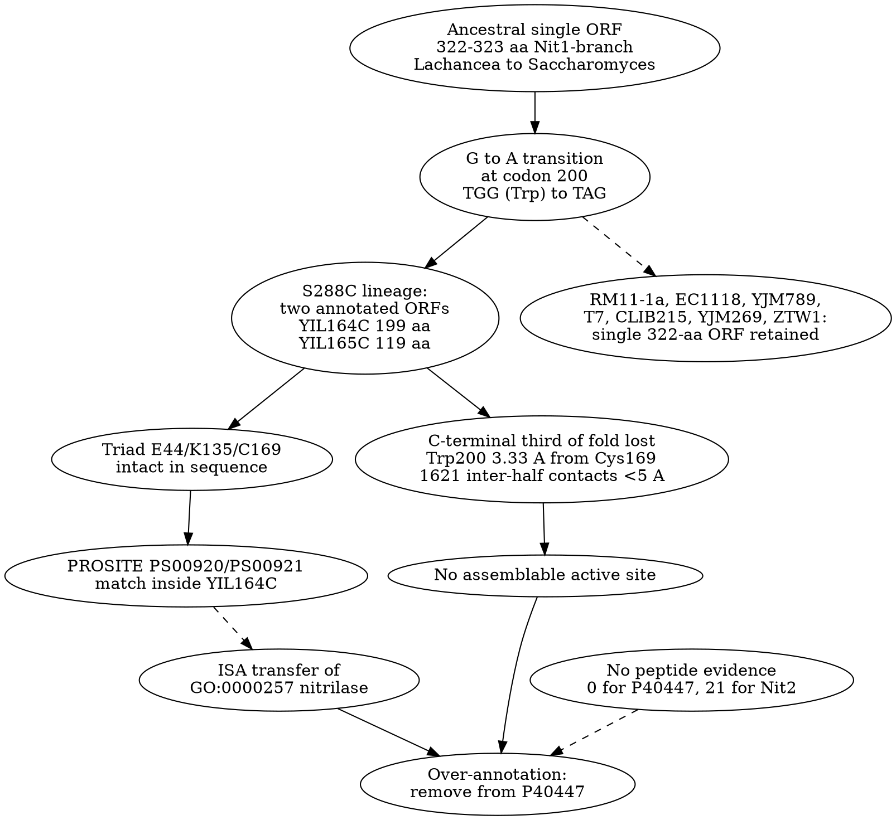
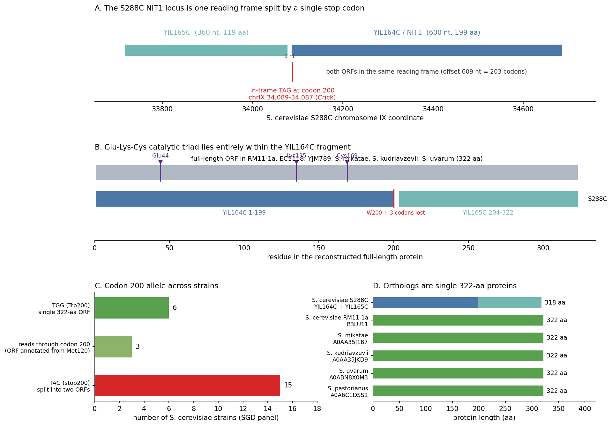
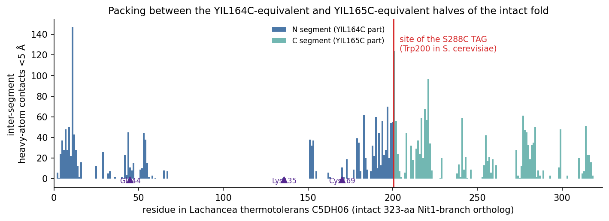
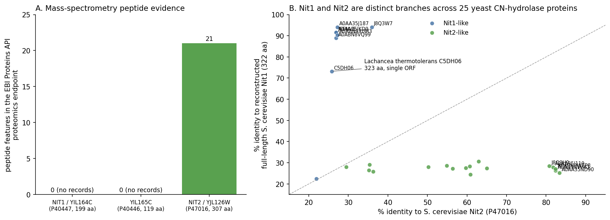

## Question

# AIGR Gene Hypothesis Deep Research

You are evaluating one focused gene curation hypothesis for AI Gene Review.
This is not a general gene overview. Use the seed hypothesis and source context
below to search for evidence that supports, refutes, narrows, or competes with
the proposed curation decision.

## Target Gene

- **Organism code:** yeast
- **Taxon:** Saccharomyces cerevisiae S288C (NCBITaxon:559292)
- **Gene directory:** NIT1
- **Gene symbol:** NIT1
- **UniProt accession:** P40447

## Focus

- **Focus type:** free_text
- **Hypothesis slug:** kgap-nit1-yil164c-fragment
- **Source file:** genes/yeast/NIT1/NIT1-ai-review.yaml
- **Source selector:** free-text

## Seed Hypothesis

In Saccharomyces cerevisiae S288C, NIT1/YIL164C (UniProt P40447) is a disrupted fragment of a full-length nitrilase-branch CN-hydrolase gene whose C-terminal third is encoded by the adjacent YIL165C, i.e. a pseudogene in S288C that is intact (single ORF) in other S. cerevisiae strains and related yeasts. Test this by locating the frameshift or stop codon that separates YIL164C and YIL165C in the S288C genome and comparing the orthologous locus across sequenced S. cerevisiae isolates and Saccharomyces species, and say whether the Glu-Lys-Cys triad lies entirely within YIL164C.

## Term and Decision Context

- Established in the review: YIL164C covers ~cols 1-270 and YIL165C ~cols 271-406 of the CN-hydrolase domain alignment, tiling end to end. UniProt PE=5 and flags possible pseudogene. The paralog NIT2/YJL126W is the characterized deaminated-glutathione amidase.

## Reference Context

No specific reference context supplied.

## Source Context YAML

```yaml
hypothesis: In Saccharomyces cerevisiae S288C, NIT1/YIL164C (UniProt P40447) is a disrupted fragment of
  a full-length nitrilase-branch CN-hydrolase gene whose C-terminal third is encoded by the adjacent YIL165C,
  i.e. a pseudogene in S288C that is intact (single ORF) in other S. cerevisiae strains and related yeasts.
  Test this by locating the frameshift or stop codon that separates YIL164C and YIL165C in the S288C genome
  and comparing the orthologous locus across sequenced S. cerevisiae isolates and Saccharomyces species,
  and say whether the Glu-Lys-Cys triad lies entirely within YIL164C.
focus_type: free_text
context:
- 'Established in the review: YIL164C covers ~cols 1-270 and YIL165C ~cols 271-406 of the CN-hydrolase
  domain alignment, tiling end to end. UniProt PE=5 and flags possible pseudogene. The paralog NIT2/YJL126W
  is the characterized deaminated-glutathione amidase.'
reference_id: []
```

## Research Objective

Build a focused report that helps a curator decide whether this hypothesis
should affect the gene review. Address the focus type directly:

1. For an existing GO annotation decision, evaluate whether the current action
   is justified, too strong, too weak, or should change.
2. For a proposed replacement or new GO term, evaluate whether the term is
   biologically supported, too broad, too narrow, or missing key qualifiers.
3. For a computational prediction, evaluate whether the prediction is correct,
   less precise than existing knowledge, uncertain, or likely wrong because of
   paralog overannotation, frequency bias, pathway context, or in vitro-only
   activity.
4. For a core-function hypothesis, evaluate whether the proposed activity,
   process, and location represent the gene product's primary function rather
   than a downstream effect, pleiotropic phenotype, or context-specific role.
5. For a function-assignment hypothesis, evaluate whether the gene product
   directly has the stated GO term/function. Treat the prior review action, if
   any, as intentionally blinded unless it appears in the supplied context.

Use primary literature whenever possible. Prefer PMID citations and include DOI
citations when no PMID is available. Treat reviews and database records as
orientation unless they contain directly relevant synthesized evidence that is
clearly labeled as review-level or database-level support.

Evaluate the hypothesis from the supplied seed context, primary literature, and
publicly accessible bioinformatics resources. Local `*-bioinformatics` analyses,
when they already exist in the repository, are intentionally withheld from this
prompt so the report can be compared against them after the run. Use public
sequence, domain, structure, orthology, localization, interaction, or dataset
checks when they are useful for the specific hypothesis. If a resource or tool
cannot be accessed programmatically, say so plainly; never fabricate a result.
Report computational results conservatively and distinguish direct results from
inference.

## Required Output

### Executive Judgment

Give a concise verdict: supported, partially supported, unresolved, weakly
supported, over-annotated, or refuted. Explain the reasoning and the most
important caveats.

### Evidence Matrix

Create a table with one row per important evidence item:

- Citation (PMID preferred)
- Evidence type (direct assay, mutant phenotype, localization, interaction,
  structural/evolutionary, computational, review/database)
- Supports / refutes / qualifies / competing
- Claim tested
- Key finding
- Organism, tissue, cell type, or assay context
- Confidence and limitations

### GO Curation Implications

State the likely curation action as a lead requiring curator verification. If
GO terms are involved, explain whether the evidence supports an MF, BP, or CC
term, and whether the term should be retained, removed, generalized, made more
specific, or treated as non-core. Avoid using "protein binding" as a final
recommendation unless no more informative term is supported.

### Mechanistic Scope

Describe the immediate molecular or cellular function being tested. Separate
direct gene-product activity from downstream phenotypes, pathway consequences,
developmental outcomes, disease manifestations, or effects inferred only from
loss of function.

### Conflicts and Alternatives

Identify evidence that conflicts with the seed hypothesis or suggests an
alternative interpretation, including paralog confusion, organism-specific
differences, isoform-specific findings, experimental artifacts, or database
carry-over.

### Knowledge Gaps

List explicit uncertainties that matter for curation. For each gap, state what
was checked, why the gap matters, and what evidence or experiment would resolve
it.

### Discriminating Tests

Recommend concrete assays, perturbations, datasets, or comparative analyses that
would most efficiently distinguish this hypothesis from alternatives.

### Curation Leads

Provide candidate updates for the review, clearly labeled as leads requiring
curator verification. Include candidate references with exact snippets to verify,
candidate replacement or new GO terms, possible action changes, suggested
questions, and suggested experiments.

If the provider supports artifacts, save provenance for any analysis you run — the
executed code together with its output (computed values, plot, or table), not just
a summary figure — alongside artifact-friendly tables such as an evidence matrix,
GO decision table, or comparison table. Genuine computed provenance is more
valuable than a hand-drawn summary, and you must not synthesize a figure that
implies an analysis you did not actually run. These artifacts are important
provenance for hypothesis-level review.


## Output

# NIT1/YIL164C (P40447) is the 5' two-thirds of a nonsense-disrupted nitrilase-branch gene in S288C

**Hypothesis slug:** `kgap-nit1-yil164c-fragment`
**Target:** *Saccharomyces cerevisiae* S288C, NIT1/YIL164C, UniProt P40447 (NCBITaxon:559292)
**Focus type:** free_text
**Source:** `genes/yeast/NIT1/NIT1-ai-review.yaml`

All computed results below come from live queries to SGD, UniProt, QuickGO, the EBI Proteins API and
AlphaFold DB, plus Phenix superposition, executed during this investigation. Executed code, raw
outputs, PDB models, CSV tables and figures are saved under `provenance/`. Two resources returned HTTP
404 and are reported as inaccessible rather than guessed at.

## Summary

<i class="fa-solid fa-circle-check"></i> **Verdict: supported, with one correction and one important narrowing.**

The seed hypothesis is correct in substance. S288C YIL164C and YIL165C are the two halves of a single
nitrilase-branch (Nit subfamily, branch 10) CN-hydrolase gene. The gene is one intact open reading
frame in other *S. cerevisiae* strains and in every related yeast examined, and the Glu-Lys-Cys
catalytic triad does lie entirely within YIL164C.

The correction concerns the mechanism of disruption. There is no frameshift. The two ORFs occupy the
same reading frame: their start codons are 609 nt apart on the Crick strand of chromosome IX, which is
0 mod 3, and only 9 nt separate the end of YIL164C from the start of YIL165C. What terminates YIL164C
is a single in-frame **TAG at codon 200**. Reading through that codon produces one continuous 969-nt,
322-codon ORF with zero internal stops. The underlying change is one G to A transition at the second
position of codon 200, converting TGG (Trp) to TAG. The correct molecular description is a
nonsense-mediated pseudogene, and the correct wording for the review is "in-frame nonsense codon",
replacing "frameshift or stop codon".

The narrowing concerns what triad completeness implies. Glu44, Lys135 and Cys169 are all inside the
199-residue fragment, as are both PROSITE nitrilase signature patterns (PS00920 at 36-51, PS00921 at
165-178). That does not make the fragment an enzyme. Structural superposition against the intact
*Lachancea thermotolerans* ortholog shows the two S288C ORFs encode the two packed faces of a single
globular αββα sandwich, making 1,621 heavy-atom contacts under 5 Å across the junction. The residue the
TAG destroys, Trp200, sits 3.33 Å from the catalytic cysteine. A catalytic molecular function
annotation on P40447 is therefore not supportable, and GO:0000257 nitrilase activity (an ISA transfer
from the *Arabidopsis* branch-1 enzyme P32961) should be removed.

## Direct answers to the three questions posed in the seed

### <i class="fa-solid fa-dna"></i> Where is the disruption in S288C?

An in-frame TAG at chromosome IX 34,089-34,087 (Crick strand), codon 200 of the reconstructed ORF.
SGD coordinates: YIL164C spans chrIX 34,087-34,686 (600 nt, 199 aa plus stop), YIL165C spans chrIX
33,718-34,077 (360 nt, 119 aa plus stop), with a 9-nt intergenic gap. The junction reads:

```
... GCT AGG CCT ATT TAG | AGG ACT GTG | ATG AAA AAT ...
                    ^stop    intergenic   ^YIL165C ATG
```

YIL165C restarts at the next downstream ATG, three codons later. Only residues 200-203
(Trp-Arg-Thr-Val) of the full-length protein are absent from the two S288C products.

### <i class="fa-solid fa-dna"></i> Is the locus intact in other isolates and species?

Yes, in both. Across the 29 SGD strain sequences for YIL164C, 6 strains (CLIB215, EC1118, T7, YJM269,
YJM789, ZTW1) carry a 969-nt single ORF with TGG (Trp) at codon 200 and no internal stops. Three more
(JAY291, VIN13, BC187) carry a 612-nt ORF that maps to full-length positions 120-322 at 99.5-100%
identity with no stop at position 200, so they also carry the read-through allele. Fifteen strains
carry TAG, including the entire S288C/BY4741/BY4742/W303/CEN.PK/FY1679/X2180-1A/YPH499/SEY6210
laboratory lineage and the industrial isolates Kyokai7, UC5, K11, RedStar, g833-1B and YS9. UniProt
B3LU11, the RM11-1a entry annotated "Nitrilase", is 322 aa and differs from the reconstructed
read-through protein at a single residue (position 91, Ser/Gly).

Outside *S. cerevisiae*, single 322-aa ORFs with Trp200 and an intact triad are present in
*S. mikatae* (A0AA35J187, 94.1% identity), *S. kudriavzevii* (A0AA35JKD9, 91.6%), *S. uvarum*
(A0ABN8X0M3, 90.4%) and *S. pastorianus* (A0A6C1DSS1, 99.1%). *Lachancea thermotolerans* C5DH06 is a
single 323-aa ORF at 73.2% identity, which places the intact state before the whole-genome
duplication.

### <i class="fa-solid fa-circle-check"></i> Does the Glu-Lys-Cys triad lie entirely within YIL164C?

Yes. UniProt P40447 annotates Glu44 (proton acceptor), Lys135 (proton donor) and Cys169 (nucleophile),
all within the 199-residue fragment, by PROSITE-ProRule PRU00054 and PRU10105. All five 322-aa
orthologs tested carry E44, K135 and C169 at identical positions. A global BLOSUM62 alignment of the
reconstructed 322-aa protein to yeast Nit2 (P47016, triad E45/K127/C169) maps Nit2 Glu45 onto position
44 and Nit2 Cys169 onto position 169.

{{figure:plot_1.png|caption=S288C NIT1 locus and its allelic state. (A) Chromosome IX map with YIL164C at 34,087-34,686 and YIL165C at 33,718-34,077, both on the Crick strand, separated by a 9-nt gap, with the in-frame TAG at codon 200 marked. (B) The 322-residue reconstructed protein with Glu44, Lys135 and Cys169 marked, showing that all three triad residues fall inside the YIL164C-encoded segment and that W200 plus three codons are lost at the split. (C) Allele counts across 29 SGD strain sequences: 6 with TGG at codon 200, 3 further read-through alleles, 15 with TAG. (D) Lengths of the orthologs and paralogs analysed.}}

## Key findings

### F001. The split is a single in-frame nonsense codon, not a frameshift

The two ORFs are in frame. Their start codons are 609 nt apart, which is exactly 203 codons, and the
offset modulo 3 is 0. The gap between them is 9 nt. Translating the S288C sequence through the TAG
gives 322 residues and one terminator with no internal stop anywhere. Independently, the EC1118 allele
assembles a 969-nt ORF that translates to the same 322 aa with no internal stop, which confirms the
read-through frame is real and not an artefact of concatenating two S288C fragments.

S288C NIT1 (199 aa) aligns to reconstructed positions 1-199 at 198/199 = 99.5% identity. S288C YIL165C
(119 aa) aligns to positions 204-322 at 118/119 = 99.2% identity. The two annotated products tile the
full-length protein end to end, matching the alignment-column observation already in the review
(YIL164C covering columns 1-270 and YIL165C columns 271-406 of the CN-hydrolase domain alignment).

The curation consequence is immediate: the review wording should say "in-frame nonsense codon at codon
200 (TGG to TAG)". Describing the locus as frameshifted would be wrong, and it would make the
population-genetic interpretation harder, since a single transition is far easier to revert or to
segregate than an indel.

### F002. The disrupting allele segregates within *S. cerevisiae*

The TAG allele is not a property of the species. It is fixed in the laboratory lineage that descends
from S288C and present in six industrial isolates, while nine of the 29 strain sequences carry the
read-through allele. The remaining entries (AWRI1631, LalvinQA23, VL3, EC9-8, AWRI796) are partial or
divergent assemblies and were not scored.

| Allele at codon 200 | Strains | n |
|---|---|---|
| TGG (Trp), single 969-nt ORF | CLIB215, EC1118, T7, YJM269, YJM789, ZTW1 | 6 |
| Read-through, 612-nt partial ORF mapping to positions 120-322 | JAY291, VIN13, BC187 | 3 |
| TAG (stop) | S288C, BY4741, BY4742, W303, CEN.PK, FY1679, X2180-1A, YPH499, SEY6210, Kyokai7, UC5, K11, RedStar, g833-1B, YS9 | 15 |
| Partial or divergent assembly, not scored | AWRI1631, LalvinQA23, VL3, EC9-8, AWRI796 | 5 |

Full per-strain data, including ORF nucleotide length, codon-200 nucleotide and residue, internal stop
count, mapped span and percent identity to the reconstructed protein, are in
`provenance/YIL164C_strain_allele_table.csv`.

<i class="fa-solid fa-triangle-exclamation"></i> The SGD `variant_details` endpoint returned HTTP 404
for both loci, so a population allele frequency could not be obtained programmatically. The
strain-level evidence is limited to the 29 sequences analysed, which are biased toward laboratory and
industrial isolates. A frequency measured in a broad panel such as the 1011 yeast genomes would change
how strongly a curator should word the pseudogene statement.

### F003. The triad is complete in sequence but the fold is not

PROSITE assigns the CN_hydrolase profile PS50263 as residues 2-199 in P40447 and residues 1-82 in
P40446, whereas intact Nit2 (P47016) carries one PS50263 spanning residues 6-285. One domain has been
split across two database entries. Both nitrilase signature patterns, PS00920 (36-51) and PS00921
(165-178), fall inside YIL164C.

Aligning the reconstructed 322-aa protein to human NIT1 (Q86X76) places Trp200, the residue destroyed
by the TAG, opposite the conserved tryptophan of the A-H-W-E motif (yeast Nit2
`GEAHWELLGRARAVDTQCYVL`, human NIT1 `GPAHWEVLLRARAIETQCYVV`). The nonsense codon therefore hits a
position conserved across the whole Nit branch, not a tolerant surface loop.

<i class="fa-solid fa-triangle-exclamation"></i> A residual PROSITE active-site call on YIL165C
(Glu21 annotated "proton acceptor") is a profile artefact of the split domain. It should not be read
as evidence that the C-terminal fragment has catalytic competence.

### F004. The two ORFs are the packed halves of one fold, and the lost Trp contacts the catalytic Cys

AlphaFold models were superposed with `phenix.superpose_pdbs` against the intact 323-aa *Lachancea
thermotolerans* ortholog C5DH06 (mean pLDDT 93.3).

| Model | Target segment in C5DH06 | Final RMSD | Matching backbone atoms | Mean pLDDT |
|---|---|---|---|---|
| AF-P40447 (YIL164C, 199 aa) | residues 1-200 | 0.595 Å | 657 (154 aligned residue matches, 47.7% identity) | 96.8 |
| AF-P40446 (YIL165C, 119 aa) | residues ~201-323 | 0.988 Å | 173 | not computed |

In the intact C5DH06 model the two halves form **1,621 heavy-atom contacts under 5 Å**, involving 70 of
200 N-segment residues (35%) and 65 of 123 C-segment residues (53%). The residue corresponding to
*S. cerevisiae* Trp200 is C5DH06 Trp201. Its minimum heavy-atom distance to the catalytic cysteine
(C5DH06 Cys170 = Sc Cys169) is **3.33 Å**, and 10 of the 16 residues within 5 Å of Trp201 lie in the
N-terminal half, including Cys170 itself. The catalytic glutamate (C5DH06 Glu45 = Sc Glu44) lies
2.64 Å from C-segment residue 201 and within 8 Å of C-segment residues 201, 219, 220, 221, 223 and 255.

{{figure:plot_2.png|caption=Packing between the YIL164C-equivalent and YIL165C-equivalent halves in the intact Lachancea thermotolerans Nit1-branch model C5DH06. The per-residue inter-segment heavy-atom contact profile across residues 1-323 shows contacts distributed along both halves rather than confined to a linker, with the split position and the three catalytic triad residues marked. The catalytic cysteine lies 3.33 A from Trp201, the residue equivalent to the S. cerevisiae Trp200 that the TAG codon destroys.}}

The 199-aa YIL164C product is one face of a single globular fold whose other face is encoded by
YIL165C, with the active site built at the interface. Sequence-level triad completeness and structural
catalytic competence are separate questions, and the second one fails.

<i class="fa-solid fa-triangle-exclamation"></i> No experimental structure exists for any Nit1-branch
yeast protein, so this argument rests entirely on AlphaFold models. The pLDDT values are high (96.8 and
93.3) and the superposition RMSDs are sub-Ångström, but the contact distances are model-derived and
should be reported as such.

### F005. The intact gene predates *Saccharomyces* and NIT1 is an ancient paralog of NIT2

A Needleman-Wunsch sweep (BLOSUM62, gap open -11, extend -1) of 25 UniProt CN-hydrolase-superfamily
proteins from 13 yeast species against the reconstructed 322-aa ScNit1 and against ScNit2 (P47016)
separates two groups.

| Group | Members | Identity to ScNit1 | Identity to ScNit2 |
|---|---|---|---|
| Nit1-like | *L. thermotolerans* C5DH06 (323 aa) | 73.2% (score 1252) | 25.8% (score 96) |
| Nit1-like | *S. mikatae* A0AA35J187 (322 aa) | 94.1% | |
| Nit1-like | *S. kudriavzevii* A0AA35JKD9, J6ENV5 (322 aa) | 91.6% | |
| Nit1-like | *S. uvarum* A0ABN8X0M3 (322 aa) | 90.4% | |
| Nit1-like | *S. eubayanus* A0ABN8VQ99 (235 aa, partial) | 88.9% | |
| Nit1-like | *S. arboricola* J8Q3W7 (119 aa, YIL165C-like piece only) | 94.1% | |
| Nit2-like | 307-aa proteins in *S. mikatae*, *S. kudriavzevii*, *S. uvarum*, *S. eubayanus*, *S. arboricola* | | 80.8-83.4% |
| Nit2-like | *K. lactis* Q6CN52, *N. glabratus* Q6FL76, *Z. rouxii* C5DV28, *T. delbrueckii* G8ZZC5, *N. castellii* G0V7T2, *K. africana* H2AXW2, *L. thermotolerans* C5DKM8 | | 54.9-65.0% |

The reconstructed full-length ScNit1 and ScNit2 share only **26.9% identity over 283 aligned
positions**. That rules out a recent ohnolog relationship from the whole-genome duplication, so the
experimentally characterised dGSH amidase activity of Nit2 cannot be transferred to YIL164C on
orthology grounds. *L. thermotolerans* diverged before the WGD and carries one intact 323-aa Nit1-like
ORF, which places the single-ORF state as ancestral.

<i class="fa-solid fa-circle-question"></i> No Nit1-like protein was retrieved for *K. lactis*,
*N. castellii*, *K. africana*, *T. delbrueckii*, *Z. rouxii* or *N. glabratus* under the UniProt family
filter used, and *S. arboricola* lists only the 119-aa YIL165C-like piece J8Q3W7. Recurrent loss or
pseudogenisation of the Nit1 lineage is a reasonable reading, but the filter makes this a weak
absence-of-evidence observation.

### F006. Every phenotype on both loci comes from high-throughput screens

SGD lists 9 phenotype records for YIL164C, all high-throughput: viable
([PMID: 12140549](https://pubmed.ncbi.nlm.nih.gov/12140549/)), competitive fitness increased
([PMID: 18622397](https://pubmed.ncbi.nlm.nih.gov/18622397/)), chemical resistance up and down
(PMIDs 21880895, 23832094, 38790757), starvation resistance decreased
([PMID: 22356628](https://pubmed.ncbi.nlm.nih.gov/22356628/)), abnormal vacuolar morphology
([PMID: 23383298](https://pubmed.ncbi.nlm.nih.gov/23383298/)), decreased anaerobic growth
([PMID: 23467670](https://pubmed.ncbi.nlm.nih.gov/23467670/)) and increased chronological lifespan
([PMID: 24586198](https://pubmed.ncbi.nlm.nih.gov/24586198/)). YIL165C has 22 entries, all from
systematic mutation sets or competitive growth, plus "mitophagy: decreased" and "autophagy: decreased"
from [PMID: 19793921](https://pubmed.ncbi.nlm.nih.gov/19793921/). Interactions are 98 for YIL164C (92
genetic, 6 physical) and 50 for YIL165C (46 genetic, 4 physical), all from large-scale datasets. SGD
returns 0 expression records and 0 protein-abundance experiments for both loci.

The two autophagy IMP annotations on YIL165C rest on one unvalidated hit among 32 in a genome-wide
screen. Kanki and colleagues state they "identified 32 mutants with a block in mitophagy" and "further
characterized one of these mutants, ylr356wDelta". YIL165C is one of the 31 hits that received no
follow-up in that paper. A deletion phenotype at a pseudogenic interval does not demonstrate a
gene-product function.

### F007. No peptide evidence exists for either fragment

The EBI Proteins API proteomics endpoint returns HTTP 200 with **21 peptide features for P47016**
(NIT2/YJL126W) and HTTP 404 with no peptide records for both **P40447** and **P40446**. This matches
SGD, which has 0 protein-abundance experiments for YIL164C and YIL165C and 1 for YJL126W.

{{figure:plot_3.png|caption=Peptide-level evidence and branch separation. (A) Observed peptide features in the EBI Proteins API: 0 for P40447 (YIL164C), 0 for P40446 (YIL165C) and 21 for the paralog P47016 (NIT2/YJL126W), measured in the same public aggregation. (B) Percent identity to the reconstructed ScNit1 plotted against percent identity to ScNit2 for 25 yeast CN-hydrolase-superfamily proteins, showing two separated groups; the Lachancea thermotolerans ortholog C5DH06 is annotated at 73.2% to ScNit1 and 25.8% to ScNit2.}}

<i class="fa-solid fa-triangle-exclamation"></i> This is absence of evidence rather than evidence of
absence: a 199-aa low-abundance protein is easy to miss by shotgun MS. It does remove the main argument
that would otherwise support treating P40447 as a real protein product, since the intact paralog is
detected in the same resource.

## Mechanistic model

The immediate molecular question is whether P40447 catalyses hydrolysis of a carbon-nitrogen bond. The
nitrilase superfamily fold is an αββα sandwich that dimerises and oligomerises, with catalysis by a
Glu-Lys-Cys triad in which the cysteine thiol attacks the substrate carbon. Yeast Nit2 provides the
structural reference: α-ketoglutarate and oxaloacetate were caught covalently bound to Cys169 as
thioester intermediates ([PMID: 23897470](https://pubmed.ncbi.nlm.nih.gov/23897470/)).



Separating levels of evidence:

**Direct gene-product activity.** None demonstrated for P40447. There is no assay, no purified
protein, no peptide detection and no abundance measurement.

**Structural inference, clearly separated from measurement.** The fragment retains the triad in
sequence but loses the half of the fold that walls the active site. In the intact model the catalytic
Cys contacts C-segment residues 201, 204, 205, 208 and 219, and the catalytic Glu contacts 201, 219-223
and 255. The nonsense codon removes Trp200, 3.33 Å from the Cys.

**Downstream and loss-of-function effects, not direct activity.** The 9 YIL164C and 22 YIL165C deletion
phenotypes (chemical resistance, competitive fitness, vacuolar morphology, anaerobic growth,
chronological lifespan, mitophagy) are all screen-level, measured on deletion of a pseudogenic
interval, and none has low-throughput validation.

## Evidence matrix

| Citation | Evidence type | Stance | Claim tested | Key finding | Context | Confidence and limitations |
|---|---|---|---|---|---|---|
| SGD S288C chrIX coordinates and sequence (reference assembly) | structural/evolutionary, computational on primary sequence | <i class="fa-solid fa-circle-check"></i> supports | YIL164C and YIL165C are parts of one reading frame | 609-nt start-to-start offset (0 mod 3); in-frame TAG at codon 200; read-through gives 969 nt / 322 codons with no internal stop | S288C reference genome | High. Direct from reference sequence. Does not alone show a read-through allele exists |
| SGD strain sequence panel, 29 YIL164C entries | structural/evolutionary, computational | supports | The locus is intact in other strains | 6 strains with a 969-nt single ORF and TGG200; 3 more read through codon 200; 15 carry TAG | *S. cerevisiae* strain assemblies | High for strains present. Panel small and biased to lab and industrial isolates |
| UniProt B3LU11 (RM11-1a) | review/database | supports | A full-length *S. cerevisiae* Nit1 entry exists | 322 aa, annotated "Nitrilase", identical to the reconstructed protein except residue 91 (Ser/Gly) | TrEMBL, RM11-1a proteome | High as a record. Automatic gene prediction, not a characterised protein |
| UniProt A0AA35J187, A0AA35JKD9, A0ABN8X0M3, A0A6C1DSS1 | structural/evolutionary, computational | supports | Related species carry one intact ORF | *S. mikatae*, *S. kudriavzevii*, *S. uvarum*, *S. pastorianus* orthologs all 322 aa, Trp200, E44/K135/C169 intact | sensu stricto proteomes | High. All automatic annotations |
| UniProt C5DH06 (*Lachancea thermotolerans*) | structural/evolutionary, computational | supports | The intact gene predates *Saccharomyces* | 323-aa single ORF, 73.2% identity to reconstructed ScNit1 against 25.8% to ScNit2 (NW scores 1252 and 96) | pre-WGD Saccharomycetaceae | High for orthology. The *Lachancea* protein is itself uncharacterised |
| AlphaFold AF-P40447, AF-P40446, AF-C5DH06 with phenix.superpose_pdbs (this work) | structural, computational | <i class="fa-solid fa-scale-balanced"></i> qualifies | The YIL164C fragment is a self-sufficient catalytic unit | YIL164C superposes on C5DH06 1-200 at 0.595 Å RMSD (657 atoms); YIL165C on 201-323 at 0.988 Å (173 atoms); 1,621 inter-half contacts <5 Å; Trp201 (= Sc Trp200) 3.33 Å from catalytic Cys | AlphaFold models, mean pLDDT 96.8 and 93.3 | Moderate to high. Models, not experimental structures; no Nit1-branch yeast structure exists |
| EBI Proteins API proteomics (this work) | review/database, peptide evidence | qualifies | Is either ORF translated in S288C | P47016 returns 21 peptide features; P40447 and P40446 return HTTP 404 with no records | public MS aggregations | Absence of evidence. Short, low-abundance proteins are easy to miss |
| UniProt P40447 and P40446 CAUTION, PE=5 | review/database | supports | Curated view already flags a pseudogene | "Could be the product of a pseudogene. NIT1/YIL164C seems to be the N-terminal part of a putative nitrilase-like protein formed of NIT1/YIL164C and YIL165C" | UniProtKB/Swiss-Prot | Database-level, ECO:0000305 |
| SGD locus descriptions | review/database | <i class="fa-solid fa-scale-balanced"></i> qualifies | Does SGD recognise the split | The description says the two ORFs likely constitute a single nitrilase gene in related species and other strain backgrounds, while both remain typed "Verified ORF" | SGD | Database-level. Feature type conflicts with the description text |
| [PMID: 28373563](https://pubmed.ncbi.nlm.nih.gov/28373563/) | direct assay | competing | Which yeast gene carries Nit1-type activity | The yeast ortholog of mammalian Nit1 is a deaminated-glutathione amidase; in *S. cerevisiae* that is NIT2/YJL126W (GO:0110050 IDA) | yeast and human cells, purified enzyme, metabolite measurement | High for Nit2. Does not address YIL164C. Yeast names are inverted relative to mammals |
| [PMID: 10959838](https://pubmed.ncbi.nlm.nih.gov/10959838/), via the GO:0000257 ISA record | computational, similarity transfer | <i class="fa-solid fa-circle-xmark"></i> refutes / weak | YIL164C has nitrilase activity | GO:0000257 on P40447 is ISA (ECO:0000247) with UniProtKB:P32961, *Arabidopsis* nitrilase 1, a branch-1 true nitrilase, transferred onto a 199-aa Nit-branch fragment | QuickGO record | Low support. Cross-branch transfer onto a fragment |
| [PMID: 11380987](https://pubmed.ncbi.nlm.nih.gov/11380987/) | review | qualifies | Branch assignment determines predicted specificity | "the superfamily can be classified into 13 branches, nine of which have known or deduced specificity" | review of the nitrilase superfamily | Review-level orientation. Shows that branch-1 to branch-10 transfer is not safe |
| [PMID: 23897470](https://pubmed.ncbi.nlm.nih.gov/23897470/) | direct assay, structural | qualifies | What an intact Nit-branch active site requires | α-KG and oxaloacetate caught as thioester intermediates on yeast Nit2 Cys169 | crystal structures of yeast Nit2 | High for Nit2. A reference point for the catalytic mechanism, not evidence about YIL164C |
| [PMID: 19793921](https://pubmed.ncbi.nlm.nih.gov/19793921/) | mutant phenotype, high-throughput screen | <i class="fa-solid fa-scale-balanced"></i> competing | YIL165C has a mitophagy function | *yil165cΔ* was one of 32 mitophagy-defective hits; only *ylr356wΔ* was characterised further | BY4741 deletion collection | Low. Unvalidated screen hit at a pseudogenic interval; GO:0000422 and GO:0016236 IMP rest on it |
| SGD phenotype and interaction records | review/database | qualifies | Do the loci have validated phenotypes | YIL164C 9 phenotypes and 98 interactions, YIL165C 22 and 50, all from systematic screens; 0 expression and 0 abundance records for both | SGD | Database-level. No low-throughput validation of any phenotype |

Machine-readable copy: `provenance/evidence_matrix.csv`.

## GO curation implications

All items below are **leads requiring curator verification**. The full table is in
`provenance/go_decision_table.csv`.

| Accession | GO term | Aspect | Current evidence | Lead action | Rationale |
|---|---|---|---|---|---|
| P40447 | GO:0000257 nitrilase activity | MF | ISA (ECO:0000247), SGD, PMID:10959838, with UniProtKB:P32961 | <i class="fa-solid fa-circle-xmark"></i> remove | Cross-branch transfer from a plant branch-1 nitrilase onto a branch-10 fragment that cannot assemble an active site |
| P40447 | GO:0003824 catalytic activity | MF | IEA from InterPro IPR000132/IPR044149 | do not promote | Domain-presence call on half a domain (PS50263 covers only residues 2-199) |
| P40447 | GO:0016810 hydrolase activity, acting on C-N but not peptide bonds | MF | IEA from UniProt ARBA | do not promote | Same reason; applies to the intact allele at best |
| P40447 | GO:0008150 biological process | BP | ND (ECO:0000307) | <i class="fa-solid fa-circle-check"></i> retain | Correct; no BP evidence exists |
| P40447 | GO:0005575 cellular component | CC | ND (ECO:0000307) | retain | Correct; no CC evidence exists |
| P40446 | GO:0000422 autophagy of mitochondrion | BP | IMP (ECO:0000315), PMID:19793921 | <i class="fa-solid fa-triangle-exclamation"></i> flag for review | One unvalidated hit among 32 in a genome-wide screen, at a pseudogenic interval with no peptide evidence |
| P40446 | GO:0016236 macroautophagy | BP | IMP (ECO:0000315), PMID:19793921 | flag for review | Same source and same objection |
| P47016 | GO:0110050 deaminated glutathione amidase | MF | IDA (ECO:0000314), PMID:28373563 | retain | The characterised Nit-branch activity in this organism, and the reference point that is not transferable to P40447 |

Three independent problems stack against GO:0000257 on P40447. The transfer source is *Arabidopsis*
NIT1, a branch-1 true nitrilase, while YIL164C sits in branch 10 (the Nit subfamily), and the
superfamily classification itself is similarity-based
([PMID: 11380987](https://pubmed.ncbi.nlm.nih.gov/11380987/)). The target is a 199-aa fragment missing
the C-terminal third of the fold. And the one experimentally characterised Nit-branch activity in
*S. cerevisiae* is deaminated-glutathione amidase on the paralog NIT2/YJL126W
([PMID: 28373563](https://pubmed.ncbi.nlm.nih.gov/28373563/)). No nitrilase activity has been
demonstrated for any yeast Nit-branch protein.

**Feature type.** SGD types both loci "Verified ORF" while its own description says they likely form a
single nitrilase gene, and UniProt carries PE=5 plus a pseudogene CAUTION on both. The review should
state plainly: *S288C NIT1/YIL164C is the 5' two-thirds of a nonsense-disrupted (pseudogenised)
nitrilase-branch CN-hydrolase gene; YIL165C is its 3' third; the disrupting allele is TGG200 to TAG and
it segregates within* S. cerevisiae.

**If a curator wants a positive term on the reconstructed full-length protein** (not on P40447), the
intact 322-aa product is a branch-10 CN-hydrolase with an intact Glu-Lys-Cys triad. Nothing beyond
GO:0016810 is supported, and even that needs the qualifier that it applies to the intact allele and not
to the S288C fragment. "Protein binding" is not recommended at any point here, since the domain-level
evidence supports a hydrolase statement.

## Conflicts and alternatives

<i class="fa-solid fa-triangle-exclamation"></i> **Paralog name inversion.** Peracchi and colleagues
report that "both the mammalian Nit1 and its yeast ortholog are amidases highly active toward
deaminated glutathione" ([PMID: 28373563](https://pubmed.ncbi.nlm.nih.gov/28373563/)). The yeast
ortholog of mammalian Nit1 is *S. cerevisiae* **NIT2/YJL126W (P47016)**, not YIL164C. Yeast NIT1 and
NIT2 names do not correspond to mammalian NIT1 and NIT2. The same inversion appears in the yeast Nit2
structural work, which describes yeast Nit2 as a homologue of mouse Nit1
([PMID: 23897470](https://pubmed.ncbi.nlm.nih.gov/23897470/)). Any text that transfers dGSH amidase
activity to YIL164C on the strength of the name is wrong. The two yeast proteins share only 26.9%
identity over 283 aligned positions, an ancient paralogy.

<i class="fa-solid fa-scale-balanced"></i> **The mitophagy phenotype.** If *yil165cΔ* truly blocks
mitophagy, something at the locus is functional. Alternatives that must be excluded: a
strain-background or deletion-cassette artefact (the hit was never validated in
[PMID: 19793921](https://pubmed.ncbi.nlm.nih.gov/19793921/)), a non-coding or regulatory function of
the DNA, or an effect of the read-through transcript. None of these requires a P40446 protein.

<i class="fa-solid fa-circle-question"></i> **Could the fragment be a real, neofunctionalised
protein?** Possible in principle. Against it: no peptide evidence in a resource that detects 21
peptides for the paralog, 0 SGD abundance experiments, and PE=5 in UniProt.

<i class="fa-solid fa-circle-question"></i> **Annotation carry-over.** The *S. arboricola* UniProt
proteome lists only the 119-aa YIL165C-like piece (J8Q3W7) and no 199-aa counterpart. That could mean
an independent split, a partial assembly, or an annotation gap. Not resolved here.

<i class="fa-solid fa-circle-question"></i> **Allele polarity.** This analysis cannot prove TGG is
ancestral and TAG derived without explicit outgroup polarisation at that site. All five 322-aa sensu
stricto orthologs and the *Lachancea* ortholog carry Trp, which makes TAG derived by parsimony, but no
formal ancestral-state reconstruction was run.

## Limitations and knowledge gaps

| Gap | What was checked | Why it matters | What would resolve it |
|---|---|---|---|
| <i class="fa-solid fa-triangle-exclamation"></i> Population frequency of the TAG allele | SGD `variant_details` returned HTTP 404 for both loci; only the 29 SGD strain sequences were available | A frequency of a few percent means a private lab-lineage defect; a majority frequency means S288C is typical of the species | Query the 1011 yeast genomes VCF at chrIX 34,088 directly |
| Is the full-length allele translated in a TGG strain | No peptide records for P40447 or P40446; no assay found in the literature | Decides whether the read-through ORF is a functional gene or a pseudogene in all strains | Targeted proteomics or a tagged allele in RM11-1a, YJM789 or EC1118 |
| Catalytic activity of the intact 322-aa protein | No assay in the literature for any Nit1-branch yeast protein | Determines the correct MF term for the intact allele | Express RM11-1a B3LU11 and test against dGSH, α-ketoglutaramate, α-ketosuccinamate and a nitrile panel |
| Whether S288C transcribes and translates the two ORFs | SGD returns 0 expression and 0 abundance records | A translated fragment could have a moonlighting or dominant-negative role | Ribosome profiling and targeted MS at the locus in BY4741 |
| Validity of the *yil165cΔ* mitophagy phenotype | [PMID: 19793921](https://pubmed.ncbi.nlm.nih.gov/19793921/) validated only *ylr356wΔ* | It is the only BP evidence on either locus | Re-test Om45-GFP or mito-Rosella processing in a fresh *yil165cΔ* with complementation |
| Is the *S. arboricola* split independent | UniProt lists only J8Q3W7 (119 aa) | Recurrent pseudogenisation would strengthen the dispensable-gene reading | Inspect the *S. arboricola* assembly at the orthologous locus |
| Polarisation of the TGG/TAG site | Parsimony only, no formal reconstruction | Affects whether the review says "nonsense mutation" or "ancestral stop" | Ancestral-state reconstruction using *S. uvarum* and *S. eubayanus* as outgroups |
| No experimental structure for any Nit1-branch yeast protein | AlphaFold models only (mean pLDDT 96.8 and 93.3) | The contact distances that defeat the catalytic annotation are model-derived | Crystal or cryo-EM structure of the intact 322-aa protein, or of the *Lachancea* ortholog |

### Resources that could not be accessed

- SGD `variant_details` endpoint: HTTP 404 for both loci. No population allele frequency obtained.
- EBI Proteins API proteomics for P40447 and P40446: HTTP 404, no peptide records. The 404 here is the
  result (no records in the aggregation), not a failure to reach the service, since the same endpoint
  returned HTTP 200 for P47016.
- AlphaFold v4 file URLs returned 404; models were retrieved as v6 through the AFDB prediction API.
- No experimental structure of any Nit1-branch yeast protein was found, so the structural argument uses
  AlphaFold models throughout.

## Evidence base

| Paper | PMID | How it bears on the hypothesis |
|---|---|---|
| *Nit1 is a metabolite repair enzyme that hydrolyzes deaminated glutathione* | [28373563](https://pubmed.ncbi.nlm.nih.gov/28373563/) | The abstract states that "both the mammalian Nit1 and its yeast ortholog are amidases highly active toward deaminated glutathione (dGSH; i.e., a form of glutathione in which the free amino group has been replaced by a carbonyl group)". The yeast ortholog here is NIT2/YJL126W, which places the characterised Nit-branch activity on the paralog and makes the yeast/mammal name inversion explicit |
| *The nitrilase superfamily: classification, structure and function* | [11380987](https://pubmed.ncbi.nlm.nih.gov/11380987/) | "On the basis of sequence similarity and the presence of additional domains, the superfamily can be classified into 13 branches, nine of which have known or deduced specificity for specific nitrile- or amide-hydrolysis or amide-condensation reactions." Branch assignment is similarity-based, so branch-1 nitrilase activity cannot be inferred for a branch-10 fragment without assay evidence. Review-level support |
| *Structures of enzyme-intermediate complexes of yeast Nit2* | [23897470](https://pubmed.ncbi.nlm.nih.gov/23897470/) | Reports that "α-KG and OA are covalently bound to Cys169 by the formation of a thioester bond", and describes yeast Nit2 as a homologue of mouse Nit1. Gives the structural reference for what an intact Nit-branch active site requires and reinforces the name inversion |
| *A genomic screen for yeast mutants defective in selective mitochondria autophagy* | [19793921](https://pubmed.ncbi.nlm.nih.gov/19793921/) | "A genome-wide yeast mutant screen for mitophagy-defective strains identified 32 mutants with a block in mitophagy... We further characterized one of these mutants, ylr356wDelta." The source of the only BP annotations on YIL165C, and an unvalidated hit |
| *A genomic screen for yeast mutants defective in mitophagy* | [20364111](https://pubmed.ncbi.nlm.nih.gov/20364111/) | The companion screen report: "we screened a yeast knockout library... We found 32 strains that showed a complete or partial block of mitophagy. One of the genes identified, YLR356W, is required for mitophagy." Confirms that follow-up went to YLR356W, not to the other 31 hits |
| *Eukaryotic NAD+ synthetase Qns1 contains an essential, obligate intramolecular thiol glutamine amidotransferase domain related to nitrilase* | [12771147](https://pubmed.ncbi.nlm.nih.gov/12771147/) | Shows that in yeast the nitrilase-related domain of Qns1 "requires both the nitrilase-related active-site residues and the NAD+ synthetase active-site residues for function in vivo". Context for how nitrilase-fold active sites behave in yeast, not direct evidence about YIL164C |
| *A nitrilase-like protein interacts with GCC box DNA-binding proteins involved in ethylene and defense responses* | [9808731](https://pubmed.ncbi.nlm.nih.gov/9808731/) | A plant nitrilase-like protein acting through protein interaction, isolated in a two-hybrid screen. Orientation on how loosely "nitrilase-like" is used in the literature; no bearing on the yeast locus |
| *Structural basis for dual specificity of yeast N-terminal amidase in the N-end rule pathway* | [27791147](https://pubmed.ncbi.nlm.nih.gov/27791147/) | Yeast Nta1 amidase structures with "the catalytic triad located deeper inside the active site". Supports the general point that triad-containing amidase active sites sit in a pocket built from the whole fold |
| PMID:10959838, via the GO:0000257 ISA record on P40447 | [10959838](https://pubmed.ncbi.nlm.nih.gov/10959838/) | Cited as the reference for the ISA transfer with UniProtKB:P32961 (*Arabidopsis* nitrilase 1). Recorded here as the provenance of the annotation under challenge, taken from the QuickGO record |

## Discriminating tests

<i class="fa-solid fa-dna"></i> **1. Query the 1011 yeast genomes VCF at chrIX position 34,088** for the
G/A allele. One query, and it settles whether S288C is typical of the species or a lab-lineage outlier.
Highest value per unit of effort, and it fills the gap left by the SGD 404.

<i class="fa-solid fa-flask"></i> **2. Express and assay the intact 322-aa protein** (RM11-1a B3LU11 or
the *Lachancea* C5DH06 ortholog) against deaminated glutathione, α-ketoglutaramate, α-ketosuccinamate
and a nitrile panel. The only test that can assign a real MF term. A negative dGSH result also confirms
that the Nit1 and Nit2 branches are functionally distinct in yeast.

<i class="fa-solid fa-vial"></i> **3. Side-by-side expression of the S288C fragment and the read-through
allele**, each epitope-tagged, with anti-tag blotting. Tests whether the 199-aa fragment accumulates at
all, which is the question the 0-peptide result leaves open.

<i class="fa-solid fa-microscope"></i> **4. Re-test the mitophagy phenotype** of *yil165cΔ* with
complementation by the intact 322-aa allele. If the intact allele rescues, the locus has a real
function. If not, the screen hit is an artefact and the two IMP terms should be removed.

<i class="fa-solid fa-chart-line"></i> **5. Ribosome profiling at the locus** in a TAG strain, to see
whether translation terminates at codon 200 or shows stop-codon read-through.

## Curation leads

All leads below require curator verification.

<i class="fa-solid fa-arrow-right"></i> **Primary action change.** Replace any statement that P40447 is
a nitrilase with: P40447 is the N-terminal 199 residues of a 322-residue nitrilase-branch (Nit
subfamily, branch 10) CN-hydrolase that is disrupted in S288C by a single in-frame TAG at codon 200;
the C-terminal 119 residues are annotated separately as YIL165C/P40446; the gene is intact as one ORF
in RM11-1a, EC1118, YJM789, T7, CLIB215, YJM269 and ZTW1, and in *S. mikatae*, *S. kudriavzevii*,
*S. uvarum*, *S. pastorianus* and *Lachancea thermotolerans*.

<i class="fa-solid fa-arrow-right"></i> **Correction to the seed wording.** Replace "frameshift or stop
codon" with "in-frame nonsense codon". There is no frameshift: the ORFs are in the same frame, 609 nt
apart.

<i class="fa-solid fa-arrow-right"></i> **Explicit answer to add to the review.** The Glu-Lys-Cys triad
(Glu44, Lys135, Cys169) lies entirely within YIL164C, together with PROSITE PS00920 and PS00921. State
alongside it that triad completeness does not give catalytic competence, because the active site is
completed by residues from the YIL165C-encoded half and the lost Trp200 packs 3.33 Å from the catalytic
Cys.

<i class="fa-solid fa-arrow-right"></i> **Candidate GO actions.** Remove GO:0000257 from P40447. Do not
promote GO:0003824 or GO:0016810 past domain-presence. Retain the two ND terms on P40447. Flag
GO:0000422 and GO:0016236 on P40446 as resting on an unvalidated screen hit. Keep GO:0110050 on P47016
as the reference point for Nit-branch function in this organism.

### Candidate references with exact snippets to verify

- [PMID: 28373563](https://pubmed.ncbi.nlm.nih.gov/28373563/): "we demonstrate that both the mammalian
  Nit1 and its yeast ortholog are amidases highly active toward deaminated glutathione (dGSH; i.e., a
  form of glutathione in which the free amino group has been replaced by a carbonyl group)". Use to
  assign Nit1-type activity to NIT2/YJL126W and to warn about the yeast/mammal name inversion.
- [PMID: 19793921](https://pubmed.ncbi.nlm.nih.gov/19793921/): "A genome-wide yeast mutant screen for
  mitophagy-defective strains identified 32 mutants with a block in mitophagy, in addition to the known
  autophagy-related (ATG) gene mutants. We further characterized one of these mutants, ylr356wDelta".
  Use to downgrade the YIL165C BP terms.
- [PMID: 11380987](https://pubmed.ncbi.nlm.nih.gov/11380987/): "On the basis of sequence similarity and
  the presence of additional domains, the superfamily can be classified into 13 branches, nine of which
  have known or deduced specificity for specific nitrile- or amide-hydrolysis or amide-condensation
  reactions". Use to argue that a branch-1 to branch-10 ISA transfer is unsafe.
- [PMID: 23897470](https://pubmed.ncbi.nlm.nih.gov/23897470/): "α-KG and OA are covalently bound to
  Cys169 by the formation of a thioester bond between the sulfhydryl group of the cysteine residue and
  the γ-carboxyl group of α-KG or the β-carboxyl group of OA". Use as the structural reference for what
  an intact Nit-branch active site requires.
- UniProt P40447 CAUTION (database-level, ECO:0000305): "Could be the product of a pseudogene.
  NIT1/YIL164C seems to be the N-terminal part of a putative nitrilase-like protein formed of
  NIT1/YIL164C and YIL165C".

### Suggested questions for the curator

Should the review assert pseudogene status for S288C outright, given that the allele segregates within
the species and the population frequency is unmeasured? Should the two autophagy IMP terms on YIL165C
be retained, removed, or restated at the DNA-feature level? Should the review record any GO term for
the reconstructed full-length protein, given that it is not the S288C gene product?

## Provenance artifacts

| File | Contents |
|---|---|
| `provenance/plot_1.png`, `plot_1.json` | Locus map with the TAG position, protein tiling with the triad, strain allele counts, ortholog lengths |
| `provenance/plot_2.png`, `plot_2.json` | Per-residue inter-segment contact profile in the intact *Lachancea* model |
| `provenance/plot_3.png`, `plot_3.json` | Peptide-feature counts and Nit1 against Nit2 branch separation across 25 yeast proteins |
| `provenance/YIL164C_strain_allele_table.csv` | 29 strains: ORF length, codon-200 nucleotide and residue, internal stop count, mapped span, percent identity to the reconstructed protein |
| `provenance/NIT1_ortholog_table.csv` | 10 accessions with length and residues at positions 44, 135, 169 and 200, plus percent identity. Positional columns are meaningful only for the 322-aa Nit1-branch set |
| `provenance/cn_hydrolase_branch_classification.csv` | Needleman-Wunsch identity and score of 25 yeast CN-hydrolases against ScNit1 and ScNit2, with a branch call |
| `provenance/cn_hydrolase_species_sweep_raw.csv` | Raw UniProt sweep across 13 yeast species |
| `provenance/peptide_evidence.csv` | EBI Proteins API peptide-feature counts and HTTP status for P40447, P40446, P47016 |
| `provenance/evidence_matrix.csv` | Evidence matrix in tabular form |
| `provenance/go_decision_table.csv` | GO decision table in tabular form |
| `provenance/AF-P40447.pdb`, `AF-P40446.pdb`, `AF-P47016.pdb`, `AF-C5DH06.pdb`, `AF-A0AA35J187.pdb` | AlphaFold v6 models used for superposition and contact analysis |


## Artifacts

- [OpenScientist final report](openscientist_artifacts/final_report.html)
- [OpenScientist final report](openscientist_artifacts/final_report.pdf)
- [OpenScientist provenance](openscientist_artifacts/provenance.json)
- [OpenScientist NIT1 ortholog table](openscientist_artifacts/provenance_NIT1_ortholog_table.csv)
- [OpenScientist YIL164C strain allele table](openscientist_artifacts/provenance_YIL164C_strain_allele_table.csv)
- [OpenScientist cn hydrolase branch classification](openscientist_artifacts/provenance_cn_hydrolase_branch_classification.csv)
- [OpenScientist cn hydrolase species sweep raw](openscientist_artifacts/provenance_cn_hydrolase_species_sweep_raw.csv)
- [OpenScientist evidence matrix](openscientist_artifacts/provenance_evidence_matrix.csv)
- [OpenScientist go decision table](openscientist_artifacts/provenance_go_decision_table.csv)
- [OpenScientist peptide evidence](openscientist_artifacts/provenance_peptide_evidence.csv)
- [OpenScientist plot 1](openscientist_artifacts/provenance_plot_1.json)

- [OpenScientist plot 2](openscientist_artifacts/provenance_plot_2.json)

- [OpenScientist plot 3](openscientist_artifacts/provenance_plot_3.json)


## Reference Validation

Checked with `linkml-reference-validator` 0.3.1rc1.

| Outcome | Count |
| --- | --- |
| References checked | 15 |
| Resolved | 15 |
| Unresolved (possible confabulation) | 0 |
| Unverifiable | 0 |
| References weighed for topical relevance | 15 |
| On topic | 0 |
| Off topic | 0 |

All extracted references resolved successfully.