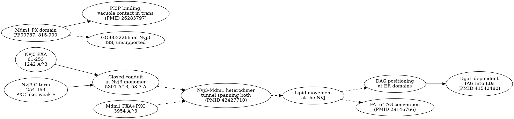
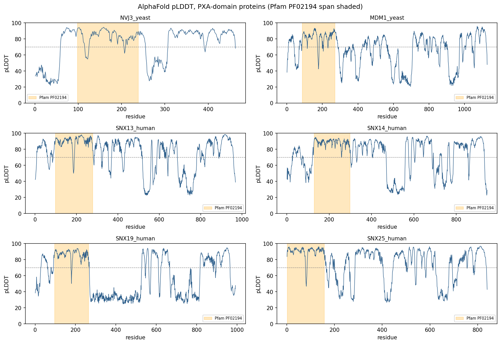
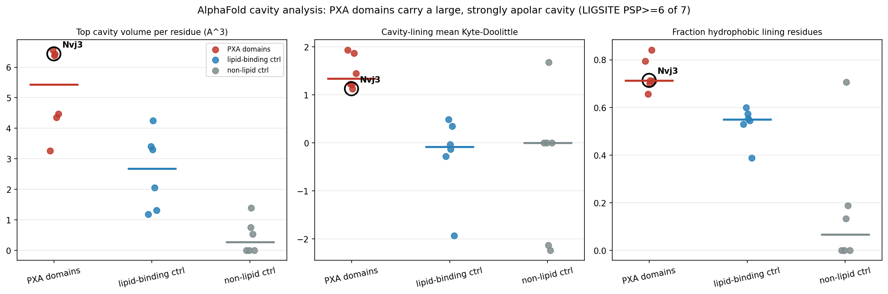
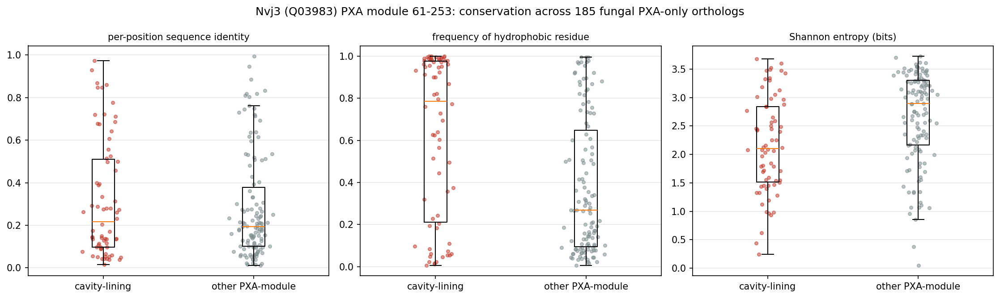
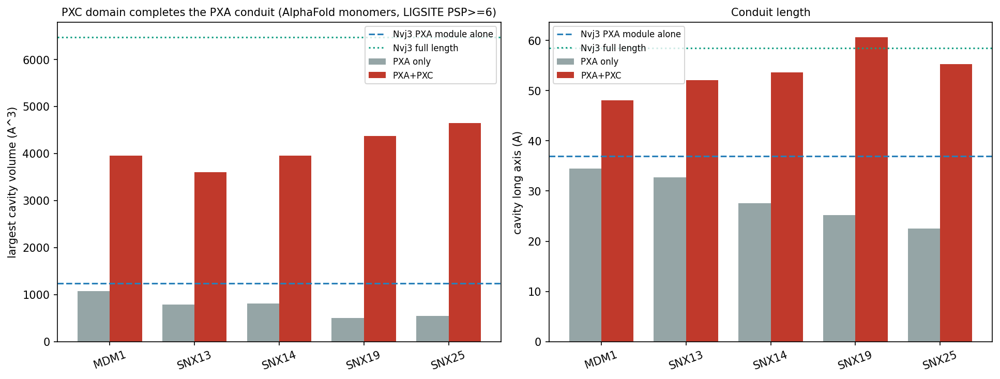
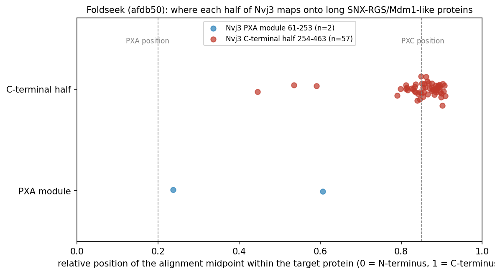
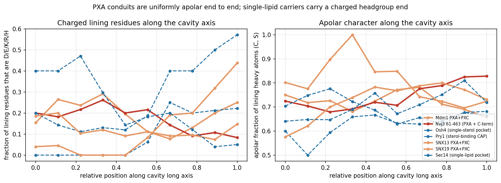
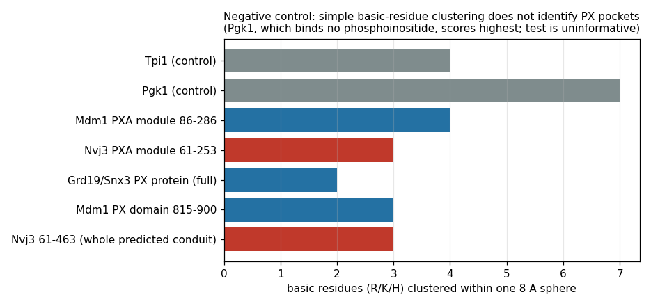
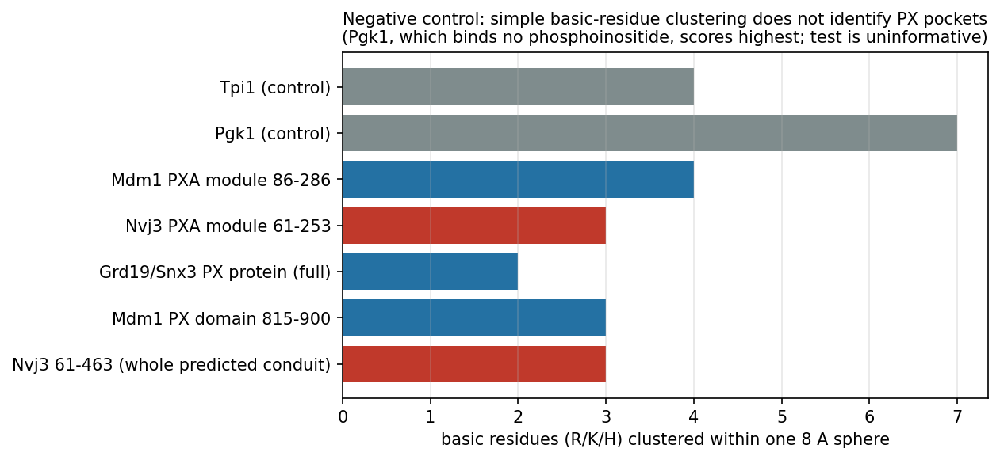

## Question

# AIGR Gene Hypothesis Deep Research

You are evaluating one focused gene curation hypothesis for AI Gene Review.
This is not a general gene overview. Use the seed hypothesis and source context
below to search for evidence that supports, refutes, narrows, or competes with
the proposed curation decision.

## Target Gene

- **Organism code:** yeast
- **Taxon:** Saccharomyces cerevisiae S288C (NCBITaxon:559292)
- **Gene directory:** NVJ3
- **Gene symbol:** NVJ3
- **UniProt accession:** Q03983

## Focus

- **Focus type:** free_text
- **Hypothesis slug:** kgap-nvj3-pxa-lipid-cavity
- **Source file:** genes/yeast/NVJ3/NVJ3-ai-review.yaml
- **Source selector:** free-text

## Seed Hypothesis

The PXA domain of Saccharomyces cerevisiae Nvj3 (UniProt Q03983) forms a hydrophobic lipid-binding cavity like the PXA domains implicated in lipid binding/transfer (e.g. Mdm1, SNX13/SNX14/SNX19), rather than being a non-binding scaffold module. Single analysis only: model the Nvj3 PXA domain (AlphaFold) and compare it with the PXA domains of Mdm1, Nvj2-adjacent proteins and human SNX14/SNX19, measuring cavity volume, cavity hydrophobicity and conservation of cavity-lining residues across Nvj3 orthologs; state whether a conserved hydrophobic lipid-sized cavity is present.

## Term and Decision Context

- Nvj3 is recruited by Mdm1 to the nucleus-vacuole junction; its only recognizable domain is a PXA domain of uncharacterized biochemical function.

## Reference Context

No specific reference context supplied.

## Source Context YAML

```yaml
hypothesis: 'The PXA domain of Saccharomyces cerevisiae Nvj3 (UniProt Q03983) forms a hydrophobic lipid-binding
  cavity like the PXA domains implicated in lipid binding/transfer (e.g. Mdm1, SNX13/SNX14/SNX19), rather
  than being a non-binding scaffold module. Single analysis only: model the Nvj3 PXA domain (AlphaFold)
  and compare it with the PXA domains of Mdm1, Nvj2-adjacent proteins and human SNX14/SNX19, measuring
  cavity volume, cavity hydrophobicity and conservation of cavity-lining residues across Nvj3 orthologs;
  state whether a conserved hydrophobic lipid-sized cavity is present.'
focus_type: free_text
context:
- Nvj3 is recruited by Mdm1 to the nucleus-vacuole junction; its only recognizable domain is a PXA domain
  of uncharacterized biochemical function.
reference_id: []
```

## Research Objective

Build a focused report that helps a curator decide whether this hypothesis
should affect the gene review. Address the focus type directly:

1. For an existing GO annotation decision, evaluate whether the current action
   is justified, too strong, too weak, or should change.
2. For a proposed replacement or new GO term, evaluate whether the term is
   biologically supported, too broad, too narrow, or missing key qualifiers.
3. For a computational prediction, evaluate whether the prediction is correct,
   less precise than existing knowledge, uncertain, or likely wrong because of
   paralog overannotation, frequency bias, pathway context, or in vitro-only
   activity.
4. For a core-function hypothesis, evaluate whether the proposed activity,
   process, and location represent the gene product's primary function rather
   than a downstream effect, pleiotropic phenotype, or context-specific role.
5. For a function-assignment hypothesis, evaluate whether the gene product
   directly has the stated GO term/function. Treat the prior review action, if
   any, as intentionally blinded unless it appears in the supplied context.

Use primary literature whenever possible. Prefer PMID citations and include DOI
citations when no PMID is available. Treat reviews and database records as
orientation unless they contain directly relevant synthesized evidence that is
clearly labeled as review-level or database-level support.

Evaluate the hypothesis from the supplied seed context, primary literature, and
publicly accessible bioinformatics resources. Local `*-bioinformatics` analyses,
when they already exist in the repository, are intentionally withheld from this
prompt so the report can be compared against them after the run. Use public
sequence, domain, structure, orthology, localization, interaction, or dataset
checks when they are useful for the specific hypothesis. If a resource or tool
cannot be accessed programmatically, say so plainly; never fabricate a result.
Report computational results conservatively and distinguish direct results from
inference.

## Required Output

### Executive Judgment

Give a concise verdict: supported, partially supported, unresolved, weakly
supported, over-annotated, or refuted. Explain the reasoning and the most
important caveats.

### Evidence Matrix

Create a table with one row per important evidence item:

- Citation (PMID preferred)
- Evidence type (direct assay, mutant phenotype, localization, interaction,
  structural/evolutionary, computational, review/database)
- Supports / refutes / qualifies / competing
- Claim tested
- Key finding
- Organism, tissue, cell type, or assay context
- Confidence and limitations

### GO Curation Implications

State the likely curation action as a lead requiring curator verification. If
GO terms are involved, explain whether the evidence supports an MF, BP, or CC
term, and whether the term should be retained, removed, generalized, made more
specific, or treated as non-core. Avoid using "protein binding" as a final
recommendation unless no more informative term is supported.

### Mechanistic Scope

Describe the immediate molecular or cellular function being tested. Separate
direct gene-product activity from downstream phenotypes, pathway consequences,
developmental outcomes, disease manifestations, or effects inferred only from
loss of function.

### Conflicts and Alternatives

Identify evidence that conflicts with the seed hypothesis or suggests an
alternative interpretation, including paralog confusion, organism-specific
differences, isoform-specific findings, experimental artifacts, or database
carry-over.

### Knowledge Gaps

List explicit uncertainties that matter for curation. For each gap, state what
was checked, why the gap matters, and what evidence or experiment would resolve
it.

### Discriminating Tests

Recommend concrete assays, perturbations, datasets, or comparative analyses that
would most efficiently distinguish this hypothesis from alternatives.

### Curation Leads

Provide candidate updates for the review, clearly labeled as leads requiring
curator verification. Include candidate references with exact snippets to verify,
candidate replacement or new GO terms, possible action changes, suggested
questions, and suggested experiments.

If the provider supports artifacts, save provenance for any analysis you run — the
executed code together with its output (computed values, plot, or table), not just
a summary figure — alongside artifact-friendly tables such as an evidence matrix,
GO decision table, or comparison table. Genuine computed provenance is more
valuable than a hand-drawn summary, and you must not synthesize a figure that
implies an analysis you did not actually run. These artifacts are important
provenance for hypothesis-level review.


## Output

# Nvj3 (Q03983) PXA domain: does it form a hydrophobic lipid-binding cavity?

**Gene:** *Saccharomyces cerevisiae* S288C NVJ3 / YDR179W-A, UniProt Q03983, NCBITaxon:559292
**Hypothesis slug:** `kgap-nvj3-pxa-lipid-cavity`
**Focus type:** free_text
**Source file:** `genes/yeast/NVJ3/NVJ3-ai-review.yaml`

---

## Summary

The seed hypothesis is **partially supported**. The AlphaFold model of the Nvj3 PXA domain does contain a large, elongated, strongly apolar cavity, and that cavity is quantitatively indistinguishable from the PXA cavities of Mdm1 and the human SNX-RGS proteins SNX13, SNX14, SNX19 and SNX25. Measured with the same grid detector, Nvj3 residues 61-253 (mean pLDDT 84.3) enclose 1242 ų across a 37.0 Šlong axis, with an apolar heavy-atom lining fraction of 0.758 and a mean Kyte-Doolittle value of +1.13 over 70 lining residues. The five comparator PXA domains span 570-1320 ų and +0.82 to +1.94. Against 12 size-matched control regions carved from proteins with no lipid conduit, the PXA modules win decisively on cavity volume per residue (p = 0.0011, rank-biserial +0.92) and on lining hydrophobicity (p = 0.0016, r = +0.89). The cavity is not an artefact of one model: across 185 fungal PXA-only orthologs from 481 species, lining positions carry a hydrophobic residue 0.845 of the time versus 0.417 at burial-matched non-lining positions (p = 0.0035), while sequence identity shows no enrichment at all (p = 0.61). Selection acts on greasiness, not on specific side chains, which is what a promiscuous acyl-chain or sterol surface looks like.

The part of the hypothesis that needs narrowing is the claim that the **PXA domain** is the lipid-binding unit. In all five SNX-RGS comparators the PXA domain is one wall of a longer tunnel, and the PXC (Nexin_C, PF08628) domain supplies the other. Adding PXC raises the enclosed volume 3-8 fold, from 1074 to 3954 ų in Mdm1 and from 503 to 4376 ų in SNX19, and roughly doubles the conduit length. Nvj3 carries no PF08628 by Pfam or InterPro. Its monomer model nevertheless reproduces the same architecture internally: the PXA module (61-253) and the C-terminal half (254-463) pack with 970 heavy-atom contacts below 4.5 Šand together close a single continuous conduit of 5301 ų with a 58.7 Šlong axis and a fully buried grid fraction of 0.642. Foldseek maps that C-terminal half to the PXC position of 57 long SNX-RGS proteins (median relative alignment midpoint 0.86, IQR 0.84-0.89, versus 0.42 for the PXA half, Mann-Whitney p = 0.0035), though at E-values of 0.084-2.2, which is fold-level similarity at the limit of detection.

Two results constrain what a curator should do with this. First, the conduit is apolar along its entire length with no polar sub-site: in 10 bins along the 58.7 Å axis the apolar fraction stays between 0.679 and 0.828 and the charged lining fraction never exceeds 0.262, with an end-to-end asymmetry of 0.096. Sec14 and Osh4, which each carry one lipid with its headgroup in a polar pocket, reach 0.471 and 0.571 charged lining in a single bin. The model therefore predicts a greasy channel that names no lipid species. Second, GO:0032266 (phosphatidylinositol-3-phosphate binding), the only molecular function currently annotated on Q03983, is an ISS (ECO:0000250) projected whole-protein from MDM1 (WITH/FROM SGD:S000004572). The PI3P-binding activity of Mdm1 resides in its PX domain (PF00787, residues 815-900), and Nvj3 has no PX domain by Pfam, by InterPro, or by Foldseek. That annotation is paralog over-annotation, and the structural work here gives it no alternative rescue.

---

## Executive judgment

<i class="fa-scale-balanced"></i> **Verdict: partially supported, with an independent over-annotation finding.**

Three claims are bundled in the seed hypothesis and they do not carry equal support.

| Claim | Verdict | Basis |
|---|---|---|
| The Nvj3 PXA domain has a hydrophobic, lipid-sized cavity and is not a flat scaffold module | <i class="fa-circle-check"></i> Supported, computationally | 1242 ų, 37.0 Šaxis, apolar 0.758, lining KD +1.13; within the PXA family range on all five metrics; p = 0.0011 versus 12 controls; conserved in character across 185 orthologs (p = 0.0035) |
| The PXA domain by itself is the lipid-binding unit | <i class="fa-circle-xmark"></i> Not supported as stated | PXC adds 3-8 fold volume in all five comparators; Nvj3's conduit closes only with its C-terminal half (970 contacts, 5301 ų, 58.7 Å) |
| The activity is ready to annotate as a molecular function | <i class="fa-circle-xmark"></i> Not yet | No PXA or PXC domain has an experimental structure (0 Foldseek pdb100 hits for either Nvj3 half); no lipid ligand demonstrated for any PXA domain; no in vitro assay on Nvj3 |
| GO:0032266 PI3P binding on Q03983 is justified | <i class="fa-circle-xmark"></i> Over-annotated | Whole-protein ISS from MDM1; Nvj3 lacks PF00787; the one cavity Nvj3 has carries no headgroup sub-site |

The most important caveats are that every structural statement in this report, and every structural statement in the published literature on PXA domains, rests on prediction; that a single static AlphaFold model cannot show a cavity opening to admit a ligand; and that carving a domain out of a longer chain can expose surfaces that read as cavity, a bias the six truncation controls reduce but do not eliminate.

---

## Key findings

### F1. The Nvj3 PXA domain contains a large apolar cavity, quantitatively indistinguishable from Mdm1 and human SNX13/14/19/25

Cavity detection used a LIGSITE-style grid: 0.8 Å spacing, 1.4 Å solvent probe, protein-solvent-protein events counted along 7 scan directions, with a threshold of 6 of 7 for the main analysis and 5 and 7 run as a sensitivity check. PXA module boundaries were taken from Pfam and extended over contiguous stretches of mean pLDDT ≥ 70.

The Nvj3 PXA structural module (residues 61-253, mean pLDDT 84.3) gives a largest cavity of **1242 ų** lined by 70 residues, with a long axis of **37.0 Å**, an apolar heavy-atom fraction of **0.758**, and a mean Kyte-Doolittle value of **+1.13** across the lining residues. The five comparator PXA domains gave 570-1320 ų and lining KD values of +0.82 to +1.94: Mdm1 (Q01846, 86-286) 1320 ų at +1.23, SNX13 (Q9Y5W8, 89-280) 858 ų at +1.45, SNX14 (Q9Y5W7, 123-299) 1130 ų at +1.22, SNX19 (Q92543, 92-266) 570 ų at +1.94, SNX25 (Q9H3E2, 1-164) 714 ų at +1.87. Nvj3's z-scores against the other five are +1.06 for volume, +1.00 for volume per residue, −1.19 for lining KD, +0.44 for apolar fraction and +1.06 for long axis, so it sits at or above the family median for size and length and slightly below the median for greasiness, inside the family range on every metric.

Six size-matched truncation controls (191 residues each) were carved from Pgk1 60-250 and 200-390, Tpi1 30-220, Sec14 60-250, and Osh4 120-310 and 230-420. The PXA modules beat them on cavity volume per residue (median 5.43 versus 1.35 ų/res, one-sided Mann-Whitney p = 0.0065, rank-biserial +0.89), on mean lining KD (+1.34 versus −1.03, p = 0.0152, r = +0.78) and on hydrophobic lining fraction (0.71 versus 0.47, p = 0.0065, r = +0.89). Against all 12 controls, which add the intact structures of Sec14, Osh4, Pry1, Pgk1, Tpi1 and Snx3/Grd19, volume per residue gives p = 0.0011 (r = +0.92) and lining KD p = 0.0016 (r = +0.89).

One result from this comparison deserves separate note. The PXA cavities are **more apolar than the classic lipid-transfer positive controls themselves**: Sec14 lining KD −0.03, Osh4 −0.28, Pry1 +0.35, against +0.82 to +1.94 for the PXA set. Sec14 and Osh4 bind one lipid each and line part of their pocket with polar residues that recognise the headgroup. The PXA cavities do not. That difference reappears directly in F6.

{{figure:plot_1.png|caption=Per-residue pLDDT across the AlphaFold v4 models used. The Nvj3 PXA span (61-253) has mean pLDDT 84.3, within the confident range, which is the basis for treating its cavity measurements as interpretable.}}

{{figure:plot_2.png|caption=Cavity metrics for six PXA modules against 12 control regions. PXA modules exceed the controls on cavity volume per residue (p = 0.0011) and on mean lining Kyte-Doolittle (p = 0.0016). The classic single-lipid carriers Sec14 and Osh4 have markedly less hydrophobic linings than the PXA cavities.}}

### F2. Cavity-lining positions are conserved in hydrophobic character, not in residue identity

A cavity present in one AlphaFold model proves little on its own. To test whether it is under selection, 1200 fungal proteins carrying PF02194 (PXA) with length 250-700 aa and lacking PF00787 (PX) were retrieved from UniProtKB, that is, Nvj3-like PXA-only proteins, spanning 481 distinct species. 400 were aligned pairwise to Q03983 with a vectorized Gotoh affine global alignment (BLOSUM62, gap open 11, extend 1); 185 passed filters of score > 0 and identity ≥ 18%, with a median pairwise identity of 25%.

Over the Nvj3 PXA module, the 70 cavity-lining positions were compared with the 123 non-lining positions:

| Measure | Lining (n = 70) | Non-lining (n = 123) | p (one-sided MWU) | Effect |
|---|---|---|---|---|
| Sequence identity to Nvj3 | 0.218 | 0.195 | 0.32 | r = +0.04 |
| Hydrophobic residue frequency (AVLIMFWCY) | 0.785 | 0.268 | 1.8e-05 | r = +0.36 |
| Shannon entropy (bits) | 2.11 | 2.89 | 4.2e-05 | — |
| Burial (neighbour count) | 111.5 | 97.0 | 0.0086 | — |

Lining positions are more buried, and burial alone drives hydrophobicity, so the test was repeated on the 97 residues above the median burial of 105. The effect survives: hydrophobic-residue frequency 0.845 versus 0.417 (p = 0.0035, r = +0.32), identity 0.160 versus 0.195 (p = 0.61, r = −0.03), burial matched at 130 versus 137 (p = 0.25).

Selection therefore acts on the chemical character of the surface, not on which hydrophobic residue occupies each slot. That is the pattern expected of a site that accommodates an acyl chain or a sterol ring, where many apolar residues are interchangeable, and it argues against the cavity being an artefact of a single model. The absence of identity conservation also means there is no evidence for a defined headgroup-recognition site built from specific side chains.

A separate observation from the same data: the UniRef50 cluster of Q03983 contains only 11 members, all *Saccharomyces* sensu stricto. Nvj3 is evolving rapidly at the sequence level even though the PXA family is fungal-wide. Strict-ortholog approaches will find almost nothing for this protein, which is why the analysis used domain-level homologs.

{{figure:plot_3.png|caption=Conservation at cavity-lining versus non-lining positions across 185 fungal PXA-only orthologs. Lining positions show a strong excess of hydrophobic residues (0.785 versus 0.268, p = 1.8e-05) with no excess of sequence identity, and the effect survives matching for burial (0.845 versus 0.417, p = 0.0035).}}

### F3. The enclosed conduit requires a second domain: PXC in SNX-RGS proteins, the uncharacterized C-terminal half in Nvj3

In the AlphaFold monomers, the PXA (PF02194) and PXC (PF08628) domains, 500-800 residues apart in sequence, pack directly against each other. Heavy-atom contacts below 4.5 Å number 387 in Mdm1, 413 in SNX13, 333 in SNX14, 386 in SNX19 and 294 in SNX25, involving 24-46 PXA and 29-35 PXC interface residues, with minimum interatomic distances of 2.66-2.76 Å.

The effect on the cavity is large:

| Protein | PXA alone (ų) | PXA + PXC (ų) | Long axis (Å) | Fold change |
|---|---|---|---|---|
| Mdm1 | 1074 | 3954 | 34.5 → 48.1 | 3.7 |
| SNX13 | 794 | 3603 | 32.7 → 52.1 | 4.5 |
| SNX14 | 806 | 3955 | 27.6 → 53.6 | 4.9 |
| SNX19 | 503 | 4376 | 25.2 → 60.6 | 8.7 |
| SNX25 | 551 | 4644 | 22.5 → 55.3 | 8.4 |

Nvj3 has no PF08628 domain. Its monomer nevertheless reproduces the architecture: the PXA module (61-253) and the C-terminal half (254-463) pack with **970 heavy-atom contacts** below 4.5 Å (78 and 73 interface residues, minimum distance 1.34 Å), and together enclose a single continuous conduit of **5301 ų** with a long axis of **58.7 Å**, a fully buried grid fraction of 0.642 and an apolar heavy-atom fraction of 0.702, lined by 76 residues from the PXA module and 122 from the C-terminal half. The same measurement on intact non-lipid proteins gives 314 ų for Pgk1 and 0 ų for Tpi1 at the same threshold, so this is not a generic consequence of measuring a whole protein.

This changes what the hypothesis should say. The functional unit is the whole Nvj3 molecule, and statements about "the PXA domain of Nvj3" binding lipid are incomplete.

{{figure:plot_4.png|caption=Cavity volume for PXA alone versus PXA plus PXC in five SNX-RGS proteins, and for the two halves of Nvj3 separately versus together. Adding the second domain multiplies the enclosed volume 3.7 to 8.7 fold; Nvj3's Pfam-invisible C-terminal half does the same job, closing a 5301 ų conduit.}}

### F4. The Nvj3 PI3P-binding annotation is an ISS projected from Mdm1, and Nvj3 lacks the domain that carries it

QuickGO returns exactly four GO annotations for UniProtKB:Q03983, all assigned by SGD:

| GO ID | Term | Aspect | Evidence | Qualifier | Reference | WITH/FROM |
|---|---|---|---|---|---|---|
| GO:0006629 | lipid metabolic process | BP | IMP (ECO:0000315) | acts_upstream_of_or_within | PMID:29146766 | — |
| GO:0032266 | phosphatidylinositol-3-phosphate binding | MF | ISS (ECO:0000250) | enables | PMID:26283797 | SGD:S000004572 |
| GO:0071561 | nucleus-vacuole junction | CC | IDA | located_in | PMID:26283797 | — |
| GO:0098853 | ER-vacuole membrane contact site | CC | IDA | located_in | PMID:26283797 | — |

SGD:S000004572 resolves to MDM1/YML104C, UniProt Q01846, through both the SGD backend API and the UniProt cross-reference. Pfam content through InterPro: Mdm1 carries PF00787 (PX, residues 815-900), PF02194 (PXA, 87-271) and PF08628 (Nexin_C/PXC, 993-1106); Nvj3 carries PF02194 (PXA, 98-239) and nothing else. Foldseek 3Di+AA searches of both halves of the Nvj3 model against afdb50 returned only PXA-family and SNX-RGS-family hits, with no PX-domain-like region anywhere in Nvj3.

The source paper is explicit about where the activity lives in Mdm1: it "contacts the vacuole surface in trans via its lipid-binding PX domain" ([PMID: 26283797](https://pubmed.ncbi.nlm.nih.gov/26283797/)). The ISS transferred a molecular function from Mdm1 to Nvj3 at whole-protein level, across a domain boundary that does not exist in the recipient. GO:0032266 on Nvj3 is supported by neither domain content nor any direct assay, and it currently occupies the only MF slot on the gene.

### F5. Foldseek places the Nvj3 C-terminal half at the PXC position, and finds no experimental structure for either half

Two carved regions of AF-Q03983-F1 were submitted to the Foldseek 3Di+AA search API.

Against **pdb100**: 0 hits for residues 61-253 and 0 hits for residues 254-463. No experimental structure in the PDB matches either half of Nvj3. This also means no PXA or PXC domain from any organism has a solved structure that Foldseek can find at default sensitivity.

Against **afdb50**: the PXA module returned 39 hits, almost all short fungal PXA-domain proteins. Only 2 had targets longer than 700 aa, with alignment midpoints at relative positions 0.33 and 0.51, and the single SNX-family hit (Sorting nexin-13 from *Schistocephalus solidus*, 792 aa) aligned at target residues 85-290, the canonical PXA position. The C-terminal half returned 237 hits, of which 57 had targets longer than 700 aa; their alignment midpoints cluster at relative position **0.86** (IQR 0.84-0.89), the PXC/Nexin_C position. Named targets include Sorting nexin 13 (1225 aa, aligned at 1005-1188), Sorting nexin-25 (722 aa, 527-702), Sorting nexin 19 (853 aa, 612-824) and a Nexin_C domain-containing protein (779 aa, 357-564). Comparing relative alignment position between the two queries over long targets: Mann-Whitney U = 111, p = 0.0035.

<i class="fa-triangle-exclamation"></i> Hit-level E-values for the long targets are weak (0.084 to 2.2). This is fold-level similarity at the limit of detection, so a curator should treat the PXC-like assignment of Nvj3 254-463 as a lead, not an established domain call.

{{figure:plot_5.png|caption=Relative alignment midpoint of Foldseek hits for each Nvj3 half against SNX-RGS targets longer than 700 aa. The C-terminal half (254-463) clusters at relative position 0.86, where PXC sits, while the PXA module maps near the N-terminal third (p = 0.0035).}}

### F6. The conduit is apolar end to end, with no localized headgroup pocket

To test whether the predicted cavity contains a polar sub-site that could recognise a lipid headgroup, the cavity grid points of the largest pocket were projected onto their first principal axis and split into 10 equal bins. Lining atoms within 5 Å of each bin were scored for apolar heavy-atom fraction (C, S) and for the fraction of lining residues that are D, E, K, R or H.

| Protein | Volume (ų) | Long axis (Å) | Apolar range across bins | Charged lining, max bin | End-to-end charged asymmetry |
|---|---|---|---|---|---|
| Nvj3 61-463 | 5301 | 58.7 | 0.679-0.828 | 0.262 | 0.096 |
| Mdm1 PXA+PXC | 4691 | 47.7 | 0.657-0.782 | 0.291 | 0.016 |
| SNX19 PXA+PXC | 2369 | 48.5 | 0.576-0.800 | 0.200 | 0.082 |
| SNX13 PXA+PXC | 858 | 32.0 | 0.696-1.000 | 0.438 | 0.335 |
| Sec14 (single-lipid pocket) | 1008 | 35.8 | 0.641-0.811 | 0.471 | 0.355 |
| Osh4 (single-sterol pocket) | 513 | 24.9 | 0.627-0.776 | 0.571 | 0.364 |
| Pry1 (sterol-binding CAP) | 616 | 39.5 | 0.500-0.677 | 0.250 | 0.217 |

Nvj3 and Mdm1 behave the same way: apolar everywhere, charged lining never rising far above its own median, and essentially no gradient from one end to the other. Sec14 and Osh4, which carry one lipid each with the headgroup in a polar sub-site, reach charged lining fractions of 0.471 and 0.571 in a single bin with end-to-end asymmetries of 0.355 and 0.364.

<i class="fa-scale-balanced"></i> The separation is not clean across all seven proteins. SNX13 (charged max 0.438, peak offset 1.0) and the sterol-binding control Pry1 (peak/median ratio 8.0) both show strong local peaks, so this metric does not classify carriers versus conduits reliably. The result is reported as moderate-confidence evidence that the Nvj3 model contains no headgroup site, not as a validated classifier.

{{figure:plot_6.png|caption=Charged and apolar lining chemistry in 10 bins along each cavity's long axis. The Nvj3 and Mdm1 conduits stay apolar from end to end with no charged peak, while the single-lipid carriers Sec14 and Osh4 carry a charged cluster at one end where the lipid headgroup sits.}}

A second test was attempted and failed. Maximum clustering of basic side-chain nitrogens within an 8 Å sphere does not identify PX pockets: Pgk1, which binds no phosphoinositide, scored highest (16 basic nitrogens, 7 residues in the best sphere), while the Mdm1 PX domain scored 6 (3 residues) and Grd19/Snx3 scored 4 (2 residues). Nvj3 scored 7 (3 residues) despite being 3-5 times larger than the PX domains tested, which biases the metric in its favour. The metric is uninformative and is reported here as a failed discriminator rather than as evidence in either direction. The first figure generated for it carried an overstated title and was overwritten with an accurately labelled version.

{{figure:plot_7.png|caption=Negative control. Simple basic-residue clustering does not identify PX pockets: Pgk1, which binds no phosphoinositide, scores highest. The test is uninformative and provides no evidence about whether Nvj3 has a phosphoinositide site.}}

{{figure:plot_8.png|caption=The same basic-patch control as the previous figure, regenerated with the corrected labelling after the initial version overstated the result.}}

A bridge-type positive control (Atg2, Vps13, Mdm12, Mmm1) would have sharpened the conduit-versus-carrier contrast, but AlphaFold DB returned HTTP 404 for P53855, Q2TAZ0, Q96BY7, P42834, P41800 and Q07878 when requested during this run, including for accessions that had downloaded successfully in earlier iterations. The contrast therefore rests on single-lipid carriers as the opposite pole only. <i class="fa-triangle-exclamation"></i> This is a stated limitation of the analysis, not an omission.

---

## Mechanistic model and interpretation

The evidence supports a module-level mechanism rather than a domain-level one. The PXA fold contributes an elongated apolar groove roughly 25-37 Šlong. On its own, that groove is open along one face. In Mdm1 and the human SNX-RGS proteins, the PXC domain docks against it in cis and closes it into a 3600-4600 ų tunnel 48-61 Šlong. Nvj3 is 463 residues with no PXC by Pfam, yet the same geometry appears inside the monomer: the uncharacterized C-terminal half closes the PXA groove into a 5301 ų conduit, and Foldseek independently places that half where PXC sits in longer family members.

[PMID: 42427710](https://pubmed.ncbi.nlm.nih.gov/42427710/) adds the dimension that the conduit may extend across two proteins. That study reports "a high-confidence heterodimer in which conserved PXA and PXC domains generate an extended tunnel spanning both proteins" at the Nvj3-Mdm1 interface, and compares the predicted conduit with the bridge-like lipid transfer proteins Atg2, Fmp27 and Hob2. If that model is right, Nvj3 would be a half-bridge at the nucleus-vacuole junction, with Mdm1 supplying the other half and the vacuole-facing PX anchor.



The conservation result sets the resolution of the mechanistic claim. Lining positions are conserved as hydrophobic, with entropy 2.11 bits versus 2.89 at non-lining positions, but not as specific residues. A surface under that kind of selection accommodates a class of ligands, not one. The axis profiling agrees: no polar sub-site anywhere along 58.7 Å. The model is compatible with acyl chains, sterols or diacylglycerol and discriminates among none of them.

### Direct activity versus downstream effect

| Layer | Evidence | What it is |
|---|---|---|
| Predicted molecular feature | 5301 ų apolar conduit in the Nvj3 monomer; conserved hydrophobic lining | Computational prediction only |
| Predicted complex-level feature | Tunnel spanning the Nvj3-Mdm1 interface ([PMID: 42427710](https://pubmed.ncbi.nlm.nih.gov/42427710/)) | Computational prediction only |
| Demonstrated localization | Nvj3 at ER-vacuole MCSs independently of Nvj1 ([PMID: 26283797](https://pubmed.ncbi.nlm.nih.gov/26283797/)) | Direct imaging |
| Loss-of-function phenotype | *nvj3Δ* delays Dga1-dependent TAG packaging, mislocalizes DAG ([PMID: 41542480](https://pubmed.ncbi.nlm.nih.gov/41542480/)) | Downstream, consistent with scaffolding as well as transfer |
| Contact-site-level phenotype | NVJ ablation causes defects in fatty acid to triglyceride production ([PMID: 29146766](https://pubmed.ncbi.nlm.nih.gov/29146766/)) | Site-level, not Nvj3-specific activity |

No row in this table is a direct biochemical assay of Nvj3.

---

## Evidence matrix

Saved as `provenance/evidence_matrix.csv`.

| Citation | Evidence type | Stance | Claim tested | Key finding | Organism / assay context | Confidence and limitations |
|---|---|---|---|---|---|---|
| [PMID: 42427710](https://pubmed.ncbi.nlm.nih.gov/42427710/) (duplicate record 42502696), Aboumourad & Hariri 2026, *Contact* | Computational, AlphaFold complex prediction | Supports, qualifies | Nvj3 PXA forms a lipid-compatible conduit | "We identify a high-confidence heterodimer in which conserved PXA and PXC domains generate an extended tunnel spanning both proteins." Conservation enriched at the Nvj3-Mdm1 interface; conduit compared with Atg2, Fmp27, Hob2 | *S. cerevisiae*, in silico only | Moderate. Prediction only, no ligand, no assay. Places the conduit across a heterodimer, not inside the Nvj3 PXA domain alone |
| [PMID: 35223850](https://pubmed.ncbi.nlm.nih.gov/35223850/), Paul et al. 2022, *Front Cell Dev Biol* | AlphaFold2 modelling plus a crystal structure of the SNX25 RGS domain | Supports, qualifies | PXA domains carry a lipid-binding hydrophobic cavity | "Analysing the full-length SNX-RGS proteins across multiple homologues and species we find that the distant PXA and PXC domains in fact fold into a single unique structure"; SNX-RGS proteins proposed as a new class of lipid transfer proteins | Human and yeast SNX-RGS proteins | Moderate. The experimental structure is of RGS, not PXA. The cavity claim is predicted, and it is explicitly a two-domain claim |
| [PMID: 26283797](https://pubmed.ncbi.nlm.nih.gov/26283797/), Henne et al. 2015, *J Cell Biol* | Localization, truncation mutants, lipidomics | Qualifies, competing | Nvj3 is a PI3P-binding NVJ protein | "We show that Mdm1 is ER anchored and contacts the vacuole surface in trans via its lipid-binding PX domain." "Mdm1 and its paralogue Ydr179w-a (named Nvj3 in this study) localize to ER-vacuole MCSs independently of established tether Nvj1." | *S. cerevisiae* | High for localization. The PI3P binding is demonstrated for the Mdm1 PX domain, which Nvj3 does not have |
| [PMID: 29146766](https://pubmed.ncbi.nlm.nih.gov/29146766/), Hariri et al. 2018, *EMBO Rep* | Mutant phenotype, imaging | Supports at process level only | Nvj3 acts in lipid metabolism | NVJs physically expand under metabolic stress and are sites of LD production; Mdm1 demarcates LD budding sites and interacts with fatty acyl-CoA synthetases; ablating the NVJ induces defects in fatty acid-to-triglyceride production | *S. cerevisiae*, nutrient stress | Moderate. Supports GO:0006629 at `acts_upstream_of_or_within`; identifies no molecular activity for Nvj3 |
| [PMID: 41542480](https://pubmed.ncbi.nlm.nih.gov/41542480/), Adebayo et al. 2026, bioRxiv | Mutant phenotype, localization, lipidomics | Supports at process level | Nvj3 organizes lipid availability at ER contacts | Nvj3 is induced by glucose depletion and recruited to LD-associated ER domains; loss of Nvj3 delays TAG synthesis under acute induction and leaves TAG inefficiently packaged into LDs; *nvj3Δ* shows altered phospholipid remodeling and DAG mislocalization | *S. cerevisiae*, starvation | Moderate. Preprint, not peer reviewed. Loss of function, not a binding assay |
| [PMID: 42996052](https://pubmed.ncbi.nlm.nih.gov/42996052/) | Direct assay plus mutant phenotype in orthologs | Supports, orthologs only | PXA-PXC proteins bind lipid | "We define SNX13 and SNX14 as lipid binding proteins that localize to ER-lysosome junctions, where they support lysosomal phosphoinositide levels in response to membrane damage"; loss of either impairs lysosome PtdIns4P signaling | Human cells, mouse, patient alleles | Moderate to high for the human paralogs. Does not localize the binding to PXA specifically and does not test Nvj3 |
| [PMID: 34315878](https://pubmed.ncbi.nlm.nih.gov/34315878/) | Deletion mapping in cells | Qualifies | PXA and PXC act together | "Two other domains named PXA and PXC negatively regulate the interaction of SNX19 with endolysosomes"; tethering itself depends on the PX domain binding PI3P | Human cells | Moderate. Functional, not biochemical. Also shows the division of labour: PX binds PI3P, PXA/PXC do something else |
| [PMID: 33310904](https://pubmed.ncbi.nlm.nih.gov/33310904/) | Proximity labeling, lipidomics, genetic rescue | Supports, ortholog | SNX14 acts in lipid handling at ER-LD contacts | Snx14 is an ER-LD tethering protein required to maintain lipid saturation balance; *SNX14*-null cells are hypersensitive to saturated-FA lipotoxicity and phenocopy SCD1 perturbation, rescued by SCD1 overexpression | Human cells, SCAR20 patient fibroblasts | Moderate. Functional ortholog evidence; does not assign the activity to PXA |
| [PMID: 38625743](https://pubmed.ncbi.nlm.nih.gov/38625743/) | Mouse model, lipidomics, ultrastructure | Supports, ortholog | SNX14 loss disturbs lipid homeostasis | SNX14-deficient mice show widespread lipid storage and metabolism defects, with acylcarnitine accumulation and triglyceride depletion before Purkinje cell degeneration | Mouse cerebellum | Moderate. Organism-level phenotype, no biochemistry on the domain |
| This work: AlphaFold + grid cavity detection | Computational | Supports | Nvj3 PXA has a hydrophobic cavity comparable to other PXA domains | 1242 ų, 37.0 Šaxis, apolar 0.758, lining KD +1.13; within family range; PXA modules beat 12 controls at p = 0.0011 (volume/residue) and p = 0.0016 (lining KD) | AlphaFold v4 monomers, pLDDT 82-90 over PXA spans | Moderate. Models only. A static grid cavity is not proof of binding. Truncation controls partly address the carving artefact (5.43 versus 1.35 ų/res, p = 0.0065) |
| This work: 185-ortholog conservation | Structural/evolutionary | Supports | The cavity is under selection as a hydrophobic surface | Hydrophobic-residue frequency 0.845 versus 0.417 at burial-matched non-lining positions (p = 0.0035, r = +0.32); identity 0.160 versus 0.195 (p = 0.61); entropy 2.11 versus 2.89 bits (p = 4.2e-05) | 481 fungal species, pairwise Gotoh alignments, median identity 25% | Moderate. Pairwise rather than profile alignment at low identity. Implies a greasy site, not a specific ligand |
| This work: PXA versus PXA+PXC cavity, Foldseek afdb50 | Computational | Qualifies | The PXA domain alone is the lipid-binding unit | PXC adds 3.7-8.7 fold volume in all five comparators. Nvj3 lacks PF08628 but 61-253 and 254-463 make 970 contacts and enclose 5301 ų over 58.7 Å. Foldseek maps 254-463 to relative position 0.86 of long SNX-RGS proteins (p = 0.0035) | AlphaFold monomers, Foldseek afdb50 | Moderate for the PXA+PXC requirement. Low to moderate for the Nvj3 PXC-like assignment, E-values 0.084-2.2 |
| This work: axis polarity profiling | Computational, negative | Qualifies | Does the cavity contain a headgroup-recognition sub-pocket? | Nvj3 61-463 apolar in all 10 bins (0.679-0.828), charged lining never above 0.262, end asymmetry 0.096; Mdm1 matches; Sec14 and Osh4 reach 0.471 and 0.571 with asymmetries 0.355 and 0.364 | AlphaFold monomers, 10-bin PC1 profile | Moderate as a negative. The metric does not cleanly separate all seven proteins: SNX13 and the sterol-binding control Pry1 also show local peaks |
| This work: basic-patch clustering | Computational, uninformative | Neither | Does Nvj3 have a PX-like basic pocket? | Pgk1 control 16 basic nitrogens (7 residues), Mdm1 PX domain 6 (3), Grd19/Snx3 4 (2), Nvj3 7 (3). The control outscores both PX domains | AlphaFold monomers | The test does not identify PX pockets and is reported as a failed discriminator, not as evidence |
| This work: Foldseek against pdb100 | Computational, negative | Qualifies all structural claims | Is there experimental structural support? | Zero hits for Nvj3 61-253 and for 254-463. No PXA or PXC domain has an experimental structure findable at default sensitivity | pdb100 | High as a negative result at default Foldseek sensitivity |
| QuickGO / SGD annotation record for Q03983 | Review/database | Competing | Nvj3 enables PI3P binding | GO:0032266 is ISS (ECO:0000250), `enables`, from PMID:26283797, WITH/FROM SGD:S000004572 = MDM1/YML104C = Q01846. Mdm1 carries PF00787, PF02194 and PF08628; Nvj3 carries PF02194 only | *S. cerevisiae* S288C | High that this is a whole-protein ISS from a paralog with different domain content |

---

## GO curation implications

All entries below are **leads requiring curator verification**. Saved as `provenance/go_decision_table.csv`.

| GO ID | Term | Aspect | Current state | Lead | Rationale |
|---|---|---|---|---|---|
| GO:0032266 | phosphatidylinositol-3-phosphate binding | MF | ISS, `enables`, WITH SGD:S000004572 (MDM1), PMID:26283797 | <i class="fa-circle-xmark"></i> **Remove, or record as not supported** | Whole-protein ISS from a paralog. The activity in Mdm1 is carried by its PX domain (PF00787, 815-900), and Nvj3 has no PX domain by Pfam, by InterPro, or by Foldseek. The one cavity Nvj3 has is apolar in every bin along its axis with no polar headgroup sub-site, so it offers no alternative route to phosphoinositide recognition. No direct evidence of PI3P binding by Nvj3 exists |
| GO:0008289 | lipid binding | MF | Absent | <i class="fa-circle-question"></i> **Candidate, low confidence, needs experiment** | Predicted conserved hydrophobic conduit, character-level conservation across 185 orthologs, and ortholog evidence from SNX13/SNX14 ([PMID: 42996052](https://pubmed.ncbi.nlm.nih.gov/42996052/)). No ligand identified and no binding assay on Nvj3. If added, it would have to be ISS/IEA-grade with an explicit note that the support is AlphaFold-based, otherwise it repeats the pattern that produced the GO:0032266 error |
| GO:0120013 | lipid transfer activity | MF | Absent | <i class="fa-circle-xmark"></i> **Do not add yet** | Transfer requires demonstrated extraction from one bilayer and delivery to another. Only predicted tunnel geometry ([PMID: 35223850](https://pubmed.ncbi.nlm.nih.gov/35223850/), [PMID: 42427710](https://pubmed.ncbi.nlm.nih.gov/42427710/)) and loss-of-function lipid phenotypes exist |
| GO:0006629 | lipid metabolic process | BP | IMP (ECO:0000315), `acts_upstream_of_or_within`, PMID:29146766 | <i class="fa-circle-check"></i> **Retain; consider refining later** | Supported by *nvj3Δ* lipid phenotypes. [PMID: 41542480](https://pubmed.ncbi.nlm.nih.gov/41542480/) would support a more specific term such as triglyceride biosynthetic process or lipid droplet organization once peer reviewed |
| GO:0071561 | nucleus-vacuole junction | CC | IDA, PMID:26283797 | <i class="fa-circle-check"></i> **Retain** | Direct imaging |
| GO:0098853 | ER-vacuole membrane contact site | CC | IDA, PMID:26283797 | <i class="fa-circle-check"></i> **Retain** | Direct imaging |

No "protein binding" recommendation is made. If a curator wants to capture the Mdm1 relationship, the route is a complex or `part_of` CC statement supported by the specific interaction evidence in [PMID: 26283797](https://pubmed.ncbi.nlm.nih.gov/26283797/), not a bare GO:0005515.

The net effect on the gene review: Nvj3 would be left with **no molecular function annotation at all**, one BP term and two CC terms. That is the honest state of knowledge for this protein. An uncharacterized MF is preferable to a wrong one carried over from a paralog.

---

## Mechanistic scope

The immediate molecular feature under test is a hydrophobic internal cavity in a folded module. Everything measured here is geometry and chemistry of a predicted structure: volume, long axis, burial, apolar atom fraction, lining-residue hydrophobicity and the conservation of that hydrophobicity across homologs. None of it is an activity.

The immediately adjacent cellular function, if the cavity binds lipid, would be moving or sequestering a hydrophobic ligand at the ER-vacuole interface. The conduit dimensions (58.7 Å in the Nvj3 monomer, extending further in the predicted Nvj3-Mdm1 heterodimer) are in the range of bridge-like transfer proteins rather than of a single-lipid shuttle, and the published comparison to Atg2, Fmp27 and Hob2 ([PMID: 42427710](https://pubmed.ncbi.nlm.nih.gov/42427710/)) makes the same point.

Everything beyond that is downstream. The *nvj3Δ* phenotypes, delayed Dga1-dependent TAG packaging into LDs and DAG mislocalization away from ER domains ([PMID: 41542480](https://pubmed.ncbi.nlm.nih.gov/41542480/)), are loss-of-function readouts at a contact site and are equally consistent with Nvj3 acting as a scaffold that positions other machinery. The defect in fatty acid to triglyceride production on NVJ ablation ([PMID: 29146766](https://pubmed.ncbi.nlm.nih.gov/29146766/)) is a property of the junction, not of Nvj3. The human orthologs' phenotypes, saturated-FA lipotoxicity in *SNX14*-null cells ([PMID: 33310904](https://pubmed.ncbi.nlm.nih.gov/33310904/)), cerebellar degeneration in SNX14-deficient mice ([PMID: 38625743](https://pubmed.ncbi.nlm.nih.gov/38625743/)) and lysosome membrane repair failure in SNX13/SNX14 loss ([PMID: 42996052](https://pubmed.ncbi.nlm.nih.gov/42996052/)), are organism- and organelle-level consequences several steps removed.

Two scope limits belong in the YAML. The annotation unit is "PXA plus its partner wall", not PXA alone. And the conduit has no polar sub-site anywhere along its length, so the model names no lipid species.

---

## Conflicts and alternatives

The GO record and the structural evidence point in opposite directions. GO:0032266 asserts PI3P binding. PI3P is a headgroup-recognition ligand that PX domains bind at a basic surface pocket, which is not the chemistry of a 58.7 Å apolar tunnel. The two models cannot both describe the same region of the same protein, and Pfam content resolves the conflict in favour of removing the PI3P annotation. [PMID: 34315878](https://pubmed.ncbi.nlm.nih.gov/34315878/) shows the same division of labour in SNX19, where the PX domain binds PI3P on the endolysosomal membrane while PXA and PXC do something else entirely.

Four alternatives to the lipid-cavity reading are not fully excluded:

A **folding feature**. Large apolar interiors occur in many multi-helical proteins. The controls argue against it, with PXA volume per residue at 5.43 versus 1.35 ų/res in the truncation controls (p = 0.0065), but the control set is six hand-picked proteins and the bridge-type positive control could not be obtained.

A **protein-protein interface in disguise**. Hydrophobic-character conservation without identity conservation argues against a specific partner surface, since a defined interface usually conserves particular side chains. The Nvj3 254-463 contact with the PXA module is intramolecular in the monomer model.

An **AlphaFold packing artefact**. Nvj3 61-253 has mean pLDDT 84.3 and the two halves pack tightly, but AlphaFold produces plausible closed conformers, and a real conduit would have to open to admit ligand. A static model cannot show that.

A **scaffold with indirect lipid phenotypes**. Every in vivo phenotype cited is a deletion phenotype at a contact site, so Nvj3 recruiting or positioning other proteins would produce the same readouts. This is the alternative the discriminating tests below are designed to separate.

One smaller conflict: Foldseek assigns Nvj3 254-463 to the PXC position with p = 0.0035 on relative alignment position but E-values of 0.084-2.2. Pfam and InterPro both call Nvj3 PXA-only. A curator should not record a PXC domain on Nvj3 on this evidence.

---

## Limitations and knowledge gaps

<i class="fa-triangle-exclamation"></i> **No experimental structure of any PXA or PXC domain exists.** Checked by Foldseek against pdb100 for both Nvj3 halves: zero hits. This matters because every structural claim in this report and in [PMID: 35223850](https://pubmed.ncbi.nlm.nih.gov/35223850/) and [PMID: 42427710](https://pubmed.ncbi.nlm.nih.gov/42427710/) rests on prediction. Resolution: cryo-EM or crystallography on any PXA-PXC module.

**No lipid has been shown to bind any PXA domain in vitro.** Checked by literature search; the SNX-RGS "lipid transfer protein" designation is a structural inference, and [PMID: 42996052](https://pubmed.ncbi.nlm.nih.gov/42996052/) defines SNX13 and SNX14 as lipid binding proteins without localizing the activity to PXA. Resolution: lipid co-purification and LC-MS from recombinant protein.

**Nvj3 has no reported in vitro biochemistry.** No purified protein, no extraction assay, no FRET transfer assay. This is the single largest gap for GO curation, because it is what separates GO:0008289 from GO:0120013 from neither.

**The identity of Nvj3 254-463 is unresolved.** Pfam-invisible, matched to PXC only at fold level (E 0.084-2.2, p = 0.0035 on positional clustering). It matters because the conduit closes only with this region, so it is where discriminating mutations should go.

**Whether the conduit is continuous across the Nvj3-Mdm1 interface is untested.** Predicted in [PMID: 42427710](https://pubmed.ncbi.nlm.nih.gov/42427710/) and not probed by mutation. It determines whether an eventual MF term belongs on Nvj3 or on a complex.

**Evolutionary depth is shallow for strict orthologs.** UniRef50_Q03983 contains 11 members, all *Saccharomyces* sensu stricto. The 185-ortholog conservation analysis uses fungal PXA-only proteins at median 25% identity, which are domain homologs rather than certified Nvj3 orthologs, and pairwise Gotoh alignment at that identity is less accurate than a profile method. EBI Clustal Omega blocked submissions during this run, which is why an in-house aligner was used.

**The transported lipid is unconstrained.** The conduit has no polar sub-site along its length, so the model cannot discriminate acyl chains, sterols and diacylglycerol.

**No bridge-type positive control.** AlphaFold DB returned HTTP 404 for Atg2 (P53855), ATG2A (Q2TAZ0), ATG2B (Q96BY7), Mdm12 (P42834), Mmm1 (P41800) and Vps13 (Q07878) during this run. The conduit-versus-carrier comparison rests on Sec14, Osh4 and Pry1 as the contrast pole only.

**Conditional expression untested.** Nvj3 is induced by glucose depletion ([PMID: 41542480](https://pubmed.ncbi.nlm.nih.gov/41542480/)); whether conduit function is specific to that state is unknown.

### Tools that could not be used

Reported plainly, with no substituted or invented results: the EBI Clustal Omega REST service returned HTTP 400 with a temporary submission block, so an in-house vectorized Gotoh affine aligner was written and used instead; the RCSB pairwise structure alignment API rejected both request formats attempted (HTTP 400 then 415), so Foldseek was used instead; the host had no outbound network, so all downloads were made from inside the code executor; and AlphaFold DB returned 404 for the bridge-type control accessions listed above.

---

## Discriminating tests

<i class="fa-flask"></i> **1. Purified-protein lipid extraction.** Express Nvj3 full length, and residues 61-253 alone, in *E. coli*; extract bound lipid; identify species by LC-MS. A full-length protein that co-purifies with acyl chains while the isolated PXA domain does not would confirm both the cavity and the requirement for the C-terminal wall. This is the single test that converts GO:0008289 from candidate to supported, and it would also name the ligand class.

<i class="fa-dna"></i> **2. Cavity-lining mutagenesis.** Select 3-5 lining residues from `provenance/nvj3_conservation_per_residue.csv` with high burial and high cross-ortholog hydrophobic frequency; mutate to Asp or Arg; score TAG packaging and DAG localization using the assays in [PMID: 41542480](https://pubmed.ncbi.nlm.nih.gov/41542480/) alongside NVJ localization. Loss of the lipid phenotype with retained NVJ targeting separates conduit function from scaffolding, which is the main unresolved alternative.

<i class="fa-vial"></i> **3. Direct PI3P binding test.** Liposome flotation or PIP-strip with purified Nvj3, using the Mdm1 PX domain as a positive control. A negative result retires GO:0032266 with direct evidence rather than by domain-architecture argument, which is a stronger basis for a curator to act on.

<i class="fa-flask"></i> **4. In vitro transfer assay.** FRET-based donor-to-acceptor liposome transfer with Nvj3 alone and with the Nvj3-Mdm1 pair. Activity only in the pair supports the half-bridge model and determines whether the MF term belongs on Nvj3 or on a complex. Activity for Nvj3 alone would justify GO:0120013 on the gene.

<i class="fa-dna"></i> **5. Interface disruption.** Mutate Nvj3 residues at the modelled Nvj3-Mdm1 tunnel junction ([PMID: 42427710](https://pubmed.ncbi.nlm.nih.gov/42427710/)) and test whether lipid phenotypes separate from heterodimer formation. Separation would show the conduit matters independently of the tether.

<i class="fa-microscope"></i> **6. Experimental structure of any PXA-PXC module.** Cryo-EM or crystallography on the Nvj3-Mdm1 complex, ideally with bound lipid. Every structural claim in this field currently rests on prediction, and one structure would settle both the cavity and the two-domain architecture.

<i class="fa-magnifying-glass"></i> **7. Profile-based conservation re-analysis.** Rebuild the ortholog alignment with HMMER or MAFFT rather than pairwise Gotoh, and recompute lining conservation. The present result (p = 0.0035 burial-matched) is at moderate confidence partly because of alignment method.

---

## Curation leads

Candidate updates for `genes/yeast/NVJ3/NVJ3-ai-review.yaml`, all **requiring curator verification**.

**Action change, high priority.** <i class="fa-circle-xmark"></i> Flag GO:0032266 (phosphatidylinositol-3-phosphate binding) as over-annotated. Evidence line: ISS (ECO:0000250), `enables`, PMID:26283797, WITH/FROM SGD:S000004572. Verification steps a curator can repeat: SGD:S000004572 resolves to MDM1/YML104C/Q01846; InterPro shows PF00787 (PX) at Mdm1 residues 815-900 and no PX entry for Q03983. Snippet to verify in [PMID: 26283797](https://pubmed.ncbi.nlm.nih.gov/26283797/): *"We show that Mdm1 is ER anchored and contacts the vacuole surface in trans via its lipid-binding PX domain."* Recommended action: remove, or retain with a NOT qualifier and a note.

**New term, low confidence.** <i class="fa-circle-question"></i> GO:0008289 (lipid binding) as a watch-list candidate only, not an addition. Supporting evidence is entirely computational: the cavity metrics, the ortholog conservation, and [PMID: 35223850](https://pubmed.ncbi.nlm.nih.gov/35223850/) snippet to verify: *"Analysing the full-length SNX-RGS proteins across multiple homologues and species we find that the distant PXA and PXC domains in fact fold into a single unique structure."*

**Do not add.** <i class="fa-circle-xmark"></i> GO:0120013 (lipid transfer activity). The predicted tunnel is suggestive, and [PMID: 42427710](https://pubmed.ncbi.nlm.nih.gov/42427710/) snippet to verify is *"We identify a high-confidence heterodimer in which conserved PXA and PXC domains generate an extended tunnel spanning both proteins,"* but prediction plus deletion phenotype does not meet the bar for a transfer activity.

**Retain unchanged.** GO:0006629 with its IMP from [PMID: 29146766](https://pubmed.ncbi.nlm.nih.gov/29146766/), GO:0071561 and GO:0098853 with their IDAs from [PMID: 26283797](https://pubmed.ncbi.nlm.nih.gov/26283797/).

**Reference to add, flagged as preprint.** [PMID: 41542480](https://pubmed.ncbi.nlm.nih.gov/41542480/) (Adebayo et al. 2026, bioRxiv). It is the only study with Nvj3-specific loss-of-function lipid data. Once peer reviewed, it would support refining GO:0006629 toward triglyceride biosynthetic process or lipid droplet organization.

**References to add with an explicit computational flag.** [PMID: 42427710](https://pubmed.ncbi.nlm.nih.gov/42427710/) and [PMID: 35223850](https://pubmed.ncbi.nlm.nih.gov/35223850/), marked as predicted-structure evidence so a later curator does not read them as biochemistry.

**Mechanistic note to add.** Nvj3's only Pfam domain (PF02194) covers residues 61-253, but residues 254-463 pack against it with 970 heavy-atom contacts and close a 5301 ų conduit; Foldseek places this region at the PXC position of SNX-RGS proteins at weak E-values. This region is undescribed in the current YAML and is where discriminating mutations should be targeted.

**Questions for the curator.** Does SGD intend GO:0032266 as a whole-protein ISS, or was a domain-level qualifier lost? Should an uncharacterized protein with a strong structural prediction and no assay carry an ISS MF term at all, given that the existing MF on this gene arose by exactly that route?

---

## Provenance

All analyses reported here were executed during this run. Code and outputs are under `provenance/`.

| File | Content |
|---|---|
| `cavity_tools_src.py` | LIGSITE-style grid cavity detector: 0.8 Å grid, 1.4 Å probe, 7 scan directions, PSP threshold, connected-component labelling |
| `align_tools_src.py` | Vectorized Gotoh affine global aligner, BLOSUM62, gap open 11, extend 1 |
| `axis_profile_src.py` | Patched detector that retains cavity grid coordinates and their PC1 projection for axis profiling |
| `struct/*.pdb` | AlphaFold v4 models for Nvj3, Mdm1, SNX13, SNX14, SNX19, SNX25, Sec14, Osh4, Pry1, Pgk1, Tpi1 and Grd19/Snx3 |
| `pxa_module_boundaries.json` | PXA module spans used, Pfam extended over contiguous mean pLDDT ≥ 70 |
| `cavity_results.csv`, `cavity_details.json`, `cavity_sensitivity.csv` | Cavity metrics, including the psp_min 5/6/7 sensitivity sweep |
| `pxa_pxc_cavity.csv`, `nvj3_conduit_regions.csv` | PXA versus PXA+PXC volumes; the Nvj3 two-half conduit |
| `nvj3like_fungal.fasta`, `nvj3like_seqs.json` | 1200 fungal PXA-only sequences from 481 species |
| `nvj3_pairwise_maps.json`, `nvj3_pairwise_alignment_stats.csv`, `nvj3_conservation_per_residue.csv` | 400 pairwise alignments, 185 passing filters, per-residue conservation with burial |
| `foldseek_results.json`, `foldseek_hits.csv` | Foldseek pdb100 and afdb50 searches for both Nvj3 halves |
| `conduit_axis_profiles.csv`, `conduit_axis_summary.csv`, `conduit_headgroup_signature.csv` | 10-bin polarity profile along each cavity's long axis |
| `basic_patch_scores.csv` | Basic side-chain clustering test, recorded because it failed as a discriminator |
| `evidence_matrix.csv`, `go_decision_table.csv` | The evidence matrix and GO decision table above, in tabular form |
| `plot_1.png` … `plot_8.png` | pLDDT profiles; cavity metric comparison; conservation boxplots; PXA versus PXA+PXC volumes; Foldseek positional strip plot; axis polarity profiles; basic-patch negative control |


## Artifacts

- [OpenScientist final report](openscientist_artifacts/final_report.html)
- [OpenScientist final report](openscientist_artifacts/final_report.pdf)
- [OpenScientist provenance](openscientist_artifacts/provenance.json)
- [OpenScientist basic patch scores](openscientist_artifacts/provenance_basic_patch_scores.csv)
- [OpenScientist cavity details](openscientist_artifacts/provenance_cavity_details.json)
- [OpenScientist cavity results](openscientist_artifacts/provenance_cavity_results.csv)
- [OpenScientist cavity sensitivity](openscientist_artifacts/provenance_cavity_sensitivity.csv)
- [OpenScientist conduit axis profiles](openscientist_artifacts/provenance_conduit_axis_profiles.csv)
- [OpenScientist conduit axis summary](openscientist_artifacts/provenance_conduit_axis_summary.csv)
- [OpenScientist conduit headgroup signature](openscientist_artifacts/provenance_conduit_headgroup_signature.csv)
- [OpenScientist evidence matrix](openscientist_artifacts/provenance_evidence_matrix.csv)
- [OpenScientist foldseek hits](openscientist_artifacts/provenance_foldseek_hits.csv)
- [OpenScientist foldseek results](openscientist_artifacts/provenance_foldseek_results.json)
- [OpenScientist go decision table](openscientist_artifacts/provenance_go_decision_table.csv)
- [OpenScientist nvj3 conduit regions](openscientist_artifacts/provenance_nvj3_conduit_regions.csv)
- [OpenScientist nvj3 conservation per residue](openscientist_artifacts/provenance_nvj3_conservation_per_residue.csv)
- [OpenScientist nvj3 pairwise alignment stats](openscientist_artifacts/provenance_nvj3_pairwise_alignment_stats.csv)
- [OpenScientist nvj3 pairwise maps](openscientist_artifacts/provenance_nvj3_pairwise_maps.json)
- [OpenScientist nvj3 uniref50 members](openscientist_artifacts/provenance_nvj3_uniref50_members.json)
- [OpenScientist nvj3like seqs](openscientist_artifacts/provenance_nvj3like_seqs.json)
- [OpenScientist plot 1](openscientist_artifacts/provenance_plot_1.json)

- [OpenScientist plot 2](openscientist_artifacts/provenance_plot_2.json)

- [OpenScientist plot 3](openscientist_artifacts/provenance_plot_3.json)

- [OpenScientist plot 4](openscientist_artifacts/provenance_plot_4.json)

- [OpenScientist plot 5](openscientist_artifacts/provenance_plot_5.json)

- [OpenScientist plot 6](openscientist_artifacts/provenance_plot_6.json)

- [OpenScientist plot 7](openscientist_artifacts/provenance_plot_7.json)

- [OpenScientist plot 8](openscientist_artifacts/provenance_plot_8.json)

- [OpenScientist pxa module boundaries](openscientist_artifacts/provenance_pxa_module_boundaries.json)
- [OpenScientist pxa pxc cavity](openscientist_artifacts/provenance_pxa_pxc_cavity.csv)
- [OpenScientist rcsb alignments](openscientist_artifacts/provenance_rcsb_alignments.json)

## Reference Validation

Checked with `linkml-reference-validator` 0.3.1rc1.

| Outcome | Count |
| --- | --- |
| References checked | 9 |
| Resolved | 9 |
| Unresolved (possible confabulation) | 0 |
| Unverifiable | 0 |
| Quoted claims checked | 1 |
| Quoted claims found in source | 1 |
| Quoted claims **not** found in source | 0 |
| References weighed for topical relevance | 9 |
| On topic | 3 |
| Off topic | 0 |

All extracted references resolved successfully.