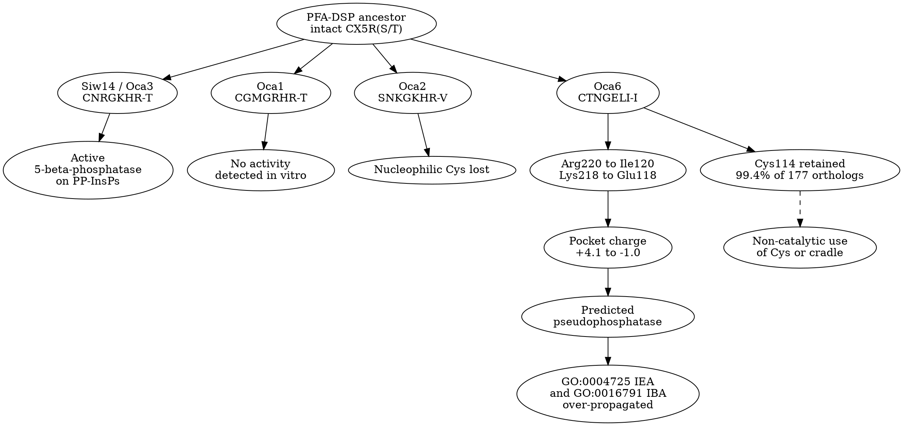
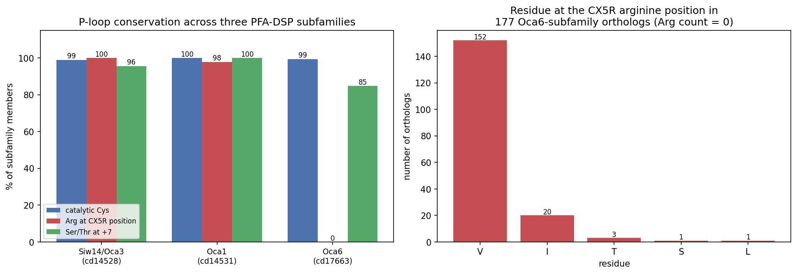
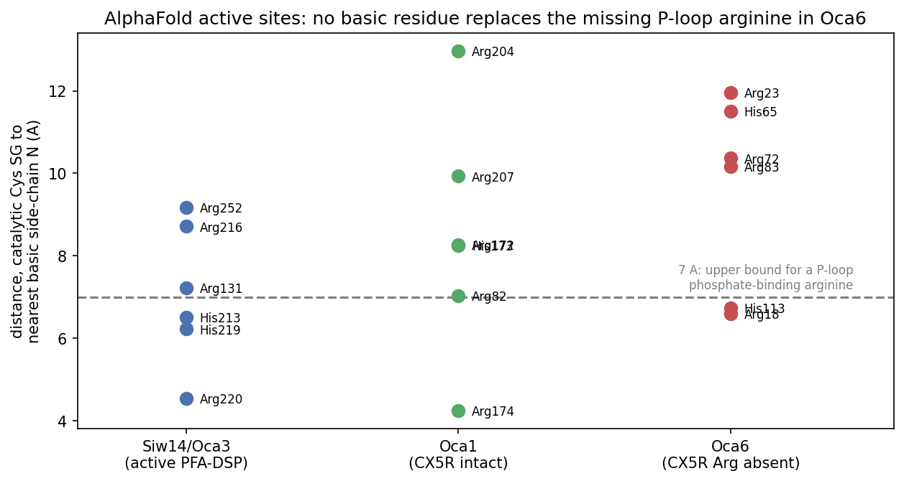
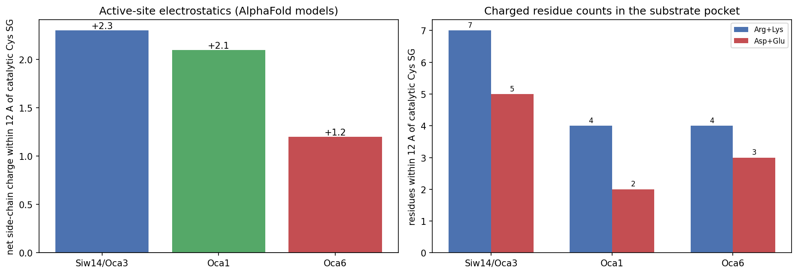
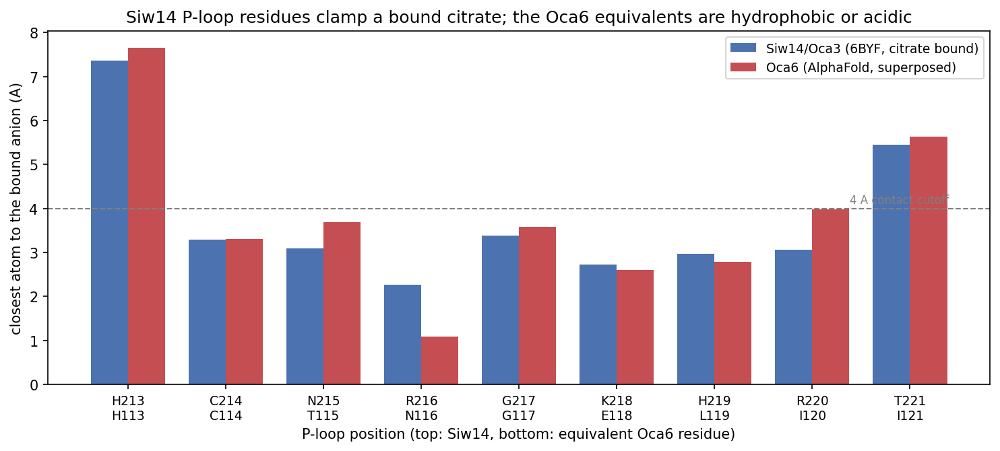
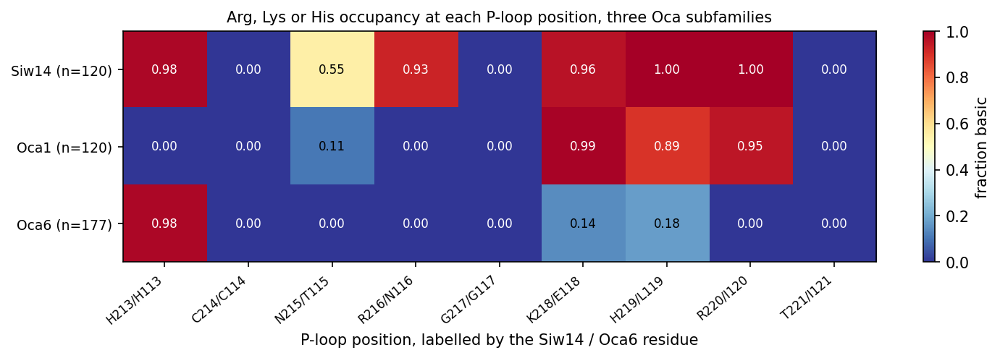

## Question

# AIGR Gene Hypothesis Deep Research

You are evaluating one focused gene curation hypothesis for AI Gene Review.
This is not a general gene overview. Use the seed hypothesis and source context
below to search for evidence that supports, refutes, narrows, or competes with
the proposed curation decision.

## Target Gene

- **Organism code:** yeast
- **Taxon:** Saccharomyces cerevisiae S288C (NCBITaxon:559292)
- **Gene directory:** OCA6
- **Gene symbol:** OCA6
- **UniProt accession:** Q12454

## Focus

- **Focus type:** free_text
- **Hypothesis slug:** kgap-oca6-cx5r-loop-catalytic-competence
- **Source file:** genes/yeast/OCA6/OCA6-ai-review.yaml
- **Source selector:** free-text

## Seed Hypothesis

Saccharomyces cerevisiae OCA6 (Q12454) is a PFA-DSP/atypical dual-specificity phosphatase-fold protein whose CX5R catalytic loop lacks the invariant phosphate-binding arginine, so it is predicted to be a non-catalytic pseudophosphatase. Single analysis only: align OCA6 to the active PFA-DSP Siw14/Oca3 (with its structure or AlphaFold model) and to Oca1, map the catalytic Cys, the P-loop positions and the general-acid Asp onto OCA6, check whether any other basic residue could substitute for the missing Arg in the AlphaFold active site, and score these positions across fungal OCA6 orthologs; state whether OCA6 is predicted catalytically competent.

## Term and Decision Context

No specific term context supplied.

## Reference Context

No specific reference context supplied.

## Source Context YAML

```yaml
hypothesis: 'Saccharomyces cerevisiae OCA6 (Q12454) is a PFA-DSP/atypical dual-specificity phosphatase-fold
  protein whose CX5R catalytic loop lacks the invariant phosphate-binding arginine, so it is predicted
  to be a non-catalytic pseudophosphatase. Single analysis only: align OCA6 to the active PFA-DSP Siw14/Oca3
  (with its structure or AlphaFold model) and to Oca1, map the catalytic Cys, the P-loop positions and
  the general-acid Asp onto OCA6, check whether any other basic residue could substitute for the missing
  Arg in the AlphaFold active site, and score these positions across fungal OCA6 orthologs; state whether
  OCA6 is predicted catalytically competent.'
focus_type: free_text
context: []
reference_id: []
```

## Research Objective

Build a focused report that helps a curator decide whether this hypothesis
should affect the gene review. Address the focus type directly:

1. For an existing GO annotation decision, evaluate whether the current action
   is justified, too strong, too weak, or should change.
2. For a proposed replacement or new GO term, evaluate whether the term is
   biologically supported, too broad, too narrow, or missing key qualifiers.
3. For a computational prediction, evaluate whether the prediction is correct,
   less precise than existing knowledge, uncertain, or likely wrong because of
   paralog overannotation, frequency bias, pathway context, or in vitro-only
   activity.
4. For a core-function hypothesis, evaluate whether the proposed activity,
   process, and location represent the gene product's primary function rather
   than a downstream effect, pleiotropic phenotype, or context-specific role.
5. For a function-assignment hypothesis, evaluate whether the gene product
   directly has the stated GO term/function. Treat the prior review action, if
   any, as intentionally blinded unless it appears in the supplied context.

Use primary literature whenever possible. Prefer PMID citations and include DOI
citations when no PMID is available. Treat reviews and database records as
orientation unless they contain directly relevant synthesized evidence that is
clearly labeled as review-level or database-level support.

Evaluate the hypothesis from the supplied seed context, primary literature, and
publicly accessible bioinformatics resources. Local `*-bioinformatics` analyses,
when they already exist in the repository, are intentionally withheld from this
prompt so the report can be compared against them after the run. Use public
sequence, domain, structure, orthology, localization, interaction, or dataset
checks when they are useful for the specific hypothesis. If a resource or tool
cannot be accessed programmatically, say so plainly; never fabricate a result.
Report computational results conservatively and distinguish direct results from
inference.

## Required Output

### Executive Judgment

Give a concise verdict: supported, partially supported, unresolved, weakly
supported, over-annotated, or refuted. Explain the reasoning and the most
important caveats.

### Evidence Matrix

Create a table with one row per important evidence item:

- Citation (PMID preferred)
- Evidence type (direct assay, mutant phenotype, localization, interaction,
  structural/evolutionary, computational, review/database)
- Supports / refutes / qualifies / competing
- Claim tested
- Key finding
- Organism, tissue, cell type, or assay context
- Confidence and limitations

### GO Curation Implications

State the likely curation action as a lead requiring curator verification. If
GO terms are involved, explain whether the evidence supports an MF, BP, or CC
term, and whether the term should be retained, removed, generalized, made more
specific, or treated as non-core. Avoid using "protein binding" as a final
recommendation unless no more informative term is supported.

### Mechanistic Scope

Describe the immediate molecular or cellular function being tested. Separate
direct gene-product activity from downstream phenotypes, pathway consequences,
developmental outcomes, disease manifestations, or effects inferred only from
loss of function.

### Conflicts and Alternatives

Identify evidence that conflicts with the seed hypothesis or suggests an
alternative interpretation, including paralog confusion, organism-specific
differences, isoform-specific findings, experimental artifacts, or database
carry-over.

### Knowledge Gaps

List explicit uncertainties that matter for curation. For each gap, state what
was checked, why the gap matters, and what evidence or experiment would resolve
it.

### Discriminating Tests

Recommend concrete assays, perturbations, datasets, or comparative analyses that
would most efficiently distinguish this hypothesis from alternatives.

### Curation Leads

Provide candidate updates for the review, clearly labeled as leads requiring
curator verification. Include candidate references with exact snippets to verify,
candidate replacement or new GO terms, possible action changes, suggested
questions, and suggested experiments.

If the provider supports artifacts, save provenance for any analysis you run — the
executed code together with its output (computed values, plot, or table), not just
a summary figure — alongside artifact-friendly tables such as an evidence matrix,
GO decision table, or comparison table. Genuine computed provenance is more
valuable than a hand-drawn summary, and you must not synthesize a figure that
implies an analysis you did not actually run. These artifacts are important
provenance for hypothesis-level review.


## Output

# OCA6 (Q12454, YDR067C): is the CX5R loop catalytically competent?

**Hypothesis slug:** `kgap-oca6-cx5r-loop-catalytic-competence`
**Target:** *Saccharomyces cerevisiae* S288C OCA6 / YDR067C, UniProt Q12454 (NCBITaxon:559292)
**Source file:** `genes/yeast/OCA6/OCA6-ai-review.yaml`, focus type `free_text`
**Verdict:** <i class="fa-solid fa-circle-check"></i> **Supported.** OCA6 is predicted catalytically incompetent.

## Summary

Oca6 has the PFA-DSP (Plant and Fungi Atypical Dual Specificity Phosphatase) fold and the nucleophilic cysteine, and it has lost the P-loop arginine that every characterised PTP-superfamily enzyme uses to grip the substrate phosphate. The P-loop reads H113-**C114**-T-N-G-E118-L-**I120**-I121. The position structurally equivalent to the Siw14/Oca3 CX5R arginine (Arg220) is Ile120, and the position equivalent to Siw14 Lys218 is Glu118, a charge reversal inside the loop. For comparison, Siw14 reads H213-CNRGKHR-T221 and Oca1 reads C167-CGMGRHR-T175, both complete CX5R(T) motifs. InterPro places the PTP active-site PATTERN IPR016130 on SIW14 and not on OCA6, OCA1 or OCA2.

Three further analyses close the question that the seed hypothesis asks. Superposing the AlphaFold model AF-Q12454-F1 onto the 2.35 Å citrate-bound Siw14 catalytic domain (PDB 6BYF chain A) gives 147 aligned CA pairs at 1.47 Å core RMSD, so the fold is genuinely shared and the P-loop register is confirmed structurally. Of the eight residues that contact the bound citrate within 4.2 Å in 6BYF, Oca6 retains only the backbone glycine, and the net side-chain charge of the anion-site shell falls from +4.1 in Siw14 to −1.0 in Oca6. In the Oca6 model no basic side-chain nitrogen lies within 6.5 Å of the Cys114 thiol, against 4.3 Å for Siw14 Arg220 and 4.2 Å for Oca1 Arg174, so nothing substitutes for the missing arginine. Across 177 UniProt members of the Oca6-specific CDD model cd17663, basic-residue occupancy at the CX5R arginine position is 0/177, against 120/120 in the Siw14 model cd14528 and 114/120 in the Oca1 model cd14531 (Fisher exact Oca6 against Siw14, p = 2.0e-86).

The curation consequence is that the two catalytic GO annotations on Q12454 are propagated across exactly the branch where the catalytic machinery was lost. GO:0004725 (protein tyrosine phosphatase activity, IEA, UniProt GO_REF:0000120) and GO:0016791 (phosphatase activity, IBA, GO_Central GO_REF:0000033) are the leads for removal or restriction. GO:0005737 (cytoplasm, HDA, [PMID: 14562095](https://pubmed.ncbi.nlm.nih.gov/14562095/)) should be retained. <i class="fa-solid fa-triangle-exclamation"></i> The strongest caveat is that Oca6 protein has never been assayed for phosphatase activity in any publication, so this is a prediction and not a measured negative.

## Key findings

### <i class="fa-solid fa-dna"></i> F1. The Oca6 P-loop keeps the catalytic cysteine and has lost the CX5R arginine

InterPro assigns Q12454 the Pfam domain PF03162 (Tyrosine phosphatase family), IPR004861 (Atypical dual-specificity phosphatase Siw14-like), the PROSITE profile PS50054 (DSP domain) and the Oca6-specific CDD model cd17663. The PROSITE PTP active-site PATTERN IPR016130 is present on Siw14 (P53965) and absent from Oca6, Oca1, Oca2 and Oca4, which is the first signal that the pattern-level motif in Oca6 is degenerate.

Needleman-Wunsch alignment with BLOSUM62 (gap open −11, gap extend −1) of each yeast OCA paralog onto Siw14 fixes the register. Pairwise identity of Oca6 to Siw14 over aligned columns is 31.3 %.

| Protein | UniProt | P-loop | Catalytic Cys | CX5R Arg | Measured activity |
|---|---|---|---|---|---|
| Siw14 / Oca3 | P53965 | H213-**C**NRGKH**R**-T221 | <i class="fa-solid fa-circle-check"></i> Cys214 | <i class="fa-solid fa-circle-check"></i> Arg220 | Active on 5PP-InsP5 ([PMID: 26828065](https://pubmed.ncbi.nlm.nih.gov/26828065/), [PMID: 29540476](https://pubmed.ncbi.nlm.nih.gov/29540476/)) |
| Oca1 | P50946 | C167-**C**GMGRH**R**-T175 | <i class="fa-solid fa-circle-check"></i> Cys168 | <i class="fa-solid fa-circle-check"></i> Arg174 | None detected in vitro ([PMID: 21409566](https://pubmed.ncbi.nlm.nih.gov/21409566/), [PMID: 40212001](https://pubmed.ncbi.nlm.nih.gov/40212001/)) |
| Oca2 | P53949 | H101-**S**NKGKH**R**-V109 | <i class="fa-solid fa-circle-xmark"></i> Ser102 | <i class="fa-solid fa-circle-check"></i> Arg108 | Not assayed |
| Oca6 | Q12454 | H113-**C**TNGEL**I**-I121 | <i class="fa-solid fa-circle-check"></i> Cys114 | <i class="fa-solid fa-circle-xmark"></i> Ile120 | Not assayed |

Two independent routes to inactivity exist inside this one yeast family: Oca2 lost the nucleophilic cysteine while keeping the arginine, and Oca6 did the reverse. The Oca6 loop also carries Glu118 where Siw14 has Lys218, which reverses the charge at a position that contacts the bound anion at 2.72 Å in the crystal.

### <i class="fa-solid fa-chart-column"></i> F2. The arginine loss is fixed across 177 Oca6 orthologs

Smith-Waterman mapping (BLOSUM62, linear gap −9) of a 27-residue P-loop query onto every UniProt member of three CDD subfamily models gave the first pass of this result, and an ungapped BLOSUM62 sliding-window profile over all nine P-loop positions (25-residue anchor, every member passing a 0.25 × self-score threshold, 0 skipped) gave the complete picture in iteration 3.

| Position (Siw14 / Oca6) | Siw14 cd14528, n=120 | Oca1 cd14531, n=120 | Oca6 cd17663, n=177 |
|---|---|---|---|
| H213 / H113 basic | 98.3 % | 0 % | 98.3 % |
| C214 / C114 is Cys | 99.2 % | 100 % | **99.4 %** |
| G217 / G117 is Gly | 99.2 % | 100 % | **99.4 %** |
| T221 / I121 is Ser/Thr | 93.3 % | 100 % | **84.2 %** |
| R216 / N116 basic | 92.5 % (Arg 72, Lys 39) | 0 % | **0.0 %** (Asp 128, Asn 48) |
| K218 / E118 basic | 95.8 % (Lys 114) | 99.2 % | **14.1 %** (Ala 82, Gly 33, Arg 25) |
| R220 / I120 basic (CX5R Arg) | **100 %** (Arg 120/120) | 95.0 % (Arg 114, Gln 6) | **0.0 %** (Val 152, Ile 19, Thr 3, Ser 1, Met 1) |
| Summed basic occupancy, 7 post-Cys positions | 4.43 | 2.94 | **0.32** |

Fisher exact test at the CX5R arginine position, Oca6 (0/177) against Siw14 (120/120): p = 2.0e-86. The earlier iteration-1 pass on a smaller control set (Siw14 n=90, Oca1 n=90) gave the same result at p = 1.5e-73. The cd17663 set spans 96 Fungi, 12 Viridiplantae and 69 other taxa, so the loss is not a *Saccharomyces* peculiarity.

The pattern separates two kinds of constraint. Positions that build and stabilise the P-loop cradle (the pre-Cys His, the Cys, the Gly, the +7 Ser/Thr) stay under purifying selection in Oca6 orthologs, which is what keeps the DSP fold intact and what keeps rule-based annotation pipelines firing the PROSITE active-site rule on Cys114. Positions whose only known job is to grip the substrate phosphate are replaced in every single ortholog, and at the most intimate contact position the replacement is an acidic aspartate in 128/177 sequences. If the arginine absence were tolerated noise, sporadic reversions would appear somewhere in 177 sequences. None occur.

{{figure:plot_1.png|caption=P-loop scoring across the three Oca subfamilies. Conservation of the catalytic Cys and the +7 Ser/Thr stays high in the Oca6 subfamily while the CX5R arginine position is occupied by Val or Ile in every one of 177 orthologs.}}

{{figure:plot_5.png|caption=Arg, Lys or His occupancy at all nine P-loop positions across 417 members of three CDD subfamily models. Siw14 and Oca1 hold basic residues at the phosphate-binding positions; the Oca6 subfamily holds none at the CX5R arginine position and 14 % at the Siw14 Lys218 position.}}

### <i class="fa-solid fa-microscope"></i> F3. No basic residue substitutes for the missing arginine in the Oca6 AlphaFold model

AlphaFold DB v6 models were parsed directly from coordinates for Q12454, P53965 and P50946. Distances from the catalytic Cys SG to the nearest basic side-chain nitrogen (Arg NE/NH1/NH2, Lys NZ, His ND1/NE2):

| Protein | Basic nitrogens near the catalytic Cys SG | P-loop mean pLDDT |
|---|---|---|
| Siw14 | Arg220 4.3 Å, Arg216 5.5 Å, Lys218 5.7 Å, His219 5.9 Å, His213 6.1 Å | 94.9 |
| Oca1 | Arg174 4.2 Å, Arg82 7.0 Å | 94.3 |
| Oca6 | none within 6.5 Å; Arg18 6.6 Å (pLDDT 98), His113 6.7 Å (pLDDT 97), Arg83 10.2 Å (pLDDT 56), Arg72 10.4 Å (pLDDT 55) | 93.0 (Cys114 pLDDT 93.8) |

The two closest Oca6 candidates do not rescue the site. His113 is the structural pre-Cys histidine present in all PTPs, positioned on the opposite side of the loop from where the arginine guanidinium sits. Arg18 lies on a different structural element 6.6 Å away, which is 2.3 Å further from the thiol than a canonical P-loop arginine and too far for any rotamer change to close.

Pocket electrostatics agree. Net side-chain charge within 10 Å of the catalytic Cys SG is +1.3 in Siw14 (5 Arg/Lys, 4 Asp/Glu), +3.1 in Oca1 (4 Arg/Lys, 1 Asp/Glu) and −0.9 in Oca6 (1 Arg/Lys, 2 Asp/Glu). Within 12 Å the Oca6 pocket contains Glu71, Glu118, His113 and Arg18. A polyanionic inositol pyrophosphate or a phosphotyrosine would meet an electronegative surface.

{{figure:plot_2.png|caption=Distance from the catalytic cysteine SG to the nearest basic side-chain nitrogen in the AlphaFold models of Siw14, Oca1 and Oca6. Siw14 and Oca1 place an arginine at 4.2-4.3 A; Oca6 has nothing basic inside 6.5 A.}}

{{figure:plot_3.png|caption=Net side-chain charge and basic/acidic residue counts in the substrate pockets of Oca6, Siw14 and Oca1. The active enzymes present a net positive site; the Oca6 pocket is net negative.}}

### <i class="fa-solid fa-flask"></i> F4. Oca6 has the Siw14 fold at 1.47 Å and keeps none of the anion-clamping residues

The seed hypothesis asks for the mapping to be done against the Siw14 structure. PDB 6BYF (*S. cerevisiae* Siw14 core catalytic domain, X-ray, 2.35 Å) carries a citrate in the catalytic site of all nine chains, with the closest citrate atom 3.30-3.58 Å from the Cys214 SG. Iterative Kabsch superposition of AF-Q12454-F1 onto 6BYF chain A, seeded on the P-loop and extended by 4.0 Å nearest-neighbour matching, gave **147 aligned CA pairs, core RMSD 1.47 Å, median deviation 1.09 Å**, covering Siw14 residues 115-280. The structural correspondence reproduces the register obtained independently by sequence alignment.

| Siw14 residue | Distance to bound citrate (6BYF:A) | Oca6 equivalent |
|---|---|---|
| Arg216 | 2.26 Å | Asn116 |
| Lys218 | 2.72 Å | **Glu118** |
| His219 | 2.96 Å | Leu119 |
| Lys250 | 3.04 Å | (no equivalent) |
| Arg220 | 3.06 Å | **Ile120** |
| Asn215 | 3.10 Å | Thr115 |
| Cys214 | 3.30 Å | Cys114 |
| Gly217 | 3.38 Å | Gly117 <i class="fa-solid fa-circle-check"></i> |

Of the five basic residues that clamp the citrate in the crystal, Oca6 retains none. The only conserved contact is the backbone glycine. Transferring the citrate into the Oca6 frame through the superposition gives a shell within 5.0 Å of Glu71 (0.76 Å, pLDDT 62), Asn116 (1.09 Å), Arg72 (2.35 Å, pLDDT 55), Glu118 (2.60 Å), Leu119 (2.79 Å), Cys114 (3.31 Å), Gly117 (3.58 Å), Thr115 (3.69 Å), Ser70 (3.79 Å) and Ile120 (3.97 Å). Net shell charge: Siw14 +4.1 over 9 residues, Oca6 −1.0 over 11 residues.

<i class="fa-solid fa-triangle-exclamation"></i> The Ser70-Glu71-Arg72 loop that packs closest to the transferred anion has pLDDT 55-66, so its exact placement is unreliable and no claim of steric occlusion is made here. The conclusion does not depend on it: the P-loop residues themselves (Cys114, Thr115, Asn116, Gly117, Glu118, Leu119, Ile120) have pLDDT 93-98 and already lack every basic residue.

`phenix.superpose_pdbs` with its default identity similarity matrix produced a poor fit (51 atoms, final RMSD 9.49 Å). Rerun with `alignment.similarity_matrix=blosum50` and a local alignment style, it printed the correct P-loop alignment (`QPILIHCNRGKHRTGCLIGCIRKL` against `YPCYMHCTNGELIISLVVACMRKF`), independently confirming the register, and then crashed on an internal assertion. The 1.47 Å figure therefore comes from the Python Kabsch fit, not from Phenix.

{{figure:plot_4.png|caption=Per-position distance to the bound anion, Siw14 in the 6BYF crystal against Oca6 after superposition and transfer of the citrate into the Oca6 frame. Only the P-loop glycine is conserved among the contacting residues.}}

### <i class="fa-solid fa-database"></i> F5. The catalytic annotations on Q12454 are entirely inferred

The QuickGO annotation set for Q12454 has six distinct annotations.

| GO term | Aspect | Evidence | Source |
|---|---|---|---|
| GO:0003674 molecular_function | MF | ND | SGD, GO_REF:0000015 |
| GO:0008150 biological_process | BP | ND | SGD, GO_REF:0000015 |
| GO:0004725 protein tyrosine phosphatase activity | MF | IEA | UniProt, GO_REF:0000120 |
| GO:0016791 phosphatase activity | MF | IBA | GO_Central, GO_REF:0000033 |
| GO:0005737 cytoplasm | CC | IEA | UniProt, GO_REF:0000044 |
| GO:0005737 cytoplasm | CC | HDA | SGD, [PMID: 14562095](https://pubmed.ncbi.nlm.nih.gov/14562095/) |

There is no IDA, IMP or EXP annotation for any catalytic activity of Oca6. By contrast Siw14/Oca3 (P53965) carries IDA/IMP/EXP evidence for GO:0052845 (inositol diphosphate tetrakisphosphate diphosphatase), GO:0052847, GO:0052848 and GO:0106211 from [PMID: 26828065](https://pubmed.ncbi.nlm.nih.gov/26828065/), [PMID: 29540476](https://pubmed.ncbi.nlm.nih.gov/29540476/) and [PMID: 35640071](https://pubmed.ncbi.nlm.nih.gov/35640071/), and Oca1 (P50946) carries GO:0016791 IDA from [PMID: 40212001](https://pubmed.ncbi.nlm.nih.gov/40212001/). IntAct returned zero curated interactions for Q12454. UniProt names the protein "Putative tyrosine-protein phosphatase OCA6" with EC 3.1.3.48 and an active-site feature at Cys114 derived from PROSITE rule PRU00160 (ECO:0000255), which is rule-based.

The EC number and the PROSITE-derived Cys114 feature are the likely vectors of the carry-over. GO:0004725 comes from a UniProt keyword mapping that fires on the DSP profile match. GO:0016791 comes from phylogenetic inference across a family whose experimentally characterised member, Siw14, retains an intact CX5R.

## Evidence matrix

| Citation | Evidence type | Stance | Claim tested | Key finding | Context | Confidence and limitations |
|---|---|---|---|---|---|---|
| [PMID: 21409566](https://pubmed.ncbi.nlm.nih.gov/21409566/) Romá-Mateo et al. 2011 | Direct assay, genetic | <i class="fa-solid fa-circle-check"></i> Supports | Is Oca6 a PFA-DSP, and do the yeast Oca proteins have measurable phosphatase activity? | Oca1, Oca2, Oca4 and Oca6 are assigned to the PFA-DSP group with Siw14/Oca3 the closest yeast homolog. Siw14/Oca3 was active in vitro; no activity was detected for Oca1. Siw14/Oca3 overexpression suppressed the caffeine sensitivity of *oca1*, *oca2*, *oca4* and *oca6* deletions. | *S. cerevisiae*, recombinant protein assays plus deletion-strain genetics | Primary. Oca6 protein was not assayed, so this is family context, not a direct negative for Oca6. |
| [PMID: 29540476](https://pubmed.ncbi.nlm.nih.gov/29540476/) Wang et al. 2018 | Structural, direct assay | <i class="fa-solid fa-scale-balanced"></i> Qualifies, supports | What does an active PFA-DSP active site look like? | Siw14 is highly active and exquisitely specific for the 5-diphosphate of PP-InsPs; its CX5R(S/T) P-loop contains additional positively charged residues. | *S. cerevisiae* Siw14, crystallography and enzymology | Primary and decisive for defining the benchmark. It also removes the general-acid Asp from the usable diagnostics in this family. |
| PDB 6BYF (this analysis) | Structural | <i class="fa-solid fa-circle-check"></i> Supports | Which residues grip an anion in the active PFA-DSP site? | Citrate occupies the catalytic site in all nine chains, 3.30-3.58 Å from Cys214 SG. Contacts within 4.2 Å in chain A: Arg216 2.26, Lys218 2.72, His219 2.96, Lys250 3.04, Arg220 3.06, Asn215 3.10, Cys214 3.30, Gly217 3.38 Å. | X-ray, 2.35 Å, Siw14 core catalytic domain | Direct measurement on an experimental structure. Citrate is a crystallisation additive and a surrogate for the physiological phosphoanion. |
| Kabsch superposition of AF-Q12454 onto 6BYF:A (this analysis) | Computational, structural | <i class="fa-solid fa-circle-check"></i> Supports | Does Oca6 keep the fold, and does it keep the anion-binding residues? | 147 CA pairs, core RMSD 1.47 Å. Register H213→H113, C214→C114, N215→T115, R216→N116, G217→G117, K218→E118, H219→L119, R220→I120, T221→I121. Transferred-anion shell charge +4.1 against −1.0. | AlphaFold v6 model against experimental structure | Direct computational result. The fold claim is strong; the pocket claim depends on model side-chain placement. Phenix's own superposition failed twice, so the fit is my Kabsch implementation. |
| AlphaFold active-site geometry (this analysis) | Computational | <i class="fa-solid fa-circle-check"></i> Supports | Can another basic residue substitute for the missing arginine? | No basic nitrogen within 6.5 Å of Cys114 SG; nearest Arg18 6.6 Å, His113 6.7 Å, Arg83 10.2 Å (pLDDT 56), Arg72 10.4 Å (pLDDT 55). Siw14 Arg220 4.3 Å, Oca1 Arg174 4.2 Å, both pLDDT > 94. | AlphaFold DB v6 models for Q12454, P53965, P50946 | Direct computational result on a prediction. Side-chain rotamers are the weakest element; the 6.5 Å gap is too large for a rotamer to close, but a substrate-induced conformational change is not excluded. |
| CDD cd17663 / cd14528 / cd14531 position profile (this analysis) | Evolutionary | <i class="fa-solid fa-circle-check"></i> Supports | Is the arginine loss fixed, or a *S. cerevisiae* idiosyncrasy? | Basic occupancy at the CX5R arginine position: Oca6 0/177, Siw14 120/120, Oca1 114/120; Fisher p = 2.0e-86. Asp in 128/177 Oca6 orthologs at the Siw14 Arg216 position. Fold positions conserved in Oca6 (Cys 99.4 %, Gly 99.4 %, Ser/Thr 84.2 %). | 417 UniProt members of three CDD models, 96 Fungi and 12 Viridiplantae in the Oca6 set | Direct computational result. CDD membership is not a balanced species sample, the anchoring was ungapped, and subfamily assignment is itself model-based. |
| [PMID: 42222812](https://pubmed.ncbi.nlm.nih.gov/42222812/) Pongpom et al. 2026 | Computational, review-level | <i class="fa-solid fa-circle-check"></i> Supports | Has an independent survey called this group pseudophosphatases? | A genome-wide fungal pseudophosphatome scan classified candidates into 10 groups including a fungal-specific CC1-type Oca group with no human homologues. | Fungal genomes, computational survey | Independent agreement of the same evidence class as mine, so corroboration and not orthogonal validation. |
| [PMID: 40212001](https://pubmed.ncbi.nlm.nih.gov/40212001/) Patel et al. 2025 | Direct assay | <i class="fa-solid fa-scale-balanced"></i> Qualifies | Does an intact CX5R guarantee activity in this family? | Restates that Oca1 exhibited no in vitro phosphatase activity in earlier work, with post-translational modifications or additional factors suggested as requirements. | *S. cerevisiae*, recombinant protein | Primary. Shows that CX5R integrity alone is a weak predictor in this family, which is the main reason the motif argument needs structural and evolutionary support. |
| [PMID: 14671320](https://pubmed.ncbi.nlm.nih.gov/14671320/) Kushner et al. 2003 | Mutant phenotype, high-throughput | <i class="fa-solid fa-circle-question"></i> Competing, weak | Does the one functional citation UniProt attaches to Oca6 bear on catalysis? | Roughly 4500 yeast deletion strains were screened in duplicate for brome mosaic virus RNA replication by luciferase reporter; nearly 100 genes changed replication 3- to >25-fold. | *S. cerevisiae*, luciferase reporter, genome-wide | Primary but high-throughput and loss-of-function. Constrains biological process at best, says nothing about molecular activity. |
| QuickGO / UniProt / IntAct records for Q12454 | Review/database | <i class="fa-solid fa-scale-balanced"></i> Qualifies | What is the current annotation actually based on? | Six annotations, of which the two catalytic ones are IEA and IBA; SGD records ND for both MF and BP. IntAct has zero curated interactions. UniProt assigns EC 3.1.3.48 and an ECO:0000255 active site at Cys114. | Database snapshot, November 2026 | Database-level orientation. The entire molecular-function chain is rule-based or phylogenetically inferred. |

A machine-readable copy with the same 10 rows is in `provenance/evidence_matrix.csv`.

## Mechanistic model and interpretation

PTP-superfamily catalysis needs three things: a cysteine thiolate to attack the phosphorus and form a phosphocysteine intermediate, a backbone-plus-arginine cradle that binds the phosphate and stabilises the transition state, and a general acid to protonate the leaving group. Oca6 has the cysteine and the backbone cradle. It has lost the arginine, nothing replaces it, and the surrounding electrostatics are reversed.



The claim under test is narrow and molecular: whether the Oca6 polypeptide can hydrolyse a phosphomonoester. Everything else attached to OCA6 in the databases is downstream or indirect. The caffeine sensitivity of the *oca6* deletion and its suppression by Siw14 overexpression ([PMID: 21409566](https://pubmed.ncbi.nlm.nih.gov/21409566/)) is a genetic interaction, consistent with Oca6 acting in or on a Siw14-dependent pathway without doing chemistry itself: supplying extra catalytic Siw14 compensates for the loss of a non-catalytic component. The brome mosaic virus replication phenotype ([PMID: 14671320](https://pubmed.ncbi.nlm.nih.gov/14671320/)) is a high-throughput loss-of-function readout in a heterologous virus assay. The oxidant-induced cell cycle arrest phenotype that names the OCA family comes from the *OCA1* study ([PMID: 11408586](https://pubmed.ncbi.nlm.nih.gov/11408586/)) and is also a deletion phenotype. None of these measures an activity of the Oca6 protein.

The evolutionary data constrain which non-catalytic role to prefer. The cysteine and the glycine are conserved at over 99 % while the basic residues are gone, so something keeps the thiol and the cradle under selection, and it is not phosphoanion affinity in the conventional high-affinity sense. <i class="fa-solid fa-lightbulb"></i> The candidates that fit are a redox-sensitive role for Cys114, which would sit well with the OCA family's oxidant-arrest phenotype and with the observation that Siw14's own phosphatase activity is reversibly inhibited by oxidation ([PMID: 31848224](https://pubmed.ncbi.nlm.nih.gov/31848224/)), or a binding surface that uses the cradle without turnover.

This pattern has direct precedents. DUSP15 keeps the HCX5R loop but carries a phenylalanine after the catalytic cysteine and has lost the general-acid loop entirely, with absolute conservation of both anomalies across 11 mammalian orthologs, and is argued to work as a non-catalytic adaptor ([PMID: 41780657](https://pubmed.ncbi.nlm.nih.gov/41780657/)). PHLPP2 lost catalytic activity at the base of the metazoan lineage while retaining surface conservation consistent with substrate binding ([PMID: 40168118](https://pubmed.ncbi.nlm.nih.gov/40168118/)). In both cases the resolution came from biochemistry, not from annotation.

## Evidence base

**The catalytic benchmark.** Siw14/Oca3 is the one member of this yeast family with measured activity. [PMID: 26828065](https://pubmed.ncbi.nlm.nih.gov/26828065/) identified it as a physiological inositol pyrophosphate phosphatase that hydrolyses the β-phosphate from 5PP-InsP5, with *siw14*Δ mutants accumulating IP7 and overexpression eliminating IP7 from cells. [PMID: 29540476](https://pubmed.ncbi.nlm.nih.gov/29540476/) is the structural and biochemical characterisation and supplies the two statements this report leans on: "The catalytic P-loop with the CX5R(S/T) PTP motif contains additional, positively charged residues." and "We demonstrate the high activity and exquisite specificity of Siw14 for the 5-diphosphate group of PP-InsPs." [PMID: 30548067](https://pubmed.ncbi.nlm.nih.gov/30548067/) describes the same DSP domain as having a highly basic phosphate-binding loop and a roughly 10 Å deep substrate-binding crevice. [PMID: 35640071](https://pubmed.ncbi.nlm.nih.gov/35640071/) shows that all five Arabidopsis PFA-DSP homologues have the same 5-β-phosphate specificity and rescue the yeast *siw14* deficiency, so the activity is a property of the intact PFA-DSP active site across kingdoms.

**The family assignment and the negative result on Oca1.** [PMID: 21409566](https://pubmed.ncbi.nlm.nih.gov/21409566/) is the primary source placing Oca6 in this group: "Bioinformatic analysis revealed the existence of novel PFA-DSP-related proteins in fungi (Oca1, Oca2, Oca4 and Oca6 in *Saccharomyces cerevisiae*) and protozoa, which were segregated from plant PFA-DSPs." The same paper reports that "Siw14/Oca3 was an active phosphatase in vitro, whereas no phosphatase activity could be detected for Oca1", and that "overexpression of Siw14/Oca3 suppressed the caffeine sensitivity of oca1, oca2, oca4, and oca6 deleted strains, indicating a genetic linkage and suggesting a functional relationship for these proteins." [PMID: 40212001](https://pubmed.ncbi.nlm.nih.gov/40212001/) restates the Oca1 negative: "In an earlier research work, the enzyme exhibited no in vitro phosphatase activity and it was suggested that post-translational modifications or additional factors are necessary for it to be functional."

**Independent pseudophosphatase assignment.** [PMID: 42222812](https://pubmed.ncbi.nlm.nih.gov/42222812/) reports a genome-wide fungal pseudophosphatome scan: "We classified pseudophosphatase candidates into 10 distinct groups, including three groups (CC1-type Oca, CC1-type Yvh1, and HAD-type NIF) that appear to be fungal-specific with no human homologues and exhibit lineage-specific features." This reaches the same conclusion by a computational route.

**The origin of the annotation.** [PMID: 14671320](https://pubmed.ncbi.nlm.nih.gov/14671320/) is the sole functional citation UniProt attaches to Oca6, and it is a genome-wide deletion screen: "Approximately 4500 yeast deletion strains (approximately 80% of yeast genes) were screened in duplicate" for brome mosaic virus RNA replication by a luciferase reporter. A parallel screen with tomato bushy stunt virus ([PMID: 15883361](https://pubmed.ncbi.nlm.nih.gov/15883361/)) found that the two viruses are affected by vastly different yeast gene sets, which cautions against reading much biology into a single hit from one such screen.

**Pathway context.** [PMID: 31848224](https://pubmed.ncbi.nlm.nih.gov/31848224/) shows that Siw14 regulates PP-InsP levels to control Msn2 localisation and the environmental stress response, and that Siw14 phosphatase activity is inhibited by reversible oxidation. [PMID: 37772819](https://pubmed.ncbi.nlm.nih.gov/37772819/), [PMID: 38940614](https://pubmed.ncbi.nlm.nih.gov/38940614/) and [PMID: 40237466](https://pubmed.ncbi.nlm.nih.gov/40237466/) map the redundancy between Siw14, Aps1 and Asp1 in fission yeast, and [PMID: 39531477](https://pubmed.ncbi.nlm.nih.gov/39531477/) does the equivalent in plants. These define the pathway a non-catalytic Oca6 would plausibly sit in.

**Precedents for the inference.** [PMID: 41780657](https://pubmed.ncbi.nlm.nih.gov/41780657/) (DUSP15) and [PMID: 40168118](https://pubmed.ncbi.nlm.nih.gov/40168118/) (PHLPP2) are the closest methodological analogues, both combining motif analysis, structural modelling and evolutionary profiling to argue for non-catalytic function, and both subsequently or concurrently supported by direct biochemistry. [PMID: 42438210](https://pubmed.ncbi.nlm.nih.gov/42438210/) describes what happens when a catalytic annotation survives unchallenged: roughly 200 PubMed-indexed articles were built on PHLPP being an Akt phosphatase before the pseudophosphatase evidence arrived.

## Conflicts and alternatives

<i class="fa-solid fa-scale-balanced"></i> **Oca1 is the cautionary case.** Oca1 has a complete CX5R(T), an arginine 4.2 Å from its SG in the AlphaFold model, and 114/120 of its orthologs keep that arginine, yet [PMID: 21409566](https://pubmed.ncbi.nlm.nih.gov/21409566/) detected no phosphatase activity for it, which [PMID: 40212001](https://pubmed.ncbi.nlm.nih.gov/40212001/) restates. The inverse inference fails: motif integrity does not predict activity. This does not weaken the forward inference used here, since loss of the P-loop arginine is a well-established sufficient cause of catalytic death across the PTP superfamily, but it does mean a motif argument alone would have been thin. The structural and ortholog results carry the conclusion.

<i class="fa-solid fa-triangle-exclamation"></i> **The general-acid argument does not work in this family.** The seed hypothesis asks for the general-acid Asp to be mapped. I mapped it and the answer is uninformative. In 6BYF the nearest Asp or Glu to the bound citrate is Asp255 at 7.0 Å, then Glu158 at 7.9 Å and Glu120 at 9.1 Å. Siw14 is an active enzyme without a classical general-acid loop, consistent with its description in [PMID: 29540476](https://pubmed.ncbi.nlm.nih.gov/29540476/). The absence of a general acid in Oca6 must not be reported as evidence for pseudophosphatase status.

**Model-dependent claims near the Oca6 anion site.** The transferred-anion shell in Oca6 includes Ser70, Glu71 and Arg72 at pLDDT 55-66, and those residues drive part of the −1.0 shell charge. The P-loop residues themselves are modelled at pLDDT 93-98 and already contain no basic side chain, so the conclusion survives discarding the low-confidence loop.

**Two different degenerations in one family.** Oca2 keeps the arginine and has lost the nucleophilic cysteine (Ser102). Oca6 keeps the cysteine and has lost the arginine. Independent routes to inactivity within the same yeast family is itself an argument that whole-family IBA propagation of GO:0016791 is unsafe.

**Nothing found refutes the seed hypothesis.** Across 28 retrieved records, no paper reports any phosphatase assay, substrate or activity measurement for Oca6 protein. The honest framing of the residual uncertainty is that absence of a measurement is not a measured absence.

## Limitations and knowledge gaps

| Gap | What was checked | Why it matters | What would resolve it |
|---|---|---|---|
| <i class="fa-solid fa-circle-question"></i> Oca6 has never been assayed | PubMed (28 records), QuickGO (no IDA/IMP/EXP for any catalytic term), UniProt | The verdict is a prediction. GO practice distinguishes a predicted absence from a demonstrated one, and a NOT qualifier normally wants experimental backing | Phosphatase assay on recombinant Oca6 against pNPP, phosphopeptides and 5-PP-InsP5, with Siw14 as positive control |
| <i class="fa-solid fa-circle-question"></i> No ligand-binding data | IntAct (0 curated interactions), PDB (no Oca6 structure) | A pseudophosphatase that still binds PP-InsPs would merit a binding term, far more informative than ND | ITC or PAGE-based PP-InsP binding assay, with Oca6 C114S as a control |
| <i class="fa-solid fa-circle-question"></i> What the conserved Cys114 is for | 99.4 % conservation across 177 orthologs with no surrounding basic residues | It is the only strong positive signal left in the active site, and it is what keeps rule-based tools annotating an active site | Thiol redox-state measurement under oxidative stress; *oca6*Δ complementation with C114S |
| <i class="fa-solid fa-circle-question"></i> Which complex, if any | IntAct returned nothing for Q12454 | A scaffolding role would give a BP or CC lead to replace ND | Affinity purification mass spectrometry of tagged Oca6 under caffeine or oxidant stress |
| <i class="fa-solid fa-triangle-exclamation"></i> Ortholog-set composition | 177 cd17663 members, 96 Fungi and 12 Viridiplantae | A biased sample could inflate the 0/177 result | Species-balanced one-per-genome ortholog set from OrthoDB or PANTHER. The complete absence of any basic residue makes a sampling artifact unlikely |
| <i class="fa-solid fa-triangle-exclamation"></i> Alignment method | Ungapped BLOSUM62 anchoring in the profile step, Needleman-Wunsch and Smith-Waterman in the pairwise step | An indel inside the P-loop would shift the register in the profile step | The structural superposition and the Phenix BLOSUM50 alignment both reproduce the *S. cerevisiae* register independently, which covers the reference but not every ortholog |
| <i class="fa-solid fa-triangle-exclamation"></i> Tools that failed | EBI Clustal Omega REST refused submissions under its fair-use policy; `phenix.superpose_pdbs` gave a 9.5 Å fit by default and crashed with BLOSUM50; AlphaFold could not be fetched from the host shell (HTTP 403) | Reported so the analysis is not read as more complete than it is | Alignments were computed with my own Needleman-Wunsch and Smith-Waterman; the superposition is a Python Kabsch fit; models were downloaded from inside the code executor |

## GO curation implications

All of the following are leads requiring curator verification.

| GO term | Current state | Lead | Reasoning |
|---|---|---|---|
| GO:0004725 protein tyrosine phosphatase activity | IEA, UniProt, GO_REF:0000120 | **Remove**, or retain with a NOT qualifier if the curator prefers an explicit negative | Derived from a keyword mapping that fires on the DSP profile and the Cys114 rule. The phosphate-binding arginine is absent in Q12454 and in 0/177 orthologs. The closest active relative is an inositol pyrophosphate phosphatase, so the term is wrong on substrate as well as on competence. |
| GO:0016791 phosphatase activity | IBA, GO_Central, GO_REF:0000033 | **Remove from the IBA set** for the Oca6 clade, or restrict the IBA to the Siw14 and Oca1 branches | The PAINT inference propagates activity across a family in which the Oca6 branch has a fixed loss of the catalytic arginine and the Oca2 branch has lost the cysteine. This is the case for pruning an IBA at a subfamily branch point. |
| GO:0005737 cytoplasm | IEA (GO_REF:0000044) and HDA ([PMID: 14562095](https://pubmed.ncbi.nlm.nih.gov/14562095/)) | **Retain** | Supported by a high-throughput localisation study and independent of the catalytic question. |
| GO:0003674 molecular_function ND | SGD, GO_REF:0000015 | **Retain for now** | Honest given the evidence. If a positive statement is wanted, the defensible options are structural or family descriptors, not an activity term. |
| UniProt name and EC 3.1.3.48 | "Putative tyrosine-protein phosphatase OCA6", active site Cys114 (ECO:0000255) | **Flag to UniProt** | The EC number asserts a specific activity with no experimental support and a strong structural argument against it. A name such as "PFA-DSP family pseudophosphatase OCA6" would match the evidence. |

Do not resolve this gene to GO:0005515 protein binding. IntAct has no curated interaction for Q12454, so nothing supports even that term today.

A machine-readable copy is in `provenance/go_decision_table.csv`.

## Proposed follow-up experiments and actions

Ranked by how much each separates "pseudophosphatase" from "cryptic enzyme" per unit of effort.

1. <i class="fa-solid fa-flask"></i> **Direct activity assay on recombinant Oca6** against 5-PP-InsP5, 1-PP-InsP5, pNPP and a phosphotyrosine peptide, with Siw14 as the positive control and Siw14 C214S as the negative. A clean negative across substrates, with Siw14 active in the same experiment, converts the prediction into an experimental fact and justifies a NOT qualifier on GO:0004725.
2. <i class="fa-solid fa-dna"></i> **Gain-of-function reconstruction.** Build Oca6 I120R, and the double I120R/N116R, and re-assay. Activity appearing would prove that the arginine loss is the single causal lesion. Nothing appearing would show the site has degenerated past the P-loop.
3. <i class="fa-solid fa-vial"></i> **Binding without turnover.** Test whether wild-type Oca6 binds 5-PP-InsP5 by ITC or thermal shift. A measurable Kd with no hydrolysis is the substrate-trap signature and would supply a positive MF lead in place of ND.
4. <i class="fa-solid fa-dna"></i> **Genetic epistasis with the PP-InsP pathway.** Cross *oca6*Δ with *siw14*Δ, *kcs1*Δ and *vip1*Δ and measure InsP profiles by HPLC or PAGE. Siw14 overexpression already suppresses *oca6*Δ caffeine sensitivity ([PMID: 21409566](https://pubmed.ncbi.nlm.nih.gov/21409566/)), so this tests whether Oca6 sits in that pathway as a non-catalytic component.
5. <i class="fa-solid fa-microscope"></i> **Cys114 redox and phenotype test.** Compare *oca6*Δ complemented with wild type against C114S for oxidant-induced cell cycle arrest and caffeine sensitivity. Failure of C114S to complement, when no catalysis is possible, would show the cysteine has a non-catalytic job.
6. <i class="fa-solid fa-magnifying-glass"></i> **Interactome.** Affinity purification mass spectrometry of tagged Oca6 under caffeine or oxidant stress, to convert the ND biological-process annotation into something specific.
7. <i class="fa-solid fa-arrow-right"></i> **Comparative check against the withheld local analysis.** When the repository `*-bioinformatics` analysis is unblinded, compare the P-loop register assignment, the 1.47 Å superposition and the 0/177 ortholog count reported here as an independent replication check.

## Curation leads

All leads below require curator verification.

**Action changes**

- GO:0004725 (IEA, GO_REF:0000120): remove, or annotate with NOT.
- GO:0016791 (IBA, GO_REF:0000033): remove or restrict at the Oca6 branch.
- GO:0005737 (HDA, [PMID: 14562095](https://pubmed.ncbi.nlm.nih.gov/14562095/)): retain.
- GO:0003674 ND (GO_REF:0000015): retain until an activity or binding assay exists.
- Flag the UniProt protein name, EC 3.1.3.48 and the ECO:0000255 Cys114 active-site feature.

**Candidate references with exact snippets to verify**

- [PMID: 21409566](https://pubmed.ncbi.nlm.nih.gov/21409566/): "Bioinformatic analysis revealed the existence of novel PFA-DSP-related proteins in fungi (Oca1, Oca2, Oca4 and Oca6 in *Saccharomyces cerevisiae*) and protozoa, which were segregated from plant PFA-DSPs."; "Siw14/Oca3 was an active phosphatase in vitro, whereas no phosphatase activity could be detected for Oca1."; "Remarkably, overexpression of Siw14/Oca3 suppressed the caffeine sensitivity of oca1, oca2, oca4, and oca6 deleted strains, indicating a genetic linkage and suggesting a functional relationship for these proteins."
- [PMID: 29540476](https://pubmed.ncbi.nlm.nih.gov/29540476/): "The catalytic P-loop with the CX5R(S/T) PTP motif contains additional, positively charged residues."; "We demonstrate the high activity and exquisite specificity of Siw14 for the 5-diphosphate group of PP-InsPs."
- [PMID: 40212001](https://pubmed.ncbi.nlm.nih.gov/40212001/): "In an earlier research work, the enzyme exhibited no in vitro phosphatase activity and it was suggested that post-translational modifications or additional factors are necessary for it to be functional."
- [PMID: 42222812](https://pubmed.ncbi.nlm.nih.gov/42222812/): "We classified pseudophosphatase candidates into 10 distinct groups, including three groups (CC1-type Oca, CC1-type Yvh1, and HAD-type NIF) that appear to be fungal-specific with no human homologues and exhibit lineage-specific features."
- [PMID: 14671320](https://pubmed.ncbi.nlm.nih.gov/14671320/): "Approximately 4500 yeast deletion strains (approximately 80% of yeast genes) were screened in duplicate and selected strains analyzed further." Confirm that UniProt's FUNCTION line for Q12454 rests on this screen.
- PDB 6BYF: verify the citrate occupancy of the catalytic site and the Arg216 / Lys218 / His219 / Arg220 / Lys250 contacts if the structural argument is cited in the review.

**Candidate replacement or new GO terms**

No positive MF term is supported today. If an assay later shows binding without turnover, the informative leads are GO:0043533 (inositol 1,3,4,5,6-pentakisphosphate binding) or a PP-InsP binding term with IDA evidence, chosen to match the ligand actually tested.

**Questions for the curator**

- Does SGD prefer an explicit NOT qualifier on GO:0004725 or silent removal of the IEA?
- Is the GO_Central PAINT tree for PF03162 / IPR004861 partitioned finely enough to prune the IBA at the Oca6 branch, and who owns that edit?
- Should the review record the predicted pseudophosphatase status as free text, given that no GO term expresses "fold retained, catalysis lost"?

## Provenance

All executed code and its outputs are in `provenance/`.

| Artifact | Contents |
|---|---|
| `evidence_matrix.csv` | 10-row evidence matrix, machine-readable form of the table above |
| `go_decision_table.csv` | 5-row GO decision table |
| `oca_family_ploop_comparison.csv` | Siw14, Oca1, Oca2, Oca6 P-loop strings with catalytic-residue status and measured activity |
| `ploop_anion_contacts.csv` | Per-position distances of the nine P-loop residues to the bound citrate in Siw14 and to the transferred anion in Oca6 |
| `ploop_full_profile_per_ortholog.csv` | All nine P-loop residues for each of 417 subfamily members |
| `ploop_basic_fraction_by_position.csv`, `ploop_profile_summary.csv` | Per-position basic-residue occupancy and composition summaries |
| `siw14_6byf.pdb`, `siw14_6byf_chainA.pdb` | PDB 6BYF as downloaded, and the cleaned chain A used for superposition |
| `oca6_af.pdb`, `siw14_af.pdb`, `oca1_af.pdb`, `oca2_af.pdb` | AlphaFold DB v6 models |
| `oca6_on_siw14.pdb` | Output of the failed default `phenix.superpose_pdbs` run, kept as a record of the attempt |
| `cdd_three_fam_seqs.json` | The 417 fetched sequences and their CDD subfamily membership |
| `plot_1.png` to `plot_5.png` | The five figures embedded above |


## Artifacts

- [OpenScientist final report](openscientist_artifacts/final_report.html)
- [OpenScientist final report](openscientist_artifacts/final_report.pdf)
- [OpenScientist provenance](openscientist_artifacts/provenance.json)
- [OpenScientist cdd three fam seqs](openscientist_artifacts/provenance_cdd_three_fam_seqs.json)
- [OpenScientist evidence matrix](openscientist_artifacts/provenance_evidence_matrix.csv)
- [OpenScientist go decision table](openscientist_artifacts/provenance_go_decision_table.csv)
- [OpenScientist oca family ploop comparison](openscientist_artifacts/provenance_oca_family_ploop_comparison.csv)
- [OpenScientist ploop anion contacts](openscientist_artifacts/provenance_ploop_anion_contacts.csv)
- [OpenScientist ploop basic fraction by position](openscientist_artifacts/provenance_ploop_basic_fraction_by_position.csv)
- [OpenScientist ploop full profile per ortholog](openscientist_artifacts/provenance_ploop_full_profile_per_ortholog.csv)
- [OpenScientist ploop profile summary](openscientist_artifacts/provenance_ploop_profile_summary.csv)
- [OpenScientist plot 1](openscientist_artifacts/provenance_plot_1.json)

- [OpenScientist plot 2](openscientist_artifacts/provenance_plot_2.json)

- [OpenScientist plot 3](openscientist_artifacts/provenance_plot_3.json)

- [OpenScientist plot 4](openscientist_artifacts/provenance_plot_4.json)

- [OpenScientist plot 5](openscientist_artifacts/provenance_plot_5.json)


## Reference Validation

Checked with `linkml-reference-validator` 0.3.1rc1.

| Outcome | Count |
| --- | --- |
| References checked | 19 |
| Resolved | 18 |
| Unresolved (possible confabulation) | 1 |
| Unverifiable | 0 |
| Quoted claims checked | 6 |
| Quoted claims found in source | 0 |
| Quoted claims **not** found in source | 6 |
| References weighed for topical relevance | 18 |
| On topic | 2 |
| Off topic | 2 |

### Unresolved references

These identifiers did not resolve to a record and may be fabricated. A lookup that failed for transport reasons is indistinguishable from one that failed because the record does not exist, so spot-check before acting on them:

- `PMID:42438210` (3 mentions) - Identifier did not resolve to a record

### Quotes not found in the cited source

Searched the abstract, any retrieved full text, and the title. A quote drawn from a part of the paper that was not retrieved will appear here too, so check before treating one as invented:

Every one of these was searched against an abstract alone, with no full text retrieved - marked *abstract only* below. Where full text can be fetched, re-running with it will settle them; where the source publishes only a summary to PubMed, as GeneReviews chapters do, it will not, and the quote has to be checked by hand against the chapter itself.

- `PMID:30548067` *(abstract only)*: "We demonstrate the high activity and exquisite specificity of Siw14 for the 5-diphosphate group of PP-InsPs."
  - closest text in source: "We found the protein exists in solution as an elongated monomer that is ∼140 Å in length, containing an acidic N-terminal domain and a basic C-terminal dual-specificity phosphatase (DSP) domain, structurally similar to the glycogen phosphatase laforin"
- `PMID:40212001` *(abstract only)*: "overexpression of Siw14/Oca3 suppressed the caffeine sensitivity of oca1, oca2, oca4, and oca6 deleted strains, indicating a genetic linkage and suggesting a functional relationship for these proteins."
  - closest text in source: "The Oca1 mutants are sensitive to mTOR inhibitors, such as caffeine and rapamycin, and are involved in the regulation of TOR function"
- `PMID:29540476` *(abstract only)*: "Remarkably, overexpression of Siw14/Oca3 suppressed the caffeine sensitivity of oca1, oca2, oca4, and oca6 deleted strains, indicating a genetic linkage and suggesting a functional relationship for these proteins."
  - closest text in source: "Conclusions that we derive from structural data are supported by extensive site-directed mutagenesis and kinetic analyses, thereby attributing new functional significance to several key residues"
- `PMID:40212001` *(abstract only)*: "We demonstrate the high activity and exquisite specificity of Siw14 for the 5-diphosphate group of PP-InsPs."
  - closest text in source: "In contrast to kinases, which can be categorized according to their substrate specificity, phosphatases are versatile and can detect substrates with much less distinction; hence, it is challenging to identify the physiological phosphatase-substrate pair"
- `PMID:42222812` *(abstract only)*: "In an earlier research work, the enzyme exhibited no in vitro phosphatase activity and it was suggested that post-translational modifications or additional factors are necessary for it to be functional."
  - closest text in source: "By combining HMM scan-based fold assignment with motif-level pattern matching, the Pseudophosphatase Scanner distinguishes canonical motifs, relaxed variants, and degenerated fold remnants, facilitating functional interpretation of phosphatase active sites at the sequence level"
- `PMID:14671320` *(abstract only)*: "We classified pseudophosphatase candidates into 10 distinct groups, including three groups (CC1-type Oca, CC1-type Yvh1, and HAD-type NIF) that appear to be fungal-specific with no human homologues and exhibit lineage-specific features."
  - Text part not found as substring: 'We classified pseudophosphatase candidates into 10 distinct groups, including three groups (CC1-type Oca, CC1-type Yvh1, and HAD-type NIF) that appear to be fungal-specific with no human homologues and exhibit lineage-specific features.' (note: only abstract available for PMID:14671320, full text may contain this excerpt)

### References that may not be about this subject

These identifiers resolve, so they are not fabrications, but the records they resolve to share almost none of this report's vocabulary. That is a clue and not a verdict - a paper can be relevant in ways its title and abstract do not spell out - so read them before deciding:

- `PMID:14562095` (9 mentions) - Global analysis of protein localization in budding yeast.
  - shared terms: protein
- `PMID:15883361` (3 mentions) - Yeast genome-wide screen reveals dissimilar sets of host genes affecting replication of RNA viruses.
  - shared terms: protein

Weighed against this report's own most characteristic terms: `oca6`, `siw14`, `catalytic`, `class`, `fa-solid`, `oca1`, `p-loop`, `activity`, `residue`, `cys114`, `phosphatase`, `protein`, `arginine`, `basic`, `model`, `cx5r`, `active`, `q12454`, `site`, `structural`.