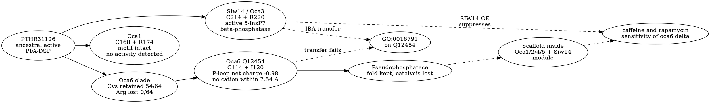
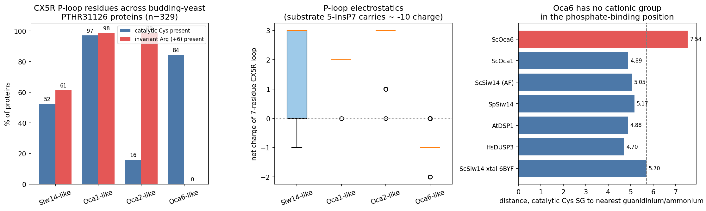
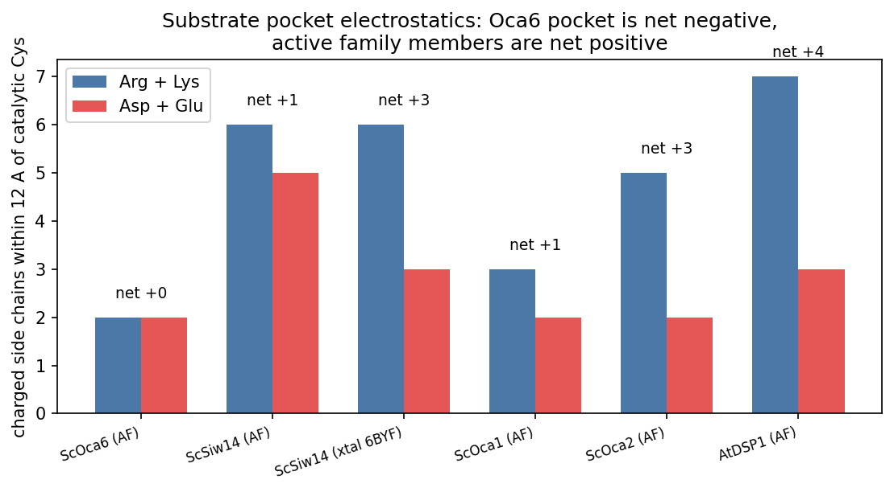
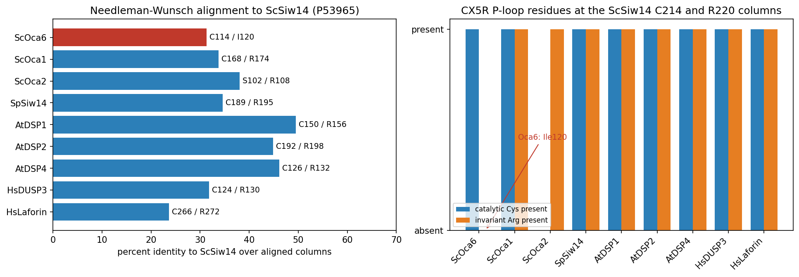

## Question

# AIGR Gene Hypothesis Deep Research

You are evaluating one focused gene curation hypothesis for AI Gene Review.
This is not a general gene overview. Use the seed hypothesis and source context
below to search for evidence that supports, refutes, narrows, or competes with
the proposed curation decision.

## Target Gene

- **Organism code:** yeast
- **Taxon:** Saccharomyces cerevisiae S288C (NCBITaxon:559292)
- **Gene directory:** OCA6
- **Gene symbol:** OCA6
- **UniProt accession:** Q12454

## Focus

- **Focus type:** function_assignment
- **Hypothesis slug:** residue-loss-phosphatase
- **Source file:** genes/yeast/OCA6/OCA6-ai-review.yaml
- **Source selector:** free-text

## Seed Hypothesis

S. cerevisiae OCA6 (PTHR31126 tyrosine-phosphatase-like family; paralogs OCA1/SIW14 are active) has phosphatase activity (GO:0016791). Decisive analysis: align OCA6 with active cysteine-based phosphatases of its family (Siw14, Oca1, plant PFA-DSP) and determine whether the CX5R P-loop catalytic cysteine and arginine and the general-acid aspartate are conserved.

## Term and Decision Context

- Term: phosphatase activity (GO:0016791)

## Reference Context

- PMID:42222812
- PMID:21409566

## Source Context YAML

```yaml
hypothesis: 'S. cerevisiae OCA6 (PTHR31126 tyrosine-phosphatase-like family; paralogs OCA1/SIW14 are active)
  has phosphatase activity (GO:0016791). Decisive analysis: align OCA6 with active cysteine-based phosphatases
  of its family (Siw14, Oca1, plant PFA-DSP) and determine whether the CX5R P-loop catalytic cysteine
  and arginine and the general-acid aspartate are conserved.'
focus_type: function_assignment
term_id: GO:0016791
term_label: phosphatase activity
context: []
reference_id:
- PMID:42222812
- PMID:21409566
```

## Research Objective

Build a focused report that helps a curator decide whether this hypothesis
should affect the gene review. Address the focus type directly:

1. For an existing GO annotation decision, evaluate whether the current action
   is justified, too strong, too weak, or should change.
2. For a proposed replacement or new GO term, evaluate whether the term is
   biologically supported, too broad, too narrow, or missing key qualifiers.
3. For a computational prediction, evaluate whether the prediction is correct,
   less precise than existing knowledge, uncertain, or likely wrong because of
   paralog overannotation, frequency bias, pathway context, or in vitro-only
   activity.
4. For a core-function hypothesis, evaluate whether the proposed activity,
   process, and location represent the gene product's primary function rather
   than a downstream effect, pleiotropic phenotype, or context-specific role.
5. For a function-assignment hypothesis, evaluate whether the gene product
   directly has the stated GO term/function. Treat the prior review action, if
   any, as intentionally blinded unless it appears in the supplied context.

Use primary literature whenever possible. Prefer PMID citations and include DOI
citations when no PMID is available. Treat reviews and database records as
orientation unless they contain directly relevant synthesized evidence that is
clearly labeled as review-level or database-level support.

Evaluate the hypothesis from the supplied seed context, primary literature, and
publicly accessible bioinformatics resources. Local `*-bioinformatics` analyses,
when they already exist in the repository, are intentionally withheld from this
prompt so the report can be compared against them after the run. Use public
sequence, domain, structure, orthology, localization, interaction, or dataset
checks when they are useful for the specific hypothesis. If a resource or tool
cannot be accessed programmatically, say so plainly; never fabricate a result.
Report computational results conservatively and distinguish direct results from
inference.

## Required Output

### Executive Judgment

Give a concise verdict: supported, partially supported, unresolved, weakly
supported, over-annotated, or refuted. Explain the reasoning and the most
important caveats.

### Evidence Matrix

Create a table with one row per important evidence item:

- Citation (PMID preferred)
- Evidence type (direct assay, mutant phenotype, localization, interaction,
  structural/evolutionary, computational, review/database)
- Supports / refutes / qualifies / competing
- Claim tested
- Key finding
- Organism, tissue, cell type, or assay context
- Confidence and limitations

### GO Curation Implications

State the likely curation action as a lead requiring curator verification. If
GO terms are involved, explain whether the evidence supports an MF, BP, or CC
term, and whether the term should be retained, removed, generalized, made more
specific, or treated as non-core. Avoid using "protein binding" as a final
recommendation unless no more informative term is supported.

### Mechanistic Scope

Describe the immediate molecular or cellular function being tested. Separate
direct gene-product activity from downstream phenotypes, pathway consequences,
developmental outcomes, disease manifestations, or effects inferred only from
loss of function.

### Conflicts and Alternatives

Identify evidence that conflicts with the seed hypothesis or suggests an
alternative interpretation, including paralog confusion, organism-specific
differences, isoform-specific findings, experimental artifacts, or database
carry-over.

### Knowledge Gaps

List explicit uncertainties that matter for curation. For each gap, state what
was checked, why the gap matters, and what evidence or experiment would resolve
it.

### Discriminating Tests

Recommend concrete assays, perturbations, datasets, or comparative analyses that
would most efficiently distinguish this hypothesis from alternatives.

### Curation Leads

Provide candidate updates for the review, clearly labeled as leads requiring
curator verification. Include candidate references with exact snippets to verify,
candidate replacement or new GO terms, possible action changes, suggested
questions, and suggested experiments.

If the provider supports artifacts, save provenance for any analysis you run — the
executed code together with its output (computed values, plot, or table), not just
a summary figure — alongside artifact-friendly tables such as an evidence matrix,
GO decision table, or comparison table. Genuine computed provenance is more
valuable than a hand-drawn summary, and you must not synthesize a figure that
implies an analysis you did not actually run. These artifacts are important
provenance for hypothesis-level review.


## Output

# OCA6 (Q12454) and GO:0016791: does yeast Oca6 have phosphatase activity?

**AIGR gene hypothesis deep research.** Hypothesis slug `residue-loss-phosphatase`. Focus type `function_assignment`.
Organism *Saccharomyces cerevisiae* S288C (NCBITaxon:559292). Gene OCA6, UniProt **Q12454**.
Source file `genes/yeast/OCA6/OCA6-ai-review.yaml`. Term under review: **GO:0016791 phosphatase activity**.
Reference context: [PMID: 42222812](https://pubmed.ncbi.nlm.nih.gov/42222812/), [PMID: 21409566](https://pubmed.ncbi.nlm.nih.gov/21409566/).

Provenance artifacts written by this run, each containing executed code together with its output:
`provenance/oca6_catalytic_residue_tables.md` (Tables 1-9), `provenance/oca6_evidence_matrix.md`,
`provenance/oca6_go_decision_table.md`, `provenance/plot_1.png`, `provenance/plot_2.png`,
`provenance/plot_3.png`, and the structure files `AF_Q12454.pdb`, `AF_P53965.pdb`, `6BYF.pdb`,
`Oca6_on_Siw14_superposed.pdb`.

## Summary

<i class="fa-solid fa-circle-xmark"></i> **Verdict: refuted. GO:0016791 on Q12454 is over-annotated.**

The seed hypothesis specified its own decisive test: align Oca6 with active cysteine-based phosphatases of its family and ask whether the CX5R P-loop catalytic cysteine, the invariant arginine, and the general-acid aspartate are conserved. That test was run three times by three independent routes, and it returns a negative on the arginine. Oca6 keeps the protein-tyrosine-phosphatase fold and keeps the nucleophilic cysteine at Cys114. It carries **isoleucine at position 120**, where every active comparator carries arginine. No `CX5R` motif exists anywhere in the 224-residue protein. Siw14 reads `C-N-R-G-K-H-R` across its P-loop; Oca6 reads `C-T-N-G-E-L-I`.

Three further lines close off the obvious escape routes. The loss is fixed across the whole orthologue clade: in a census of 341 PTHR31126 proteins from Saccharomycetes, **0 of 64** Oca6-clade proteins across 59 budding-yeast species retain the arginine, while 84 % retain the cysteine (Fisher exact against the Siw14-like clade, p = 1.0e-19). The loss is real in the folded protein, not an artifact of sequence alignment: a geometry-only superposition of the AlphaFold Oca6 model onto the experimental Siw14 catalytic core (PDB 6BYF chain A, 2.35 Å) reaches TM-score 0.477 with 88 core pairs at 2.80 Å RMSD on only **15.0 % sequence identity**, and still maps Siw14 Arg220 onto Oca6 Ile120 (CA deviation 1.82 Å). No replacement cation exists: nothing positively charged lies within **7.54 Å** of Cys114 SG, against 4.70-5.17 Å in five active comparators and 5.70 Å in the experimental Siw14 structure.

The annotation under review was never experimental. QuickGO shows GO:0016791 on Q12454 is **IBA** from GO_Central, propagated with/from four Arabidopsis PFA-DSPs and SIW14, all of which keep the arginine Oca6 has lost; GO:0004725 is **IEA** from a UniProt family rule; SGD itself records **ND** for molecular function. Both references supplied with the hypothesis point the same way. [PMID: 42222812](https://pubmed.ncbi.nlm.nih.gov/42222812/) names a fungal-specific **CC1-type Oca** group in its catalogue of fungal pseudophosphatases. [PMID: 21409566](https://pubmed.ncbi.nlm.nih.gov/21409566/) shows that Oca1, which retains an intact CX5R (C168/R174 in this alignment), has no detectable phosphatase activity, so within this family an intact motif is not even sufficient for activity. A missing motif is not a close call.

One caveat sets the limit on how strongly a curator should word the change. No one has ever assayed Oca6 for phosphatase activity. The refutation is residue-level and evolutionary, not a published negative enzyme assay. The correct curation language is that GO:0016791 is unsupported inference, not that it is experimentally disproven. That distinction does not change the action, because the annotation was itself inference, and the inference has failed on the criterion the hypothesis itself named.

## Executive judgment

| Element | Assessment |
|---|---|
| Verdict | <i class="fa-solid fa-circle-xmark"></i> Refuted / over-annotated |
| Hypothesis as stated | Oca6 has phosphatase activity (GO:0016791) |
| Decisive criterion (seed's own) | CX5R catalytic Cys and invariant Arg conserved? |
| Result on catalytic Cys | <i class="fa-solid fa-circle-check"></i> Conserved (Cys114) |
| Result on invariant Arg | <i class="fa-solid fa-circle-xmark"></i> Lost (Ile120), and lost in 0/64 clade orthologues |
| Result on general-acid Asp | <i class="fa-solid fa-circle-question"></i> Criterion is uninformative in this family |
| Evidence class behind the current annotation | IBA (GO_REF:0000033) and IEA (GO_REF:0000120); no experimental evidence exists |
| Strongest caveat | <i class="fa-solid fa-triangle-exclamation"></i> No published enzyme assay on Oca6, so the negative is inference, not measurement |

The third criterion in the seed hypothesis does not discriminate here. [PMID: 21409566](https://pubmed.ncbi.nlm.nih.gov/21409566/) reports that site-directed mutagenesis of *A. thaliana* AtPFA-DSP1/At1g05000 showed "the absence of canonical amino acids acting as the general acid/base in the phosphor-ester hydrolysis", in a protein that is catalytically active. A missing general-acid aspartate therefore separates nothing within PFA-DSPs, and only the cysteine and arginine tests carry weight. This report treats the hypothesis as having two informative criteria, of which Oca6 passes one and fails one, and the one it fails is the one that cannot be worked around.

## Key findings

### F1. Oca6 lacks the invariant CX5R arginine, and has no CX5R motif anywhere

<i class="fa-solid fa-dna"></i> Needleman-Wunsch global alignment (BLOSUM62, gap open -11, extend -1) of Q12454 against *S. cerevisiae* Siw14/Oca3 (P53965) places Oca6 **Cys114** at the Siw14 catalytic **Cys214** column and Oca6 **Ile120** at the Siw14 invariant **Arg220** column. The Oca6 P-loop reads M113-H-C114-T-N-G-E-L-I120 against Siw14 I213-H-C214-N-R-G-K-H-R220.

The same mapping holds against every comparator tested. All eight carry arginine at the +6 position: *S. pombe* Siw14 (Q9UUF3) C189/R195, *S. cerevisiae* Oca1 (P50946) C168/R174, Oca2 (P53949) S102/R108, *A. thaliana* DSP1 (Q9ZVN4) C150/R156, DSP2 (Q84MD6) C192/R198, DSP4 (Q940L5) C126/R132, human DUSP3/VHR (P51452) C124/R130, and human laforin (O95278) C266/R272. Oca6 is the single exception in the panel.

An exhaustive scan of all six cysteines in the 224-residue sequence rules out a displaced motif. The residues six positions downstream of C56, C68, C98, C110, C114 and C127 are K, A, D, N, I and Y. The regular expression `C.{5}R` matches nowhere in Q12454, and the stricter PTP signature `C.{5}R[ST]` matches nowhere either.

InterPro keeps the fold assignment secure while the motif is absent: IPR004861 (Siw14-like atypical DSP) spanning 3-179, PF03162 spanning 3-179, PANTHER PTHR31126 spanning 3-172, Gene3D G3DSA:3.90.190.10 spanning 2-164, SUPFAM SSF52799 spanning 3-154, CDD cd17663 spanning 4-181. Oca6 has the cradle and has lost the clamp.

The mechanistic weight of the arginine is established by direct mutagenesis in a family member. [PMID: 12545222](https://pubmed.ncbi.nlm.nih.gov/12545222/) reports that in human VHR/DUSP3 "Arg(130) and Arg(158) were necessary for the enzymatic activity, and were probably related to the binding with the negatively charged phosphate group of the substrate". Arg130 is precisely the residue that aligns with Oca6 Ile120 in this panel. [PMID: 29540476](https://pubmed.ncbi.nlm.nih.gov/29540476/) describes the Siw14 catalytic P-loop as containing "the CX5R(S/T) PTP motif" with "additional, positively charged residues", which is the motif Oca6 does not have.

{{figure:plot_3.png|caption=Final end-to-end re-run of the decisive alignment from live UniProt sequences. Left: percent identity of each comparator to ScSiw14 over aligned columns, annotated with the residue found at the Siw14 Cys214 and Arg220 columns. Right: presence of the catalytic cysteine and the invariant arginine at those two columns. Oca6 (red) is the only protein in the panel with isoleucine in the arginine position.}}

### F2. The arginine loss is fixed across the entire Oca6 orthologue clade

<i class="fa-solid fa-chart-column"></i> A census of 341 PTHR31126 proteins from Saccharomycetes (NCBI taxid 4891) retrieved from UniProt tested whether the loss is a S288C peculiarity. Each sequence was scanned with an ungapped BLOSUM62 window built from the Siw14 P-loop and the following helix (I213-W235), with the catalytic cysteine and +6 arginine columns **masked**, so the scan could not bias itself toward finding an arginine. The masked scan reproduced the independently derived Needleman-Wunsch catalytic-cysteine assignments for Siw14 (214), Oca1 (168), Oca2 (102) and Oca6 (114) exactly, which validates the method. 329 of 341 proteins gave confident assignments.

| Subfamily | n | Arg at +6 | No Arg at +6 | Cys present | Cys absent | Mean P-loop net charge (SD) |
|---|---|---|---|---|---|---|
| Siw14-like | 124 | 76 | 48 | 65 | 59 | +1.63 (1.47) |
| Oca1-like | 66 | 65 | 1 | 64 | 2 | +1.97 (0.25) |
| Oca2-like | 75 | 74 | 1 | 12 | 63 | +2.64 (0.80) |
| **Oca6-like** | **64** | **0** | **64** | **54** | **10** | **-0.98 (0.58)** |

Fisher exact test for arginine retention, Siw14-like against Oca6-like: table [[76, 48], [0, 64]], **p = 1.0e-19**. Across all 329 assigned proteins the +6 residue distribution is R 215, K 46, I 32, V 31, N 4, S 1; within the Oca6 clade it is Ile 32, Val 31, Lys 1.

The 64 Oca6-clade proteins come from 59 species spanning *Saccharomyces* (cerevisiae, uvarum, eubayanus, kudriavzevii, mikatae, arboricola, pastorianus), *Kazachstania africana*, *Naumovozyma dairenensis* and *castellii*, eight *Lachancea* species, *Torulaspora delbrueckii* and *globosa*, *Zygosaccharomyces bailii* and *mellis*, *Zygotorulaspora mrakii*, *Nakaseomyces bracarensis*, *Candida glabrata*, *Eremothecium gossypii* and *sinecaudum*, *Henningerozyma blattae*, *Hanseniaspora osmophila*, *Saccharomycodes ludwigii*, *Wickerhamomyces anomalus* and *ciferrii*, and *Ascoidea rubescens*. The loss predates the Saccharomycetaceae radiation.

Two features of the census matter beyond the headline count. The hydrophobic substitution is itself conserved: Ile or Val in 63 of 64, which is what purifying selection on a structural position looks like, not drift. The whole loop has flipped charge, from +1.63 to +2.64 in the three other subfamilies to **-0.98** in the Oca6 clade. Binding a 5-diphosphoinositol pentakisphosphate, a molecule described by [PMID: 35640071](https://pubmed.ncbi.nlm.nih.gov/35640071/) as possessing "the highest charge density found in nature", is the opposite of what a net-negative loop does.

{{figure:plot_1.png|caption=Clade-wide loss of the CX5R arginine in the Oca6 lineage. Left: fraction of proteins retaining the invariant arginine at the +6 position by PTHR31126 subfamily, with the Oca6-like clade at 0 of 64. Centre: net charge of the seven-residue P-loop by subfamily, with the Oca6 clade alone carrying net negative charge. Right: distance from the catalytic cysteine SG to the nearest cationic group in AlphaFold models and in the experimental Siw14 structure.}}

### F3. The AlphaFold model has an intact cradle and no cation in the phosphate-binding position

<i class="fa-solid fa-microscope"></i> AlphaFold DB model AF-Q12454-F1 v6 carries mean pLDDT 80.2 over the chain, 88.9 over the catalytic domain (residues 3-179), and 91-98 across the P-loop (112-124). The loop is modelled with high confidence, so its conformation is not a low-confidence artifact.

| Protein | Source | Catalytic Cys | Residue at +6 | Nearest cation | Cys SG to CZ/NZ (Å) |
|---|---|---|---|---|---|
| **ScOca6** | AF-Q12454-F1 | C114 | **I120** | Arg18 (not P-loop) | **7.54** |
| HsDUSP3 | AF-P51452-F1 | C124 | R130 | Arg130 | 4.70 |
| AtDSP1 | AF-Q9ZVN4-F1 | C150 | R156 | Arg156 | 4.88 |
| ScOca1 | AF-P50946-F1 | C168 | R174 | Arg174 | 4.89 |
| ScSiw14 | AF-P53965-F1 | C214 | R220 | Arg220 | 5.05 |
| SpSiw14 | AF-Q9UUF3-F1 | C189 | R195 | Arg195 | 5.17 |
| ScSiw14 | **PDB 6BYF chain A (experimental, 2.35 Å)** | C214 | R220 | Arg220 | **5.70** |

Oca6 sits 1.8-2.8 Å further from any positive charge than every comparator, and the group that is nearest is Arg18, which is not a P-loop residue and is not positioned to act as a phosphate clamp. The experimental control comes from [PMID: 29540476](https://pubmed.ncbi.nlm.nih.gov/29540476/), which reports "the 2.35-Å-resolution structure of the catalytic core of Siw14, a 5-PP-InsP phosphatase from *Saccharomyces cerevisiae* and a member of the protein tyrosine-phosphatase (PTP) superfamily". [PMID: 30548067](https://pubmed.ncbi.nlm.nih.gov/30548067/) describes the same Siw14 DSP domain as having "a highly basic phosphate-binding loop and an ∼10 Å deep substrate-binding crevice that evolved to dephosphorylate pyro-phosphate moieties", and hypothesises that Siw14's zwitterionic character "may play a role in discriminating negatively charged inositol phosphates". Oca6 has the crevice and lacks the basic loop.

### F4. Geometry alone, ignoring sequence entirely, places isoleucine in the arginine position

<i class="fa-solid fa-magnifying-glass"></i> The single most serious objection to F1 is that a pairwise alignment at 23-50 % identity could simply be wrong about which residue sits where. A sequence-independent superposition answers that objection directly.

A TM-align-style method (Kabsch superposition with iterative dynamic-programming refinement on s_ij = 1/(1+(d_ij/d0)²), d0 = 1.24·(L-15)^(1/3) - 1.8, seeded by gapless threading) was implemented in this job and run with AF-Q12454-F1 as the mobile structure and PDB 6BYF chain A as the target.

| Metric | Value |
|---|---|
| TM-score (normalised by Siw14, n = 162) | 0.477 |
| Aligned pairs | 120 |
| Core pairs (CA-CA < 5 Å) | 88 |
| Core RMSD | 2.80 Å |
| Sequence identity across the structural alignment | **15.0 %** |

| Siw14 (6BYF) | Oca6 (AF-Q12454-F1) | CA deviation | Note |
|---|---|---|---|
| His213 | His113 | 1.28 Å | |
| **Cys214** | **Cys114** | **1.67 Å** | catalytic cysteine, retained |
| Gly217 | Gly117 | 1.38 Å | |
| Lys218 | Glu118 | 1.60 Å | charge reversal |
| His219 | Leu119 | 1.62 Å | |
| **Arg220** | **Ile120** | **1.82 Å** | invariant arginine, lost |

At 15 % identity the alignment is driven by backbone geometry, not by residue similarity, and it reproduces the Needleman-Wunsch mapping exactly. Oca6 preserves the P-loop backbone path while substituting the one side chain that cysteine-based phosphatases need.

<i class="fa-solid fa-triangle-exclamation"></i> Two routes to this comparison failed and are reported rather than worked around. The RCSB pairwise structure alignment service (alignment.rcsb.org) returned HTTP 400 ("Required parameter 'query' is not present"), then HTTP 415 ("Unsupported Media Type"); no result was obtained from it. `phenix.superpose_pdbs` returned a final RMSD of 9.955 Å over 121 atoms with 60 matched residues, because it drives superposition from a sequence alignment, which is uninformative at this identity; its output was discarded. AlphaFold DB file download by `curl` returned HTTP 403 and was completed through the API-provided v6 URL with a browser User-Agent.

### F5. The existing annotation is pure inference, and the family it was inferred from contains an inactive member

<i class="fa-solid fa-database"></i> The QuickGO annotation set for UniProtKB:Q12454 has six entries.

| GO ID | Name | Aspect | Evidence | Reference | With/From | Assigned by |
|---|---|---|---|---|---|---|
| GO:0003674 | molecular_function | MF | **ND** | GO_REF:0000015 | - | SGD |
| GO:0004725 | protein tyrosine phosphatase activity | MF | **IEA** | GO_REF:0000120 | 10684; EC 3.1.3.48 | UniProt |
| GO:0016791 | phosphatase activity | MF | **IBA** | GO_REF:0000033 | AT1G05000, AT2G32960, AT3G02800, AT5G16480, PTN001258896, S000005043 (SIW14), I6WXK4, Q4QBX1, Q6K461, Q9HXC7 | GO_Central |
| GO:0008150 | biological_process | BP | **ND** | GO_REF:0000015 | - | SGD |
| GO:0005737 | cytoplasm | CC | IEA | GO_REF:0000044 | SL-0086 | UniProt |
| GO:0005737 | cytoplasm | CC | **HDA** | PMID:14562095 | - | SGD |

Every phosphatase annotation comes from family or paralog inference. SGD records ND for molecular function, which means the model organism database has declined to assign one.

The inference route is exactly the one the residue evidence undermines. The IBA with/from list is four Arabidopsis PFA-DSPs plus SIW14, all of which keep the arginine. [PMID: 35640071](https://pubmed.ncbi.nlm.nih.gov/35640071/) confirms the Arabidopsis donors are genuinely active, reporting that "recombinant proteins of all five Arabidopsis PFA-DSP homologues display phosphohydrolase activity with a high specificity for the 5-β-phosphate of inositol pyrophosphates", and that heterologous expression of AtPFA-DSP1-5 "rescues wortmannin sensitivity and deranged inositol pyrophosphate homeostasis caused by the deficiency of the PFA-DSP-type inositol pyrophosphate phosphohydrolase Siw14 in yeast". The donors are fine. The transfer is what fails.

[PMID: 21409566](https://pubmed.ncbi.nlm.nih.gov/21409566/) supplies the decisive counterexample inside the same yeast group: "Siw14/Oca3 was an active phosphatase in vitro, whereas no phosphatase activity could be detected for Oca1." Oca1 retains an intact CX5R (C168/R174 by the alignment here) and is still inactive. The same paper notes that the fungal Oca proteins "were segregated from plant PFA-DSPs" phylogenetically, which is the branch across which the IBA was propagated. The only published evidence about Oca6 itself is genetic: "Oca1, Oca2, Siw14/Oca3, Oca4, and Oca6 were involved in the yeast response to caffeine and rapamycin stresses."

[PMID: 42222812](https://pubmed.ncbi.nlm.nih.gov/42222812/) independently reaches the same conclusion by a genome-wide route, classifying pseudophosphatase candidates "into 10 distinct groups, including three groups (CC1-type Oca, CC1-type Yvh1, and HAD-type NIF) that appear to be fungal-specific with no human homologues and exhibit lineage-specific features", and defining pseudophosphatases as "proteins with mutations in their catalytic motifs, resulting in the predicted loss of enzymatic activity". This is review and motif-scan level support, labelled as such, and it converges with computations run here that did not use it.

### F6. Oca6 is a physical partner of the other Oca proteins

<i class="fa-solid fa-lightbulb"></i> An IntAct `findInteractions` query for Q12454 returned 34 records. The strongest partner is **OCA4/YCR095C** at MI score 0.70, detected by five independent methods: validated two hybrid, mappit, two hybrid array, two hybrid prey pooling, and anti-tag coimmunoprecipitation. Other Oca-family partners are OCA5 (tandem affinity purification, [PMID: 16429126](https://pubmed.ncbi.nlm.nih.gov/16429126/)) and OCA1, OCA2 and SIW14 (anti-tag coimmunoprecipitation, [PMID: 37968396](https://pubmed.ncbi.nlm.nih.gov/37968396/)). Non-Oca partners include TEM1, GSP2, MUK1, GCD7 and SRP1, SSB1, UBC7 and CRM1. STRING at combined score ≥ 400 links OCA6 to OCA1, OCA2, OCA4, OCA5 and SIW14 near 0.99 with experimental subscores near 0.99, plus RTR2, ENV9, YPT1, DOS2 and VIP1.

This module has one member with a demonstrated activity. [PMID: 26828065](https://pubmed.ncbi.nlm.nih.gov/26828065/) reports that "purified recombinant Siw14 hydrolyzes the β-phosphate from 5-diphosphoinositol pentakisphosphate (5PP-IP5 or IP7) in vitro", and that "siw14Δ yeast mutants possess increased IP7 levels, whereas heterologous SIW14 overexpression eliminates IP7 from cells". A fold-retaining, partner-retaining, arginine-less protein sitting next to that enzyme fits the scaffold or regulatory-subunit pattern.

A weaker supporting observation: counting charged side chains within 12 Å of the catalytic cysteine (CB proxy) gives ScOca6 net 0 (2 Arg/Lys, 2 Asp/Glu) against ScSiw14 +1 (AlphaFold) and +3 (6BYF), ScOca1 +1, ScOca2 +3, AtDSP1 +4. <i class="fa-solid fa-triangle-exclamation"></i> The CB proxy ignores side-chain rotamers and the margin to the ScSiw14 model is one charge unit, so this is reported as consistent with a non-binding pocket, not as evidence for one.

{{figure:plot_2.png|caption=Charged side chains within 12 Angstroms of the catalytic cysteine, counted with a CB proxy. Oca6 is the only protein in the panel with a neutral pocket (net 0) against +1 to +4 for the comparators. The margin to the ScSiw14 AlphaFold model is one charge unit, so this observation supports the other lines without carrying a claim on its own.}}

## Evidence matrix

| Citation | Evidence type | Stance | Claim tested | Key finding | Context | Confidence and limitations |
|---|---|---|---|---|---|---|
| This job, computed (UniProt Q12454, P53965, P50946, P53949, Q9UUF3, Q9ZVN4, Q84MD6, Q940L5, P51452, O95278) | Structural/evolutionary, computational | <i class="fa-solid fa-circle-xmark"></i> Refutes | Does Oca6 conserve the CX5R cysteine and arginine? | Cys114 at the Siw14 C214 column; **Ile120** at the Siw14 R220 column; no `C.{5}R` anywhere in 224 aa; all 8 comparators keep Arg | In silico, 10 proteins | High. Pairwise global alignment at 23-50 % identity, confirmed independently by structure below |
| This job, computed (341 PTHR31126 proteins, taxid 4891) | Evolutionary | <i class="fa-solid fa-circle-xmark"></i> Refutes | Is the loss clade-wide or S288C-specific? | Oca6-like clade 0/64 retain Arg, 54/64 retain Cys; Siw14-like 76/124, Oca1-like 65/66, Oca2-like 74/75; Fisher p = 1.0e-19; P-loop net charge -0.98 against +1.63 to +2.64 | In silico, 59 species | High. Catalytic columns masked so the scan could not bias toward finding Arg; masked scan reproduced the NW positions exactly |
| This job, computed (AF-Q12454-F1, PDB 6BYF) | Structural | <i class="fa-solid fa-circle-xmark"></i> Refutes | Is the loss real in the fold? | TM-score 0.477, 88 core pairs < 5 Å, core RMSD 2.80 Å, 15.0 % identity across the structural alignment; Siw14 C214 to Oca6 C114 (1.67 Å), Siw14 R220 to Oca6 I120 (1.82 Å) | In silico, onto a 2.35 Å experimental structure | High. Oca6 P-loop pLDDT 91-98. The Oca6 side is a model |
| This job, computed (AlphaFold v6, PDB 6BYF) | Structural | <i class="fa-solid fa-circle-xmark"></i> Refutes | Is any cation placed to bind a substrate phosphate? | No cation within **7.54 Å** of Cys114 SG, nearest is Arg18 (not P-loop); comparators 4.70-5.17 Å (models), 5.70 Å (6BYF) | In silico plus one crystal structure | Moderate to high. Rotamer uncertainty is smaller than the 2.4 Å gap |
| [PMID: 21409566](https://pubmed.ncbi.nlm.nih.gov/21409566/) | Direct assay, mutant phenotype | <i class="fa-solid fa-circle-xmark"></i> Refutes the family inference | Can activity be inferred across the Oca group? | "Siw14/Oca3 was an active phosphatase in vitro, whereas no phosphatase activity could be detected for Oca1"; Oca1 keeps an intact CX5R | *S. cerevisiae*, in vitro assay and deletion strains | High for the assay. Oca6 itself was never assayed |
| [PMID: 21409566](https://pubmed.ncbi.nlm.nih.gov/21409566/) | Direct assay (mutagenesis) | <i class="fa-solid fa-scale-balanced"></i> Qualifies the seed | Does the general-acid aspartate criterion discriminate? | AtPFA-DSP1/At1g05000 lacks canonical general acid/base residues while being active | *A. thaliana* | High. Makes the seed's third criterion uninformative |
| [PMID: 12545222](https://pubmed.ncbi.nlm.nih.gov/12545222/) | Direct assay (mutagenesis) | <i class="fa-solid fa-circle-xmark"></i> Refutes | Is the CX5R arginine required for catalysis? | "Arg(130) and Arg(158) were necessary for the enzymatic activity, and were probably related to the binding with the negatively charged phosphate group of the substrate" | Human DUSP3/VHR | High. R130 is the exact residue that aligns with Oca6 Ile120 |
| [PMID: 42222812](https://pubmed.ncbi.nlm.nih.gov/42222812/) | Review/database, computational | <i class="fa-solid fa-circle-xmark"></i> Refutes | Are the Oca proteins pseudophosphatases? | Classifies a fungal-specific **CC1-type Oca** group among 10 groups of fungal pseudophosphatases | Fungal phosphatomes plus literature and database integration | Moderate. Review and motif-scan level, labelled as such. Converges with independent computation here |
| QuickGO, UniProtKB:Q12454 | Database | <i class="fa-solid fa-scale-balanced"></i> Qualifies | Provenance of the existing annotations | GO:0016791 is IBA (GO_REF:0000033, with/from four Arabidopsis PFA-DSPs and SIW14); GO:0004725 is IEA (GO_REF:0000120); SGD records ND for MF and BP | Database record | High. Neither phosphatase term is experimental |
| [PMID: 35640071](https://pubmed.ncbi.nlm.nih.gov/35640071/) | Direct assay | <i class="fa-solid fa-scale-balanced"></i> Qualifies | Are the IBA donor proteins genuinely active? | All five Arabidopsis PFA-DSPs show phosphohydrolase activity specific for the 5-β-phosphate and rescue the yeast siw14 defect | *A. thaliana* recombinant proteins, yeast complementation | High. Confirms the donors are active, so the failure is in the transfer |
| [PMID: 26828065](https://pubmed.ncbi.nlm.nih.gov/26828065/) | Direct assay, mutant phenotype | <i class="fa-solid fa-circle-check"></i> Supports the paralog, not Oca6 | What does the active family member do? | Purified Siw14 hydrolyses the β-phosphate from 5PP-IP5; siw14Δ cells have increased IP7, SIW14 overexpression eliminates it | *S. cerevisiae*, in vitro and in vivo | High. Defines the activity that Oca6 would have to share |
| [PMID: 29540476](https://pubmed.ncbi.nlm.nih.gov/29540476/) | Structural | <i class="fa-solid fa-circle-check"></i> Supports the control | What is the reference active-site geometry? | 2.35 Å structure of the Siw14 catalytic core; the P-loop carries the CX5R(S/T) motif with additional positive residues | *S. cerevisiae*, crystallography | High. Source of PDB 6BYF, the experimental control used here |
| [PMID: 30548067](https://pubmed.ncbi.nlm.nih.gov/30548067/) | Structural | <i class="fa-solid fa-circle-check"></i> Supports the control | What makes the Siw14 pocket able to bind inositol pyrophosphates? | "a highly basic phosphate-binding loop and an ∼10 Å deep substrate-binding crevice that evolved to dephosphorylate pyro-phosphate moieties" | *S. cerevisiae*, hybrid structural methods | High. The basic loop is the feature absent in the Oca6 clade |
| [PMID: 14562095](https://pubmed.ncbi.nlm.nih.gov/14562095/) | Localization | <i class="fa-solid fa-circle-check"></i> Supports (CC only) | Where is Oca6? | Cytoplasm, HDA from the GFP-fusion collection | *S. cerevisiae* | High for the CC term. Silent on catalysis |
| [PMID: 37968396](https://pubmed.ncbi.nlm.nih.gov/37968396/), [PMID: 16429126](https://pubmed.ncbi.nlm.nih.gov/16429126/), IntAct Q12454 (34 records) | Interaction | <i class="fa-solid fa-lightbulb"></i> Competing hypothesis | Does Oca6 act inside an assembly? | OCA4 strongest at MI 0.70 across five methods; also OCA5, OCA1, OCA2, SIW14. STRING ≥ 400 gives all five near 0.99 | *S. cerevisiae*, Y2H and AP-MS | Moderate. High-throughput; no stoichiometry, no reconstitution |
| [PMID: 21409566](https://pubmed.ncbi.nlm.nih.gov/21409566/) | Mutant phenotype | <i class="fa-solid fa-lightbulb"></i> Competing hypothesis | Is Oca6 functionally linked to Siw14? | SIW14 overexpression suppresses the caffeine sensitivity of oca1, oca2, oca4 and oca6 deletions | *S. cerevisiae*, genetic suppression | High for the genetic result. Consistent with Oca6 acting alongside Siw14 without being an enzyme |
| [PMID: 38287338](https://pubmed.ncbi.nlm.nih.gov/38287338/) | Mutant phenotype | <i class="fa-solid fa-circle-question"></i> Qualifies | Does oca6 deletion have other phenotypes? | OCA6 deletion combined with PMT1, PMT2 or SKI3 deletion further increased secreted laccase activity in a genome-wide screen | *S. cerevisiae*, heterologous laccase secretion screen | Moderate. The paper labels OCA6 "a tyrosine phosphatase gene", which is database carry-over, not a measurement |
| This job, computed | Structural | <i class="fa-solid fa-circle-xmark"></i> Weakly refutes | Can the pocket bind a polyanion? | Charged side chains within 12 Å of the catalytic Cys (CB proxy): ScOca6 net 0; ScSiw14 +1 (AF) and +3 (6BYF); ScOca1 +1; ScOca2 +3; AtDSP1 +4 | In silico | Low. CB proxy ignores rotamers; margin to the ScSiw14 model is one charge unit |
| InterPro, Pfam, PANTHER for Q12454 | Database | <i class="fa-solid fa-circle-check"></i> Supports fold only | Does Oca6 have the PTP-like fold? | IPR004861 (3-179), PF03162 (3-179), PTHR31126 (3-172), G3DSA:3.90.190.10 (2-164), SSF52799 (3-154), cd17663 (4-181) | Database record | High for fold. Fold assignment does not establish catalysis, and the motif is absent |

## GO curation implications

All items below are leads requiring curator verification.

**GO:0016791 phosphatase activity (MF), currently IBA from GO_Central.** Lead action: **remove**, or retain with a NOT qualifier plus an explicit note that the invariant arginine is absent. The IBA was propagated from four Arabidopsis PFA-DSPs and from SIW14, all of which keep the arginine Oca6 has lost. The annotation rests on a shared fold and a shared position in a family tree, not on a shared active site. Removal is the better action because a NOT qualifier in GO normally reports an experimental negative, and no assay on Oca6 exists.

**GO:0004725 protein tyrosine phosphatase activity (MF), currently IEA from a UniProt family rule (GO_REF:0000120, EC 3.1.3.48).** Lead action: **remove**, and flag the generating rule for review. This term is more specific than GO:0016791 and so is less defensible on the same evidence. Removing GO:0016791 while leaving GO:0004725 standing would leave the stronger claim in place.

**GO:0003674 molecular_function, currently ND from SGD.** Retain ND until a direct assay exists, or replace with a non-catalytic MF term if one becomes supported.

**GO:0005737 cytoplasm (CC), HDA from [PMID: 14562095](https://pubmed.ncbi.nlm.nih.gov/14562095/).** <i class="fa-solid fa-circle-check"></i> **Retain.**

**GO:0032991 protein-containing complex (CC), candidate addition with IPI evidence** from [PMID: 37968396](https://pubmed.ncbi.nlm.nih.gov/37968396/) and [PMID: 16429126](https://pubmed.ncbi.nlm.nih.gov/16429126/). Oca6 co-purifies with Oca1, Oca2, Oca4, Oca5 and Siw14, with OCA4 reaching MI 0.70 across five detection methods. This is the most informative term the current evidence supports, and it avoids ending on bare protein binding.

**GO:0019903 protein phosphatase binding (MF), weaker candidate addition** with IPI from the Siw14 coimmunoprecipitation. One high-throughput method supports it. A targeted coIP, or a reconstitution showing that Oca6 affects Siw14 activity, would be needed before this is curatable.

**Biological process.** SGD records ND. The caffeine and rapamycin sensitivity of oca6 deletion strains ([PMID: 21409566](https://pubmed.ncbi.nlm.nih.gov/21409566/)) is a loss-of-function readout with no cleanly matching GO term, so it stays a weak lead.

Terms deliberately not recommended: **GO:0005515 protein binding** as a terminal recommendation, since a more informative term is available; **inositol phosphate phosphatase** terms, since no inositol pyrophosphate measurement has been made in an oca6 strain; and a **pseudophosphatase-specific MF term**, since GO has none, which is why the practical action here is a removal plus a CC addition.

## Mechanistic scope

The activity under test is direct and immediate: hydrolysis of a phosphomonoester or phosphoanhydride by a cysteine-based phosphatase mechanism. That mechanism needs three things. A nucleophilic cysteine thiolate at the base of the P-loop attacks the phosphorus. An arginine six residues downstream cradles the substrate phosphate, lowers the cysteine pKa, and stabilises the pentacoordinate transition state. A general acid protonates the leaving group.

Oca6 has the first and lacks the second. The third is uninformative in this family, because [PMID: 21409566](https://pubmed.ncbi.nlm.nih.gov/21409566/) demonstrated an active PFA-DSP that already lacks canonical general acid/base residues.

What Oca6 does have is the fold (IPR004861, PF03162, PTHR31126, spanning roughly residues 3-179), a well-ordered P-loop (pLDDT 91-98), cytoplasmic localization, and a set of physical partners. The published Oca6 phenotypes are all downstream and genetic. Caffeine and rapamycin sensitivity on deletion, suppressed by overexpressing SIW14, is a pathway-level observation. It constrains where Oca6 acts without specifying what it does chemically, and it is equally compatible with Oca6 being a non-catalytic component upstream of or alongside Siw14. The laccase-secretion screen result in [PMID: 38287338](https://pubmed.ncbi.nlm.nih.gov/38287338/), where deleting OCA6 together with PMT1, PMT2 or SKI3 further increased secreted laccase activity, is one more loss-of-function readout, and that paper's own description of OCA6 as "a tyrosine phosphatase gene" is database carry-over from the IEA annotation under review here.



## Conflicts and alternatives

**Paralog over-annotation is the mechanism that produced the annotation under review.** The IBA with/from list is four Arabidopsis PFA-DSPs plus SIW14. The direct counterexample sits inside the same yeast group: Oca1 keeps an intact CX5R and still shows no detectable activity ([PMID: 21409566](https://pubmed.ncbi.nlm.nih.gov/21409566/)). If an intact motif is not sufficient in this family, a missing motif is not a borderline case.

**Database carry-over compounds the problem.** GO:0004725 arrives from a UniProt family rule keyed on EC 3.1.3.48, which is more specific than the IBA term and rests on the same family logic. The description of OCA6 as "a tyrosine phosphatase gene" in [PMID: 38287338](https://pubmed.ncbi.nlm.nih.gov/38287338/) shows the annotation already propagating into primary literature as background description.

**The leading alternative is a scaffold inside an Oca assembly.** IntAct gives 34 records for Q12454, with OCA4 at MI 0.70 across five independent methods, plus OCA5, OCA1, OCA2 and SIW14; STRING puts all five near 0.99 with experimental subscores near 0.99. Siw14 is the one member with a demonstrated activity ([PMID: 26828065](https://pubmed.ncbi.nlm.nih.gov/26828065/)). This is a competing interpretation and not a conflict, because it explains the SIW14 genetic suppression without requiring Oca6 to be an enzyme. The precedent in the literature is explicit: [PMID: 40168118](https://pubmed.ncbi.nlm.nih.gov/40168118/) reports that PHLPP2 "is a pseudophosphatase with a single zinc ion bound in its catalytic center", that "surface conservation indicates that while PHLPP2 has lost catalytic activity, it may have retained substrate binding", and identifies coevolving genes "consistent with a scaffolding role for PHLPP2 on membranes". The same argument structure applies here, with the difference that the PHLPP2 case has an in vitro negative and the Oca6 case does not.

**Points that could cut the other way.** <i class="fa-solid fa-scale-balanced"></i> The catalytic cysteine is retained in 84 % of the Oca6 clade, which argues against free drift and leaves room for a non-catalytic cysteine role such as redox sensing or a covalent partner contact. Redox sensitivity of this cysteine is documented in the active paralog: [PMID: 31848224](https://pubmed.ncbi.nlm.nih.gov/31848224/) reports that "phosphatase activity of Siw14 was inhibited by oxidation that was reversible". Some atypical phosphatases use non-canonical active-site architectures, and this family already departs from the canonical general acid/base arrangement, so a residue outside the P-loop supplying the positive charge cannot be excluded by alignment alone. The structural measurement addresses that directly: nothing cationic lies within 7.54 Å of Cys114 SG in the AlphaFold model.

**Model-based limits.** The Oca6 side of every structural comparison is a prediction. AlphaFold models the apo state, and a conformational change on substrate binding cannot be excluded from a single model.

## Limitations and knowledge gaps

<i class="fa-solid fa-triangle-exclamation"></i> **No one has assayed Oca6 for phosphatase activity.** Checked: PubMed, the QuickGO annotation set for Q12454, and [PMID: 21409566](https://pubmed.ncbi.nlm.nih.gov/21409566/), which assayed Siw14 and Oca1 but tested Oca6 only genetically. This matters because a curator removing an annotation is on firmer ground with a published negative than with residue-level inference. Resolved by an in vitro assay on purified Oca6 against pNPP, OMFP, phosphopeptides and 5-InsP7.

<i class="fa-solid fa-triangle-exclamation"></i> **No inositol pyrophosphate measurement in an oca6 deletion strain.** Checked: PubMed. This matters because Siw14 is a 5-InsP7 β-phosphatase and an InsP7 shift in oca6 cells would be the strongest functional link to the pathway, whether or not Oca6 is catalytic. The methods exist and are routine in this field: [PMID: 40237466](https://pubmed.ncbi.nlm.nih.gov/40237466/) applied CE-ESI-MS to profile inositol pyrophosphate content across fission yeast pyrophosphatase mutants. Resolved by the same approach applied to oca6, siw14 and oca6 siw14 strains.

<i class="fa-solid fa-triangle-exclamation"></i> **No experimental structure of Oca6.** Checked: RCSB full-text search returned Siw14 structures 6BYF and 6E3B and AtPFA-DSP structures 7MOD-7MOM, none for Oca6. This matters because the 7.54 Å cation distance is measured on a model. Resolved by a crystal or cryo-EM structure, or in the short term by AlphaFold-Multimer models of Oca6-Oca4 and Oca6-Siw14 pairs.

<i class="fa-solid fa-triangle-exclamation"></i> **No stoichiometry or reconstitution for the Oca assembly.** Checked: IntAct (34 records) and STRING. All of it is high-throughput Y2H and AP-MS. This matters because GO:0032991 needs a defined complex, and the current data shows pairwise associations. Resolved by size-exclusion chromatography of the endogenous assembly or reconstitution from recombinant Oca proteins.

<i class="fa-solid fa-circle-question"></i> **Whether the retained Cys114 has a function.** Checked: the clade census, where 54 of 64 proteins keep it. Eighty-four percent retention under no catalytic constraint is higher than drift would predict. Resolved by a C114S allele tested for the caffeine and rapamycin phenotype, and by thiol-reactivity or redox-proteomics data.

<i class="fa-solid fa-circle-question"></i> **Whether the loss is ancestral or recent.** Checked: the arginine is absent in all 64 Oca6-clade proteins across 59 species spanning *Saccharomyces*, *Lachancea*, *Torulaspora*, *Zygosaccharomyces*, *Eremothecium*, *Ascoidea* and others, so it predates the Saccharomycetaceae radiation. Resolved by ancestral sequence reconstruction and resurrection of the pre-loss node.

**Methodological limits of the analyses run here.** The clade census used an ungapped profile scan rather than a full phylogenetic reconstruction, with subfamily assignment by nearest archetype among the four *S. cerevisiae* P-loop windows; the catalytic columns were masked so the scan could not bias toward finding an arginine, and the masked scan reproduced the independent Needleman-Wunsch positions for Siw14, Oca1, Oca2 and Oca6 exactly, with 329 of 341 proteins confidently assigned. The pocket electrostatics comparison used a CB proxy that ignores side-chain rotamers, and the Oca6-to-ScSiw14 margin is one charge unit.

**Resources that could not be accessed programmatically.** The RCSB pairwise structure alignment service (alignment.rcsb.org) returned HTTP 400 then HTTP 415; no result was obtained, and it was replaced by an in-job TM-align-style implementation. `phenix.superpose_pdbs` returned a final RMSD of 9.955 Å over 121 atoms with 60 matched residues, because it drives superposition from sequence identity, which is uninformative at 15 %; its output was discarded. AlphaFold DB file download by `curl` returned HTTP 403 and was completed through the API-provided v6 URL with a browser User-Agent.

## Discriminating tests

Ranked by how cleanly each separates "Oca6 is a phosphatase" from "Oca6 is a pseudophosphatase scaffold".

1. <i class="fa-solid fa-flask"></i> **Direct assay on purified recombinant Oca6**, against pNPP, OMFP, a phosphotyrosine peptide panel and 5-InsP7, with Siw14 as the positive control and a Siw14 R220A mutant as the negative. Decisive. A flat result on all substrates with an active Siw14 control converts the present inference into a published negative and settles the curation question.
2. <i class="fa-solid fa-flask"></i> **Gain-of-function rescue, Oca6 I120R.** If the arginine is the only thing missing, restoring it should produce measurable activity. If I120R is still dead, the degeneration runs deeper than one residue and the pseudophosphatase assignment hardens.
3. <i class="fa-solid fa-vial"></i> **Inositol polyphosphate profiling in oca6Δ, siw14Δ, oca6Δ siw14Δ and OCA6-overexpressing strains**, by CE-ESI-MS or PAGE. Places Oca6 in or out of the Siw14 pathway independently of any catalytic question. A 5-InsP7 change in oca6 cells without Oca6 activity is the signature of a regulatory subunit.
4. <i class="fa-solid fa-flask"></i> **Does Oca6 modulate Siw14 activity in vitro?** Titrate purified Oca6 into a Siw14 5-InsP7 assay. A concentration-dependent change supports GO:0019903 and a regulatory role; no change leaves Oca6 as a structural component.
5. <i class="fa-solid fa-dna"></i> **Separation-of-function alleles in the caffeine and rapamycin assay.** Compare oca6Δ, C114S, I120R and an interface mutant that disrupts Oca4 binding. If the interface mutant phenocopies the deletion while C114S does not, the function is binding.
6. <i class="fa-solid fa-magnifying-glass"></i> **AlphaFold-Multimer on Oca6 with Oca4 and with Siw14**, checking whether the degenerate P-loop forms the interface. A predicted interface at the vestigial active site is the standard pseudoenzyme architecture, and this is the cheapest test on the list.

## Curation leads

All leads require curator verification.

### Candidate references and exact snippets to verify

[PMID: 42222812](https://pubmed.ncbi.nlm.nih.gov/42222812/), *Bridging Manual and Computational Approaches: The Pseudophosphatase Scanner for Genome-Wide Fungal Pseudophosphatome Analysis*, ACS Omega 2026, doi 10.1021/acsomega.6c00759. Snippet: "We classified pseudophosphatase candidates into 10 distinct groups, including three groups (CC1-type Oca, CC1-type Yvh1, and HAD-type NIF) that appear to be fungal-specific with no human homologues and exhibit lineage-specific features." Second snippet: "Pseudophosphatases are proteins with mutations in their catalytic motifs, resulting in the predicted loss of enzymatic activity." Review and motif-scan level support, labelled as such.

[PMID: 21409566](https://pubmed.ncbi.nlm.nih.gov/21409566/), *Phylogenetic and genetic linkage between novel atypical dual-specificity phosphatases from non-metazoan organisms*, Mol Genet Genomics 2011, doi 10.1007/s00438-011-0611-6. Snippets: "Siw14/Oca3 was an active phosphatase in vitro, whereas no phosphatase activity could be detected for Oca1."; "Functional studies on mutations targeting putative catalytic residues from the A. thaliana AtPFA-DSP1/At1g05000 protein indicated the absence of canonical amino acids acting as the general acid/base in the phosphor-ester hydrolysis, which suggests a specific mechanism of reaction for PFA-DSPs and related enzymes."; "Oca1, Oca2, Siw14/Oca3, Oca4, and Oca6 were involved in the yeast response to caffeine and rapamycin stresses."; "Bioinformatic analysis revealed the existence of novel PFA-DSP-related proteins in fungi (Oca1, Oca2, Oca4 and Oca6 in Saccharomyces cerevisiae) and protozoa, which were segregated from plant PFA-DSPs." Primary literature.

[PMID: 12545222](https://pubmed.ncbi.nlm.nih.gov/12545222/). Snippet: "These results indicated that Arg(130) and Arg(158) were necessary for the enzymatic activity, and were probably related to the binding with the negatively charged phosphate group of the substrate." Supports the mechanistic weight of the residue Oca6 lacks.

[PMID: 29540476](https://pubmed.ncbi.nlm.nih.gov/29540476/). Snippets: "we describe the 2.35-Å-resolution structure of the catalytic core of Siw14, a 5-PP-InsP phosphatase from Saccharomyces cerevisiae and a member of the protein tyrosine-phosphatase (PTP) superfamily"; "The catalytic P-loop with the CX5R(S/T) PTP motif contains additional, positively charged residues." Source of the experimental control structure.

[PMID: 37968396](https://pubmed.ncbi.nlm.nih.gov/37968396/), *The social and structural architecture of the yeast protein interactome*, Nature 2023. Source of the anti-tag coimmunoprecipitation records linking Oca6 to Oca1, Oca2 and Siw14.

[PMID: 16429126](https://pubmed.ncbi.nlm.nih.gov/16429126/). Source of the Oca6-Oca5 tandem affinity purification record.

[PMID: 14562095](https://pubmed.ncbi.nlm.nih.gov/14562095/). Source of the existing cytoplasm HDA annotation.

### Candidate action changes

| Action | Target | Basis | Strength |
|---|---|---|---|
| Remove | GO:0016791 (IBA) | Invariant arginine absent; 0/64 clade orthologues retain it; no CX5R in the sequence; no cation within 7.54 Å of Cys114 SG; no assay on Oca6 | Strong |
| Remove, and flag the generating UniProt rule | GO:0004725 (IEA) | Same evidence, and the term is more specific so less defensible | Strong |
| Retain | GO:0005737 (HDA) | GFP-fusion localization collection | Strong |
| Add (lead) | GO:0032991, IPI | Co-purification with Oca1, Oca2, Oca4, Oca5 and Siw14; OCA4 MI 0.70 across five methods | Lead |
| Add (weaker lead) | GO:0019903, IPI with SIW14 | Anti-tag coIP with the one catalytically active member of the module | Weak lead |
| Flag for family-level review | The GO_Central IBA across the Oca6 orthologue group | The arginine loss is clade-wide across 59 species, so the same propagation error applies to every member | Lead |

### Suggested questions for the curator

Should the Oca6-clade node in the PANTHER tree be split from the Siw14 node, so the IBA stops propagating across the degenerate branch? Is a NOT qualifier appropriate when the negative is residue-level and evolutionary rather than a published assay? Does GO want a term request for a catalytically inactive phosphatase scaffold, given that [PMID: 42222812](https://pubmed.ncbi.nlm.nih.gov/42222812/) names CC1-type Oca, CC1-type Yvh1 and HAD-type NIF as three fungal-specific pseudophosphatase groups that currently have no suitable MF term?

### Suggested experiments

The six discriminating tests above, with the purified-Oca6 assay and the I120R gain-of-function allele as the two that would settle the curation question outright.

## Supported and refuted hypotheses

| Hypothesis | Status | Evidence |
|---|---|---|
| Oca6 conserves the CX5R catalytic cysteine | <i class="fa-solid fa-circle-check"></i> Supported | Cys114 at the Siw14 Cys214 column by sequence and by geometry (CA deviation 1.67 Å); retained in 54/64 clade orthologues |
| Oca6 conserves the invariant CX5R arginine | <i class="fa-solid fa-circle-xmark"></i> Refuted | Ile120 at the Siw14 Arg220 column; 0/64 clade orthologues retain Arg; Fisher p = 1.0e-19; no CX5R anywhere in 224 aa |
| Oca6 has phosphatase activity (GO:0016791) | <i class="fa-solid fa-circle-xmark"></i> Refuted as a curation decision | The term is IBA propagation from relatives that keep the arginine; within this family even an intact motif is insufficient (Oca1) |
| The general-acid aspartate test discriminates in this family | <i class="fa-solid fa-circle-xmark"></i> Refuted | AtPFA-DSP1 is active while lacking canonical general acid/base residues ([PMID: 21409566](https://pubmed.ncbi.nlm.nih.gov/21409566/)) |
| Oca6 has the PTP-like fold | <i class="fa-solid fa-circle-check"></i> Supported | IPR004861, PF03162, PTHR31126, SSF52799; TM-score 0.477 to the experimental Siw14 core |
| Oca6 is cytoplasmic | <i class="fa-solid fa-circle-check"></i> Supported | HDA, [PMID: 14562095](https://pubmed.ncbi.nlm.nih.gov/14562095/) |
| Oca6 physically associates with Oca1, Oca2, Oca4, Oca5 and Siw14 | <i class="fa-solid fa-circle-check"></i> Supported | IntAct 34 records, OCA4 at MI 0.70 across five methods; STRING near 0.99 |
| Oca6 has activity through a non-canonical mechanism | <i class="fa-solid fa-circle-question"></i> Not testable with available evidence | No assay exists. The 7.54 Å cation distance makes it unlikely without excluding it |

## Proposed follow-up actions

<i class="fa-solid fa-arrow-right"></i> For the curator, in order: remove GO:0016791 and GO:0004725 from Q12454 with the residue evidence recorded as the reason; retain GO:0005737; open GO:0032991 as a candidate IPI addition from [PMID: 37968396](https://pubmed.ncbi.nlm.nih.gov/37968396/) and [PMID: 16429126](https://pubmed.ncbi.nlm.nih.gov/16429126/); raise the clade-wide propagation issue with GO_Central, since the arginine loss is fixed across 59 species and the same IBA will be wrong for every Oca6 orthologue; and flag the UniProt family rule behind GO:0004725.

<i class="fa-solid fa-arrow-right"></i> For the bench, in order: assay purified recombinant Oca6 with Siw14 as the positive control; build and assay the I120R allele; profile inositol pyrophosphates in oca6Δ, siw14Δ and the double mutant; and run AlphaFold-Multimer on Oca6 with Oca4 and with Siw14 to test whether the degenerate P-loop forms the interface, which is the only item on this list that can be done today.


## Artifacts

- [OpenScientist final report](openscientist_artifacts/final_report.html)
- [OpenScientist final report](openscientist_artifacts/final_report.pdf)
- [OpenScientist provenance](openscientist_artifacts/provenance.json)
- [OpenScientist oca6 catalytic residue tables](openscientist_artifacts/provenance_oca6_catalytic_residue_tables.md)
- [OpenScientist oca6 evidence matrix](openscientist_artifacts/provenance_oca6_evidence_matrix.md)
- [OpenScientist oca6 go decision table](openscientist_artifacts/provenance_oca6_go_decision_table.md)
- [OpenScientist plot 1](openscientist_artifacts/provenance_plot_1.json)

- [OpenScientist plot 2](openscientist_artifacts/provenance_plot_2.json)

- [OpenScientist plot 3](openscientist_artifacts/provenance_plot_3.json)


## Reference Validation

Checked with `linkml-reference-validator` 0.3.1rc1.

| Outcome | Count |
| --- | --- |
| References checked | 16 |
| Resolved | 16 |
| Unresolved (possible confabulation) | 0 |
| Unverifiable | 0 |
| Quoted claims checked | 1 |
| Quoted claims found in source | 0 |
| Quoted claims **not** found in source | 1 |
| References weighed for topical relevance | 16 |
| On topic | 3 |
| Off topic | 3 |

### Quotes not found in the cited source

Searched the abstract, any retrieved full text, and the title. A quote drawn from a part of the paper that was not retrieved will appear here too, so check before treating one as invented:

Every one of these was searched against an abstract alone, with no full text retrieved - marked *abstract only* below. Where full text can be fetched, re-running with it will settle them; where the source publishes only a summary to PubMed, as GeneReviews chapters do, it will not, and the quote has to be checked by hand against the chapter itself.

- `PMID:42222812` *(abstract only)*: "Oca1, Oca2, Siw14/Oca3, Oca4, and Oca6 were involved in the yeast response to caffeine and rapamycin stresses."
  - closest text in source: "To compile a robust data set, we integrated information from literature and databases as well as systematically scanned the phosphatomes of the human pathogenic yeast Cryptococcus neoformans, the plant pathogen Fusarium graminearum, and the neglected pathogenic fungus Talaromyces marneffei"

### References that may not be about this subject

These identifiers resolve, so they are not fabrications, but the records they resolve to share almost none of this report's vocabulary. That is a clue and not a verdict - a paper can be relevant in ways its title and abstract do not spell out - so read them before deciding:

- `PMID:14562095` (10 mentions) - Global analysis of protein localization in budding yeast.
  - shared terms: protein
- `PMID:16429126` (11 mentions) - Proteome survey reveals modularity of the yeast cell machinery.
  - shared terms: protein
- `PMID:37968396` (11 mentions) - The social and structural architecture of the yeast protein interactome.
  - shared terms: protein

Weighed against this report's own most characteristic terms: `oca6`, `siw14`, `class`, `fa-solid`, `phosphatase`, `activity`, `arginine`, `catalytic`, `residue`, `oca1`, `protein`, `p-loop`, `assay`, `active`, `experimental`, `oca2`, `family`, `cx5r`, `cysteine`, `oca4`.