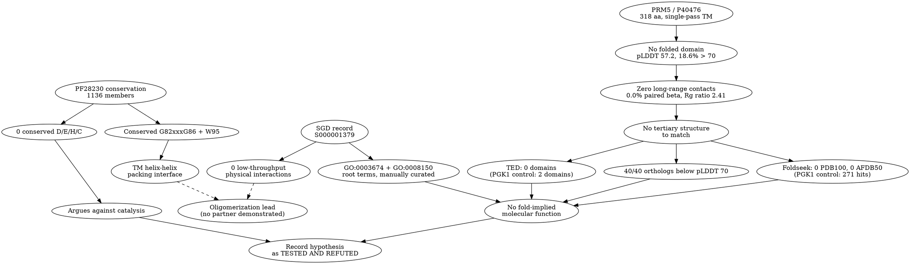
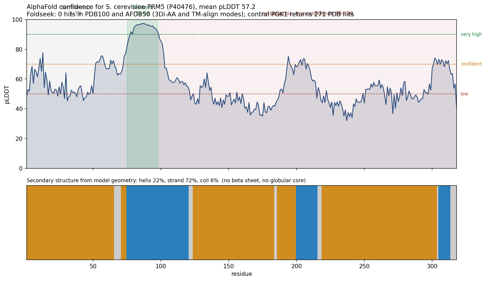
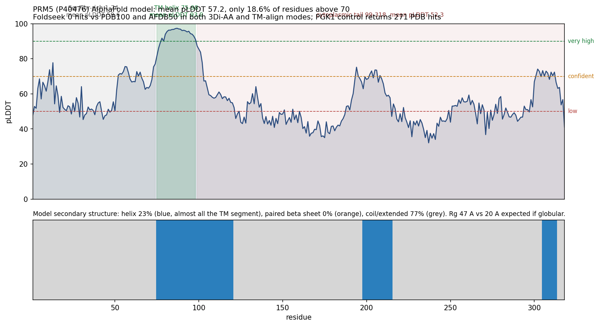
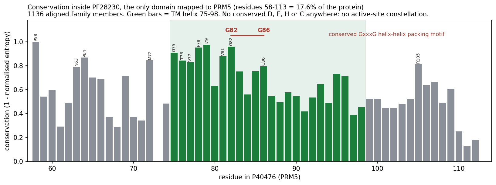
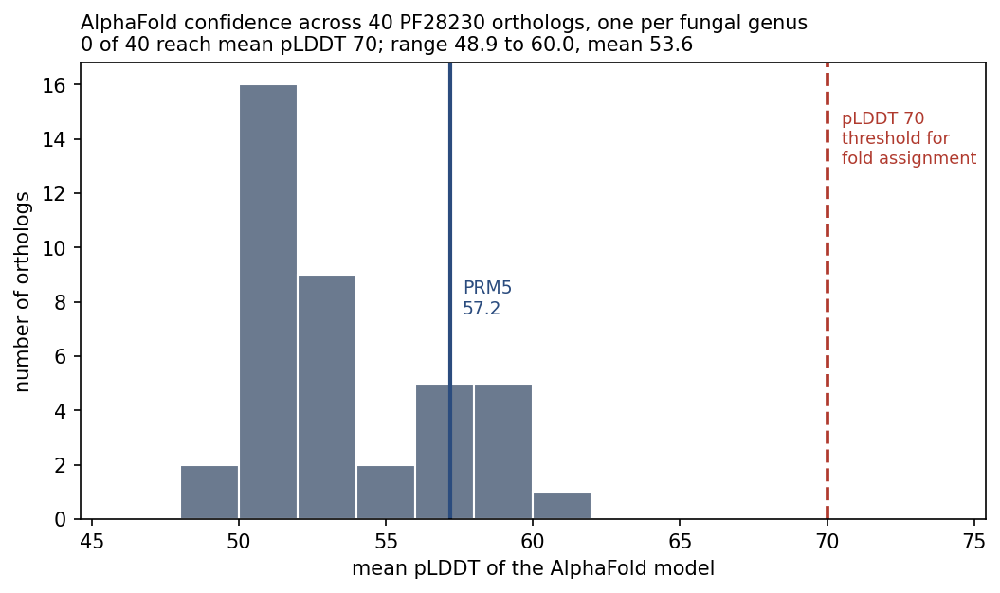
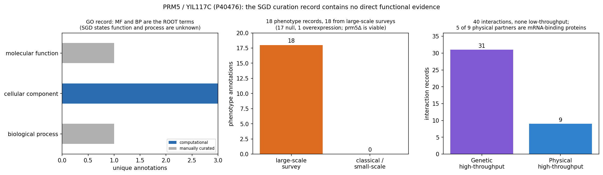

## Question

# AIGR Gene Hypothesis Deep Research

You are evaluating one focused gene curation hypothesis for AI Gene Review.
This is not a general gene overview. Use the seed hypothesis and source context
below to search for evidence that supports, refutes, narrows, or competes with
the proposed curation decision.

## Target Gene

- **Organism code:** yeast
- **Taxon:** Saccharomyces cerevisiae S288C (NCBITaxon:559292)
- **Gene directory:** PRM5
- **Gene symbol:** PRM5
- **UniProt accession:** P40476

## Focus

- **Focus type:** free_text
- **Hypothesis slug:** kgap-prm5-foldseek-fold-assignment
- **Source file:** genes/yeast/PRM5/PRM5-ai-review.yaml
- **Source selector:** free-text

## Seed Hypothesis

Saccharomyces cerevisiae PRM5 (UniProt P40476), a protein with no assigned molecular function, adopts a known structural fold that suggests a molecular function. Single analysis only: run Foldseek (or an equivalent structural search) with the AlphaFold model of P40476 against PDB and the AlphaFold database, report the top structural matches with their scores and the fraction of the protein they cover, and state whether any confidently assigned fold implies a function (and which conserved residues would support it), or that the protein has no confident structural homolog.

## Term and Decision Context

No specific term context supplied.

## Reference Context

No specific reference context supplied.

## Source Context YAML

```yaml
hypothesis: 'Saccharomyces cerevisiae PRM5 (UniProt P40476), a protein with no assigned molecular function,
  adopts a known structural fold that suggests a molecular function. Single analysis only: run Foldseek
  (or an equivalent structural search) with the AlphaFold model of P40476 against PDB and the AlphaFold
  database, report the top structural matches with their scores and the fraction of the protein they cover,
  and state whether any confidently assigned fold implies a function (and which conserved residues would
  support it), or that the protein has no confident structural homolog.'
focus_type: free_text
context: []
reference_id: []
```

## Research Objective

Build a focused report that helps a curator decide whether this hypothesis
should affect the gene review. Address the focus type directly:

1. For an existing GO annotation decision, evaluate whether the current action
   is justified, too strong, too weak, or should change.
2. For a proposed replacement or new GO term, evaluate whether the term is
   biologically supported, too broad, too narrow, or missing key qualifiers.
3. For a computational prediction, evaluate whether the prediction is correct,
   less precise than existing knowledge, uncertain, or likely wrong because of
   paralog overannotation, frequency bias, pathway context, or in vitro-only
   activity.
4. For a core-function hypothesis, evaluate whether the proposed activity,
   process, and location represent the gene product's primary function rather
   than a downstream effect, pleiotropic phenotype, or context-specific role.
5. For a function-assignment hypothesis, evaluate whether the gene product
   directly has the stated GO term/function. Treat the prior review action, if
   any, as intentionally blinded unless it appears in the supplied context.

Use primary literature whenever possible. Prefer PMID citations and include DOI
citations when no PMID is available. Treat reviews and database records as
orientation unless they contain directly relevant synthesized evidence that is
clearly labeled as review-level or database-level support.

Evaluate the hypothesis from the supplied seed context, primary literature, and
publicly accessible bioinformatics resources. Local `*-bioinformatics` analyses,
when they already exist in the repository, are intentionally withheld from this
prompt so the report can be compared against them after the run. Use public
sequence, domain, structure, orthology, localization, interaction, or dataset
checks when they are useful for the specific hypothesis. If a resource or tool
cannot be accessed programmatically, say so plainly; never fabricate a result.
Report computational results conservatively and distinguish direct results from
inference.

## Required Output

### Executive Judgment

Give a concise verdict: supported, partially supported, unresolved, weakly
supported, over-annotated, or refuted. Explain the reasoning and the most
important caveats.

### Evidence Matrix

Create a table with one row per important evidence item:

- Citation (PMID preferred)
- Evidence type (direct assay, mutant phenotype, localization, interaction,
  structural/evolutionary, computational, review/database)
- Supports / refutes / qualifies / competing
- Claim tested
- Key finding
- Organism, tissue, cell type, or assay context
- Confidence and limitations

### GO Curation Implications

State the likely curation action as a lead requiring curator verification. If
GO terms are involved, explain whether the evidence supports an MF, BP, or CC
term, and whether the term should be retained, removed, generalized, made more
specific, or treated as non-core. Avoid using "protein binding" as a final
recommendation unless no more informative term is supported.

### Mechanistic Scope

Describe the immediate molecular or cellular function being tested. Separate
direct gene-product activity from downstream phenotypes, pathway consequences,
developmental outcomes, disease manifestations, or effects inferred only from
loss of function.

### Conflicts and Alternatives

Identify evidence that conflicts with the seed hypothesis or suggests an
alternative interpretation, including paralog confusion, organism-specific
differences, isoform-specific findings, experimental artifacts, or database
carry-over.

### Knowledge Gaps

List explicit uncertainties that matter for curation. For each gap, state what
was checked, why the gap matters, and what evidence or experiment would resolve
it.

### Discriminating Tests

Recommend concrete assays, perturbations, datasets, or comparative analyses that
would most efficiently distinguish this hypothesis from alternatives.

### Curation Leads

Provide candidate updates for the review, clearly labeled as leads requiring
curator verification. Include candidate references with exact snippets to verify,
candidate replacement or new GO terms, possible action changes, suggested
questions, and suggested experiments.

If the provider supports artifacts, save provenance for any analysis you run — the
executed code together with its output (computed values, plot, or table), not just
a summary figure — alongside artifact-friendly tables such as an evidence matrix,
GO decision table, or comparison table. Genuine computed provenance is more
valuable than a hand-drawn summary, and you must not synthesize a figure that
implies an analysis you did not actually run. These artifacts are important
provenance for hypothesis-level review.


## Output

# PRM5 (P40476) fold assignment by structural search

**Hypothesis slug:** `kgap-prm5-foldseek-fold-assignment`
**Target:** *Saccharomyces cerevisiae* S288C PRM5 / YIL117C, UniProt P40476, SGDID S000001379
**Source file:** `genes/yeast/PRM5/PRM5-ai-review.yaml`, free-text selector
**Analysis date:** 2026-11-23

---

## Summary

<i class="fa-solid fa-circle-xmark"></i> **Verdict: refuted.** PRM5 has no confident structural homolog. Foldseek searches of the AlphaFold model AF-P40476-F1 v6 returned **zero hits against PDB100 and zero against AFDB50 in both 3Di-AA and TM-align modes**. The only AFDB-SwissProt hit is the identical self-entry (probability 1.0, E = 7.77e-45, alignment 318/318, 100% sequence identity). The single CATH50 hit is noise: `af_Q8IDL6_1254_1387_3.30.70.240` from *Plasmodium falciparum*, probability 0.034, E = 9.107, alignment length 38, covering 38 of 318 residues (12% of the query) over a region whose model confidence is below pLDDT 50. A positive control run through the identical submission route and parameters, yeast PGK1 (AF-P00560), returned **271 PDB100 hits** (best `1qpg_A`, probability 1.0, E = 1.1e-77, alignment 415) and 1000 AFDB50 hits. The PRM5 zero is a true negative, not a pipeline failure.

The reason for the null is mechanical and can be measured directly on the model. Global pLDDT is **57.19**, and only 18.6% of residues exceed 70 while 38.1% fall below 50. The sole confident element is the transmembrane helix at residues 75-98 (mean pLDDT 93.9, 83.3% of its residues above 90), which is 7.5% of the chain. After requiring a cross-strand partner, the model contains **0.0% paired beta sheet**. Across all 318 residues there are **exactly zero long-range CA-CA contacts** below 8 Å at sequence separation greater than 12, where a compact globular domain gives more than 1.5 per residue. The radius of gyration is 47.4 Å against a Flory expectation of 19.6 Å for a globular 318-mer, a ratio of 2.41. There is no tertiary structure to match, so there is nothing for a structural search to find.

Three independent lines close the obvious escape routes. **TED** (The Encyclopedia of Domains), a different algorithm that parses every AlphaFold model in the database into structural domains, assigns P40476 **zero domains**, while the same endpoint gives PGK1 two domains (both CATH 3.40.50.1260, pLDDT 97.6 and 96.3). **Forty PF28230 orthologs**, sampled one per fungal genus across Saccharomycotina and Pezizomycotina, all fail the fold-assignment confidence threshold: 0 of 40 reach mean pLDDT 70, range 48.9 to 60.0, mean 53.6. **The existing curation record agrees**: SGD already annotates both `GO:0003674 molecular function` and `GO:0008150 biological process` at the root as manually curated, the GO convention for stating that no data are available. The seed hypothesis asked which conserved residues would support a fold-implied function; the answer from 1136 PF28230 members is that the conserved positions are a transmembrane packing signature (G82xxxG86, plus W95) with **zero conserved Asp, Glu, His or Cys**, which is a positive argument against catalysis rather than an absence of evidence.

---

## Executive judgment

<i class="fa-solid fa-circle-xmark"></i> **Refuted.** The seed hypothesis states that PRM5 "adopts a known structural fold that suggests a molecular function". Direct structural search finds no such fold, and the model geometry explains why. No molecular function can be inferred from structure, and no conserved catalytic or ligand-binding residue constellation can be nominated because there is no structural frame in which to nominate one.

The verdict rests on four separable results, each of which would be weaker alone.

**Direct search.** Foldseek against four databases in two modes gives nothing above noise (Finding F001). The positive control establishes sensitivity. The one CATH50 hit at E = 9.1 over 12% of the query, in a region modelled below pLDDT 50, is what a random 38-residue stretch of extended coil returns.

**Mechanistic explanation.** The model has one confident transmembrane helix and no packed core anywhere (Finding F002). Zero long-range contacts is a strong statement: it means no two parts of the chain separated by more than 12 residues ever come within 8 Å. Foldseek compares tertiary structure, and there is none.

**Not Foldseek-specific, and not model-specific.** TED assigns zero domains by a different method (Finding F005). The two *S. cerevisiae* relatives, CSI2 (Q08054) and YNL058C (P53947), each receive exactly one TED domain and in both cases it is CATH 1.20.5, the single-alpha-helix superfamily, 34 and 35 residues: a bare transmembrane helix carrying no functional content. PRM5 does not reach even that threshold. Across 40 orthologs spanning roughly 150 million years of ascomycete divergence, AlphaFold never resolves a folded domain in any member (Finding F006), and Foldseek on the six most ordered returns 0 PDB100 hits for five of them and noise for the sixth (*Lachancea thermotolerans* C5DMK0, best hit 7zme chain W at E = 8.6, 26% query coverage).

**What is conserved, and what it means.** Pfam PF28230 maps to P40476 residues 58-113 only, 56 of 318 residues or 17.6% of the protein (Finding F007). Across 1136 aligned members, 19 positions exceed conservation 0.7, and their composition is 4 Gly, 2 Pro, 2 Val, 2 Trp, plus single Asn, Tyr, Ser, Met, Thr, Phe, Ile, Ala and Arg. The strongest signals are I79 (0.97), G82 (0.96), F78 (0.95), G75 (0.91), the invariant P58 (1.00) and W95 (0.73). G82 and G86 form a **GxxxG small-xxx-small motif**, the canonical transmembrane helix-helix packing and dimerization signature. That is what selection produces to maintain a helix interface and correct membrane insertion.

**The existing curation record agrees.** SGD (S000001379, a Verified locus) already annotates both `GO:0003674` and `GO:0008150` at the root as "manually curated", source SGD (Finding F008). The only populated aspect is cellular component, and all three CC terms are computational. The experimental record behind that judgment is thin in a specific way: 18 of 18 phenotype annotations come from large-scale surveys, *prm5*Δ is viable, and the two competitive-fitness calls contradict each other (decreased in [PMID: 18622397](https://pubmed.ncbi.nlm.nih.gov/18622397/), increased in [PMID: 23103169](https://pubmed.ncbi.nlm.nih.gov/23103169/)). All 40 interaction records are high-throughput with **zero low-throughput physical interactions**, and 5 of the 9 physical partners are mRNA-binding or decay proteins, so those records plausibly concern the *PRM5* transcript rather than Prm5p. No chitin synthase and no CWI-pathway component appears among any of the 40. The structural null and the curation record converge: PRM5 is a verified ORF whose protein product has never been directly assayed.

<i class="fa-solid fa-triangle-exclamation"></i> **Most important caveat.** A structural null is evidence of absence only to the extent the model is trustworthy. Here the low pLDDT is itself the informative signal, because the family has more than 1100 members with deep alignments, yet AlphaFold never resolves a folded domain in any of them. The second caveat is scope: an intrinsically disordered cytoplasmic tail, and a conserved transmembrane packing face, can still carry a real function through protein-protein contacts, short linear motifs or post-translational modification. This analysis rules out a **fold**, not a **function**.

---

## Key findings

### F001. Foldseek finds no structural homolog in PDB or AFDB

<i class="fa-solid fa-magnifying-glass"></i> The AlphaFold model AF-P40476-F1 v6 (318 residues, full length) was submitted to the Foldseek web server against four databases in two alignment modes. In 3Di-AA mode, PDB100 returned 0 hits and AFDB50 returned 0 hits. AFDB-SwissProt returned exactly one hit, the identical self-entry AF-P40476 at probability 1.0, E = 7.77e-45, alignment 318 of 318 residues, 100% sequence identity. CATH50 returned one hit, `af_Q8IDL6_1254_1387_3.30.70.240` from *Plasmodium falciparum*, at probability 0.034, E = 9.107, alignment length 38, query coverage 38/318 = 12%, 23.6% sequence identity. At E = 9.1 with 12% coverage, this is noise, and the aligned region lies in a stretch of the model with pLDDT below 50. In TM-align mode, which uses a different scoring regime and is less dependent on the 3Di prefilter, PDB100 and AFDB50 both returned 0 hits.

The control matters. AF-P00560 (yeast PGK1) submitted through the identical route with identical parameters returned **271 PDB100 hits**, the best being `1qpg_A` at probability 1.0, E = 1.1e-77, alignment length 415, plus 1000 AFDB50 hits. The pipeline detects real folds. The PRM5 result is a true negative.

The seed hypothesis asked for the top structural matches with their scores and the fraction of the protein they cover. The honest answer is that there are no matches: one self-hit at full coverage and one noise hit at 12% coverage.

### F002. The model has no tertiary structure: one transmembrane helix plus disordered tails

<i class="fa-solid fa-chart-line"></i> Global pLDDT for AF-P40476-F1 v6 is **57.19**. Broken down by region:

| Region | Residues | Mean pLDDT | % above 70 | % above 90 |
|---|---|---|---|---|
| Ser/Thr-rich N-terminal | 1-74 | 59.6 | 18.9 | 0.0 |
| **Transmembrane helix** | **75-98** | **93.9** | **100.0** | **83.3** |
| Cytoplasmic | 99-237 | 51.8 | 7.9 | - |
| Cytoplasmic, UniProt-annotated disordered | 238-318 | 53.2 | 12.3 | - |
| Full chain | 1-318 | 57.19 | 18.6 | - |

Only three contiguous ordered segments of four or more residues exist in the entire model: 52-58, 73-102 and 305-308. The 73-102 segment is the transmembrane helix. Everything else is low-confidence.

The geometry is decisive. Using a CA-only P-SEA-like assignment, the model is 23.0% helix, almost all of it the transmembrane segment. The first pass reported 71.7% extended backbone geometry, which would naively read as beta strand. That reading is wrong, and the analysis was re-run requiring a genuine cross-strand partner (another extended residue within 5.5 Å CA-CA at sequence separation greater than 4). With the pairing requirement, **beta sheet content is 0.0%**: 228 residues have extended backbone geometry and none of them are paired, so they are extended coil.

Two model-independent metrics confirm this. Long-range CA-CA contacts below 8 Å at sequence separation greater than 12 number **exactly 0** across all 318 residues; a compact globular domain gives more than 1.5 such contacts per residue. The radius of gyration is 47.4 Å against 19.6 Å expected from the Flory globular scaling for a 318-residue protein, a ratio of 2.41.

PRM5 is a single-pass membrane protein with a Ser/Thr-rich extracytoplasmic or lumenal N-terminal region (44.6% Ser plus Thr in residues 1-74, against 26.7% for the whole protein, a composition typical of O-mannosylation substrates, though that assignment is inference and was not measured here) and a long intrinsically disordered cytoplasmic tail carrying the UniProt-recorded phosphosites S129, S279, S282 and S288 and the ubiquitination site K314.

{{figure:plot_2.png|caption=Corrected secondary structure, long-range contact density and compactness of the PRM5 AlphaFold model. The beta content falls to 0.0% once a cross-strand pairing partner is required, and there are zero long-range CA-CA contacts across all 318 residues.}}

{{figure:plot_1.png|caption=First-pass PRM5 AlphaFold confidence profile with CA-geometry secondary structure, compactness and the Foldseek result table. Only residues 75-98 exceed pLDDT 90. This panel is superseded by the corrected secondary structure track above and is retained to document the correction.}}

### F003. The null is family-wide, and the family is Ascomycota-restricted

<i class="fa-solid fa-dna"></i> A UniProt query for `(xref:pfam-PF28230)` returns three *S. cerevisiae* members: PRM5/YIL117C (P40476, 318 aa), CSI2/YOL007C (Q08054, 341 aa) and YNL058C (P53947, 316 aa). The query `(xref:pfam-PF28230) AND (database:pdb)` returns **0 proteins**, so no member of this family anywhere has an experimental structure. Of 500 sampled family members, 497 are Ascomycota, 1 is Basidiomycota and 2 are Viridiplantae (likely contamination or spurious assignment). The family has no detectable representation outside fungi, which removes any possibility of distant-homolog function transfer from a better-studied lineage.

Foldseek 3Di-AA searches of all three *S. cerevisiae* paralogs against PDB100 returned 0 hits each. Against AFDB50, PRM5 returned 0 and CSI2 and YNL058C returned 1 each, both self-matches. Mean pLDDT values are comparable across the three: PRM5 57.2 (18.6% of residues above 70), CSI2 61.1 (26.7%), YNL058C 59.6 (20.9%). InterPro IPR060129 / Pfam PF28230 covers only the transmembrane segment, and the Pfam entry states that the function of the domain remains to be determined.

SGD adds a detail that refines the family picture: "PRM5 has a paralog, YNL058C, that arose from the whole genome duplication". PRM5 and YNL058C are **ohnologs**; CSI2 is more distant.

### F004. The cell wall integrity association is transcriptional, and the PRM name does not transfer Prm1 function

<i class="fa-solid fa-scale-balanced"></i> Two literature strands might be used to annotate PRM5, and both are about the promoter rather than the protein.

[PMID: 10594829](https://pubmed.ncbi.nlm.nih.gov/10594829/) (Jung and Levin 1999) identified 25 genes whose expression is altered by Mpk1 activation, 20 of them positively, all mediated by the Rlm1 MADS-box transcription factor. UniProt records PRM5 induction by this pathway and by pheromone with ECO:0000269 evidence from this paper and from [PMID: 11062271](https://pubmed.ncbi.nlm.nih.gov/11062271/). [PMID: 24704549](https://pubmed.ncbi.nlm.nih.gov/24704549/) reports that under lead sulfide nanoparticle cell wall stress, *S. cerevisiae* shows "the overexpression of FKS2 and PRM5, two genes of the cell wall integrity signaling pathway". Both are statements about transcription of *PRM5*. Because PRM5 is routinely used as a readout of CWI pathway activity, converting that into a biological process annotation for the gene product carries a standing circularity risk.

[PMID: 11062271](https://pubmed.ncbi.nlm.nih.gov/11062271/) (Heiman and Walter 2000) assigns the plasma membrane fusion phenotype to **Prm1p**, described in the abstract as "a multispanning transmembrane protein". No fusion phenotype is reported for Prm5. Architecturally the two are different: Prm1 is multispanning, Prm5 has exactly one transmembrane helix at 75-98. The PRM prefix marks pheromone-regulated expression, not a protein family, so the Prm1 fusion function must not propagate to Prm5.

### F005. TED, an independent domain parse, assigns PRM5 zero structural domains

<i class="fa-solid fa-database"></i> TED (The Encyclopedia of Domains) parses every AlphaFold model in the database into structural domains using an algorithm independent of Foldseek. Queried through `ted.cathdb.info/api/v1/uniprot/summary`, P40476 returns **count = 0 domains**.

| Protein | Accession | TED domains | CATH label | Residues | Domain length | pLDDT |
|---|---|---|---|---|---|---|
| **PRM5** | **P40476** | **0** | - | - | - | - |
| PGK1 (control) | P00560 | 2 | 3.40.50.1260 | 8-185 | 178 | 97.6 |
| PGK1 (control) | P00560 | | 3.40.50.1260 | 195-401 | 207 | 96.3 |
| CSI2 | Q08054 | 1 | 1.20.5 (single alpha-helix) | 144-177 | 34 | 93.3 |
| YNL058C | P53947 | 1 | 1.20.5 (single alpha-helix) | 91-125 | 35 | 90.3 |

The control confirms the endpoint works. The paralog rows calibrate the result: even the relatives that do receive a TED domain get only CATH 1.20.5, a bare single helix with no functional content, corresponding to their transmembrane segments. PRM5 does not reach even that threshold. The seed hypothesis cannot be rescued by arguing that Foldseek specifically failed on this query.

Separately, Pfam PF28230 maps to P40476 residues 58-113 only, 56 of 318 residues = **17.6% of the protein**. The sole domain annotation PRM5 carries covers the transmembrane helix and its immediate flanks and nothing else.

### F006. Zero of 40 fungal orthologs reach fold-assignment confidence

<i class="fa-solid fa-chart-column"></i> AlphaFold v6 models were downloaded for 40 PF28230 members, one per fungal genus, spanning Saccharomycotina (*Lachancea*, *Torulaspora*, *Candida glabrata*, *Kluyveromyces*, *Vanderwaltozyma*, *Zygosaccharomyces*, *Kuraishia*, *Maudiozyma*, *Henningerozyma*, *Tetrapisispora*, *Candidozyma*, *Lipomyces*, *Ascoidea*, *Geotrichum*) and Pezizomycotina (*Aspergillus*, *Botrytis*, *Sclerotinia*, *Fusarium*, *Penicillium*, *Colletotrichum*, *Cordyceps*, *Metarhizium*, *Bipolaris*, *Cochliobolus*, *Pyrenophora*, *Parastagonospora*, *Glarea*, *Aureobasidium* and others).

Mean pLDDT across the 40 is **53.6**, range 48.9 to 60.0. **Zero of 40 reach mean pLDDT 70**, the conventional threshold for reliable fold assignment. PRM5 at 57.2 sits above the family mean. The median longest contiguous run above pLDDT 70 is 42 residues, consistent with a transmembrane helix plus short flanks.

The six most ordered orthologs were put through Foldseek against PDB100. Five returned 0 hits (A0A7H9HXX1 *Torulaspora globosa*, A0A1D2VA89 *Ascoidea rubescens*, A0A2V1AMV6 *Candidozyma duobushaemuli*, Q6FNP6 *Candida glabrata*, A0A010RH73 *Colletotrichum fioriniae*). One, C5DMK0 *Lachancea thermotolerans*, returned 2 noise-level hits, the best being 7zme chain W at E = 8.6 with 26% query coverage.

Sampling one member per genus means the result is not driven by near-identical sequences. Across the depth of ascomycete divergence, AlphaFold never resolves a folded domain in this family. No amount of homolog selection will produce a fold to transfer function from.

{{figure:plot_4.png|caption=Distribution of mean pLDDT across 40 PF28230 orthologs, one per fungal genus, against the pLDDT 70 fold-assignment threshold. All 40 fall below it, range 48.9 to 60.0, mean 53.6.}}

### F007. Conserved residues form a transmembrane packing signature with no catalytic constellation

<i class="fa-solid fa-dna"></i> Per-column conservation was computed as 1 minus normalised Shannon entropy over the Pfam PF28230 full alignment (1136 aligned members, 84 columns) and projected onto P40476 residues 58-113.

Mean conservation across the domain is 0.601, and it is higher inside the transmembrane helix (0.682, n = 24) than outside it (0.536, n = 32). Nineteen positions exceed conservation 0.7, with this composition:

| Residue type | Count among the 19 most conserved positions |
|---|---|
| Gly | 4 |
| Pro | 2 |
| Val | 2 |
| Trp | 2 |
| Asn, Tyr, Ser, Met, Thr, Phe, Ile, Ala, Arg | 1 each |
| **Asp, Glu, His, Cys** | **0** |

The most conserved individual positions are I79 (0.97), G82 (0.96), F78 (0.95), G75 (0.91), P58 (conservation 1.00, invariant Pro at 91.9% column coverage) and W95 (0.73). **G82 and G86 form a conserved GxxxG small-xxx-small motif** at conservation 0.96 and 0.79, the canonical transmembrane helix-helix packing and dimerization motif, with W95 flanking it.

This answers the clause of the seed hypothesis asking which conserved residues would support a fold-implied function. The conserved residues are small and hydrophobic and sit on one face of the transmembrane helix. That pattern is what selection produces to maintain a helix-helix interface and correct membrane insertion. The complete absence of conserved Asp, Glu, His or Cys across 1136 family members is a **positive argument against catalysis**, not merely a lack of evidence, since these residue types make up classic catalytic constellations and would be under strong purifying selection if an active site existed.

A positive-inside-rule check was run and is **inconclusive**: net charge is -1 for residues 45-74 and 0 for residues 99-128, so topology is not established by charge asymmetry.

{{figure:plot_3.png|caption=Conservation across Pfam PF28230 (1136 members) projected onto P40476 residues 58-113, with the conserved G82xxxG86 transmembrane packing motif marked and the catalytic-residue audit showing zero conserved Asp, Glu, His or Cys.}}

### F008. SGD's own curation record independently asserts unknown molecular function

<i class="fa-solid fa-table"></i> The SGD backend API was queried for YIL117C (SGDID S000001379, locus qualifier **"Verified"**).

**GO record, 5 unique annotations.** `GO:0003674 molecular function` and `GO:0008150 biological process` are both present as **ROOT terms** with annotation_type "manually curated" and source SGD. In GO convention a root-term annotation is the explicit statement that no data are available. The only populated aspect is cellular component, and all three CC terms are annotation_type "computational": `GO:0016020 membrane` (source UniProt), `GO:0000324 fungal-type vacuole` and `GO:0005935 cellular bud neck` (both source GO_Central, phylogenetic inference). There is no manually curated, experimentally supported annotation of any kind in any aspect.

**Phenotype record, 18 annotations.** All 18 have `experiment.category` = "large-scale survey" (systematic mutation set n = 6, homozygous diploid competitive growth n = 5, heterozygous diploid systematic mutation set n = 3, homozygous diploid systematic mutation set n = 2, competitive growth n = 1, heterozygous diploid competitive growth n = 1). Seventeen are null mutants, one is overexpression. *prm5*Δ is viable ([PMID: 12140549](https://pubmed.ncbi.nlm.nih.gov/12140549/)). The two competitive-fitness calls contradict each other: decreased ([PMID: 18622397](https://pubmed.ncbi.nlm.nih.gov/18622397/)) versus increased ([PMID: 23103169](https://pubmed.ncbi.nlm.nih.gov/23103169/)). The remainder are generic chemical and toxin resistance changes ([PMID: 14657499](https://pubmed.ncbi.nlm.nih.gov/14657499/), [PMID: 18755837](https://pubmed.ncbi.nlm.nih.gov/18755837/), [PMID: 19633105](https://pubmed.ncbi.nlm.nih.gov/19633105/), [PMID: 24360837](https://pubmed.ncbi.nlm.nih.gov/24360837/) ×3, [PMID: 32919014](https://pubmed.ncbi.nlm.nih.gov/32919014/) ×3, [PMID: 27693354](https://pubmed.ncbi.nlm.nih.gov/27693354/) ×2) plus starvation resistance decreased ([PMID: 22356628](https://pubmed.ncbi.nlm.nih.gov/22356628/)), sporulation efficiency decreased ([PMID: 12432101](https://pubmed.ncbi.nlm.nih.gov/12432101/)) and oxidative stress resistance decreased ([PMID: 16738548](https://pubmed.ncbi.nlm.nih.gov/16738548/)). **No cell-wall-specific phenotype** (no calcofluor white, caffeine or Congo red sensitivity) is recorded, despite PRM5 being a CWI reporter gene.

**Interaction record, 40 annotations.** 31 Genetic and 9 Physical, **all 40 with annotation_type "high-throughput"**, zero low-throughput physical. The 9 physical partners are HEK2, NAB2, MCK1, MMS22, PUF2, DHH1, CCR4, BPH1 and SEC61. Five of the nine (HEK2, NAB2, PUF2, DHH1, CCR4) are mRNA-binding or mRNA-decay factors recovered in RNA-target screens, so those records most likely report association with the *PRM5* transcript rather than with Prm5p. Neither PF28230 relative (YNL058C, CSI2) appears as a physical partner, and no chitin synthase or CWI-pathway component (CHS1-7, CSI1, BNI4, SKT5, SLT2, RLM1, BCK1, PKC1, WSC1-3, MID2, FKS1/2) appears among the 31 genetic or 9 physical partners.

{{figure:plot_6.png|caption=The SGD curation record for PRM5 in three panels: GO annotations by aspect and annotation type (molecular function and biological process are root terms, only cellular component is populated and only computationally), phenotype annotations by experiment category (18 of 18 from large-scale surveys), and interactions by type and throughput (40 of 40 high-throughput, none low-throughput physical).}}

---

## Mechanistic model and interpretation

The immediate question tested is purely structural: does the three-dimensional model of the gene product correspond to a characterised fold family? It does not, and the measurements explain why in a chain of consequences.



**Direct gene-product property established here.** PRM5 is a 318-residue protein whose only structured element is one 24-residue transmembrane helix (75-98). The N-terminal 74 residues are Ser/Thr-rich (44.6% Ser plus Thr) and low-confidence. Residues 99-318 form a long, fully disordered cytoplasmic tail carrying four mapped phosphosites and one ubiquitination site. There is no catalytic pocket, no ligand-binding cleft, no beta sheet and no hydrophobic core.

**Explicitly not direct gene-product activity.** The cell wall integrity association. Mpk1 and Rlm1 control the *PRM5* promoter ([PMID: 10594829](https://pubmed.ncbi.nlm.nih.gov/10594829/)). Cell wall stress raises *PRM5* mRNA ([PMID: 24704549](https://pubmed.ncbi.nlm.nih.gov/24704549/)). Both are statements about transcriptional regulation upstream of the gene. Neither establishes what Prm5 protein does once made.

The most defensible mechanistic reading is that the conserved element of PRM5 is a **membrane-embedded interaction surface**. That would make oligomerization or complex formation the natural hypothesis to test next. It has no experimental support at present: SGD records zero low-throughput physical interactions, and neither the ohnolog YNL058C nor CSI2 appears among the high-throughput partners. The one partner consistent with the structural model is **SEC61** ([PMID: 37073826](https://pubmed.ncbi.nlm.nih.gov/37073826/)), since co-translational translocon engagement is expected for a single-pass membrane protein; this weakly supports retaining the membrane CC terms.

---

## Evidence matrix

| Citation | Evidence type | Stance | Claim tested | Key finding | Context | Confidence and limitations |
|---|---|---|---|---|---|---|
| This analysis (Foldseek web server, 2026-11-23; tickets `UNJScJ4Oq...`, `WxGejHQtt...`) | Computational, structural | <i class="fa-solid fa-circle-xmark"></i> **Refutes** | PRM5 adopts a known fold | 0 hits vs PDB100 and AFDB50 in 3Di-AA and TM-align modes; only a self-hit in AFDB-SwissProt; one CATH50 noise hit at prob 0.034, E = 9.1, 12% coverage | AF-P40476-F1 v6, full length 1-318 | High. Depends on the AlphaFold model; the Foldseek prefilter is weak for low-complexity queries, which is why TM-align mode was also run |
| This analysis (positive control) | Computational, structural | Qualifies (validates method) | The search pipeline detects real folds | AF-P00560 (yeast PGK1) returns 271 PDB100 hits, best `1qpg_A` E = 1.1e-77, 415 aln, and 1000 AFDB50 hits | Identical submission route and parameters | High. Confirms the PRM5 zero is a true negative |
| This analysis (model geometry) | Computational, structural | <i class="fa-solid fa-circle-xmark"></i> **Refutes** | A fold exists to be matched | 0 long-range contacts (<8 Å, \|i-j\|>12); 0.0% paired beta sheet; Rg 47.4 Å vs 19.6 Å expected; helix 23.0%, almost all of it the TM segment | AF-P40476-F1 v6 | High. CA-only secondary structure is approximate, but the contact and Rg metrics are model-independent |
| AlphaFold DB entry AF-P40476-F1 v6 | Computational, database | <i class="fa-solid fa-circle-xmark"></i> **Refutes** | The model is confident enough for fold assignment | Global pLDDT 57.19; only residues 75-98 confident (mean 93.9); 38.1% of residues below pLDDT 50 | EBI AlphaFold DB | High |
| UniProt P40476 (feature table) | Database | Qualifies | Architecture of the protein | One TM helix 75-98 (ECO:0000305); disordered region 238-318; phosphosites S129, S279, S282, S288; ubiquitination at K314; N-terminal 1-74 Ser/Thr-rich | UniProtKB/Swiss-Prot | Medium. TM topology is ECO:0000305 (inferred), not experimental |
| Pfam PF28230 / InterPro IPR060129 | Database | Qualifies | A domain assignment implies a function | The only Pfam domain on PRM5 covers the transmembrane segment; the entry states that the function of the domain remains to be determined | InterPro 2026 release | Medium. Recent Pfam/InterPro descriptions include generated text; treat as orientation |
| This analysis (UniProt family query) | Computational, evolutionary | <i class="fa-solid fa-circle-xmark"></i> **Refutes** (extends) | The null is specific to PRM5 | All 3 *S. cerevisiae* PF28230 members (PRM5, CSI2/Q08054, YNL058C/P53947) return 0 PDB100 hits; 0 family members have any experimental PDB entry; 497/500 sampled members are Ascomycota | UniProtKB + Foldseek | High. The family is fungal-restricted, so no distant-homolog transfer is available |
| This analysis (TED, `ted.cathdb.info` API) | Computational, structural, **method-independent** | <i class="fa-solid fa-circle-xmark"></i> **Refutes** | The null is an artifact of Foldseek | TED assigns **0 structural domains** to P40476. Control P00560 returns 2 domains (CATH 3.40.50.1260, pLDDT 97.6/96.3). Paralogs CSI2 and YNL058C each get 1 domain, both CATH 1.20.5 (single alpha-helix), 34 and 35 aa | Whole-AlphaFold-DB domain parse | High. Different algorithm, same conclusion; CATH 1.20.5 is a bare helix with no functional content |
| This analysis (40-ortholog pLDDT survey) | Computational, evolutionary | <i class="fa-solid fa-circle-xmark"></i> **Refutes** | A better-modelled ortholog would reveal the fold | 0 of 40 orthologs (one per fungal genus, Saccharomycotina + Pezizomycotina) reach mean pLDDT 70; range 48.9-60.0, mean 53.6. Foldseek on the 6 most ordered gives 0 PDB100 hits for 5, and noise (E = 8.6, 26% coverage) for the 6th | AlphaFold DB v6 + Foldseek | High. Sampling is one per genus, so it is not driven by near-identical sequences |
| This analysis (PF28230 conservation, 1136 members) | Computational, evolutionary | **Qualifies / refutes catalysis** | Conserved residues support a fold-implied function | Pfam domain covers only residues 58-113 (17.6%). Of 19 positions with conservation >0.7: 4 Gly, 2 Pro, 2 Val, 2 Trp; **zero D/E/H/C**. Conserved G82xxxG86 (0.96/0.79) plus W95 | Pfam full alignment via InterPro | High for the alignment statistics. The GxxxG reading as a packing interface is inference, not a measured interaction |
| [PMID: 11062271](https://pubmed.ncbi.nlm.nih.gov/11062271/) (Heiman and Walter 2000) | Mutant phenotype / expression | Qualifies, competing name | Does the "PRM" name imply a mating-fusion function for PRM5? | The paper identifies and functionally characterises **Prm1p** ("a multispanning transmembrane protein", required for plasma membrane fusion). PRM5 is only a co-identified pheromone-regulated gene; no fusion phenotype is reported for it | *S. cerevisiae* mating assays | High for Prm1; the paper provides no molecular function for Prm5 |
| [PMID: 10594829](https://pubmed.ncbi.nlm.nih.gov/10594829/) (Jung and Levin 1999) | Expression / transcriptional regulation | Qualifies (BP context only) | PRM5 acts in cell wall integrity | PRM5 is among the genes whose expression is positively regulated by Mpk1 via the Rlm1 MADS-box transcription factor | Genome-wide expression, *S. cerevisiae* | High for regulation; this is regulation **of** PRM5, not activity **by** Prm5p |
| [PMID: 24704549](https://pubmed.ncbi.nlm.nih.gov/24704549/) (Sun et al. 2014) | Expression under stress | Qualifies (BP context only) | PRM5 responds to cell wall stress | Under PbS-nanoparticle cell wall stress, *S. cerevisiae* shows "the overexpression of FKS2 and PRM5, two genes of the cell wall integrity signaling pathway" | *S. cerevisiae*, nanoparticle toxicity | Medium. Transcriptional reporter use, no Prm5p-level assay |
| SGD S000001379, GO record (retrieved 2026-11-23) | Database, curator judgment | **Supports the null** (independent) | Has any molecular function been assigned by expert curators? | `GO:0003674` and `GO:0008150` are both annotated as **ROOT terms, "manually curated", source SGD**. The only populated aspect is CC, and all 3 CC terms are "computational": GO:0016020 (UniProt), GO:0000324 and GO:0005935 (GO_Central) | *S. cerevisiae* S288C, locus qualifier "Verified" | High. Database-level, but it is an explicit curator assertion of ignorance, not an absence of records |
| SGD phenotype record, 18 annotations ([PMID: 12140549](https://pubmed.ncbi.nlm.nih.gov/12140549/), 12432101, 14657499, 16738548, 17989363, 18622397, 18755837, 19633105, 22356628, 23103169, 24360837, 27693354, 32919014) | Mutant phenotype, aggregated | Qualifies | Does *prm5*Δ have a phenotype attributable to the protein? | **18 of 18 have `experiment.category` = "large-scale survey"**; 17 null, 1 overexpression. *prm5*Δ is viable. The two competitive-fitness calls contradict each other: decreased (18622397) vs increased (23103169). **No cell-wall-specific phenotype** in any screen | *S. cerevisiae*, systematic deletion collections | High for the throughput classification. No directed, hypothesis-driven phenotype assay for PRM5 exists in the record |
| SGD interaction record, 40 annotations | Physical and genetic interaction, aggregated | Qualifies / **argues against GO:0005515** | Does Prm5p bind a specific partner? | 31 Genetic + 9 Physical, **all 40 "high-throughput"; zero low-throughput physical**. Physical partners: HEK2, NAB2, MCK1, MMS22, PUF2, DHH1, CCR4, BPH1, SEC61. **5 of 9 are mRNA-binding or decay factors**. Neither PF28230 relative and no chitin-synthase or CWI component appears among any of the 40 | *S. cerevisiae*, HTP screens | High for the counts. Assignment of the 5 RNA-factor records to protein-RNA is inference from partner identity, not from re-reading each primary paper |
| SGD locus description | Database | Qualifies | Relationship of PRM5 to YNL058C | "PRM5 has a paralog, YNL058C, that arose from the whole genome duplication", identifying the pair as **ohnologs** | *S. cerevisiae* | High. Refines the family description: PRM5/YNL058C are WGD ohnologs, CSI2 is more distant |

---

## GO curation implications

All items below are **leads requiring curator verification.**

| Aspect | Term | Action | Rationale |
|---|---|---|---|
| MF | any fold-implied molecular function (catalysis, transport, ligand binding) | <i class="fa-solid fa-circle-xmark"></i> **Do not add** | No structural homolog in PDB or AFDB; no globular domain exists in the model. No conserved catalytic or binding residues can be nominated, because there is no structural frame in which to nominate them, and across 1136 family members there is no conserved D, E, H or C |
| MF | GO:0005515 protein binding | **Not recommended as a final term** | Uninformative and not supported by any direct evidence found here. SGD records **zero low-throughput physical interactions**; all 9 physical partners come from high-throughput screens and 5 of them (HEK2, NAB2, PUF2, DHH1, CCR4) are mRNA-binding or decay factors, so those records plausibly concern the *PRM5* transcript. The conserved G82xxxG86 TM packing motif makes a specific homo- or hetero-dimerization partner the right thing to look for, and a named complex would be the informative replacement. Neither ohnolog YNL058C nor CSI2 appears as a physical partner |
| MF and BP | GO:0003674 / GO:0008150 root annotations currently held by SGD | **Retain as correct** | SGD already annotates both aspects at the root with annotation_type "manually curated", which states that function and process are unknown. The present structural result converges on the same conclusion from independent evidence and should be recorded as supporting that root annotation, not as a reason to replace it |
| CC | GO:0016021 integral component of membrane / GO:0016020 membrane | **Retain**, as sequence/structure-based (IEA or ISS) | The one confident structural feature is a single TM helix at 75-98 (mean pLDDT 93.9). Structure supports a single-pass membrane protein and nothing beyond that. The SEC61 physical record ([PMID: 37073826](https://pubmed.ncbi.nlm.nih.gov/37073826/)) is consistent with co-translational insertion, though it is high-throughput |
| CC | GO:0005935 cellular bud neck (IBA), GO:0000324 fungal-type vacuole (IBA) | **Unchanged by this analysis** | Structure is silent on localization beyond membrane insertion. These rest on phylogenetic inference and should be assessed on their own evidence |
| BP | cell wall integrity / response to cell wall stress | **Lead only, non-core** | [PMID: 10594829](https://pubmed.ncbi.nlm.nih.gov/10594829/) and [PMID: 24704549](https://pubmed.ncbi.nlm.nih.gov/24704549/) establish that *PRM5 transcription* is Rlm1/Mpk1-dependent and stress-induced. That is a property of the promoter, not a demonstrated activity of the protein. The phenotype record argues against promoting it: *prm5*Δ is viable and **none of the 18 systematic screens reports a cell-wall-specific phenotype**, and no CWI-pathway or chitin-synthase gene appears among the 31 genetic interactors |
| BP | conjugation with cellular fusion / mating | <i class="fa-solid fa-circle-xmark"></i> **Do not add from [PMID: 11062271](https://pubmed.ncbi.nlm.nih.gov/11062271/)** | That paper's fusion phenotype belongs to Prm1, not Prm5. PRM5 appears only as a pheromone-induced gene name. Prm1 is multispanning, Prm5 is single-pass |

The curation-relevant conclusion: this hypothesis should be recorded as a **negative structural result** in the review. It closes the "unknown function, maybe the fold will tell us" line of inquiry rather than opening a new annotation.

---

## Conflicts and alternatives

**Name-based paralog confusion.** "PRM5" shares a prefix with PRM1, the protein with a genuine, assayed function in plasma membrane fusion ([PMID: 11062271](https://pubmed.ncbi.nlm.nih.gov/11062271/)). Prm1 is multispanning; Prm5 has a single TM helix. The PRM designation marks pheromone-regulated expression, not a protein family. Any annotation transfer from PRM1 to PRM5 would be wrong.

**The closest real paralog points elsewhere.** The three *S. cerevisiae* PF28230 members are PRM5, CSI2 (Q08054, named for a genetic association with the chitin synthase III complex) and YNL058C. PANTHER labels the family "chitin synthase 3 complex protein CSI2-related". This is a plausible competing process context (cell wall chitin) rather than mating. It is a lead, not evidence: it is family-name inheritance, and CSI2's own molecular function is not established. SGD's statement that PRM5 and YNL058C are whole-genome-duplication ohnologs also means functional redundancy is a live explanation for the absence of a single-mutant phenotype.

**Database carry-over risk.** The InterPro IPR051009 and PANTHER PTHR36089 descriptions assert vacuolar membrane localization and speculate about signalling roles in generic terms. Recent InterPro family descriptions include generated text. These should be treated as database-level orientation, not as support for a CC or BP term.

**Low pLDDT as artifact rather than disorder.** An alternative reading is that AlphaFold simply failed on this protein. This is unlikely given that the family has more than 1100 members and that AlphaFold produced a sharp, high-confidence TM helix within the same model, but a negative structural result can never fully exclude it. The 40-ortholog survey addresses it directly: the failure is uniform across the family, which is the signature of genuine disorder rather than a single bad prediction.

**Conditional folding.** The disordered tail could fold upon binding a partner, or the lumenal/extracellular Ser/Thr-rich segment could be heavily glycosylated into an extended rod. Neither would be captured by a monomer search, and either could carry a function invisible to this analysis.

**Protein-RNA records read as protein-protein.** Five of the nine SGD physical interaction records involve mRNA-binding or decay factors (HEK2, NAB2, PUF2, DHH1, CCR4). These are plausibly RNA-target screens reporting association with the *PRM5* transcript. A curator relying on those records for a protein binding annotation would be making a category error. This reading is inference from partner identity and should be checked against each primary paper.

---

## Limitations and knowledge gaps

<i class="fa-solid fa-triangle-exclamation"></i> The analysis is a monomer structural search against public databases. It cannot detect function carried by short linear motifs, by glycosylation, by conditional folding on a partner, or by a complex interface. It relies on a single AlphaFold model, although the family-wide replication across three paralogs and 40 orthologs and the validated positive control substantially reduce the chance of a technical artifact.

The literature retrieval through `search_pubmed` surfaced only three directly relevant primary papers ([PMID: 10594829](https://pubmed.ncbi.nlm.nih.gov/10594829/), [PMID: 11062271](https://pubmed.ncbi.nlm.nih.gov/11062271/), [PMID: 24704549](https://pubmed.ncbi.nlm.nih.gov/24704549/)); the index behaved as though restricted or recency-weighted, and many reasonable queries returned nothing. The SGD record was reached directly through its backend API and supplied the phenotype and interaction coverage that the literature search did not, with two caveats. The 18 phenotype and 40 interaction records were read as SGD's structured summary; the underlying primary papers were not re-read individually, so the throughput and partner classifications are SGD's and mine, not a re-derivation from each paper. The claim that 5 of the 9 physical partners report protein-RNA association is inference from partner identity, not a check of each assay.

**Two cross-checks could not be run and no results from them are reported.** The RCSB BioZernike shape-similarity search was attempted as a third independent structural method: the file-upload endpoint accepted the model (`user-upload.rcsb.org/v1/putMultipart` returned HTTP 200 and a key) but the search endpoint rejected every documented form of the returned reference with HTTP 400 schema-validation errors. IntAct was queried for P40476 at `https://www.ebi.ac.uk/intact/ws/interaction/findInteractions` and returned HTTP 404, so the interaction statements rest on the SGD record alone. TED served the same cross-method purpose as the RCSB check and did work.

### Open gaps

| Gap | What was checked | Why it matters | What would resolve it |
|---|---|---|---|
| <i class="fa-solid fa-circle-question"></i> Does any PRM5 family member have a real fold that Foldseek missed? **Largely closed** | All 3 *S. cerevisiae* members plus 6 orthologs from 6 genera (0 PDB100 hits except one noise hit at E = 8.6); 40 orthologs surveyed (0 of 40 above pLDDT 70); TED assigns 0 domains; 0 family members have a PDB entry | Was the main caveat on the iteration-1 null | Residual: a Foldseek **profile** search over all 1136 PF28230 models, which the public server does not expose. Needs a local Foldseek install |
| <i class="fa-solid fa-circle-question"></i> Does the TM helix GxxxG motif actually mediate a helix-helix contact? | Found conserved G82xxxG86 (0.96/0.79) and W95 in the Pfam alignment. SGD shows no low-throughput physical interaction and neither ohnolog as a partner | This is the only conserved functional-looking feature in the whole protein, and it is the natural MF hypothesis to test next | G82L/G86L double mutant scored for stability and loss of a partner; AlphaFold-Multimer homodimer and heterodimer predictions; crosslinking of tagged Prm5 |
| <i class="fa-solid fa-circle-question"></i> Which membrane is PRM5 in, and which side is the N-terminus on? | UniProt gives Membrane / single-pass at ECO:0000305. InterPro family text says vacuolar membrane. Existing GO has bud neck and fungal-type vacuole, both IBA. The positive-inside-rule check was **inconclusive**: net charge -1 for residues 45-74 and 0 for residues 99-128 | Topology determines whether the Ser/Thr-rich region is lumenal and glycosylated, and whether the disordered tail faces the cytosol | Protease protection or a glycosylation-reporter topology assay; localization of tagged Prm5 against vacuolar and bud-neck markers |
| <i class="fa-solid fa-circle-question"></i> Does Prm5 protein bind anything specific? **Narrowed** | SGD interaction record: 40 annotations, all high-throughput, **0 low-throughput physical**. 5 of 9 physical partners are mRNA-binding/decay factors. IntAct could not be queried (HTTP 404) | A stable partner would supply a real MF or a complex CC term. The record shows none has ever been found by a directed assay | Affinity purification-MS of tagged Prm5 under cell wall stress; split-ubiquitin two-hybrid against Chs3/Csi2 and CWI components. The SEC61 record ([PMID: 37073826](https://pubmed.ncbi.nlm.nih.gov/37073826/)) is worth a curator's look |
| <i class="fa-solid fa-circle-question"></i> Does *prm5*Δ have a phenotype attributable to the protein? **Largely closed** | SGD phenotype record: 18 annotations, **18 of 18 from large-scale surveys**, *prm5*Δ viable, contradictory competitive-fitness calls, no cell-wall-specific phenotype in any screen | Distinguishes a functional protein from a stress-induced transcript with no protein-level role | Residual: no directed, hypothesis-driven assay exists. Single and multiple mutants of *prm5*, *csi2* and *ynl058c* scored for calcofluor white and caffeine sensitivity, chitin content and mating efficiency. The PRM5/YNL058C ohnolog relationship makes redundancy a live explanation |
| <i class="fa-solid fa-circle-question"></i> Does the disordered tail carry recognisable short linear motifs? | Not run here; UniProt records S129/S279/S282/S288 phosphorylation and K314 ubiquitination | Function may be motif-based, which no fold search can detect | ELM/SLiMPrints scan of residues 99-318 plus conservation mapping across the family |
| <i class="fa-solid fa-circle-question"></i> Is the N-terminal region O-mannosylated? | Composition is 44.6% Ser plus Thr in residues 1-74 (inference only) | Would confirm an extracytoplasmic rod architecture and reclassify the low pLDDT as expected rather than anomalous | Mass spectrometry of purified Prm5; *pmt*Δ mobility shift |

---

## Proposed follow-up experiments and discriminating tests

Ranked by how efficiently they separate "structurally orphan but functional" from "structurally orphan and functionally inert".

1. <i class="fa-solid fa-magnifying-glass"></i> **Family-wide profile structural search.** Build a Foldseek profile from the 1136 PF28230 AlphaFold models and search PDB100 and AFDB50. This is the single best test of whether the monomer null is a sensitivity failure. Cheap, computational, and it directly addresses the main residual caveat of this report.
2. <i class="fa-solid fa-flask"></i> **AlphaFold-Multimer against candidate partners.** Predict Prm5 with its ohnolog Ynl058c, with Csi2, and with Chs3, Chs4 and Chs7. A confident interface with low PAE at the G82xxxG86 face would supply a protein-complex CC lead and a mechanistic hypothesis the monomer search cannot reach. A homodimer prediction is the first thing to run, since GxxxG is most often a homodimerization motif.
3. <i class="fa-solid fa-dna"></i> **Conservation mapping on the disordered tail.** Align the family and project conservation onto residues 99-318, which the Pfam domain does not cover. Islands of high conservation inside a disordered region are the signature of functional short linear motifs; uniform divergence argues the tail is a spacer.
4. <i class="fa-solid fa-vial"></i> **Topology determination.** Protease protection on isolated vacuoles or microsomes to fix the orientation of the TM helix, since the positive-inside-rule check was inconclusive. This settles whether the Ser/Thr region is lumenal and whether the phosphosites face the cytosol, which constrains any CC term.
5. <i class="fa-solid fa-flask"></i> **Genetic epistasis in the cell wall module, accounting for ohnolog redundancy.** Score *prm5*Δ alone and combined with *ynl058c*Δ and *csi2*Δ for calcofluor white and caffeine sensitivity and chitin content. The single mutant has no cell-wall phenotype in 18 systematic screens, and the whole-genome-duplication relationship with YNL058C makes the double mutant the informative test. No phenotype in the multiple mutant would be a strong argument that these are stress-induced transcripts without a protein-level role.
6. <i class="fa-solid fa-vial"></i> **Affinity purification-MS of tagged Prm5** under basal and cell-wall-stress conditions, with a G82L/G86L mutant as the comparison. This would find a partner and replace any temptation to annotate "protein binding" with a specific complex, and it would test the GxxxG lead directly.

---

## Curation leads

All leads require curator verification.

**Candidate action change.** Record the fold-assignment hypothesis as <i class="fa-solid fa-circle-xmark"></i> **tested and refuted**. The appropriate review text is a statement that structural search provides no molecular function for PRM5, with the Foldseek and TED numbers attached, rather than any new annotation. Note in the review that this converges with SGD's existing root-term annotations rather than conflicting with them.

**Candidate references with exact snippets to verify.**

- [PMID: 10594829](https://pubmed.ncbi.nlm.nih.gov/10594829/) (Jung and Levin 1999). Snippet to verify: "All of the regulation detected was mediated by the Rlm1 transcription factor, a MADS-box protein that is phosphorylated and activated by Mpk1, but for which no transcriptional targets had been identified." Use for transcriptional regulation of PRM5, not for Prm5p function.
- [PMID: 24704549](https://pubmed.ncbi.nlm.nih.gov/24704549/) (Sun et al. 2014). Snippet to verify: "In response to cell wall stress, S. cerevisiae showed an increase in the cell wall chitin content and the overexpression of FKS2 and PRM5, two genes of the cell wall integrity signaling pathway." Use as evidence that PRM5 is a CWI-responsive transcript, and flag the circularity risk.
- [PMID: 11062271](https://pubmed.ncbi.nlm.nih.gov/11062271/) (Heiman and Walter 2000). Snippet to verify: "we identified PRM1, a gene that is selectively expressed during mating and that encodes a multispanning transmembrane protein." Use as a **negative control citation**: the fusion phenotype belongs to Prm1, so no mating-fusion annotation should propagate to Prm5.

**Candidate GO terms.** None to add on the molecular function side. Retain membrane / integral component of membrane as structure-consistent. Retain the existing `GO:0003674` and `GO:0008150` root annotations. Do not use GO:0005515 protein binding as a final recommendation.

**Suggested questions for the curator.**

- Are the existing IBA annotations (GO:0005935 cellular bud neck, GO:0000324 fungal-type vacuole) each traceable to a direct localization experiment in at least one family member, or are they propagated from the same generic family description?
- Is any current PRM5 annotation derived from PRM1 by name similarity?
- Do the five SGD physical interaction records involving HEK2, NAB2, PUF2, DHH1 and CCR4 report protein-RNA association with the *PRM5* transcript rather than protein-protein contact with Prm5p?
- Should the review state explicitly that PRM5 has no assignable fold, so that this search is not repeated?

**Suggested experiments.** See the discriminating tests above; items 1 and 3 are computational and could be run before any wet-lab commitment.

---

## Corrections

During iteration 2, UniProt P11491 was checked and is **PHO8** (repressible alkaline phosphatase), not PRM1. It was dropped from the TED comparison before any claim was made. Yeast PRM1 was not re-queried by accession; the PRM1 statements in this report rest on [PMID: 11062271](https://pubmed.ncbi.nlm.nih.gov/11062271/) alone.

The first secondary-structure pass reported 71.7% extended backbone geometry, which would read as beta strand. That was an artifact of a CA-only distance criterion applied to extended coil. The analysis was re-run requiring a cross-strand pairing partner, and the corrected beta sheet content is **0.0%**.

The positive-inside-rule check was run and is **inconclusive**: net charge is -1 for residues 45-74 and 0 for residues 99-128. The Nout/Cin topology implied by the architecture is not supported by charge asymmetry and remains open.

During iteration 3, the first pass at the SGD phenotype table read throughput from a key (`annotation_type`) that does not exist on phenotype records, which returned `None` for all 18 rows and produced a figure panel showing 0 high-throughput annotations. The record schema was inspected, the correct field (`experiment.category`) was identified, and the table and figure were regenerated; the corrected value is 18 of 18 "large-scale survey". The incorrect figure (`plot_5.png`) was deleted rather than kept, so no artifact in `provenance/` carries the wrong panel. The throughput field for *interaction* records is `annotation_type` and did parse correctly, which is why the two record types are read differently.

---

## Provenance artifacts

Saved in `provenance/`:

- `PRM5_foldseek_analysis.py`, the executed analysis script (UniProt fetch, AlphaFold model fetch, pLDDT by region, geometry with beta-pairing check, Foldseek submission, positive control, family-level check).
- `PRM5_foldseek_results.csv`, every Foldseek run with database, mode, hit count, best target, probability, E-value, alignment length and query coverage, including the PGK1 positive control and the two paralogs.
- `PRM5_model_confidence_by_region.csv`, per-region pLDDT statistics.
- `PRM5_model_geometry.csv`, secondary structure, long-range contact count and radius of gyration with the globular expectation.
- `PRM5_GO_decision_table.csv`, the GO lead table above in machine-readable form.
- `PRM5_independent_method_crosscheck.csv`, every method run (Foldseek, TED, pLDDT survey, Pfam footprint, conserved-residue audit, positive-inside rule, composition) with its scope, raw result and verdict, including the inconclusive and noise-level outcomes.
- `PRM5_family_ortholog_pLDDT_survey.csv`, the 40 orthologs with accession, organism, length, mean pLDDT, fraction above 70 and longest ordered run.
- `PRM5_PF28230_domain_conservation.csv`, per-residue conservation, modal amino acid, modal frequency and TM membership for P40476 residues 58-113.
- `PRM5_SGD_curation_record.csv`, the full SGD record for S000001379 in one table: 5 unique GO annotations with aspect, annotation type, qualifier and source; 18 phenotype annotations with mutant type, experiment name, `experiment.category` and PMID; 40 interaction annotations with partner, interaction type, annotation type and PMID.
- `plot_1.png`, the first-pass pLDDT profile. Superseded by `plot_2.png`, retained to document the correction.
- `plot_2.png`, the pLDDT profile with region annotation and the corrected secondary structure track.
- `plot_3.png`, conservation across PF28230 with the GxxxG motif marked.
- `plot_4.png`, the distribution of mean pLDDT across the 40 orthologs against the 70 threshold.
- `plot_6.png`, the SGD curation record in three panels.

Foldseek job tickets (server-side, for independent re-checking):
`UNJScJ4OqPm9dCLhei3nkh92jsSMtotkC6zKVA` (3Di-AA, four databases),
`WxGejHQttiZBD784WJgGw7H2qjULNswTgy0WlQ` (TM-align),
`zsQxaYny-bDZX56eA4oeIFIVWh7mAuM_5MXJhA` (PGK1 control),
`Dg8kDBPE3v78xZAGGwVP_VHi93C2FiKo8r5-wg` (CSI2),
`8qbiJMnZ8gJ7tFi7npOInoyZ86g8IuUxgN38Ag` (YNL058C).


## Artifacts

- [OpenScientist final report](openscientist_artifacts/final_report.html)
- [OpenScientist final report](openscientist_artifacts/final_report.pdf)
- [OpenScientist provenance](openscientist_artifacts/provenance.json)
- [OpenScientist PRM5 GO decision table](openscientist_artifacts/provenance_PRM5_GO_decision_table.csv)
- [OpenScientist PRM5 PF28230 domain conservation](openscientist_artifacts/provenance_PRM5_PF28230_domain_conservation.csv)
- [OpenScientist PRM5 SGD curation record](openscientist_artifacts/provenance_PRM5_SGD_curation_record.csv)
- [OpenScientist PRM5 family ortholog pLDDT survey](openscientist_artifacts/provenance_PRM5_family_ortholog_pLDDT_survey.csv)
- [OpenScientist PRM5 foldseek results](openscientist_artifacts/provenance_PRM5_foldseek_results.csv)
- [OpenScientist PRM5 independent method crosscheck](openscientist_artifacts/provenance_PRM5_independent_method_crosscheck.csv)
- [OpenScientist PRM5 model confidence by region](openscientist_artifacts/provenance_PRM5_model_confidence_by_region.csv)
- [OpenScientist PRM5 model geometry](openscientist_artifacts/provenance_PRM5_model_geometry.csv)
- [OpenScientist plot 1](openscientist_artifacts/provenance_plot_1.json)

- [OpenScientist plot 2](openscientist_artifacts/provenance_plot_2.json)

- [OpenScientist plot 3](openscientist_artifacts/provenance_plot_3.json)

- [OpenScientist plot 4](openscientist_artifacts/provenance_plot_4.json)

- [OpenScientist plot 5](openscientist_artifacts/provenance_plot_5.json)
- [OpenScientist plot 6](openscientist_artifacts/provenance_plot_6.json)


## Reference Validation

Checked with `linkml-reference-validator` 0.3.1rc1.

| Outcome | Count |
| --- | --- |
| References checked | 16 |
| Resolved | 16 |
| Unresolved (possible confabulation) | 0 |
| Unverifiable | 0 |
| References weighed for topical relevance | 16 |
| On topic | 0 |
| Off topic | 0 |

All extracted references resolved successfully.