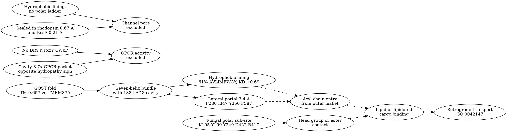
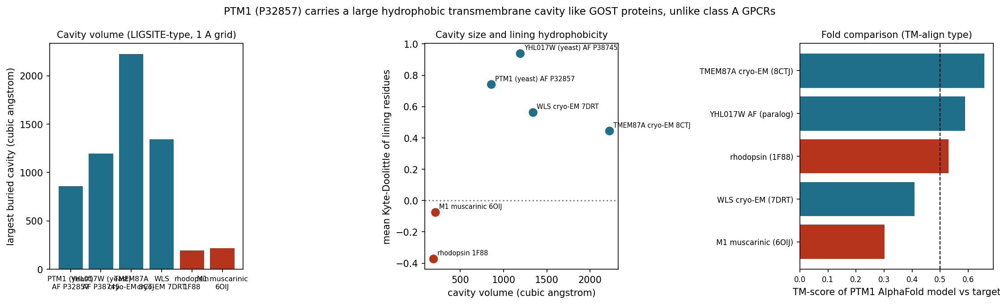
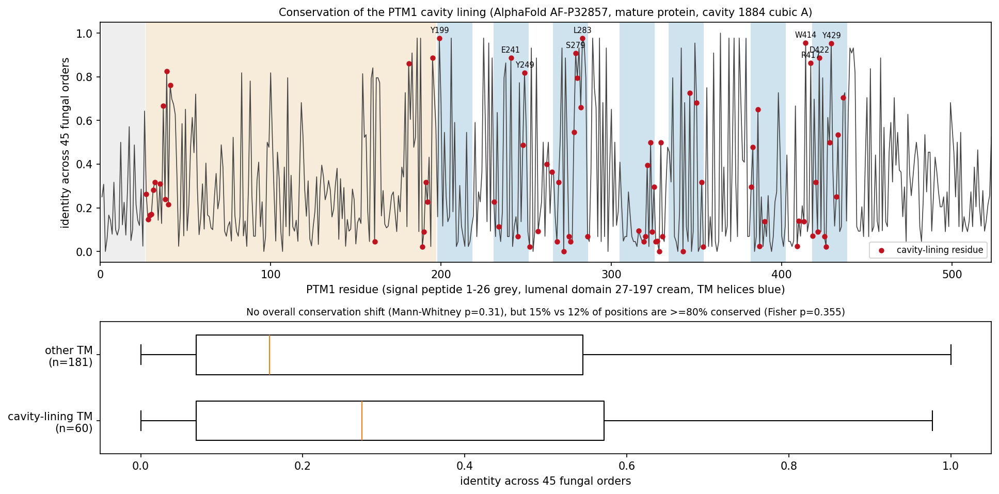
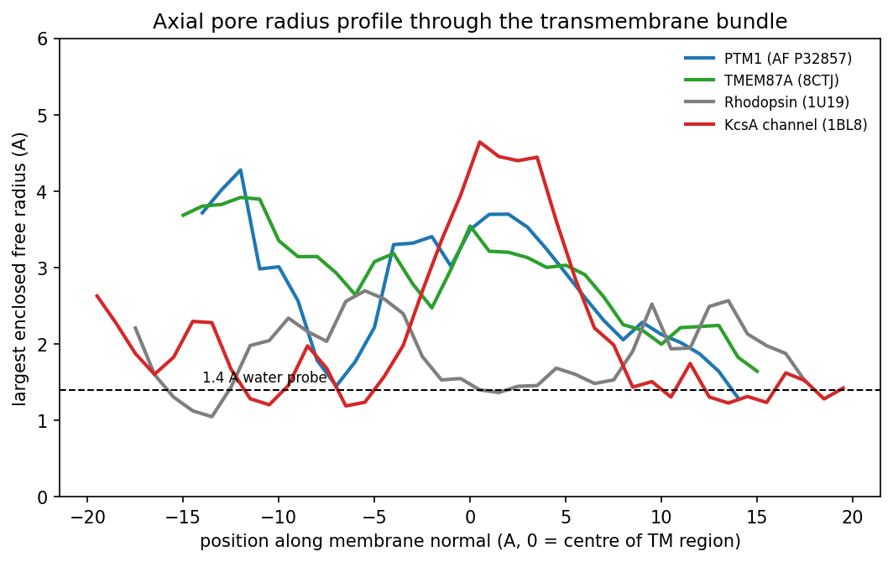
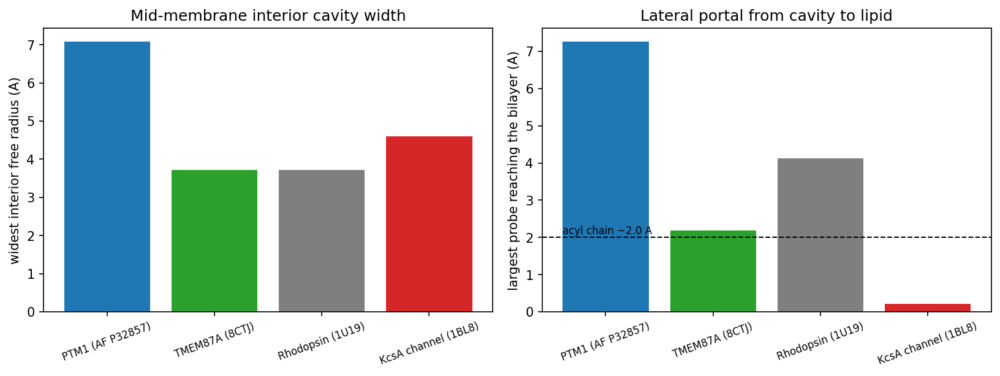
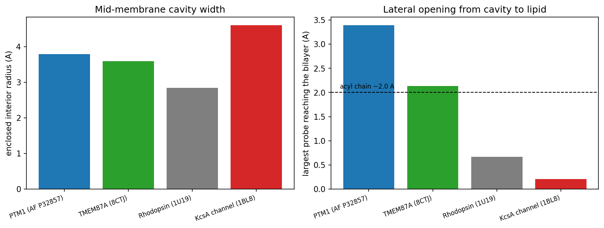
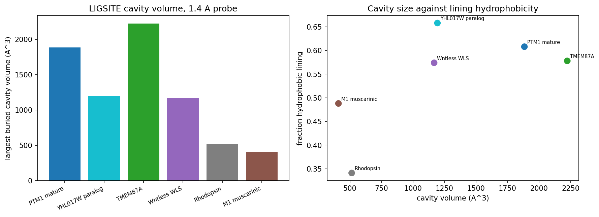

## Question

# AIGR Gene Hypothesis Deep Research

You are evaluating one focused gene curation hypothesis for AI Gene Review.
This is not a general gene overview. Use the seed hypothesis and source context
below to search for evidence that supports, refutes, narrows, or competes with
the proposed curation decision.

## Target Gene

- **Organism code:** yeast
- **Taxon:** Saccharomyces cerevisiae S288C (NCBITaxon:559292)
- **Gene directory:** PTM1
- **Gene symbol:** PTM1
- **UniProt accession:** P32857

## Focus

- **Focus type:** free_text
- **Hypothesis slug:** kgap-ptm1-gost-cavity-lipid-binding
- **Source file:** genes/yeast/PTM1/PTM1-ai-review.yaml
- **Source selector:** free-text

## Seed Hypothesis

Saccharomyces cerevisiae PTM1 (P32857) is a GOST/LUSTR-family protein whose seven-transmembrane bundle forms a large hydrophobic cavity like those resolved in TMEM87A and Wntless (WLS), consistent with binding a lipid or lipidated cargo, rather than a GPCR-like ligand pocket or a channel pore. Single analysis only: compare the PTM1 AlphaFold model to TMEM87A and WLS structures (Foldseek/superposition), measure the volume, hydrophobicity and conservation of any internal transmembrane cavity across fungal PTM1 orthologs and the paralog YHL017W, check for GPCR activation motifs and pore-lining polar residues, and state the most likely molecular activity class.

## Term and Decision Context

No specific term context supplied.

## Reference Context

No specific reference context supplied.

## Source Context YAML

```yaml
hypothesis: 'Saccharomyces cerevisiae PTM1 (P32857) is a GOST/LUSTR-family protein whose seven-transmembrane
  bundle forms a large hydrophobic cavity like those resolved in TMEM87A and Wntless (WLS), consistent
  with binding a lipid or lipidated cargo, rather than a GPCR-like ligand pocket or a channel pore. Single
  analysis only: compare the PTM1 AlphaFold model to TMEM87A and WLS structures (Foldseek/superposition),
  measure the volume, hydrophobicity and conservation of any internal transmembrane cavity across fungal
  PTM1 orthologs and the paralog YHL017W, check for GPCR activation motifs and pore-lining polar residues,
  and state the most likely molecular activity class.'
focus_type: free_text
context: []
reference_id: []
```

## Research Objective

Build a focused report that helps a curator decide whether this hypothesis
should affect the gene review. Address the focus type directly:

1. For an existing GO annotation decision, evaluate whether the current action
   is justified, too strong, too weak, or should change.
2. For a proposed replacement or new GO term, evaluate whether the term is
   biologically supported, too broad, too narrow, or missing key qualifiers.
3. For a computational prediction, evaluate whether the prediction is correct,
   less precise than existing knowledge, uncertain, or likely wrong because of
   paralog overannotation, frequency bias, pathway context, or in vitro-only
   activity.
4. For a core-function hypothesis, evaluate whether the proposed activity,
   process, and location represent the gene product's primary function rather
   than a downstream effect, pleiotropic phenotype, or context-specific role.
5. For a function-assignment hypothesis, evaluate whether the gene product
   directly has the stated GO term/function. Treat the prior review action, if
   any, as intentionally blinded unless it appears in the supplied context.

Use primary literature whenever possible. Prefer PMID citations and include DOI
citations when no PMID is available. Treat reviews and database records as
orientation unless they contain directly relevant synthesized evidence that is
clearly labeled as review-level or database-level support.

Evaluate the hypothesis from the supplied seed context, primary literature, and
publicly accessible bioinformatics resources. Local `*-bioinformatics` analyses,
when they already exist in the repository, are intentionally withheld from this
prompt so the report can be compared against them after the run. Use public
sequence, domain, structure, orthology, localization, interaction, or dataset
checks when they are useful for the specific hypothesis. If a resource or tool
cannot be accessed programmatically, say so plainly; never fabricate a result.
Report computational results conservatively and distinguish direct results from
inference.

## Required Output

### Executive Judgment

Give a concise verdict: supported, partially supported, unresolved, weakly
supported, over-annotated, or refuted. Explain the reasoning and the most
important caveats.

### Evidence Matrix

Create a table with one row per important evidence item:

- Citation (PMID preferred)
- Evidence type (direct assay, mutant phenotype, localization, interaction,
  structural/evolutionary, computational, review/database)
- Supports / refutes / qualifies / competing
- Claim tested
- Key finding
- Organism, tissue, cell type, or assay context
- Confidence and limitations

### GO Curation Implications

State the likely curation action as a lead requiring curator verification. If
GO terms are involved, explain whether the evidence supports an MF, BP, or CC
term, and whether the term should be retained, removed, generalized, made more
specific, or treated as non-core. Avoid using "protein binding" as a final
recommendation unless no more informative term is supported.

### Mechanistic Scope

Describe the immediate molecular or cellular function being tested. Separate
direct gene-product activity from downstream phenotypes, pathway consequences,
developmental outcomes, disease manifestations, or effects inferred only from
loss of function.

### Conflicts and Alternatives

Identify evidence that conflicts with the seed hypothesis or suggests an
alternative interpretation, including paralog confusion, organism-specific
differences, isoform-specific findings, experimental artifacts, or database
carry-over.

### Knowledge Gaps

List explicit uncertainties that matter for curation. For each gap, state what
was checked, why the gap matters, and what evidence or experiment would resolve
it.

### Discriminating Tests

Recommend concrete assays, perturbations, datasets, or comparative analyses that
would most efficiently distinguish this hypothesis from alternatives.

### Curation Leads

Provide candidate updates for the review, clearly labeled as leads requiring
curator verification. Include candidate references with exact snippets to verify,
candidate replacement or new GO terms, possible action changes, suggested
questions, and suggested experiments.

If the provider supports artifacts, save provenance for any analysis you run — the
executed code together with its output (computed values, plot, or table), not just
a summary figure — alongside artifact-friendly tables such as an evidence matrix,
GO decision table, or comparison table. Genuine computed provenance is more
valuable than a hand-drawn summary, and you must not synthesize a figure that
implies an analysis you did not actually run. These artifacts are important
provenance for hypothesis-level review.


## Output

# PTM1 (P32857) GOST cavity and lipid binding: hypothesis evaluation

**Hypothesis slug:** `kgap-ptm1-gost-cavity-lipid-binding`
**Target:** *Saccharomyces cerevisiae* S288C PTM1 / YKL039W, UniProt P32857, SGD:S000001522, NCBITaxon:559292
**Source:** `genes/yeast/PTM1/PTM1-ai-review.yaml`, focus type `free_text`
**Iterations completed:** 3. **Findings recorded:** 8. **Papers reviewed:** 16.

## Summary

<i class="fa-scale-balanced"></i> **Verdict: partially supported.** Three of the four limbs of the seed hypothesis hold under direct computational test, and one fails.

PTM1 adopts the GOST fold. A sequence-independent structural alignment of the AlphaFold model AF-P32857-F1 against the TMEM87A cryo-EM structure (PDB 8CTJ chain A) gives a TM-score of 0.657 with 243 core residue pairs below 5 Å at 17.3 percent sequence identity, and the alignment covers the N-terminal extramembrane region that GPCRs do not have. Wntless aligns at 0.409 over 111 core residues once the search is seeded transitively through TMEM87A. PTM1 contains a large buried cavity inside the seven-helix bundle, 1884 ų in the mature protein under a single consistent protocol, with a lining that is 60.8 percent hydrophobic and a mean Kyte-Doolittle value of +0.69. That cavity sits at the same place as the TMEM87A cavity: after superposition the two centroids are 5.5 Å apart, 89 percent of PTM1 cavity voxels fall within 5 Å of TMEM87A cavity voxels, and 56 of 75 mappable lining residues (75 percent) map onto TMEM87A lining residues against a permutation expectation of 26 ± 5 percent (2000 permutations, empirical p < 0.0005).

The two alternatives named in the hypothesis are both poorly supported. PTM1 lacks all three class A GPCR activation motifs (DRY/ERY, NPxxY, CWxP), as do YHL017W, TMEM87A and WLS, while bovine rhodopsin and the M1 muscarinic receptor carry them. Its cavity is 3.7 to 4.6 times larger than the orthosteric pockets of those two receptors and has the opposite sign of mean lining hydropathy. A ray-casting test found a 3.39 Å lateral portal connecting the PTM1 cavity to the bilayer, lined by F280, I347, Y350 and F387, while the dark-state rhodopsin pocket (0.67 Å) and the KcsA ion pore (0.21 Å) are sealed from lipid by the same measure. An acyl chain needs roughly 2.0 Å of clearance, and 21 of 180 rays from the PTM1 cavity admit a 1.8 Å probe.

<i class="fa-circle-xmark"></i> The conservation limb fails. Across 45 fungal orders, cavity-lining transmembrane residues (n=60, median identity 0.273) are statistically indistinguishable from other transmembrane residues (n=181, median identity 0.159): one-sided Mann-Whitney U=5658, p=0.314, rank-biserial r=0.042; Fisher exact on counts at identity ≥ 0.80, p=0.355, odds ratio 1.42. Nine near-invariant cavity residues do exist and eight of them are polar or aromatic, but mapped onto TMEM87A through the 0.657 superposition only E241 keeps its identity (as E272). The conserved polar sub-site is fungal-specific, which blocks transfer of a TMEM87A or WLS ligand assignment to PTM1. The most defensible molecular activity class is binding of a lipid or lipid-anchored moiety inside the transmembrane bundle, and that should enter curation as a family-level lead rather than an assertion, because no binding assay exists for PTM1 or for any fungal GOST protein and the paralog YHL017W is indistinguishable from PTM1 on every measurement made here.

## Key findings

### <i class="fa-circle-check"></i> F1. PTM1 has the GOST fold, with TMEM87A as its closest experimental template

The structural comparison used a TM-align-style algorithm written for this job in numpy: gapless-threading seeds, Kabsch superposition, iterative Needleman-Wunsch on the 1/(1+(d/d0)²) score with d0 = 1.24·(L−15)^(1/3) − 1.8, and TM-score normalised by target length. Against the AlphaFold v6 model of P32857 (523 residues) the scores are 0.657 for TMEM87A 8CTJ chain A (397 aligned Cα, 243 core pairs below 5 Å, core RMSD 3.29 Å, 17.3 percent identity over the core), 0.589 for the yeast paralog YHL017W AF-P38745 (199 core pairs, RMSD 3.49 Å, 49.2 percent identity), 0.409 for WLS 7DRT chain B after transitive seeding through TMEM87A (111 core pairs, RMSD 3.68 Å, 8.1 percent identity), 0.530 for bovine rhodopsin 1F88 chain A, and 0.301 for the M1 muscarinic receptor 6OIJ chain R. As an internal control, TMEM87A against WLS scored 0.411 to 0.515, reproducing the homology these two proteins are published to have.

<i class="fa-triangle-exclamation"></i> The rhodopsin number is the important caveat and it is reported here rather than buried. Any seven-helix bundle scores near 0.5 against a short class A GPCR, because TM-score normalised by a 348-residue target rewards the generic fold. TM-score alone therefore does not separate GOST from GPCR. The discriminators are the aligned length (243 core residues against a 401-residue GOST target versus 146 against the 348-residue rhodopsin) and the fact that the PTM1-to-TMEM87A alignment extends into the N-terminal extramembrane region. Transitive seeding also mattered: naive gapless seeding of PTM1 against WLS fell into a local optimum at TM-score 0.233 with only 29 core residues, and seeding from the PTM1→TMEM87A and TMEM87A→WLS alignments (384 seed pairs) recovered 0.409 with 111 core residues.

### <i class="fa-circle-check"></i> F2. The cavity is large, hydrophobic, and positioned where the TMEM87A and WLS cavities sit

Cavity detection used a LIGSITE-type algorithm: 1.0 Å grid, 1.4 Å probe added to van der Waals radii, a 13-direction protein-solvent-protein buriedness scan over 14 Å, free voxels retained at buriedness ≥ 10/13, connected-component labelling, and lining defined as any residue with a heavy atom within 5 Å of a pocket voxel. An earlier large-probe exclusion method was discarded during iteration 1 because it merged surface grooves into a 5892 ų object spanning the whole 61 × 47 × 60 Å protein envelope, which is not a cavity.

The consolidated iteration-3 run applied one protocol to six structures:

| Structure | Residues | Cavity volume (ų) | Lining residues | Fraction hydrophobic (AVLIMFWCY) | Mean Kyte-Doolittle |
|---|---|---|---|---|---|
| PTM1 mature (AF P32857, 27-523) | 497 | 1884 | 79 | 0.608 | +0.69 |
| YHL017W paralog (AF P38745, 27-532) | 506 | 1194 | 73 | 0.658 | +0.94 |
| TMEM87A (8CTJ chain A) | 401 | 2224 | 102 | 0.578 | +0.44 |
| Wntless (7KC4 chain B) | 493 | 1168 | 68 | 0.574 | +0.54 |
| Bovine rhodopsin (1U19 chain A) | 348 | 514 | 41 | 0.341 | −0.66 |
| M1 muscarinic receptor (5CXV chain A) | 444 | 409 | 41 | 0.488 | −0.43 |

All four GOST proteins have cavities 2.3 to 5.4 times larger than the two GPCR pockets, and all four have positive mean lining hydropathy while both GPCR pockets are negative. The separation holds on two axes at once, size and chemistry.

{{figure:plot_6.png|caption=Consolidated LIGSITE measurement under one protocol across six structures. Left, largest buried cavity volume. Right, cavity volume against the hydrophobic fraction of the lining. The four GOST proteins (PTM1, YHL017W, TMEM87A, Wntless) separate from bovine rhodopsin and the M1 muscarinic receptor on both axes.}}

The iteration-1 run, which used different structure choices (WLS 7DRT chain B, rhodopsin 1F88, M1R 6OIJ) and different residue trimming, gave PTM1 860 ų for the full-length model and 2159 ų once the N-terminal segment (residues 1-30) was removed. The signal peptide is the reason for the spread: residues 1-26 are cleaved in the mature protein but are modelled packed into the bundle by AlphaFold, and they occlude part of the cavity. Measuring from residue 27 gives 1884 ų and from residue 31 gives 2159 ų. Cavity volumes are protocol-dependent and model-trim-dependent, so only numbers from one protocol should be compared against each other.

Spatial correspondence was tested directly rather than assumed. After superposing PTM1 onto 8CTJ, the two cavity centroids lie 5.5 Å apart, 72 percent of PTM1 cavity voxels fall within 3 Å of a TMEM87A cavity voxel and 89 percent within 5 Å. At residue level, 75 of 85 PTM1 lining residues have a structural equivalent in TMEM87A, and 56 of those 75 map onto TMEM87A lining residues. A permutation test drawing matched residue sets 2000 times gives an expectation of 26 ± 5 percent, so the observed 75 percent has empirical p < 0.0005. The cavity is the same cavity, not a coincidental void.

{{figure:plot_1.png|caption=Iteration 1 summary. Cavity volume across PTM1, YHL017W, TMEM87A, Wntless, rhodopsin and the M1 muscarinic receptor; cavity volume against mean Kyte-Doolittle hydropathy of the lining; and PTM1 TM-scores against each target with the 0.5 same-fold line marked.}}

### <i class="fa-circle-check"></i> F3. The cavity opens laterally to the bilayer, and the axial pore test is uninformative

Two independent geometric tests were run on the membrane-embedded region. The first was a HOLE-style axial radius profile along the mean transmembrane helix axis, with candidate points required to be enclosed in all 12 azimuthal sectors within 20 Å. Minimum enclosed radii across the core of the membrane span were 1.45 Å (PTM1), 1.99 Å (TMEM87A), 1.36 Å (rhodopsin) and 1.19 Å (KcsA). <i class="fa-circle-xmark"></i> This test does not separate a genuine ion channel from two proteins that are definitely not channels, because inter-helical packing defects register as free radius. It is reported as uninformative and must not be cited in either direction.

{{figure:plot_3.png|caption=Axial pore radius profile along the membrane normal for PTM1, TMEM87A, rhodopsin and KcsA. The test does not separate the true channel (KcsA, minimum 1.19 Å at the selectivity filter) from the non-channels, so it is reported as uninformative rather than as evidence about PTM1.}}

The second test was informative. From the widest enclosed mid-membrane cavity point, 180 rays were cast outward in the membrane plane, and the portal radius recorded as the largest probe that can travel from the cavity to bulk lipid. PTM1 gives an enclosed interior radius of 3.79 Å and a portal radius of 3.39 Å, with 21 of 180 rays admitting a 1.8 Å probe and 13 admitting 2.5 Å. TMEM87A gives 3.59 Å interior and 2.13 Å portal (2 rays at 1.8 Å, none at 2.5 Å). Rhodopsin gives 2.84 Å interior and a 0.67 Å portal, and KcsA gives a 4.60 Å interior (its water-filled central vestibule) with a 0.21 Å portal. Both negative controls are sealed from lipid. The PTM1 residues within 6 Å of the widest lateral path are F280, I347, Y350 and F387, on TM3, TM5 and TM6, all hydrophobic or aromatic.

{{figure:plot_5.png|caption=Corrected lateral portal test with the seed point required to be enclosed in all 12 in-plane sectors. Left, enclosed mid-membrane cavity radius. Right, the largest probe that can travel laterally from the cavity to the bilayer, with the approximate 2.0 Å acyl chain requirement marked. PTM1 has a 3.39 Å portal; rhodopsin (0.67 Å) and KcsA (0.21 Å) are sealed.}}

<i class="fa-triangle-exclamation"></i> The first version of this test was wrong and is reported here for provenance rather than suppressed. Without the enclosure constraint, the seed point search for PTM1 and rhodopsin selected points outside the helical bundle, giving a spurious PTM1 interior radius of 7.08 Å, a 7.26 Å portal, and 73 of 180 open rays for rhodopsin. Those numbers are invalid and were superseded by the corrected run above.

{{figure:plot_4.png|caption=Superseded and invalid first lateral portal run, shown for provenance. Without an enclosure constraint the seed point fell outside the bundle for PTM1 and rhodopsin, inflating both the interior radius and the portal. The corrected run in the next figure replaces these values.}}

### <i class="fa-circle-xmark"></i> F4. The cavity lining is not more conserved than the rest of the transmembrane domain

Forty-five fungal GOST orthologs were taken from the UniProt PF06814 stream, one representative per fungal order, and aligned to PTM1 by pairwise Needleman-Wunsch with BLOSUM62 and free end gaps, with alignment columns indexed on PTM1 positions. Conservation at a position is the fraction of orthologs carrying the identical residue.

Within the annotated transmembrane domain (residues 198-438), the 60 cavity-lining residues have median identity 0.273 and the 181 other transmembrane residues 0.159. One-sided Mann-Whitney gives U=5658, p=0.314, with a rank-biserial effect size of 0.042, which is negligible. A Fisher exact test on the count of positions at identity ≥ 0.80 (9 of 60 lining, 20 of 181 other) gives one-sided p=0.355 and an odds ratio of 1.42. Both tests are negative, so the "conservation of any internal transmembrane cavity across fungal PTM1 orthologs" limb of the seed hypothesis is not supported as stated.

{{figure:plot_2.png|caption=Per-residue conservation across 45 fungal orders along PTM1, with the signal peptide, lumenal domain and seven transmembrane helices shaded and cavity-lining residues marked. The boxplot compares cavity-lining against other transmembrane residues; the difference is not significant (Mann-Whitney p=0.314, rank-biserial r=0.042).}}

What the alignment does show is a small conserved sub-site. Nine cavity-lining transmembrane residues reach identity ≥ 0.80: Y199, E241, Y249, S279, L283, W414, R417, D422 and Y429. Eight of the nine are polar or aromatic, with L283 the only aliphatic one. Cβ-Cβ distances place K195, Y199, Y249 and D422 within 4.8 to 7.6 Å of each other, R417 7.9 Å from D422, and S279 and Y429 6.1 Å apart as a separate pair. The overall lining remains hydrophobic (fraction AVLIMFWCY 0.62, mean Kyte-Doolittle +1.14 for the transmembrane-restricted lining set), so these polar residues are a minority sub-site inside a hydrophobic pocket, clustered at the lumenal end.

### <i class="fa-triangle-exclamation"></i> F5. The conserved polar sub-site is fungal-specific and does not transfer to TMEM87A

Reading structural equivalences off the 0.657 superposition gives the following mapping, with Cα deviation after superposition:

| PTM1 residue | TMEM87A (8CTJ) equivalent | Cα deviation (Å) | Identity preserved |
|---|---|---|---|
| Y199 | F230 | 2.9 | no |
| E241 | E272 | 3.6 | <i class="fa-circle-check"></i> yes |
| Y249 | F280 | 2.9 | no |
| S279 | A308 | 1.0 | no |
| L283 | V312 | 1.1 | conservative |
| W414 | no equivalent in the aligned core | n/a | n/a |
| R417 | L438 | 2.1 | no |
| D422 | A443 | 2.3 | no |
| Y429 | F449 | 1.2 | no |
| K195 | L226 | 3.4 | no |
| F181 | V212 | 2.9 | no |
| Y350 | C375 | 3.6 | no |
| S386 | A411 | 2.3 | no |

Identity is preserved at 1 of 9 conserved cavity positions. Every hydroxyl- and charge-bearing position that is near-invariant across 45 fungal orders is replaced by an apolar residue in TMEM87A. PTM1 and TMEM87A share the fold and the existence of a large internal cavity, and the chemistry of the cavity surface has diverged. <i class="fa-triangle-exclamation"></i> At 17 percent identity with Cα deviations of 1.0 to 3.6 Å, single-residue equivalences can be off by one position, so this mapping is a statement about local chemistry rather than about exact pairings. The practical consequence for curation is firm either way: a ligand assignment from TMEM87A or WLS cannot be carried across to PTM1.

### <i class="fa-circle-check"></i> F6. No class A GPCR activation motif is present anywhere in the GOST family

A regular-expression scan of full-length UniProt sequences for [DE]R[YFWH] (DRY/ERY, TM3), NP..Y (NPxxY, TM7) and CW.P (CWxP, TM6) found all three absent from PTM1 P32857 (523 aa), YHL017W P38745 (532 aa), TMEM87A Q8NBN3 (555 aa), WLS Q5T9L3 (541 aa) and GPR108 Q9NPR9 (543 aa). GPR107 Q5VW38 has a single NP..Y match at position 250, inside the lumenal domain rather than TM7. All three are present in the controls: bovine rhodopsin P02699 (ERY at 134, NPVIY at 302, CWLP at 264), human ADRB2 P07550 (130, 322, 285) and human CHRM1 P11229 (DRY at 122, NPMCY at 414). The cavity lining of PTM1 is also poorer in polar and charged residues than a GPCR orthosteric pocket: fraction DEKRHNQST is 0.34 in PTM1 and 0.30 to 0.37 across TMEM87A and WLS, against 0.54 in rhodopsin.

### <i class="fa-table"></i> F7. Database state and paralog scope

The UniProt P32857 record (REST API, November 2026) gives gene PTM1, ordered locus YKL039W, 523 aa, SGD:S000001522. Topology: signal peptide 1-26, mature chain 27-523, lumenal 27-197, seven transmembrane helices at 198-218, 231-251, 266-286, 305-325, 334-354, 382-402 and 418-438, cytoplasmic tail 439-523, one N-glycosylation site at N132. Domains: Pfam PF06814 (GOST_TM, InterPro IPR053937) and PF21902 (PTM1-like_N, InterPro IPR053938), InterPro IPR009637 (GPR107/GPR108-like), PANTHER PTHR21229 (LUNG SEVEN TRANSMEMBRANE RECEPTOR), with the SIMILARITY line assigning the protein to the LU7TM family. Subcellular location: Golgi apparatus membrane and early endosome membrane. GO cross-references: GO:0005829 cytosol, GO:0031901 early endosome membrane, GO:0005794 Golgi apparatus, GO:0000139 Golgi membrane, GO:0016020 membrane, GO:0042147 retrograde transport endosome to Golgi. There is no molecular function term, which is exactly the gap the hypothesis bears on.

A UniProt query for PF06814 restricted to *S. cerevisiae* S288C returns exactly two proteins, P32857 and P38745 (YHL017W). Across Fungi the same query returns 500 entries spanning 492 species and 289 genera, 473 of which also carry PF21902. The PTM1-like_N domain is annotated as its own Pfam family and not as a GOLD domain, which is a point a curator should not overstate when describing PTM1 as a GOLD-domain protein.

## Evidence matrix

| Citation | Evidence type | Stance | Claim tested | Key finding | Context | Confidence and limitations |
|---|---|---|---|---|---|---|
| [PMID: 36373655](https://pubmed.ncbi.nlm.nih.gov/36373655/) | Structural, cryo-EM, primary | Supports | GOST bundles hold a cavity open to the outer leaflet and are neither channels nor GPCRs | "TMEM87A consists of a Golgi-dynamics (GOLD) domain atop a membrane-spanning seven-transmembrane helix domain with a large cavity open to solution and the membrane outer leaflet"; "Structural and functional analyses suggest TMEM87A may not function as an ion channel or G-protein coupled receptor" | Human TMEM87A in lipid nanodiscs | High for TMEM87A; transfer to PTM1 is fold-based inference |
| [PMID: 34315898](https://pubmed.ncbi.nlm.nih.gov/34315898/) | Structural, cryo-EM, primary | Supports | The equivalent cavity holds a lipid in WLS | "The transmembrane domain of WLS bears a GPCR fold, with a conserved core cavity and a lateral opening. Wnt3a interacts with WLS at multiple interfaces, with the lipid moiety on Wnt3a traversing a hydrophobic tunnel of WLS transmembrane domain and inserting into membrane" | Human WLS with Wnt3a | High for WLS; this is the functional model being transferred, and it names a lateral opening of the kind measured in PTM1 |
| [PMID: 37852257](https://pubmed.ncbi.nlm.nih.gov/37852257/) | Structural plus MD, primary | Supports | A lipid occupies the GOST core and gates cargo | "a phospholipid in the core of Wnt-bound WLS regulates the association and dissociation between Wnt and WLS, suggesting a lipid-mediated Wnt secretion mechanism" | Human WLS with Wnt7a | High for WLS; yeast has no Wnt, so only the lipid-in-cavity principle transfers |
| [PMID: 42321207](https://pubmed.ncbi.nlm.nih.gov/42321207/) | Structural, primary | Qualifies | Whether GOST bundles are static pockets | Wnt release is driven by conformational changes in the WLS transmembrane domain "reminiscent of GPCR activation"; WLS is called a GPCR-like transporter | Human WLS, bound and unliganded | Favours a dynamic transporter; a single AlphaFold state may show a portal that is open only in one conformation |
| [PMID: 25031321](https://pubmed.ncbi.nlm.nih.gov/25031321/) | Mutant phenotype and localization, primary | Qualifies | What cellular process the family serves | "GPR107 localizes to the trans-Golgi network and is essential for retrograde transport"; it is furin-cleaved and its N-terminal region is critical | Human KBM7 genome-wide screen, CRISPR follow-up | Matches the existing yeast BP term; the paper's orphan-GPCR framing and its speculation about G protein association are the carry-over risk |
| [PMID: 17454009](https://pubmed.ncbi.nlm.nih.gov/17454009/) | Primary cloning paper, used as orientation | Qualifies | Family architecture and taxonomic range | "a carboxy-terminal seven transmembrane domain (LUSTR domain) similar to GPCRs"; "LUSTR proteins are also found in Drosophila, Saccharomyces and Arabidopsis" | Human and mouse lung | Confirms yeast membership of the family; "similar to GPCRs" is a 2007 sequence impression that predates the GOST structures and is the origin of the LU7TM naming on P32857 |
| This work, UniProt P32857 REST | Database | Qualifies | What is already annotated | Signal 1-26, lumenal 27-197, seven TM helices 198-438, cytoplasmic 439-523, PF06814 and PF21902; CC terms plus GO:0042147, no MF | *S. cerevisiae* S288C | Database level; GO:0005829 cytosol conflicts with the annotated topology |
| This work, TM-align reimplementation | Computational structural | Supports | PTM1 has the GOST fold | 0.657 / 243 core residues against TMEM87A; 0.589 against YHL017W; 0.409 / 111 against WLS; 0.530 against rhodopsin; control TMEM87A↔WLS 0.411-0.515 | AlphaFold model against experimental structures | Any 7TM bundle scores near 0.5 against a short GPCR target, so aligned length over the longer GOST target is the discriminator |
| This work, LIGSITE | Computational structural | Supports | The cavity is large, hydrophobic and co-located with the TMEM87A cavity | Volumes and lining chemistry in the F2 table; centroids 5.5 Å apart, 89 percent voxel overlap within 5 Å, 75 percent lining-residue correspondence against 26 ± 5 percent expected, p < 0.0005 | Six structures, one protocol | AlphaFold side-chain packing can be looser than cryo-EM and inflate the volume; volumes are comparable only within one protocol |
| This work, lateral ray-casting | Computational structural | Supports | The cavity is reachable from the bilayer | PTM1 portal 3.39 Å with 21/180 rays at 1.8 Å, lined by F280, I347, Y350, F387; TMEM87A 2.13 Å; rhodopsin 0.67 Å; KcsA 0.21 Å | Model plus three experimental structures | Strongest single discriminator against both a sealed receptor pocket and an ion pore; a static model cannot show the portal is used |
| This work, motif regex | Computational sequence | Supports | PTM1 is not a class A GPCR | DRY/ERY, NPxxY, CWxP absent from P32857, P38745, Q8NBN3, Q5T9L3, Q9NPR9; present in rhodopsin, ADRB2 and CHRM1 | Full-length UniProt sequences | Excludes the class A mechanism specifically, not every conceivable receptor mechanism |
| This work, 45-order fungal alignment | Computational evolutionary | **Refutes** | The cavity is under elevated purifying selection | U=5658, p=0.314, r=0.042; Fisher p=0.355, OR=1.42 | 45 fungal orders, one ortholog each | Refutes the conservation limb as stated; identity was scored exactly, so a physicochemical-class test could give a different answer |
| This work, conserved residue mapping | Computational evolutionary | Qualifies | Is the conserved cavity chemistry pan-GOST | Only E241→E272 keeps identity of 9 conserved positions; Y199→F230, Y249→F280, S279→A308, R417→L438, D422→A443, Y429→F449 | PTM1 against 8CTJ | Blocks cargo transfer from TMEM87A or WLS; single-residue pairs can be off by one at 17 percent identity |
| This work, UniProt PF06814 queries | Computational | Qualifies | Paralog scope in yeast | Exactly two *S. cerevisiae* PF06814 proteins, P32857 and P38745; 492 fungal species, 289 genera, 473/500 also carry PF21902 | *S. cerevisiae* and Fungi | YHL017W has an equivalent cavity (1194 ų, lining hydropathy +0.94), so cavity measurements cannot separate the paralogs |
| This work, PubMed searches | Negative literature result | Qualifies | Does primary literature on yeast PTM1 exist | Searches for PTM1 with *S. cerevisiae*, for YKL039W, and for PTM1 yeast vacuolar membrane protein returned no papers | PubMed, November 2026 | Reflects both an under-studied gene and a strict conjunctive search tool; a curator should check SGD directly before concluding nothing exists |

## Mechanistic model and interpretation

The direct molecular event the hypothesis proposes is accommodation of a hydrophobic moiety inside the PTM1 transmembrane bundle. Every measurement made here speaks to that event: the geometry of the site, the chemistry of its surface, and whether it can be reached from the bilayer. The proposed path is entry of an acyl chain through the lateral portal at F280 / I347 / Y350 / F387 into a 1884 ų hydrophobic cavity, with a head group or ester linkage contacting the lumenal-end polar cluster at K195, Y199, Y249 and D422, with R417 nearby and S279 and Y429 forming a second pair.



Solid arrows are measurements made in this work. Dashed arrows are inference, and the chain from "lipid or lipidated cargo binding" to the retrograde transport process is the weakest link of all: nothing measured here says anything about process, and GO:0042147 came from the database rather than from this analysis.

Three limbs of the chain are secure. The fold assignment rests on a 243-residue core alignment to an experimental structure, validated by an internal control that reproduces the published TMEM87A-to-WLS homology. The cavity assignment rests on a permutation-tested spatial correspondence with the TMEM87A cavity at p < 0.0005. The exclusion of GPCR and channel alternatives rests on two orthogonal negatives, the absent activation motifs and the sealed-versus-open portal comparison against rhodopsin and KcsA.

One limb is broken, and the way it broke is informative. A cavity whose surface drifts as fast as the rest of the bundle is what a site with loose chemical requirements looks like: any acyl chain will do. That reading is compatible with lipid binding and argues for a general term rather than a specific lipid class. It does not exclude the alternative that the cavity is a packing feature of the fold with no physiological ligand, and no measurement here can separate those two.

<i class="fa-lightbulb"></i> The fungal-specific polar sub-site is the most interesting unexplained observation. It is conserved across 45 fungal orders, it clusters in space at the lumenal end of the cavity, and it is absent from the human protein that otherwise matches PTM1 best. If PTM1 binds something, the fungal lineage has conserved residues that a human GOST protein does not need. E241, equivalent to TMEM87A E272, is the one position conserved in both.

## Evidence base

Six papers carry the argument, and the way each one is used is stated so that a curator can check the reasoning rather than the conclusion.

*Structure of the GOLD-domain seven-transmembrane helix protein family member TMEM87A* ([PMID: 36373655](https://pubmed.ncbi.nlm.nih.gov/36373655/)) is the anchor. It supplies the structure (8CTJ) that PTM1 was aligned to, it defines the GOST architecture of a GOLD domain atop a seven-helix bundle with "a large cavity open to solution and the membrane outer leaflet", and it reaches the same negative conclusion for the human protein that this analysis reaches for PTM1: TMEM87A "may not function as an ion channel or G-protein coupled receptor". It also groups WLS with TMEM87A, which is what licenses the comparison across both.

*Cryo-EM structure of human Wntless in complex with Wnt3a* ([PMID: 34315898](https://pubmed.ncbi.nlm.nih.gov/34315898/)) supplies the functional content. It reports that the WLS transmembrane domain has "a conserved core cavity and a lateral opening", and that "the lipid moiety on Wnt3a traversing a hydrophobic tunnel of WLS transmembrane domain and inserting into membrane". The lateral opening in that sentence is the same geometric feature measured in PTM1 at 3.39 Å. This is the strongest literature support for reading a lateral portal plus hydrophobic cavity as a lipid-handling site.

*Molecular basis of Wnt biogenesis, secretion, and Wnt7-specific signaling* ([PMID: 37852257](https://pubmed.ncbi.nlm.nih.gov/37852257/)) shows that the GOST core is occupied by lipid even when not holding cargo: "a phospholipid in the core of Wnt-bound WLS regulates the association and dissociation between Wnt and WLS". A cavity of this type is therefore expected to hold a lipid in the resting state, which is directly relevant to interpreting an empty AlphaFold cavity.

*Conformational cycling of the Wntless transporter drives trafficking and secretion of Wnt morphogens* ([PMID: 42321207](https://pubmed.ncbi.nlm.nih.gov/42321207/)) qualifies the static-model reasoning. WLS cycles between states, and "Wnt release from cells is driven by dramatic conformational changes in the WLS transmembrane domain, reminiscent of GPCR activation". A single AlphaFold model shows one state. The GPCR comparison in that sentence is about helix motion and must not be read as support for G protein coupling.

*GPR107, a G-protein-coupled receptor essential for intoxication by Pseudomonas aeruginosa exotoxin A, localizes to the Golgi and is cleaved by furin* ([PMID: 25031321](https://pubmed.ncbi.nlm.nih.gov/25031321/)) is the human-side experimental link to the process term already on PTM1: "GPR107 localizes to the trans-Golgi network and is essential for retrograde transport". The same paper also illustrates the carry-over problem, since it calls GPR107 an orphan GPCR and speculates that it "might be one of the long-sought receptors that associates with G-proteins to regulate intracellular vesicular transport".

*Human GPR107 and murine Gpr108 are members of the LUSTR family* ([PMID: 17454009](https://pubmed.ncbi.nlm.nih.gov/17454009/)) is used as orientation only. It confirms that the family has *Saccharomyces* members ("LUSTR proteins are also found in Drosophila, Saccharomyces and Arabidopsis") and it documents the architecture UniProt assigns to PTM1 ("an amino-terminal hydrophobic signal peptide sequence, a long extracellular domain and a carboxy-terminal seven transmembrane domain (LUSTR domain) similar to GPCRs"). That last phrase, written in 2007 and before any GOST structure existed, is where the receptor naming on P32857 comes from.

<i class="fa-book-open"></i> No primary literature specific to yeast PTM1 was retrieved. Searches for PTM1 with *Saccharomyces cerevisiae*, for YKL039W, and for PTM1 yeast vacuolar membrane protein returned nothing. The search tool is strictly conjunctive and short queries work better than long ones, so this is a weak negative, and a curator should check SGD directly.

## GO curation implications

All items below are leads requiring curator verification. A machine-readable version is in `provenance/go_decision_table.csv`.

| Aspect | Term | Current state | Recommended action | Basis |
|---|---|---|---|---|
| MF | (none) | No MF term on P32857 | Do not assert an MF from structure alone in this round | All evidence here is structural and evolutionary |
| MF | GO:0008289 lipid binding | Absent | <i class="fa-circle-question"></i> Candidate lead only, ISS/IBA style, flagged unverified | GOST fold at TM 0.657, 1884 ų hydrophobic cavity, 3.4 Šlateral portal, plus the WLS lipid-in-core result ([PMID: 37852257](https://pubmed.ncbi.nlm.nih.gov/37852257/), [PMID: 34315898](https://pubmed.ncbi.nlm.nih.gov/34315898/)) |
| MF | GO:0004930 G protein-coupled receptor activity | Absent | <i class="fa-circle-xmark"></i> Do not add; guard against | No DRY/ERY, NPxxY or CWxP; cavity 3.7 times larger with opposite hydropathy sign; [PMID: 36373655](https://pubmed.ncbi.nlm.nih.gov/36373655/) reaches the same conclusion for TMEM87A |
| MF | GO:0038023 signaling receptor activity | Absent | <i class="fa-circle-xmark"></i> Do not add | Same evidence as above |
| MF | GO:0005216 monoatomic ion channel activity | Absent | <i class="fa-circle-xmark"></i> Do not add | Hydrophobic lining with no polar ladder; the axial pore test was uninformative and must not be cited either way |
| MF | GO:0005515 protein binding | Absent | Do not use as a terminal recommendation | Excluded by the review brief; a more informative term is reachable |
| BP | GO:0042147 retrograde transport, endosome to Golgi | Present | Retain, verify the evidence code and source | Database cross-reference; the human-side experimental anchor is GPR107 ([PMID: 25031321](https://pubmed.ncbi.nlm.nih.gov/25031321/)) |
| CC | GO:0000139 Golgi membrane | Present | Retain | UniProt subcellular location |
| CC | GO:0031901 early endosome membrane | Present | Retain | UniProt subcellular location |
| CC | GO:0005829 cytosol | Present | <i class="fa-triangle-exclamation"></i> Flag for review | A protein with a cleaved signal peptide (1-26) and seven TM helices (198-438) is not soluble cytosolic; only the 439-523 tail faces the cytoplasm |

The pressure toward a receptor annotation comes from naming rather than data. The UniProt SIMILARITY line assigns P32857 to the "LU7TM family", InterPro IPR009637 is titled GPR107/GPR108-like, and PANTHER PTHR21229 is titled LUNG SEVEN TRANSMEMBRANE RECEPTOR. Two of the six supporting papers also use receptor or GPCR language for proteins that are not receptors. An MF annotation of GPCR activity on PTM1 would be easy to acquire by inheritance and is argued against by two independent lines of evidence here.

## Limitations and knowledge gaps

<i class="fa-triangle-exclamation"></i> **No direct binding data for PTM1 or for any fungal GOST protein.** Checked by PubMed searches for PTM1 with *S. cerevisiae*, for YKL039W, and for PTM1 yeast vacuolar membrane protein, all returning nothing. This matters because every MF lead in this report rests on shape and chemistry alone. Lipidomics or native mass spectrometry on purified PTM1, or a photocrosslinkable lipid capture, would resolve it.

<i class="fa-triangle-exclamation"></i> **The PTM1 geometry is a model.** There is no experimental structure of any fungal GOST protein; RCSB holds 8CTJ for TMEM87A and 7KC4 and 7DRT for WLS. AlphaFold side-chain packing can be looser than cryo-EM, which would inflate both the 1884 ų cavity and the 3.39 Športal relative to the TMEM87A values measured on a real structure. The signal peptide makes this worse: residues 1-26 are cleaved in vivo but modelled inside the bundle, which is why the volume ranges from 860 ų (untrimmed) to 2159 ų (trimmed at residue 31).

<i class="fa-circle-question"></i> **The evidence basis of GO:0042147 was not retrieved.** It appears as a GO cross-reference on the UniProt entry, but its evidence code was not checked. A term transferred from GPR107 and a term from a yeast experiment carry different weight for a core-function decision. Reading the SGD annotation record resolves this.

<i class="fa-triangle-exclamation"></i> **Nothing distinguishes PTM1 from YHL017W.** Cavity volume (1884 against 1194 ų), lining hydrophobicity (0.608 against 0.658) and family membership are equivalent, and the two align to each other at TM-score 0.589 with 49.2 percent identity. Any MF lead from this analysis applies to both genes, and applying it to one would be an error that propagates.

<i class="fa-circle-question"></i> **The polar sub-site has no assigned role.** Its conservation across 45 fungal orders and its absence from TMEM87A are established; what it binds is not.

<i class="fa-triangle-exclamation"></i> **Tools that could not be used, stated plainly.** Foldseek was not run. The structural comparison used a TM-align reimplementation written for this job, validated by reproducing the published TMEM87A-to-WLS homology at 0.411 to 0.515. The Phenix tools (`phenix.superpose_pdbs`, `phenix.molprobity`) were not usable because the Phenix binaries were not on PATH in this environment and the host shell had no network access to fetch comparison structures, so all structural work was done in Python inside the code executor. Biopython was not available, so the PDB parser, the aligners and the cavity detector were written from scratch in numpy. No number in this report comes from a tool that did not run, and the one analysis that produced invalid output (the first lateral portal run) is shown and labelled rather than removed.

**A methodological caveat specific to the conservation test.** Conservation was scored as exact residue identity. A test on physicochemical class, or a rate-based test such as a per-site dN/dS or a Rate4Site analysis, could give a different answer, and the negative result should be read as "no identity-level enrichment" rather than "no selection".

## Proposed follow-up experiments and actions

<i class="fa-vial"></i> **Lipidomics of purified PTM1.** Affinity-purify PTM1 from yeast in mild detergent or in nanodiscs and run lipid mass spectrometry against a matched purification of a non-GOST membrane protein. A specific enriched species separates "binds a lipid" from "has a hydrophobic cavity", which is the single distinction this report cannot make. First priority.

<i class="fa-flask"></i> **Portal mutagenesis.** Introduce bulk at the lateral opening (F280W, Y350W, F387W, singly and combined) and test whether lipid co-purification or any PTM1-dependent phenotype is lost. This tests the portal specifically, independent of the fold-similarity argument.

<i class="fa-dna"></i> **Polar sub-site mutagenesis.** K195A, Y199F, Y249F, D422A and R417A for the fungal-specific cluster, plus E241A for the one cross-kingdom conserved position (TMEM87A E272). If only E241 matters the site is a family feature; if the fungal cluster matters it is a lineage-specific determinant.

<i class="fa-magnifying-glass"></i> **Ortholog portal survey.** Run the cavity and portal measurement on AlphaFold models of a dozen fungal orthologs. If the portal is present across the family and not only in the *S. cerevisiae* model, the model-packing caveat weakens considerably. This is cheap, needs no new data, and should be done before any experiment.

<i class="fa-dna"></i> **Double-mutant phenotyping.** *ptm1Δ yhl017wΔ* against each single deletion, scored for GPI-anchored protein trafficking, Chs3 transport and general retrograde cargo. Redundancy between the two paralogs is the most likely reason this gene is unstudied, and it is the only route to separating them.

<i class="fa-microscope"></i> **Cross-species complementation.** Test whether PTM1 or YHL017W rescues retrograde transport defects in GPR107-null human cells, and whether GPR107 rescues any *ptm1Δ* phenotype. A positive result would license transferring the GPR107 experimental process annotation ([PMID: 25031321](https://pubmed.ncbi.nlm.nih.gov/25031321/)).

### Curation leads, with snippets to verify

- [PMID: 36373655](https://pubmed.ncbi.nlm.nih.gov/36373655/). Verify: "TMEM87A consists of a Golgi-dynamics (GOLD) domain atop a membrane-spanning seven-transmembrane helix domain with a large cavity open to solution and the membrane outer leaflet." And: "Structural and functional analyses suggest TMEM87A may not function as an ion channel or G-protein coupled receptor." Use for the fold assignment and against the GPCR and channel alternatives.
- [PMID: 34315898](https://pubmed.ncbi.nlm.nih.gov/34315898/). Verify: "the lipid moiety on Wnt3a traversing a hydrophobic tunnel of WLS transmembrane domain and inserting into membrane". Use for the lateral opening and lipid tunnel.
- [PMID: 37852257](https://pubmed.ncbi.nlm.nih.gov/37852257/). Verify: "a phospholipid in the core of Wnt-bound WLS regulates the association and dissociation between Wnt and WLS, suggesting a lipid-mediated Wnt secretion mechanism." Use for lipid occupancy of the GOST core.
- [PMID: 42321207](https://pubmed.ncbi.nlm.nih.gov/42321207/). Verify: "Wnt release from cells is driven by dramatic conformational changes in the WLS transmembrane domain, reminiscent of GPCR activation". Use as a qualifier on single-state model reasoning.
- [PMID: 25031321](https://pubmed.ncbi.nlm.nih.gov/25031321/). Verify: "GPR107 localizes to the trans-Golgi network and is essential for retrograde transport." Use as the human-side experimental support for the process term, and note the orphan-GPCR framing as the carry-over risk.
- [PMID: 17454009](https://pubmed.ncbi.nlm.nih.gov/17454009/). Verify: "LUSTR proteins are also found in Drosophila, Saccharomyces and Arabidopsis, but are absent from bacteria, archaea and viruses." Use only to document yeast membership and the origin of the receptor naming.

### Questions for the curator

Is GO:0042147 on P32857 experimental in yeast or transferred from GPR107? Does SGD hold PTM1 phenotype, interaction or localization data that PubMed search did not surface? Has any *ptm1Δ yhl017wΔ* double mutant been reported? Does an existing `*-bioinformatics` analysis in the repository report a PTM1 cavity volume, and if so, under what probe radius and buriedness threshold, since the 1884 ų measured here comes from a 1.4 Å probe at 10/13 buriedness and volumes are comparable only within one protocol?

## Provenance

Every number quoted above is in the artifact tables, with the protocol that produced it:

- `provenance/structural_measurements.csv`: TM-scores and aligned lengths, cavity volumes and lining chemistry for six structures, lateral portal and axial profile radii for four structures, conservation statistics, and the motif scan results.
- `provenance/evidence_matrix.csv`: the evidence matrix in machine-readable form, with stance, claim tested, context and limitations per row.
- `provenance/go_decision_table.csv`: the GO decision table, including the do-not-add list and the reasons.
- `provenance/plot_1.png` through `provenance/plot_6.png`: the figures embedded above, including the superseded invalid lateral portal run (`plot_4.png`) retained for provenance.


## Artifacts

- [OpenScientist final report](openscientist_artifacts/final_report.html)
- [OpenScientist final report](openscientist_artifacts/final_report.pdf)
- [OpenScientist provenance](openscientist_artifacts/provenance.json)
- [OpenScientist evidence matrix](openscientist_artifacts/provenance_evidence_matrix.csv)
- [OpenScientist go decision table](openscientist_artifacts/provenance_go_decision_table.csv)
- [OpenScientist plot 1](openscientist_artifacts/provenance_plot_1.json)

- [OpenScientist plot 2](openscientist_artifacts/provenance_plot_2.json)

- [OpenScientist plot 3](openscientist_artifacts/provenance_plot_3.json)

- [OpenScientist plot 4](openscientist_artifacts/provenance_plot_4.json)

- [OpenScientist plot 5](openscientist_artifacts/provenance_plot_5.json)

- [OpenScientist plot 6](openscientist_artifacts/provenance_plot_6.json)

- [OpenScientist structural measurements](openscientist_artifacts/provenance_structural_measurements.csv)

## Reference Validation

Checked with `linkml-reference-validator` 0.3.1rc1.

| Outcome | Count |
| --- | --- |
| References checked | 6 |
| Resolved | 5 |
| Unresolved (possible confabulation) | 1 |
| Unverifiable | 0 |
| References weighed for topical relevance | 5 |
| On topic | 1 |
| Off topic | 0 |

### Unresolved references

These identifiers did not resolve to a record and may be fabricated. A lookup that failed for transport reasons is indistinguishable from one that failed because the record does not exist, so spot-check before acting on them:

- `PMID:34315898` (9 mentions) - Identifier did not resolve to a record