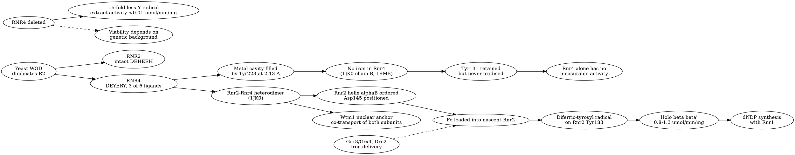
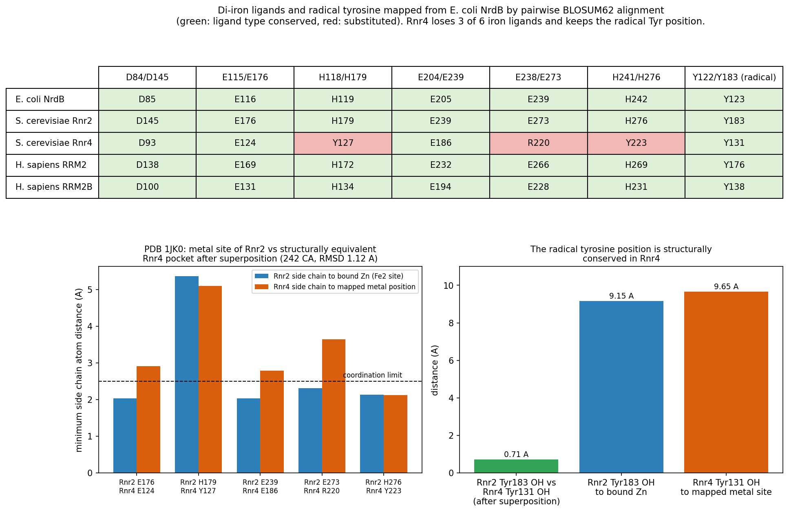
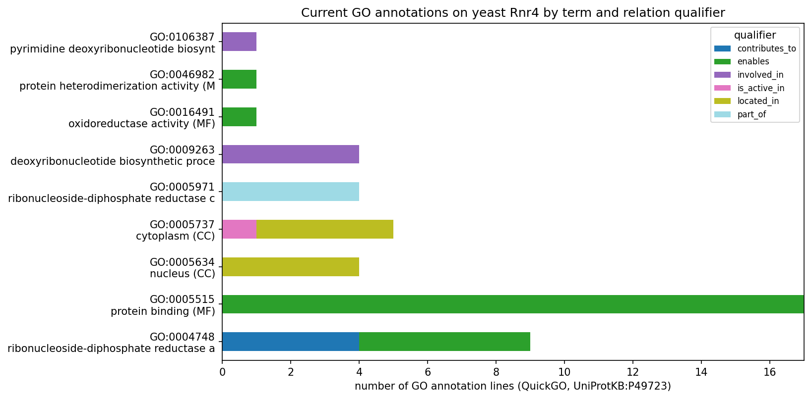
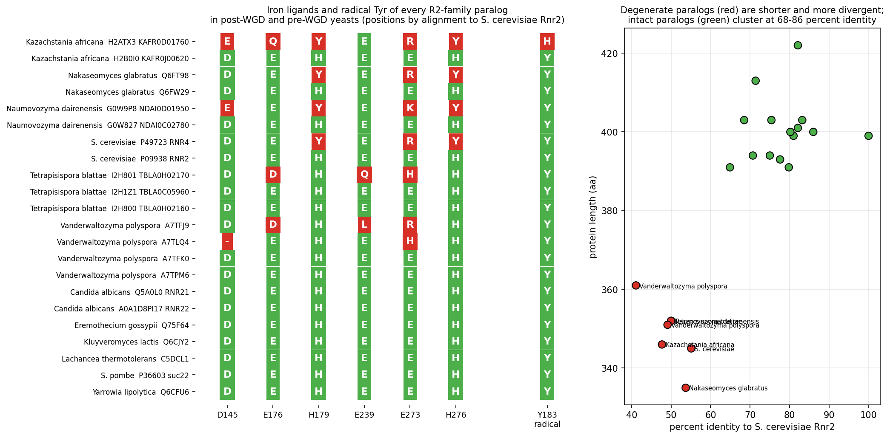
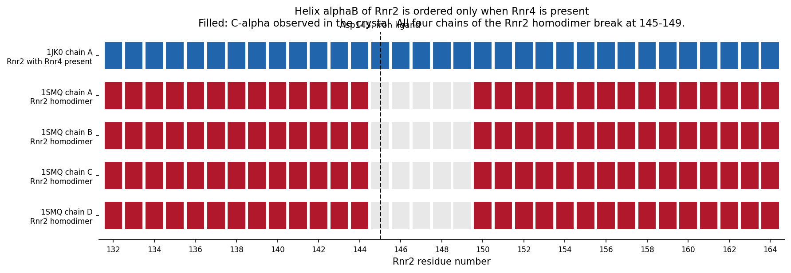

## Question

# AIGR Gene Hypothesis Deep Research

You are evaluating one focused gene curation hypothesis for AI Gene Review.
This is not a general gene overview. Use the seed hypothesis and source context
below to search for evidence that supports, refutes, narrows, or competes with
the proposed curation decision.

## Target Gene

- **Organism code:** yeast
- **Taxon:** Saccharomyces cerevisiae S288C (NCBITaxon:559292)
- **Gene directory:** RNR4
- **Gene symbol:** RNR4
- **UniProt accession:** P49723

## Focus

- **Focus type:** free_text
- **Hypothesis slug:** rnr4-catalytic-residues
- **Source file:** genes/yeast/RNR4/RNR4-ai-review.yaml
- **Source selector:** free-text

## Seed Hypothesis

Yeast Rnr4 lacks the di-iron-binding residues and the radical-harbouring tyrosine of the ribonucleotide reductase small (R2) subunit, so it is catalytically inactive itself and contributes to ribonucleoside-diphosphate reductase activity only as a structural partner of Rnr2 in the Rnr2-Rnr4 heterodimer.

## Term and Decision Context

- Decisive analysis: align Rnr4 with Rnr2 and E. coli NrdB and check the iron ligands and the radical tyrosine position.

## Reference Context

No specific reference context supplied.

## Source Context YAML

```yaml
hypothesis: Yeast Rnr4 lacks the di-iron-binding residues and the radical-harbouring tyrosine of the ribonucleotide
  reductase small (R2) subunit, so it is catalytically inactive itself and contributes to ribonucleoside-diphosphate
  reductase activity only as a structural partner of Rnr2 in the Rnr2-Rnr4 heterodimer.
focus_type: free_text
context:
- 'Decisive analysis: align Rnr4 with Rnr2 and E. coli NrdB and check the iron ligands and the radical
  tyrosine position.'
reference_id: []
```

## Research Objective

Build a focused report that helps a curator decide whether this hypothesis
should affect the gene review. Address the focus type directly:

1. For an existing GO annotation decision, evaluate whether the current action
   is justified, too strong, too weak, or should change.
2. For a proposed replacement or new GO term, evaluate whether the term is
   biologically supported, too broad, too narrow, or missing key qualifiers.
3. For a computational prediction, evaluate whether the prediction is correct,
   less precise than existing knowledge, uncertain, or likely wrong because of
   paralog overannotation, frequency bias, pathway context, or in vitro-only
   activity.
4. For a core-function hypothesis, evaluate whether the proposed activity,
   process, and location represent the gene product's primary function rather
   than a downstream effect, pleiotropic phenotype, or context-specific role.
5. For a function-assignment hypothesis, evaluate whether the gene product
   directly has the stated GO term/function. Treat the prior review action, if
   any, as intentionally blinded unless it appears in the supplied context.

Use primary literature whenever possible. Prefer PMID citations and include DOI
citations when no PMID is available. Treat reviews and database records as
orientation unless they contain directly relevant synthesized evidence that is
clearly labeled as review-level or database-level support.

Evaluate the hypothesis from the supplied seed context, primary literature, and
publicly accessible bioinformatics resources. Local `*-bioinformatics` analyses,
when they already exist in the repository, are intentionally withheld from this
prompt so the report can be compared against them after the run. Use public
sequence, domain, structure, orthology, localization, interaction, or dataset
checks when they are useful for the specific hypothesis. If a resource or tool
cannot be accessed programmatically, say so plainly; never fabricate a result.
Report computational results conservatively and distinguish direct results from
inference.

## Required Output

### Executive Judgment

Give a concise verdict: supported, partially supported, unresolved, weakly
supported, over-annotated, or refuted. Explain the reasoning and the most
important caveats.

### Evidence Matrix

Create a table with one row per important evidence item:

- Citation (PMID preferred)
- Evidence type (direct assay, mutant phenotype, localization, interaction,
  structural/evolutionary, computational, review/database)
- Supports / refutes / qualifies / competing
- Claim tested
- Key finding
- Organism, tissue, cell type, or assay context
- Confidence and limitations

### GO Curation Implications

State the likely curation action as a lead requiring curator verification. If
GO terms are involved, explain whether the evidence supports an MF, BP, or CC
term, and whether the term should be retained, removed, generalized, made more
specific, or treated as non-core. Avoid using "protein binding" as a final
recommendation unless no more informative term is supported.

### Mechanistic Scope

Describe the immediate molecular or cellular function being tested. Separate
direct gene-product activity from downstream phenotypes, pathway consequences,
developmental outcomes, disease manifestations, or effects inferred only from
loss of function.

### Conflicts and Alternatives

Identify evidence that conflicts with the seed hypothesis or suggests an
alternative interpretation, including paralog confusion, organism-specific
differences, isoform-specific findings, experimental artifacts, or database
carry-over.

### Knowledge Gaps

List explicit uncertainties that matter for curation. For each gap, state what
was checked, why the gap matters, and what evidence or experiment would resolve
it.

### Discriminating Tests

Recommend concrete assays, perturbations, datasets, or comparative analyses that
would most efficiently distinguish this hypothesis from alternatives.

### Curation Leads

Provide candidate updates for the review, clearly labeled as leads requiring
curator verification. Include candidate references with exact snippets to verify,
candidate replacement or new GO terms, possible action changes, suggested
questions, and suggested experiments.

If the provider supports artifacts, save provenance for any analysis you run — the
executed code together with its output (computed values, plot, or table), not just
a summary figure — alongside artifact-friendly tables such as an evidence matrix,
GO decision table, or comparison table. Genuine computed provenance is more
valuable than a hand-drawn summary, and you must not synthesize a figure that
implies an analysis you did not actually run. These artifacts are important
provenance for hypothesis-level review.


## Output

# RNR4 (P49723, *Saccharomyces cerevisiae*): catalytic residues and the basis of its RNR annotation

Hypothesis slug: `rnr4-catalytic-residues`. Focus type: free_text. Source file: `genes/yeast/RNR4/RNR4-ai-review.yaml`. Target: UniProt **P49723**, NCBITaxon:559292.

Seed hypothesis under test: "Yeast Rnr4 lacks the di-iron-binding residues and the radical-harbouring tyrosine of the ribonucleotide reductase small (R2) subunit, so it is catalytically inactive itself and contributes to ribonucleoside-diphosphate reductase activity only as a structural partner of Rnr2 in the Rnr2-Rnr4 heterodimer."

## Summary

**Verdict: partially supported.** The decisive analysis requested in the brief was run. Rnr4 was aligned with Rnr2 (P09938) and with *E. coli* NrdB (P69924) by affine Needleman-Wunsch, the six di-iron ligands and the radical tyrosine were located in all three proteins, and the positions were checked against coordinates from PDB 1JK0 (Rnr2-Rnr4 heterodimer), 1SMQ (Rnr2 homodimer) and 1SMS (Rnr4 homodimer). Three of the hypothesis's four clauses survive, one is wrong, and one is too weak.

Rnr4 retains **three** of the six canonical di-iron ligands (Asp93, Glu124, Glu186) and has lost three (Rnr2 His179 to Tyr127, Glu273 to Arg220, His276 to Tyr223). The pocket that would hold Fe1 and Fe2 is filled: after superposing Rnr2 onto Rnr4 (242 CA pairs, core RMSD 1.12 Å), the ring carbon Tyr223 CD1 sits 2.13 Å from the position onto which the Rnr2-bound metal maps. No metal is present in Rnr4 in either crystal form. Purified Y4 has no measurable RNR activity and no tyrosyl radical can be generated on it ([PMID: 10535923](https://pubmed.ncbi.nlm.nih.gov/10535923/)). The catalytic-inactivity conclusion is therefore solid, but the wording should say "lacks three of six iron ligands", not "lacks the di-iron-binding residues".

The clause stating that Rnr4 lacks the radical tyrosine is **refuted**. Rnr4 Tyr131 aligns to NrdB Tyr123, Rnr2 Tyr183, human RRM2 Tyr176 and RRM2B Tyr138, and after superposition its hydroxyl oxygen lands 0.71 Å from that of Rnr2 Tyr183. UniProt independently annotates P49723 Tyr131 as an active site, and all 493 fungal R2-family proteins scanned carry Tyr at this position. What Rnr4 lacks is the metal centre that oxidises that tyrosine, which is sufficient to explain the absence of a radical. The clause as written asserts a sequence fact that a single alignment contradicts and should be struck from the review text.

The clause "contributes only as a structural partner" under-states the measured role. Rnr4 is required *in vivo* for loading iron into nascent Rnr2 and for forming the diferric-tyrosyl radical ([PMID: 21931161](https://pubmed.ncbi.nlm.nih.gov/21931161/)), *rnr4Δ* extracts have 15-fold less tyrosyl radical than wild type ([PMID: 16285741](https://pubmed.ncbi.nlm.nih.gov/16285741/)), and the structural mechanism is specific: the Rnr2 helix αB that donates iron ligand Asp145 is fully ordered only when Rnr4 is present. For GO curation, the practical consequence is that GO:0004748 on P49723 should carry only `contributes_to` and the five `enables` lines should go, the fold-derived GO:0016491 `enables` line should be dropped, and a biological-process term covering cofactor maturation of the partner subunit is a reasonable addition.

## Key findings

### <i class="fa-solid fa-circle-check"></i> Finding 1: Rnr4 loses three of six di-iron ligands and its metal pocket is sterically occluded

Pairwise global alignment with BLOSUM62 and affine gaps (open -11, extend -1) placed *E. coli* NrdB against yeast Rnr2 (28.4% identity over 328 aligned columns) and against yeast Rnr4 (21.8% over 325 columns), and Rnr2 directly against Rnr4 (55.1% identity over 345 aligned columns, score 957). The positive control for the method is that the six UniProt-annotated Fe ligands of NrdB (D85, E116, H119, E205, E239, H242) map onto Rnr2 D145, E176, H179, E239, E273, H276, which reproduces UniProt's independent Rnr2 annotation exactly, 6 of 6. Human RRM2 and RRM2B also conserve 6 of 6. The same procedure maps the NrdB ligands onto Rnr4 D93, E124, **Y127**, E186, **R220**, **Y223**: three conserved, three substituted.

The structural test used PDB 1JK0 at 2.8 Å, where chain A is Rnr2, chain B is Rnr4, and PDB numbering matches UniProt numbering. The single Zn ion sits in chain A, coordinated by Glu176 OE1 at 2.03 Å, Glu239 OE1 at 2.04 Å, His276 ND1 at 2.13 Å and Glu273 OE1 at 2.31 Å. Kabsch superposition of Rnr2 onto Rnr4 used 242 of 265 CA pairs within 3 Å and gave a core RMSD of 1.12 Å. Mapping the Zn position into the Rnr4 frame places Rnr4 Tyr223 CD1 at 2.13 Å, Glu186 OE2 at 2.78 Å, Glu124 OE2 at 2.92 Å, Gln120 OE1 at 3.15 Å and Arg220 NE at 3.67 Å from the would-be metal position. The CA atoms of the five observed ligand-equivalent pairs deviate by only 0.10-0.91 Å, so the changes are local side-chain substitutions inside a conserved ferritin-like scaffold and not a fold difference.

Rnr4 chain B contains no metal. The Rnr4 homodimer structure 1SMS also contains no iron, carrying only four Hg heavy-atom sites at surface residues Cys217 and Cys228.

| Site role | *E. coli* NrdB | Yeast Rnr2 | Yeast Rnr4 | Human RRM2 | Human RRM2B | Conserved in Rnr4 |
|---|---|---|---|---|---|---|
| Fe ligand 1 | D85 | D145 | D93 | D138 | D100 | yes |
| Fe ligand 2 | E116 | E176 | E124 | E169 | E131 | yes |
| Fe ligand 3 | H119 | H179 | **Y127** | H172 | H134 | no (His to Tyr) |
| Fe ligand 4 | E205 | E239 | E186 | E232 | E194 | yes |
| Fe ligand 5 | E239 | E273 | **R220** | E266 | E228 | no (Glu to Arg) |
| Fe ligand 6 | H242 | H276 | **Y223** | H269 | H231 | no (His to Tyr) |
| Radical tyrosine | Y123 | Y183 | **Y131** | Y176 | Y138 | **yes** |

{{figure:plot_1.png|caption=Iron ligand conservation across R2 proteins, occlusion of the Rnr4 metal pocket measured in PDB 1JK0, and conservation of the radical tyrosine position. Rnr4 keeps three ligands and fills the metal cavity with the Tyr223 ring at 2.13 A from the mapped metal position, while Tyr131 superposes on Rnr2 Tyr183 to within 0.71 A.}}

Rnr4 cannot assemble a di-iron centre. Half the ligand set is gone, and the replacement side chains, in particular the Tyr223 ring, physically occupy the metal cavity. The protein keeps the R2 fold but has lost the cofactor site, so it cannot generate a tyrosyl radical or do the radical chemistry needed for nucleotide reduction. This is the structural basis for the catalytic-inactivity half of the seed hypothesis.

Independent confirmation comes from the two primary structure papers. Voegtli et al. report that "Although both Y2 and Y4 are homologous to R2s from other organisms, Y4 lacks three conserved iron-binding residues, and its exact function is unclear", that "A single metal ion, assigned as Zn(II), occupies the Fe2 position in the Y2 active site", and that "No metal-binding site is observed in Y4" ([PMID: 11526233](https://pubmed.ncbi.nlm.nih.gov/11526233/)). Sommerhalter et al. reach the same count from different crystals: "Rnr4 is unique in that it lacks three iron-binding residues conserved in all other R2s" ([PMID: 15196016](https://pubmed.ncbi.nlm.nih.gov/15196016/)). Biochemistry agrees: "Efforts to generate Y. in Y2 or Y4 using Fe(2+), O(2), and reductant have been unsuccessful" ([PMID: 10535923](https://pubmed.ncbi.nlm.nih.gov/10535923/)).

<i class="fa-solid fa-triangle-exclamation"></i> The 2.13 Å occlusion distance depends on a side-chain rotamer modelled at 2.8 Å resolution. Read it as "the cavity is filled", not as an exact clash distance. The ligand identities themselves do not depend on resolution.

### <i class="fa-solid fa-circle-xmark"></i> Finding 2: Rnr4 retains the radical tyrosine, so the seed hypothesis is wrong on that clause

The radical tyrosine of *E. coli* NrdB (Tyr122 in mature numbering, Tyr123 in P69924, annotated by UniProt as an active site) aligns to Rnr2 Tyr183, human RRM2 Tyr176, human RRM2B Tyr138 and yeast Rnr4 Tyr131. All five positions are tyrosine. UniProt independently annotates P49723 Tyr131 as an active site, so this is not an artefact of my alignment. In PDB 1JK0, after superposing Rnr2 chain A onto Rnr4 chain B, the hydroxyl oxygen of Rnr2 Tyr183 lands 0.71 Å from the hydroxyl oxygen of Rnr4 Tyr131. The radical Tyr sits 9.15 Å from the bound Zn in Rnr2, and Rnr4 Tyr131 OH is 9.65 Å from the mapped metal position, so even the spatial relationship of this residue to the (empty) cofactor site is preserved.

The seed hypothesis asserts that Rnr4 lacks both the di-iron ligands and the radical-harbouring tyrosine. The second half is incorrect. What Rnr4 lacks is the metal centre that oxidises the tyrosine. Voegtli et al. state the dependency directly: "The R2 subunits of class I ribonucleotide reductases (RNRs) house a diferric-tyrosyl radical (Y*) cofactor essential for DNA synthesis" ([PMID: 11526233](https://pubmed.ncbi.nlm.nih.gov/11526233/)). Losing the diiron site alone is sufficient to explain the absence of radical in Rnr4 even with Tyr131 intact, which is exactly what the failed radical-generation experiments show ([PMID: 10535923](https://pubmed.ncbi.nlm.nih.gov/10535923/)).

The curation statement should be narrowed to the iron ligands. If the review keeps the tyrosine clause, it asserts a claim that a curator running one alignment will immediately contradict.

### <i class="fa-solid fa-scale-balanced"></i> Finding 3: Five `enables`-qualified GO:0004748 lines on P49723 are not supported by the structure

QuickGO returns 46 annotation lines for UniProtKB:P49723. GO:0004748 (ribonucleoside-diphosphate reductase activity, thioredoxin disulfide as acceptor) appears nine times, split 5 `enables` versus 4 `contributes_to`. The `enables` lines are IEA GO_REF:0000120 (RHEA:23252 / EC 1.17.4.1 reaction mapping), IGI [PMID: 9315670](https://pubmed.ncbi.nlm.nih.gov/9315670/) in two lines (with SGD S000000872 and S000001328), IGI [PMID: 9315671](https://pubmed.ncbi.nlm.nih.gov/9315671/) and IMP PMID:9315671. The `contributes_to` lines are IDA PMID:10535923, IDA PMID:10716984, IMP [PMID: 16285741](https://pubmed.ncbi.nlm.nih.gov/16285741/) and RCA GO_REF:0000123. GO:0016491 (oxidoreductase activity) is `enables`, IEA from InterPro IPR012348, the ferritin-like di-iron domain signature.

{{figure:plot_2.png|caption=Current GO annotation set on P49723 by term and qualifier. GO:0004748 is split 5 enables versus 4 contributes_to on the same protein, and GO:0016491 enables is propagated from the ferritin-like di-iron domain signature IPR012348.}}

The two 1997 papers behind three of the `enables` lines are genetic. Wang et al. show that RNR4 is essential and that "The lethality of RNR4 deletion mutations can be suppressed by overexpression of RNR1 and RNR3, two genes encoding the large subunit of the RNR enzyme, indicating genetic interactions among the RNR genes" ([PMID: 9315670](https://pubmed.ncbi.nlm.nih.gov/9315670/)). That is loss-of-function evidence about the pathway. It cannot discriminate between a subunit carrying the catalytic site and a subunit the complex needs in order to work. The remaining `enables` line comes from reaction mapping onto the EC number of the holoenzyme, which is a property of the complex and not of any one subunit. Against that, the direct assay result is blunt: "Y2, Y3, and Y4 isolated from E. coli have no measurable activity" ([PMID: 10535923](https://pubmed.ncbi.nlm.nih.gov/10535923/)).

GO:0016491 `enables` is the cleanest case of a fold-based IEA contradicted by structure. IPR012348 detects the ferritin-like di-iron fold, which Rnr4 keeps intact, while the di-iron site that makes the fold redox-active is destroyed.

### <i class="fa-solid fa-lightbulb"></i> Finding 4: Rnr4 acts in cofactor assembly and subunit trafficking, which is more than a passive scaffold

Four independent lines qualify the "structural partner only" wording.

Nguyen et al. incubated Y4 with Fe(II) and inactive *E. coli*-expressed Y2, then added O2, and generated active Y2 at 0.069 µmol/min/mg (0.30 for the His6-Y2-K387N variant), concluding that "Y4 appears to play an important role in diiron-Y. assembly of Y2" ([PMID: 10535923](https://pubmed.ncbi.nlm.nih.gov/10535923/)). Rnr4 drives cofactor assembly in trans.

Perlstein et al. measured *rnr4Δ* strains: "The Y* content of rnr4delta is 15-fold less than that of wt, consistent with the observed low activity of rnr4delta extracts", with extract activity below 0.01 nmol/min/mg versus 0.06 ± 0.01 for wild type. Several *rnr4Δ* strains are viable, and FLAG-β2 isolated from *rnr4Δ* still retains 2 nmol/min/mg ([PMID: 16285741](https://pubmed.ncbi.nlm.nih.gov/16285741/)). The contribution is quantitative, roughly 15-fold on radical content, and not all-or-none.

Zhang et al. put the function in vivo: "rnr4 mutants are defective in iron loading into nascent β and are hypersensitive to iron depletion and the Tyr(•)-reducing agent hydroxyurea", and "Although only β is capable of iron binding and Tyr(•) formation, cells lacking β' are either dead or exhibit extremely low Tyr(•) levels and RNR activity depending on genetic backgrounds" ([PMID: 21931161](https://pubmed.ncbi.nlm.nih.gov/21931161/)). Tyrosyl radical forms in permeabilised *rnr4Δ* spheroplasts when recombinant β' is added, and an iron chelator blocks the effect when added before but not after β' supplementation, which places Rnr4 upstream of iron delivery, acting with Grx3/Grx4 and Dre2.

The trafficking evidence completes the picture. An et al. state the division of labour: "Rnr2 generates a diferric-tyrosyl radical cofactor required for catalysis; Rnr4 facilitates cofactor assembly and stabilizes the resulting holo-heterodimer" ([PMID: 16489218](https://pubmed.ncbi.nlm.nih.gov/16489218/)). Lee and Elledge show Wtm1 binds Rnr2/Rnr4 complexes and anchors them in the nucleus outside S phase, releasing them to the cytoplasm after DNA damage ([PMID: 16452505](https://pubmed.ncbi.nlm.nih.gov/16452505/)). Both subunits move as one unit.

### <i class="fa-solid fa-dna"></i> Finding 5: The iron-site degeneration is confined to post-whole-genome-duplication yeasts

I scanned 493 fungal proteins carrying InterPro IPR000358 (UniProt query `(xref:interpro-IPR000358) AND (taxonomy_id:4751)`, 467 species), aligning each to Rnr2 with a vectorised affine Needleman-Wunsch validated to reproduce the slow reference implementation exactly (identical score 957 and identical 345 matched pairs on the Rnr2-Rnr4 control). 482 of 493 conserve all six ligands in the pattern DEHEEH. Only four carry the full Rnr4 pattern DEYERY: *S. cerevisiae* RNR4 (P49723), *S. pastorianus* (A0A6C1DRP6), *S. eubayanus* (A0ABN8VSU6) and *S. kudriavzevii* (A0AA35NT59), all *Saccharomyces* sensu stricto. The other seven deviations are alignment gaps in partial sequences. All 493 sequences carry Tyr at the position equivalent to Rnr2 Tyr183.

A targeted per-genome scan then compared R2 paralog content directly.

| Genome | WGD status | Intact paralog (identity to Rnr2, length) | Degenerate paralog (identity, length, ligands retained) |
|---|---|---|---|
| *S. cerevisiae* | post-WGD | Rnr2, 391-403 aa class | Rnr4, DEYERY, 3 of 6 |
| *Nakaseomyces glabratus* | post-WGD | intact DEHEEH | short degenerate |
| *Naumovozyma dairenensis* | post-WGD | intact DEHEEH | short degenerate |
| *Kazachstania africana* | post-WGD | intact DEHEEH | H2ATX3, DDHQHH, also **His at the radical position** |
| *Tetrapisispora blattae* | post-WGD | intact DEHEEH | short degenerate |
| *Vanderwaltozyma polyspora* | post-WGD | intact DEHEEH | short degenerate |
| *Kluyveromyces lactis*, *Eremothecium gossypii*, *Lachancea thermotolerans*, *Candida albicans*, *Yarrowia lipolytica*, *S. pombe* | pre-WGD or outgroup | DEHEEH only | none (7 of 7 paralogs intact) |

Across the six post-WGD genomes, each has one intact paralog at 75.0-86.0% identity to Rnr2 and 391-403 aa, plus one short degenerate paralog at 41.1-53.7% identity and 335-352 aa retaining only 1-3 of the six ligands (patterns DEYERY, EEYEKY, EQYERY, DDHQHH, DDHLRH). All five pre-WGD and outgroup genomes contain only intact DEHEEH proteins.

{{figure:plot_3.png|caption=R2 paralog iron ligand patterns across post-WGD and pre-WGD yeast genomes, with identity to Rnr2 plotted against protein length. Every post-WGD genome sampled has one intact 391-403 aa paralog and one short 335-352 aa paralog with a degenerate ligand set; all pre-WGD and outgroup paralogs are intact.}}

The metal site decayed once, after the duplication, and has stayed decayed in every post-duplication genome sampled. This is subfunctionalisation of a duplicate: one copy keeps the cofactor site and the chemistry, the other keeps the fold and the dimer interface. For curation it means Rnr4 is exactly the protein type that attracts paralog over-annotation, since family-level signatures (IPR000358, IPR012348) and EC/RHEA reaction mappings transfer the catalytic function of intact family members onto a copy that cannot perform it. Annotations on Rnr4 cannot be propagated to the single R2 protein of non-duplicated fungi, and no human or *E. coli* protein is an Rnr4 orthologue. The *Kazachstania africana* paralog having His at the radical position shows the Tyr is under relaxed constraint in this clade even though *S. cerevisiae* Rnr4 keeps it.

This result quantifies the uniqueness claim that Sommerhalter et al. made from one structure: "Rnr4 is unique in that it lacks three iron-binding residues conserved in all other R2s" ([PMID: 15196016](https://pubmed.ncbi.nlm.nih.gov/15196016/)).

### <i class="fa-solid fa-circle-check"></i> Finding 6: GO:0051604 protein maturation is the deepest existing BP term for the Rnr4 role

QuickGO ontology lookups resolved the candidate terms and their children. GO:0051604 protein maturation is defined as "Any process leading to the attainment of the full functional capacity of a protein". Its children are peptidyl-hypusine biosynthesis, GPI anchor attachment, protein processing, protein folding, N-terminal acetylation, CAAX-box maturation, protein activation cascade, protein lipoylation and protein-tetrapyrrole linkage. No child covers di-iron or tyrosyl-radical cofactor assembly, so GO:0051604 is the deepest existing node that fits what Rnr4 does to Rnr2. GO:0065003 protein-containing complex assembly is the alternative, defined as "The aggregation, arrangement and bonding together of a set of macromolecules to form a protein-containing complex", which covers the holo-heterodimer stabilisation of [PMID: 16489218](https://pubmed.ncbi.nlm.nih.gov/16489218/) but misses the cofactor-loading defect that is the measured phenotype.

GO:0004748 resolves to the full label "ribonucleoside-diphosphate reductase activity, thioredoxin disulfide as acceptor", with UDP, CDP and ADP reductase activity as children. GO:0046982 protein heterodimerization activity is "Binding to a nonidentical protein to form a heterodimer", which is exactly what the 1JK0 interface and the 1:1 β/β' pull-down show, and it is already annotated IDA from PMID:11526233.

The stoichiometry that justifies `contributes_to` is explicit in Chabes et al.: "Holo Y2Y4 heterodimer contains 0.6-0.8 Y* and has a specific activity of 0.8-1.3 micromol.min.mg", and "Titration of Y2 with Y4 in the presence of Fe(2+) and O(2) gives maximal activity with one equivalent of Y4 per Y2" ([PMID: 11526232](https://pubmed.ncbi.nlm.nih.gov/11526232/)).

### <i class="fa-solid fa-microscope"></i> Finding 7: Rnr4 orders the Rnr2 helix that donates iron ligand Asp145

Chain-break analysis of the deposited coordinates converts "structural partner" into a specific mechanism. In the Y2Y4 heterodimer (PDB 1JK0, 2.8 Å), chain A (Rnr2) is continuous from residue 26 to 359 with no internal gaps, and all 13 residues of helix αB (140-152), including iron ligand Asp145, have observed CA atoms. In the Rnr2 homodimer (PDB 1SMQ, 3.1 Å), all four independent chains A, B, C and D break at exactly residues 145-149, leaving only 8 of 13 αB residues observed and Asp145 unmodelled in every copy. 1SMQ contains no bound metal at all.

An independent replicate for Rnr4 itself: in the Rnr4 homodimer (PDB 1SMS, 3.1 Å), both chains observe 314 residues, the complete substitute pocket is present (Asp93, Glu124, Tyr127, Glu186, Arg220, Tyr223, Gln120) together with Tyr131 at the radical position, and the only heteroatoms are four Hg ions at surface Cys217 and Cys228. No iron site is present in Rnr4 in either crystal form.

{{figure:plot_4.png|caption=Chain-break map of Rnr2 helix alphaB. In the heterodimer 1JK0, chain A models all 13 residues of alphaB including iron ligand Asp145. In the Rnr2 homodimer 1SMQ, all four chains break at residues 145-149 and Asp145 is unmodelled in every copy.}}

In the Rnr2 homodimer the helix carrying one of the six iron ligands is mobile and Asp145 is not positioned. This explains both why apo Rnr2 alone loads iron poorly and why the heterodimer is the species that assembles the diferric-tyrosyl radical. The computed chain breaks reproduce what Sommerhalter et al. reported from the same structures: "In the Rnr2 homodimer, one of the iron-binding helices, helix alphaB, is not well-ordered", and "In the heterodimer, interactions with a loop region connecting Rnr4 helices alphaA and alpha3 stabilize this Rnr2 helix, which donates iron ligand Asp 145" ([PMID: 15196016](https://pubmed.ncbi.nlm.nih.gov/15196016/)).

<i class="fa-solid fa-triangle-exclamation"></i> Unmodelled density at 3.1 Å is evidence of mobility and not proof of a specific disordered conformation. The two crystals differ in space group and resolution, so the comparison is qualitative.

## Mechanistic model

The immediate molecular function being tested is whether P49723 carries the diferric-tyrosyl radical cofactor and turns over ribonucleoside diphosphates. It does not. What it does is order a partner helix and enable cofactor loading into Rnr2.



Separating direct activity from downstream consequence:

| Observation | Direct property of Rnr4 | Downstream or complex-level |
|---|---|---|
| 3 of 6 Fe ligands substituted, pocket filled by Tyr223 | yes | |
| Tyr131 present at the radical position | yes | |
| No activity for purified Y4 | yes | |
| Heterodimerisation with Rnr2, 1:1 | yes | |
| Ordering of Rnr2 helix αB and Asp145 | yes (contact-mediated) | |
| Iron loading into nascent Rnr2 | acts upstream, does not bind the iron | |
| Diferric-tyrosyl radical formation | | belongs to Rnr2 |
| 0.8-1.3 µmol/min/mg RNR activity | | belongs to the holo heterodimer |
| Nuclear anchoring by Wtm1 | | property of the Rnr2-Rnr4 complex |
| Lethality suppressed by RNR1/RNR3 overexpression | | pathway-level genetics |

Scope limits: all structural work is *S. cerevisiae*, all activity work is on *S. cerevisiae* protein (some expressed in *E. coli*), and the evolutionary scan covers fungi only. None of this transfers to human RRM2 or RRM2B, which keep all six ligands.

## Evidence matrix

Machine-readable version: `provenance/evidence_matrix.csv` (15 rows).

| Citation | Evidence type | Stance | Claim tested | Key finding | Context | Confidence and limitations |
|---|---|---|---|---|---|---|
| This work, `provenance/rnr4_residue_mapping.csv` | computational, sequence | supports | Rnr4 lacks di-iron ligands | NrdB D85/E116/H119/E205/E239/H242 map to Rnr2 D145/E176/H179/E239/E273/H276 (6/6) and to Rnr4 D93/E124/Y127/E186/R220/Y223 (3/6). RRM2 and RRM2B keep 6/6. Rnr2 vs Rnr4 55.1% identity over 345 columns. | UniProt P69924, P09938, P49723, P31350, Q7LG56 | High. 55% identity makes the alignment unambiguous; recovering UniProt's own Rnr2 annotation is the positive control. |
| This work, `provenance/1JK0_metal_site_geometry.csv` | computational, structural | supports | The Rnr4 pocket cannot bind iron | Zn in 1JK0 chain A at 2.03-2.31 Å from E176, E239, H276, E273. Superposition (242 CA, 1.12 Å RMSD) puts that position 2.13 Å from Rnr4 Y223 CD1, 2.78 Å from E186 OE2, 2.92 Å from E124 OE2. Ligand-equivalent CA deviations 0.10-0.91 Å. | X-ray 2.8 Å heterodimer | High for ligand identity. The 2.13 Å figure depends on a rotamer modelled at 2.8 Å. |
| [PMID: 11526233](https://pubmed.ncbi.nlm.nih.gov/11526233/) | structural, direct | supports | Rnr4 has no metal site | "Y4 lacks three conserved iron-binding residues"; "A single metal ion, assigned as Zn(II), occupies the Fe2 position in the Y2 active site"; "No metal-binding site is observed in Y4." | PDB 1JK0, 2.8 Å | High. Primary source matching every computed number. |
| [PMID: 15196016](https://pubmed.ncbi.nlm.nih.gov/15196016/) | structural, direct | supports and qualifies | Ligand loss plus helix αB ordering | "Rnr4 is unique in that it lacks three iron-binding residues conserved in all other R2s"; "In the Rnr2 homodimer, one of the iron-binding helices, helix alphaB, is not well-ordered"; "In the heterodimer, interactions with a loop region connecting Rnr4 helices alphaA and alpha3 stabilize this Rnr2 helix, which donates iron ligand Asp 145." | PDB 1SMQ, 1SMS, 3.1 Å | High for ligand count. The helix claim rests on unmodelled density. |
| This work, `provenance/rnr2_alphaB_disorder.csv` | computational, structural | qualifies | Is Rnr4 a passive scaffold? | 1JK0 chain A continuous 26-359, all 13 αB residues including Asp145 observed. All four chains of 1SMQ break at 145-149, Asp145 unmodelled, 8 of 13 observed. 1SMS models the complete Rnr4 substitute pocket with only surface Hg, no iron. 1SMQ has no metal. | three crystal forms, 2.8-3.1 Å | Medium-high. Independent reproduction from coordinates; different space groups and resolutions. |
| This work, `provenance/fungal_r2_scan.csv`, `provenance/sacch_paralog_ligand_patterns.csv` | computational, evolutionary | qualifies, flags over-annotation | Is the loss general or lineage-specific? | 482 of 493 fungal IPR000358 proteins keep DEHEEH. Only 4 carry DEYERY, all *Saccharomyces* sensu stricto. Six post-WGD genomes each have one intact (391-403 aa, 75.0-86.0% id) and one short degenerate paralog (335-352 aa, 41.1-53.7% id, 1-3 ligands); 7 of 7 pre-WGD/outgroup paralogs intact. | UniProt, fungi (taxon 4751) | Medium-high. The 493-sequence set is one result page and is not taxonomically balanced; the 12-genome panel is the sounder part. |
| This work (alignment plus 1JK0/1SMS coordinates) | computational | <i class="fa-solid fa-circle-xmark"></i> refutes clause 2 | Rnr4 lacks the radical tyrosine | Rnr4 Y131 aligns to NrdB Y123, Rnr2 Y183, RRM2 Y176, RRM2B Y138. Y131 OH is 0.71 Å from Y183 OH after superposition. Y131 OH to mapped metal 9.65 Å versus Y183 OH to Zn 9.15 Å. All 493 fungal R2 proteins carry Tyr here. UniProt annotates Y131 as an active site. | sequence plus PDB | High. *Kazachstania africana* H2ATX3 has His here, so the position is under relaxed constraint in the clade. |
| [PMID: 10535923](https://pubmed.ncbi.nlm.nih.gov/10535923/) | direct assay | supports clause 3, qualifies clause 4 | Inactive alone, active in assembly | "Y2, Y3, and Y4 isolated from E. coli have no measurable activity"; "Efforts to generate Y. in Y2 or Y4 using Fe(2+), O(2), and reductant have been unsuccessful"; Y4 plus Fe(II)/O2 reactivates Y2 at 0.069 µmol/min/mg; "Y4 appears to play an important role in diiron-Y. assembly of Y2." | purified subunits | High for the negative activity result. Reconstitution rates are low, so the in-trans result is directional. |
| [PMID: 11526232](https://pubmed.ncbi.nlm.nih.gov/11526232/) | direct assay | supports | The activity belongs to the heterodimer | "Holo Y2Y4 heterodimer contains 0.6-0.8 Y* and has a specific activity of 0.8-1.3 micromol.min.mg"; "Titration of Y2 with Y4 in the presence of Fe(2+) and O(2) gives maximal activity with one equivalent of Y4 per Y2." | in vitro reconstitution | High. The 1:1 stoichiometry is the basis for `contributes_to`. |
| [PMID: 16285741](https://pubmed.ncbi.nlm.nih.gov/16285741/) | mutant phenotype | qualifies | Is Rnr4 strictly required? | "The Y* content of rnr4delta is 15-fold less than that of wt, consistent with the observed low activity of rnr4delta extracts". Several *rnr4Δ* strains viable; FLAG-β2 from *rnr4Δ* retains 2 nmol/min/mg. | yeast strains and extracts | High. The contribution is quantitative, about 15-fold on radical content. |
| [PMID: 21931161](https://pubmed.ncbi.nlm.nih.gov/21931161/) | mutant phenotype plus assay | qualifies | Rnr4 in iron loading in vivo | "rnr4 mutants are defective in iron loading into nascent β and are hypersensitive to iron depletion and the Tyr(•)-reducing agent hydroxyurea"; "Although only β is capable of iron binding and Tyr(•) formation, cells lacking β' are either dead or exhibit extremely low Tyr(•) levels and RNR activity depending on genetic backgrounds". | yeast, in vivo and permeabilised cells | High. Places Rnr4 in an iron delivery pathway with Grx3/Grx4 and Dre2. |
| [PMID: 16489218](https://pubmed.ncbi.nlm.nih.gov/16489218/) | localization and interaction | qualifies | Rnr4 is part of the trafficking unit | "Rnr2 generates a diferric-tyrosyl radical cofactor required for catalysis; Rnr4 facilitates cofactor assembly and stabilizes the resulting holo-heterodimer." | yeast microscopy | High for co-transport. The division-of-labour sentence is the authors' framing. |
| [PMID: 16452505](https://pubmed.ncbi.nlm.nih.gov/16452505/) | localization | qualifies | Nuclear anchoring | Wtm1 binds Rnr2/Rnr4 complexes and holds them in the nucleus outside S phase; *wtm1Δ* gives cytoplasmic Rnr2/Rnr4. | yeast | High. Concerns the complex and does not separate the subunits. |
| [PMID: 9315670](https://pubmed.ncbi.nlm.nih.gov/9315670/) | genetics | <i class="fa-solid fa-scale-balanced"></i> competing, basis of `enables` | Does essentiality imply catalysis? | RNR4 essential in that background; "The lethality of RNR4 deletion mutations can be suppressed by overexpression of RNR1 and RNR3, two genes encoding the large subunit of the RNR enzyme, indicating genetic interactions among the RNR genes." | yeast genetics | High as genetics. Genetic suppression cannot assign catalytic activity to a subunit, yet two `enables` lines rest on it. |
| QuickGO record for UniProtKB:P49723; GO_REF:0000120 (RHEA:23252 / EC 1.17.4.1); GO_REF:0000002 (InterPro IPR012348) | database | competing, over-annotation source | Automatic propagation onto Rnr4 | 46 annotation lines. GO:0004748 appears 9 times, 5 `enables` and 4 `contributes_to`. GO:0016491 is `enables`, IEA from the ferritin-like di-iron signature. | retrieved 2026-11-18 | High as a record of current state. Reaction-level and fold-level mappings cannot see the destroyed di-iron site. |

## GO curation implications

<i class="fa-solid fa-table"></i> Machine-readable version: `provenance/GO_decision_table.csv` (11 rows). All actions below are leads requiring curator verification.

| GO ID | Name | Aspect | Current qualifier | Lead action | Confidence |
|---|---|---|---|---|---|
| GO:0004748 | ribonucleoside-diphosphate reductase activity, thioredoxin disulfide as acceptor | MF | `enables` (5 lines) | **Remove the `enables` lines** | high |
| GO:0004748 | same term | MF | `contributes_to` (4 lines) | **Retain** | high |
| GO:0016491 | oxidoreductase activity | MF | `enables`, IEA IPR012348 | **Remove or do not propagate** | high |
| GO:0005971 | ribonucleoside-diphosphate reductase complex | CC | `part_of`, IDA/IPI | Retain | high |
| GO:0046982 | protein heterodimerization activity | MF | `enables`, IDA PMID:11526233 | Retain as the headline MF | high |
| GO:0051604 | protein maturation | BP | not annotated | Candidate new annotation, IMP from PMID:21931161 and PMID:16285741, IDA from PMID:10535923 | medium |
| GO:0065003 | protein-containing complex assembly | BP | not annotated | Weaker alternative BP lead | low |
| GO:0009263 | deoxyribonucleotide biosynthetic process | BP | `involved_in` | Retain | high |
| GO:0005634 | nucleus | CC | `located_in`, IDA/HDA | Retain | high |
| GO:0005737 | cytoplasm | CC | `located_in`, IDA/HDA | Retain | high |
| GO:0005515 | protein binding | MF | `enables`, IPI | Keep as supporting evidence only | medium |

The central problem is qualifier inconsistency on one term. GO:0004748 carries both `enables` and `contributes_to` on the same protein. The evidence supports only `contributes_to`: Rnr4 has no metal site to run the chemistry, yet it is an obligate half of the β β' subunit whose holo form turns over at 0.8-1.3 µmol/min/mg with maximal activity at one equivalent of Y4 per Y2 ([PMID: 11526232](https://pubmed.ncbi.nlm.nih.gov/11526232/)). `contributes_to` is the GO relation designed for exactly this case. The five `enables` lines come from reaction mapping onto a complex-level EC number and from 1997 genetic suppression and essentiality data, neither of which localises the activity to a subunit.

GO:0016491 `enables` should be removed or blocked from propagation. The signature IPR012348 detects the ferritin-like di-iron fold, which Rnr4 keeps, while the di-iron site that makes that fold redox-active is gone.

The most informative MF directly supported by experiment is GO:0046982 protein heterodimerization activity, annotated IDA from the Y2Y4 structure. GO:0005515 protein binding should stay only as supporting IPI evidence and never as the headline molecular function.

The biological process aspect has a genuine gap. Rnr4's measured job, loading iron into nascent Rnr2 and enabling tyrosyl radical formation, has no precise GO term. GO:0051604 protein maturation is the deepest existing node that fits, and none of its nine children covers metallocofactor assembly of this kind. Adding GO:0051604 is a reasonable lead; proposing a new child term for di-iron or tyrosyl-radical cofactor assembly into an R2 subunit is the better long-term fix.

## Conflicts and alternatives

<i class="fa-solid fa-scale-balanced"></i> **Is RNR4 essential?** Wang et al. report RNR4 deletion as lethal and suppressible by RNR1/RNR3 overexpression ([PMID: 9315670](https://pubmed.ncbi.nlm.nih.gov/9315670/)). Perlstein et al. report viable *rnr4Δ* strains with 15-fold reduced tyrosyl radical ([PMID: 16285741](https://pubmed.ncbi.nlm.nih.gov/16285741/)). Zhang et al. state that cells lacking β' are "either dead or exhibit extremely low Tyr(•) levels and RNR activity depending on genetic backgrounds" ([PMID: 21931161](https://pubmed.ncbi.nlm.nih.gov/21931161/)). The reconciliation is background dependence. Curation should not assert strict essentiality.

**Scaffold versus active assembly factor.** A purely structural reading is consistent with the crystallography alone. It is not consistent with the chelator-timing experiment in permeabilised *rnr4Δ* spheroplasts or with the in-trans reconstitution, both of which put Rnr4 upstream of iron delivery rather than merely in the final complex.

**Could Rnr4 bind iron in some state not captured by crystallography?** No iron is present in 1JK0 chain B or in the Rnr4 homodimer 1SMS, which contains only surface Hg at Cys217 and Cys228. Attempts to generate a tyrosyl radical on Y4 with Fe(II)/O2/reductant failed ([PMID: 10535923](https://pubmed.ncbi.nlm.nih.gov/10535923/)). The alternative is unsupported, although absence of metal in crystal forms is weaker evidence than a direct binding assay would be.

<i class="fa-solid fa-circle-question"></i> **Does the retained Tyr131 do anything?** Unknown. Conservation across 493 fungal R2 proteins is uninformative on its own because the surrounding fold is conserved too, and the *K. africana* degenerate paralog H2ATX3 has His at this position. No experiment addresses whether Tyr131 is redox-active or purely structural.

**Over-annotation by paralogy.** Rnr2 and Rnr4 are 55.1% identical. Any automatic transfer keyed on sequence similarity, InterPro signature, or complex-level EC number will hand Rnr4 the Rnr2 function. The per-genome pattern means the same risk applies to the degenerate paralogs in *Nakaseomyces glabratus*, *Kazachstania africana*, *Naumovozyma dairenensis*, *Tetrapisispora blattae* and *Vanderwaltozyma polyspora*.

**Which protein is the "catalytic subunit"?** Terminology in the literature is inconsistent. Lee and Elledge call Rnr2/Rnr4 "the catalytic subunit heterodimer" and Rnr1 "its regulatory subunit" ([PMID: 16452505](https://pubmed.ncbi.nlm.nih.gov/16452505/)), while Birnbaum et al. describe Rnr1 as containing "regulatory and catalytic sites" with Rnr2 housing the radical ([PMID: 16537480](https://pubmed.ncbi.nlm.nih.gov/16537480/)). A curator should not read either phrasing as evidence about Rnr4's own activity.

## Limitations and knowledge gaps

<i class="fa-solid fa-triangle-exclamation"></i> The evolutionary scan used one page of UniProt results (493 of several thousand fungal IPR000358 entries), chosen without taxonomic balancing. The deliberately selected 12-genome paralog panel is the sounder part of that finding.

Whether RNR2 and RNR4 are formal whole-genome-duplication ohnologs was not confirmed from literature, because the relevant PubMed queries returned no results. The one-intact-one-degenerate pattern is reported as computed, not as a cited phylogenetic result.

The disorder comparison between 1JK0 and 1SMQ crosses two crystal forms at different resolutions (2.8 and 3.1 Å), so it supports mobility of helix αB and not a specific disordered conformation. Side-chain distances at 2.8-3.1 Å carry rotamer uncertainty.

Specific gaps that matter for curation:

- Whether Tyr131 has any redox or structural function. Checked: conservation in 493 fungal sequences, the 0.71 Å superposition on Tyr183, and the UniProt active-site annotation. None of these is functional evidence. A Y131F allele would resolve it.
- Whether reconstituting the three lost ligands makes Rnr4 iron-binding. Checked: nothing in the literature attempts this. It matters because it determines whether the ligand loss alone explains the dead site or whether the second shell has also degenerated.
- Whether αB ordering happens in solution and on what timescale. Checked: crystallography only. Hydrogen-deuterium exchange would resolve it.
- Which genetic background features determine *rnr4Δ* viability. Checked: three papers disagree, none isolates the modifier.
- Whether the degenerate paralogs in other post-WGD genomes perform the same assembly role or are heading toward pseudogenes. Checked: sequence only. No functional data exist for any of them.
- Whether Rnr4 contacts the Grx3/Grx4-Dre2 iron delivery machinery directly or only through Rnr2. Checked: the genetic and spheroplast data in [PMID: 21931161](https://pubmed.ncbi.nlm.nih.gov/21931161/) place Rnr4 in the pathway without a direct contact.
- No abstract was retrieved for PMID:10716984, which GO cites for two `contributes_to` lines on this protein. It is reported here only as the GO record describes it, with no quoted snippet.

<i class="fa-solid fa-magnifying-glass"></i> Tools that could not be used, stated plainly: biopython is not available in this executor, so the alignment was implemented by hand and validated against a slow reference implementation (identical score 957 and identical 345 matched pairs). The EBI Clustal Omega REST service returned HTTP 400 ("temporarily blocked from submitting new sequences"), so no multiple sequence alignment was run and none is reported. OLS4 search timed out, so GO ontology structure was read from QuickGO instead. Several PubMed queries returned nothing, including author-keyword searches for Voegtli and for PMID:10716984. The local `*-bioinformatics` analyses were withheld by the brief and were not used.

## Discriminating tests

<i class="fa-solid fa-flask"></i> **Gain-of-function triple mutant.** Build Rnr4 Y127H/R220E/Y223H, purify, and measure iron content by ICP-MS and tyrosyl radical by EPR after Fe(II)/O2 reconstitution. If the pocket is the only barrier, the mutant binds iron. A negative result says the second shell has also degenerated, which the alignment cannot see.

<i class="fa-solid fa-dna"></i> **Y131F at the chromosomal RNR4 locus.** Measure growth, hydroxyurea sensitivity, extract RNR activity and Y• content. This separates "radical tyrosine retained by neutral drift" from "retained because it is used", and directly settles the clause of the seed hypothesis that this report refutes on sequence grounds.

<i class="fa-solid fa-vial"></i> **Solution test of helix αB order.** Hydrogen-deuterium exchange mass spectrometry on Rnr2 alone versus Rnr2-Rnr4, focusing on peptides spanning residues 140-160. Prediction: faster exchange in that peptide for Rnr2 alone.

<i class="fa-solid fa-flask"></i> **Asp145 epistasis.** If the Rnr4 contribution acts through αB ordering, an Rnr2 D145 mutant should be epistatic to *rnr4Δ* for radical formation.

<i class="fa-solid fa-dna"></i> **Cross-species complementation.** Ask whether the *Nakaseomyces glabratus* or *Naumovozyma dairenensis* degenerate paralogs rescue *rnr4Δ*. This tests whether the assembly function is conserved along with the degenerate pocket, and whether the GO leads here should propagate.

<i class="fa-solid fa-chart-column"></i> **Direct test of the GO lead.** A `contributes_to` curation predicts that no purified Rnr4 preparation will ever show RNR activity in the absence of Rnr2. That has held in every published attempt so far.

## Curation leads

All leads require curator verification.

1. <i class="fa-solid fa-arrow-right"></i> On P49723 GO:0004748, drop the 5 `enables` lines and keep the 4 `contributes_to` lines. Flag GO_REF:0000120 (RHEA:23252 / EC 1.17.4.1 mapping) as the mechanism that reintroduces `enables` on each refresh. Verify snippet: "Y2, Y3, and Y4 isolated from E. coli have no measurable activity" (PMID:10535923).
2. <i class="fa-solid fa-arrow-right"></i> Remove or block propagation of GO:0016491 `enables` (GO_REF:0000002, InterPro IPR012348) on P49723. Consider flagging IPR012348 as fold-level for MF inference. Verify snippet: "No metal-binding site is observed in Y4." (PMID:11526233).
3. <i class="fa-solid fa-arrow-right"></i> Correct the review free text: Rnr4 lacks **three of six** di-iron ligands, and **retains** the radical tyrosine at Tyr131. Verify snippet: "Rnr4 is unique in that it lacks three iron-binding residues conserved in all other R2s" (PMID:15196016), plus the UniProt active-site annotation on P49723 Tyr131.
4. <i class="fa-solid fa-arrow-right"></i> Replace "structural partner" with the measured role: Rnr4 orders Rnr2 helix αB (which donates iron ligand Asp145) and is required for normal iron loading and diferric-tyrosyl radical formation in Rnr2. Verify snippet: "In the heterodimer, interactions with a loop region connecting Rnr4 helices alphaA and alpha3 stabilize this Rnr2 helix, which donates iron ligand Asp 145." (PMID:15196016) and "rnr4 mutants are defective in iron loading into nascent β and are hypersensitive to iron depletion and the Tyr(•)-reducing agent hydroxyurea" (PMID:21931161).
5. <i class="fa-solid fa-arrow-right"></i> Do not describe RNR4 as unconditionally essential. Verify snippets: PMID:9315670 versus "The Y* content of rnr4delta is 15-fold less than that of wt, consistent with the observed low activity of rnr4delta extracts" (PMID:16285741) and "cells lacking β' are either dead or exhibit extremely low Tyr(•) levels and RNR activity depending on genetic backgrounds" (PMID:21931161).
6. <i class="fa-solid fa-arrow-right"></i> Add GO:0051604 protein maturation as a BP lead with IMP from PMID:21931161 and PMID:16285741 and IDA from PMID:10535923. Raise a term request for a child covering di-iron or tyrosyl-radical cofactor assembly into an R2 subunit.
7. <i class="fa-solid fa-arrow-right"></i> Keep GO:0046982 protein heterodimerization activity as the headline MF (IDA, PMID:11526233). Keep GO:0005515 protein binding as supporting evidence only.
8. <i class="fa-solid fa-arrow-right"></i> Flag the degenerate R2 paralogs in post-WGD *Saccharomycetaceae* (listed in `provenance/sacch_paralog_ligand_patterns.csv`) for the same qualifier review, since they will inherit `enables` GO:0004748 by the same automatic routes.

Suggested questions for the curator: does SGD want `contributes_to` GO:0004748 to remain when the `enables` lines are removed, or should the MF statement rest on GO:0046982 plus the CC complex term alone? Is a new BP child term for metallocofactor assembly within scope for a term request?

## Provenance

Every number in this report comes from code executed in this job. Files under `provenance/`:

| File | Contents |
|---|---|
| `evidence_matrix.csv` | the 15-row evidence matrix |
| `GO_decision_table.csv` | the 11-row GO decision table |
| `rnr4_residue_mapping.csv` | ligand and radical-Tyr equivalences across NrdB, Rnr2, Rnr4, RRM2, RRM2B, with the alignment method row |
| `1JK0_metal_site_geometry.csv` | all measured distances, the superposition RMSD and the CA deviations |
| `rnr2_alphaB_disorder.csv` | chain-break table for 1JK0 versus 1SMQ and the 1SMS pocket inventory |
| `prov/seqs.json`, `prov/features.json` | fetched UniProt sequences and annotated Fe and active-site features |
| `prov/fastnw.py` | the vectorised affine Needleman-Wunsch aligner used throughout |
| `prov/1JK0.pdb`, `prov/1SMQ.pdb`, `prov/1SMS.pdb`, `prov/R.npy`, `prov/t.npy` | coordinates and the Kabsch rotation and translation |
| `prov/rnr4_go_annotations.csv`, `prov/rnr4_GO0004748_audit.csv` | all 46 QuickGO annotation lines for P49723 and the qualifier audit |
| `prov/fungal_r2.json`, `prov/fungal_r2_scan.csv` | 500 fungal IPR000358 proteins and the ligand-pattern scan of 493 |
| `prov/sacch_r2_paralogs.json`, `prov/sacch_paralog_ligand_patterns.csv` | per-genome R2 paralog inventory for post-WGD and pre-WGD yeasts |


## Artifacts

- [OpenScientist final report](openscientist_artifacts/final_report.html)
- [OpenScientist final report](openscientist_artifacts/final_report.pdf)
- [OpenScientist provenance](openscientist_artifacts/provenance.json)
- [OpenScientist 1JK0 metal site geometry](openscientist_artifacts/provenance_1JK0_metal_site_geometry.csv)
- [OpenScientist GO decision table](openscientist_artifacts/provenance_GO_decision_table.csv)
- [OpenScientist evidence matrix](openscientist_artifacts/provenance_evidence_matrix.csv)
- [OpenScientist plot 1](openscientist_artifacts/provenance_plot_1.json)

- [OpenScientist plot 2](openscientist_artifacts/provenance_plot_2.json)

- [OpenScientist plot 3](openscientist_artifacts/provenance_plot_3.json)

- [OpenScientist plot 4](openscientist_artifacts/provenance_plot_4.json)

- [OpenScientist features](openscientist_artifacts/provenance_prov_features.json)
- [OpenScientist fungal r2](openscientist_artifacts/provenance_prov_fungal_r2.json)
- [OpenScientist fungal r2 scan](openscientist_artifacts/provenance_prov_fungal_r2_scan.csv)
- [OpenScientist nrdb mapping](openscientist_artifacts/provenance_prov_nrdb_mapping.json)
- [OpenScientist rnr2 alphaB disorder](openscientist_artifacts/provenance_prov_rnr2_alphaB_disorder.csv)
- [OpenScientist rnr2 rnr4 pairs](openscientist_artifacts/provenance_prov_rnr2_rnr4_pairs.json)
- [OpenScientist rnr4 GO0004748 audit](openscientist_artifacts/provenance_prov_rnr4_GO0004748_audit.csv)
- [OpenScientist rnr4 go annotations](openscientist_artifacts/provenance_prov_rnr4_go_annotations.csv)
- [OpenScientist sacch paralog ligand patterns](openscientist_artifacts/provenance_prov_sacch_paralog_ligand_patterns.csv)
- [OpenScientist sacch r2 paralogs](openscientist_artifacts/provenance_prov_sacch_r2_paralogs.json)
- [OpenScientist seqs](openscientist_artifacts/provenance_prov_seqs.json)
- [OpenScientist rnr4 residue mapping](openscientist_artifacts/provenance_rnr4_residue_mapping.csv)