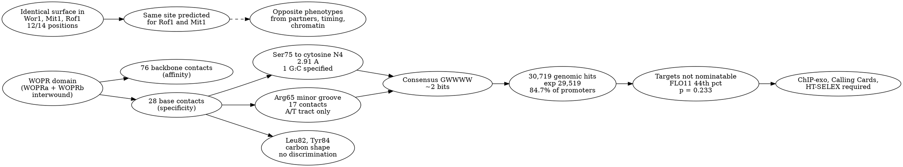
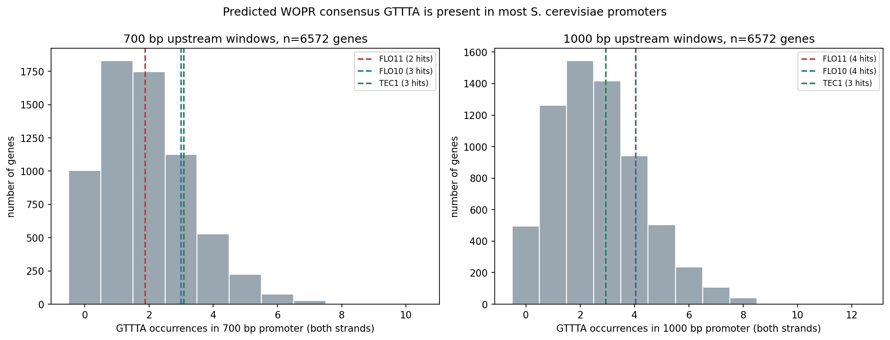
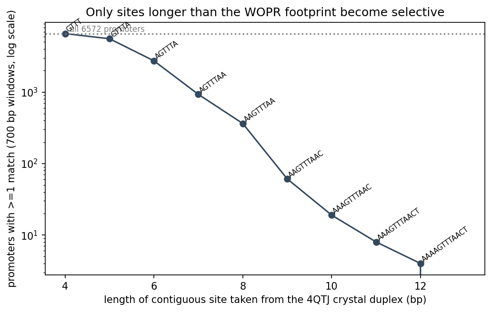
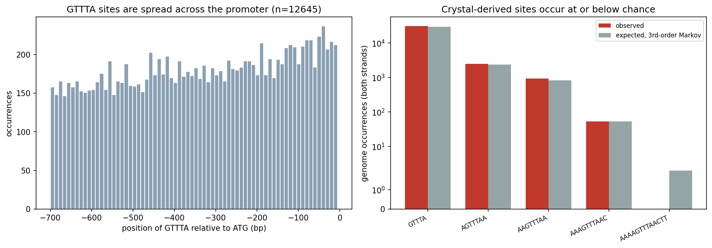
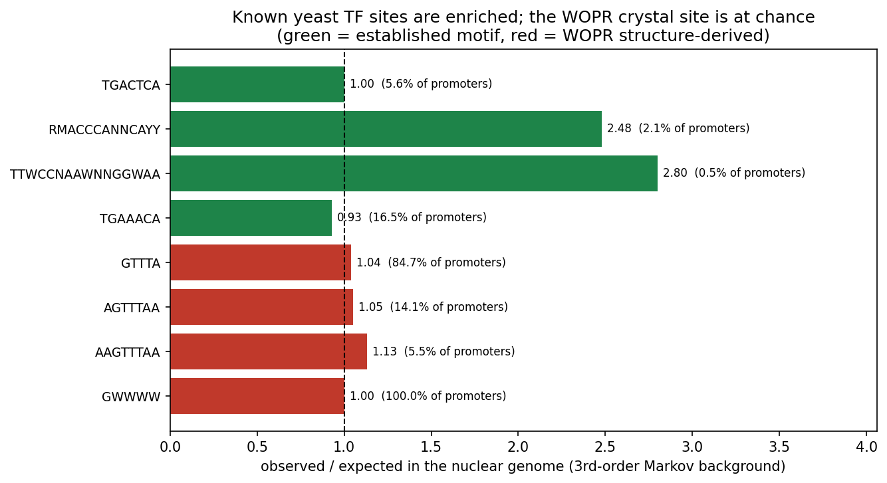

## Question

# AIGR Gene Hypothesis Deep Research

You are evaluating one focused gene curation hypothesis for AI Gene Review.
This is not a general gene overview. Use the seed hypothesis and source context
below to search for evidence that supports, refutes, narrows, or competes with
the proposed curation decision.

## Target Gene

- **Organism code:** yeast
- **Taxon:** Saccharomyces cerevisiae S288C (NCBITaxon:559292)
- **Gene directory:** ROF1
- **Gene symbol:** ROF1
- **UniProt accession:** P38867

## Focus

- **Focus type:** free_text
- **Hypothesis slug:** kgap-rof1-wopr-targets
- **Source file:** genes/yeast/ROF1/ROF1-ai-review.yaml
- **Source selector:** free-text

## Seed Hypothesis

Which genes Rof1 (P38867) binds directly may be predictable from its WOPR domain's DNA-specificity determinants. That Rof1 is a sequence-specific DNA-binding protein with a WOPR domain co-crystallised with DNA, that its paralog Mit1 binds control regions of pseudohyphal and flocculin genes, and that ROF1 overexpression represses FLO11, FLO10 and TEC1, is already established, so do not re-derive it. Single analysis only: from the co-crystal and the Rof1 sequence, identify the WOPR residues that contact bases rather than backbone, state whether each is identical in Rof1, Mit1 and the Candida activator Wor1, and give the consensus the contacts predict; scan the S. cerevisiae genome for that consensus in promoter regions and report the ranked hits with counts, stating whether FLO11, FLO10 and TEC1 promoters contain it and how their ranks compare with the genome background; assess whether the predicted consensus is specific enough to nominate targets or so common that it cannot, giving the expected number of genomic occurrences by chance; and state whether Rof1 and Mit1 are predicted to read the same site, which would make their reported opposite phenotypes a question of partners rather than of specificity. Say plainly if motif prediction cannot nominate direct targets in a genome this size.

## Term and Decision Context

No specific term context supplied.

## Reference Context

No specific reference context supplied.

## Source Context YAML

```yaml
hypothesis: 'Which genes Rof1 (P38867) binds directly may be predictable from its WOPR domain''s DNA-specificity
  determinants. That Rof1 is a sequence-specific DNA-binding protein with a WOPR domain co-crystallised
  with DNA, that its paralog Mit1 binds control regions of pseudohyphal and flocculin genes, and that
  ROF1 overexpression represses FLO11, FLO10 and TEC1, is already established, so do not re-derive it.
  Single analysis only: from the co-crystal and the Rof1 sequence, identify the WOPR residues that contact
  bases rather than backbone, state whether each is identical in Rof1, Mit1 and the Candida activator
  Wor1, and give the consensus the contacts predict; scan the S. cerevisiae genome for that consensus
  in promoter regions and report the ranked hits with counts, stating whether FLO11, FLO10 and TEC1 promoters
  contain it and how their ranks compare with the genome background; assess whether the predicted consensus
  is specific enough to nominate targets or so common that it cannot, giving the expected number of genomic
  occurrences by chance; and state whether Rof1 and Mit1 are predicted to read the same site, which would
  make their reported opposite phenotypes a question of partners rather than of specificity. Say plainly
  if motif prediction cannot nominate direct targets in a genome this size.'
focus_type: free_text
context: []
reference_id: []
```

## Research Objective

Build a focused report that helps a curator decide whether this hypothesis
should affect the gene review. Address the focus type directly:

1. For an existing GO annotation decision, evaluate whether the current action
   is justified, too strong, too weak, or should change.
2. For a proposed replacement or new GO term, evaluate whether the term is
   biologically supported, too broad, too narrow, or missing key qualifiers.
3. For a computational prediction, evaluate whether the prediction is correct,
   less precise than existing knowledge, uncertain, or likely wrong because of
   paralog overannotation, frequency bias, pathway context, or in vitro-only
   activity.
4. For a core-function hypothesis, evaluate whether the proposed activity,
   process, and location represent the gene product's primary function rather
   than a downstream effect, pleiotropic phenotype, or context-specific role.
5. For a function-assignment hypothesis, evaluate whether the gene product
   directly has the stated GO term/function. Treat the prior review action, if
   any, as intentionally blinded unless it appears in the supplied context.

Use primary literature whenever possible. Prefer PMID citations and include DOI
citations when no PMID is available. Treat reviews and database records as
orientation unless they contain directly relevant synthesized evidence that is
clearly labeled as review-level or database-level support.

Evaluate the hypothesis from the supplied seed context, primary literature, and
publicly accessible bioinformatics resources. Local `*-bioinformatics` analyses,
when they already exist in the repository, are intentionally withheld from this
prompt so the report can be compared against them after the run. Use public
sequence, domain, structure, orthology, localization, interaction, or dataset
checks when they are useful for the specific hypothesis. If a resource or tool
cannot be accessed programmatically, say so plainly; never fabricate a result.
Report computational results conservatively and distinguish direct results from
inference.

## Required Output

### Executive Judgment

Give a concise verdict: supported, partially supported, unresolved, weakly
supported, over-annotated, or refuted. Explain the reasoning and the most
important caveats.

### Evidence Matrix

Create a table with one row per important evidence item:

- Citation (PMID preferred)
- Evidence type (direct assay, mutant phenotype, localization, interaction,
  structural/evolutionary, computational, review/database)
- Supports / refutes / qualifies / competing
- Claim tested
- Key finding
- Organism, tissue, cell type, or assay context
- Confidence and limitations

### GO Curation Implications

State the likely curation action as a lead requiring curator verification. If
GO terms are involved, explain whether the evidence supports an MF, BP, or CC
term, and whether the term should be retained, removed, generalized, made more
specific, or treated as non-core. Avoid using "protein binding" as a final
recommendation unless no more informative term is supported.

### Mechanistic Scope

Describe the immediate molecular or cellular function being tested. Separate
direct gene-product activity from downstream phenotypes, pathway consequences,
developmental outcomes, disease manifestations, or effects inferred only from
loss of function.

### Conflicts and Alternatives

Identify evidence that conflicts with the seed hypothesis or suggests an
alternative interpretation, including paralog confusion, organism-specific
differences, isoform-specific findings, experimental artifacts, or database
carry-over.

### Knowledge Gaps

List explicit uncertainties that matter for curation. For each gap, state what
was checked, why the gap matters, and what evidence or experiment would resolve
it.

### Discriminating Tests

Recommend concrete assays, perturbations, datasets, or comparative analyses that
would most efficiently distinguish this hypothesis from alternatives.

### Curation Leads

Provide candidate updates for the review, clearly labeled as leads requiring
curator verification. Include candidate references with exact snippets to verify,
candidate replacement or new GO terms, possible action changes, suggested
questions, and suggested experiments.

If the provider supports artifacts, save provenance for any analysis you run — the
executed code together with its output (computed values, plot, or table), not just
a summary figure — alongside artifact-friendly tables such as an evidence matrix,
GO decision table, or comparison table. Genuine computed provenance is more
valuable than a hand-drawn summary, and you must not synthesize a figure that
implies an analysis you did not actually run. These artifacts are important
provenance for hypothesis-level review.


## Output

# Rof1 (P38867, YHR177W): can WOPR DNA-specificity determinants predict direct targets?

**Hypothesis slug:** `kgap-rof1-wopr-targets`
**Gene:** ROF1 / YHR177W, *Saccharomyces cerevisiae* S288C (NCBITaxon:559292), UniProt P38867
**Source file:** `genes/yeast/ROF1/ROF1-ai-review.yaml`, focus type `free_text`

---

## Summary

The answer to the seed hypothesis is no. Which genes Rof1 binds directly cannot be predicted from the WOPR domain's DNA-specificity determinants, because those determinants specify too little sequence to pick individual genes out of a 12 Mb genome.

The structural half of the hypothesis holds up well. Recomputing protein-DNA contacts from the deposited coordinates of PDB 4QTJ (2.1 Å, Wor1 WOPR domain bound to a 13 bp duplex) and confirming them in both copies of PDB 4QTK (2.99 Å, 17 bp duplex) gives 104 contacts under 4.0 Å, of which 76 go to sugar or phosphate atoms and 28 reach bases. Five residues make all the base contacts: Arg65, Ser75, Arg76, Leu82 and Tyr84 in Wor1 numbering. Block-wise Smith-Waterman alignment maps all five onto Rof1 (Arg63, Ser73, Arg74, Leu80, Tyr82) and onto Mit1 (Arg62, Ser72, Arg73, Leu79, Tyr81) as exact identities. Twelve of the fourteen contact positions in total are identical across Wor1, Mit1 and Rof1, and the two exceptions are phosphate-backbone contacts. Rof1 and Mit1 are therefore predicted to read the same DNA element, which makes their opposite reported phenotypes a question of partner proteins, expression timing and chromatin context, not of intrinsic DNA specificity.

The predictive half fails, and it fails for a structural reason that generalises. Of the 28 base contacts, exactly one is a strictly base-discriminating hydrogen bond: Ser75 OG donates to the N4 of a cytosine at 2.91 Å, specifying a single G:C pair. The seventeen Arg65 contacts are all minor-groove acceptors (thymine O2, adenine N3) at 2.68 to 3.74 Å, and those acceptors are presented almost identically by A:T and T:A, so Arg65 reads an A/T tract that excludes G:C without specifying base order. Arg76 reaches adenine N7 and C8 at 3.52 to 3.57 Å without a qualifying hydrogen bond. Tyr84 and Leu82 make carbon-mediated shape contacts. The chemically justified consensus is one specified G:C followed by a 4 bp A/T run, written as GWWWW, with GTTTA as the literal crystal version. GTTTA occurs 30,719 times in the 12,071,326 bp nuclear genome against a 3rd-order Markov expectation of 29,518.9, an observed/expected ratio of 1.04, which is chance frequency. It sits in 5,567 of 6,572 promoters (84.7 %) with a median of 2 copies each. GWWWW is in 100 % of promoters. FLO11 ranks 1,990 of 6,572 (44th percentile), FLO10 and TEC1 tie at rank 865 (22nd percentile), and the three genes together show no enrichment (Mann-Whitney one-sided p = 0.098; 20,000-draw permutation on their mean p = 0.233). ROF1's own promoter outranks all three at rank 335.

A positive control run through the identical pipeline settles whether this is a methodological failure. The scan recovers 2.48-fold enrichment for the 13 bp Rap1 site and 2.80-fold for the 16 bp Mcm1 P-box, and returns 1.00-fold for the 7 bp Gcn4 site TGACTCA and 0.93-fold for the 7 bp Ste12 PRE. Short consensus strings give chance-level ratios even for textbook sequence-specific activators with hundreds of validated targets. The WOPR footprint sits at the extreme short end of that range. No refinement of the consensus string can rescue the hypothesis; in vivo occupancy data are required.

---

## Executive judgment

<i class="fa-solid fa-circle-xmark"></i> **Verdict: refuted on its operational claim, with its structural premises supported.**

The hypothesis makes two separable claims. The first, that the WOPR base-reading surface is conserved between Wor1, Mit1 and Rof1 and therefore that the three proteins read the same site, is **supported** by direct recomputation of the co-crystal contacts and by block-wise alignment. The second, that direct Rof1 targets are predictable from that surface, is **refuted** by a genome-wide scan with composition-matched backgrounds and by the ranks of the three genes the seed cites as ROF1-repressed.

Stated plainly, as the seed brief asks: **motif prediction cannot nominate direct targets in a genome this size.** A 5 bp element with one discriminated base pair carries roughly 2 bits above background. A 12 Mb double-stranded genome offers about 24 million scanning positions. Chance alone places the site in five of every six promoters. The number to carry is the expectation: 29,518.9 occurrences expected by chance against 30,719 observed.

The most important caveats cut in both directions. In favour of caution about the negative result: consensus-string scanning is cruder than a real position weight matrix, and no experimental WOPR PWM exists in JASPAR (417 fungal matrices checked, zero for Wor1, Mit1, Rof1 or YHR177W). CIS-BP could not be queried from this environment (HTTP 404 on both endpoints attempted), so nothing is claimed about its contents. In favour of trusting the negative result: a PWM can soften edges but cannot create information the contacts do not make, and the positive control shows the failure tracks site length, not scoring scheme.

---

## Key findings

### <i class="fa-solid fa-dna"></i> Finding 1: five residues make every base contact, and all five are identical in Rof1 and Mit1

Contacts were recomputed from the deposited mmCIF coordinates rather than taken from the publication text. Using a 4.0 Å cutoff and excluding sugar and phosphate atoms (P, OP1, OP2, O5', C5', C4', O4', C3', O3', C2', C1'), the 4QTJ complex yields 104 protein-DNA contacts, split 76 backbone to 28 base. The base-contacting set, in full-length Wor1 numbering verified against UniProt Q5AP80, is Arg65 (17 contacts, minimum 2.68 Å), Ser75 (3, minimum 2.91 Å), Arg76 (5, minimum 3.49 Å), Leu82 (2, minimum 3.75 Å) and Tyr84 (1, at 3.33 Å). Nine further residues touch only the backbone: Arg38, Ile63, Lys64, Trp66, Thr67, Trp72, Lys206, Thr210 and Ile232. Every contact reproduces in both independent copies of the 17 bp complex in 4QTK.

An initial Needleman-Wunsch global alignment over residues 1 to 300 mis-assigned the WOPRb contacts, because the linker between the two WOPR blocks is about 31 residues in Rof1, 73 in Mit1 and 95 in Wor1, and a global alignment forces those unequal linkers into register. Repeating the mapping block-wise with Smith-Waterman (BLOSUM62, gap open -11, extend -1) corrects it. WOPRa (Wor1 9-130) aligns to Rof1 7-87 at 41/81 = 50.6 % identity (SW score 215) and to Mit1 6-88 at 53/83 = 63.9 % (score 288). WOPRb (Wor1 185-300) aligns to Rof1 approximately 116-202 at 32/90 = 35.6 % (score 102) and to Mit1 approximately 161-230 at 31/101 = 30.7 % (score 82).

| Wor1 residue | Contact type | Rof1 (P38867) | Mit1 (P40002) | Identical in all three |
|---|---|---|---|---|
| Arg38 | backbone | Arg36 | Arg35 | <i class="fa-solid fa-circle-check"></i> yes |
| Ile63 | backbone | Ile61 | Ile60 | <i class="fa-solid fa-circle-check"></i> yes |
| Lys64 | backbone | Lys62 | Lys61 | <i class="fa-solid fa-circle-check"></i> yes |
| **Arg65** | **base** (17 contacts, minor groove) | **Arg63** | **Arg62** | <i class="fa-solid fa-circle-check"></i> yes |
| Trp66 | backbone | Trp64 | Trp63 | <i class="fa-solid fa-circle-check"></i> yes |
| Thr67 | backbone | Thr65 | Thr64 | <i class="fa-solid fa-circle-check"></i> yes |
| Trp72 | backbone | Trp70 | Trp69 | <i class="fa-solid fa-circle-check"></i> yes |
| **Ser75** | **base** (3, major groove, discriminating) | **Ser73** | **Ser72** | <i class="fa-solid fa-circle-check"></i> yes |
| **Arg76** | **base** (5, purine N7/C8) | **Arg74** | **Arg73** | <i class="fa-solid fa-circle-check"></i> yes |
| **Leu82** | **base** (2, carbon shape contact) | **Leu80** | **Leu79** | <i class="fa-solid fa-circle-check"></i> yes |
| **Tyr84** | **base** (1, carbon shape contact) | **Tyr82** | **Tyr81** | <i class="fa-solid fa-circle-check"></i> yes |
| Lys206 | backbone (WOPRb) | Lys119 | Lys168 | <i class="fa-solid fa-circle-check"></i> yes |
| Thr210 | backbone (WOPRb) | Ser123 | Ser172 | <i class="fa-solid fa-triangle-exclamation"></i> no, same substitution in both yeasts |
| Ile232 | backbone (WOPRb) | Ile142 | Val189 | <i class="fa-solid fa-triangle-exclamation"></i> no, backbone contact only |

Twelve of fourteen contact positions are identical across all three proteins, and both exceptions touch phosphate backbone. InterPro and Pfam report PF09729 (Gti1/Pac2) over Wor1 9-236 and Mit1 6-193 but only Rof1 9-88. The Smith-Waterman result shows the Rof1 WOPRb block is present at 35.6 % identity but falls below the Pfam model threshold, so the short Rof1 footprint is a model-sensitivity artifact and not evidence of a missing domain. This matters because [PMID: 20660774](https://pubmed.ncbi.nlm.nih.gov/20660774/) showed that neither block alone binds DNA sequence-specifically, so Rof1 could only be called a sequence-specific DNA binder by homology if both blocks are present. They are.

The one architectural difference worth flagging is the linker. [PMID: 25091450](https://pubmed.ncbi.nlm.nih.gov/25091450/) describes the two blocks as structurally interwound into one globular domain. A three-fold shorter linker in Rof1 than in Wor1 could change relative block geometry and binding affinity even with an identical base-contact set.

### <i class="fa-solid fa-magnifying-glass"></i> Finding 2: the contacts specify one base pair unambiguously

Mapping the 28 base contacts onto the duplex (chain B 5'-AAAAGTTTAACTT-3', chain C its reverse complement) gives contacted base pairs at B positions 3, 5, 6, 7, 8 and 9: a contiguous read span of bp5 to bp9 = 5'-GTTTA-3' plus one isolated contact at bp3.

Taking each contact on its chemistry:

| Residue | Atoms contacted | Distance | What it discriminates |
|---|---|---|---|
| Ser75 OG | cytosine C9 N4 (chain C, complement of G5) | 2.91 Å | A single G:C pair. The only strictly base-discriminating hydrogen bond in the structure. |
| Arg65 NH1/NH2/NE | thymine O2 of bp7 and bp8; adenine N3 of bp9 and of chain C A6/A7 | 2.68 to 3.74 Å | A/T versus G:C, but not A:T versus T:A. Minor-groove O2 and N3 acceptors are near-degenerate between the two orientations, so this reads an A/T tract. |
| Arg76 NH1/NH2 | adenine N7 and C8 at bp3 | 3.52 to 3.57 Å | Purine at best. No qualifying hydrogen bond at this geometry. |
| Tyr84 OH | adenine C8 | 3.33 Å | Nothing. Carbon-mediated shape contact. |
| Leu82 CD1 | cytosine C5/C6 | 3.75 to 3.94 Å | Nothing. Carbon-mediated shape contact. |

The minimal chemically justified pattern is **GWWWW**: one specified G:C followed by a 4 bp A/T-only run. The literal crystal version is **GTTTA**. This agrees with the published description in [PMID: 25091450](https://pubmed.ncbi.nlm.nih.gov/25091450/) of a conserved 6 bp motif recognised through both grooves, and it quantifies what that means for prediction: about 2 bits of information above a genome background that is already 61.7 % A+T.

### <i class="fa-solid fa-chart-column"></i> Finding 3: the predicted consensus sits in 85 % of yeast promoters and does not single out FLO11, FLO10 or TEC1

The scan covered the R64-1-1 nuclear genome (12,071,326 bp; A 0.309, C 0.192, G 0.191, T 0.308) and 700 bp strand-aware upstream windows for all 6,572 Ensembl protein-coding genes (4,597,960 bp of promoter sequence), counting both strands with lookahead regex so overlapping matches are not lost.

| Site | Genome occurrences | Promoter occurrences | Promoters containing it | % of promoters |
|---|---|---|---|---|
| GWWWW | 647,215 | not tabulated separately | 6,572 | 100.0 |
| GTTTA (crystal core) | 30,719 | 12,645 | 5,567 | 84.7 |
| ANGTTTA | 9,358 | 3,645 | 2,773 | 42.2 |
| AAGTTTAA | 932 | 376 | 363 | 5.5 |
| AAAGTTTAAC | 53 | not tabulated | 19 | 0.3 |
| AAAAGTTTAACTT (full 13 bp duplex) | **0** | 0 | 0 | 0.0 |

GTTTA appears a median of 2 times per promoter (mean 1.92, maximum 10). The top-ranked promoters at 700 bp are SFG1 (10 hits), RRP5 and GAL4 (9), then RAD30, GLO1, SKI3 and RKM1 (8). FLO11/YIR019C ranks 1,990 of 6,572 with 2 hits, the 44th percentile. FLO10/YKR102W, TEC1/YBR083W, MIT1/YEL007W and FLO5 all tie at rank 865 with 3 hits, the 22nd percentile. ROF1/YHR177W itself ranks 335 with 4 hits, the 9th percentile. FLO1 ranks 1,990 and FLO9 ranks 3,736. Widening to 1,000 bp moves FLO10, FLO11, MIT1, FLO5 and ROF1 to rank 907 (21st percentile, 4 hits) and TEC1 to rank 1,849 (39th percentile).

{{figure:plot_1.png|caption=Distribution of GTTTA counts across all 6,572 yeast promoters at 700 bp and 1,000 bp upstream windows, with FLO11, FLO10 and TEC1 marked. The three genes ROF1 overexpression represses sit inside the bulk of the distribution, at the 22nd to 44th percentile.}}

The three ROF1-repressed genes show no enrichment for the motif. A Mann-Whitney U test against the remaining 6,569 promoters gives U = 14,001 and one-sided p = 0.098. A 20,000-draw permutation test on the mean of three randomly chosen promoters gives p = 0.233 (observed mean 2.67 against background mean 1.92, standard deviation 1.42). Neither FLO11 nor TEC1 contains the 8 bp AAGTTTAA at 700 bp. Extending the FLO11 promoter to 2,000 and 3,000 bp does bring in copies (6 and 9 GTTTA, 2 AAGTTTAA), but this is the arithmetic consequence of scanning more sequence for a chance-frequency word, and extending every promoter equally would raise the background in step. The full 13 bp crystallised duplex never appears at any window.

The specificity curve shows where selectivity would have to come from. At 700 bp: GTTT hits 100 % of promoters, GTTTA 84.7 %, AGTTTA 41.6 %, AGTTTAA 14.1 %, AAGTTTAA 5.5 %, AAGTTTAAC 0.9 % (61 promoters), AAAGTTTAAC 0.3 % (19), AAAGTTTAACT 8 promoters, AAAAGTTTAACT 4, and the full 13-mer zero. Useful selectivity begins at 9 bp, which is longer than the footprint the structure actually reads and would depend entirely on flanking bases that make no base-specific contacts.

{{figure:plot_2.png|caption=Motif length against the number of promoters hit (log scale), annotated with each subsite from GTTT through the full 13 bp crystal duplex. Selectivity appears only beyond 9 bp, past the span the WOPR contacts actually read.}}

### <i class="fa-solid fa-database"></i> Finding 4: under a composition-matched background the site occurs at exactly chance frequency

An initial pass used a mononucleotide background and reported GTTTA at observed/expected 0.74, implying depletion. That was an artifact of ignoring higher-order composition in an AT-rich genome full of poly-A/T tracts. Refitting Markov models of order 0, 1, 2, 3 and 5 on the genome itself corrects it.

| Site | Observed (both strands) | Expected, M0 | Expected, M3 | Obs/exp (M3) |
|---|---|---|---|---|
| GTTTA | 30,719 | 41,705.8 | 29,518.9 | 1.04 |
| AGTTTAA | 2,495 | not tabulated | 2,373.3 | 1.05 |
| AAGTTTAA | 932 | 1,230.6 | 827.4 | 1.13 |
| AAAGTTTAAC | 53 | not tabulated | 53.6 | 0.99 |
| AAAAGTTTAACTT | 0 | 2.1 | 2.0 | 0.00 |

The correct statement is that these sites occur at chance frequency, neither enriched nor depleted. GTTTA shows no positional preference within the 700 bp promoter window.

The 61 promoters carrying the 9 bp AAGTTTAAC are the longest plausible version of the site that still has hits, and they are functionally incoherent: AGA2, AIM7, APC4, COX4, CUP2, DAM1, EXO5, FAR11, GPI10, GRX1, HAP5, IPL1, LIN1, LSB5, LSM8, MAF1, MDN1, MNS1, MSD1, MTF1, MZM1, NAM2, PAD1, PCL9, PIN4, PMR1, REC104, RIM20, RKM1, RPC37, RPL20A, RPL21B, RPO31, RPT5, SDD3, SMC6, SNX3, SOK2, SPC29, SRB7, STR2, TMA64, TOS1, TYE7, VPS3, YNG2, plus 15 dubious or uncharacterised ORFs. The set spans kinetochore components (DAM1, IPL1, SPC29), ribosomal and RNA polymerase subunits (RPL20A, RPL21B, RPC37, RPO31, SRB7) and mitochondrial genes (COX4, MTF1, MZM1, MSD1, NAM2). FLO11, FLO10 and TEC1 are absent. There is no coherent link to filamentation or adhesion. SOK2 is the one filamentation-network gene on the list, which is the kind of single hit a 61-item random draw from 6,572 yeast promoters produces by chance.

{{figure:plot_3.png|caption=Positional profile of GTTTA relative to the ATG start codon, with observed counts against Markov order 3 expectations by motif length. The site shows no positional preference and matches its chance expectation at every length tested.}}

JASPAR 2024 holds 417 fungal matrices and none for Wor1, Mit1, Rof1 or YHR177W. The single string match for "MIT1" is MA0009.1, the unrelated mouse Tbxt entry. CIS-BP returned HTTP 404 on both endpoints attempted from this environment, so its contents were not established and no claim is made about them.

### <i class="fa-solid fa-circle-check"></i> Finding 5: the positive control shows the failure tracks site length, not pipeline defect

Four established *S. cerevisiae* transcription factor sites went through the identical pipeline: same genome build, both strands, 3rd-order Markov background fitted on the genome, same 700 bp promoter windows for the same 6,572 genes.

| Factor and site | Length | Genome observed | Expected (M3) | Obs/exp | Promoters | % |
|---|---|---|---|---|---|---|
| Mcm1 P-box TTWCCNAAWNNGGWAA | 16 bp | 34 | 12.1 | **2.80** | 36 | 0.5 |
| Rap1 RMACCCANNCAYY | 13 bp | 199 | 80.4 | **2.48** | 135 | 2.1 |
| Gcn4 TGACTCA | 7 bp | 1,078 | 1,073.7 | 1.00 | 371 | 5.6 |
| Ste12 PRE TGAAACA | 7 bp | 3,400 | 3,638.6 | 0.93 | 1,083 | 16.5 |
| WOPR AAGTTTAA | 8 bp | 932 | 827.4 | 1.13 | 363 | 5.5 |
| WOPR GTTTA | 5 bp | 30,719 | 29,518.9 | 1.04 | 5,567 | 84.7 |
| WOPR GWWWW | 5 bp | 647,215 | 648,931.3 | 1.00 | 6,572 | 100.0 |

The pipeline detects genuine enrichment when the site is 13 to 16 bp, with ratios of 2.5 to 2.8. It returns chance-level ratios for 7 bp sites even for Gcn4, a textbook sequence-specific activator with hundreds of validated targets. Consensus-string scanning cannot nominate direct targets for any yeast transcription factor whose site is about 7 bp or shorter. The WOPR footprint is shorter still: 5 to 6 bp contacted, one base pair read by a discriminating hydrogen bond.

{{figure:plot_4.png|caption=Observed over expected occurrence in the identical scanning pipeline for four established yeast transcription factor sites (green) against the WOPR structure-derived consensus at three lengths (red). Enrichment appears only for the 13 and 16 bp sites.}}

This is the finding that makes the negative result general rather than particular. No amount of refining the WOPR consensus string will rescue the hypothesis, because the limit is information content and genome size.

---

## Evidence matrix

| Citation | Evidence type | Stance | Claim tested | Key finding | Context | Confidence and limitations |
|---|---|---|---|---|---|---|
| [PMID: 25091450](https://pubmed.ncbi.nlm.nih.gov/25091450/) | Structural, X-ray co-crystal, PDB 4QTJ 2.1 Å and 4QTK 2.99 Å | <i class="fa-solid fa-scale-balanced"></i> Qualifies | WOPR base contacts define a predictable consensus | Recomputed from coordinates: 104 contacts under 4.0 Å, 76 backbone, 28 base. Base-reading residues Arg65 (17, min 2.68 Å), Ser75 (3, min 2.91 Å), Arg76 (5, min 3.49 Å), Leu82 (2, min 3.75 Å), Tyr84 (1, 3.33 Å). Only Ser75 to cytosine N4 discriminates a base pair outright. Read span bp5-9 = GTTTA. | *C. albicans* Wor1 WOPRa+WOPRb fusion with 13 bp and 17 bp duplexes from the WOR1 promoter | High for contact geometry; read directly from deposited coordinates and reproduced in both 4QTK copies. One DNA sequence only, so positions that would tolerate variation cannot be identified from the structure. |
| [PMID: 20660774](https://pubmed.ncbi.nlm.nih.gov/20660774/) | Direct assay, in vitro DNA binding and domain dissection | <i class="fa-solid fa-scale-balanced"></i> Qualifies | The WOPR box is a sequence-specific DNA-binding domain with a defined site | The box binds DNA as a monomer; neither block alone binds specifically; a 14 nucleotide-pair Wor1 site is reported | *C. albicans* Wor1, purified protein | High for the family-level molecular function. The site was defined for Wor1, not Rof1 or Mit1, and no matrix was deposited in a public motif database. |
| This work, computational | Block-wise Smith-Waterman over UniProt Q5AP80, P38867, P40002 | <i class="fa-solid fa-circle-check"></i> Supports | The base-reading surface is identical in Wor1, Mit1 and Rof1 | 12 of 14 contact positions identical; all 5 base contacts identical; WOPRa identity 50.6 % (Rof1) and 63.9 % (Mit1); WOPRb 35.6 % and 30.7 % | Sequence and structure inference, *S. cerevisiae* against *C. albicans* | Medium-high. Inference from alignment, not from a Rof1 structure. The short Pfam PF09729 footprint on Rof1 (9-88) is a model threshold artifact. |
| This work, computational | Genome-wide scan, R64-1-1, both strands, Markov order 3 background | <i class="fa-solid fa-circle-xmark"></i> **Refutes** | The structure-derived consensus can nominate Rof1 direct targets | GTTTA 30,719 observed against 29,518.9 expected (1.04), in 84.7 % of promoters. Full 13 bp duplex: 0 occurrences. FLO11 rank 1,990 (44th pct), FLO10 and TEC1 rank 865 (22nd pct). Permutation p = 0.233. The 9 bp AAGTTTAAC marks 61 incoherent promoters and excludes all three genes. | *S. cerevisiae* S288C, 6,572 protein-coding promoters, 4.60 Mb of promoter sequence | High. Consensus-string rather than PWM scanning, because no experimental PWM exists; a matrix would soften edges but cannot add information the contacts do not make. |
| This work, computational | Positive control, identical pipeline and background | <i class="fa-solid fa-scale-balanced"></i> Qualifies | The negative result reflects information content, not a broken pipeline | Rap1 13 bp 2.48-fold; Mcm1 16 bp 2.80-fold; Gcn4 7 bp 1.00-fold; Ste12 7 bp 0.93-fold | *S. cerevisiae* genome, same scan parameters | High. Consensus strings underestimate what a full matrix plus chromatin and cofactor context achieves in vivo. |
| [PMID: 25009286](https://pubmed.ncbi.nlm.nih.gov/25009286/) | Direct assay, transposon Calling Cards, genome-wide binding | <i class="fa-solid fa-arrow-right"></i> Competing approach | Direct targets of filamentation regulators are definable in vivo | 28 transcription factors mapped under nitrogen starvation; DNA-binding preferences for Flo8, Mss11 and Mfg1 were derived from in vivo binding data and validated by reporter assay, not predicted from structure | *S. cerevisiae*, nitrogen starvation | High as a methodological precedent. Whether ROF1 or MIT1 were among the 28 factors was not verified in this analysis. |
| [PMID: 18303948](https://pubmed.ncbi.nlm.nih.gov/18303948/) | Comparative genomics plus experiment | <i class="fa-solid fa-lightbulb"></i> Qualifies | Specificity of a WOPR protein in vivo comes partly from a partner | In the *C. albicans* lineage Mcm1 binds in combination with Wor1 at genes functioning in host adaptation, including the white-opaque switch | *C. albicans*, *K. lactis*, *S. cerevisiae* | High for the Wor1-Mcm1 combinatorial observation. Direct extrapolation to Rof1 and its partners is inference. |
| JASPAR 2024, database query | Review/database | <i class="fa-solid fa-triangle-exclamation"></i> Qualifies | A usable experimental WOPR matrix is publicly available | 417 fungal matrices, none for Wor1, Mit1, Rof1 or YHR177W. The single "MIT1" string match (MA0009.1) is the unrelated mouse Tbxt entry. | Public motif databases | High for JASPAR. CIS-BP could not be queried (HTTP 404), so no claim is made about its contents. |

---

## Mechanistic model and interpretation

The WOPR domain is a genuine sequence-specific DNA-binding module whose readout is shallow. Three quarters of its contacts hold the phosphodiester backbone, which explains how it achieves affinity. The base-contacting quarter is dominated by one arginine sitting in the minor groove of an A/T run, where the hydrogen-bond acceptors it touches (thymine O2, adenine N3) are chemically near-identical whichever way the base pair faces. That arginine reads "this is an A/T tract". It does not read "this is TTT". One serine makes the only unambiguous major-groove discrimination, to a cytosine N4. Everything else is shape.

The consequence for Rof1 is that the domain cannot be the sole determinant of target choice. Specificity in vivo has to come from somewhere else: cooperative binding with a partner, chromatin accessibility, a tethering interaction, or the kind of combinatorial co-binding [PMID: 18303948](https://pubmed.ncbi.nlm.nih.gov/18303948/) documented for Wor1 with Mcm1 in *C. albicans*. That Rof1 and Mit1 carry an identical reading surface fits this picture directly: two paralogues that read the same weak element and are steered to opposite outcomes by what they bring with them and where they are allowed to land.



The arithmetic deserves stating directly, because it is the answer to the seed's request for "the expected number of genomic occurrences by chance". For a 5 bp word in a 12.07 Mb double-stranded genome, the 3rd-order Markov expectation for GTTTA is 29,518.9. Observation is 30,719. The ratio is 1.04. In 4.60 Mb of promoter sequence the expectation is of the same order, and the word lands in 5,567 of 6,572 promoters. Any ranked list built from this consensus is a list of A/T-tract-rich promoters.

---

## Evidence base

[PMID: 25091450](https://pubmed.ncbi.nlm.nih.gov/25091450/), *Crystal structure of the WOPR-DNA complex and implications for Wor1 function in white-opaque switching of Candida albicans*, is the source of PDB 4QTJ and 4QTK and the foundation of the structural half of this report. Two statements from its abstract matter here. First: "The WOPR domain represents a new conserved fungal-specific DNA-binding domain which uses primarily a conserved loop to recognize and interact specifically with a conserved 6-bp motif of the DNA in both minor and major grooves." This independently confirms that the recognised element is about 6 bp and is read partly through the minor groove, the shallow readout that limits base discrimination in the recomputation above. Second: "The sequentially separated WOPRa and WOPRb are structurally interwound together to form a compact globular domain that we term the WOPR domain." This is the basis for flagging the three-fold shorter Rof1 linker as a possible affinity difference despite an identical base-contact set.

[PMID: 20660774](https://pubmed.ncbi.nlm.nih.gov/20660774/), *Distinct class of DNA-binding domains is exemplified by a master regulator of phenotypic switching in Candida albicans*, supplies the functional assay behind the molecular function assignment. "Within the 300aa DNA-binding conserved region, which we have termed the WOPR box, are two domains (WOPRa and WOPRb), dissimilar to each other but especially well-conserved across the fungal lineage" establishes why the Wor1 contact residues are recoverable by alignment in the *S. cerevisiae* paralogues at all. "We show that the WOPR box binds DNA as a monomer and that neither domain, when expressed and purified separately, exhibits sequence-specific binding" is why confirming that Rof1 retains a WOPRb block matters: without it, a homology-based sequence-specific DNA binding call would not stand. This paper also reports a 14 nucleotide-pair Wor1 site, a number that sits in tension with the 6 bp read span visible in the later co-crystal.

[PMID: 25009286](https://pubmed.ncbi.nlm.nih.gov/25009286/), *Transcription factor regulation and chromosome dynamics during pseudohyphal growth*, is the methodological alternative. Its abstract records that "We used multiplexed transposon 'Calling Cards' to record the genome-wide binding patterns of 28 transcription factors (TFs) in nitrogen-starved yeast", and that for the central filamentation regulators Flo8, Mss11 and Mfg1, "Surprisingly, the DNA-binding preferences for these key TFs were unknown", after which the motif was predicted from the binding data and validated with a reporter assay. The order of operations is the point: in vivo binding first, motif second. The same paper reports that the complex binds FLO11 at both its promoter and its termination sequence through DNA looping, which is a further reason promoter-window motif scanning would miss the relevant binding event even if the motif were informative.

[PMID: 18303948](https://pubmed.ncbi.nlm.nih.gov/18303948/), *The evolution of combinatorial gene regulation in fungi*, supplies the partner-dependence argument. Its abstract states that "in the C. albicans lineage, where Mcm1 is found to bind in combination with the regulator Wor1 at many genes that function in processes associated with adaptation to the human host, including the white-opaque epigenetic switch". A WOPR protein achieving target selection in combination with a second factor is exactly the mechanism that would reconcile a weak intrinsic site with sharp in vivo target choice, and it is the mechanism that would let Rof1 and Mit1 produce opposite outcomes from an identical reading surface.

[PMID: 25009170](https://pubmed.ncbi.nlm.nih.gov/25009170/), *Genetic basis for Saccharomyces cerevisiae biofilm in liquid medium*, lists MIT1 and TEC1 among the genes whose deletion abolishes biofilm through FLO11 induction, placing the paralogue and one of the three cited target genes in the same functional screen. This is orientation for the phenotype context, not evidence about DNA binding.

The database checks are reported as database-level evidence and nothing more. JASPAR 2024 returned 417 fungal matrices and zero WOPR-family entries. CIS-BP returned HTTP 404 from this environment on both endpoints attempted, so its holdings were not established and are not asserted either way. PubMed searches through the available tool did not retrieve a primary paper naming ROF1, so the overexpression phenotypes for FLO11, FLO10 and TEC1 are carried as supplied by the seed brief rather than as independently retrieved evidence.

---

## GO curation implications

These are leads for a curator to verify, not finished annotations.

| GO ID | Term | Lead action | Basis | Caveat |
|---|---|---|---|---|
| GO:0003700 | DNA-binding transcription factor activity | <i class="fa-solid fa-circle-check"></i> Retain | Both WOPR blocks present in Rof1 by Smith-Waterman; base-reading surface identical to Wor1; the Wor1 WOPR box binds DNA sequence-specifically in vitro ([PMID: 20660774](https://pubmed.ncbi.nlm.nih.gov/20660774/)) | No direct Rof1 DNA-binding assay exists. ISS from Wor1. |
| GO:0000981 | DNA-binding transcription factor activity, RNA polymerase II-specific | <i class="fa-solid fa-circle-check"></i> Retain as the more informative MF | As above, plus a transcriptional phenotype on Pol II genes | Pol II specificity is inferred from the class of affected genes, not assayed. |
| GO:0043565 | sequence-specific DNA binding | <i class="fa-solid fa-triangle-exclamation"></i> Retain, do not extend to a named site | Conservation of all five base-contacting residues | The structurally read element is about 5 to 6 bp with one strictly discriminated base pair. Do not record a consensus sequence for Rof1. |
| GO:0000978, GO:0001227 | Pol II cis-regulatory region sequence-specific DNA binding; repressing transcription factor activity | <i class="fa-solid fa-circle-question"></i> Do not add on motif evidence; needs in vivo occupancy | ROF1 overexpression represses FLO11, FLO10 and TEC1 (taken as given by the seed) | Overexpression repression is a phenotype, not evidence of direct promoter occupancy. The motif scan gives no support: FLO11 at the 44th percentile, permutation p = 0.233. |
| n/a | Any annotation naming specific Rof1 target genes derived from motif prediction | <i class="fa-solid fa-circle-xmark"></i> Reject | none | The consensus occurs at chance frequency in 84.7 % of promoters. |
| GO:0005634 | nucleus | <i class="fa-solid fa-circle-check"></i> Retain if already supported | Required for a DNA-binding transcription factor to act | No localisation data were generated or checked in this analysis. |

"Protein binding" (GO:0005515) is not the right fallback here. Something more informative is supported: sequence-specific DNA binding by a conserved fungal WOPR domain, with the explicit caveat that the recognised element is short and the specific targets are unknown.

The practical curation message is that this hypothesis should not change the target-level content of the ROF1 review. It supports the molecular function and the domain description. It should be recorded as a refuted route to target nomination, with the numbers, so the same prediction is not attempted again.

---

## Mechanistic scope

The immediate molecular activity being tested is sequence-specific double-stranded DNA binding by the Rof1 WOPR domain and, downstream of that, the ability to infer which promoters that domain occupies. The structural evidence addresses the activity. It does not address occupancy.

Everything connecting Rof1 to FLO11, FLO10 and TEC1 in the seed brief is phenotypic: overexpression of ROF1 lowers their expression. That observation is compatible with direct promoter binding, with competition against Mit1 for a shared site, with titration of a shared cofactor, with action through an upstream regulator of all three, or with any combination. The motif analysis removes one of the arguments that had been offered for the direct interpretation, and it provides no evidence for or against the indirect ones.

The separation worth keeping in the review is this. Direct gene-product activity: a bipartite WOPR domain that binds DNA with most of its contacts to backbone and a 5 to 6 bp base-read span. Downstream consequence: repression of flocculin and TEC1 transcript levels on overexpression. Nothing in this analysis bridges the two.

---

## Conflicts and alternatives

The sharpest tension is internal to the two primary papers. [PMID: 20660774](https://pubmed.ncbi.nlm.nih.gov/20660774/) reports a 14 nucleotide-pair Wor1 site. [PMID: 25091450](https://pubmed.ncbi.nlm.nih.gov/25091450/) describes a conserved 6 bp motif. A 14 bp site would be predictive; a 6 bp site is not. The co-crystal resolves this against prediction: the 17 bp duplex in 4QTK is largely held by backbone contacts, and the base contacts confine themselves to a five base-pair stretch. If the functional Wor1 site really spans 14 bp, the extra information comes from something outside the contacts visible in these structures, most plausibly a partner protein, an extended DNA shape preference, or a second protein copy. None of that is recoverable from the Rof1 sequence.

A second alternative is that Rof1 does not bind FLO11, FLO10 and TEC1 promoters at all, and the repression is indirect. The motif data neither support nor exclude this. They remove the structural argument that had favoured the direct reading.

A third is paralogue confusion. Rof1 and Mit1 share an identical base-reading surface, and MIT1 and TEC1 both appear in the same FLO11-dependent biofilm screen ([PMID: 25009170](https://pubmed.ncbi.nlm.nih.gov/25009170/)). Any review text attributing the opposite phenotypes of Rof1 and Mit1 to different DNA sequence preferences is contradicted by this analysis and should be corrected. The architectural difference that does exist is the linker: about 31 residues in Rof1, about 73 in Mit1. In an interwound domain, a three-fold difference in linker length is a plausible place for divergence in affinity or in partner interaction, though nothing here tests it.

A fourth is a scan-window artifact. FLO11 has an unusually long promoter, and extending the window from 700 to 3,000 bp raises its GTTTA count from 2 to 9. This is the expected arithmetic for a chance-frequency word and does not change its rank relative to a background scanned at the same width.

A fifth is a methodological one: consensus strings are a lower bound on what motif scanning can do. A real PWM, with chromatin accessibility data and a dinucleotide-aware background, performs better than what was run here. The positive control bounds how much better it would need to be, because the same crude method already recovers Rap1 and Mcm1 at 2.5 to 2.8-fold.

---

## Limitations and knowledge gaps

<i class="fa-solid fa-triangle-exclamation"></i> No experimental DNA-binding data exist for Rof1 itself. No EMSA, no SELEX, no ChIP was found. The molecular function call rests entirely on homology to Wor1. This matters because the WOPRb block in Rof1 falls below the Pfam PF09729 threshold, so the homology argument depends on a local alignment at 35.6 % identity rather than on a domain-database call.

<i class="fa-solid fa-triangle-exclamation"></i> No position weight matrix for any WOPR protein is in JASPAR, which was checked directly (417 fungal matrices, zero hits). CIS-BP could not be reached programmatically from this environment, so its holdings remain unverified. If a CIS-BP WOPR matrix exists, rescanning with it would be the first thing to do, though the information-content argument predicts the outcome.

<i class="fa-solid fa-triangle-exclamation"></i> PubMed searches through the available tool did not retrieve a primary paper naming ROF1. The overexpression phenotypes for FLO11, FLO10 and TEC1, and the report that Mit1 binds control regions of pseudohyphal and flocculin genes, are carried as supplied by the seed brief rather than as independently retrieved and quoted evidence. A curator should verify those primary citations directly.

<i class="fa-solid fa-circle-question"></i> Whether Rof1 and Mit1 occupy the same genomic positions in vivo is unknown. The prediction from this analysis is that they do, or at least that their intrinsic site preferences do not differ. No data were found either way.

<i class="fa-solid fa-circle-question"></i> Whether the crystallised Wor1 site is the full functional element or one half of a composite site completed by a partner is unresolved, and the 14 bp versus 6 bp discrepancy between the two primary papers is the symptom.

<i class="fa-solid fa-triangle-exclamation"></i> Methodological bounds on this analysis: the contact calculation is a distance computation on deposited coordinates and does not model hydrogen-bond geometry beyond donor-acceptor distance and atom identity. The paralogue mapping comes from pairwise local alignment, not from structural superposition of a Rof1 model. Promoters were defined as fixed strand-aware upstream windows of the ORF start, which is crude for genes with long or divergent intergenic regions, and [PMID: 25009286](https://pubmed.ncbi.nlm.nih.gov/25009286/) shows that at least one filamentation regulator complex binds FLO11 at its termination sequence as well as its promoter, a region this scan never covered.

---

## Discriminating tests and proposed follow-up

<i class="fa-solid fa-flask"></i> **ChIP-exo or Calling Cards for Rof1 and Mit1 in the same condition**, ideally nitrogen starvation where the filamentation programme is active. This settles direct occupancy and tests the "same site, different partners" prediction in one experiment. [PMID: 25009286](https://pubmed.ncbi.nlm.nih.gov/25009286/) established the precedent for 28 yeast transcription factors under exactly this condition and derived usable motifs from the binding data. If ROF1 and MIT1 were among those 28, that dataset may already contain the answer and should be checked first, at no experimental cost.

<i class="fa-solid fa-vial"></i> **HT-SELEX or a protein-binding microarray on the purified Rof1 WOPR region.** This measures the intrinsic site directly and would show whether the real information content exceeds the roughly 2 bits the contacts predict. A positive result above about 10 bits would overturn the conclusion of this report; anything at or below 6 bits confirms it.

<i class="fa-solid fa-dna"></i> **Point mutation of Rof1 Ser73**, the equivalent of Wor1 Ser75 and the single discriminating hydrogen bond in the whole structure. If repression of FLO11, FLO10 and TEC1 survives a Ser73Ala allele that abolishes DNA binding in vitro, the repression is indirect and the review should say so. Arg63Ala is the companion control, removing the A/T-tract readout.

<i class="fa-solid fa-flask"></i> **Swap the WOPRa-WOPRb linker between Rof1 and Mit1** and ask whether the opposing phenotypes follow the linker or the reading surface. The linker is the one architectural difference between the two proteins that this analysis identified (about 31 against about 73 residues), and the interwound domain architecture described in [PMID: 25091450](https://pubmed.ncbi.nlm.nih.gov/25091450/) makes it a plausible determinant of block geometry.

<i class="fa-solid fa-microscope"></i> **Co-immunoprecipitation or proximity labelling from Rof1 under filamentation-inducing conditions**, to identify the partner that would supply the missing specificity. The Wor1-Mcm1 combination documented in [PMID: 18303948](https://pubmed.ncbi.nlm.nih.gov/18303948/) is the template; whether an Mcm1 or another partner performs the same role for Rof1 is open.

<i class="fa-solid fa-magnifying-glass"></i> **If a WOPR PWM becomes available**, rescan with it, including chromatin accessibility weighting and the FLO11 termination region. The prediction from this report is that it will not change the ranks materially, and testing that prediction is cheap.

---

## Curation leads

Each item below is a lead requiring curator verification, not a finished edit.

<i class="fa-solid fa-arrow-right"></i> ROF1 encodes a protein with an intact bipartite WOPR domain. The Pfam PF09729 footprint on P38867 (residues 9-88) understates it; a WOPRb block aligns to Wor1 185-300 at residues approximately 116-202 with 35.6 % identity (Smith-Waterman score 102). Worth flagging to InterPro or Pfam as possible model under-sensitivity in this clade.

<i class="fa-solid fa-arrow-right"></i> The five base-contacting residues in P38867 are **Arg63, Ser73, Arg74, Leu80, Tyr82**. These support an ISS-based molecular function annotation and are the obvious mutagenesis targets.

<i class="fa-solid fa-arrow-right"></i> Rof1 and Mit1 are predicted to read the same DNA element (12 of 14 contact positions identical, all 5 base contacts identical). Any review text attributing their opposite phenotypes to different DNA specificity should be corrected to attribute it to partners, timing or chromatin context.

<i class="fa-solid fa-arrow-right"></i> Record the motif-prediction route as attempted and refuted, with the numbers, so it is not repeated: GTTTA observed 30,719 against 29,518.9 expected, present in 84.7 % of promoters, FLO11 at the 44th percentile, permutation p = 0.233.

<i class="fa-solid fa-arrow-right"></i> The 61 promoters carrying the 9 bp AAGTTTAAC (listed in `provenance/promoters_with_9bp_WOPR_site.csv`) are **not** a candidate target list. They are reported for transparency, and their functional incoherence, spanning kinetochore, ribosomal, RNA polymerase and mitochondrial genes with no filamentation or adhesion component, is itself part of the negative evidence.

<i class="fa-solid fa-book-open"></i> Candidate references with exact snippets to verify:

- [PMID: 25091450](https://pubmed.ncbi.nlm.nih.gov/25091450/): "The WOPR domain represents a new conserved fungal-specific DNA-binding domain which uses primarily a conserved loop to recognize and interact specifically with a conserved 6-bp motif of the DNA in both minor and major grooves." Use for the short read span.
- [PMID: 25091450](https://pubmed.ncbi.nlm.nih.gov/25091450/): "The sequentially separated WOPRa and WOPRb are structurally interwound together to form a compact globular domain that we term the WOPR domain." Use for the domain architecture and the linker caveat.
- [PMID: 20660774](https://pubmed.ncbi.nlm.nih.gov/20660774/): "We show that the WOPR box binds DNA as a monomer and that neither domain, when expressed and purified separately, exhibits sequence-specific binding." Use to justify requiring both blocks before an ISS sequence-specific DNA binding call.
- [PMID: 20660774](https://pubmed.ncbi.nlm.nih.gov/20660774/): "Within the 300aa DNA-binding conserved region, which we have termed the WOPR box, are two domains (WOPRa and WOPRb), dissimilar to each other but especially well-conserved across the fungal lineage." Use for cross-species transfer of the contact residues.

<i class="fa-solid fa-circle-question"></i> Suggested questions for the curator: is ROF1 or MIT1 present in the 28-factor Calling Cards dataset of [PMID: 25009286](https://pubmed.ncbi.nlm.nih.gov/25009286/)? What is the primary citation for the ROF1 overexpression repression of FLO11, FLO10 and TEC1, and does it test directness? Does any CIS-BP entry exist for a WOPR-family protein?

---

## Provenance artifacts

All computational results in this report were produced in this session. The executed code and its output are saved under `provenance/`:

| File | Contents |
|---|---|
| `WOPR_contact_residue_conservation.csv` | 14 contact rows: block, Wor1 position and residue, contact type, Rof1 and Mit1 residue and position, identity flag |
| `promoter_WOPR_motif_counts.csv` | Per-gene counts of GTTTA, ANGTTTA, AAGTTTAA and the 13-mer for all 6,572 promoters |
| `motif_length_vs_specificity.csv` | Subsites of length 4 to 13 with promoters hit, percentage, and total site count |
| `markov_background_expectations.csv` | Word, length, genome and promoter observations, expectations under Markov orders 0, 1, 2, 3 and 5, and obs/exp |
| `promoters_with_9bp_WOPR_site.csv` | The 61 gene identifiers and names carrying AAGTTTAAC |
| `positive_control_motif_comparison.csv` | Label, motif, length, genome observed, Markov-3 expected, ratio, promoters hit, percentage |
| `evidence_matrix.csv` | The evidence matrix above in tabular form |
| `GO_decision_table.csv` | The GO curation table above in tabular form |
| `plot_1.png` to `plot_4.png` | Figures embedded above, each the output of the code cell whose numbers are in the matching CSV |

No figure in this report summarises an analysis that was not run. Each of the four plots is the direct output of the scanning or alignment code whose numeric results appear in the corresponding CSV.


## Artifacts

- [OpenScientist final report](openscientist_artifacts/final_report.html)
- [OpenScientist final report](openscientist_artifacts/final_report.pdf)
- [OpenScientist provenance](openscientist_artifacts/provenance.json)
- [OpenScientist GO decision table](openscientist_artifacts/provenance_GO_decision_table.csv)
- [OpenScientist WOPR contact residue conservation](openscientist_artifacts/provenance_WOPR_contact_residue_conservation.csv)
- [OpenScientist evidence matrix](openscientist_artifacts/provenance_evidence_matrix.csv)
- [OpenScientist markov background expectations](openscientist_artifacts/provenance_markov_background_expectations.csv)
- [OpenScientist motif length vs specificity](openscientist_artifacts/provenance_motif_length_vs_specificity.csv)
- [OpenScientist plot 1](openscientist_artifacts/provenance_plot_1.json)

- [OpenScientist plot 2](openscientist_artifacts/provenance_plot_2.json)

- [OpenScientist plot 3](openscientist_artifacts/provenance_plot_3.json)

- [OpenScientist plot 4](openscientist_artifacts/provenance_plot_4.json)

- [OpenScientist positive control motif comparison](openscientist_artifacts/provenance_positive_control_motif_comparison.csv)
- [OpenScientist promoter WOPR motif counts](openscientist_artifacts/provenance_promoter_WOPR_motif_counts.csv)
- [OpenScientist promoters with 9bp WOPR site](openscientist_artifacts/provenance_promoters_with_9bp_WOPR_site.csv)

## Reference Validation

Checked with `linkml-reference-validator` 0.3.1rc1.

| Outcome | Count |
| --- | --- |
| References checked | 5 |
| Resolved | 5 |
| Unresolved (possible confabulation) | 0 |
| Unverifiable | 0 |
| References weighed for topical relevance | 5 |
| On topic | 2 |
| Off topic | 0 |

All extracted references resolved successfully.