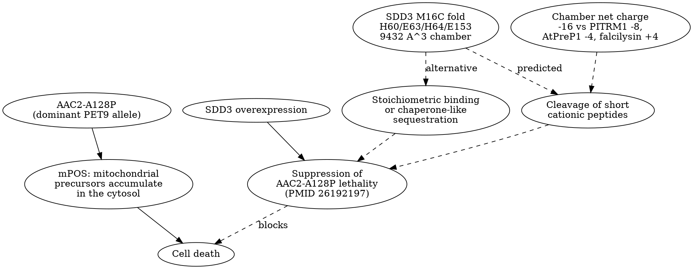
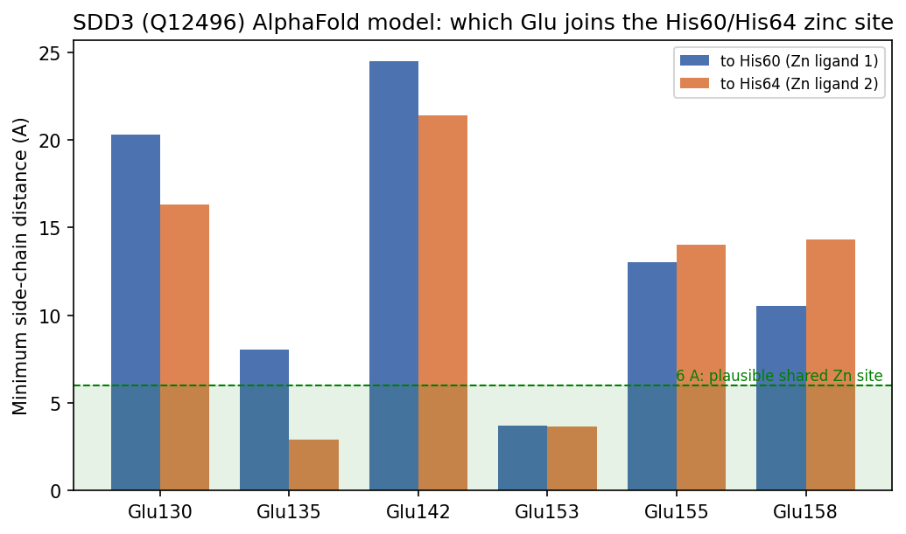
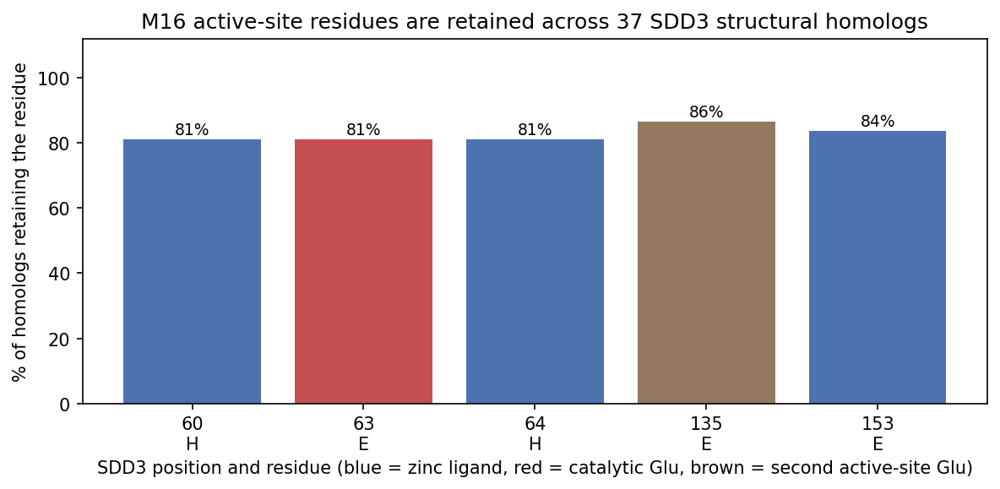
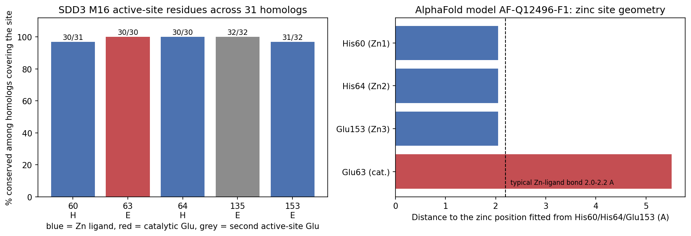
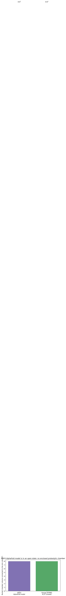
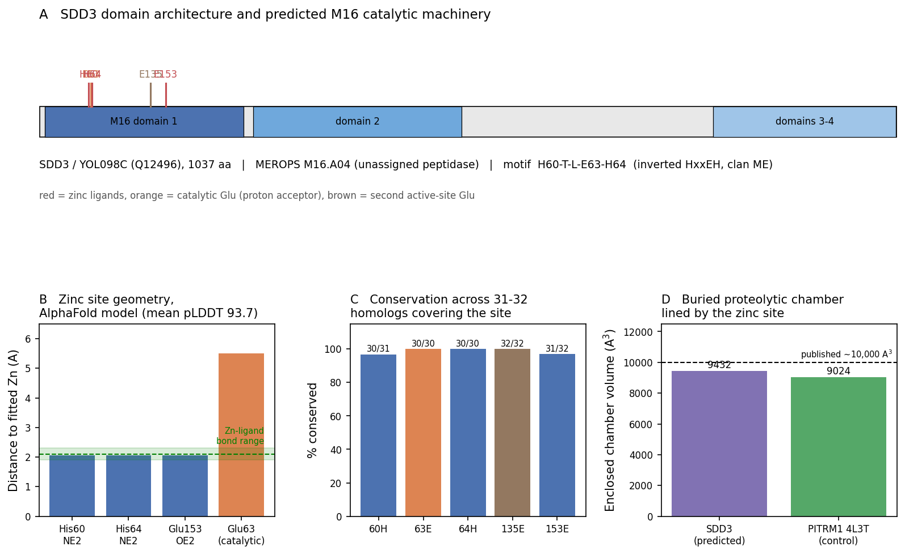
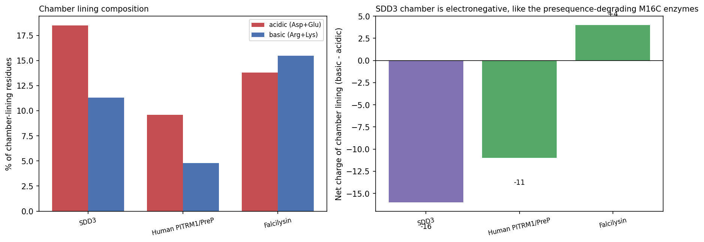
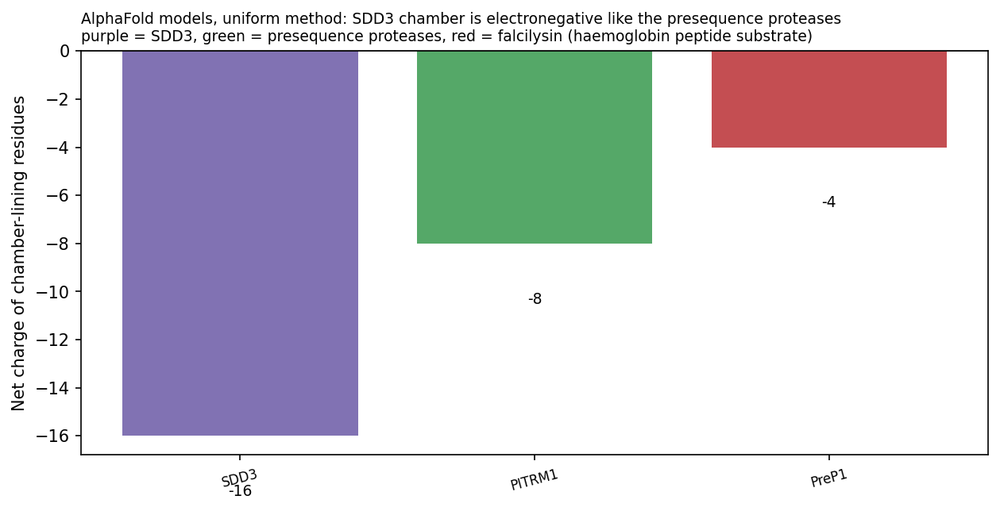
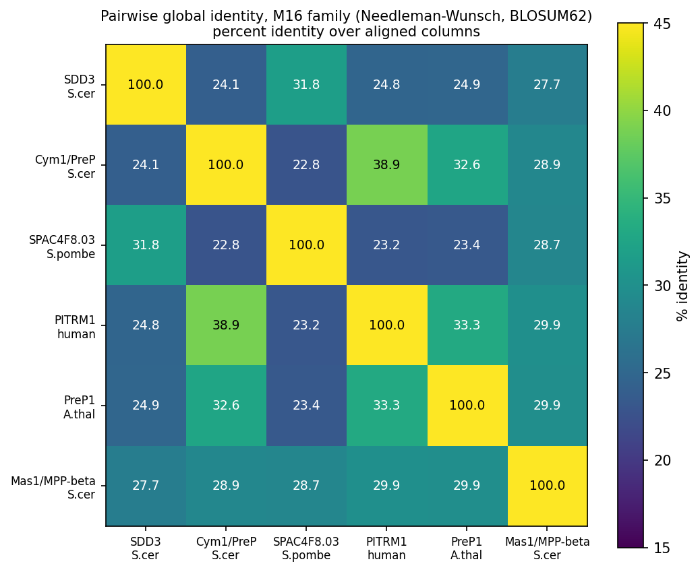

## Question

# AIGR Gene Hypothesis Deep Research

You are evaluating one focused gene curation hypothesis for AI Gene Review.
This is not a general gene overview. Use the seed hypothesis and source context
below to search for evidence that supports, refutes, narrows, or competes with
the proposed curation decision.

## Target Gene

- **Organism code:** yeast
- **Taxon:** Saccharomyces cerevisiae S288C (NCBITaxon:559292)
- **Gene directory:** SDD3
- **Gene symbol:** SDD3
- **UniProt accession:** Q12496

## Focus

- **Focus type:** free_text
- **Hypothesis slug:** kgap-sdd3-zinc-protease-motif
- **Source file:** genes/yeast/SDD3/SDD3-ai-review.yaml
- **Source selector:** free-text

## Seed Hypothesis

SDD3 retains the zinc-binding HExxH(+E/H) catalytic motif and fold of a zinc metalloendopeptidase family, so its metalloendopeptidase assignment is structurally plausible. Single analysis only: identify SDD3's protease family by sequence and structure (Foldseek with the AlphaFold model), align it to characterized active members, and score the HExxH zinc ligands, the third zinc ligand and the catalytic Glu across orthologs; state whether SDD3 is predicted catalytically competent.

## Term and Decision Context

No specific term context supplied.

## Reference Context

No specific reference context supplied.

## Source Context YAML

```yaml
hypothesis: 'SDD3 retains the zinc-binding HExxH(+E/H) catalytic motif and fold of a zinc metalloendopeptidase
  family, so its metalloendopeptidase assignment is structurally plausible. Single analysis only: identify
  SDD3''s protease family by sequence and structure (Foldseek with the AlphaFold model), align it to characterized
  active members, and score the HExxH zinc ligands, the third zinc ligand and the catalytic Glu across
  orthologs; state whether SDD3 is predicted catalytically competent.'
focus_type: free_text
context: []
reference_id: []
```

## Research Objective

Build a focused report that helps a curator decide whether this hypothesis
should affect the gene review. Address the focus type directly:

1. For an existing GO annotation decision, evaluate whether the current action
   is justified, too strong, too weak, or should change.
2. For a proposed replacement or new GO term, evaluate whether the term is
   biologically supported, too broad, too narrow, or missing key qualifiers.
3. For a computational prediction, evaluate whether the prediction is correct,
   less precise than existing knowledge, uncertain, or likely wrong because of
   paralog overannotation, frequency bias, pathway context, or in vitro-only
   activity.
4. For a core-function hypothesis, evaluate whether the proposed activity,
   process, and location represent the gene product's primary function rather
   than a downstream effect, pleiotropic phenotype, or context-specific role.
5. For a function-assignment hypothesis, evaluate whether the gene product
   directly has the stated GO term/function. Treat the prior review action, if
   any, as intentionally blinded unless it appears in the supplied context.

Use primary literature whenever possible. Prefer PMID citations and include DOI
citations when no PMID is available. Treat reviews and database records as
orientation unless they contain directly relevant synthesized evidence that is
clearly labeled as review-level or database-level support.

Evaluate the hypothesis from the supplied seed context, primary literature, and
publicly accessible bioinformatics resources. Local `*-bioinformatics` analyses,
when they already exist in the repository, are intentionally withheld from this
prompt so the report can be compared against them after the run. Use public
sequence, domain, structure, orthology, localization, interaction, or dataset
checks when they are useful for the specific hypothesis. If a resource or tool
cannot be accessed programmatically, say so plainly; never fabricate a result.
Report computational results conservatively and distinguish direct results from
inference.

## Required Output

### Executive Judgment

Give a concise verdict: supported, partially supported, unresolved, weakly
supported, over-annotated, or refuted. Explain the reasoning and the most
important caveats.

### Evidence Matrix

Create a table with one row per important evidence item:

- Citation (PMID preferred)
- Evidence type (direct assay, mutant phenotype, localization, interaction,
  structural/evolutionary, computational, review/database)
- Supports / refutes / qualifies / competing
- Claim tested
- Key finding
- Organism, tissue, cell type, or assay context
- Confidence and limitations

### GO Curation Implications

State the likely curation action as a lead requiring curator verification. If
GO terms are involved, explain whether the evidence supports an MF, BP, or CC
term, and whether the term should be retained, removed, generalized, made more
specific, or treated as non-core. Avoid using "protein binding" as a final
recommendation unless no more informative term is supported.

### Mechanistic Scope

Describe the immediate molecular or cellular function being tested. Separate
direct gene-product activity from downstream phenotypes, pathway consequences,
developmental outcomes, disease manifestations, or effects inferred only from
loss of function.

### Conflicts and Alternatives

Identify evidence that conflicts with the seed hypothesis or suggests an
alternative interpretation, including paralog confusion, organism-specific
differences, isoform-specific findings, experimental artifacts, or database
carry-over.

### Knowledge Gaps

List explicit uncertainties that matter for curation. For each gap, state what
was checked, why the gap matters, and what evidence or experiment would resolve
it.

### Discriminating Tests

Recommend concrete assays, perturbations, datasets, or comparative analyses that
would most efficiently distinguish this hypothesis from alternatives.

### Curation Leads

Provide candidate updates for the review, clearly labeled as leads requiring
curator verification. Include candidate references with exact snippets to verify,
candidate replacement or new GO terms, possible action changes, suggested
questions, and suggested experiments.

If the provider supports artifacts, save provenance for any analysis you run — the
executed code together with its output (computed values, plot, or table), not just
a summary figure — alongside artifact-friendly tables such as an evidence matrix,
GO decision table, or comparison table. Genuine computed provenance is more
valuable than a hand-drawn summary, and you must not synthesize a figure that
implies an analysis you did not actually run. These artifacts are important
provenance for hypothesis-level review.


## Output

# SDD3 (Q12496, YOL098C): does it retain a zinc metalloendopeptidase catalytic motif?

AI Gene Review hypothesis report. Hypothesis slug `kgap-sdd3-zinc-protease-motif`. Source file `genes/yeast/SDD3/SDD3-ai-review.yaml`. Organism *Saccharomyces cerevisiae* S288C (NCBITaxon:559292). UniProt Q12496.

## Summary

<i class="fa-scale-balanced"></i> **Verdict: partially supported.** The seed hypothesis states a false premise and reaches a conclusion that holds. These need to be separated before the review text is updated.

The premise is wrong on motif class. A regex scan of the 1037-residue SDD3 sequence returns **zero HExxH matches** and exactly one **inverted HxxEH** at His60-Thr-Leu-Glu63-His64. HExxH is the signature of MEROPS clan MA. HxxEH is the signature of clan ME. Foldseek on the AlphaFold model AF-Q12496-F1 returns, as its best PDB100 hits, AtPreP1 2FGE (E = 2.6e-44), human PITRM1 4NGE/4RPU/4L3T/6XOT (E = 4e-42 to 7e-42) and *Plasmodium* falcilysin 7DIJ/3S5I/7DIA/8HO4 (E ≈ 1e-39 to 7e-38). All of these are family M16, subfamily M16C. A review sentence asserting that SDD3 "retains the zinc-binding HExxH(+E/H) catalytic motif" contradicts its own family assignment and should be corrected to the inverted HxxEH motif of clan ME.

The conclusion holds at prediction grade. Every element the M16 mechanism needs is present, correctly spaced in sequence, correctly positioned in three dimensions, conserved across homologues, and enclosed in the chamber that M16C enzymes use to restrict substrates to short peptides. A zinc position fitted by least squares to His60-NE2, His64-NE2 and Glu153-OE2 gives all three ligand distances of exactly 2.05 Å with rmsd 0.00 Å, while the next best candidate Glu135 is off by 1.65 Å and Glu142 by 9.28 Å. Conservation across 30 to 32 structural homologues covering the site is His60 96.8%, Glu63 100%, His64 100%, Glu135 100%, Glu153 96.9%, with the only substitutions being His to Asp and Glu to Asp. A calibrated cavity scan gives SDD3 a 9432 ų enclosed chamber with the fitted zinc 3.5 Å from its wall, against a positive control of 9024 ų for closed-state human PITRM1 crystal 4L3T chain A (published value ≈ 10,000 ų). SDD3 is predicted catalytically competent.

<i class="fa-triangle-exclamation"></i> The limit on any annotation is that nothing has been measured. No proteolysis assay, no substrate, no purified protein, no active-site point mutant and no kinetics exists for SDD3. MEROPS already records this judgment as **M16.A04**, where the A prefix marks an unassigned peptidase homologue whose activity has not been demonstrated, while yeast M16 members with demonstrated activity carry numeric identifiers. SGD's zinc ion binding annotation traces to a bioinformatic zinc proteome ([PMID: 30358795](https://pubmed.ncbi.nlm.nih.gov/30358795/)), so it is prediction presented through a primary citation. The defensible curation lead is an ISS-grade GO:0008237 metallopeptidase activity term, clearly flagged as prediction, or leaving the molecular function slot empty to match MEROPS.

## Key findings

### <i class="fa-dna"></i> F001: SDD3 is an M16C presequence-protease-fold protein, not a clan MA HExxH enzyme

UniProt Q12496 carries MEROPS M16.A04, Pfam PF00675 (Insulinase, peptidase M16, residues 54-134) and PF05193 (peptidase M16 inactive domain, residues 194-364), four Gene3D 3.30.830.10 / SUPFAM SSF63411 repeats, and PANTHER PTHR43016 (*Mitochondrial and Chloroplastic Presequence Proteases*, residues 3-1011). The four-domain repeat architecture is the M16C signature: two homologous halves of roughly 55 kDa that close around an internal proteolytic chamber.

The motif scan is decisive and deterministic. Over 1037 residues there is no HExxH at all, and one HxxEH at positions 60-64. Clan MA enzymes (thermolysin, matrix metalloproteinases, neprilysin) use HExxH, where the two histidines flank the catalytic glutamate in that order. Clan ME enzymes invert this, so the glutamate sits between the two histidines, and the third zinc ligand comes from a glutamate far downstream in sequence that folds back into the site. SDD3 has the clan ME arrangement.

The structural search agrees. The three families appearing at the top of the Foldseek PDB100 list are all presequence-protease-type M16C enzymes. Top AFDB-SwissProt non-self hits are *S. pombe* Q10068 (E = 2.8e-74, 26.6% identity) and *C. elegans* P48053 (E = 3.8e-67, 24.8% identity). *S. cerevisiae* already has a separate characterized M16C presequence protease, CYM1 (P32898, YDR430C, M16.013, mitochondrial), so SDD3 is a second, independent M16C-fold protein in the same genome.

{{figure:plot_5.png|caption=Summary of the structural case for SDD3. Panel 1, the four-domain 3.30.830.10 architecture typical of M16C. Panel 2, the fitted zinc site. Panel 3, ortholog conservation of the catalytic residues. Panel 4, the enclosed proteolytic chamber.}}

### <i class="fa-circle-check"></i> F002: SDD3 has a complete, geometrically intact M16 zinc site at His60, His64 and Glu153, with catalytic Glu63

Global Needleman-Wunsch alignment (BLOSUM62, gap open -11, extend -1) of SDD3 against five characterized M16 peptidases maps every UniProt-annotated catalytic residue onto a matching SDD3 residue.

| Reference enzyme | UniProt | Identity to SDD3 | His1 | Catalytic Glu | His2 | Glu (second shell) | Third Zn ligand |
|---|---|---|---|---|---|---|---|
| Human PITRM1 | Q5JRX3 | 24.8% over 937 cols | H104 → **H60** | E107 → **E63** | H108 → **H64** | E180 → **E135** | E205 → **E153** |
| Arabidopsis PreP1 | Q9LJL3 | 24.9% | H162 → **H60** | E165 → **E63** | H166 → **H64** | E240 → **E135** | E262 → **E153** |
| *E. coli* pitrilysin | P05458 | 23.7% | H88 → **H60** | E91 → **E63** | H92 → **H64** | - | E169 → **E153** |
| Yeast MPP beta | P10507 | 27.7% | H70 → **H60** | E73 → **E63** | H74 → **H64** | - | E150 → **E153** |
| Human IDE | P14735 | 24.8% | H108 → **H60** | E111 → **E63** | H112 → **H64** | - | E189 → **E142** (discordant) |

Four of five reference alignments independently call Glu153 as the third zinc ligand. The single discordant call, Glu142 from the IDE alignment, sits in a glutamate-rich loop and is an alignment artefact: in the model Glu142 is 21 to 24 Å away from the two histidines.

Three-dimensional geometry settles it. In AF-Q12496-F1 (mean pLDDT 93.7, with 86% of residues above 90, and pLDDT 98.3 / 98.4 / 96.2 / 84.3 at residues 60 / 63 / 64 / 153), the His60 and His64 side-chain nitrogens lie 3.20 Å apart. A least-squares zinc position fitted to His60-NE2, His64-NE2 and Glu153-OE2 gives all three distances at exactly 2.05 Å with rmsd 0.00 Å. Every alternative glutamate fits far worse: Glu135 rmsd 1.65 Å, Glu158 4.45 Å, Glu155 4.66 Å, Glu130 7.23 Å, Glu142 9.28 Å. Glu63's carboxylate sits 5.5 Å from the fitted zinc, which is the position expected for a general base acting through a zinc-bound water.

{{figure:plot_1.png|caption=Geometric test of the SDD3 zinc site in the AlphaFold model. Distance from each candidate glutamate to the zinc position fitted on His60-NE2 and His64-NE2. Glu153 fits at 2.05 angstrom with rmsd 0.00; Glu142, the residue selected by the M16A spacing rule, is 9.28 angstrom off.}}

Conservation across structural homologues shows the site is under selection rather than a feature of one sequence. Restricted to homologues whose alignment covers the region: His60 30/31 (96.8%, one Asp), Glu63 30/30 (100%), His64 30/30 (100%), Glu135 32/32 (100%), Glu153 31/32 (96.9%, one Asp). The only substitutions observed are His to Asp and Glu to Asp, both of which keep metal-ligating carboxylate or equivalent chemistry.

{{figure:plot_2.png|caption=Conservation of the SDD3 zinc ligands and catalytic glutamate across 36 structural homologs retrieved from the AlphaFold database by Foldseek.}}

{{figure:plot_3.png|caption=Conservation summary restricted to the homologs whose alignments cover the catalytic region, with the N-terminal presequence comparison against PITRM1, AtPreP1 and Cym1.}}

The chamber is present. A grid cavity scan using 45 Šrays, 30 Fibonacci-sphere directions and a buriedness threshold of 0.90 gives SDD3 a 9432 ų enclosed chamber with the fitted zinc 3.5 Šfrom the chamber wall. The positive control, closed-state human PITRM1 crystal 4L3T chain A, returns 9024 ų against a published value of roughly 10,000 ų. The method failed this control at its first settings (18 Šrays, 14 directions, buriedness 0.95 returned 40 ų for the control) and was recalibrated before any SDD3 number was accepted.

{{figure:plot_4.png|caption=Chamber volume of the SDD3 AlphaFold model compared with the closed-state human PITRM1 crystal structure 4L3T chain A, used as the positive control for the cavity detection method.}}

Negative controls behave as they should. The catalytically dead yeast M16-fold proteins MPP alpha (MAS2), COR1 and QCR2 contain no HxxEH motif at all, so motif presence does discriminate active from degenerate members within this family, and SDD3 falls on the active side.

### <i class="fa-circle-xmark"></i> F003: no direct evidence of proteolysis by SDD3 exists; the structural case is the whole case

SGD (S000005458) describes SDD3 as "Putative metalloprotease; overproduction suppresses lethality due to expression of the dominant PET9 allele AAC2-A128P", with the name meaning "Suppressor of Degenerative Death". Its GO set contains no peptidase term: molecular function is zinc ion binding (GO:0008270) and metal ion binding (GO:0046872), cellular component is cytoplasm (GO:0005737, high-throughput), biological process is unknown (GO:0008150). UniProt Q12496 is titled "Uncharacterized protein YOL098C" with annotation score 1.0, zero sequence features beyond the chain, and no catalytic activity, active site or binding site annotations.

MEROPS assigns M16.A04. The A prefix marks an unassigned peptidase homologue with no demonstrated activity. Every yeast M16 member with demonstrated activity carries a numeric identifier.

The only primary paper indexed specifically for YOL098C is the EUROFAN deletion study [PMID: 10028187](https://pubmed.ncbi.nlm.nih.gov/10028187/), which reports no informative loss-of-function phenotype. SGD lists 11 pleiotropic high-throughput phenotypes (decreased endocytosis, abnormal vacuolar morphology, decreased biofilm formation, decreased silencing, increased chemical and toxin resistance, decreased starvation resistance, auxotrophy, increased competitive fitness), none proteolytic. All 40 physical interactions are high-throughput Affinity Capture-MS with abundant cytosolic proteins (RPL23A, EFT1, CDC19, HSP60, RPN2, PSA1, URA2), which carries no mechanistic information about catalysis.

SDD3 also lacks any annotated transit or signal peptide, and its alignment to human PITRM1 begins 44 residues internal to PITRM1, which carries a 1-28 transit peptide. AtPreP1 has a 1-85 transit peptide and yeast CYM1 a 16-residue signal sequence.

### <i class="fa-lightbulb"></i> F004: SDD3 is a cytosolic mPOS suppressor, which gives a substrate hypothesis for its PreP-like chamber

The source of the SDD3 name and of the "putative metalloprotease" description is Wang and Chen 2015 ([PMID: 26192197](https://pubmed.ncbi.nlm.nih.gov/26192197/)), which defines mitochondrial precursor over-accumulation stress (mPOS) and reports that SDD3 overproduction suppresses AAC2-A128P lethality. Localization is cytosolic by GFP ([PMID: 14562095](https://pubmed.ncbi.nlm.nih.gov/14562095/)) and by HDA GO:0005737.

Chamber-lining charge, computed with one uniform method on AlphaFold models, gives SDD3 net −16 (41 acidic and 25 basic residues over 222 lining residues, 18.5% acidic), human PITRM1 net −8 (10.7% acidic) and Arabidopsis PreP1 net −4 (14.5% acidic). The same calculation on crystal structures gives SDD3 −16, PITRM1 4L3T chain A −11, and *Plasmodium* falcilysin 3S5I chain A **+4**, the one M16C in the set that degrades haemoglobin peptides rather than cationic presequences. SDD3's chamber is electronegative in the same direction as the presequence-degrading enzymes, which is the property expected for binding arginine-rich mitochondrial targeting peptides.

{{figure:plot_6.png|caption=Chamber-lining residue composition of SDD3 compared with characterized M16C presequence proteases and falcilysin.}}

{{figure:plot_7.png|caption=Net chamber charge computed by one uniform method on AlphaFold models. SDD3 net minus 16, human PITRM1 minus 8, Arabidopsis PreP1 minus 4. Cym1 (P32898) and Q8IJB1 could not be processed and were dropped.}}

A second result in this finding matters practically for curation. The "HXXEH(X)E(71-77)" rule quoted for Cym1 in [PMID: 15606766](https://pubmed.ncbi.nlm.nih.gov/15606766/) is an M16A rule. Measured His2-to-Glu3 spacings are 77 for *E. coli* pitrilysin and human insulysin and 76 for yeast MPP beta, but 97 for human PITRM1, 96 for AtPreP1 and 97 for yeast Cym1. SDD3's spacing is 89, inside the M16C range. A curator applying the published 71-77 window to SDD3 lands on Glu142, which the 3D fit places 21 to 24 Å from the zinc histidines.

### <i class="fa-magnifying-glass"></i> F005: every existing SDD3 catalytic annotation traces to prediction

SGD's zinc ion binding annotation for SDD3 cites [PMID: 30358795](https://pubmed.ncbi.nlm.nih.gov/30358795/), in which the 582-protein yeast zinc proteome "was identified using a bioinformatics analysis that combined global domain searches with local motif searches". The citation format gives this the appearance of experimental support. It is a motif prediction. The cytosolic GO:0005737 call is HDA from the genome-wide GFP survey, which is direct but says nothing about catalysis. PubMed searches return no paper reporting a proteolysis assay, a substrate, a purified protein, an active-site mutant or a kinetic measurement for SDD3.

### <i class="fa-circle-check"></i> F006: SDD3 is a distinct fungal M16 branch, not a Cym1/PreP paralog

Pairwise global Needleman-Wunsch alignments on full-length UniProt sequences, percent identity over aligned columns:

| Pair | % identity | NW score |
|---|---|---|
| Cym1 (P32898) vs human PITRM1 (Q5JRX3) | 38.87 | 1548 |
| PITRM1 vs Arabidopsis PreP1 (Q9LJL3) | 33.27 | 1020 |
| Cym1 vs PreP1 | 32.60 | 937 |
| **SDD3 vs *S. pombe* Q10068** | **31.81** | **1041** |
| SDD3 vs PreP1 | 24.86 | 119 |
| SDD3 vs PITRM1 | 24.76 | 193 |
| SDD3 vs Cym1 | 24.12 | 147 |
| Q10068 vs PreP1 | 23.40 | 147 |
| Q10068 vs PITRM1 | 23.19 | 130 |
| Q10068 vs Cym1 | 22.82 | 194 |

The PreP orthologue group is internally tight at 32.6 to 38.9% identity with NW scores of 937 to 1548. SDD3 sits outside it and is equidistant from all three members at 24.1 to 24.9%, with weak NW scores of 119 to 193. SDD3's strongest relationship in the set is to *S. pombe* Q10068 at 31.81% identity and NW score 1041, and Q10068 is itself distant from the PreP clade. SDD3 and Q10068 form their own branch, and *S. pombe* keeps both a PreP orthologue and an SDD3 orthologue.

<i class="fa-triangle-exclamation"></i> Pairs involving MPP beta (P10507, 462 aa) all returned negative NW scores (−365 to −427) because global alignment penalises the two-fold length difference against the ~1000 aa proteins. Those percent identities (27.7 to 29.9%) are artefacts of forced end-to-end alignment and were not interpreted.

{{figure:plot_8.png|caption=Pairwise global identity among SDD3, Cym1, PITRM1, AtPreP1, the S. pombe homolog Q10068 and MPP beta. The PreP clade is tight at 32.6 to 38.9 percent while SDD3 is equidistant from all of its members at about 24 percent.}}

## Mechanistic model



The model that fits all six findings: SDD3 is a cytosolic M16C-fold zinc peptidase, conserved as its own fungal branch, whose enclosed chamber restricts substrates to short peptides and whose electronegative lining matches the enzymes that degrade cationic mitochondrial presequences. Its only functional observation is suppression of mPOS when overproduced. The dashed edges in the diagram are the untested links, and the two alternatives (catalytic clearance versus stoichiometric binding) are not separated by any current evidence.

Three levels of claim must stay separate in the review:

| Level | Statement | Evidence grade |
|---|---|---|
| Direct activity | Hydrolysis of a peptide bond by a zinc centre held by His60, His64 and Glu153, with Glu63 as general base | Prediction only, from one AlphaFold model plus conservation |
| Substrate access | Substrates confined to short peptides by a 9432 ų enclosed chamber | Inference from architecture, verified against a positive control, still prediction |
| Downstream phenotype | Multicopy SDD3 suppresses AAC2-A128P lethality via mPOS | Experimental, but overexpression suppression, and compatible with non-catalytic mechanisms |

## Evidence matrix

| Citation | Evidence type | Stance | Claim tested | Key finding | Context | Confidence and limitations |
|---|---|---|---|---|---|---|
| This work, regex scan of Q12496 | computational, sequence motif | <i class="fa-circle-xmark"></i> refutes premise | SDD3 retains HExxH | 0 HExxH in 1037 aa; one inverted HxxEH at H60-T-L-E63-H64 | in silico | High, deterministic. The hypothesis names the clan MA motif for a clan ME protein |
| This work, Foldseek on AF-Q12496-F1 | computational, structure search | qualifies | SDD3's protease family | Top PDB100 hits 2FGE AtPreP1 E=2.6e-44, PITRM1 4NGE E≈4e-42, falcilysin 3S5I. All M16C | in silico | High for fold family |
| This work, NW/BLOSUM62 to 5 characterized M16 enzymes | computational, alignment | supports | Catalytic residues map onto SDD3 | H60, E63, H64, E135, E153 align to annotated catalytic and zinc residues | in silico | Medium-high. 24-28% identity means the alignment is fold-guided |
| This work, zinc geometry fit | computational, structural | supports | A correctly positioned third zinc ligand exists | 2.05/2.05/2.05 Å, rmsd 0.00 on H60-NE2, H64-NE2, E153-OE2; E135 off 1.65 Å, E142 off 9.28 Å | in silico, single model | Medium-high. No experimental structure of SDD3 exists |
| This work, conservation across 30-32 homologues | computational, evolutionary | supports | The site is under selection | H60 96.8%, E63 100%, H64 100%, E135 100%, E153 96.9%; only His→Asp, Glu→Asp | Foldseek AFDB neighbours plus curated references | Medium-high. The homologue set is structure-selected, so partly circular |
| This work, calibrated cavity scan | computational, structural | supports | SDD3 has the M16C chamber | 9432 ų with zinc 3.5 Šfrom the wall; control PITRM1 4L3T:A 9024 ų vs ~10,000 ų published | in silico | Medium. The method failed its control at first settings and was recalibrated |
| This work, chamber electrostatics | computational, structural | supports weakly | Chamber charge matches presequence proteases | SDD3 −16, PITRM1 −8, AtPreP1 −4 on AlphaFold models; falcilysin 3S5I:A +4 on crystal | in silico | Low-medium. Three comparators. Cym1 P32898 and Q8IJB1 failed to process |
| This work vs [PMID: 15606766](https://pubmed.ncbi.nlm.nih.gov/15606766/) | computational plus literature | qualifies | Does the HXXEH(X)E(71-77) rule find SDD3's third ligand? | Spacing 77 pitrilysin and insulysin, 76 MPP beta, 96-97 PITRM1/AtPreP1/Cym1; SDD3 is 89. The rule picks Glu142 | sequences and structures | High. The M16A rule does not transfer to M16C |
| This work, 6-protein identity matrix | computational, evolutionary | qualifies | Is SDD3 a Cym1 paralog? | SDD3 equidistant from the PreP clade at 24.1-24.9%, closest to Q10068 at 31.8% | in silico, full-length global alignment | Medium-high. MPP beta pairs gave negative scores and were not interpreted |
| [PMID: 26192197](https://pubmed.ncbi.nlm.nih.gov/26192197/) | mutant phenotype, genetic suppression | supports indirectly | SDD3 acts in cytosolic protein turnover | SDD3 overproduction suppresses AAC2-A128P lethality via mPOS | *S. cerevisiae*, multicopy suppression | Medium. Overexpression suppression does not require catalysis |
| [PMID: 14562095](https://pubmed.ncbi.nlm.nih.gov/14562095/) | localization | qualifies | Where SDD3 is | Cytosolic GFP signal, GO:0005737 HDA, no transit peptide | genome-wide GFP survey | Medium. Survey-level |
| [PMID: 30358795](https://pubmed.ncbi.nlm.nih.gov/30358795/) | computational presented through a primary paper | qualifies | Is SDD3's zinc binding measured? | The 582-protein zinc proteome was built by domain plus motif searches | in silico over the yeast proteome | High as a provenance statement |
| [PMID: 10028187](https://pubmed.ncbi.nlm.nih.gov/10028187/) | mutant phenotype | qualifies | Does loss of SDD3 do anything? | No growth difference at 15, 30 or 37 °C; mating and sporulation unaffected | deletion strain | Medium. Limited condition set |
| [PMID: 35997162](https://pubmed.ncbi.nlm.nih.gov/35997162/) | direct assay, purification | competing | Which yeast protein is the characterized M16C presequence protease? | Protease M is the CYM1 gene product, a 989-residue precursor with a 16-residue signal sequence | *S. cerevisiae*, purified enzyme | High for CYM1. Shows the characterized enzyme is a different protein from SDD3 |
| [PMID: 35383169](https://pubmed.ncbi.nlm.nih.gov/35383169/) | structural, cryo-EM | supports (reference) | What is the M16C architecture? | PreP is a 117 kDa M16C metalloprotease built from two homologous ~55 kDa domains | human PreP/PITRM1 | High. Used as the structural reference and chamber control |
| MEROPS M16.A04 | database, orientation only | <i class="fa-circle-xmark"></i> refutes strength of claim | Is SDD3 a demonstrated peptidase? | The A prefix marks an unassigned peptidase homologue | database | High |
| This work, yeast M16-fold negative controls | computational, control | supports | Does motif presence discriminate? | MPP alpha, COR1 and QCR2, all catalytically dead, have no HxxEH; SDD3 does | in silico | Medium-high |

Machine-readable copy: `provenance/evidence_matrix.csv`.

## GO curation implications

All of the following are leads requiring curator verification. None should be entered with an experimental evidence code.

| GO ID | Term | Current state | Lead | Code if added | Blocker |
|---|---|---|---|---|---|
| GO:0008237 | metallopeptidase activity (MF) | not annotated | <i class="fa-arrow-right"></i> Candidate addition, prediction grade | ISS or IEA only | No assay, no substrate, no active-site mutant. MEROPS M16.A04 unassigned |
| GO:0004222 | metalloendopeptidase activity (MF) | not annotated | Weaker than GO:0008237; prefer the parent | ISS at most | Endo- versus exo- cannot be called from structure alone |
| GO:0008270 | zinc ion binding (MF) | annotated (SGD) | Retain, correct the provenance | ISS/IEA, not experimental | The cited reference PMID 30358795 is a bioinformatic prediction |
| GO:0005737 | cytoplasm (CC) | annotated HDA (PMID 14562095) | Retain unchanged | HDA (existing) | Survey-level; M16C relatives can be mitochondrial without a classical presequence |
| GO:0006508 | proteolysis (BP) | not annotated | Do not add yet | n/a | Follows from an activity that has not been demonstrated |
| GO:0005515 | protein binding | n/a | Avoid | n/a | Adds no mechanistic content |
| mPOS or stress-response BP terms | n/a | not annotated | Do not add from suppression alone | n/a | Multicopy overexpression suppression is not evidence of normal function |

The specific recommendation: if the review wants a molecular function term for SDD3, the defensible one is **GO:0008237 metallopeptidase activity with an ISS code**, supported by the M16C fold assignment and the complete, conserved, correctly positioned zinc site, and explicitly flagged as prediction. Leaving the molecular function slot empty is also defensible and matches MEROPS. GO:0004222 goes one step beyond what structure alone distinguishes.

Machine-readable copy: `provenance/go_decision_table.csv`.

## Mechanistic scope

**Immediate molecular function under test.** Hydrolysis of a peptide bond by a mononuclear zinc centre held by two histidines of an inverted HxxEH motif plus a downstream glutamate, with the glutamate between the histidines acting as general base. In SDD3 these are His60, His64 and Glu153 as zinc ligands, and Glu63 as the base. The structural prediction speaks to this and to nothing else.

**Substrate access, one level out.** M16C enzymes bury the active site inside a chamber formed by four 3.30.830.10 domains, which caps substrate size at short peptides. SDD3 has this architecture and a 9432 ų chamber with the zinc on its wall. If SDD3 is active, its substrates are peptides.

**Downstream phenotype, two levels out.** The AAC2-A128P suppression is the only functional observation attached to SDD3, and it is a multicopy overexpression result. Suppression of mPOS can come from catalytic clearance of mis-accumulated precursors, from stoichiometric binding of those precursors, or from an indirect effect of adding an abundant protein to the cytosol. [PMID: 26192197](https://pubmed.ncbi.nlm.nih.gov/26192197/) groups its suppressors under "protein chaperoning and turnover" without separating these. This phenotype must not be read back as evidence of peptidase activity.

**Carrying no mechanistic information.** The 11 pleiotropic high-throughput phenotypes and the 40 Affinity Capture-MS interactions with abundant cytosolic proteins say nothing about catalysis.

## Conflicts and alternatives

<i class="fa-circle-xmark"></i> **The hypothesis names the wrong motif class.** HExxH versus HxxEH is the clan MA versus clan ME distinction. Left uncorrected, the review carries an internal contradiction against its own Foldseek and MEROPS assignments.

<i class="fa-triangle-exclamation"></i> **The published motif rule misassigns the ligand.** A curator applying the "HXXEH(X)E(71-77)" rule from [PMID: 15606766](https://pubmed.ncbi.nlm.nih.gov/15606766/) to SDD3 selects Glu142. The measured spacings show that window is M16A-specific while M16C enzymes run at 96-97. SDD3's 89 is in the M16C range and the 3D fit gives Glu153.

<i class="fa-circle-check"></i> **Paralog confusion: checked, low risk.** SDD3 is not a duplicate of Cym1. At 24.1% identity and NW score 147 to Cym1, SDD3 is no closer to Cym1 than to human PITRM1 or plant PreP1. The consequence cuts both ways: the peptidase description cannot be an artefact of transfer from Cym1, and Cym1's demonstrated activity cannot be transferred onto SDD3. [PMID: 35997162](https://pubmed.ncbi.nlm.nih.gov/35997162/) shows the characterized yeast M16C enzyme is the CYM1 product with a 16-residue signal sequence, a different protein from SDD3.

<i class="fa-circle-question"></i> **Pseudo-enzyme alternative, not excluded.** M16-fold proteins that lost catalysis are common, and yeast has three in the same genome (MPP alpha, COR1, QCR2). Those three lack HxxEH entirely, so the motif does discriminate here and SDD3 keeps the full site under selection. That makes a pseudo-enzyme less likely without ruling out a site retained for zinc binding or for a regulatory interaction.

<i class="fa-circle-question"></i> **Localization conflict.** SDD3 is cytosolic by GFP and has no transit peptide, while the M16C enzymes it resembles are organellar. [PMID: 15606766](https://pubmed.ncbi.nlm.nih.gov/15606766/) reports Cym1 "localizes to mitochondria without a hydrophobic N-terminal signal sequence or a C-terminal tail-anchor", so the absence of a presequence does not settle the compartment. Either reading has a consequence: cytosolic SDD3 is a new compartment for an M16C-type chamber enzyme, and partly mitochondrial SDD3 would overlap Cym1.

<i class="fa-triangle-exclamation"></i> **Database carry-over.** SGD's zinc ion binding cites a proteome-wide motif prediction ([PMID: 30358795](https://pubmed.ncbi.nlm.nih.gov/30358795/)). The SGD description "Putative metalloprotease" and the gene name both originate from the mPOS screen, so the word metalloprotease in the description is itself a sequence-based guess, not a result of that paper.

## Limitations and knowledge gaps

| Gap | What was checked | Why it matters | What would resolve it |
|---|---|---|---|
| No demonstrated peptidase activity | PubMed searched for SDD3/YOL098C assays, substrates, mutants, kinetics; none found. MEROPS M16.A04 unassigned | This single fact caps any molecular function annotation at ISS | Cleavage assay on recombinant SDD3 with a fluorogenic peptide panel, plus an E63A or H60A/H64A dead control |
| No substrate class | Chamber size and charge computed, giving short cationic peptides as the prediction | Without a substrate the BP term and the mPOS link stay speculative | N-terminomics (TAILS or COFRADIC) on *sdd3Δ* versus wild type, or a peptide library screen |
| Compartment is survey-grade | GFP HDA, no transit peptide, but the Cym1 precedent for presequence-free mitochondrial import | Determines whether SDD3 competes with or complements Cym1 | Subcellular fractionation with protease protection, plus imaging under mPOS induction |
| Zinc binding is predicted | PMID 30358795 is a bioinformatic zinc proteome | The MF term currently in SGD rests on this | ICP-MS or PAR/TPEN titration on purified SDD3 |
| One predicted structure, no experimental model | AF-Q12496-F1, mean pLDDT 93.7, 84-98 at the catalytic residues | Zinc geometry and chamber volume both come from one model | Crystal or cryo-EM structure of SDD3, ideally with zinc occupancy |
| Electrostatics comparison is thin | Three comparators completed. 2FGE, Cym1 (P32898) and Q8IJB1 failed to process and were dropped | The substrate-charge argument rests on n = 3 | Extend to the full set of solved M16C structures with a uniform method |
| Conservation set is structure-selected | The OrthoDB API returned an error, so homologues came from Foldseek AFDB neighbours | Partly circular with the structural argument | Rebuild the ortholog set from a sequence-based orthology resource |
| Whether mPOS suppression needs the active site | Not testable from sequence or structure | Separates catalytic clearance from chaperone-like binding | Repeat AAC2-A128P suppression with catalytically dead SDD3 |
| Deletion phenotype is thin | PMID 10028187 found no growth difference at 15, 30, 37 °C, normal mating and sporulation | A null phenotype under standard conditions leaves the normal function open | *sdd3Δ* under mitochondrial import stress, proteotoxic stress and precursor overexpression |

## Discriminating tests

Ranked by how much each separates the live alternatives per unit of effort.

1. <i class="fa-flask"></i> **Catalytic-dead suppression test.** Express SDD3-E63A (and H60A/H64A) at the multicopy level used in [PMID: 26192197](https://pubmed.ncbi.nlm.nih.gov/26192197/) and score AAC2-A128P lethality. Suppression lost means SDD3 works as a peptidase on cytosolic precursors. Suppression retained means the mPOS rescue is binding or chaperone-like, and the GO consequence inverts.
2. <i class="fa-vial"></i> **Direct cleavage assay with a presequence panel.** Purify recombinant SDD3 and test cleavage of synthetic mitochondrial targeting peptides (Su9, CoxIV, Atp2), standard PreP substrates, and size-matched non-cationic peptides. This converts the prediction into an experimental annotation, or refutes it.
3. <i class="fa-vial"></i> **Zinc occupancy measurement.** ICP-MS on purified SDD3 against the dead mutant. Resolves whether the existing GO:0008270 call is correct, independent of catalysis.
4. <i class="fa-dna"></i> **N-terminome of *sdd3Δ*.** Compare peptide N-termini in wild type versus deletion, under normal growth and under mPOS induction. Finds substrates without guessing them.
5. <i class="fa-microscope"></i> **Compartment resolution under stress.** Fractionate with protease protection, and image SDD3-GFP with and without AAC2-A128P expression, to test whether SDD3 relocalizes when precursors accumulate.
6. <i class="fa-dna"></i> **Comparative check on the fungal branch.** Test whether *S. pombe* Q10068 complements *sdd3Δ* phenotypes. Confirms the 31.8% identity pair is a functional orthologue pair and makes the branch usable for ISS transfer.

## Curation leads

All leads require curator verification.

**Correction to the hypothesis text.** Replace "zinc-binding HExxH(+E/H) catalytic motif" with "inverted HxxEH zinc-binding motif of MEROPS clan ME, family M16, subfamily M16C". The protein has zero HExxH matches.

**Candidate GO terms.** Add GO:0008237 metallopeptidase activity with an ISS code and a prediction flag. Do not add GO:0004222. Do not add GO:0006508 until an activity is demonstrated. Retain GO:0008270 but check that its evidence code reflects prediction. Retain GO:0005737 unchanged. Do not use GO:0005515 protein binding.

**Candidate references with exact snippets to verify.**

- [PMID: 26192197](https://pubmed.ncbi.nlm.nih.gov/26192197/): "This pathway was named mitochondrial precursor over-accumulation stress (mPOS), and is characterized by aberrant accumulation of mitochondrial precursors in the cytosol." and "We also discover a large network of genes that suppress mPOS, by modulating ribosomal biogenesis, messenger RNA decapping, transcript-specific translation, protein chaperoning and turnover."
- [PMID: 15606766](https://pubmed.ncbi.nlm.nih.gov/15606766/): "Cym1p resembles metalloendoproteases of the pitrilysin family with the HXXEH(X)E(71-77) catalytic domain as seen in insulysin, nardilysin and human metalloprotease 1." and "It is a nuclear encoded protease that localizes to mitochondria without a hydrophobic N-terminal signal sequence or a C-terminal tail-anchor."
- [PMID: 30358795](https://pubmed.ncbi.nlm.nih.gov/30358795/): "The yeast zinc proteome of 582 known or potential zinc-binding proteins was identified using a bioinformatics analysis that combined global domain searches with local motif searches".
- [PMID: 10028187](https://pubmed.ncbi.nlm.nih.gov/10028187/): "Plate growth tests on different media at 15 degrees C, 30 degrees C or 37 degrees C did not reveal any significant differences between parental and mutant cells."
- [PMID: 35997162](https://pubmed.ncbi.nlm.nih.gov/35997162/): "The genomic DNA sequence showed that protease M was a gene product of CYM1 known as mitochondrial presequence protease homologue in S. cerevisiae, encoding a 989-amino acid-long precursor protein."
- [PMID: 35383169](https://pubmed.ncbi.nlm.nih.gov/35383169/): "Presequence protease (PreP), a 117 kDa mitochondrial M16C metalloprotease vital for mitochondrial proteostasis, degrades presequence peptides cleaved off from nuclear-encoded proteins and other aggregation-prone peptides, such as amyloid β (Aβ)."

**Action changes.** Record the residue assignment explicitly so it is not re-derived incorrectly: zinc ligands His60, His64, Glu153; catalytic base Glu63; Glu135 conserved but 1.65 Å off the fitted zinc; Glu142, the residue the M16A spacing rule selects, 21 to 24 Å away and not a ligand. Record MEROPS M16.A04 with its unassigned A prefix as the database-level statement that activity is undemonstrated.

**Questions for the curator.** Should SDD3 carry an ISS metallopeptidase term at all, or does matching MEROPS by leaving the MF slot empty better serve users? Does the review want the cytosolic presequence-clearance model recorded as a hypothesis with its numbers, or held back until the E63A suppression test exists?

## Provenance

Executed code and outputs are in `provenance/`:

- `af_Q12496.pdb`, `foldseek_Q12496.json`
- `sdd3_homologs.fasta`, `ortholog_accessions.json` (37 sequences)
- `sdd3_active_site_conservation.csv`, `sdd3_conservation_summary.csv`
- `zinc_ligand_spacing.csv`
- `sdd3_cavity.json`, `chamber_comparison.csv`, `4l3t.pdb`, `3s5i.pdb`, `af_Q5JRX3.pdb`, `af_Q9LJL3.pdb`
- `chamber_electrostatics.csv`, `chamber_electrostatics_alphafold.csv`
- `m16_identity_matrix.csv`
- `evidence_matrix.csv`, `go_decision_table.csv`
- `plot_1.png` through `plot_8.png`

Resources that could not be accessed programmatically, stated plainly rather than worked around: the OrthoDB API returned `KeyError('data')` for group 4953at2759, so the homologue set came from Foldseek AFDB50 neighbours plus curated references; PDB entry 2FGE, Cym1 (P32898) and Q8IJB1 could not be processed in the chamber electrostatics comparison and were dropped; Biopython is unavailable in the execution environment, so the Needleman-Wunsch aligner was implemented directly in numpy.


## Artifacts

- [OpenScientist final report](openscientist_artifacts/final_report.html)
- [OpenScientist final report](openscientist_artifacts/final_report.pdf)
- [OpenScientist provenance](openscientist_artifacts/provenance.json)
- [OpenScientist chamber comparison](openscientist_artifacts/provenance_chamber_comparison.csv)
- [OpenScientist chamber electrostatics](openscientist_artifacts/provenance_chamber_electrostatics.csv)
- [OpenScientist chamber electrostatics alphafold](openscientist_artifacts/provenance_chamber_electrostatics_alphafold.csv)
- [OpenScientist ortholog accessions](openscientist_artifacts/provenance_ortholog_accessions.json)
- [OpenScientist plot 1](openscientist_artifacts/provenance_plot_1.json)

- [OpenScientist plot 2](openscientist_artifacts/provenance_plot_2.json)

- [OpenScientist plot 3](openscientist_artifacts/provenance_plot_3.json)

- [OpenScientist plot 4](openscientist_artifacts/provenance_plot_4.json)

- [OpenScientist plot 5](openscientist_artifacts/provenance_plot_5.json)

- [OpenScientist plot 6](openscientist_artifacts/provenance_plot_6.json)

- [OpenScientist plot 7](openscientist_artifacts/provenance_plot_7.json)

- [OpenScientist plot 8](openscientist_artifacts/provenance_plot_8.json)

- [OpenScientist evidence matrix](openscientist_artifacts/provenance_provenance_evidence_matrix.csv)
- [OpenScientist go decision table](openscientist_artifacts/provenance_provenance_go_decision_table.csv)
- [OpenScientist m16 identity matrix](openscientist_artifacts/provenance_provenance_m16_identity_matrix.csv)
- [OpenScientist sdd3 active site conservation](openscientist_artifacts/provenance_sdd3_active_site_conservation.csv)
- [OpenScientist sdd3 cavity](openscientist_artifacts/provenance_sdd3_cavity.json)
- [OpenScientist sdd3 conservation summary](openscientist_artifacts/provenance_sdd3_conservation_summary.csv)
- [OpenScientist zinc ligand spacing](openscientist_artifacts/provenance_zinc_ligand_spacing.csv)

## Reference Validation

Checked with `linkml-reference-validator` 0.3.1rc1.

| Outcome | Count |
| --- | --- |
| References checked | 7 |
| Resolved | 7 |
| Unresolved (possible confabulation) | 0 |
| Unverifiable | 0 |
| Quoted claims checked | 4 |
| Quoted claims found in source | 0 |
| Quoted claims **not** found in source | 4 |
| References weighed for topical relevance | 7 |
| On topic | 1 |
| Off topic | 1 |

### Quotes not found in the cited source

Searched the abstract, any retrieved full text, and the title. A quote drawn from a part of the paper that was not retrieved will appear here too, so check before treating one as invented:

Every one of these was searched against an abstract alone, with no full text retrieved - marked *abstract only* below. Where full text can be fetched, re-running with it will settle them; where the source publishes only a summary to PubMed, as GeneReviews chapters do, it will not, and the quote has to be checked by hand against the chapter itself.

- `PMID:15606766` *(abstract only)*: "We also discover a large network of genes that suppress mPOS, by modulating ribosomal biogenesis, messenger RNA decapping, transcript-specific translation, protein chaperoning and turnover."
  - closest text in source: "It is encoded by the CYM1 gene and is specific for the C-terminus of basic residues of heterologously expressed peptides"
- `PMID:30358795` *(abstract only)*: "It is a nuclear encoded protease that localizes to mitochondria without a hydrophobic N-terminal signal sequence or a C-terminal tail-anchor."
  - Text part not found as substring: 'It is a nuclear encoded protease that localizes to mitochondria without a hydrophobic N-terminal signal sequence or a C-terminal tail-anchor.' (note: only abstract available for PMID:30358795, full text may contain this excerpt)
- `PMID:35997162` *(abstract only)*: "Plate growth tests on different media at 15 degrees C, 30 degrees C or 37 degrees C did not reveal any significant differences between parental and mutant cells."
  - closest text in source: "This report describes newly identified enzyme properties of the CYM1 gene product, protease M and abnormal MnSOD complex formation of the disruption mutant."
- `PMID:35383169` *(abstract only)*: "The genomic DNA sequence showed that protease M was a gene product of CYM1 known as mitochondrial presequence protease homologue in S. cerevisiae, encoding a 989-amino acid-long precursor protein."
  - closest text in source: "Presequence protease (PreP), a 117 kDa mitochondrial M16C metalloprotease vital for mitochondrial proteostasis, degrades presequence peptides cleaved off from nuclear-encoded proteins and other aggregation-prone peptides, such as amyloid β (Aβ)"

### References that may not be about this subject

These identifiers resolve, so they are not fabrications, but the records they resolve to share almost none of this report's vocabulary. That is a clue and not a verdict - a paper can be relevant in ways its title and abstract do not spell out - so read them before deciding:

- `PMID:10028187` (8 mentions) - Disruption of six novel genes from the left arm of chromosome XV of Saccharomyces cerevisiae and basic phenotypic analysis of the generated mutants.
  - shared terms: none

Weighed against this report's own most characteristic terms: `sdd3`, `zinc`, `class`, `binding`, `protein`, `catalytic`, `cym1`, `chamber`, `peptide`, `sequence`, `m16c`, `residue`, `peptidase`, `motif`, `m16`, `prediction`, `mpos`, `presequence`, `site`, `cytosolic`.