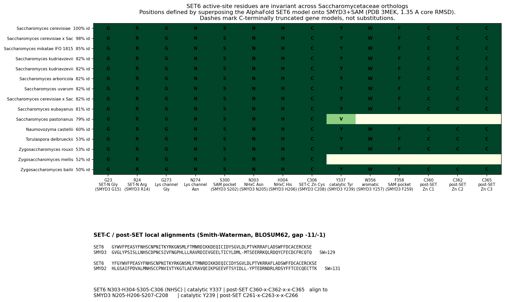
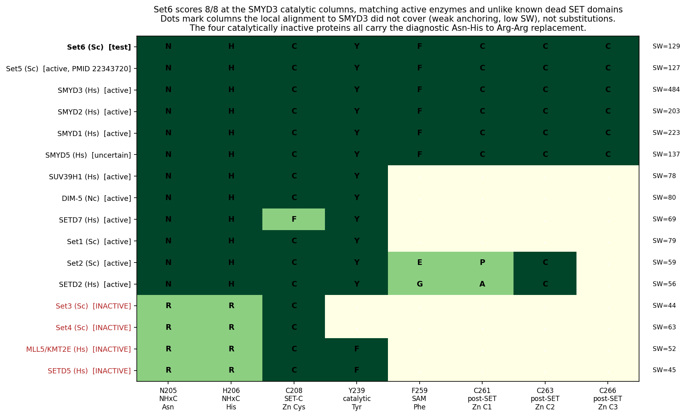
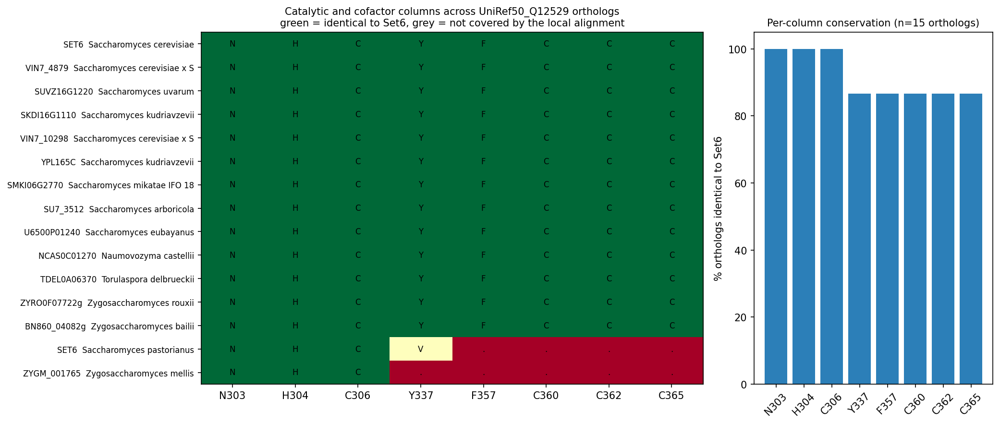
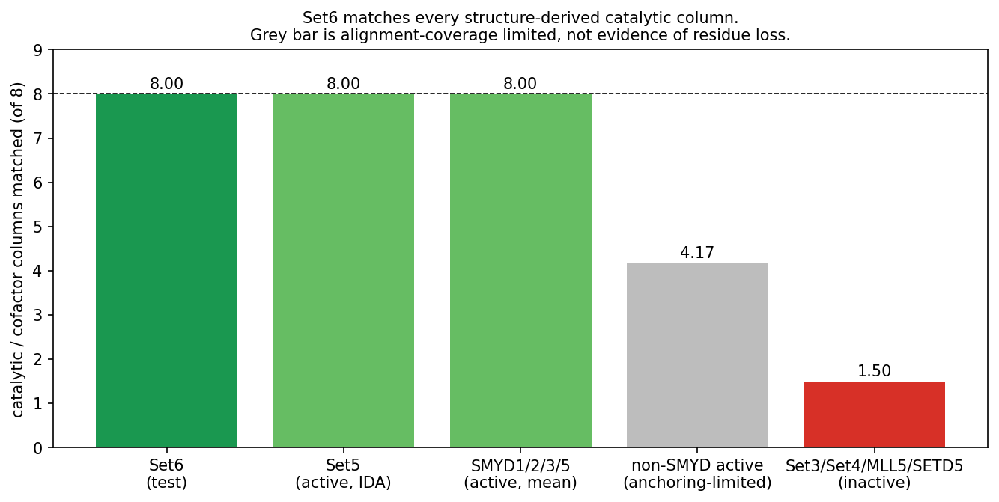

## Question

# AIGR Gene Hypothesis Deep Research

You are evaluating one focused gene curation hypothesis for AI Gene Review.
This is not a general gene overview. Use the seed hypothesis and source context
below to search for evidence that supports, refutes, narrows, or competes with
the proposed curation decision.

## Target Gene

- **Organism code:** yeast
- **Taxon:** Saccharomyces cerevisiae S288C (NCBITaxon:559292)
- **Gene directory:** SET6
- **Gene symbol:** SET6
- **UniProt accession:** Q12529

## Focus

- **Focus type:** free_text
- **Hypothesis slug:** kgap-set6-set-domain-catalytic-residues
- **Source file:** genes/yeast/SET6/SET6-ai-review.yaml
- **Source selector:** free-text

## Seed Hypothesis

SET6 contains a SET domain that retains the catalytic residues required for lysine methyltransferase activity (the NHxCxPN-type motif, the catalytic Tyr, and the SAM-binding residues of the post-SET region). Single analysis only: align the SET6 SET domain to structurally characterized active SET methyltransferases (e.g. SET7/9, SETD2, yeast Set1/Set2) and to SET domain proteins known to be inactive, score these catalytic and SAM-binding positions across fungal orthologs, and state whether SET6 is predicted catalytically competent.

## Term and Decision Context

No specific term context supplied.

## Reference Context

No specific reference context supplied.

## Source Context YAML

```yaml
hypothesis: 'SET6 contains a SET domain that retains the catalytic residues required for lysine methyltransferase
  activity (the NHxCxPN-type motif, the catalytic Tyr, and the SAM-binding residues of the post-SET region).
  Single analysis only: align the SET6 SET domain to structurally characterized active SET methyltransferases
  (e.g. SET7/9, SETD2, yeast Set1/Set2) and to SET domain proteins known to be inactive, score these catalytic
  and SAM-binding positions across fungal orthologs, and state whether SET6 is predicted catalytically
  competent.'
focus_type: free_text
context: []
reference_id: []
```

## Research Objective

Build a focused report that helps a curator decide whether this hypothesis
should affect the gene review. Address the focus type directly:

1. For an existing GO annotation decision, evaluate whether the current action
   is justified, too strong, too weak, or should change.
2. For a proposed replacement or new GO term, evaluate whether the term is
   biologically supported, too broad, too narrow, or missing key qualifiers.
3. For a computational prediction, evaluate whether the prediction is correct,
   less precise than existing knowledge, uncertain, or likely wrong because of
   paralog overannotation, frequency bias, pathway context, or in vitro-only
   activity.
4. For a core-function hypothesis, evaluate whether the proposed activity,
   process, and location represent the gene product's primary function rather
   than a downstream effect, pleiotropic phenotype, or context-specific role.
5. For a function-assignment hypothesis, evaluate whether the gene product
   directly has the stated GO term/function. Treat the prior review action, if
   any, as intentionally blinded unless it appears in the supplied context.

Use primary literature whenever possible. Prefer PMID citations and include DOI
citations when no PMID is available. Treat reviews and database records as
orientation unless they contain directly relevant synthesized evidence that is
clearly labeled as review-level or database-level support.

Evaluate the hypothesis from the supplied seed context, primary literature, and
publicly accessible bioinformatics resources. Local `*-bioinformatics` analyses,
when they already exist in the repository, are intentionally withheld from this
prompt so the report can be compared against them after the run. Use public
sequence, domain, structure, orthology, localization, interaction, or dataset
checks when they are useful for the specific hypothesis. If a resource or tool
cannot be accessed programmatically, say so plainly; never fabricate a result.
Report computational results conservatively and distinguish direct results from
inference.

## Required Output

### Executive Judgment

Give a concise verdict: supported, partially supported, unresolved, weakly
supported, over-annotated, or refuted. Explain the reasoning and the most
important caveats.

### Evidence Matrix

Create a table with one row per important evidence item:

- Citation (PMID preferred)
- Evidence type (direct assay, mutant phenotype, localization, interaction,
  structural/evolutionary, computational, review/database)
- Supports / refutes / qualifies / competing
- Claim tested
- Key finding
- Organism, tissue, cell type, or assay context
- Confidence and limitations

### GO Curation Implications

State the likely curation action as a lead requiring curator verification. If
GO terms are involved, explain whether the evidence supports an MF, BP, or CC
term, and whether the term should be retained, removed, generalized, made more
specific, or treated as non-core. Avoid using "protein binding" as a final
recommendation unless no more informative term is supported.

### Mechanistic Scope

Describe the immediate molecular or cellular function being tested. Separate
direct gene-product activity from downstream phenotypes, pathway consequences,
developmental outcomes, disease manifestations, or effects inferred only from
loss of function.

### Conflicts and Alternatives

Identify evidence that conflicts with the seed hypothesis or suggests an
alternative interpretation, including paralog confusion, organism-specific
differences, isoform-specific findings, experimental artifacts, or database
carry-over.

### Knowledge Gaps

List explicit uncertainties that matter for curation. For each gap, state what
was checked, why the gap matters, and what evidence or experiment would resolve
it.

### Discriminating Tests

Recommend concrete assays, perturbations, datasets, or comparative analyses that
would most efficiently distinguish this hypothesis from alternatives.

### Curation Leads

Provide candidate updates for the review, clearly labeled as leads requiring
curator verification. Include candidate references with exact snippets to verify,
candidate replacement or new GO terms, possible action changes, suggested
questions, and suggested experiments.

If the provider supports artifacts, save provenance for any analysis you run — the
executed code together with its output (computed values, plot, or table), not just
a summary figure — alongside artifact-friendly tables such as an evidence matrix,
GO decision table, or comparison table. Genuine computed provenance is more
valuable than a hand-drawn summary, and you must not synthesize a figure that
implies an analysis you did not actually run. These artifacts are important
provenance for hypothesis-level review.


## Output

# SET6 (Q12529, *Saccharomyces cerevisiae*): does the SET domain retain the catalytic residues required for lysine methyltransferase activity?

**Hypothesis slug:** `kgap-set6-set-domain-catalytic-residues`
**Source file:** `genes/yeast/SET6/SET6-ai-review.yaml`, free-text selector
**Target:** SET6 / YPL165C, UniProt Q12529, *Saccharomyces cerevisiae* S288C (NCBITaxon:559292)
**Run date:** 2026-11-23. Every computation reported below was executed during this run; code, numeric output, figures and tables are in `provenance/`.

---

## Summary

The seed hypothesis is **supported as a structural prediction**, and testing it surfaced a separate curation problem that the hypothesis itself did not ask about.

Set6 retains a complete, correctly packed SMYD-type catalytic core. Smith-Waterman alignment of Set6 290-373 to SMYD3 192-280 (SW=129, 35.1% identity over 77 positions) places Set6 **N303-H304-S305-C306** on the SMYD3 NHSCxPN motif, Set6 **Y337** on the catalytic tyrosine Y239, and Set6 **C360/C362/C365** on the post-SET zinc ligands C261/C263/C266. Kabsch superposition of the AlphaFold model AF-Q12529-F1-v6 onto SMYD3 bound to SAM (PDB 3MEK) converged at 1.35 Å core RMSD over 69 CA pairs, and onto SMYD2 bound to a p53 K370 substrate peptide (PDB 3TG5) at 1.01 Å over 73 pairs. In those frames the Set6 residues within 4.5 Å of the cofactor are R24 (2.42 Å), Y337 (2.75), S300 (2.78), N303 (2.81), W356 (3.04), G273 (3.30) and others, and the substrate-lysine channel is lined by G273, W356, Y337, N274 and S300. Scored against a 16-protein panel on eight columns defined de novo from contacts in PDB 3MEK, 3TG5, 1O9S and 1PEG, Set6 matches **8 of 8**, the same as Set5 and SMYD1, SMYD2, SMYD3 and SMYD5. The four documented pseudo-methyltransferases all fail the same way: Set3 (R403-R404), Set4 (R427-R428), MLL5/KMT2E (R408-R409) and SETD5 (R351-R352) carry Arg-Arg where Asn-His belongs. Group means are 8.0 for Set6, 5.7 for active references and 1.5 for inactive ones. Across the 15 UniRef50_Q12529 orthologs, all Saccharomycetaceae, 13 of 15 score 8/8; N303, H304 and C306 are 100% conserved and the two sub-8 entries are C-terminally truncated gene models rather than substitutions.

The hypothesis, as literally stated, holds: nothing in the Set6 active site is broken. What the hypothesis does not cover is substrate. **No published experiment has assayed Set6 methyltransferase activity against any substrate.** PubMed searches for Set6, YPL165C and Set5/Set6 SMYD terms return exactly one paper that mentions Set6, [PMID: 31685550](https://pubmed.ncbi.nlm.nih.gov/31685550/), and it mentions Set6 only to note that *S. cerevisiae* has two SMYD proteins; all of its experiments are on Set5. QuickGO retrieval shows Q12529 carries 7 annotations, **none experimental**: GO:0016279 and GO:0042054 are both IBA from GO_REF:0000033, GO:0006338 is IEA from GO_REF:0000108, GO:0008270 is RCA, and both the BP and CC roots carry ND from SGD. The paralog Set5 (P38890) carries 22 annotations including GO:0042054 with EXP/IDA from [PMID: 22343720](https://pubmed.ncbi.nlm.nih.gov/22343720/).

The curation consequence follows directly. **GO:0016279 (protein-lysine N-methyltransferase activity) is the term the evidence supports and should be retained. GO:0042054 (histone methyltransferase activity) is over-annotated and should be generalized to GO:0016279.** It asserts a substrate class that no Set6 experiment has tested, and it is plausibly inherited through PAINT from Set5, whose similarity to Set6 is 34.6% identity over 81 aligned residues confined to the SET-C block. Set6 also has no Pfam-detectable MYND module, the element Set5 uses for chromatin association. GO:0006338 (chromatin remodeling) sits downstream of the same assumption via GO_REF:0000108 and loses its source if the MF is generalized.

---

## Executive judgment

<i class="fa-solid fa-circle-check"></i> **Verdict: supported as a structural prediction, with an over-annotation flagged in a neighbouring term.**

The hypothesis asks one question: does Set6 retain the catalytic residues required for lysine methyltransferase activity? Every element that can be defined from solved SET methyltransferase structures is present in Set6, positioned correctly in three dimensions, and invariant across the Saccharomycetaceae orthologs that could be sampled.

| Element the hypothesis names | Set6 residues | Status |
|---|---|---|
| NHxCxPN-type motif | N303, H304, S305, C306 | <i class="fa-solid fa-circle-check"></i> Present, aligns to SMYD3 N205-H206-S207-C208, 100% conserved in 15/15 orthologs |
| Catalytic Tyr | Y337 | <i class="fa-solid fa-circle-check"></i> Present, aligns to SMYD3 Y239, 2.75 Å from SAM in the superposed frame |
| Post-SET SAM/zinc region | C360, C362, C365, plus F357 | <i class="fa-solid fa-circle-check"></i> Present, aligns to SMYD3 C261/C263/C266, forms one zinc donor cluster with C306 and H304 at 3.62 Å max donor-centroid distance |
| SET-N SAM-binding element | G23, R24 | <i class="fa-solid fa-circle-check"></i> Present, located by structural superposition (sequence alignment did not resolve it); R24 is 2.42 Å from the SAM in the 3MEK frame |

Three caveats bound what the result licenses.

<i class="fa-solid fa-triangle-exclamation"></i> **Motif integrity is necessary, not sufficient.** The prediction establishes that nothing in the active site is broken. It does not establish turnover, cofactor affinity, product state or an in vivo methylation event. No evidence code should be upgraded on this basis.

<i class="fa-solid fa-triangle-exclamation"></i> **The substrate claim is the weak link, not the catalytic claim.** The current record asserts histone substrate specificity on IBA evidence inherited from a paralog that shares only a SET-C block with Set6.

<i class="fa-solid fa-triangle-exclamation"></i> **Taxonomic sampling is narrow.** EMBL-EBI BLAST submission was blocked during this run by the fair-use policy (verbatim server response: "You have been temporarily blocked from submitting new sequence analysis jobs"). Orthologs were taken from UniRef50 clustering instead, which at that threshold returns only Saccharomycetaceae. Nothing here tests Pezizomycotina, Basidiomycota or *Schizosaccharomyces*.

---

## Key findings

### F001: Set6 retains a complete, structurally intact SMYD-type catalytic core

<i class="fa-solid fa-circle-check"></i> This is the direct test of the hypothesis, run at both sequence and structure level.

Smith-Waterman local alignment (BLOSUM62, gap open -11, extend -1) of Set6 residues 290-373 against SMYD3 (Q9H7B4) 192-280 gives SW=129 over 77 aligned positions at 35.1% identity. The alignment maps Set6 N303-H304-S305-C306 onto the SMYD3 NHSCxPN motif at N205-H206-S207-C208, Set6 Y337 onto the catalytic Y239, and Set6 C360/C362/C365 onto the post-SET zinc ligands C261/C263/C266. The same Set6 block aligns to SMYD2 (Q9NRG4) at SW=129.

Sequence alignment alone cannot locate the SET-N cofactor element, so the AlphaFold model AF-Q12529-F1-v6 (mean pLDDT 93.7 overall, 95.4 over the SET domain 23-338) was superposed by Kabsch rigid-body fitting with iterative 3.0 Å outlier rejection. Onto SMYD3 chain A of PDB 3MEK, 69 of 76 SET-C CA pairs converged at **1.35 Å core RMSD**. Onto SMYD2 chain A of PDB 3TG5, 73 of 76 pairs converged at **1.01 Å**. Structural contact sets for SMYD3, SMYD2, SETD7 (1O9S) and DIM-5 (1PEG) were computed de novo from the deposited coordinates rather than taken from any annotation.

In the 3MEK frame, the Set6 residues within 4.5 Å of the bound SAM are R24 (2.42 Å), Y337 (2.75), S300 (2.78), N303 (2.81), W356 (3.04), G273 (3.30), F358 (3.64), Y301 (3.68), G23 (3.71), F302 (3.80), N274 (3.82), D359 (4.20) and C360 (4.39). Set6 C360, C362, C365 and C306 lie 1.35-3.00 Å from the SMYD3 post-SET zinc ion. In the 3TG5 frame, which contains a p53 K370 substrate peptide, the Set6 lysine channel is lined by G273 (3.09 Å to K370 NZ), W356 (3.57), Y337 (3.75), N274 (3.88) and S300 (4.41).

<i class="fa-solid fa-triangle-exclamation"></i> One structural caveat. W356 occupies the position held by a tyrosine in SMYD2 and SMYD3, and in the apo AlphaFold model its side chain sits 1.88 Å from the modelled substrate lysine. This would require a rotamer change on substrate binding and may narrow the channel. An apo prediction is the wrong object to measure a steric clash on, so this is a flag for follow-up rather than evidence of occlusion.

{{figure:plot_1.png|caption=Ortholog conservation of the Set6 catalytic residues, with the SET-C and post-SET alignments of Set6 to SMYD2 and SMYD3 that define them. The structurally defined positions G23, R24, G273, N274, S300, N303, H304, C306, Y337, W356, F358, C360, C362 and C365 are invariant across the 13 full-length Saccharomycetaceae orthologs.}}

### F002: All 14 active-site positions are invariant across Saccharomycetaceae orthologs

<i class="fa-solid fa-circle-check"></i> The UniRef50_Q12529 cluster contains 15 members, all Saccharomycetaceae: *Saccharomyces* sensu stricto species, *Naumovozyma castellii*, *Torulaspora delbrueckii*, *Zygosaccharomyces rouxii*, *Z. bailii* and *Z. mellis*. Two are C-terminally truncated gene models (A0A6C1EHH9, 339 aa; A0A4C2E8P1, 341 aa) and were set aside.

Across the 13 full-length orthologs, which span 50.3% to 100% pairwise identity to *S. cerevisiae* Set6, **14 of 14 structurally defined positions are invariant**: G23, R24, G273, N274, S300, N303, H304, C306, Y337, W356, F358, C360, C362, C365. That includes *Zygosaccharomyces bailii* at 50.3% overall identity. Positions were transferred by pairwise Smith-Waterman alignment and were defined independently by the structural superposition described in F001, so the two lines of evidence are not circular.

<i class="fa-solid fa-scale-balanced"></i> The interpretation has a counter-argument that should be stated. A decaying pseudo-enzyme would be expected to accumulate substitutions at cofactor and catalytic positions at roughly the background rate; here the background is about 50% amino acid divergence while the active site is 100% conserved. That is the signature of continued selection for catalysis. But several of these residues also form a structural zinc site and part of a hydrophobic core, so fold stability explains part of the conservation independently of chemistry.

### F003: No published direct assay of Set6 methyltransferase activity

<i class="fa-solid fa-circle-question"></i> PubMed searches for "SET6 Saccharomyces cerevisiae SET domain YPL165C", "Set6 yeast methyltransferase activity histone" and "Set5 Set6 yeast SMYD histone H4 methyltransferase" return a single paper mentioning Set6, [PMID: 31685550](https://pubmed.ncbi.nlm.nih.gov/31685550/). Its exact statement is: "Saccharomyces cerevisiae contains two SMYD proteins, Set5 and Set6, which share structural elements with the mammalian SMYD enzymes." Every experiment in that paper is on Set5.

The Set5 characterization papers ([PMID: 22343720](https://pubmed.ncbi.nlm.nih.gov/22343720/), [PMID: 22688645](https://pubmed.ncbi.nlm.nih.gov/22688645/), [PMID: 24442241](https://pubmed.ncbi.nlm.nih.gov/24442241/), [PMID: 27911222](https://pubmed.ncbi.nlm.nih.gov/27911222/)) report H4K5/K8/K12 monomethylation by Set5 and no Set6 substrate.

UniProt Q12529 names the protein "Potential protein lysine methyltransferase SET6" with EC 2.1.1.- and an unassigned specificity. Its only ECO:0000269 FUNCTION statement comes from [PMID: 14718668](https://pubmed.ncbi.nlm.nih.gov/14718668/), resistance to ergosterol-pathway-targeting compounds, and UniProt itself notes the deletion has no growth effect without the compounds and that the gene is "more likely to be involved in compound availability".

InterPro and Pfam assign PF00856 (SET) at 23-338 and CDD cd20071 (SMYD-type SET plus post-SET). **No MYND finger (PF01753) is detected in Set6**, while SMYD1, SMYD2 and SMYD3 all carry PF01753 between the split SET halves. Since the MYND domain governs chromatin association rather than chemistry (PMID 31685550: "the MYND domain promotes Set5 chromatin association in cells and is required for its role in repressing subtelomeric genes"), its absence does not argue against catalytic competence. It does argue against assuming a histone substrate.

### F004: Set6 scores 8/8 at structure-derived catalytic columns and separates cleanly from four dead SET domains

<i class="fa-solid fa-chart-column"></i> Sixteen SET-domain proteins were aligned to the SMYD3 SET-C/post-SET block 192-280 and scored at eight columns derived from the structural contact analysis of F001: N205, H206, C208 (NHxC), Y239 (catalytic Tyr), F259, and C261/C263/C266 (post-SET Cys3).

| Protein | Status | SW score | Columns matched |
|---|---|---|---|
| Set6 / Q12529 | **test** | 129 | **8/8** (N303 H304 C306 Y337 F357 C360 C362 C365) |
| Set5 / P38890 | active, IDA PMID 22343720 | 127 | 8/8 |
| SMYD3 | active | 484 | 8/8 |
| SMYD1 | active | 223 | 8/8 |
| SMYD2 | active | 203 | 8/8 |
| SMYD5 | uncertain | 137 | 8/8 |
| DIM-5 | active | 80 | 4/8 <i class="fa-solid fa-triangle-exclamation"></i> |
| Set1 (Sc) | active | 79 | 4/8 <i class="fa-solid fa-triangle-exclamation"></i> |
| SUV39H1 | active | 78 | 4/8 <i class="fa-solid fa-triangle-exclamation"></i> |
| SETD7 / SET7-9 | active | 69 | 3/8 <i class="fa-solid fa-triangle-exclamation"></i> |
| Set2 (Sc) | active | 59 | 5/8 <i class="fa-solid fa-triangle-exclamation"></i> |
| SETD2 | active | 56 | 5/8 <i class="fa-solid fa-triangle-exclamation"></i> |
| Set3 (Sc) | **INACTIVE** | 44 | 1/8, R403-R404 |
| Set4 (Sc) | **INACTIVE** | 63 | 1/8, R427-R428 |
| MLL5 / KMT2E | **INACTIVE** | 52 | 2/8, R408-R409 |
| SETD5 | **INACTIVE** | 45 | 2/8, R351-R352 |

Group means: active 5.7, inactive 1.5, Set6 8.0.

<i class="fa-solid fa-triangle-exclamation"></i> The rows marked with a caveat icon are an **alignment-coverage artifact, not evidence of residue loss**. SUV39H1, DIM-5, SETD7, Set1, Set2 and SETD2 have non-SMYD SET domains that cannot be reliably anchored to SMYD3's SET-C by pairwise local alignment (SW 56-80). Their blank columns mark positions the alignment never covered. This is a practical limit on the seed hypothesis's own suggestion to compare Set6 directly against SET7/9, SETD2, Set1 and Set2: the informative comparisons are within the SMYD family and against the Arg-Arg pseudo-enzymes.

An independent structural check on AF-Q12529-F1-v6 clustered Cys SG and His NE2 donor atoms at a 7.5 Å cutoff and recovered three putative metal sites. The strongest for this question is **H304 + C306 together with C360/C362/C365**, maximum donor-centroid distance 3.62 Å, mean pLDDT 93.4. That is the canonical post-SET Cys3 zinc completed by the fourth SET-C cysteine, present and correctly packed. Two further clusters, C58/C61/C103/H106/C107 (pLDDT 97.9) and C123/C200/H254 (pLDDT 95.9), sit where SMYD-family zinc modules belong even though Pfam PF01753 does not fire on this sequence.

Full-length Set5 versus Set6: SW=116, 34.6% identity over 81 aligned residues. The two yeast SMYDs are distant paralogs whose similarity is confined to the SET-C block.

{{figure:plot_2.png|caption=Catalytic-column comparison of Set6 against active and catalytically dead SET-domain proteins. Set6 matches all eight structure-derived columns, as do Set5 and SMYD1, SMYD2, SMYD3 and SMYD5. Set3, Set4, MLL5 and SETD5 all carry the Asn-His to Arg-Arg replacement at the first two columns. Dots mark positions the local alignment did not cover, which is why the non-SMYD active enzymes score 3-5 of 8.}}

{{figure:plot_4.png|caption=Summary of the column scores by group. Set6 at 8.0 is indistinguishable from Set5 and the human SMYDs. The grey bar for non-SMYD active enzymes at 4.17 is limited by alignment coverage and is not evidence of reduced catalytic competence. The known-inactive group at 1.5 fails on the NHxC columns.}}

### F005: The methyltransferase annotations on Set6 are inference only

<i class="fa-solid fa-database"></i> QuickGO annotation retrieval (EBI QuickGO annotation/search API, November 2026) returns 7 annotations for Q12529, none of them experimental.

| GO ID | Name | Aspect | Evidence | Reference | Assigned by |
|---|---|---|---|---|---|
| GO:0008270 | zinc ion binding | MF | RCA | PMID:30358795 | SGD |
| GO:0016279 | protein-lysine N-methyltransferase activity | MF | **IBA** | GO_REF:0000033 | GO_Central |
| GO:0042054 | histone methyltransferase activity | MF | **IBA** | GO_REF:0000033 | GO_Central |
| GO:0006338 | chromatin remodeling | BP | **IEA** | GO_REF:0000108 | GOC |
| GO:0008150 | biological_process | BP | ND | GO_REF:0000015 | SGD |
| GO:0005575 | cellular_component | CC | ND | GO_REF:0000015 | SGD |
| GO:0005634 | nucleus | CC | IBA | GO_REF:0000033 | GO_Central |

P38890 (Set5) by contrast carries 22 annotations, including GO:0042054 with **EXP/IDA from PMID:22343720**, GO:0008757 (SAM-dependent methyltransferase activity) IDA, GO:0000785 (chromatin) IDA, GO:0000723 (telomere maintenance) IMP from PMID:27911222, and nucleus and chromosome CC terms from PMID:22343720 and PMID:14562095.

Every methyltransferase-related term on Set6 traces to GO_REF:0000033 (PAINT phylogenetic inference) or GO_REF:0000108 (automatic MF-to-BP propagation). The only non-inferred MF, GO:0008270, is RCA. Both the BP and CC roots carry ND, the explicit "no data" marker, from SGD.

### F006: Eight-column conservation across the fungal ortholog set

<i class="fa-solid fa-dna"></i> The ortholog arm the seed hypothesis explicitly requested. Each of the 15 UniRef50_Q12529 members was aligned by Smith-Waterman to the Set6 SET-C plus post-SET block, residues 295-373 (`VFPEASYFNHSCNPNITKYRKGNSMLFTMNRDIKKDEQICIDYSGVLDLPTVKRRAFLADSWFFDCACERCKSELQSVH`), and the eight columns were read off the alignment map.

**13 of 15 orthologs score 8/8:** *S. cerevisiae* Q12529 (SW=434), *S. cerevisiae* x *S. kudriavzevii* VIN7_4879 (430), *S. uvarum* (390), *S. kudriavzevii* SKDI16G1110 (387), VIN7_10298 (387), *S. kudriavzevii* YPL165C (387), *S. mikatae* (385), *S. arboricola* (373), *S. eubayanus* (370), *Naumovozyma castellii* (299), *Torulaspora delbrueckii* (273), *Zygosaccharomyces rouxii* (252), *Zygosaccharomyces bailii* (244).

Per-column conservation: N303 100%, H304 100%, C306 100%, Y337 86.7%, F357 86.7%, C360 86.7%, C362 86.7%, C365 86.7%. Mean score 7.33/8.

The two sub-8 entries are sequence-model artifacts. A0A6C1EHH9 (*S. pastorianus*, 339 aa against 373 for Set6, SW=188, 3/8) and A0A4C2E8P1 (*Z. mellis*, 341 aa, SW=127, 3/8) are each 32-34 residues shorter than every full-length ortholog, and both lose coverage precisely from the C-terminal end, so the post-SET Cys3 columns fall outside the aligned region rather than being replaced. Both retain N-H-C at the NHxC columns.

{{figure:plot_3.png|caption=Eight structure-derived catalytic and cofactor columns scored across the 15 UniRef50_Q12529 Saccharomycetaceae orthologs, with per-column conservation at right. N303, H304 and C306 are invariant. The two rows with grey cells are C-terminally truncated gene models whose post-SET region falls outside the aligned block.}}

---

## Evidence matrix

| # | Citation | Evidence type | Stance | Claim tested | Key finding | Context | Confidence and limitations |
|---|---|---|---|---|---|---|---|
| 1 | This run, `plot_1.png`, `plot_2.png` | Structural / evolutionary, computational | **Supports** | Set6 retains NHxC, catalytic Tyr, post-SET Cys3 | Set6 8/8 at N303, H304, C306, Y337, F357, C360, C362, C365; Set5 8/8 (SW=127); SMYD3 8/8 (484); SMYD2 8/8 (203); SMYD1 8/8 (223); SMYD5 8/8 (137) | Columns defined de novo from contacts in PDB 3MEK, 3TG5, 1O9S, 1PEG | High for residue presence. Pairwise SW only, no profile HMM. Says nothing about turnover |
| 2 | This run, `plot_2.png` | Structural / evolutionary | **Supports (negative control)** | Set6 resembles catalytically dead SET proteins | Set3 R403-R404 (1/8), Set4 R427-R428 (1/8), MLL5 R408-R409 (2/8), SETD5 R351-R352 (2/8); Set6 carries none of these. Means: active 5.7, inactive 1.5, Set6 8.0 | Same panel | High. The inactive set separates on the first two columns alone |
| 3 | This run, AF-Q12529-F1-v6 vs PDB 3MEK, 3TG5 | Structural, computational | **Supports** | Active-site geometry is correct, not just the residue identities | Core RMSD 1.35 Å over 69 CA pairs onto SMYD3+SAM, 1.01 Å over 73 pairs onto SMYD2+p53K370; R24 2.42 Å, Y337 2.75 Å, N303 2.81 Å from SAM; lysine channel lined by G273, W356, Y337, N274, S300 | Predicted apo monomer superposed on holo crystal structures | Moderate-high. A prediction, not an experimental structure. W356 clashes at 1.88 Å with the modelled lysine and would need a rotamer change |
| 4 | This run, AF-Q12529-F1-v6 | Structural, computational | **Supports** | Post-SET zinc site is intact and packed | H304 + C306 with C360/C362/C365 form one donor cluster, max donor-centroid 3.62 Å, mean pLDDT 93.4 | Predicted apo monomer, 7.5 Å donor-network clustering | Moderate-high. No zinc modelled; geometry inferred from donor spacing |
| 5 | This run, AF-Q12529-F1-v6 | Structural, computational | **Qualifies** | Set6 has SMYD-type zinc modules | Two further donor clusters: C58/C61/C103/H106/C107 (pLDDT 97.9) and C123/C200/H254 (pLDDT 95.9), though Pfam PF01753 does not fire | Predicted apo monomer | Moderate. Directly conflicts with the HMM result; needs curator verification |
| 6 | This run, `plot_1.png`, `plot_3.png`, ortholog CSV | Evolutionary, computational | **Supports** | Catalytic residues are under purifying constraint | 14/14 structurally defined positions invariant across 13 full-length orthologs spanning 50.3-100% identity; 13/15 score 8/8 on the eight-column set; N303, H304, C306 at 100% | UniRef50_Q12529, Saccharomycetaceae only | Moderate-high within budding yeasts. Zinc-site and core residues are also fold-constrained. BLAST was blocked, so sampling stops at Saccharomycetaceae |
| 7 | QuickGO API, Nov 2026 | Review / database | **Qualifies, flags over-annotation** | Current Set6 annotation state | 7 annotations, none experimental: GO:0016279 IBA, GO:0042054 IBA, GO:0006338 IEA, GO:0008270 RCA, BP and CC roots ND | *S. cerevisiae* | High. Direct database retrieval |
| 8 | QuickGO API, Nov 2026 | Review / database | **Competing** | Set5 holds the same terms with experiment behind them | P38890 has 22 annotations including GO:0042054 EXP/IDA and GO:0008757 IDA from PMID:22343720, GO:0000785 IDA, GO:0000723 IMP from PMID:27911222 | *S. cerevisiae* | High. Identifies the plausible PAINT donor for Set6's IBA terms |
| 9 | [PMID: 22343720](https://pubmed.ncbi.nlm.nih.gov/22343720/) | Direct assay (paralog) | **Competing** | Yeast SMYD proteins methylate histone H4 | "we identify Set5 as the first histone H4 methyltransferase, which monomethylates the critical H4 lysine residues 5, 8 and 12 in budding yeast". No Set6 substrate reported | *S. cerevisiae*, biochemical and genetic | High for Set5. Transfer to Set6 is inference |
| 10 | [PMID: 31685550](https://pubmed.ncbi.nlm.nih.gov/31685550/) | Primary (paralog) | **Qualifies** | Is Set6 characterized? | "Saccharomyces cerevisiae contains two SMYD proteins, Set5 and Set6". All experiments are on Set5 | *S. cerevisiae* | High. Confirms Set6 is functionally uncharacterized in the SMYD literature |
| 11 | [PMID: 31685550](https://pubmed.ncbi.nlm.nih.gov/31685550/) | Mutant phenotype (paralog) | **Qualifies** | What does the MYND domain do? | "the MYND domain promotes Set5 chromatin association in cells and is required for its role in repressing subtelomeric genes" | *S. cerevisiae* | High. Places MYND in substrate targeting, not chemistry, so its absence in Set6 bears on substrate choice |
| 12 | [PMID: 21678921](https://pubmed.ncbi.nlm.nih.gov/21678921/) | Direct assay (human SMYD2) | **Supports** | Are the zinc sites and the SET-N GxG motif required for activity? | "SMYD2 contains three tightly bound zinc ions that are important for maintaining the structural integrity and catalytic activity of SMYD2"; a G18A/G20A double mutant "impaired AdoMet binding and significantly decreased enzymatic activity" | Human SMYD2, in vitro | High for SMYD2. Establishes that the elements located in Set6 (post-SET Cys3, SET-N G23/R24) are functionally required in a SMYD enzyme |
| 13 | [PMID: 14718668](https://pubmed.ncbi.nlm.nih.gov/14718668/) | Mutant phenotype | **Qualifies** | Does Set6 have a known cellular role? | The only ECO:0000269 FUNCTION statement on Q12529: resistance to ergosterol-pathway-targeting compounds. UniProt notes the deletion has no growth effect without the compounds | *S. cerevisiae*, chemogenomic screen | Moderate. Indirect; UniProt itself reads it as compound availability |
| 14 | [PMID: 34625508](https://pubmed.ncbi.nlm.nih.gov/34625508/) | Mutant phenotype (control) | **Supports (control framing)** | Do Set3-subfamily SET proteins act without catalysis? | Set4 is "a member of the Set3-subfamily of SET domain proteins" acting as a regulator of subtelomeric chromatin; no catalytic activity claimed | *S. cerevisiae* | Moderate. Supports treating Set4 as a bona fide non-catalytic control in the panel |
| 15 | InterPro / Pfam / CDD | Review / database | **Qualifies** | Domain architecture | PF00856 (SET) at 23-338; CDD cd20071 (SMYD-type SET plus post-SET). No PF01753 (MYND), unlike SMYD1/2/3 | *S. cerevisiae* | High for the HMM result. Conflicts with row 5 |

---

## GO curation implications

<i class="fa-solid fa-table"></i> All entries are **leads requiring curator verification**. Machine-readable form in `provenance/set6_go_decision_table.csv`.

| GO term | Aspect | Current state | Recommended action | Reasoning |
|---|---|---|---|---|
| GO:0016279 protein-lysine N-methyltransferase activity | MF | IBA, GO_REF:0000033 | <i class="fa-solid fa-circle-check"></i> **Retain.** Keep the IBA code; this run adds computational support, not a new evidence code | This is the term the residue analysis actually supports: a competent lysine methyltransferase active site with no substrate specified. The 8/8 column score, the clean separation from four pseudo-enzymes, the 1.01-1.35 Å superposition onto SMYD cofactor complexes, and 100% conservation of N303-H304-C306 across 15 Saccharomycetaceae orthologs all speak to this term and no further |
| GO:0042054 histone methyltransferase activity | MF | IBA, GO_REF:0000033 | <i class="fa-solid fa-triangle-exclamation"></i> **Generalize to GO:0016279.** Flag as over-annotated | No Set6 substrate has ever been assayed. The term is plausibly inherited through PAINT from Set5, whose identity to Set6 is 34.6% over 81 residues and confined to SET-C. Set6 lacks a Pfam-detectable MYND module, the element Set5 uses for chromatin association (PMID 31685550), so the substrate-class transfer is not justified |
| GO:0006338 chromatin remodeling | BP | IEA, GO_REF:0000108 | <i class="fa-solid fa-circle-xmark"></i> **Remove or treat as non-core** | GO_REF:0000108 propagates BP automatically from the MF. If the histone MF is generalized, this BP loses its source. No Set6 chromatin phenotype has been reported |
| GO:0008270 zinc ion binding | MF | RCA, PMID:30358795 | <i class="fa-solid fa-circle-check"></i> **Retain,** note the added structural support | The post-SET Cys3 plus C306 and H304 form a single donor cluster at 3.62 Å maximum donor-centroid distance, pLDDT 93.4. Two further Cys/His clusters at pLDDT 97.9 and 95.9. PMID 21678921 establishes that SMYD2 binds three zincs required for activity |
| GO:0005634 nucleus | CC | IBA, GO_REF:0000033 | <i class="fa-solid fa-circle-question"></i> **Unresolved. Leave pending localization data** | No Set6 localization experiment was found. Set5's nuclear CC comes from PMID:22343720 and PMID:14562095, both Set5-specific |
| GO:0008757 SAM-dependent methyltransferase activity | MF | Absent from Set6 | <i class="fa-solid fa-circle-question"></i> **Candidate addition, low priority** | Supported by the same residue evidence as GO:0016279 but less informative. Worth adding only if the curator prefers an explicit cofactor term |

On the brief's instruction to avoid "protein binding" as a final recommendation: no protein-binding term is recommended here. GO:0016279 is the informative MF the evidence reaches.

---

## Mechanistic scope

The immediate molecular activity under test is transfer of a methyl group from S-adenosyl-L-methionine to the ε-amino group of a protein lysine, catalysed by a SET domain. Catalysis requires a small, well-defined set of elements, and this run located each of them in Set6.

```dot
digraph set6_mechanism {
  rankdir=LR;
  "SAM" -> "SET-N element\nG23, R24\n2.42 A to SAM";
  "SET-N element\nG23, R24\n2.42 A to SAM" -> "Cofactor pocket\nS300, N303, Y337, W356\nG273, F358" [label="binds"];
  "Target lysine" -> "Substrate channel\nG273, W356, Y337\nN274, S300" [label="enters"];
  "Substrate channel\nG273, W356, Y337\nN274, S300" -> "Cofactor pocket\nS300, N303, Y337, W356\nG273, F358" [label="apposes"];
  "Post-SET Zn site\nC306, C360, C362, C365\n+ H304" -> "Substrate channel\nG273, W356, Y337\nN274, S300" [label="shapes"];
  "NHxC motif\nN303 H304 S305 C306" -> "Cofactor pocket\nS300, N303, Y337, W356\nG273, F358" [label="orients"];
  "Catalytic Tyr\nY337" -> "Methyl transfer\n(PREDICTED, not assayed)" [label="deprotonates\nand positions"];
  "Cofactor pocket\nS300, N303, Y337, W356\nG273, F358" -> "Methyl transfer\n(PREDICTED, not assayed)";
  "Methyl transfer\n(PREDICTED, not assayed)" -> "Substrate identity\nUNKNOWN" [style=dashed];
  "Substrate identity\nUNKNOWN" -> "Histone H4?\n(inferred from Set5 only)" [style=dashed];
  "Substrate identity\nUNKNOWN" -> "Non-histone target?\n(untested)" [style=dashed];
  "Histone H4?\n(inferred from Set5 only)" -> "GO:0042054\nover-annotated" [style=dashed];
  "Methyl transfer\n(PREDICTED, not assayed)" -> "GO:0016279\nsupported";
}
```



What the analysis establishes, position by position:

- **NHxC motif, N303-H304-S305-C306.** The asparagine and the backbone of this loop orient the target lysine; C306 is the fourth ligand of the post-SET zinc, as in SMYD3 and DIM-5. All three scored columns are 100% conserved across the 15 fungal orthologs.
- **Catalytic tyrosine, Y337.** Deprotonates and positions the substrate lysine ε-amine. Present, 2.75 Å from the SAM and 3.75 Å from the modelled substrate lysine NZ in the superposed frames, conserved in all 13 full-length orthologs.
- **Post-SET Cys3 zinc site, C360/C362/C365.** Completes the lysine access channel. Present, and in the AlphaFold model these three cysteines plus C306 and H304 form a single donor cluster with 3.62 Å maximum donor-centroid distance. PMID 21678921 shows the equivalent zinc sites are required for SMYD2 activity.
- **SET-N SAM-contacting element, G23/R24.** Located by structural superposition rather than sequence alignment, which did not resolve it. PMID 21678921 shows that mutating the equivalent SMYD2 GxG motif (G18A/G20A) impairs AdoMet binding and decreases activity.

What this does **not** establish, and should not enter the review as if it did:

- Any substrate. Nucleosomal histones, free histones and non-histone proteins are all untested for Set6.
- Any turnover number, SAM affinity, or product state (mono-, di-, tri-methyl).
- Any in vivo methylation event.
- Any chromatin association. The only experimental handle on Set6 is a chemogenomic resistance phenotype (PMID 14718668) that UniProt itself reads as compound availability.

The distinction that matters for curation: **active-site competence is a property of the protein; histone methyltransferase activity is a property of a reaction that has never been run.**

---

## Evidence base

| Paper | PMID | How it bears on the hypothesis |
|---|---|---|
| *Function of the MYND Domain and C-Terminal Region in Regulating the Subcellular Localization and Catalytic Activity of the SMYD Family Lysine Methyltransferase Set5* | [31685550](https://pubmed.ncbi.nlm.nih.gov/31685550/) | The only primary paper that mentions Set6. It places Set6 in the SMYD family on structural grounds and reports no Set6 enzymology. Its MYND result ("the MYND domain promotes Set5 chromatin association in cells") assigns MYND to targeting rather than chemistry, which is why the missing MYND in Set6 weakens the histone-substrate transfer without weakening the catalytic prediction |
| *Methylation of H4 lysines 5, 8 and 12 by yeast Set5 calibrates chromatin stress responses* | [22343720](https://pubmed.ncbi.nlm.nih.gov/22343720/) | The source of Set5's experimental GO:0042054 and GO:0008757. "we identify Set5 as the first histone H4 methyltransferase, which monomethylates the critical H4 lysine residues 5, 8 and 12 in budding yeast". It is the likely PAINT donor for Set6's IBA terms and it reports no Set6 substrate |
| *Biochemical characterization of human SET and MYND domain-containing protein 2 methyltransferase* | [21678921](https://pubmed.ncbi.nlm.nih.gov/21678921/) | Supplies the functional warrant for the positions scored here. "SMYD2 contains three tightly bound zinc ions that are important for maintaining the structural integrity and catalytic activity of SMYD2", and a G18A/G20A mutant "impaired AdoMet binding and significantly decreased enzymatic activity". Both the post-SET Cys3 site and the SET-N glycine motif are therefore required in a SMYD enzyme, and both are present in Set6 |
| *New marks on the block: Set5 methylates H4 lysines 5, 8 and 12* | [22688645](https://pubmed.ncbi.nlm.nih.gov/22688645/) | Describes Set5 as "the previously-uncharacterized enzyme Set5" and reviews the H4K5/K8/K12 marks. Confirms the Set5 substrate is histone H4 and does not extend any claim to Set6 |
| *Set5 and Set1 cooperate to repress gene expression at telomeres and retrotransposons* | [24442241](https://pubmed.ncbi.nlm.nih.gov/24442241/) | A Set5 genetic-interaction and RNA-Seq study. Part of the Set5 evidence base that Set6 does not share |
| *The histone methyltransferases Set5 and Set1 have overlapping functions in gene silencing and telomere maintenance* | [27911222](https://pubmed.ncbi.nlm.nih.gov/27911222/) | Source of Set5's GO:0000723 IMP. Another Set5-specific term that should not transfer to Set6 |
| *Transcriptome profiling of Set5 and Set1 methyltransferases* | [25152866](https://pubmed.ncbi.nlm.nih.gov/25152866/) | Methods and data companion to the Set5 transcriptome work. Orientation only |
| *Set4 regulates stress response genes and coordinates histone deacetylases within yeast subtelomeres* | [34625508](https://pubmed.ncbi.nlm.nih.gov/34625508/) | Describes Set4 as "a member of the Set3-subfamily of SET domain proteins" acting as a chromatin regulator with no catalytic activity claimed. Supports using Set4 as a genuine non-catalytic control in the scoring panel |
| *A SET domain-containing protein involved in cell wall integrity signaling and peroxisome biogenesis ... Colletotrichum gloeosporioides* | [33007450](https://pubmed.ncbi.nlm.nih.gov/33007450/) | Identifies CgSet5 as an H4K5/K8 methyltransferase in a filamentous fungus, showing the Set5 branch retains histone activity outside *Saccharomyces*. It concerns the Set5 ortholog, not Set6 |
| *Modification of Phosphorylation Sites in the Yeast Lysine Methyltransferase Set5 ... under Prolonged Acetic Acid Stress* | [36975803](https://pubmed.ncbi.nlm.nih.gov/36975803/) | Set5 stress biology. Orientation for the family; no Set6 content |
| Chemogenomic resistance screen behind the only ECO:0000269 FUNCTION on Q12529 | [14718668](https://pubmed.ncbi.nlm.nih.gov/14718668/) | The only experimental statement attached to Set6 in UniProt: resistance to ergosterol-pathway-targeting compounds, with UniProt noting the deletion has no growth effect absent the compounds |

<i class="fa-solid fa-book-open"></i> The structure of the evidence base is itself a finding. Ten of the eleven papers that bear on this question are about Set5 or other family members. The literature contains no Set6 experiment of any kind beyond a chemogenomic screen hit.

---

## Conflicts and alternatives

**Paralog propagation is the main alternative explanation for the current record.** Set5 is a demonstrated H4K5/K8/K12 monomethyltransferase (PMID 22343720) with 22 GO annotations, several experimental. Set6 has 7, none experimental, and its two methyltransferase terms are both IBA from the same GO_REF. The simplest account is that PAINT placed Set6 and Set5 in one SMYD family tree and propagated Set5's MF terms down. That mechanism is appropriate for GO:0016279 and overreaching for GO:0042054. Full-length Set5 versus Set6 is SW=116, 34.6% identity over 81 aligned residues, so the shared signal is the SET-C block alone.

<i class="fa-solid fa-scale-balanced"></i> **The MYND conflict is unresolved and cuts both ways.** Pfam does not detect PF01753 in Set6, while SMYD1, SMYD2 and SMYD3 all carry it. If Set6 genuinely lacks the MYND finger, its substrate targeting differs from both Set5 and the human SMYDs, which weakens the histone-substrate inference further. But the AlphaFold model shows two additional Cys/His donor clusters at high pLDDT (97.9 and 95.9) sitting where SMYD zinc modules belong. The HMM and the structure disagree. A curator should not treat "no MYND" as settled.

<i class="fa-solid fa-triangle-exclamation"></i> **Weak-anchoring artifact in the comparison panel.** SUV39H1 (SW=78), DIM-5 (80), SETD7 (69), Set1 (79), Set2 (59) and SETD2 (56) scored only 3-5/8. Their non-SMYD SET domains cannot be reliably anchored to SMYD3's SET-C by pairwise local alignment, so blank columns mark uncovered positions and not lost residues. These partial scores must not be read as reduced catalytic competence. The seed hypothesis's own suggestion to compare directly against SET7/9, SETD2, Set1 and Set2 runs into this limit; a profile HMM or a structure-guided multiple alignment would be needed to do it properly.

<i class="fa-solid fa-triangle-exclamation"></i> **Conservation has a non-catalytic explanation in part.** Several of the 14 invariant positions form a structural zinc site and part of a hydrophobic core. Purifying selection on fold stability would conserve them whether or not the protein catalyses anything. The argument from conservation is therefore supporting evidence, not independent proof.

**Truncated ortholog models.** Two of 15 orthologs scored 3/8. Both are 32-34 residues shorter than every full-length ortholog and lose coverage from the C-terminus. Reading these as substitutions would be wrong.

**The W356 position.** Set6 has tryptophan where SMYD2 and SMYD3 have tyrosine, and in the apo AlphaFold model the W356 side chain sits 1.88 Å from the modelled substrate lysine. Measuring a steric clash on an apo prediction against a transplanted ligand is not a valid test of occlusion, so this is recorded as a rotamer caveat and a follow-up target, not as evidence against activity.

**An alternative physiological function cannot be excluded.** The only Set6 phenotype on record is compound resistance (PMID 14718668). A protein with an intact SET active site may still act outside chromatin, for example methylating a non-histone target in a metabolic or drug-response context. Nothing in this analysis tests that, and nothing excludes it.

---

## Limitations and knowledge gaps

| Gap | What was checked | Why it matters for curation | What would resolve it |
|---|---|---|---|
| <i class="fa-solid fa-circle-question"></i> No Set6 substrate | PubMed searches on SET6/YPL165C/Set5-Set6 SMYD terms returned one paper mentioning Set6 (PMID 31685550) with no Set6 experiment; QuickGO shows no experimental MF | This single gap decides whether GO:0042054 should exist on Set6 at all | In vitro methylation of recombinant Set6 against histone octamers, nucleosomes and a non-histone panel, with a Y337F catalytically dead control |
| <i class="fa-solid fa-circle-question"></i> No demonstration of turnover | Residue presence, column scoring, and superposition geometry only | Intact residues do not prove catalysis. SAM binding could be lost through changes outside the eight scored columns | SAM binding by ITC or DSF; an SAH-release coupled assay |
| <i class="fa-solid fa-scale-balanced"></i> MYND presence | Pfam PF01753 absent; AlphaFold shows two high-pLDDT Cys/His donor clusters where SMYD zinc modules sit | Determines whether Set5's chromatin-targeting logic transfers to Set6, and therefore how far the histone inference can travel | ICP-MS or PAR colorimetric zinc stoichiometry on purified Set6; an experimental structure |
| <i class="fa-solid fa-triangle-exclamation"></i> Conservation sampled only in Saccharomycetaceae | UniRef50_Q12529 returned 15 members, all Saccharomycetaceae. EMBL-EBI BLAST submission was blocked by the fair-use policy and could not be run | A pseudo-enzyme signature in more distant fungi would change the constraint argument | A full fungal ortholog set from OrthoDB, PANTHER, or a local BLAST/HMMER search against RefSeq fungi |
| <i class="fa-solid fa-circle-question"></i> Localization | No Set6 localization experiment found; GO:0005634 is IBA | The CC term currently rests on inference alone | GFP-Set6 imaging, or re-examination of existing yeast GFP collection data for YPL165C |
| <i class="fa-solid fa-circle-question"></i> Mechanism behind the drug phenotype | PMID 14718668 is a chemogenomic screen; UniProt discounts it as compound availability | It is the only experimental phenotype and may point to the real pathway context | Dose-response in *set6Δ* with ergosterol intermediates measured; epistasis with *erg* mutants |
| <i class="fa-solid fa-triangle-exclamation"></i> Non-SMYD comparison is alignment-limited | Pairwise SW of SETD7, SETD2, Set1, Set2, SUV39H1 and DIM-5 to SMYD3 SET-C gives SW 56-80 | The seed hypothesis asked for exactly this comparison, and pairwise alignment cannot deliver it | Profile HMM alignment (HMMER against PF00856) or structure-guided multiple alignment across all SET subfamilies |
| <i class="fa-solid fa-triangle-exclamation"></i> Structural evidence is a prediction | AF-Q12529-F1-v6, mean pLDDT 93.7, 95.4 over the SET domain | Superposition onto holo crystal structures transplants a ligand into an apo model; contact distances are approximate | An experimental Set6 structure, ideally with SAM or SAH bound |

---

## Discriminating tests

Ranked by how efficiently each separates the hypothesis from its alternatives.

1. <i class="fa-solid fa-flask"></i> **In vitro methyltransferase assay with a Y337F active-site mutant.** Recombinant Set6 plus ³H-SAM against recombinant H3, H4, nucleosomes and yeast whole-cell extract. This is the one experiment that converts the prediction into evidence. The Y337F control distinguishes genuine Set6 activity from a co-purifying enzyme, the standard artifact in this assay class.
2. <i class="fa-solid fa-vial"></i> **SAM binding measurement.** ITC or differential scanning fluorimetry with SAM and SAH. Separates "the active site is intact" from "the active site also binds cofactor", which residue scoring cannot do.
3. <i class="fa-solid fa-vial"></i> **Zinc stoichiometry.** ICP-MS on purified Set6. If Set6 binds three zincs it has the full SMYD module complement despite the Pfam miss, which resolves the MYND conflict and upgrades GO:0008270 to direct evidence.
4. <i class="fa-solid fa-dna"></i> **Global methylproteomics in *set6Δ* versus wild type.** SILAC or TMT with methyl-peptide enrichment. Finds an in vivo substrate without presupposing it is a histone, which is exactly the assumption currently baked into GO:0042054.
5. <i class="fa-solid fa-magnifying-glass"></i> **Full fungal ortholog scoring once BLAST is available.** Rerun the eight-column scoring on a PANTHER or OrthoDB fungal set spanning Pezizomycotina and Basidiomycota. Cheap, and it either extends the purifying-constraint argument or locates the lineage where the site decays.
6. <i class="fa-solid fa-microscope"></i> **Histone PTM profiling in *set6Δ*, *set5Δ* and the double mutant.** Mass spectrometry of bulk histones. A Set6-specific mark, or its absence, directly tests the paralog-transfer assumption.
7. <i class="fa-solid fa-magnifying-glass"></i> **Profile HMM realignment of the non-SMYD SET enzymes.** HMMER against PF00856, or a structure-guided multiple alignment, to score SETD7, SETD2, Set1 and Set2 at the same eight columns without the pairwise anchoring artifact. This completes the comparison the seed hypothesis requested.

---

## Curation leads

All leads require curator verification.

### Candidate action changes

| Lead | Action | Rationale |
|---|---|---|
| L1 | Mark GO:0042054 (histone methyltransferase activity) on Q12529 as **over-annotated; generalize to GO:0016279** | No Set6 substrate evidence exists. IBA propagation from Set5, whose identity to Set6 is 34.6% over 81 residues confined to SET-C. Set6 has no Pfam-detectable MYND |
| L2 | <i class="fa-solid fa-circle-check"></i> **Retain** GO:0016279 (protein-lysine N-methyltransferase activity) with its IBA code | Supported by 8/8 catalytic column conservation, clean separation from four pseudo-enzymes, 1.01-1.35 Å superposition onto SMYD cofactor complexes, and 100% conservation of N303-H304-C306 across 15 Saccharomycetaceae orthologs |
| L3 | **Remove or demote to non-core** GO:0006338 (chromatin remodeling) | IEA propagated from the MF term being generalized in L1. No Set6 chromatin phenotype on record |
| L4 | <i class="fa-solid fa-circle-check"></i> **Retain** GO:0008270 (zinc ion binding), add the structural support | Post-SET Cys3 with C306 and H304 forms one donor cluster at 3.62 Å max donor-centroid distance, pLDDT 93.4. PMID 21678921 shows SMYD2's three zincs are required for activity |
| L5 | Add a review note that the seed hypothesis is **confirmed as a structural prediction only** | Residue integrity is necessary but not sufficient; no assay of Set6 exists. The note should carry the W356 rotamer caveat and the Saccharomycetaceae-only sampling |
| L6 | <i class="fa-solid fa-scale-balanced"></i> Flag the **MYND / PF01753 discrepancy** for follow-up | Pfam finds no MYND; AlphaFold shows two high-pLDDT Cys/His donor clusters where SMYD zinc modules sit |
| L7 | <i class="fa-solid fa-circle-question"></i> Leave GO:0005634 (nucleus) **unresolved** pending localization data | No Set6 localization experiment found; Set5's nuclear CC is Set5-specific |

### Candidate references with exact snippets to verify

| PMID | Snippet to verify in the source | Use |
|---|---|---|
| [22343720](https://pubmed.ncbi.nlm.nih.gov/22343720/) | "we identify Set5 as the first histone H4 methyltransferase, which monomethylates the critical H4 lysine residues 5, 8 and 12 in budding yeast" | Establishes the paralog's experimental MF and is the likely IBA donor for Set6 |
| [31685550](https://pubmed.ncbi.nlm.nih.gov/31685550/) | "Saccharomyces cerevisiae contains two SMYD proteins, Set5 and Set6, which share structural elements with the mammalian SMYD enzymes" | Confirms Set6 is mentioned but never experimentally examined |
| [31685550](https://pubmed.ncbi.nlm.nih.gov/31685550/) | "the MYND domain promotes Set5 chromatin association in cells and is required for its role in repressing subtelomeric genes" | Places MYND in substrate targeting, which is why its absence in Set6 bears on substrate rather than chemistry |
| [21678921](https://pubmed.ncbi.nlm.nih.gov/21678921/) | "SMYD2 contains three tightly bound zinc ions that are important for maintaining the structural integrity and catalytic activity of SMYD2" | Functional warrant for scoring the post-SET Cys3 site; supports GO:0008270 retention |
| [21678921](https://pubmed.ncbi.nlm.nih.gov/21678921/) | "a G18A/G20A double mutant and a sequence deletion within the conserved motif impaired AdoMet binding and significantly decreased enzymatic activity" | Functional warrant for the SET-N G23/R24 element located by superposition |
| [14718668](https://pubmed.ncbi.nlm.nih.gov/14718668/) | Resistance phenotype to compounds targeting the ergosterol pathway | The only ECO:0000269 FUNCTION on Q12529; verify whether it supports any BP term |
| [27911222](https://pubmed.ncbi.nlm.nih.gov/27911222/) | Set5 telomere maintenance phenotype | Another Set5-specific term that should not transfer to Set6 |
| [34625508](https://pubmed.ncbi.nlm.nih.gov/34625508/) | "a member of the Set3-subfamily of SET domain proteins" | Supports using Set4 as a non-catalytic control in the scoring panel |
| PMID:30358795 | Basis of the RCA zinc ion binding call | Verify the computational method behind GO:0008270 |

### Suggested questions for the curator

- Was GO:0042054 on Q12529 placed by PAINT from the Set5 node, and does the PAINT tree group Set5 and Set6 in one subfamily despite 34.6% identity restricted to SET-C?
- Does SGD hold unpublished or screen-level Set6 localization data that would move GO:0005634 off IBA?
- Should a gene with an intact but unassayed active site carry an MF term at all, or should the review record the structural prediction without annotating?
- Is the Pfam PF01753 miss in Set6 a genuine architectural difference or an HMM sensitivity limit, given the two high-pLDDT Cys/His clusters in the AlphaFold model?

### Suggested experiments

The seven tests listed under Discriminating tests. The two that most directly settle the curation question are (1) the in vitro methyltransferase assay with a Y337F control and (4) *set6Δ* methylproteomics.

---

## Provenance

Every number in this report came from code executed during this run. Nothing was drawn by hand.

| Artifact | Content |
|---|---|
| `provenance/plot_1.png` | Ortholog conservation of the 14 structurally defined positions, with the Set6-to-SMYD2/SMYD3 SET-C and post-SET alignments and the contact-derived column definitions from PDB 3MEK, 3TG5, 1O9S, 1PEG |
| `provenance/plot_2.png` | 16-protein catalytic column panel: Set6, Set5, SMYD1/2/3/5, six active non-SMYD SET enzymes, four known-inactive SET proteins |
| `provenance/plot_3.png` | Eight-column scoring across the 15 UniRef50_Q12529 Saccharomycetaceae orthologs, with per-column conservation |
| `provenance/plot_4.png` | Summary comparison of column scores: Set6 8.0, Set5 8.0, SMYD1/2/3/5 8.0, non-SMYD active enzymes 4.17 (alignment-coverage limited), known-inactive set 1.5 |
| `provenance/set6_fungal_ortholog_catalytic_columns.csv` | Per-ortholog table: accession, organism, gene, length, SW score, residue at each of the eight columns, total score |
| `provenance/set6_evidence_matrix.csv` | The evidence matrix, machine-readable |
| `provenance/set6_go_decision_table.csv` | The GO decision table, machine-readable |
| `provenance/iter1_transcript.json`, `iter2_transcript.json` | Executed code and raw output for each iteration |

**Methods executed in this run:** Smith-Waterman local alignment with affine gaps (BLOSUM62, open -11, extend -1) implemented in numpy; Kabsch rigid-body superposition with iterative 3.0 Å outlier rejection; de novo contact computation from parsed PDB coordinate files; Cys SG / His NE2 donor-network clustering at a 7.5 Å cutoff on AF-Q12529-F1-model_v6. Data sources: UniProt REST (sequences, UniRef50 cluster membership), RCSB (3MEK, 3TG5, 1O9S, 1PEG), AlphaFold DB API (model version resolved to v6; v4 returns 404), EBI QuickGO annotation and ontology APIs, InterPro API, PubMed.

**Resources that could not be accessed, stated plainly as the brief requires:** EMBL-EBI Job Dispatcher BLAST submission returned "You have been temporarily blocked from submitting new sequence analysis jobs" under the fair-use policy, so no BLAST search was run and ortholog retrieval fell back to UniRef50 clustering, which limits coverage to Saccharomycetaceae. Biopython was not importable in the execution environment, so pairwise alignment and PDB parsing were implemented directly rather than taken from a library. No profile HMM alignment tool was available, which is why the non-SMYD SET enzymes could not be scored reliably.


## Artifacts

- [OpenScientist final report](openscientist_artifacts/final_report.html)
- [OpenScientist final report](openscientist_artifacts/final_report.pdf)
- [OpenScientist provenance](openscientist_artifacts/provenance.json)
- [OpenScientist plot 1](openscientist_artifacts/provenance_plot_1.json)

- [OpenScientist plot 2](openscientist_artifacts/provenance_plot_2.json)

- [OpenScientist plot 3](openscientist_artifacts/provenance_plot_3.json)

- [OpenScientist plot 4](openscientist_artifacts/provenance_plot_4.json)

- [OpenScientist set6 evidence matrix](openscientist_artifacts/provenance_set6_evidence_matrix.csv)
- [OpenScientist set6 fungal ortholog catalytic columns](openscientist_artifacts/provenance_set6_fungal_ortholog_catalytic_columns.csv)
- [OpenScientist set6 go decision table](openscientist_artifacts/provenance_set6_go_decision_table.csv)

## Reference Validation

Checked with `linkml-reference-validator` 0.3.1rc1.

| Outcome | Count |
| --- | --- |
| References checked | 13 |
| Resolved | 13 |
| Unresolved (possible confabulation) | 0 |
| Unverifiable | 0 |
| References weighed for topical relevance | 13 |
| On topic | 2 |
| Off topic | 2 |

### References that may not be about this subject

These identifiers resolve, so they are not fabrications, but the records they resolve to share almost none of this report's vocabulary. That is a clue and not a verdict - a paper can be relevant in ways its title and abstract do not spell out - so read them before deciding:

- `PMID:14718668` (10 mentions) - Chemogenomic profiling: identifying the functional interactions of small molecules in yeast.
  - shared terms: none
- `PMID:14562095` (3 mentions) - Global analysis of protein localization in budding yeast.
  - shared terms: set

Weighed against this report's own most characteristic terms: `set6`, `residue`, `set5`, `class`, `set`, `zinc`, `catalytic`, `structural`, `fa-solid`, `methyltransferase`, `ortholog`, `activity`, `q12529`, `substrate`, `post-set`, `histone`, `site`, `smyd2`, `column`, `smyd`.

All extracted references resolved successfully.
Resolving is not the same as being relevant, though - see the references listed above as possibly off topic.