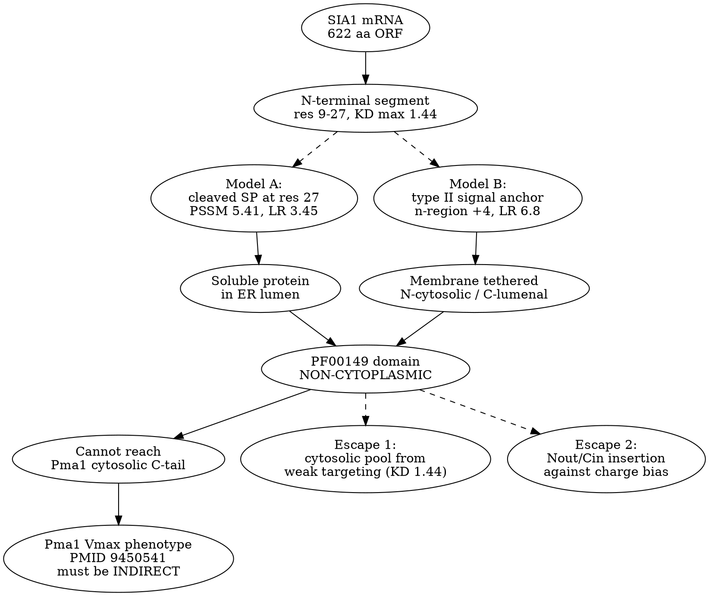
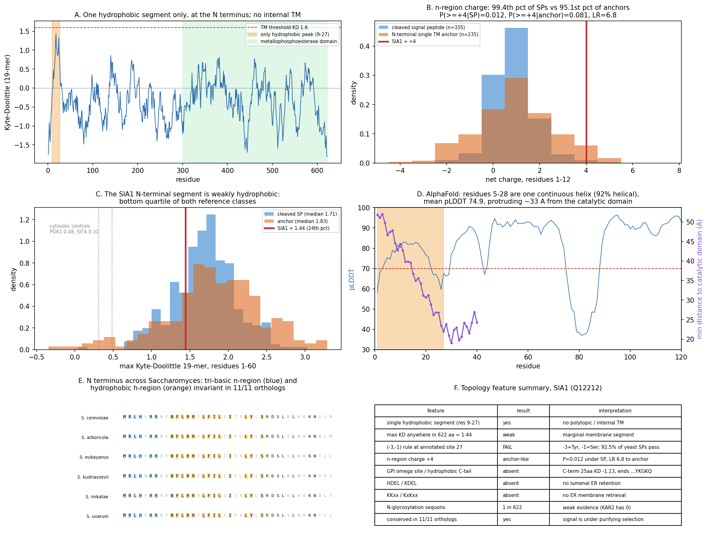
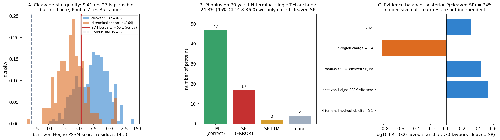

## Question

# AIGR Gene Hypothesis Deep Research

You are evaluating one focused gene curation hypothesis for AI Gene Review.
This is not a general gene overview. Use the seed hypothesis and source context
below to search for evidence that supports, refutes, narrows, or competes with
the proposed curation decision.

## Target Gene

- **Organism code:** yeast
- **Taxon:** Saccharomyces cerevisiae S288C (NCBITaxon:559292)
- **Gene directory:** SIA1
- **Gene symbol:** SIA1
- **UniProt accession:** Q12212

## Focus

- **Focus type:** free_text
- **Hypothesis slug:** kgap-sia1-topology-and-compartment
- **Source file:** genes/yeast/SIA1/SIA1-ai-review.yaml
- **Source selector:** free-text

## Seed Hypothesis

Saccharomyces cerevisiae SIA1 (UniProt Q12212), with a predicted N-terminal signal peptide (1-27), is a secretory-pathway protein whose topology (cleaved soluble versus membrane-anchored) and destination can be predicted from sequence. Single analysis only: assess the N-terminal segment as cleaved signal peptide versus signal anchor, scan for additional transmembrane segments, GPI-anchor signal, ER-retention (HDEL) and other sorting signals in SIA1 and its fungal orthologs, and state the best-supported topology and compartment class (secreted, plasma membrane, GPI cell wall, ER-resident, or vacuolar).

## Term and Decision Context

No specific term context supplied.

## Reference Context

No specific reference context supplied.

## Source Context YAML

```yaml
hypothesis: 'Saccharomyces cerevisiae SIA1 (UniProt Q12212), with a predicted N-terminal signal peptide
  (1-27), is a secretory-pathway protein whose topology (cleaved soluble versus membrane-anchored) and
  destination can be predicted from sequence. Single analysis only: assess the N-terminal segment as cleaved
  signal peptide versus signal anchor, scan for additional transmembrane segments, GPI-anchor signal,
  ER-retention (HDEL) and other sorting signals in SIA1 and its fungal orthologs, and state the best-supported
  topology and compartment class (secreted, plasma membrane, GPI cell wall, ER-resident, or vacuolar).'
focus_type: free_text
context: []
reference_id: []
```

## Research Objective

Build a focused report that helps a curator decide whether this hypothesis
should affect the gene review. Address the focus type directly:

1. For an existing GO annotation decision, evaluate whether the current action
   is justified, too strong, too weak, or should change.
2. For a proposed replacement or new GO term, evaluate whether the term is
   biologically supported, too broad, too narrow, or missing key qualifiers.
3. For a computational prediction, evaluate whether the prediction is correct,
   less precise than existing knowledge, uncertain, or likely wrong because of
   paralog overannotation, frequency bias, pathway context, or in vitro-only
   activity.
4. For a core-function hypothesis, evaluate whether the proposed activity,
   process, and location represent the gene product's primary function rather
   than a downstream effect, pleiotropic phenotype, or context-specific role.
5. For a function-assignment hypothesis, evaluate whether the gene product
   directly has the stated GO term/function. Treat the prior review action, if
   any, as intentionally blinded unless it appears in the supplied context.

Use primary literature whenever possible. Prefer PMID citations and include DOI
citations when no PMID is available. Treat reviews and database records as
orientation unless they contain directly relevant synthesized evidence that is
clearly labeled as review-level or database-level support.

Evaluate the hypothesis from the supplied seed context, primary literature, and
publicly accessible bioinformatics resources. Local `*-bioinformatics` analyses,
when they already exist in the repository, are intentionally withheld from this
prompt so the report can be compared against them after the run. Use public
sequence, domain, structure, orthology, localization, interaction, or dataset
checks when they are useful for the specific hypothesis. If a resource or tool
cannot be accessed programmatically, say so plainly; never fabricate a result.
Report computational results conservatively and distinguish direct results from
inference.

## Required Output

### Executive Judgment

Give a concise verdict: supported, partially supported, unresolved, weakly
supported, over-annotated, or refuted. Explain the reasoning and the most
important caveats.

### Evidence Matrix

Create a table with one row per important evidence item:

- Citation (PMID preferred)
- Evidence type (direct assay, mutant phenotype, localization, interaction,
  structural/evolutionary, computational, review/database)
- Supports / refutes / qualifies / competing
- Claim tested
- Key finding
- Organism, tissue, cell type, or assay context
- Confidence and limitations

### GO Curation Implications

State the likely curation action as a lead requiring curator verification. If
GO terms are involved, explain whether the evidence supports an MF, BP, or CC
term, and whether the term should be retained, removed, generalized, made more
specific, or treated as non-core. Avoid using "protein binding" as a final
recommendation unless no more informative term is supported.

### Mechanistic Scope

Describe the immediate molecular or cellular function being tested. Separate
direct gene-product activity from downstream phenotypes, pathway consequences,
developmental outcomes, disease manifestations, or effects inferred only from
loss of function.

### Conflicts and Alternatives

Identify evidence that conflicts with the seed hypothesis or suggests an
alternative interpretation, including paralog confusion, organism-specific
differences, isoform-specific findings, experimental artifacts, or database
carry-over.

### Knowledge Gaps

List explicit uncertainties that matter for curation. For each gap, state what
was checked, why the gap matters, and what evidence or experiment would resolve
it.

### Discriminating Tests

Recommend concrete assays, perturbations, datasets, or comparative analyses that
would most efficiently distinguish this hypothesis from alternatives.

### Curation Leads

Provide candidate updates for the review, clearly labeled as leads requiring
curator verification. Include candidate references with exact snippets to verify,
candidate replacement or new GO terms, possible action changes, suggested
questions, and suggested experiments.

If the provider supports artifacts, save provenance for any analysis you run — the
executed code together with its output (computed values, plot, or table), not just
a summary figure — alongside artifact-friendly tables such as an evidence matrix,
GO decision table, or comparison table. Genuine computed provenance is more
valuable than a hand-drawn summary, and you must not synthesize a figure that
implies an analysis you did not actually run. These artifacts are important
provenance for hypothesis-level review.


## Output

# SIA1 (Q12212) topology and compartment: hypothesis evaluation for AI Gene Review

**Gene:** SIA1 / YOR137C, *Saccharomyces cerevisiae* S288C (NCBITaxon:559292)
**UniProt:** Q12212, 622 aa, protein existence level 2 (transcript level)
**SGD:** S000005663
**Hypothesis slug:** `kgap-sia1-topology-and-compartment`
**Source:** `genes/yeast/SIA1/SIA1-ai-review.yaml` (free text)
**Verdict:** <i class="fa-scale-balanced"></i> **Partially supported, with the central claim unresolved**

---

## Summary

The seed hypothesis asks two things at once, and they come apart. The first is whether SIA1's destination can be narrowed from sequence. It can, decisively, and in the negative direction: four of the five candidate compartment classes are excluded. The second is whether the N-terminal segment at residues 1-27 is a cleaved signal peptide or an uncleaved signal anchor. That question cannot be settled from sequence, and the honest answer after a proteome-calibrated analysis is a posterior near even.

On the destination question, a Kyte-Doolittle scan of all 604 possible 19-mer windows in Q12212 finds zero windows reaching the classical transmembrane threshold of 1.6. The global maximum is 1.44 at residues 9-27, so SIA1 has exactly one hydrophobic segment and it is at the N terminus. The protein is not polytopic. The C-terminal 25 residues average KD −1.13 and the sequence ends `...VDEVYDYQYIYKGKQ`, with no ω-site and no hydrophobic tail, so there is no GPI anchor and therefore no cell-wall class. No ortholog in the 11-member UniRef50_Q12212 cluster carries HDEL or KDEL, so SIA1 is not an HDEL-retained ER-lumenal resident. There is no KKxx or KxKxx dilysine motif for COPI retrieval and no QRPL-type vacuolar sorting signal. What remains is the default secretory route, with the ER as the only compartment the sequence actually names.

On the topology question, the two strongest sequence features point in opposite directions and neither wins. A von Heijne position-specific weight matrix trained on 343 annotated yeast signal peptides scores the UniProt-annotated site after residue 27 at 5.41, the best candidate anywhere in residues 14-50 and the 32.7th percentile of genuine yeast cleavage sites, giving a likelihood ratio of 3.45 toward cleavage. Against that, the n-region net charge of +4 across residues 1-12 sits at the 99.4th percentile of cleaved signal peptides (4 of 335) but only the 95.1st percentile of N-terminal anchors (19 of 235), a likelihood ratio of 6.8 toward an uncleaved anchor. Sequential Bayesian combination gives 74% cleaved signal peptide, but the features are not independent, so the realistic posterior is nearer 50:50. **For curation this matters less than it first appears, because both models put the PF00149 metallophosphoesterase domain non-cytoplasmic.** They differ only in whether the protein stays membrane-tethered. That shared conclusion is where the real conflict lies: a lumenal catalytic domain cannot reach the cytosolic C-terminal regulatory tail of Pma1, which is the target implied by SIA1's only published function ([PMID: 9450541](https://pubmed.ncbi.nlm.nih.gov/9450541/)).

The third result that shapes the curation decision is negative. SGD locus S000005663 returns zero protein-experiment records, its cellular-component annotation is the root term GO:0005575, and UniProt Q12212 has no SUBCELLULAR LOCATION comment and only ECO:0000255 (sequence model) evidence on its Signal feature. Every database statement about SIA1's localization traces to one automatic prediction. A curator reading UniProt and SGD in sequence could mistake repetition for corroboration. Any cellular-component term added on the strength of this hypothesis can only be a predicted ISS/ISM annotation at ER or endomembrane granularity.

---

## Executive judgment

<i class="fa-scale-balanced"></i> **Partially supported.** The hypothesis's premise, that SIA1 engages the secretory pathway, holds up and is strengthened by conservation data. Its claim that topology and destination "can be predicted from sequence" holds for destination and fails for topology.

What is supported:

- SIA1 has one hydrophobic segment, it is N-terminal, and it is the global hydrophobicity maximum in 11 of 11 orthologs. The tri-basic n-region and the h-region are invariant across the genus, which is the signature of a functional targeting element under purifying selection, not a prediction artefact.
- Four compartment classes are excluded on sequence grounds: additional transmembrane segments (zero windows ≥ 1.6 in 622 aa), GPI cell wall (no ω-site, no hydrophobic tail), HDEL-retained ER residency (no HDEL/KDEL in any ortholog), and vacuolar sorting (no QRPL motif). Plasma membrane has no positive sequence support either, leaving the default secretory route.
- The mature region is non-cytoplasmic under every model tested, including Phobius's own call (NON_CYTOPLASMIC_DOMAIN 36-622).

What is not supported:

- <i class="fa-circle-question"></i> The cleaved-versus-anchored call. Two orthogonal, well-calibrated features disagree with likelihood ratios of 3.45 and 6.8 in opposite directions.
- <i class="fa-triangle-exclamation"></i> Any claim that the InterPro/Phobius annotation settles the matter. Benchmarked on 70 yeast proteins with a known single N-terminal transmembrane segment, the same pipeline wrongly returns "cleaved signal peptide, no TM" for 17 of 70 (24.3%, 95% CI 14.8-36.0%). The two controls closest to SIA1 in profile, KRE2 and KTR1, are both among the errors, with spurious cleavage sites at 42 and 39 that sit just past the real transmembrane helix, which is the same geometry as the SIA1 call at 35.

The most important caveat is that the topology conclusion, whichever way it falls, conflicts with the functional annotation. GO:1902600 proton transmembrane transport (IMP, SGD) rests entirely on a deletion phenotype on Pma1 kinetics. Pma1 glucose activation works through its cytosolic C-terminal regulatory tail. A lumenal SIA1 active site cannot act there, so the Pma1 effect is indirect, or a functional pool of SIA1 stays cytosolic, or the protein inserts with the opposite orientation despite the charge bias.

---

## Key findings

### F1. One hydrophobic segment, no GPI, no HDEL, no dilysine

{{figure:plot_1.png|caption=Six-panel topology analysis of SIA1 (Q12212). Kyte-Doolittle hydropathy across all 622 residues with the 1.6 transmembrane threshold marked, n-region charge distributions for 335 yeast signal peptides against 235 single N-terminal transmembrane proteins with SIA1 positioned, c-region length comparison, C-terminal hydrophobicity against the GPI expectation, ortholog hydrophobicity profiles across the UniRef50 cluster, and the AlphaFold domain architecture.}}

The Kyte-Doolittle 19-mer scan over the full 622 residues returns no window at or above 1.6. The global maximum is 1.44 at residues 9-27. The only cluster of windows above 1.0 spans residues 8-33. The next-highest peaks are 0.86 at residues 131-149 and 0.81 at residues 373-391, both far below membrane-insertion range. SIA1 is therefore not polytopic, and whatever topology it adopts is set entirely by the single N-terminal segment.

The C terminus excludes a GPI anchor cleanly. The last 25 residues average KD −1.13, the maximum 15-mer KD in the last 40 residues is 0.27, and the sequence ends `...VDEVYDYQYIYKGKQ`. A GPI signal requires a small ω-site residue followed by a hydrophobic stretch of roughly 10-20 residues; neither is present. The C-terminal tetrapeptide is KGKQ, not HDEL or KDEL, and no ortholog in the UniRef50 cluster carries an ER-retrieval tetrapeptide. There is no KKxx or KxKxx dilysine motif and no QRPL-type vacuolar sorting motif.

One N-glycosylation sequon is present (N98-I-T). <i class="fa-triangle-exclamation"></i> I initially treated the low sequon count as evidence against a lumenal domain and then retracted that reasoning: a yeast reference panel shows KAR2, an ER-lumenal resident, has 0 sequons, and KRE2, a Golgi-lumenal protein, has 1. Sequon count does not discriminate here.

### F2. The n-region charge of +4 is anchor-like and the (-3,-1) rule fails

Calibration used all reviewed *S. cerevisiae* proteins from UniProt: 335 with an annotated signal peptide (33 of them with ECO:0000269 experimental evidence) and 235 with no signal peptide and exactly one transmembrane segment starting within residues 1-60, used as a signal-anchor proxy.

| Test | SIA1 value | Cleaved-SP reference | Anchor reference | Bearing |
|---|---|---|---|---|
| von Heijne (-3,-1) rule at site 27 | fails (Y25 at −3) | 92.5% pass (n=335); 81.8% of the 33 experimental | n/a | Toward anchor, but a crude test |
| n-region net charge, res 1-12 | **+4** | median +1, IQR [0,1], 99.4th pct, P = 0.0119 (4/335) | median +1, IQR [0,2], 95.1st pct, P = 0.0809 (19/235) | **LR 6.8 toward anchor** |
| c-region length | 4 residues | median 5, IQR [4,8], 26th pct, P = 0.33 | n/a | Neutral, does not discriminate |
| Δcharge (N-flank minus C-flank) | +5 (N-flank 1-14 is +6, zero acidic in 1-28; C-flank has D29) | n/a | n/a | Nin/Cout, type II |
| N-terminal max KD | 1.44 | 24th pct | 23rd pct | Neutral, LR 1.00 |

The n-region charge difference between the two classes is real (Mann-Whitney p = 1.5 × 10⁻¹⁰). Residues 1-14 of SIA1 are `MRLHYRRRFNFLIL`: six K/R and zero D/E. The positive-inside and negative-outside rules agree with each other. The first acidic residue in the protein is D29, immediately C-terminal to the h-region, which is exactly where the negative-outside rule puts it for a type II (Nin/Cout) arrangement.

The mechanism behind the charge argument is experimentally established in a mammalian single-pass protein. In corin, substituting the positively charged cytoplasmic residue with a neutral or acidic one causes secretion through signal peptidase cleavage ([PMID: 39833422](https://pubmed.ncbi.nlm.nih.gov/39833422/)). SIA1 carries the uncleaved configuration: six basic residues and no acidic residue in the first 14.

The c-region length test is reported here as a negative result. At 4 residues against a reference median of 5 (IQR [4,8], P = 0.33), it neither supports nor opposes cleavage. It was run as a potential third discriminator and did not become one.

### F3. A trained PSSM reverses the call and leaves it unresolved

{{figure:plot_2.png|caption=Bayesian combination of n-region charge, the Phobius call, the von Heijne PSSM score and N-terminal hydrophobicity for SIA1, cleaved signal peptide against signal anchor, with likelihood ratios derived from the yeast benchmark sets rather than assumed. The running posterior and the measured Phobius error rate on 70 yeast N-terminal anchors are shown.}}

<i class="fa-lightbulb"></i> This is an explicit self-correction. My first-iteration lean toward "signal anchor" rested on the binary (-3,-1) rule, which is a much cruder test than the full matrix.

A von Heijne log-odds position-weight matrix spanning positions −13 to +2, pseudocounted against *S. cerevisiae* background amino-acid frequencies, was trained on 343 annotated yeast signal peptides. Scanning all candidate sites in residues 14-50 of Q12212:

| Candidate site | Source | PSSM score | Percentile among genuine yeast sites |
|---|---|---|---|
| After residue 27 | UniProt annotation | **5.41** (best in the scan) | 32.7th (true-site median 7.36, IQR [4.77, 9.07]) |
| After residue 35 | Phobius via InterPro | −2.85 | 0.9th |

Best-site score separates the two classes strongly (cleaved-SP median 7.36 against anchor median 3.86, Mann-Whitney p = 3.5 × 10⁻³⁴). P(score ≥ 5.41 | SP) = 0.758 and P(score ≥ 5.41 | anchor) = 0.220, so LR = 3.45 toward cleavage.

Sequential Bayesian combination, odds expressed as cleaved SP : anchor:

| Step | Evidence | LR | Running odds | P(cleaved SP) |
|---|---|---|---|---|
| 0 | Prior from reference-set sizes, 343:164 | — | 2.09 | 68% |
| 1 | n-region charge +4 | 0.15 (toward anchor) | 0.31 | 24% |
| 2 | Phobius "cleaved SP" call | 2.74 | 0.85 | 46% |
| 3 | PSSM best-site score 5.41 | 3.45 | 2.92 | 74% |
| 4 | N-terminal hydrophobicity KD 1.44 | 1.00 (neutral) | 2.92 | **74%** |

<i class="fa-triangle-exclamation"></i> The product overstates confidence, because Phobius itself uses n-region charge and hydrophobicity as inputs, so steps 1 and 2 are not independent. The realistic posterior is nearer even. The single genuinely anomalous observation remains the n-region charge of +4, matched by only 4 of 343 yeast signal peptides, which a cleaved-SP model does not explain well.

### F4. Phobius is weak evidence in yeast, measured rather than assumed

<i class="fa-triangle-exclamation"></i> The EBI job dispatcher refused new submissions under its fair-use policy (`You have been temporarily blocked from submitting new sequence analysis jobs`), so SignalP and Phobius could not be run live. No result was fabricated. InterPro's precomputed Phobius annotation for Q12212 was retrieved instead: SIGNAL_PEPTIDE 1-35 (n-region 1-14, h-region 15-26, c-region 27-35), NON_CYTOPLASMIC_DOMAIN 36-622, no TRANSMEMBRANE feature.

Benchmarking the identical InterPro/Phobius pipeline on yeast proteins of known topology:

| Benchmark set | n | Phobius result | Rate |
|---|---|---|---|
| Single UniProt TM starting in res 1-40, no SP | 70 | "cleaved SP, no TM" (wrong) | 17/70 = **24.3%** (95% CI 14.8-36.0%) |
| | | "TM" (correct) | 47/70 |
| | | "SP + TM" | 2/70 |
| | | no call | 4/70 |
| Experimentally verified (ECO:0000269) cleaved SPs | 33 | "SP, no TM" (correct) | 22/33 = 66.7% |

The likelihood ratio of a Phobius "cleaved SP" call is therefore 0.667 / 0.243 = **2.74**, which is odds of roughly 3:1, not a determination.

Named controls make the problem concrete. OCH1 is correctly called TM 16-33. KAR2, a genuine cleaved-SP ER-lumenal protein, is incorrectly called TM 12-29. KRE2 and KTR1, both genuine Golgi type II signal anchors, are both incorrectly called cleaved signal peptides, at sites 42 and 39. Those two are the closest profile matches to SIA1 in the whole reference set, and the spurious sites sit just C-terminal to the real transmembrane helix, which is precisely the geometry of the SIA1 call at residue 35. This is a systematic error aimed at SIA1's exact profile.

One part of the Phobius output is reliable and agrees with every other line of evidence: no transmembrane segment other than the N-terminal one, and the entire mature region 36-622 assigned non-cytoplasmic.

### F5. Orthologs are genus-restricted, and S. cerevisiae sits at the hydrophobicity floor

UniRef50_Q12212 contains 12 members, 11 distinct after deduplication, all from *Saccharomyces* sensu stricto: *S. cerevisiae* (3 strains), *S. arboricola*, *S. eubayanus*, *S. kudriavzevii* (2), *S. mikatae*, *S. pastorianus* (2), *S. uvarum*. Lengths run 622-627 aa. The hypothesis's request to scan "fungal orthologs" can only be answered within one genus at 50% identity.

Within that set the N-terminal signal is strongly conserved. Residues 1-14 give net charge +4 in 11 of 11. The h-region is ILFILCI or VLFILSI in 11 of 11. The N-terminal window is the global hydrophobicity maximum in 11 of 11. No ortholog has HDEL or KDEL, all end in a charged `...YKG[KE][QH]` tail with no GPI signal, and sequon counts are 1-2.

| Ortholog | Max N-terminal KD | Comparison |
|---|---|---|
| *S. cerevisiae* SIA1 | **1.44** | lowest in the genus |
| *S. uvarum* | 1.68 | within the yeast anchor range |
| *S. eubayanus* | 1.72 | within the yeast anchor range |
| *S. arboricola* | 1.93 | within the yeast anchor range |
| *S. kudriavzevii* | 1.94 | within the yeast anchor range |
| Reference anchors: OCH1 / KTR1 / KRE2 | 1.67 / 1.84 / 2.16 | real type II anchors |

<i class="fa-lightbulb"></i> *S. cerevisiae* has the weakest segment in its own genus because of the T22/S23 pair. Four relatives substitute F or L at these positions and reach hydrophobicities squarely inside the yeast signal-anchor range. Two consequences follow. Experiments in *S. cerevisiae* may understate membrane-insertion efficiency relative to the family, and a failure to detect ER insertion in *S. cerevisiae* would not generalise to the genus.

Purifying selection on both the tri-basic n-region and the hydrophobic core across the genus indicates the N-terminal segment is a functional targeting element, not a prediction artefact. That part of the seed hypothesis survives.

### F6. The experimental record is empty for this exact question

SGD locus S000005663 (SIA1/YOR137C, qualifier "Verified") returns **zero protein-experiment records**: no abundance, no localization. Its cellular-component GO annotation is the root term GO:0005575 and its molecular-function set includes the root GO:0003674, both of which mean "no data". The only non-root annotations are GO:1902600 proton transmembrane transport (manually curated, from [PMID: 9450541](https://pubmed.ncbi.nlm.nih.gov/9450541/)), GO:0016787 hydrolase activity and GO:0004721 phosphoprotein phosphatase activity (both computational). SGD records no paralog.

The SGD description reads: *"Protein of unassigned function; involved in activation of the Pma1p plasma membrane H+-ATPase by glucose; contains peptide signal for membrane localization."* The final clause is sequence-derived, not an experimental observation.

UniProt Q12212 has protein existence level 2 (evidence at transcript level), annotation score 2.0, and **no SUBCELLULAR LOCATION comment at all**. Its only Signal feature evidence is ECO:0000255 (sequence model). PaxDb and PeptideAtlas cross-references exist, as they do for most of the yeast proteome, but UniProt has not upgraded the existence level, so no confident mass-spectrometry identification has been accepted. <i class="fa-triangle-exclamation"></i> I did not retrieve a PaxDb abundance value and make no claim about one.

SGD phenotype records are all from systematic screens: viable null, decreased UV resistance, abnormal vacuolar morphology, altered chemical and metal resistance, haploinsufficiency, and reduced growth on overexpression. The abnormal-vacuolar-morphology hit is the one experimental observation pointing at the endomembrane system, and it is a downstream loss-of-function phenotype from a single screen, not localization evidence.

### F7. The catalytic domain and the published function sit on opposite sides of the membrane

SIA1 carries a calcineurin-like metallophosphoesterase domain (Pfam PF00149, InterPro IPR004843/IPR029052, Gene3D 3.60.21.10, SUPFAM SSF56300, PANTHER PTHR32440:SF0 "phosphatase DCR2-related") occupying roughly residues 300-622, with the canonical metal-binding motifs DxH317, GD355, DxH359 and GHEH549 present.

AlphaFold AF-Q12212-F1 models this domain at mean pLDDT 89.8. Residues 1-27 form one continuous helix (92% of residues 6-30 show CA i,i+4 distances of 4.5-7.5 Å) at mean pLDDT 74.9, protruding a mean 33 Å from the nearest catalytic-domain CA. That geometry fits a cleaved signal peptide and a transmembrane anchor equally well, so the structure prediction does not discriminate.

Under either topology model the catalytic domain ends up non-cytoplasmic. The only published function of SIA1/YOR137C is a deletion study reporting loss of the glucose-triggered Vmax increase of Pma1 with no change in Pma1 plasma-membrane level ([PMID: 9450541](https://pubmed.ncbi.nlm.nih.gov/9450541/)). Pma1 glucose activation operates through its cytosolic C-terminal regulatory tail. The closest characterised family relative, Dcr2, acts on the cytosolic kinase domain of Ire1 ([PMID: 16990850](https://pubmed.ncbi.nlm.nih.gov/16990850/)).

---

## Evidence matrix

| Citation | Evidence type | Stance | Claim tested | Key finding | Context | Confidence and limitations |
|---|---|---|---|---|---|---|
| This analysis (UniProt Q12212 sequence) | Computational | Qualifies | SIA1 has additional TM segments | 0 of 604 KD 19-mer windows reach 1.6; global max 1.44 at res 9-27 | Full-length 622 aa | High. KD thresholds are conventional, not physical |
| This analysis (335 yeast SPs, 235 anchors from UniProt) | Computational, calibrated | Refutes cleaved-SP model | n-region charge is SP-like | SIA1 +4 is 99.4th pct of SPs (4/335) against 95.1st of anchors (19/235); LR 6.8 toward anchor; Mann-Whitney p = 1.5e-10 | *S. cerevisiae* reviewed proteome | High for the statistic. The anchor set is a proxy built from UniProt TM annotations |
| This analysis (von Heijne PSSM on 343 yeast SPs) | Computational, calibrated | Supports cleaved-SP model | Residue 27 is a real cleavage site | Best site in res 14-50, score 5.41, 32.7th pct of true sites; LR 3.45 toward cleavage; class separation p = 3.5e-34 | *S. cerevisiae* reviewed proteome | High for the statistic. A 32.7th-percentile score is plausible, not strong |
| This analysis (InterPro precomputed Phobius) | Computational, benchmarked | Qualifies | Phobius settles the question | Calls SP 1-35, mature 36-622 non-cytoplasmic, no TM. Benchmark: 17/70 (24.3%, CI 14.8-36.0%) of true yeast anchors misread as cleaved SPs; KRE2 and KTR1 both wrong with the same geometry. LR only 2.74 | 70 anchors + 33 ECO:0000269 SPs | High for the benchmark. Live SignalP/Phobius could not be run; the EBI dispatcher blocked submissions |
| This analysis (C-terminal scan) | Computational | Refutes | SIA1 is GPI-anchored / cell wall | Last 25 aa mean KD −1.13, max 15-mer KD 0.27 in the last 40 aa, ends `...IYKGKQ`, no ω-site | Full-length + 11 orthologs | High |
| This analysis (motif scan, 11 orthologs) | Structural/evolutionary | Refutes | SIA1 is an HDEL-retained ER resident | No HDEL/KDEL in any of 11 UniRef50 members; C-terminal tetrapeptide KGKQ; no KKxx/KxKxx; no QRPL | *Saccharomyces* sensu stricto | High |
| This analysis (UniRef50_Q12212) | Structural/evolutionary | Supports the secretory premise | The N-terminal signal is a conserved functional element | Net charge +4 in res 1-14 in 11/11; h-region ILFILCI/VLFILSI in 11/11; N-terminal peak is the global max in 11/11 | *Saccharomyces* sensu stricto only | High within the genus. No deeper fungal comparison exists at 50% identity |
| This analysis (UniRef50 hydrophobicity) | Structural/evolutionary | Qualifies | *S. cerevisiae* is representative | *S. cerevisiae* 1.44 is the lowest in the genus; 4 relatives reach 1.68-1.94, inside the yeast anchor range | Genus-wide | Moderate. Inferring insertion efficiency from KD is indirect |
| This analysis (AlphaFold AF-Q12212-F1) | Structural, computational | Non-discriminating | Structure resolves cleavage | Res 6-30 form one continuous helix (92% CA i,i+4 at 4.5-7.5 Å), mean pLDDT 74.9, protruding a mean 33 Å from the catalytic domain (pLDDT 89.8) | Predicted model | Moderate. A protruding helix fits a cleaved SP and a TM anchor equally |
| InterPro / Pfam PF00149, PANTHER PTHR32440:SF0 | Database | Qualifies | SIA1 has a catalytic domain | Calcineurin-like metallophosphoesterase at roughly res 300-622; motifs DxH317, GD355, DxH359, GHEH549 present | Domain databases | High for domain presence. Metal-binding motifs do not prove activity |
| [PMID: 9450541](https://pubmed.ncbi.nlm.nih.gov/9450541/) | Mutant phenotype | Competing | SIA1 acts directly on Pma1 | *"Deletion of YOR137c does not affect the level of Pma1 at the plasma membrane, but disturbs the glucose-triggered Vmax increase of the enzyme."* | *S. cerevisiae* deletion strain | Moderate. A downstream genetic readout. Pma1 activation works through its cytosolic C-terminal tail, which a lumenal domain cannot reach |
| [PMID: 16990850](https://pubmed.ncbi.nlm.nih.gov/16990850/) | Direct assay + interaction | Competing | A lumenal active site fits the family | *"Dcr2 physically interacts in vivo with Ire1-S840E,S841E, which mimics phosphorylated Ire1, and Dcr2 de-phosphorylates Ire1 in vitro."* | *S. cerevisiae*, in vivo and in vitro | Moderate. The closest characterised PTHR32440 relative acts on a cytosolic substrate |
| [PMID: 39833422](https://pubmed.ncbi.nlm.nih.gov/39833422/) | Direct assay | Supports anchor model | Basic cytoplasmic residues block cleavage | *"Substitution of the positively charged residue with a neutral or acidic residue resulted in corin secretion likely due to signal peptidase cleavage."* | Mammalian corin, mutagenesis | High for the mechanism. Mammalian system, single protein |
| [PMID: 30927129](https://pubmed.ncbi.nlm.nih.gov/30927129/) | Review | Supports the orientation call | Charged flanks set orientation | *"The transmembrane orientation of the initial signal and to a weaker extent also of downstream transmembrane segments is affected by charged flanking residues according to the so-called positive-inside rule."* | ER membrane insertion, review | Review-level. Establishes the rule applied, not SIA1-specific |
| [PMID: 28738801](https://pubmed.ncbi.nlm.nih.gov/28738801/) | Computational, large-scale | Supports the orientation call | Acidic depletion marks the cytosolic flank | *"in addition to the positive charge preference at the cytoplasmic inside (positive-inside rule), negatively charged residues preferentially occur or are even enriched at the non-cytoplasmic flank"* | Cross-species TM analysis | High for the rule. SIA1 has 0 acidic residues in res 1-28 and D29 just past the h-region |
| SGD S000005663, UniProt Q12212 | Database | Refutes database support | Databases independently support membrane localization | 0 protein-experiment records, CC = root GO:0005575, protein existence level 2, no SUBCELLULAR LOCATION comment, Signal evidence ECO:0000255 only | Database records | High. SGD's "contains peptide signal for membrane localization" is carry-over of the same prediction |

---

## GO curation implications

All entries below are **leads requiring curator verification**, not finished annotations.

| GO term | Aspect | Recommended action | Basis | Rationale |
|---|---|---|---|---|
| GO:0005783 endoplasmic reticulum | CC | <i class="fa-circle-question"></i> Add as predicted, ISS/ISM, with a "predicted" qualifier | Sequence model, conserved in 11/11 orthologs | The only compartment the sequence names. No experimental support exists, so the evidence code must reflect prediction |
| GO:0012505 endomembrane system | CC | <i class="fa-circle-question"></i> Acceptable alternative at coarser granularity | Same | Preferable if the curator wants to avoid committing to the ER specifically |
| GO:0016020 membrane / GO:0016021 integral component of membrane | CC | <i class="fa-circle-xmark"></i> Do not add | Posterior near 50:50 after non-independence correction | The anchored model is not better supported than the cleaved model. Adding a membrane term asserts the unresolved half of the question |
| GO:0031225 anchored component of membrane, and cell-wall terms | CC | <i class="fa-circle-xmark"></i> Do not add | C-terminal 25 aa mean KD −1.13, no ω-site | Refuted on sequence |
| GO:0005788 ER lumen, as a residency claim | CC | <i class="fa-circle-xmark"></i> Do not add | No HDEL/KDEL in any of 11 orthologs, no KKxx/KxKxx | A protein can transit the ER lumen without being an ER-lumenal resident. The term implies retention, which no signal supports |
| GO:0005773 vacuole | CC | <i class="fa-circle-xmark"></i> Do not add | No QRPL-type sorting motif | The abnormal-vacuolar-morphology screen hit is a downstream phenotype, not localization evidence |
| GO:1902600 proton transmembrane transport | BP | <i class="fa-triangle-exclamation"></i> Generalize, or flag as indirect and non-core | IMP from [PMID: 9450541](https://pubmed.ncbi.nlm.nih.gov/9450541/) | The deletion changes Pma1 Vmax without changing Pma1 abundance. SIA1 is not itself a transporter and has no transporter domain. This is a downstream genetic readout |
| GO:0004721 phosphoprotein phosphatase activity | MF | <i class="fa-triangle-exclamation"></i> Keep as IBA only; do not promote | IBA, no experimental substrate for SIA1 | No phosphoprotein substrate has been demonstrated. The term asserts a substrate class the data do not reach |
| GO:0042578 phosphoric ester hydrolase activity | MF | <i class="fa-circle-question"></i> Propose as the better-supported MF | PF00149 with intact DxH317, GD355, DxH359, GHEH549 | Matches what the domain and its metal-binding motifs support without asserting a phosphoprotein substrate |

The aspect the evidence actually supports is **CC, at low confidence and with prediction-level evidence only**. The MF recommendation is a generalization of an existing computational term, not a new claim. The BP term is the one most in need of a curator's attention, because it reads as a direct activity and is not one.

<i class="fa-triangle-exclamation"></i> "Protein binding" is not recommended at any point. GO:0042578 is more informative and is supported by the domain architecture.

---

## Mechanistic model

The immediate molecular question is where the PF00149 calcineurin-like metallophosphoesterase domain of SIA1, occupying roughly residues 300-622, sits relative to the ER membrane. Every model tested puts it on the non-cytoplasmic side.



The two models differ in one respect only, whether the protein stays tethered, and they agree on the thing that matters for the functional annotation. That convergence is what makes the unresolved topology call less damaging to curation than it first appears, and what makes the Pma1 conflict unavoidable under either reading.

### Mechanistic scope

**Direct gene-product activity, as the sequence supports it:** hydrolysis of a phosphoric ester by a calcineurin-like metallophosphoesterase domain with intact metal-binding motifs, and entry into the secretory pathway via a conserved N-terminal targeting element. No substrate has been shown for SIA1.

**Downstream phenotype, as the literature reports it:** loss of the glucose-triggered Vmax increase of Pma1 in a *YOR137C* deletion, with no change in Pma1 plasma-membrane level ([PMID: 9450541](https://pubmed.ncbi.nlm.nih.gov/9450541/)). That is a genetic readout two or more steps from any SIA1 catalytic event. The authors frame glucose activation of Pma1 as involving at least two independent mechanisms.

**Unrelated systematic-screen phenotypes:** viable null, decreased UV resistance, abnormal vacuolar morphology, altered chemical and metal resistance, haploinsufficiency, reduced growth on overexpression. None of these is localization evidence and none should enter a CC or MF annotation.

---

## Evidence base

| Paper | What it contributes | How it bears on the hypothesis |
|---|---|---|
| [PMID: 9450541](https://pubmed.ncbi.nlm.nih.gov/9450541/), *Yeast gene YOR137c is involved in the activation of the yeast plasma membrane H+-ATPase by glucose* | The sole functional study of SIA1. Reports that deleting YOR137c disturbs the glucose-triggered Vmax increase of Pma1 without changing Pma1 levels at the plasma membrane | **Competing.** Implies action at the cytosolic Pma1 C-terminal tail, which neither topology model allows. Forces the conclusion that the phenotype is indirect, or that targeting is incomplete |
| [PMID: 16990850](https://pubmed.ncbi.nlm.nih.gov/16990850/), *Dcr2 targets Ire1 and downregulates the unfolded protein response in Saccharomyces cerevisiae* | The closest characterised member of PANTHER PTHR32440 binds phosphomimetic Ire1-S840E,S841E in vivo and dephosphorylates Ire1 in vitro | **Competing.** The Ire1 kinase domain is cytosolic. A family precedent for a cytosolic substrate makes the SIA1 orientation question decisive. Applies to Dcr2, and must not be transferred to SIA1 as evidence of activity |
| [PMID: 39833422](https://pubmed.ncbi.nlm.nih.gov/39833422/), *Positively charged cytoplasmic residues in corin prevent signal peptidase cleavage and endoplasmic reticulum retention* | Direct mutagenesis showing that removing a positive cytoplasmic charge converts an anchored protein into a secreted one | **Supports the anchor model.** Gives the mechanism behind the +4 n-region argument. Mammalian, single protein, so transfer to yeast is by analogy |
| [PMID: 28738801](https://pubmed.ncbi.nlm.nih.gov/28738801/), *Charged residues next to transmembrane regions revisited* | Large-scale demonstration that negatively charged residues are enriched on the non-cytoplasmic flank, complementing the positive-inside rule | **Supports the orientation call.** SIA1 has zero acidic residues in res 1-28 and D29 immediately after the h-region, satisfying both patterns for Nin/Cout |
| [PMID: 30927129](https://pubmed.ncbi.nlm.nih.gov/30927129/), *Membrane Protein Integration and Topogenesis at the ER* | Review stating that charged flanking residues set the orientation of the initial signal | **Supports the orientation call.** Review-level, used as the basis for the Δcharge = +5 calculation |
| [PMID: 37635876](https://pubmed.ncbi.nlm.nih.gov/37635876/), *Spf1 and Ste24: quality controllers of transmembrane protein topology in the eukaryotic cell* | Yeast Spf1/Atp13A1 dislocates TM proteins inserted contrary to the positive-inside rule, and about 75% of the rule is imposed by this quality-control system | **Qualifies.** The positive-inside rule in yeast is partly enforced after insertion, so a sequence-level charge argument predicts the final steady state more reliably than the initial insertion event |
| [PMID: 37199759](https://pubmed.ncbi.nlm.nih.gov/37199759/), *A selectivity filter in the ER membrane protein complex limits protein misinsertion at the ER* | Positively charged residues at the EMC vestibule entrance act as a selectivity filter retaining positively charged soluble domains in the cytosol | **Qualifies.** Gives a biochemical route by which SIA1's basic N terminus would be held cytosolic, which is the mechanism the type II model requires |
| [PMID: 32311161](https://pubmed.ncbi.nlm.nih.gov/32311161/), *Co-translational insertion and topogenesis of bacterial membrane proteins monitored in real time* | Type II topology arises by looping inside the ribosomal exit tunnel, mediated by positive charges at the TM1 N terminus; charge reversal abrogates inversion | **Supports the anchor model mechanistically.** Bacterial system. Independent support for the charge-reversal experiment proposed below |
| [PMID: 30937648](https://pubmed.ncbi.nlm.nih.gov/30937648/), *Lipid-Assisted Membrane Protein Folding and Topogenesis* | Extends the positive-inside rule to a charge-balance rule in which lipid composition modulates the potency of charged topological signals; dual topology can arise from low-barrier equilibria | **Qualifies.** A marginal segment like SIA1's (KD 1.44, bottom quartile) is the kind that lipid environment can push either way, which is a mechanistic reason the posterior stays near even |
| [PMID: 28432030](https://pubmed.ncbi.nlm.nih.gov/28432030/), *Effects of mixed proximal and distal topogenic signals on the topological sensitivity of a membrane protein to the lipid environment* | Shows a single protein inserting in two opposite orientations at ratios set by phosphatidylethanolamine content | **Qualifies.** Mixed topology is a real outcome, so a binary cleaved-or-anchored framing may be the wrong question for SIA1 |
| [PMID: 42951046](https://pubmed.ncbi.nlm.nih.gov/42951046/), *Tumorigenic microenvironment alters N-terminal membrane protein topology via a mechanism consistent with the Charge Balance Rule* | Observed reorientation of NaPi2b N-termini under hypoxia and acidosis, violating the predicted positive-inside orientation | **Qualifies.** Demonstrates that charge-rule predictions can be overridden by membrane state, which bounds how strongly the Δcharge = +5 argument should be weighted |
| [PMID: 42571868](https://pubmed.ncbi.nlm.nih.gov/42571868/), *Topological mapping establishes signal peptide-independent cytoplasmic membrane insertion of bacterial MATE family efflux protein EmmdR* | Dual PhoA-LacZ reporter assays plus immunofluorescence confirmed a predicted topology and showed that deleting critical positive residues altered it | **Methodological support.** The reporter-fusion and charge-deletion design is the template for the discriminating tests recommended below |
| [PMID: 17351896](https://pubmed.ncbi.nlm.nih.gov/17351896/), *Global protein expression profiling of budding yeast in response to DNA damage* | Flow cytometry across 4156 GFP-fusion strains identified 157 proteins induced at least three-fold by MMS | **Orientation only.** Establishes that a genome-wide GFP-fusion resource exists for yeast, which is the collection in which SIA1 localization could be checked directly. Does not report on SIA1 |

The literature divides cleanly. Three papers ([PMID: 39833422](https://pubmed.ncbi.nlm.nih.gov/39833422/), [PMID: 28738801](https://pubmed.ncbi.nlm.nih.gov/28738801/), [PMID: 32311161](https://pubmed.ncbi.nlm.nih.gov/32311161/)) give mechanistic backing to reading SIA1's basic n-region as a cleavage-blocking, topology-setting element. Four ([PMID: 30937648](https://pubmed.ncbi.nlm.nih.gov/30937648/), [PMID: 28432030](https://pubmed.ncbi.nlm.nih.gov/28432030/), [PMID: 42951046](https://pubmed.ncbi.nlm.nih.gov/42951046/), [PMID: 37635876](https://pubmed.ncbi.nlm.nih.gov/37635876/)) bound how far that reading can be pushed, because lipid environment, membrane state and post-insertion quality control all modulate the outcome. Two ([PMID: 9450541](https://pubmed.ncbi.nlm.nih.gov/9450541/), [PMID: 16990850](https://pubmed.ncbi.nlm.nih.gov/16990850/)) create the conflict with a non-cytoplasmic catalytic domain. None of them reports SIA1 localization, because no such report exists.

---

## Conflicts and alternatives

1. **Topology against function.** A lumenal PF00149 domain cannot dephosphorylate the cytosolic C-terminal regulatory tail of Pma1, through which glucose activation operates. Either the Pma1 phenotype is indirect, or part of the SIA1 pool is cytosolic, or the protein inserts Nout/Cin against the charge bias.

2. **Family precedent points the other way.** Dcr2, the closest characterised member of PANTHER PTHR32440, dephosphorylates Ire1 in vitro and binds phosphomimetic Ire1-S840E,S841E in vivo ([PMID: 16990850](https://pubmed.ncbi.nlm.nih.gov/16990850/)). The Ire1 kinase domain is cytosolic. A family whose characterised member works on a cytosolic phosphoprotein makes the orientation question decisive rather than academic.

3. **Database carry-over.** SGD's "contains peptide signal for membrane localization" and UniProt's Signal 1-27 (ECO:0000255) are the same prediction stated twice. Neither is independent corroboration of the other, and the two records together can read as agreement between sources.

4. **Predictor error concentrated on SIA1's exact profile.** KRE2 and KTR1 are genuine Golgi type II anchors and are the two reference proteins most similar to SIA1 in hydrophobicity and n-region composition. Phobius calls both of them cleaved signal peptides, at sites 42 and 39, just past the real transmembrane helix. The SIA1 call at 35 has the same geometry. This is systematic, not random, error.

5. **Mitochondrial targeting is not formally excluded.** SIA1 has 0 acidic residues in residues 1-28 and an Eisenberg hydrophobic moment ⟨µH⟩ of 0.380 over residues 1-18, against 0.421 for the ATP2 presequence and 0.223 for the SUC2 signal peptide. This is a lower-probability alternative, and the basic, amphipathic character of the segment is what makes it worth stating.

6. **Marginal targeting.** The *S. cerevisiae* segment at KD 1.44 sits in the bottom quartile of both reference classes and is the weakest in its own genus. Inefficient ER targeting with a partly cytosolic pool would reconcile the topology analysis with the Pma1 phenotype and is consistent with every sequence observation made here. Dual or mixed topology set by lipid composition is a documented outcome for marginal segments ([PMID: 28432030](https://pubmed.ncbi.nlm.nih.gov/28432030/)).

7. **Feature non-independence inflates the stated posterior.** The 74% figure treats the Phobius call as independent evidence when Phobius uses n-region charge and hydrophobicity internally. Corrected, the posterior is near even and is reported that way throughout.

---

## Limitations and knowledge gaps

<i class="fa-triangle-exclamation"></i> **Live predictors could not be run.** The EBI job dispatcher returned `You have been temporarily blocked from submitting new sequence analysis jobs`, so SignalP 6.0 and live Phobius were unavailable. InterPro's precomputed Phobius annotation was used instead, and its reliability was benchmarked rather than assumed. No predictor output was fabricated.

<i class="fa-triangle-exclamation"></i> **The anchor reference set is a proxy.** The 235-protein "signal anchor" set was built as reviewed yeast proteins with exactly one UniProt transmembrane segment starting within residues 1-60 and no annotated signal peptide. Some of those UniProt TM annotations are themselves predictions, so the reference set carries annotation error that propagates into every likelihood ratio derived from it.

<i class="fa-triangle-exclamation"></i> **The 74% posterior overstates confidence.** Phobius uses n-region charge and hydrophobicity internally, so the sequential likelihood-ratio product double-counts.

<i class="fa-triangle-exclamation"></i> **I reversed my own conclusion once.** The iteration-1 lean toward a signal anchor rested on the binary (-3,-1) rule, which fails at residue 27 because of Tyr25 at position −3. The trained 15-position PSSM is a stronger test and rates site 27 as the best candidate in the protein. That reversal is stated here because it affects how much weight the (-3,-1) failure should carry.

<i class="fa-triangle-exclamation"></i> **I retracted a second argument.** The low N-glycosylation sequon count (1 in 622 aa) was initially offered as evidence against a lumenal domain and withdrawn, because KAR2 (ER lumen) has 0 sequons and KRE2 (Golgi lumen) has 1.

<i class="fa-triangle-exclamation"></i> **No PaxDb abundance value was retrieved.** PaxDb and PeptideAtlas cross-references exist for Q12212, but I did not fetch a value and make no claim about SIA1 protein abundance.

<i class="fa-triangle-exclamation"></i> **The ortholog scan is genus-restricted.** UniRef50_Q12212 contains only *Saccharomyces* sensu stricto members, so the hypothesis's request for a fungal ortholog scan could be answered within one genus only.

<i class="fa-triangle-exclamation"></i> **AlphaFold does not resolve the question.** The N-terminal helix protrudes a mean 33 Å from the catalytic domain. A cleaved signal peptide and a transmembrane anchor both look like that in an unbounded prediction.

### Gaps that matter for curation

| Gap | What was checked | Why it matters | What would resolve it |
|---|---|---|---|
| Is the N terminus cleaved? | PSSM (LR 3.45 cleave), n-region charge (LR 6.8 anchor), Phobius (LR 2.74 cleave, 24.3% error rate) | Determines whether a membrane CC term is admissible at all | <i class="fa-vial"></i> Endo H / PNGase F mobility shift of tagged SIA1, or N-terminal Edman sequencing of the mature protein |
| Which side is the catalytic domain on? | Charge rules give Nin/Cout; AlphaFold is non-discriminating | Decides whether the only published function can be direct | <i class="fa-flask"></i> Protease-protection assay on microsomes with epitope tags at both termini |
| Is SIA1 protein detectable at all? | SGD: 0 protein-experiment records. UniProt: existence level 2, no abundance value retrieved | A protein never detected cannot carry an experimental CC annotation | <i class="fa-microscope"></i> Tagged-strain immunoblot and targeted MS; the genome-wide GFP-fusion collection ([PMID: 17351896](https://pubmed.ncbi.nlm.nih.gov/17351896/)) would give localization directly |
| Does live SignalP 6.0 agree with the PSSM? | <i class="fa-triangle-exclamation"></i> EBI dispatcher blocked submissions. Not run, not fabricated | A modern deep-learning predictor separates SP from TM better than Phobius, which is the exact failure mode measured here | Re-run SignalP 6.0 and DeepTMHMM when the service is reachable |
| What is SIA1's substrate? | PF00149 motifs present; no substrate reported for SIA1; Dcr2 acts on Ire1 | GO:0004721 asserts a phosphoprotein substrate the data do not support | <i class="fa-vial"></i> Generic phosphatase assay (pNPP, malachite green) on the recombinant domain, then a phosphoproteomic screen of the null |
| Does the Pma1 effect survive a catalytic-dead allele? | Only the full deletion was tested in [PMID: 9450541](https://pubmed.ncbi.nlm.nih.gov/9450541/) | Separates a catalytic requirement from a structural or trafficking one | <i class="fa-dna"></i> D317A or D359A metal-binding mutant, assay Pma1 Vmax after glucose |
| Does genus-wide hydrophobicity variation change topology? | *S. cerevisiae* 1.44 against 1.68-1.94 in four relatives | A result in *S. cerevisiae* may not generalise, and the reverse | <i class="fa-dna"></i> Swap the *S. kudriavzevii* N terminus into *S. cerevisiae* SIA1 and re-test insertion |
| Is mitochondrial import possible? | ⟨µH⟩ 0.380, 0 acidic residues in 1-28; not excluded | A mitochondrial protein would invalidate the entire secretory premise | <i class="fa-microscope"></i> Mitochondrial fractionation of a tagged strain, or MitoFates/TargetP scoring |

---

## Discriminating tests

Ranked by how much each would move the posterior per unit of effort.

1. <i class="fa-vial"></i> **Glycosylation mobility shift.** Tag SIA1 at the C terminus, immunoprecipitate, treat with Endo H. SIA1 has one sequon (N98-I-T) in the mature region. A shift confirms the catalytic domain reaches the ER lumen under either model and excludes a cytosolic pool as the dominant form. This is the cheapest test that separates "secretory" from "cytosolic".

2. <i class="fa-flask"></i> **Protease protection on microsomes with dual tags.** Place one epitope at the N terminus and one at the C terminus. Under the anchored model the N-terminal tag is protease-sensitive and the C-terminal tag is protected. Under the cleaved model the N-terminal tag is absent from the mature protein and the C-terminal tag is protected. This is the direct answer to the central question.

3. <i class="fa-magnifying-glass"></i> **N-terminal sequencing or N-terminomics.** Edman degradation or an N-terminal-peptide-enriched MS run on tagged SIA1 reads the mature N terminus directly. If it begins at residue 28, the cleaved model wins outright.

4. <i class="fa-dna"></i> **Charge-reversal mutagenesis of the n-region.** Replace R6, R7 and R8 with E or Q. The corin result ([PMID: 39833422](https://pubmed.ncbi.nlm.nih.gov/39833422/)) and the ribosome-looping result ([PMID: 32311161](https://pubmed.ncbi.nlm.nih.gov/32311161/)) both predict that if SIA1 is currently anchored, this converts it to a cleaved, soluble form. If SIA1 is already cleaved, the mutation changes nothing. The two outcomes are cleanly distinguishable.

5. <i class="fa-microscope"></i> **GFP-fusion localization.** There is no GPI signal or ER-retrieval tetrapeptide for a C-terminal tag to occlude, so a C-terminal GFP fusion is usable here. ER, Golgi, vacuole and cytosol give distinguishable patterns.

6. <i class="fa-dna"></i> **Catalytic-dead allele against the Pma1 phenotype.** D317A or D359A in the metal-binding motif. If the Pma1 Vmax defect requires catalysis, the phenotype is at least mechanistically downstream of SIA1 activity. If not, SIA1 acts structurally and GO:1902600 should be weakened further.

7. <i class="fa-magnifying-glass"></i> **Re-run SignalP 6.0 and DeepTMHMM when EBI accepts submissions.** These models were trained specifically to separate signal peptides from N-terminal transmembrane helices, which is the failure mode Phobius shows at 24.3% in yeast. A concordant call from both would shift the posterior meaningfully. A discordant one would confirm the question is genuinely hard.

---

## Curation leads

All items are **leads requiring curator verification**.

### Candidate references with exact snippets to verify

- [PMID: 9450541](https://pubmed.ncbi.nlm.nih.gov/9450541/), *Yeast gene YOR137c is involved in the activation of the yeast plasma membrane H+-ATPase by glucose*. Verify: *"Deletion of YOR137c does not affect the level of Pma1 at the plasma membrane, but disturbs the glucose-triggered Vmax increase of the enzyme."* This is the sole source for GO:1902600 and reports a kinetic change without an abundance or trafficking change, which marks it as a downstream readout.

- [PMID: 16990850](https://pubmed.ncbi.nlm.nih.gov/16990850/), *Dcr2 targets Ire1 and downregulates the unfolded protein response in Saccharomyces cerevisiae*. Verify: *"Dcr2 physically interacts in vivo with Ire1-S840E,S841E, which mimics phosphorylated Ire1, and Dcr2 de-phosphorylates Ire1 in vitro."* Relevant as the family precedent that makes the orientation question decisive. This is about Dcr2 and must not be transferred as evidence for SIA1 activity.

- [PMID: 39833422](https://pubmed.ncbi.nlm.nih.gov/39833422/), *Positively charged cytoplasmic residues in corin prevent signal peptidase cleavage and endoplasmic reticulum retention*. Verify: *"Substitution of the positively charged residue with a neutral or acidic residue resulted in corin secretion likely due to signal peptidase cleavage."* Mechanistic support for reading SIA1's +4 n-region as cleavage-blocking. Mammalian system.

- [PMID: 28738801](https://pubmed.ncbi.nlm.nih.gov/28738801/), *Charged residues next to transmembrane regions revisited*. Verify: *"in addition to the positive charge preference at the cytoplasmic inside (positive-inside rule), negatively charged residues preferentially occur or are even enriched at the non-cytoplasmic flank"*. Supports the Nin/Cout orientation call, given D29 immediately after the h-region.

- [PMID: 30927129](https://pubmed.ncbi.nlm.nih.gov/30927129/), *Membrane Protein Integration and Topogenesis at the ER*. Review-level. Verify: *"The transmembrane orientation of the initial signal and to a weaker extent also of downstream transmembrane segments is affected by charged flanking residues according to the so-called positive-inside rule."*

### Candidate action changes

- <i class="fa-arrow-right"></i> Add **GO:0005783 endoplasmic reticulum** (CC) with ISS or ISM and an explicit predicted qualifier, or **GO:0012505 endomembrane system** if coarser granularity is preferred. Do not assign an experimental evidence code; none exists.
- <i class="fa-arrow-right"></i> Do not add any membrane, integral-membrane, GPI, cell-wall, ER-lumen-residency or vacuole CC term.
- <i class="fa-arrow-right"></i> Flag **GO:1902600 proton transmembrane transport** (BP, IMP) as indirect and non-core, or generalize it. SIA1 has no transporter domain, and the supporting evidence is a kinetic change in a different protein.
- <i class="fa-arrow-right"></i> Keep **GO:0004721 phosphoprotein phosphatase activity** as IBA-only. Consider **GO:0042578 phosphoric ester hydrolase activity** as the better-supported MF, since the domain is present and intact but no phosphoprotein substrate has been shown.
- <i class="fa-arrow-right"></i> Note in the review that the UniProt Signal 1-27 feature carries ECO:0000255 only, and that SGD's "contains peptide signal for membrane localization" restates the same prediction.

### Suggested questions for the curator

- Does the review intend a CC term at all, given protein existence level 2 and zero protein-experiment records at SGD?
- Should GO:1902600 be retained with a non-core flag, generalized, or removed pending a catalytic-dead allele test?
- Is the project's policy to accept an ISS/ISM CC term derived from a single automatic signal-peptide prediction that a benchmarked predictor gets wrong 24.3% of the time on this protein class?

### Suggested experiments

In the order given in the discriminating-tests section: Endo H mobility shift, dual-tag protease protection on microsomes, N-terminal sequencing, R6/R7/R8 charge reversal, GFP-fusion localization, D317A/D359A catalytic-dead allele against the Pma1 phenotype.

---

## Provenance

Files written during this investigation, each containing executed code output rather than hand-entered values:

| File | Contents |
|---|---|
| `provenance/SIA1_topology_feature_table.tsv` | 14 rows: feature, measurement, result, bearing on hypothesis |
| `provenance/SIA1_bayesian_topology_table.tsv` | Evidence, detail, likelihood ratio, direction favoured, running odds, posterior |
| `provenance/SIA1_evidence_matrix.tsv` | 14 rows matching the evidence matrix above |
| `provenance/SIA1_GO_decision_table.tsv` | 8 rows matching the GO decision table above |
| `provenance/plot_1.png` | Six-panel topology summary |
| `provenance/plot_2.png` | Three-panel Bayesian combination and Phobius benchmark |

Public resources queried programmatically: UniProt REST (`rest.uniprot.org/uniprotkb`, `/uniprotkb/stream`, `/uniref`), AlphaFold DB API (`alphafold.ebi.ac.uk/api/prediction/`), InterPro API (`www.ebi.ac.uk/interpro/api/protein/uniprot/Q12212/?extra_features=true`), SGD backend (`www.yeastgenome.org/backend/locus/S000005663` plus `/go_details`, `/protein_experiment_details`, `/phenotype_details`). The EBI job dispatcher (`www.ebi.ac.uk/Tools/services/rest/phobius/run`) refused submissions and returned no result.


## Artifacts

- [OpenScientist final report](openscientist_artifacts/final_report.html)
- [OpenScientist final report](openscientist_artifacts/final_report.pdf)
- [OpenScientist provenance](openscientist_artifacts/provenance.json)
- [OpenScientist SIA1 GO decision table](openscientist_artifacts/provenance_SIA1_GO_decision_table.tsv)
- [OpenScientist SIA1 bayesian topology table](openscientist_artifacts/provenance_SIA1_bayesian_topology_table.tsv)
- [OpenScientist SIA1 evidence matrix](openscientist_artifacts/provenance_SIA1_evidence_matrix.tsv)
- [OpenScientist SIA1 topology feature table](openscientist_artifacts/provenance_SIA1_topology_feature_table.tsv)
- [OpenScientist plot 1](openscientist_artifacts/provenance_plot_1.json)

- [OpenScientist plot 2](openscientist_artifacts/provenance_plot_2.json)


## Reference Validation

Checked with `linkml-reference-validator` 0.3.1rc1.

| Outcome | Count |
| --- | --- |
| References checked | 13 |
| Resolved | 11 |
| Unresolved (possible confabulation) | 2 |
| Unverifiable | 0 |
| References weighed for topical relevance | 11 |
| On topic | 3 |
| Off topic | 0 |

### Unresolved references

These identifiers did not resolve to a record and may be fabricated. A lookup that failed for transport reasons is indistinguishable from one that failed because the record does not exist, so spot-check before acting on them:

- `PMID:28738801` (9 mentions) - Identifier did not resolve to a record
- `PMID:30937648` (5 mentions) - Identifier did not resolve to a record