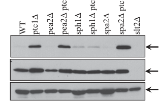

## Question

# Gene Research for Functional Annotation

## ⚠️ CRITICAL: Gene/Protein Identification Context

**BEFORE YOU BEGIN RESEARCH:** You MUST verify you are researching the CORRECT gene/protein. Gene symbols can be ambiguous, especially for less well-characterized genes from non-model organisms.

### Target Gene/Protein Identity (from UniProt):
- **UniProt Accession:** Q06160
- **Protein Description:** RecName: Full=Protein SPH1; AltName: Full=SPA2 homolog 1;
- **Gene Information:** Name=SPH1; OrderedLocusNames=YLR313C;
- **Organism (full):** Saccharomyces cerevisiae (strain ATCC 204508 / S288c) (Baker's yeast).
- **Protein Family:** Not specified in UniProt
- **Key Domains:** GIT_SHD. (IPR013724); Spa2/Sph1. (IPR039892); GIT_SHD (PF08518)

### MANDATORY VERIFICATION STEPS:

1. **Check if the gene symbol "SPH1" matches the protein description above**
2. **Verify the organism is correct:** Saccharomyces cerevisiae (strain ATCC 204508 / S288c) (Baker's yeast).
3. **Check if protein family/domains align with what you find in literature**
4. **If you find literature for a DIFFERENT gene with the same or similar symbol, STOP**

### If Gene Symbol is Ambiguous or You Cannot Find Relevant Literature:

**DO NOT PROCEED WITH RESEARCH ON A DIFFERENT GENE.** Instead:
- State clearly: "The gene symbol 'SPH1' is ambiguous or literature is limited for this specific protein"
- Explain what you found (e.g., "Found extensive literature on a different gene with the same symbol in a different organism")
- Describe the protein based ONLY on the UniProt information provided above
- Suggest that the protein function can be inferred from domain/family information

### Research Target:

Please provide a comprehensive research report on the gene **SPH1** (gene ID: SPH1, UniProt: Q06160) in yeast.

The research report should be a detailed narrative explaining the function, biological processes, and localization of the gene product. Citations should be given for all claims.

You should prioritize authoritative reviews and primary scientific literature when conducting research. You can supplement
this with annotations you find in gene/protein databases, but these can be outdated or inaccurate.

We are specifically interested in the primary function of the gene - for enzymes, what reaction is catalyzed, and what is the substrate specificity? For transporters, what is the substrate? For structural proteins or adapters, what is the broader structural role? For signaling molecules, what is the role in the pathway.

We are interested in where in or outside the cell the gene product carries out its function.

We are also interested in the signaling or biochemical pathways in which the gene functions. We are less interested in broad pleiotropic effects, except where these elucidate the precise role.

Include evidence where possible. We are interested in both experimental evidence as well as inference from structure, evolution, or bioinformatic analysis. Precise studies should be prioritized over high-throughput, where available.

## Output

Question: You are an expert researcher providing comprehensive, well-cited information.

Provide detailed information focusing on:
1. Key concepts and definitions with current understanding
2. Recent developments and latest research (prioritize 2023-2024 sources)
3. Current applications and real-world implementations
4. Expert opinions and analysis from authoritative sources
5. Relevant statistics and data from recent studies

Format as a comprehensive research report with proper citations. Include URLs and publication dates where available.
Always prioritize recent, authoritative sources and provide specific citations for all major claims.

# Gene Research for Functional Annotation

## ⚠️ CRITICAL: Gene/Protein Identification Context

**BEFORE YOU BEGIN RESEARCH:** You MUST verify you are researching the CORRECT gene/protein. Gene symbols can be ambiguous, especially for less well-characterized genes from non-model organisms.

### Target Gene/Protein Identity (from UniProt):
- **UniProt Accession:** Q06160
- **Protein Description:** RecName: Full=Protein SPH1; AltName: Full=SPA2 homolog 1;
- **Gene Information:** Name=SPH1; OrderedLocusNames=YLR313C;
- **Organism (full):** Saccharomyces cerevisiae (strain ATCC 204508 / S288c) (Baker's yeast).
- **Protein Family:** Not specified in UniProt
- **Key Domains:** GIT_SHD. (IPR013724); Spa2/Sph1. (IPR039892); GIT_SHD (PF08518)

### MANDATORY VERIFICATION STEPS:

1. **Check if the gene symbol "SPH1" matches the protein description above**
2. **Verify the organism is correct:** Saccharomyces cerevisiae (strain ATCC 204508 / S288c) (Baker's yeast).
3. **Check if protein family/domains align with what you find in literature**
4. **If you find literature for a DIFFERENT gene with the same or similar symbol, STOP**

### If Gene Symbol is Ambiguous or You Cannot Find Relevant Literature:

**DO NOT PROCEED WITH RESEARCH ON A DIFFERENT GENE.** Instead:
- State clearly: "The gene symbol 'SPH1' is ambiguous or literature is limited for this specific protein"
- Explain what you found (e.g., "Found extensive literature on a different gene with the same symbol in a different organism")
- Describe the protein based ONLY on the UniProt information provided above
- Suggest that the protein function can be inferred from domain/family information

### Research Target:

Please provide a comprehensive research report on the gene **SPH1** (gene ID: SPH1, UniProt: Q06160) in yeast.

The research report should be a detailed narrative explaining the function, biological processes, and localization of the gene product. Citations should be given for all claims.

You should prioritize authoritative reviews and primary scientific literature when conducting research. You can supplement
this with annotations you find in gene/protein databases, but these can be outdated or inaccurate.

We are specifically interested in the primary function of the gene - for enzymes, what reaction is catalyzed, and what is the substrate specificity? For transporters, what is the substrate? For structural proteins or adapters, what is the broader structural role? For signaling molecules, what is the role in the pathway.

We are interested in where in or outside the cell the gene product carries out its function.

We are also interested in the signaling or biochemical pathways in which the gene functions. We are less interested in broad pleiotropic effects, except where these elucidate the precise role.

Include evidence where possible. We are interested in both experimental evidence as well as inference from structure, evolution, or bioinformatic analysis. Precise studies should be prioritized over high-throughput, where available.

# SPH1 (YLR313C; UniProt Q06160) in budding yeast

## Identity and principal function

**Identity check.** The requested protein is **Sph1p, “Spa2 homolog 1,” encoded by *SPH1/YLR313C* in *Saccharomyces cerevisiae* S288C**—not Spa2p, which is encoded by the separate gene *SPA2*. The accession, locus, strain designation, and GIT_SHD/Spa2–Sph1 domain annotations are those specified in the question. Published work independently identifies Sph1p as a Spa2-related yeast polarity protein; Spa2p contains five regions conserved with Sph1p. Those shared regions support a relationship between the proteins, **not interchangeability of their experimentally established functions**. (sheu1998spa2pinteractswith pages 1-2, li2013differentpolarisomecomponents pages 1-2)

**Functional assessment.** Sph1p is best annotated as a **polarized-growth-associated regulatory protein** with a demonstrated contribution to activation of the cell-wall-integrity MAP kinase **Slt2p/Mpk1p**. It participates in bud and mating-projection morphogenesis and, in a defined genetic setting, regulates how cortical endoplasmic reticulum (ER) spreads into a daughter bud. A scaffold- or adaptor-like role is plausible from its homology and polarized localization, but the available Sph1-specific experiments do not identify a biochemical reaction, catalytic substrate, transporter cargo, or a complete set of direct binding partners. (fujiwara1998rho1pbni1pspa2pinteractionsimplication pages 6-9, li2013differentpolarisomecomponents pages 1-2, li2013differentpolarisomecomponents pages 6-7)

The following table distinguishes observations on Sph1p from inferences and from results established only for Spa2p.

| SPH1-specific finding | Evidence type and strength | Evidence and methodological qualification |
|---|---|---|
| **Identity and domains** | **Curated identity; homology-supported domain annotation** | Target is *S. cerevisiae* Sph1p, UniProt **Q06160**, gene **SPH1**, locus **YLR313C** (identifiers supplied in the research brief). Spa2 contains five regions conserved with Sph1p, designated SHD-I–V; the supplied InterPro/Pfam annotations place Sph1p in the Spa2/Sph1 family and identify a GIT_SHD-related region. These establish homology, not identical partner specificity or function (sheu1998spa2pinteractswith pages 1-2, hoefen2006themultifunctionalgit pages 2-3). |
| **Polarized localization** | **Moderate: later primary-study summary plus review; foundational direct imaging not retrieved** | Li *et al.* state that the seven recognized polarisome proteins, including Sph1p, localize to small-bud tips and large-bud necks. A later review likewise describes the conserved region as important for targeting Spa2 and Sph1 to polarized-growth sites. Because the original Sph1 imaging study was unavailable, precise stage-specific localization should be treated as literature-supported rather than independently re-evaluated here (li2013differentpolarisomecomponents pages 1-2, xie2021polarisomeassemblymediates pages 2-3). |
| **Polarized mating and bipolar budding** | **Moderate: primary article reporting earlier findings; foundational paper unavailable** | Fujiwara *et al.* report that **SPH1** had been shown to be required for bipolar budding and mating-projection (“shmoo”) formation, citing the foundational Arkowitz–Lowe and Roemer *et al.* studies. The original Roemer study is identifiable as *The Spa2-related protein, Sph1p, is important for polarized growth in yeast*, but its full experimental details and numerical phenotype penetrance were not available for verification (fujiwara1998rho1pbni1pspa2pinteractionsimplication pages 6-9, foltman2018cellpolarityprotein pages 29-30). |
| **Cortical-ER inheritance in a `ptc1Δ` background** | **Strong direct genetic and imaging evidence** | `sph1Δ` significantly suppressed the `ptc1Δ` cortical-ER inheritance defect. Across the rescued polarisome double mutants, including `sph1Δ ptc1Δ`, approximately **70–90%** of small buds contained a distributed cortical-ER network, versus approximately **80%** in wild type; in `ptc1Δ`, **>80%** instead contained mother–bud-axis ER tubules without detectable cortical ER. The 70–90% interval is pooled across several mutant classes and is not a uniquely reported Sph1 value (li2013differentpolarisomecomponents pages 2-3). |
| **Slt2/Mpk1 activation versus localization** | **Strong direct biochemical and fluorescence evidence** | In `sph1Δ ptc1Δ`, dually phosphorylated Slt2 was significantly reduced relative to `ptc1Δ`, based on immunoblots quantified over **four independent experiments**. By contrast, deleting **SPH1** did not significantly alter Slt2-GFP localization or Mkk1-GFP localization at bud tips/necks. Thus Sph1 supports full CWI-MAPK activation in this context rather than recruiting the kinase module to the polarized site (li2013differentpolarisomecomponents pages 3-4, li2013differentpolarisomecomponents pages 4-5, li2013differentpolarisomecomponents pages 6-7, li2013differentpolarisomecomponents media facd4e55). |
| **No detected Bni1 interaction or tested genetic coupling** | **Limited negative evidence reported as unpublished observations within a primary paper** | Fujiwara *et al.* reported that `sph1` was not synthetically lethal with `rho1::RhoA` or `pkc1` and that Sph1p did not interact with Bni1p in their yeast two-hybrid assay. These results distinguish Sph1 from the experimentally demonstrated Spa2–Bni1 axis, but negative two-hybrid and genetic tests do **not** exclude condition-dependent, indirect, or assay-inaccessible interactions (fujiwara1998rho1pbni1pspa2pinteractionsimplication pages 6-9). |

*Table: Evidence specific to *Saccharomyces cerevisiae* Sph1p/Q06160, separated by direct experiment, secondary reporting, and homology-based inference. The table explicitly avoids transferring Spa2-specific binding results to Sph1p.*

## Localization and cellular process

Sph1p is associated with **sites of polarized growth inside the cell**, rather than an established extracellular compartment. Li and colleagues describe Sph1p among polarisome-associated proteins concentrated at **small-bud tips** and **large-bud necks**; the Spa2/Sph1 homology literature also connects these proteins with polarized-growth sites. The foundational Sph1 imaging paper was not available in full for independent assessment here, so precise localization dynamics or direct plasma-membrane binding should not be inferred from those summaries. (li2013differentpolarisomecomponents pages 1-2, xie2021polarisomeassemblymediates pages 2-3)

During vegetative growth, Sph1p contributes to the spatial organization underlying **bipolar budding**; during the pheromone response, it contributes to formation of the polarized mating projection, or **shmoo**. The original characterization is Roemer *et al.*, “The Spa2-related protein, Sph1p, is important for polarized growth in yeast” (*Journal of Cell Science*, **February 1998**; https://doi.org/10.1242/jcs.111.4.479). Those phenotype statements are corroborated by a contemporaneous primary paper citing the original studies, but detailed effect sizes from the original Sph1 experiments could not be verified because its full text was unavailable. These are morphogenesis roles, not evidence that Sph1 itself polymerizes actin. (foltman2018cellpolarityprotein pages 29-30, fujiwara1998rho1pbni1pspa2pinteractionsimplication pages 6-9, xie2021polarisomeassemblymediates pages 1-2)

## Best-resolved signaling role: Slt2 activation and ER inheritance

The strongest mechanistic evidence comes from Li, Ferro-Novick and Novick, “Different polarisome components play distinct roles in Slt2p-regulated cortical ER inheritance in *Saccharomyces cerevisiae*” (*Molecular Biology of the Cell*, **2013**, published online August 7; https://doi.org/10.1091/mbc.e13-05-0268). In **`ptc1Δ`** cells, loss of the Ptc1 phosphatase leaves Slt2 excessively active: an ER tubule enters the new bud but fails to spread around its cortex. Deleting **`SPH1`** significantly suppresses this defect and reduces the pool of **dually phosphorylated, active Slt2p** in the `sph1Δ ptc1Δ` double mutant relative to `ptc1Δ`. The phosphorylation comparison was quantified across **four independent experiments**. The reported ER-rescue range—approximately **70–90%** of small buds with a cortical ER network—covers several suppressing polarisome mutants, **including** `sph1Δ ptc1Δ`; it is *not* a separately established percentage for SPH1 alone. Approximately 80% of wild-type small buds have cortical ER, whereas more than 80% of `ptc1Δ` small buds show axis-aligned ER tubules without detectable cortical ER. (li2013differentpolarisomecomponents pages 1-2, li2013differentpolarisomecomponents pages 2-3, li2013differentpolarisomecomponents pages 4-5, li2013differentpolarisomecomponents media facd4e55)

**The distinction is kinase activation versus kinase recruitment.** Loss of SPH1 did **not** significantly disrupt bud-tip Slt2–GFP localization or Mkk1–GFP localization at bud tips and necks. By contrast, loss of *SPA2* or *PEA2* impaired localization of this kinase module without comparably lowering elevated Slt2 phosphorylation in the `ptc1Δ` background. Thus, under these experimental conditions, Sph1p helps sustain **full activation** of Slt2 rather than serving as its demonstrated bud-tip recruitment scaffold. How Sph1p affects activation, and which downstream Slt2 substrate controls ER spreading, remain unresolved. The interpretation that active Slt2 keeps ER associated with the actin-based cytoskeleton is a **model** supported by the observation that actin depolymerization reverses the `ptc1Δ` ER phenotype; direct molecular mediation by Sph1p was not demonstrated. (li2013differentpolarisomecomponents pages 3-4, li2013differentpolarisomecomponents pages 4-5, li2013differentpolarisomecomponents pages 6-7)

The effect is also **context-specific**, not a generic requirement for organelle inheritance: deleting SPH1 did not rescue the mitochondrial-inheritance defect of `ptc1Δ`. In the same study, `sph1Δ ptc1Δ` grew faster than `ptc1Δ`, although single polarisome-gene deletions did not impair growth in the wild-type background examined. These genetic observations reinforce a role in a particular Slt2-regulated polarity process rather than establishing an essential housekeeping activity. (li2013differentpolarisomecomponents pages 5-6, li2013differentpolarisomecomponents pages 1-2)

## Homology, partner specificity, and recent understanding

The supplied **GIT_SHD/PF08518, IPR013724, and Spa2/Sph1/IPR039892 annotations** are consistent with sequence-based assignment to a conserved protein-interaction architecture. Spa2 and Sph1 share homologous regions; the Spa2-homology domain also occurs in GIT proteins, where it is associated with protein interactions. **Domain similarity alone does not confer the other domains or enzymatic ARF-GAP activity of mammalian GIT proteins on yeast Sph1p.** (sheu1998spa2pinteractswith pages 1-2, hoefen2006themultifunctionalgit pages 2-3)

A particularly important negative comparison is Fujiwara *et al.*, “Rho1p-Bni1p-Spa2p interactions” (*Molecular Biology of the Cell*, **May 1998**; https://doi.org/10.1091/mbc.9.5.1221). That study demonstrated direct **Spa2p–Bni1p** binding, but reported **no Sph1p–Bni1p interaction in its yeast two-hybrid test** and no synthetic lethality of tested `sph1` combinations with `rho1::RhoA` or `pkc1`. The Sph1-specific negative findings were described in the article as **unpublished observations**, so they limit—rather than definitively exclude—interaction under other conditions. They caution against describing Sph1p as a proven Bni1-binding scaffold or simply assigning it Spa2p’s pathway. (fujiwara1998rho1pbni1pspa2pinteractionsimplication pages 4-6, fujiwara1998rho1pbni1pspa2pinteractionsimplication pages 6-9)

More recent mechanistic work chiefly clarifies **Spa2p**, not Sph1p. A **2021** review describes a Spa2-centered polarisome linking polarized actin assembly and secretion (Xie and Miao, https://doi.org/10.1242/jcs.247916). A **February 8, 2022** experimental/modeling study implicates **Spa2’s** SHD region in a feedback pathway involving Msb3/4, Sec4, Bud6 and Bni1 during mating (Lawson *et al.*, https://doi.org/10.1371/journal.pone.0263347). Neither establishes that **Sph1p** directly binds those partners or performs the same feedback step. Searches for **2023–2024 Sph1-specific mechanistic studies** did not yield a comparably direct result; recency should therefore not override the better-supported Sph1-specific experiments from 1998 and 2013. (xie2021polarisomeassemblymediates pages 2-3, lawson2022apositivefeedback pages 2-4, li2013differentpolarisomecomponents pages 1-2)

**Bottom line.** For functional annotation, assign **Sph1p/Q06160** to *intracellular polarized-growth organization and modulation of Slt2/Mpk1 activation*, with experimentally connected roles in budding, mating-projection formation and Slt2-dependent cortical-ER inheritance. Label its precise molecular interaction mechanism **unresolved**; do not transfer Spa2-specific direct-binding, enzymatic, or cytokinetic claims to SPH1 without Sph1-specific evidence. (fujiwara1998rho1pbni1pspa2pinteractionsimplication pages 6-9, li2013differentpolarisomecomponents pages 1-2, li2013differentpolarisomecomponents pages 6-7)

References

1. (sheu1998spa2pinteractswith pages 1-2): Yi-Jun Sheu, Beatriz Santos, Nathalie Fortin, Christine Costigan, and Michael Snyder. Spa2p interacts with cell polarity proteins and signaling components involved in yeast cell morphogenesis. Molecular and Cellular Biology, 18:4053-4069, Jul 1998. URL: https://doi.org/10.1128/mcb.18.7.4053, doi:10.1128/mcb.18.7.4053. This article has 333 citations and is from a domain leading peer-reviewed journal.

2. (li2013differentpolarisomecomponents pages 1-2): Xia Li, Susan Ferro-Novick, and Peter Novick. Different polarisome components play distinct roles in slt2p-regulated cortical er inheritance in saccharomyces cerevisiae. Molecular Biology of the Cell, 24:3145-3154, Oct 2013. URL: https://doi.org/10.1091/mbc.e13-05-0268, doi:10.1091/mbc.e13-05-0268. This article has 16 citations and is from a domain leading peer-reviewed journal.

3. (fujiwara1998rho1pbni1pspa2pinteractionsimplication pages 6-9): Takeshi Fujiwara, Kazuma Tanaka, Akihisa Mino, Mitsuhiro Kikyo, Kazuo Takahashi, Kazuya Shimizu, and Yoshimi Takai. Rho1p-bni1p-spa2p interactions: implication in localization of bni1p at the bud site and regulation of the actin cytoskeleton in saccharomyces cerevisiae. Molecular biology of the cell, 9 5:1221-33, May 1998. URL: https://doi.org/10.1091/mbc.9.5.1221, doi:10.1091/mbc.9.5.1221. This article has 228 citations and is from a domain leading peer-reviewed journal.

4. (li2013differentpolarisomecomponents pages 6-7): Xia Li, Susan Ferro-Novick, and Peter Novick. Different polarisome components play distinct roles in slt2p-regulated cortical er inheritance in saccharomyces cerevisiae. Molecular Biology of the Cell, 24:3145-3154, Oct 2013. URL: https://doi.org/10.1091/mbc.e13-05-0268, doi:10.1091/mbc.e13-05-0268. This article has 16 citations and is from a domain leading peer-reviewed journal.

5. (hoefen2006themultifunctionalgit pages 2-3): Ryan J. Hoefen and Bradford C. Berk. The multifunctional git family of proteins. Journal of Cell Science, 119:1469-1475, Apr 2006. URL: https://doi.org/10.1242/jcs.02925, doi:10.1242/jcs.02925. This article has 317 citations and is from a domain leading peer-reviewed journal.

6. (xie2021polarisomeassemblymediates pages 2-3): Ying Xie and Yansong Miao. Polarisome assembly mediates actin remodeling during polarized yeast and fungal growth. Journal of Cell Science, Jan 2021. URL: https://doi.org/10.1242/jcs.247916, doi:10.1242/jcs.247916. This article has 35 citations and is from a domain leading peer-reviewed journal.

7. (foltman2018cellpolarityprotein pages 29-30): Magdalena Foltman, Yasmina Filali-Mouncef, Damaso Crespo, and Alberto Sanchez-Diaz. Cell polarity protein spa2 coordinates chs2 incorporation at the division site in budding yeast. PLOS Genetics, 14:e1007299, Mar 2018. URL: https://doi.org/10.1371/journal.pgen.1007299, doi:10.1371/journal.pgen.1007299. This article has 25 citations and is from a domain leading peer-reviewed journal.

8. (li2013differentpolarisomecomponents pages 2-3): Xia Li, Susan Ferro-Novick, and Peter Novick. Different polarisome components play distinct roles in slt2p-regulated cortical er inheritance in saccharomyces cerevisiae. Molecular Biology of the Cell, 24:3145-3154, Oct 2013. URL: https://doi.org/10.1091/mbc.e13-05-0268, doi:10.1091/mbc.e13-05-0268. This article has 16 citations and is from a domain leading peer-reviewed journal.

9. (li2013differentpolarisomecomponents pages 3-4): Xia Li, Susan Ferro-Novick, and Peter Novick. Different polarisome components play distinct roles in slt2p-regulated cortical er inheritance in saccharomyces cerevisiae. Molecular Biology of the Cell, 24:3145-3154, Oct 2013. URL: https://doi.org/10.1091/mbc.e13-05-0268, doi:10.1091/mbc.e13-05-0268. This article has 16 citations and is from a domain leading peer-reviewed journal.

10. (li2013differentpolarisomecomponents pages 4-5): Xia Li, Susan Ferro-Novick, and Peter Novick. Different polarisome components play distinct roles in slt2p-regulated cortical er inheritance in saccharomyces cerevisiae. Molecular Biology of the Cell, 24:3145-3154, Oct 2013. URL: https://doi.org/10.1091/mbc.e13-05-0268, doi:10.1091/mbc.e13-05-0268. This article has 16 citations and is from a domain leading peer-reviewed journal.

11. (li2013differentpolarisomecomponents media facd4e55): Xia Li, Susan Ferro-Novick, and Peter Novick. Different polarisome components play distinct roles in slt2p-regulated cortical er inheritance in saccharomyces cerevisiae. Molecular Biology of the Cell, 24:3145-3154, Oct 2013. URL: https://doi.org/10.1091/mbc.e13-05-0268, doi:10.1091/mbc.e13-05-0268. This article has 16 citations and is from a domain leading peer-reviewed journal.

12. (xie2021polarisomeassemblymediates pages 1-2): Ying Xie and Yansong Miao. Polarisome assembly mediates actin remodeling during polarized yeast and fungal growth. Journal of Cell Science, Jan 2021. URL: https://doi.org/10.1242/jcs.247916, doi:10.1242/jcs.247916. This article has 35 citations and is from a domain leading peer-reviewed journal.

13. (li2013differentpolarisomecomponents pages 5-6): Xia Li, Susan Ferro-Novick, and Peter Novick. Different polarisome components play distinct roles in slt2p-regulated cortical er inheritance in saccharomyces cerevisiae. Molecular Biology of the Cell, 24:3145-3154, Oct 2013. URL: https://doi.org/10.1091/mbc.e13-05-0268, doi:10.1091/mbc.e13-05-0268. This article has 16 citations and is from a domain leading peer-reviewed journal.

14. (fujiwara1998rho1pbni1pspa2pinteractionsimplication pages 4-6): Takeshi Fujiwara, Kazuma Tanaka, Akihisa Mino, Mitsuhiro Kikyo, Kazuo Takahashi, Kazuya Shimizu, and Yoshimi Takai. Rho1p-bni1p-spa2p interactions: implication in localization of bni1p at the bud site and regulation of the actin cytoskeleton in saccharomyces cerevisiae. Molecular biology of the cell, 9 5:1221-33, May 1998. URL: https://doi.org/10.1091/mbc.9.5.1221, doi:10.1091/mbc.9.5.1221. This article has 228 citations and is from a domain leading peer-reviewed journal.

15. (lawson2022apositivefeedback pages 2-4): Michael J. Lawson, Brian Drawert, Linda Petzold, and Tau-Mu Yi. A positive feedback loop involving the spa2 shd domain contributes to focal polarization. PLoS ONE, 17:e0263347, Feb 2022. URL: https://doi.org/10.1371/journal.pone.0263347, doi:10.1371/journal.pone.0263347. This article has 8 citations and is from a peer-reviewed journal.

## Artifacts

- [Edison artifact artifact-00](SPH1-deep-research-falcon_artifacts/artifact-00.md)

## Citations

1. li2013differentpolarisomecomponents pages 2-3
2. li2013differentpolarisomecomponents pages 1-2
3. li2013differentpolarisomecomponents pages 6-7
4. hoefen2006themultifunctionalgit pages 2-3
5. xie2021polarisomeassemblymediates pages 2-3
6. foltman2018cellpolarityprotein pages 29-30
7. li2013differentpolarisomecomponents pages 3-4
8. li2013differentpolarisomecomponents pages 4-5
9. xie2021polarisomeassemblymediates pages 1-2
10. li2013differentpolarisomecomponents pages 5-6
11. lawson2022apositivefeedback pages 2-4
12. https://doi.org/10.1242/jcs.111.4.479
13. https://doi.org/10.1091/mbc.e13-05-0268
14. https://doi.org/10.1091/mbc.9.5.1221
15. https://doi.org/10.1242/jcs.247916
16. https://doi.org/10.1371/journal.pone.0263347
17. https://doi.org/10.1128/mcb.18.7.4053,
18. https://doi.org/10.1091/mbc.e13-05-0268,
19. https://doi.org/10.1091/mbc.9.5.1221,
20. https://doi.org/10.1242/jcs.02925,
21. https://doi.org/10.1242/jcs.247916,
22. https://doi.org/10.1371/journal.pgen.1007299,
23. https://doi.org/10.1371/journal.pone.0263347,