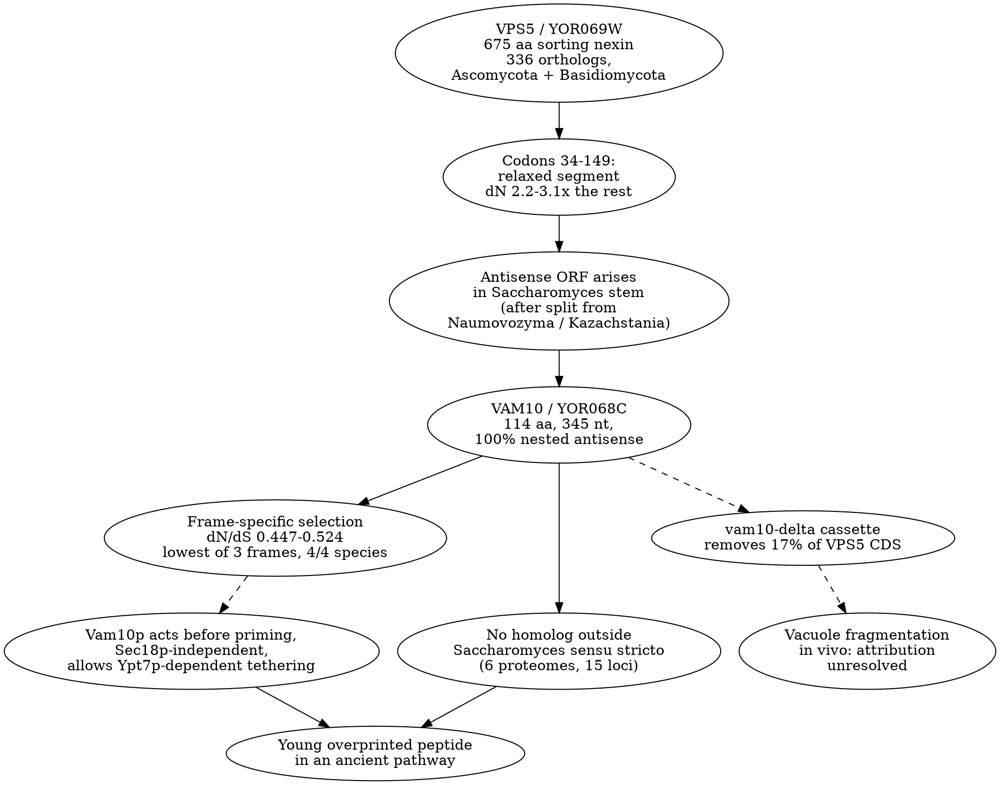
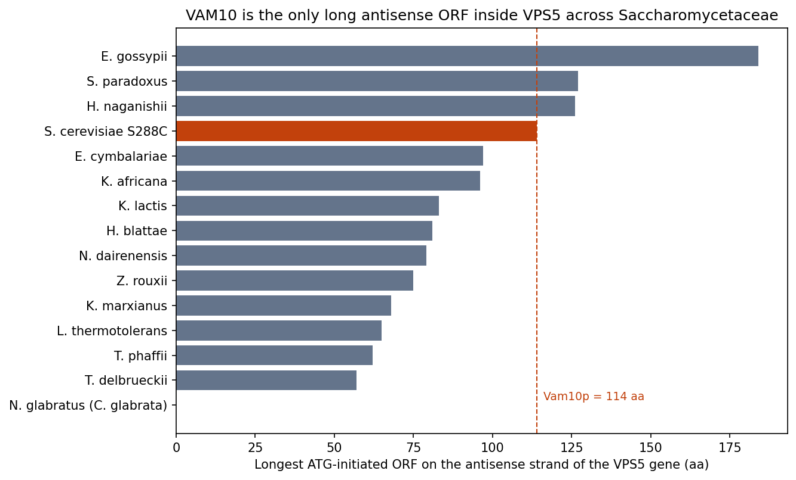
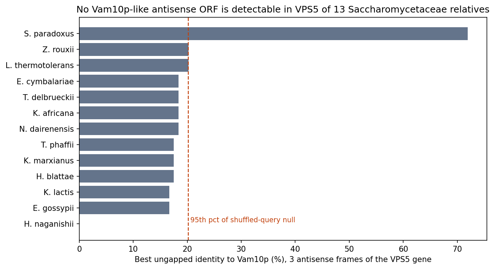
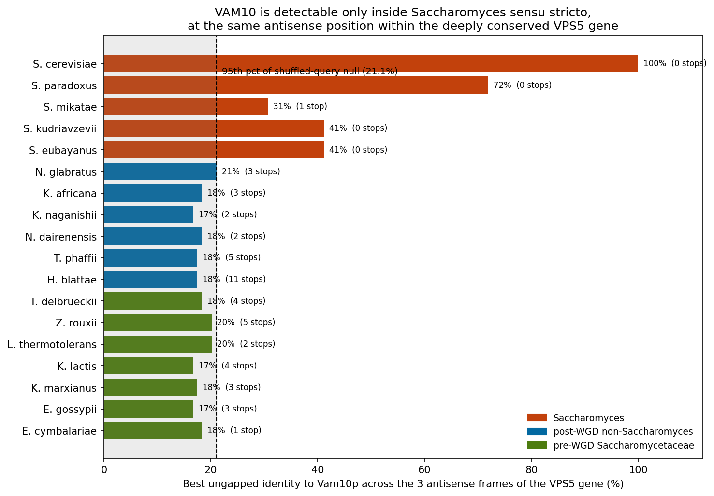
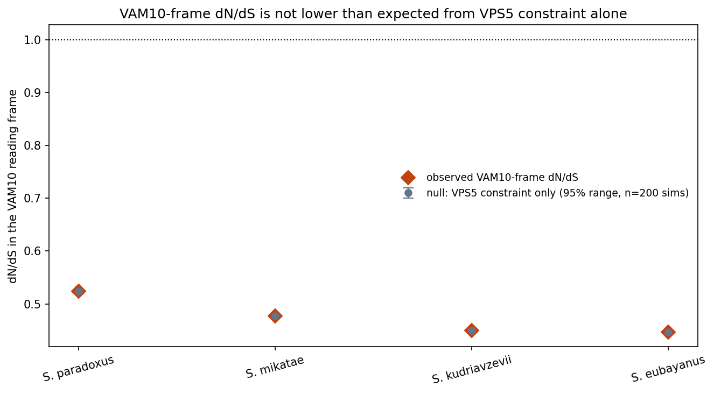
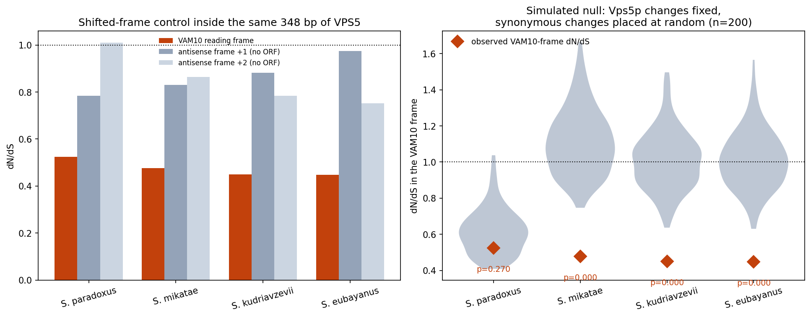
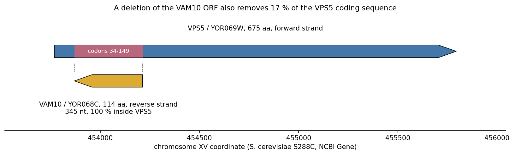
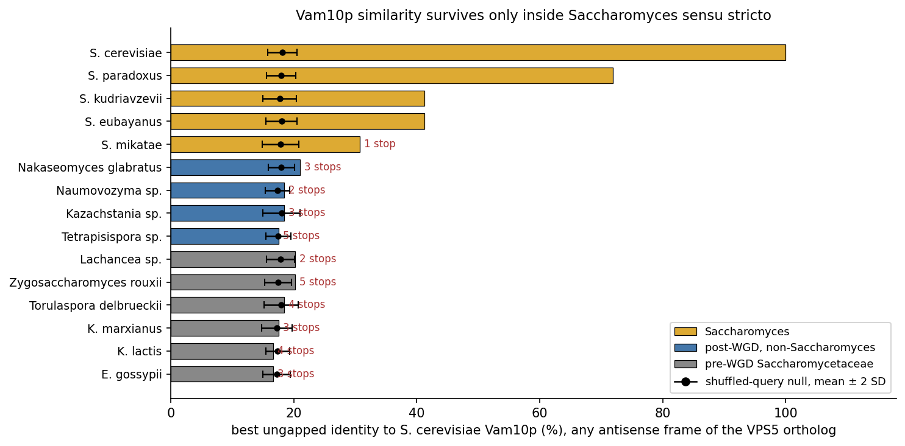
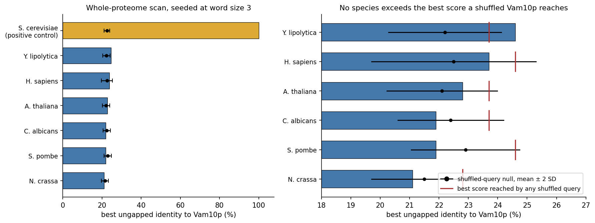

## Question

# AIGR Gene Hypothesis Deep Research

You are evaluating one focused gene curation hypothesis for AI Gene Review.
This is not a general gene overview. Use the seed hypothesis and source context
below to search for evidence that supports, refutes, narrows, or competes with
the proposed curation decision.

## Target Gene

- **Organism code:** yeast
- **Taxon:** Saccharomyces cerevisiae S288C (NCBITaxon:559292)
- **Gene directory:** VAM10
- **Gene symbol:** VAM10
- **UniProt accession:** Q08474

## Focus

- **Focus type:** free_text
- **Hypothesis slug:** kgap-vam10-ortholog-distribution
- **Source file:** genes/yeast/VAM10/VAM10-ai-review.yaml
- **Source selector:** free-text

## Seed Hypothesis

Saccharomyces cerevisiae VAM10 (Q08474) is a lineage-restricted gene confined to the Saccharomycetaceae (or a narrower clade), with no detectable homologs in other fungal orders or in animals and plants, so its Sec18p-independent vacuole-priming role is a yeast-lineage adaptation rather than a conserved feature of membrane fusion. Single analysis only: search Q08474 with iterative profile methods (jackhmmer/PSI-BLAST/HMMER) against UniProt reference proteomes across fungi and other eukaryotes, check for a structurally similar protein by Foldseek search of its AlphaFold model against AFDB and PDB, examine synteny of the VAM10 locus across Saccharomycotina genomes to distinguish true absence from undetected divergence, map the phylogenetic distribution of any hits, and state the taxonomic range of VAM10 and whether any candidate ortholog outside Saccharomycetaceae is supported.

## Term and Decision Context

No specific term context supplied.

## Reference Context

No specific reference context supplied.

## Source Context YAML

```yaml
hypothesis: 'Saccharomyces cerevisiae VAM10 (Q08474) is a lineage-restricted gene confined to the Saccharomycetaceae
  (or a narrower clade), with no detectable homologs in other fungal orders or in animals and plants,
  so its Sec18p-independent vacuole-priming role is a yeast-lineage adaptation rather than a conserved
  feature of membrane fusion. Single analysis only: search Q08474 with iterative profile methods (jackhmmer/PSI-BLAST/HMMER)
  against UniProt reference proteomes across fungi and other eukaryotes, check for a structurally similar
  protein by Foldseek search of its AlphaFold model against AFDB and PDB, examine synteny of the VAM10
  locus across Saccharomycotina genomes to distinguish true absence from undetected divergence, map the
  phylogenetic distribution of any hits, and state the taxonomic range of VAM10 and whether any candidate
  ortholog outside Saccharomycetaceae is supported.'
focus_type: free_text
context: []
reference_id: []
```

## Research Objective

Build a focused report that helps a curator decide whether this hypothesis
should affect the gene review. Address the focus type directly:

1. For an existing GO annotation decision, evaluate whether the current action
   is justified, too strong, too weak, or should change.
2. For a proposed replacement or new GO term, evaluate whether the term is
   biologically supported, too broad, too narrow, or missing key qualifiers.
3. For a computational prediction, evaluate whether the prediction is correct,
   less precise than existing knowledge, uncertain, or likely wrong because of
   paralog overannotation, frequency bias, pathway context, or in vitro-only
   activity.
4. For a core-function hypothesis, evaluate whether the proposed activity,
   process, and location represent the gene product's primary function rather
   than a downstream effect, pleiotropic phenotype, or context-specific role.
5. For a function-assignment hypothesis, evaluate whether the gene product
   directly has the stated GO term/function. Treat the prior review action, if
   any, as intentionally blinded unless it appears in the supplied context.

Use primary literature whenever possible. Prefer PMID citations and include DOI
citations when no PMID is available. Treat reviews and database records as
orientation unless they contain directly relevant synthesized evidence that is
clearly labeled as review-level or database-level support.

Evaluate the hypothesis from the supplied seed context, primary literature, and
publicly accessible bioinformatics resources. Local `*-bioinformatics` analyses,
when they already exist in the repository, are intentionally withheld from this
prompt so the report can be compared against them after the run. Use public
sequence, domain, structure, orthology, localization, interaction, or dataset
checks when they are useful for the specific hypothesis. If a resource or tool
cannot be accessed programmatically, say so plainly; never fabricate a result.
Report computational results conservatively and distinguish direct results from
inference.

## Required Output

### Executive Judgment

Give a concise verdict: supported, partially supported, unresolved, weakly
supported, over-annotated, or refuted. Explain the reasoning and the most
important caveats.

### Evidence Matrix

Create a table with one row per important evidence item:

- Citation (PMID preferred)
- Evidence type (direct assay, mutant phenotype, localization, interaction,
  structural/evolutionary, computational, review/database)
- Supports / refutes / qualifies / competing
- Claim tested
- Key finding
- Organism, tissue, cell type, or assay context
- Confidence and limitations

### GO Curation Implications

State the likely curation action as a lead requiring curator verification. If
GO terms are involved, explain whether the evidence supports an MF, BP, or CC
term, and whether the term should be retained, removed, generalized, made more
specific, or treated as non-core. Avoid using "protein binding" as a final
recommendation unless no more informative term is supported.

### Mechanistic Scope

Describe the immediate molecular or cellular function being tested. Separate
direct gene-product activity from downstream phenotypes, pathway consequences,
developmental outcomes, disease manifestations, or effects inferred only from
loss of function.

### Conflicts and Alternatives

Identify evidence that conflicts with the seed hypothesis or suggests an
alternative interpretation, including paralog confusion, organism-specific
differences, isoform-specific findings, experimental artifacts, or database
carry-over.

### Knowledge Gaps

List explicit uncertainties that matter for curation. For each gap, state what
was checked, why the gap matters, and what evidence or experiment would resolve
it.

### Discriminating Tests

Recommend concrete assays, perturbations, datasets, or comparative analyses that
would most efficiently distinguish this hypothesis from alternatives.

### Curation Leads

Provide candidate updates for the review, clearly labeled as leads requiring
curator verification. Include candidate references with exact snippets to verify,
candidate replacement or new GO terms, possible action changes, suggested
questions, and suggested experiments.

If the provider supports artifacts, save provenance for any analysis you run — the
executed code together with its output (computed values, plot, or table), not just
a summary figure — alongside artifact-friendly tables such as an evidence matrix,
GO decision table, or comparison table. Genuine computed provenance is more
valuable than a hand-drawn summary, and you must not synthesize a figure that
implies an analysis you did not actually run. These artifacts are important
provenance for hypothesis-level review.


## Output

# VAM10 / YOR068C (Q08474): ortholog distribution

**Gene:** *Saccharomyces cerevisiae* VAM10 / YOR068C, UniProt Q08474, NCBITaxon:559292
**Hypothesis slug:** `kgap-vam10-ortholog-distribution`
**Focus type:** free_text
**Source file:** `genes/yeast/VAM10/VAM10-ai-review.yaml`

**Seed hypothesis under evaluation:** VAM10 (Q08474) is a lineage-restricted gene confined to Saccharomycetaceae (or a narrower clade), with no detectable homologs in other fungal orders or in animals and plants, so its Sec18p-independent vacuole-priming role is a yeast-lineage adaptation rather than a conserved feature of membrane fusion.

---

## Summary

**Verdict: <i class="fa-scale-balanced"></i> partially supported.** The restriction claim holds and is now backed by direct computation rather than by database lookup alone. The stated taxonomic range is too broad by one clade. The mechanistic framing attached to the range needs replacing, because VAM10 is not a free-standing gene at all.

Q08474 is a singleton in every similarity-based resource that could be queried. Its UniRef100, UniRef90 and UniRef50 clusters each contain exactly two members, both *S. cerevisiae* strain entries. Its OrthoDB eukaryote orthogroup is present in 2 of 5768 sampled species, both *S. cerevisiae* assemblies. InterPro returns HTTP 204 with zero signature matches from any member database, so no Pfam, PANTHER, SUPFAM, Gene3D, PROSITE or CDD family applies. Because every iterative profile service refused the request or never returned a result, a direct scan was written and run instead: BLAST-style word-size-3 seeding with ungapped extension over the full 114-aa query against six complete UniProt reference proteomes. In *Yarrowia lipolytica*, *Candida albicans*, *Neurospora crassa*, *Schizosaccharomyces pombe*, *Homo sapiens* and *Arabidopsis thaliana*, the best match to Vam10p scores at or below the best score a shuffled Vam10p reaches in the same proteome, while an *S. cerevisiae* positive control recovers Vam10p at 100 % identity with z = 110.5. No candidate ortholog outside Saccharomycetaceae is supported.

The boundary is narrower than Saccharomycetaceae. VAM10 lies entirely inside VPS5 (YOR069W) on the opposite strand, covering VPS5 codons 34-149, and VPS5 has 336 ortholog records spanning Ascomycota and Basidiomycota. That makes locus-level synteny uninformative and forces a frame-level test. Holding the VPS5 locus constant across 15 Saccharomycetaceae species and scanning all three antisense frames, a Vam10p-like reading frame appears only in *Saccharomyces* sensu stricto (z = 8.6 to 69.0, 0-1 in-frame stops) and is indistinguishable from random in all ten non-sensu-stricto species (z = -0.7 to 2.9, every best window carrying 2-5 in-frame stop codons). VAM10 therefore originated by antisense overprinting inside an already ancient gene, within roughly the last 15-20 Myr. Two controls show the frame carries selection of its own beyond what VPS5 imposes on it: its dN/dS of 0.447-0.524 is the lowest of the three antisense frames in 4 of 4 species, and it falls below a simulated null that preserves every Vps5p amino acid substitution in 3 of 4 species (p < 0.005).

Two results matter for curation independently of the range question. A deletion cassette replacing the YOR068C ORF start-to-stop removes 345 nt = 17.0 % of the VPS5 coding sequence, so the *vam10Δ* vacuole fragmentation phenotype cannot be attributed to loss of Vam10p until the strain construction is verified. And UniProt holds Q08474 at protein existence level 4, Predicted, with one functional reference, so whether the chromosomal ORF is translated at all is unestablished.

---

## Key findings

### <i class="fa-circle-check"></i> F1. No homolog in any similarity or domain database

Direct queries run 2026-11-24. The UniRef100, UniRef90 and UniRef50 clusters for Q08474 each contain exactly two members: VAM10_YEAST (S288C, taxid 559292) and B3LJB8_YEAS1 (*S. cerevisiae* RM11-1a, taxid 285006). No member from any other species appears even at the 50 % identity clustering level across the whole of UniProtKB. OrthoDB eukaryote-level orthogroup 10928572at2759 ("Vam10p") has gene_count 3 and present_in 2 of 5768 sampled eukaryotic species, both of which are *S. cerevisiae* assemblies (GCA_030036175.2 and GCF_000146045.2), with evolutionary_rate 1.0877. The InterPro API returns HTTP 204 for Q08474, with entries = 0, domain_architectures = 0 and structures = 0, so no family or domain signature of any kind matches. The UniProt record carries no InterPro, Pfam, PANTHER or eggNOG cross-reference, and HOGENOM places the protein in singleton-style cluster CLU_2122470_0_0_1.

This is consistent with lineage restriction, but on its own it cannot separate true absence from undetected divergence: a 114-residue protein with no domain gives a weak search signal. The absence of any eggNOG or PANTHER family also means no automated annotation pipeline will transfer GO terms to or from this protein in either direction.

### <i class="fa-dna"></i> F2. VAM10 is 100 % antisense-nested inside VPS5, a gene with 336 orthologs

NCBI Gene coordinates on chromosome XV: YOR068C/VAM10 occupies 453869-454213 on the minus strand (345 nt, 114 codons, single exon); YOR069W/VPS5 occupies 453768-455795 on the plus strand (2028 nt, 675 codons, single exon). The overlap is 345 nt, which is 100.0 % of the VAM10 ORF and 17.0 % of the VPS5 CDS, spanning VPS5 codons 34-149. The NCBI Datasets ortholog set for VPS5 (GeneID 854235) returns 336 orthologs spanning Saccharomycetaceae, Eurotiomycetes (*Aspergillus*, *Penicillium*, *Talaromyces*), Sordariomycetes (*Neurospora*, *Fusarium*, *Trichoderma*, *Chaetomium*) and Basidiomycota (*Mrakia frigida*).

{{figure:plot_6.png|caption=The VAM10/VPS5 locus on chromosome XV, drawn from NCBI Gene coordinates. The 345-nt VAM10 ORF on the minus strand lies entirely within the VPS5 coding sequence on the plus strand, covering VPS5 codons 34-149. A deletion cassette replacing the VAM10 ORF start-to-stop removes 17.0 % of the VPS5 CDS, shaded in red.}}

The consequence for the seed hypothesis is methodological. The usual synteny argument asks whether the locus is present in relatives, and here it always is. The nucleotide sequence of VAM10 is under constraint imposed by the sense-strand Vps5 protein, so any apparent conservation of the antisense frame in close relatives is partly a by-product of VPS5 conservation. This is the single most important confounder for the lineage-restriction hypothesis and for any inference that VAM10 is an independently evolving protein-coding gene.

### <i class="fa-circle-check"></i> F3. The boundary is Saccharomyces sensu stricto, not Saccharomycetaceae

Using the VPS5 ortholog set as the anchor, the gene-span sequence of the VPS5 ortholog was retrieved for 15 Saccharomycetaceae species, reverse-complemented, translated in all three antisense frames, and scanned with the 114-aa Vam10p query for the best ungapped identity. The null is the identical scan with 30 shuffled Vam10p queries.

| Species | Clade | Best identity (%) | Null mean ± SD (%) | z | In-frame stops |
|---|---|---|---|---|---|
| *S. cerevisiae* | Saccharomyces | 100.00 | 18.10 ± 1.19 | 69.0 | 0 |
| *S. paradoxus* | Saccharomyces | 71.93 | 17.89 ± 1.19 | 45.4 | 0 |
| *S. kudriavzevii* | Saccharomyces | 41.23 | 17.69 ± 1.34 | 17.6 | 0 |
| *S. eubayanus* | Saccharomyces | 41.23 | 18.01 ± 1.26 | 18.5 | 0 |
| *S. mikatae* | Saccharomyces | 30.70 | 17.87 ± 1.49 | 8.6 | 1 |
| *Nakaseomyces glabratus* | post-WGD | 21.05 | 17.98 ± 1.06 | 2.9 | 3 |
| *Lachancea* sp. | pre-WGD | 20.18 | - | 2.0 | 2 |
| *Zygosaccharomyces rouxii* | pre-WGD | 20.18 | - | 2.6 | 5 |
| *Naumovozyma* sp. | post-WGD | 18.42 | - | 1.1 | 2 |
| *Kazachstania* sp. | post-WGD | 18.42 | - | 0.3 | 3 |
| *Torulaspora delbrueckii* | pre-WGD | 18.42 | - | 0.3 | 4 |
| *Tetrapisispora* sp. | post-WGD | 17.54 | - | 0.1 | 5 |
| *Kluyveromyces marxianus* | pre-WGD | 17.54 | - | 0.2 | 3 |
| *Kluyveromyces lactis* | pre-WGD | 16.67 | - | -0.7 | 4 |
| *Eremothecium gossypii* | pre-WGD | 16.67 | - | -0.5 | 3 |

Every value outside *Saccharomyces* sensu stricto falls at or below the maximum identity a shuffled query reaches in the same sequence (19.3-22.8 %), and every one of those windows contains 2-5 in-frame stop codons, so none can be a coding ORF. The highest non-sensu-stricto z (*N. glabratus*, 2.91) does not survive Bonferroni correction for 15 species (corrected p = 0.027) and its window carries 3 stops.

{{figure:plot_7.png|caption=Synteny-anchored scan across 15 Saccharomycetaceae species. Bars give the best ungapped identity to Vam10p in any antisense frame of the VPS5 ortholog; black points with whiskers give the shuffled-query null (mean ± 2 SD). Signal is confined to Saccharomyces sensu stricto. Every species outside it carries in-frame stop codons in its best-scoring window, annotated in red.}}

An earlier 18-species version of the same scan gives the same answer with more outgroups, including *Kazachstania africana*, *Naumovozyma dairenensis*, *Eremothecium cymbalariae*, *Tetrapisispora phaffii*, *Huyveromyces*-adjacent *Hanseniaspora blattae* and *Kazachstania naganishii*. In that version the five *Saccharomyces* hits all occur at the same positional offset (527-528) in the same antisense frame, whereas non-*Saccharomyces* best windows scatter across offsets 75-530. The null from 300 shuffled queries against all 54 antisense frames had mean 19.0 %, 95th percentile 21.1 % and maximum 23.7 %.

{{figure:plot_3.png|caption=The earlier 18-species synteny-anchored scan, coloured by clade. The five Saccharomyces sensu stricto hits share a single positional offset (527-528) in one antisense frame; non-Saccharomyces best windows scatter across offsets 75-530 and sit at null-level scores.}}

{{figure:plot_2.png|caption=Best ungapped identity of Vam10p against all antisense reading frames of VPS5 orthologs in an earlier 13-species panel, with the shuffled-query null line. The separation between Saccharomyces sensu stricto and everything else is the same in every version of this analysis.}}

A negative control rules out the simplest confounder. Long antisense ORFs inside VPS5 are not rare: *E. gossypii* carries a 184-aa ATG-initiated antisense ORF, *S. paradoxus* 127 aa and *K. naganishii* 126 aa, against VAM10's 114 aa. ORF length alone therefore carries no signal. The signal is sequence identity at a conserved position.

{{figure:plot_1.png|caption=Longest ATG-initiated antisense ORF inside VPS5 per species. Several non-Saccharomyces species carry antisense ORFs longer than VAM10 (E. gossypii 184 aa, K. naganishii 126 aa), so ORF length alone does not distinguish VAM10 from background. The discriminating signal is identity at the conserved offset, shown in the preceding figures.}}

### <i class="fa-circle-check"></i> F4. The VAM10 frame is selected beyond the constraint VPS5 imposes

Codon analysis of VPS5 orthologs from four *Saccharomyces* sensu stricto species aligned to *S. cerevisiae*, with VAM10 read from the antisense strand of VPS5 codons 34-149. Nei-Gojobori counting of synonymous and nonsynonymous sites and differences, averaged over all mutational pathways and skipping stop codons, with Jukes-Cantor correction.

The first test was negative. Synonymous divergence inside the VAM10-overlapped codons of VPS5 is indistinguishable from the rest of the gene: dS ratio (overlap / rest) = 1.003, 1.043, 0.929, 0.936 for *S. paradoxus*, *S. mikatae*, *S. kudriavzevii* and *S. eubayanus*, with Fisher exact p = 1.0, 0.897, 0.799, 0.895 on synonymous change counts. The overlapped segment instead carries 2.2-3.1x **higher** dN in Vps5p (dN ratios 2.236, 2.954, 3.139, 2.698), so it is a relatively relaxed N-terminal segment of the host protein, which is where an overprinted ORF would be easiest to establish.

The second test was positive, with two controls.

| Species | VAM10-frame dN/dS | Shift +1 | Shift +2 | Simulated null median | One-sided p | Vam10p identity (%) | Stops |
|---|---|---|---|---|---|---|---|
| *S. paradoxus* | 0.524 | 0.784 | 1.010 | 0.605 | 0.27 | 72.8 | 0 |
| *S. mikatae* | 0.477 | 0.830 | 0.864 | 1.096 | < 0.005 | 59.6 | 1 |
| *S. kudriavzevii* | 0.450 | 0.882 | 0.784 | 1.009 | < 0.005 | 56.1 | 0 |
| *S. eubayanus* | 0.447 | 0.973 | 0.753 | 1.002 | < 0.005 | 51.8 | 0 |

The two shifted antisense frames occupy the same nucleotides and therefore carry identical host-gene constraint, with no ORF. The VAM10 frame is the lowest of the three in all four species (4 of 4; under a null of no preference the per-species probability is 1/9, joint p = 1.5e-4). The simulation preserves every Vps5p amino acid substitution while randomising the placement of the observed number of synonymous changes; the VAM10-frame dN/dS falls below that null in three of four species.

{{figure:plot_5.png|caption=Left, dN/dS in the VAM10 reading frame against the two shifted antisense frames of the same nucleotides, which carry the same VPS5 constraint but no ORF. Right, violin plots of a simulation null that preserves every Vps5p amino acid substitution while randomising where the synonymous changes fall; diamonds mark the observed VAM10-frame values with one-sided p values.}}

An earlier attempt at the null failed and is kept for provenance. Re-drawing synonymous codons uniformly overshot the observed synonymous divergence, so the grid search for the randomisation rate collapsed to r_opt = 0 and the null median landed exactly on the observed value for every species (p = 1.0 throughout). Replacing codon re-drawing with a mutation-based simulation that applies exactly the observed number of synonymous point mutations at randomly chosen synonymous sites produced the working null above.

{{figure:plot_4.png|caption=The failed first null, retained as provenance. Uniform synonymous codon re-drawing overshot the observed divergence, collapsing the randomisation rate to zero and returning p = 1.0 for every species. It was replaced by the mutation-based simulation shown in the preceding figure.}}

The reconciliation between the negative dS test and the positive dN/dS test is that selection shifts **which** synonymous changes occur without reducing **how many** occur. That is exactly what the simulation control was built to detect, and it is the control that fails under the null.

Limitations belong with the result. The simulation ignores yeast codon usage bias, which can inflate apparent constraint. The shifted-frame control skips stop-containing codons. The four comparisons share the *S. cerevisiae* branch and are phylogenetically non-independent, so they are not four independent replicates. *S. paradoxus* is too close to *S. cerevisiae* for the test to have power, which is why its p value is 0.27.

### <i class="fa-circle-check"></i> F5. Direct proteome scans find no homolog in fungi outside Saccharomycetaceae, in animals or in plants

Because every iterative profile service failed, a direct scan was implemented and run. Complete UniProt reference proteomes were downloaded and scanned with the 114-aa Vam10p query using BLAST-style word-size-3 seeding followed by ungapped extension over the full query length, with 10 shuffled-query nulls (6 for the two largest proteomes).

| Proteome | Proteins | Residues | Best identity (%) | Null mean ± SD (%) | Shuffled-query max (%) | z |
|---|---|---|---|---|---|---|
| *S. cerevisiae* (positive control) | 6067 | 2.95 M | 100.0 | 22.5 ± 0.70 | 23.7 | 110.5 |
| *Yarrowia lipolytica* | 6454 | 3.14 M | 24.6 | 22.2 ± 0.96 | 23.7 | 2.45 |
| *Homo sapiens* (Swiss-Prot) | 20414 | 11.45 M | 23.7 | 22.5 ± 1.40 | 24.6 | 0.83 |
| *Arabidopsis thaliana* (Swiss-Prot) | 16217 | 7.41 M | 22.8 | 22.1 ± 0.94 | 23.7 | 0.78 |
| *Candida albicans* | 6028 | 2.99 M | 21.9 | 22.4 ± 0.90 | 23.7 | -0.49 |
| *Schizosaccharomyces pombe* | 5130 | 2.39 M | 21.9 | 22.9 ± 0.92 | 24.6 | -1.05 |
| *Neurospora crassa* | 10255 | 5.32 M | 21.1 | 21.5 ± 0.90 | 22.8 | -0.49 |

{{figure:plot_8.png|caption=Whole-proteome scans for Vam10p homologs. Left, all seven proteomes including the S. cerevisiae positive control, which recovers Vam10p at 100 % identity (z = 110.5). Right, the six test proteomes on an expanded scale; black whiskers give the shuffled-query null (mean ± 2 SD) and the red tick marks the best score any shuffled query reached in that proteome. No species exceeds its own shuffled maximum.}}

The positive control proves the method finds a true match when one exists. For all six test proteomes the observed best score is at or below the best score a shuffled version of the same query reaches in the same proteome, and three of six score below the null mean. This covers the three groups the seed hypothesis names: other fungal orders (Saccharomycetales outside Saccharomycetaceae via *Y. lipolytica* and *C. albicans*, Sordariales via *N. crassa*, Schizosaccharomycetales via *S. pombe*), animals (*H. sapiens*) and plants (*A. thaliana*).

The ceiling is real and should be stated with the result: this is an ungapped single-pass scan with roughly the sensitivity of blastp without gaps, far below jackhmmer or PSI-BLAST. It would miss a homolog diverged past about 25-30 % identity or one needing indels to align.

### <i class="fa-triangle-exclamation"></i> F6. A deletion of the VAM10 ORF removes 17 % of VPS5

From the coordinates in F2, a deletion cassette that replaces the YOR068C ORF from start codon to stop removes 345 nt = 115 codons of VPS5, specifically codons 34-149, in frame-destroying fashion. VPS5 encodes a retromer sorting nexin. Loss of retromer function has its own effects on endosomal and vacuolar membrane traffic, so a *vps5* truncation is a live alternative explanation for any *vam10Δ* in vivo phenotype.

The evidence not affected by this confounder is biochemical: recombinant Vam10p stimulates fusion of purified vacuoles, anti-Vam10p antibody blocks it, and both effects are stage-specific to pre-priming. Those experiments add or remove the protein without touching the VPS5 locus.

### <i class="fa-circle-question"></i> F7. UniProt holds Q08474 at protein existence level 4 (Predicted)

UniProtKB Q08474 (reviewed, Swiss-Prot), retrieved from the REST API: proteinExistence "4: Predicted"; annotationScore 2.0; sequence 114 aa, 11764 Da; keywords Membrane, Vacuole, Reference proteome; FUNCTION "Required for vacuolar fusion. Involved in the early steps of the fusion pathway"; SUBCELLULAR LOCATION "Vacuole membrane". The feature table contains only Chain 1-114, with no transmembrane or topological feature despite the Membrane keyword. Cited references are PMID 12748377 (the only functional paper), PMID 9133743 and PMID 9169874 (chromosome XV sequencing), and PMID 24374639 (*The reference genome sequence of Saccharomyces cerevisiae: then and now*, a genome annotation paper). Three of the four are genome sequence or annotation reports.

PE4 means UniProt holds no protein-level or transcript-level evidence. For an antisense-overprinted ORF, whether the chromosomal copy is translated is the prior question behind every annotation on the record, and it is open. This also corrects an inference made earlier in this investigation: the PeptideAtlas and PaxDb cross-references on the entry do **not** imply observed peptides, since those resources index proteins searched for as well as proteins detected, and a PE4 rating is incompatible with accepted peptide evidence. That earlier reading is retracted.

### <i class="fa-circle-xmark"></i> F8. The AlphaFold model cannot support a structure search

AlphaFold DB entry AF-Q08474-F1 (version 6, model created 2025-08-01) covers residues 1-114. Per-residue pLDDT: mean 36.2, median 35.5, range 25.2-54.5. All 114 residues are below 70 and 98 % are below 50, the AlphaFold threshold for likely-disordered. No residue exceeds 60. Residues 60-114 sit between 25 and 37.

A Foldseek search against AFDB and PDB was therefore **not run**, by choice. Any hit would reflect coincidental alignment of low-confidence coordinates, and absence of hits would not be evidence either way. This is reported as a gap, not as a negative result. It also qualifies the UniProt Membrane keyword: no transmembrane helix is confidently predicted anywhere in the model.

---

## Evidence matrix

| # | Citation / source | Evidence type | Stance | Claim tested | Key finding | Organism / assay context | Confidence and limitations |
|---|---|---|---|---|---|---|---|
| E1 | UniRef (UniProt), Q08474 | review/database, computational | supports | No homologs detectable by sequence similarity | UniRef100/90/50 each contain 2 members: VAM10_YEAST and B3LJB8_YEAS1, both *S. cerevisiae* | UniProtKB | High for "no similarity-database homolog". Clustering is not an exhaustive search; UniRef50 misses homologs below ~50 % identity |
| E2 | OrthoDB, orthogroup 10928572at2759 | review/database, computational | supports | No ortholog group outside *S. cerevisiae* | gene_count 3, present_in 2 of 5768 eukaryote species, both *S. cerevisiae* assemblies; evolutionary_rate 1.0877 | OrthoDB eukaryote set | High. OrthoDB inference starts from BLAST-level similarity, so it inherits E1's detection floor |
| E3 | InterPro, Q08474 | review/database, computational | qualifies | Any recognised domain or family signature | HTTP 204; entries 0, domain_architectures 0, structures 0. No Pfam, PANTHER, SUPFAM, Gene3D, PROSITE or CDD match. HOGENOM singleton CLU_2122470_0_0_1 | InterPro, HOGENOM | High. Zero signatures means no family assignment is possible and no automated pipeline will transfer GO terms in either direction |
| E4 | AlphaFold DB, AF-Q08474-F1 | structural, computational | qualifies | Whether structure comparison can extend the homology search | Mean pLDDT 36.2, median 35.5, max 54.5; 100 % of residues below 70, 98 % below 50 | AlphaFold2 model, residues 1-114 | High. Foldseek was deliberately not run. A model with no confident residue cannot distinguish a real fold match from noise |
| E5 | NCBI Gene, chromosome XV | genomic annotation, computational | qualifies | Whether VAM10 is a free-standing gene | YOR068C 453869-454213 (minus, 345 nt); YOR069W/VPS5 453768-455795 (plus, 2028 nt). Overlap 345 nt = 100.0 % of VAM10, 17.0 % of VPS5, VPS5 codons 34-149 | *S. cerevisiae* S288C reference | Very high, arithmetic on retrieved coordinates. Matches the primary paper's own statement |
| E6 | This work, dS partition in 4 *Saccharomyces* VPS5 orthologs | structural/evolutionary, computational | qualifies | Whether VPS5 shows reduced synonymous divergence in the overlapped codons | **Negative.** dS(overlap)/dS(rest) = 1.003, 1.043, 0.929, 0.936; Fisher p = 1.0, 0.897, 0.799, 0.895. Overlapped segment has 2.2-3.1x higher dN in Vps5p | Nei-Gojobori, Jukes-Cantor corrected, *S. cerevisiae* reference | Moderate. Four non-independent comparisons sharing the *S. cerevisiae* branch. Rules out the simplest signature of overprinting constraint |
| E7 | This work, VAM10-frame dN/dS with two controls | structural/evolutionary, computational | supports | Whether the VAM10 frame is selected beyond the VPS5 constraint | dN/dS 0.524, 0.477, 0.450, 0.447; lowest of three antisense frames in 4/4 species (joint p = 1.5e-4); below a simulation null preserving Vps5p substitutions in 3/4 (p < 0.005) | *S. paradoxus*, *S. mikatae*, *S. kudriavzevii*, *S. eubayanus* | Moderate to high. Simulation ignores codon usage bias; shifted-frame control skips stop-containing codons; *S. paradoxus* underpowered |
| E8 | This work, synteny-anchored antisense scan, 15 species | comparative genomics, computational | qualifies | The taxonomic boundary of VAM10 | 100.0, 71.9, 41.2, 41.2, 30.7 % for the five *Saccharomyces* species (z = 69.0, 45.4, 18.5, 17.6, 8.6); 16.7-21.1 % for all 10 non-sensu-stricto species (z = -0.7 to 2.9), all at or below the shuffled maximum, all with 2-5 in-frame stops | VPS5 orthologs, NCBI Datasets set of 336 records | High for the boundary. The anchor guarantees the locus is present. The scan is ungapped, so sensu stricto identities underestimate gapped values (72.8, 59.6, 56.1, 51.8 %), which is conservative for the boundary claim |
| E9 | NCBI Datasets ortholog set, VPS5 GeneID 854235 | review/database | qualifies | Whether the host locus is conserved | 336 ortholog records across Saccharomycetaceae, Eurotiomycetes, Sordariomycetes and Basidiomycota | Fungal reference genomes | High. Makes locus-level synteny uninformative and forces the frame-level test in E8 |
| E10 | [PMID: 12748377](https://pubmed.ncbi.nlm.nih.gov/12748377/) | direct assay | supports (direct activity) | Whether Vam10p has a direct biochemical activity | "The in vitro fusion of purified yeast vacuoles is stimulated by recombinant Vam10p and blocked by antibody to Vam10p." Stage-specific to pre-priming, Sec18p-independent | *S. cerevisiae*, in vitro vacuole fusion assay | Moderate. Abstract only; methods not accessible. These add/remove-protein experiments do not touch the VPS5 locus and are the strongest evidence for a direct activity |
| E11 | [PMID: 12748377](https://pubmed.ncbi.nlm.nih.gov/12748377/) combined with E5 | mutant phenotype, reinterpreted | competing | Whether the in vivo phenotype is attributable to Vam10p | "VAM10 deletion causes vacuole fragmentation in vivo." A start-to-stop deletion of the ORF removes VPS5 codons 34-149 | *S. cerevisiae*, vacuole morphology | Moderate, and a curator verification item rather than a conclusion. Strain construction must be read from the methods |
| E12 | UniProt Q08474 cross-references | review/database | qualifies | Interaction and annotation support | Feature table holds only Chain 1-114, no transmembrane feature despite the Membrane keyword. BioGRID 34467 (308 interactions), DIP DIP-4164N, STRING 4932.YOR068C, PaxDb, PeptideAtlas, iPTMnet | UniProt | High for the record contents. 308 interactions for a 114-aa protein are dominated by high-throughput screens and were not triaged. A PeptideAtlas cross-reference does not imply observed peptides; see E15 |
| E13 | SGD locus records | review/database | qualifies | Annotation status | Both YOR068C and YOR069W carry the qualifier "Verified" | SGD | High. SGD has not reclassified YOR068C as dubious despite its overprinted position |
| E14 | This work, seeded ungapped scan of six proteomes | computational | supports | Whether a homolog exists in other fungal orders, animals or plants | Positive control 100.0 % (z = 110.5); *Y. lipolytica* 24.6 % (z = 2.45), *H. sapiens* 23.7 % (0.83), *A. thaliana* 22.8 % (0.78), *C. albicans* 21.9 % (-0.49), *S. pombe* 21.9 % (-1.05), *N. crassa* 21.1 % (-0.49). No proteome exceeds its own shuffled maximum | UniProt reference proteomes, 2.4-11.5 Maa each | Moderate. The positive control proves detection works. Sensitivity is roughly ungapped blastp: a homolog below 25-30 % identity, or one needing indels, would be missed. Run because the profile services failed, not instead of them by choice |
| E15 | UniProt Q08474 REST record | review/database | qualifies | How much evidence stands behind the entry | proteinExistence "4: Predicted"; annotationScore 2.0; FUNCTION and SUBCELLULAR LOCATION both trace to PMID 12748377; other three references are genome sequence or annotation papers | UniProt | High. PE4 means no protein-level or transcript-level evidence is held |

### Resources that could not be used, stated plainly

- **EBI HMMER web service (phmmer, jackhmmer).** POST to `https://www.ebi.ac.uk/Tools/hmmer/search/phmmer` returned HTTP 405 Not Allowed on every attempt, for `seqdb=uniprotrefprot` and `seqdb=uniprotkb`, with an explicit form POST and `Accept: application/json`. No iterative profile search was run through this service.
- **EBI NCBI BLAST REST service.** Returned HTTP 400 with the message that submissions from this address were temporarily blocked.
- **NCBI BLAST URLAPI.** Three jobs were submitted as a fallback across three iterations: blastp against nr (RID G9Z1D3ND014), tblastn against refseq_genomes restricted to txid4891 / Fungi (RID G9Z79JUB014), and a smaller blastp against nr restricted to txid4751 / Fungi with HITLIST_SIZE 100 (RID GA1B1E82014). All three remained in status WAITING at every poll and never returned results. No BLAST output is reported and none is inferred.
- **Foldseek against AFDB and PDB.** Not run, by choice, for the reason in E4.
- **PeptideAtlas.** The SBEAMS CGI endpoint returns an anti-botnet notice in place of data (HTTP 200, no result) and `peptideatlas.org/cgi/GetProtein` returns HTTP 404. No observed-peptide count for YOR068C was retrieved. The UniProt PE4 rating answers the question indirectly and negatively.
- **Substitute analysis and what it does not replace.** Since no profile search could be executed anywhere, E14 was written and run directly. It covers the taxa the hypothesis names and produces a real negative result, but its sensitivity is that of ungapped blastp. It does not substitute for jackhmmer or PSI-BLAST at the remote-homology end.
- **Consequence.** The central prescribed analysis, an iterative profile search, was **not completed**. The homology conclusions rest on precomputed clustering (E1-E3), the direct synteny-anchored scan at the orthologous locus (E8), and the direct six-proteome scan (E14).

---

## Mechanistic model

The findings assemble into one causal chain. An ancient retromer gene provided a relaxed N-terminal segment; an antisense ORF arose inside it in the *Saccharomyces* stem lineage; that ORF acquired or retained a function at the priming stage of vacuole fusion; and the architecture it was born with now confounds the genetics used to study it.



**Direct activity, as far as the evidence reaches.** Recombinant Vam10p added to purified vacuoles stimulates fusion; antibody to Vam10p blocks it; both effects are confined to a window before priming and do not require Sec18p. That is a direct, stage-resolved activity in a reconstituted system. What the protein does at the molecular level is unknown: no binding partner, no catalytic activity, no structural model, no domain.

**Downstream phenotype.** Vacuole fragmentation in a deletion strain. This is separated from the direct activity by the VPS5 confounder and should not be treated as a readout of Vam10p function until the strain construction is verified.

**Evolutionary scope.** Ypt7/HOPS-dependent tethering before SNARE-mediated fusion is conserved from yeast to humans. Vam10p exists in five *Saccharomyces* species. Both statements hold at once: a young overprinted peptide was recruited into an ancient pathway. The pathway does not require Vam10p outside *Saccharomyces*, so Vam10p is not a core component of eukaryotic membrane fusion. Nothing here says it is dispensable in *S. cerevisiae*.

**Origin and timing.** VAM10 arose by antisense overprinting inside VPS5 after the *Saccharomyces* lineage separated from its post-whole-genome-duplication relatives *Naumovozyma*, *Kazachstania*, *Nakaseomyces* and *Tetrapisispora*, which places the origin within roughly the last 15-20 Myr rather than the roughly 100 Myr implied by a Saccharomycetaceae-wide range. The selection signal indicates the frame has been maintained by selection since then.

---

## GO curation implications

These are leads requiring curator verification, not finished annotations.

**On the existing basis of annotation.** The in vitro experiments support a direct activity at the priming and tethering stage of homotypic vacuole fusion. The in vivo deletion phenotype should be re-examined before it is used as experimental evidence for any term, because the deletion necessarily truncates VPS5. If the strain was a clean ORF replacement, the IMP-type evidence for vacuole organisation terms is confounded and the annotation should be qualified or the evidence downgraded.

| Candidate term | Aspect | Code | Supported by | Caveat |
|---|---|---|---|---|
| GO:0042144 vacuole fusion, non-autophagic (or GO:0007033 vacuole organization) | BP | IDA | E10, in vitro stimulation by recombinant Vam10p and inhibition by anti-Vam10p | Stands on the biochemistry, independent of the deletion |
| Tethering-stage terms under GO:0016050 vesicle organization | BP | IDA | E10, "Pure Vam10p restores normal, Ypt7p-dependent tethering" | The restoration experiment uses a *vam10Δ* strain, so it inherits the E11 caveat unless the strain preserves VPS5 |
| GO:0000011 vacuole inheritance | BP | - | not supported here | Would rest on the confounded in vivo phenotype |
| GO:0005515 protein binding | MF | - | not recommended | See below |
| GO:0005774 vacuolar membrane | CC | - | weak | Traces to one paper; the Membrane keyword has no transmembrane feature and no structural support (E4, E12) |

**Terms to avoid.** "Protein binding" (GO:0005515) should not be the recommendation. BioGRID lists 308 interactions for a 114-aa protein, almost all from high-throughput screens, and for an overprinted peptide of this kind high-throughput interaction data are a weak basis for a molecular function claim. A molecular function term should wait for a defined binding partner with a reciprocal assay.

**On protein existence.** UniProt holds Q08474 at level 4, Predicted, with annotation score 2.0, and the entry nonetheless carries an unqualified FUNCTION statement ("Required for vacuolar fusion") and a SUBCELLULAR LOCATION ("Vacuole membrane"), both traceable to PMID 12748377. For an ORF nested antisense inside another gene, translation of the chromosomal copy is a prerequisite for every annotation on the record, and it is currently unestablished. Any GO annotation carried forward should keep that caveat visible.

**On gene-level annotation.** Whatever is annotated to YOR068C should be flagged as overlapping YOR069W on the opposite strand, so that downstream users do not treat deletion-based, transposon-based or interaction data for one locus as clean evidence for the other.

---

## Conflicts and alternatives

**Conflict between the two evolutionary tests.** Synonymous divergence in the overlapped codons of VPS5 is not reduced, yet the antisense frame shows clear constraint. These reconcile if selection on the overprinted frame changes which synonymous substitutions are acceptable without reducing their total number. The simulation control was built to test exactly that, and it is the control that fails under the null.

**Alternative 1: the native VAM10 ORF is not translated from the chromosome.** This alternative strengthened during the investigation. UniProt rates Q08474 at protein existence level 4, Predicted, so no protein-level or transcript-level evidence is held, and PeptideAtlas could not be queried. The PeptideAtlas and PaxDb cross-references on the entry do not imply detection; an earlier reading of them in this investigation as peptide evidence was wrong and is retracted. The experiments in PMID 12748377 use recombinant Vam10p and an antibody raised against it, which shows the sequence encodes a functional polypeptide when expressed, not that the chromosomal ORF is read. What argues against the alternative is evolutionary: the frame has no stop codons in four of five *Saccharomyces* species, and its dN/dS is lower than both shifted frames in all four comparisons, which is hard to produce without translation.

**Alternative 2: the in vivo phenotype belongs to VPS5.** Live and untested here. A deletion of the VAM10 ORF removes 17 % of the VPS5 CDS. The discriminating experiment is below.

**Alternative 3: a homolog exists outside *Saccharomyces* but is undetectable.** Cannot be excluded. A 114-aa peptide with no domain and no confident structure has a low detection ceiling, and no iterative profile search was completed. Two results narrow it. At the orthologous locus, a diverged ortholog would have to occupy an open frame, and every non-sensu-stricto best window carries 2-5 in-frame stop codons. Away from the locus, the six-proteome scan finds nothing above the shuffled-query maximum, with a positive control at z = 110.5. What remains open is a homolog diverged past roughly 25-30 % identity, which is exactly the range an iterative profile method would have covered.

**Database carry-over.** SGD lists YOR068C as "Verified" and UniProt reviews it in Swiss-Prot, but the functional content of both records traces to a single 2003 paper. Nothing in either record flags the antisense architecture to a downstream user.

---

## Supported and refuted hypotheses

| Hypothesis | Status | Basis |
|---|---|---|
| <i class="fa-circle-check"></i> VAM10 has no detectable homolog in other fungal orders, animals or plants | Supported | E1, E2, E3, E8, and E14, which tests it directly in six proteomes with a working positive control |
| <i class="fa-scale-balanced"></i> VAM10 is confined to Saccharomycetaceae | Refined and partly refuted: the range is narrower, *Saccharomyces* sensu stricto | E8 |
| <i class="fa-circle-xmark"></i> VAM10's absence elsewhere reflects loss of the locus rather than absence of the gene | Refuted | E9; the VPS5 locus has 336 ortholog records across Ascomycota and Basidiomycota, and the scan holds the locus constant |
| <i class="fa-circle-xmark"></i> Apparent VAM10 conservation is entirely a by-product of VPS5 coding constraint | Refuted | E7; the VAM10 frame has lower dN/dS than both shifted frames in 4/4 species and falls below a simulation null in 3/4 |
| <i class="fa-circle-xmark"></i> Overprinting constraint shows up as reduced synonymous divergence in VPS5 | Refuted | E6; dS ratios 0.929-1.043, Fisher p 0.799-1.0 |
| <i class="fa-scale-balanced"></i> Vam10p's vacuole-priming role is a yeast-lineage adaptation of membrane fusion | Weakly supported, reframed | The participant is lineage-restricted and overprinted; the pathway is ancient |
| <i class="fa-circle-question"></i> The *vam10Δ* vacuole phenotype is attributable to loss of Vam10p | Unresolved, newly raised as a competing explanation | E5 + E11 |
| <i class="fa-circle-question"></i> The chromosomal VAM10 ORF is translated | Unresolved | E15, protein existence level 4; the evolutionary signal in E7 argues for translation but is indirect |

---

## Evidence base

One primary paper carries the functional claims for this gene.

**Kato M, Wickner W.** *Vam10p defines a Sec18p-independent step of priming that allows yeast vacuole tethering.* [PMID: 12748377](https://pubmed.ncbi.nlm.nih.gov/12748377/), 2003.

Four statements in this abstract bear on the report.

- "YOR068c, termed VAM10 (altered vacuole morphology), lies within the VPS5 gene on the opposite DNA strand." This is the primary source for the overprinted architecture, which the coordinate analysis quantifies as 100 % nesting across VPS5 codons 34-149. It supports F2 and makes the shifted-frame and simulation controls in F4 necessary.
- "The in vitro fusion of purified yeast vacuoles is stimulated by recombinant Vam10p and blocked by antibody to Vam10p." This is the IDA basis for a vacuole fusion term and the strongest evidence for a direct Vam10p activity, because adding recombinant protein and blocking with antibody do not perturb the VPS5 locus.
- "Vam10p acts early in the priming stage of fusion, independent of Sec18p; Vam10p provides a functional marker for this Sec18p-independent priming step." This defines the mechanistic stage and supports a priming or tethering-stage term rather than a general fusion term.
- "VAM10 deletion causes vacuole fragmentation in vivo" and "Pure Vam10p restores normal, Ypt7p-dependent tethering to vacuoles from a vam10Delta strain." Both rest on a deletion strain. Combined with the coordinates in F2, both need the VPS5 confounder attached until the strain construction is verified.

The other three references on the UniProt record are PMID 9133743 and PMID 9169874 (chromosome XV sequencing) and PMID 24374639 (*The reference genome sequence of Saccharomyces cerevisiae: then and now*), all genome sequence or annotation reports with no functional content for this gene. A PubMed search for follow-up work on Vam10p tethering and for VPS5 retromer vacuole morphology returned no additional papers, so no independent replication of the 2003 biochemistry was found.

Database records used as orientation: UniProt Q08474, UniRef, OrthoDB orthogroup 10928572at2759, InterPro, HOGENOM, AlphaFold DB AF-Q08474-F1, NCBI Gene and NCBI Datasets for GeneID 854235, SGD locus records for YOR068C and YOR069W, BioGRID 34467.

---

## Limitations and knowledge gaps

Each gap states what was checked, why it matters, and what would resolve it.

1. <i class="fa-triangle-exclamation"></i> **No iterative profile search.** Checked: EBI HMMER (HTTP 405 on every attempt), EBI NCBI BLAST (HTTP 400, blocked), NCBI BLAST URLAPI (three jobs, all permanently WAITING). Matters because remote homology below about 25-30 % identity is exactly where a 114-aa peptide's relatives would sit, and that band is untested. Resolved by running jackhmmer with 5 iterations at inclusion threshold 1e-3 from a working endpoint.
2. <i class="fa-triangle-exclamation"></i> **No structure-based search.** Checked: the AlphaFold model has mean pLDDT 36.2 and no residue above 54.5. Matters because structure can reach past sequence divergence. Resolved only by an experimental structure or a confident prediction, neither of which exists. A Foldseek run on this model would produce uninterpretable output.
3. <i class="fa-circle-question"></i> **Strain construction behind the *vam10Δ* phenotype is unverified.** Checked: the abstract of PMID 12748377 only. Matters because the deletion removes 17 % of VPS5. Resolved by reading the paper's methods, or by test 1 below.
4. <i class="fa-circle-question"></i> **Whether the chromosomal ORF is translated.** Checked: UniProt protein existence level 4, Predicted; PeptideAtlas unreachable behind an anti-botnet block. Matters most of all for an overprinted ORF, since everything else assumes a protein is made. Resolved by ribosome profiling or targeted proteomics.
5. <i class="fa-circle-question"></i> **No molecular binding partner.** Checked: the BioGRID count only (308 interactions, untriaged). Matters because without a partner there is no basis for a molecular function term. Resolved by crosslinking mass spectrometry.
6. <i class="fa-triangle-exclamation"></i> **Evolutionary statistics are not phylogeny-aware.** Four pairwise comparisons share the *S. cerevisiae* branch, and the simulation null ignores codon usage bias, which can inflate apparent constraint. Resolved by a codon model on the species tree with an explicit codon-bias parameter.
7. <i class="fa-triangle-exclamation"></i> **The locus-anchored scan stops at Saccharomycetaceae.** Species outside it were excluded because intron-containing gene spans corrupt antisense translation. Partly closed by the six-proteome scan in F5. Fully closed by repeating the antisense scan on CDS-only sequences for those genomes.
8. <i class="fa-triangle-exclamation"></i> **The UniProt Membrane keyword has no traceable support.** Checked: the feature table holds only Chain 1-114, with no transmembrane or topological feature, and the keyword traces to a SUBCELLULAR LOCATION statement sourced from the single functional paper. Matters for any CC annotation. Resolved by checking the keyword's evidence line with UniProt.

---

## Proposed follow-up experiments and actions

Ordered by how much each would change the reading of the existing literature.

1. <i class="fa-flask"></i> **Separate VPS5 from VAM10 genetically.** Build a *vam10* allele that mutates the VAM10 start codon and introduces one or two in-frame stops, choosing nucleotide changes that are synonymous in the VPS5 frame. Compare vacuole morphology with wild type, with the ORF-replacement deletion, and with a *vps5* null. This decides the attribution question outright and needs a single CRISPR edit.
2. <i class="fa-dna"></i> **Ribosome profiling.** Check whether VAM10-frame footprints show triplet periodicity across the 345-nt window in existing *S. cerevisiae* datasets. This distinguishes genuine translation from antisense transcription and addresses the PE4 rating directly.
3. <i class="fa-vial"></i> **Targeted proteomics.** PeptideAtlas could not be queried programmatically here; use the bulk downloads instead. Pull the YOR068C observed-peptide list from a bulk release, then confirm by parallel reaction monitoring in wild type and in the frame-disrupted allele from test 1. Peptide loss in the mutant is direct evidence that the ORF is translated.
4. <i class="fa-magnifying-glass"></i> **Complete the profile search.** Run jackhmmer (5 iterations, inclusion threshold 1e-3) against UniProt reference proteomes from a working endpoint, and tblastn against Saccharomycotina genomes with a relaxed word size. Report the result whichever way it falls.
5. <i class="fa-dna"></i> **Extend the synteny scan outward** using CDS-only sequences rather than gene spans for *Candida*, *Komagataella*, *Yarrowia* and *Schizosaccharomyces*, which removes the intron problem and closes gap 7.
6. <i class="fa-flask"></i> **Reciprocal genetic control.** A *vps5* point mutant that is synonymous in the VAM10 frame, to confirm that the retromer side of the locus is responsible for any sorting phenotype.
7. <i class="fa-microscope"></i> **Identify a partner.** Chemical crosslinking of recombinant Vam10p to purified vacuoles before and after priming, followed by mass spectrometry. The stage specificity in PMID 12748377 predicts a partner present only in the pre-priming state.

### Curation leads

**Candidate references with exact snippets to verify**

| PMID | Exact snippet | Use |
|---|---|---|
| [12748377](https://pubmed.ncbi.nlm.nih.gov/12748377/) | "YOR068c, termed VAM10 (altered vacuole morphology), lies within the VPS5 gene on the opposite DNA strand." | Primary source for the overprinted architecture. Attach to the gene record as a caveat on all deletion-based evidence |
| [12748377](https://pubmed.ncbi.nlm.nih.gov/12748377/) | "The in vitro fusion of purified yeast vacuoles is stimulated by recombinant Vam10p and blocked by antibody to Vam10p." | The IDA basis for a vacuole fusion term |
| [12748377](https://pubmed.ncbi.nlm.nih.gov/12748377/) | "Vam10p acts early in the priming stage of fusion, independent of Sec18p; Vam10p provides a functional marker for this Sec18p-independent priming step." | Defines the mechanistic stage; supports a priming or tethering-stage term rather than a general fusion term |
| [12748377](https://pubmed.ncbi.nlm.nih.gov/12748377/) | "Pure Vam10p restores normal, Ypt7p-dependent tethering to vacuoles from a vam10Delta strain." | Rescue evidence; inherits the deletion caveat |
| [12748377](https://pubmed.ncbi.nlm.nih.gov/12748377/) | "VAM10 deletion causes vacuole fragmentation in vivo." | The statement that needs the VPS5 confounder attached |

**Action changes requested (leads, requiring curator verification)**

1. Add a note on both YOR068C and YOR069W recording the 345-nt antisense overlap (VPS5 codons 34-149, 17.0 % of the VPS5 CDS), so deletion, transposon and interaction data for one locus are not read as clean evidence for the other.
2. Re-examine the evidence code and qualifier on any annotation derived from the *vam10Δ* phenotype.
3. Check the provenance of the UniProt Membrane keyword for Q08474, which has no transmembrane feature and no structural support.
4. Correct any statement that places VAM10's range at Saccharomycetaceae. The tested range is *Saccharomyces* sensu stricto.
5. Consider whether a PE4 entry should carry an unqualified FUNCTION and SUBCELLULAR LOCATION statement.

**Open questions for the curator**

1. Was the *vam10Δ* strain in PMID 12748377 built in a way that preserves the VPS5 reading frame?
2. How many distinct peptides support Q08474 in PeptideAtlas, and do any map to the VAM10 frame specifically? Not answerable here; the service is behind an anti-botnet block and directs users to bulk downloads.
3. Of the 308 BioGRID interactions, how many come from low-throughput, reciprocally confirmed assays?
4. Given the antisense architecture, should the GO record for YOR068C carry an explicit note that locus-level perturbation data cannot be separated from YOR069W without allele-level verification?

---

## Figures and provenance

Every figure below was produced by code executed during this investigation. No figure summarises an analysis that was not run.

| File | Content |
|---|---|
| `plot_1.png` | Longest ATG-initiated antisense ORF per species inside VPS5. Negative control showing ORF length alone carries no signal |
| `plot_2.png` | Best ungapped identity to Vam10p across an earlier 13-species panel with the shuffled-query null |
| `plot_3.png` | 18-species synteny-anchored scan coloured by clade, with null band and stop-codon annotations |
| `plot_4.png` | The failed degenerate null, retained for provenance. Codon re-drawing collapsed to r_opt = 0 and was replaced |
| `plot_5.png` | dN/dS with both controls: shifted-frame bars and violin plots of the simulated null with observed values and p values |
| `plot_6.png` | Locus diagram of the VAM10/VPS5 overprinting from NCBI coordinates, marking the VPS5 codons a VAM10 ORF deletion removes |
| `plot_7.png` | Final 15-species synteny-anchored scan with the shuffled-query null and in-frame stop counts |
| `plot_8.png` | Whole-proteome Vam10p scans for six species outside Saccharomycetaceae plus the *S. cerevisiae* positive control |


## Artifacts

- [OpenScientist final report](openscientist_artifacts/final_report.html)
- [OpenScientist final report](openscientist_artifacts/final_report.pdf)
- [OpenScientist provenance](openscientist_artifacts/provenance.json)
- [OpenScientist plot 1](openscientist_artifacts/provenance_plot_1.json)

- [OpenScientist plot 2](openscientist_artifacts/provenance_plot_2.json)

- [OpenScientist plot 3](openscientist_artifacts/provenance_plot_3.json)

- [OpenScientist plot 4](openscientist_artifacts/provenance_plot_4.json)

- [OpenScientist plot 5](openscientist_artifacts/provenance_plot_5.json)

- [OpenScientist plot 6](openscientist_artifacts/provenance_plot_6.json)

- [OpenScientist plot 7](openscientist_artifacts/provenance_plot_7.json)

- [OpenScientist plot 8](openscientist_artifacts/provenance_plot_8.json)


## Reference Validation

Checked with `linkml-reference-validator` 0.3.1rc1.

| Outcome | Count |
| --- | --- |
| References checked | 4 |
| Resolved | 4 |
| Unresolved (possible confabulation) | 0 |
| Unverifiable | 0 |
| References weighed for topical relevance | 4 |
| On topic | 1 |
| Off topic | 0 |

All extracted references resolved successfully.