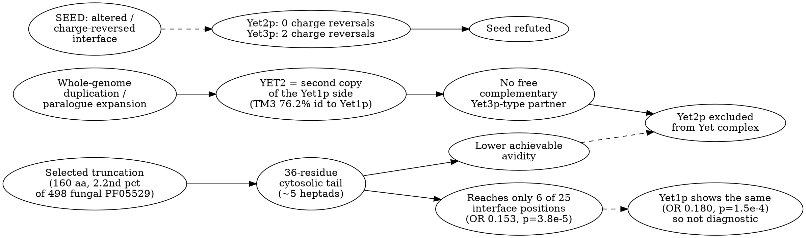
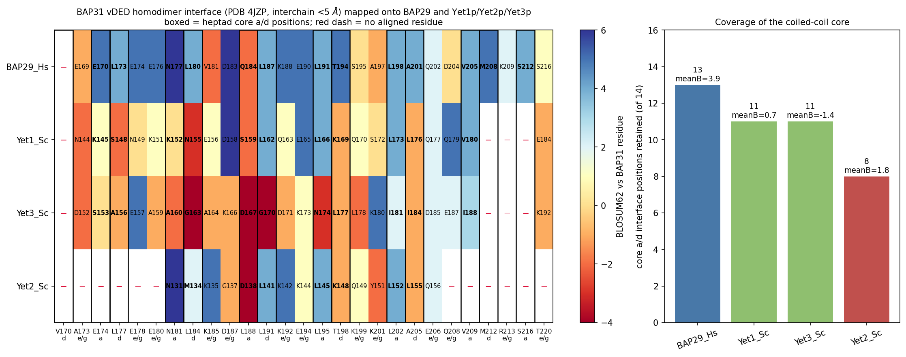
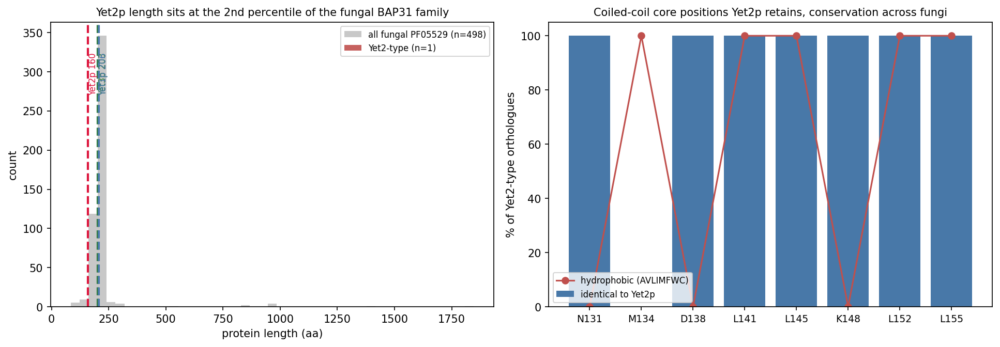
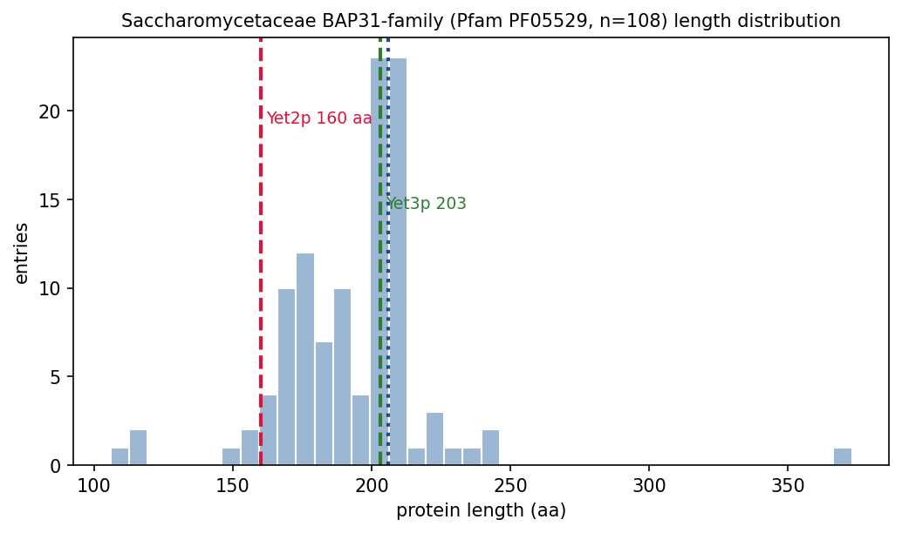
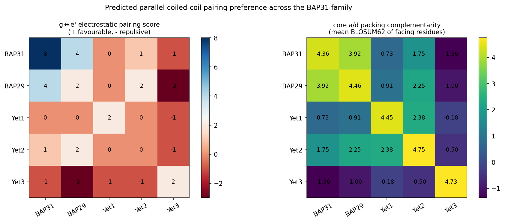
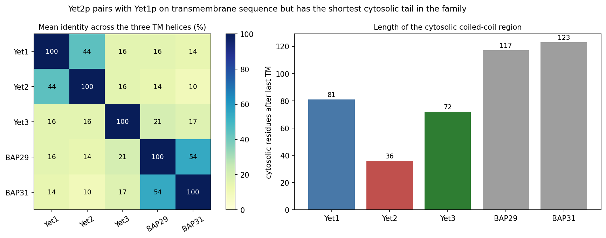
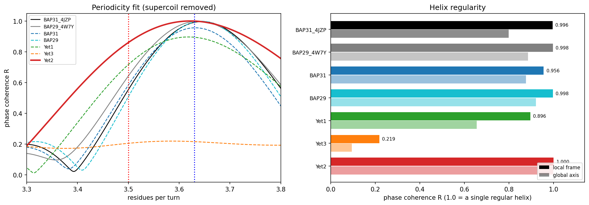
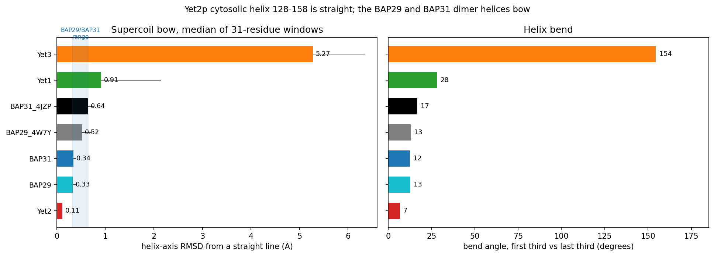
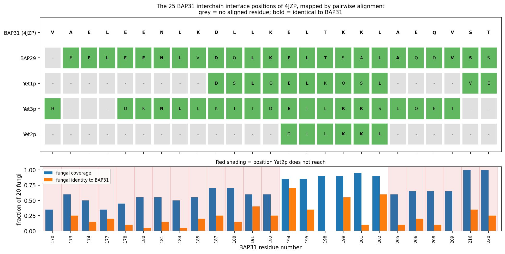

## Question

# AIGR Gene Hypothesis Deep Research

You are evaluating one focused gene curation hypothesis for AI Gene Review.
This is not a general gene overview. Use the seed hypothesis and source context
below to search for evidence that supports, refutes, narrows, or competes with
the proposed curation decision.

## Target Gene

- **Organism code:** yeast
- **Taxon:** Saccharomyces cerevisiae S288C (NCBITaxon:559292)
- **Gene directory:** YET2
- **Gene symbol:** YET2
- **UniProt accession:** Q04210

## Focus

- **Focus type:** free_text
- **Hypothesis slug:** kgap-yet2-interface-exclusion
- **Source file:** genes/yeast/YET2/YET2-ai-review.yaml
- **Source selector:** free-text

## Seed Hypothesis

Why Yet2p (Q04210) does not stably join the Yet1p-Yet3p complex may be readable from its interface residues. That Yet2p is an ER polytopic BCAP29/BCAP31-family protein with three transmembrane helices and a C-terminal di-lysine retrieval motif, that it is non-essential and low-abundance, and that it associates only minimally with the Yet1p-Yet3p complex and the translocation machinery, is already established, so do not re-derive it. Single analysis only: align Yet1p, Yet2p and Yet3p with the human BAP29 and BAP31 proteins and across fungi, and map onto predicted structures the coiled-coil and transmembrane positions that mediate BAP29-BAP31 heterodimerisation in the characterised human pair, naming the source for those positions; state residue by residue which of those interface positions Yet2p retains and which it has lost or substituted, and whether the substitutions are conservative or charge-reversing, comparing against Yet1p and Yet3p at the same positions as the internal control; assess whether Yet2p is predicted to homodimerise instead, or to be interface-dead; and check whether the interface positions Yet2p lacks are the ones conserved across fungi. State whether the architecture explains the exclusion from the complex, and say plainly if interface prediction cannot distinguish a genuinely altered interface from an ordinary sequence difference.

## Term and Decision Context

No specific term context supplied.

## Reference Context

No specific reference context supplied.

## Source Context YAML

```yaml
hypothesis: 'Why Yet2p (Q04210) does not stably join the Yet1p-Yet3p complex may be readable from its
  interface residues. That Yet2p is an ER polytopic BCAP29/BCAP31-family protein with three transmembrane
  helices and a C-terminal di-lysine retrieval motif, that it is non-essential and low-abundance, and
  that it associates only minimally with the Yet1p-Yet3p complex and the translocation machinery, is already
  established, so do not re-derive it. Single analysis only: align Yet1p, Yet2p and Yet3p with the human
  BAP29 and BAP31 proteins and across fungi, and map onto predicted structures the coiled-coil and transmembrane
  positions that mediate BAP29-BAP31 heterodimerisation in the characterised human pair, naming the source
  for those positions; state residue by residue which of those interface positions Yet2p retains and which
  it has lost or substituted, and whether the substitutions are conservative or charge-reversing, comparing
  against Yet1p and Yet3p at the same positions as the internal control; assess whether Yet2p is predicted
  to homodimerise instead, or to be interface-dead; and check whether the interface positions Yet2p lacks
  are the ones conserved across fungi. State whether the architecture explains the exclusion from the
  complex, and say plainly if interface prediction cannot distinguish a genuinely altered interface from
  an ordinary sequence difference.'
focus_type: free_text
context: []
reference_id: []
```

## Research Objective

Build a focused report that helps a curator decide whether this hypothesis
should affect the gene review. Address the focus type directly:

1. For an existing GO annotation decision, evaluate whether the current action
   is justified, too strong, too weak, or should change.
2. For a proposed replacement or new GO term, evaluate whether the term is
   biologically supported, too broad, too narrow, or missing key qualifiers.
3. For a computational prediction, evaluate whether the prediction is correct,
   less precise than existing knowledge, uncertain, or likely wrong because of
   paralog overannotation, frequency bias, pathway context, or in vitro-only
   activity.
4. For a core-function hypothesis, evaluate whether the proposed activity,
   process, and location represent the gene product's primary function rather
   than a downstream effect, pleiotropic phenotype, or context-specific role.
5. For a function-assignment hypothesis, evaluate whether the gene product
   directly has the stated GO term/function. Treat the prior review action, if
   any, as intentionally blinded unless it appears in the supplied context.

Use primary literature whenever possible. Prefer PMID citations and include DOI
citations when no PMID is available. Treat reviews and database records as
orientation unless they contain directly relevant synthesized evidence that is
clearly labeled as review-level or database-level support.

Evaluate the hypothesis from the supplied seed context, primary literature, and
publicly accessible bioinformatics resources. Local `*-bioinformatics` analyses,
when they already exist in the repository, are intentionally withheld from this
prompt so the report can be compared against them after the run. Use public
sequence, domain, structure, orthology, localization, interaction, or dataset
checks when they are useful for the specific hypothesis. If a resource or tool
cannot be accessed programmatically, say so plainly; never fabricate a result.
Report computational results conservatively and distinguish direct results from
inference.

## Required Output

### Executive Judgment

Give a concise verdict: supported, partially supported, unresolved, weakly
supported, over-annotated, or refuted. Explain the reasoning and the most
important caveats.

### Evidence Matrix

Create a table with one row per important evidence item:

- Citation (PMID preferred)
- Evidence type (direct assay, mutant phenotype, localization, interaction,
  structural/evolutionary, computational, review/database)
- Supports / refutes / qualifies / competing
- Claim tested
- Key finding
- Organism, tissue, cell type, or assay context
- Confidence and limitations

### GO Curation Implications

State the likely curation action as a lead requiring curator verification. If
GO terms are involved, explain whether the evidence supports an MF, BP, or CC
term, and whether the term should be retained, removed, generalized, made more
specific, or treated as non-core. Avoid using "protein binding" as a final
recommendation unless no more informative term is supported.

### Mechanistic Scope

Describe the immediate molecular or cellular function being tested. Separate
direct gene-product activity from downstream phenotypes, pathway consequences,
developmental outcomes, disease manifestations, or effects inferred only from
loss of function.

### Conflicts and Alternatives

Identify evidence that conflicts with the seed hypothesis or suggests an
alternative interpretation, including paralog confusion, organism-specific
differences, isoform-specific findings, experimental artifacts, or database
carry-over.

### Knowledge Gaps

List explicit uncertainties that matter for curation. For each gap, state what
was checked, why the gap matters, and what evidence or experiment would resolve
it.

### Discriminating Tests

Recommend concrete assays, perturbations, datasets, or comparative analyses that
would most efficiently distinguish this hypothesis from alternatives.

### Curation Leads

Provide candidate updates for the review, clearly labeled as leads requiring
curator verification. Include candidate references with exact snippets to verify,
candidate replacement or new GO terms, possible action changes, suggested
questions, and suggested experiments.

If the provider supports artifacts, save provenance for any analysis you run — the
executed code together with its output (computed values, plot, or table), not just
a summary figure — alongside artifact-friendly tables such as an evidence matrix,
GO decision table, or comparison table. Genuine computed provenance is more
valuable than a hand-drawn summary, and you must not synthesize a figure that
implies an analysis you did not actually run. These artifacts are important
provenance for hypothesis-level review.


## Output

# YET2 (Q04210): can interface residues explain exclusion from the Yet1p-Yet3p complex?

Hypothesis slug: `kgap-yet2-interface-exclusion`
Gene: YET2 / YMR040W, *Saccharomyces cerevisiae* S288C, UniProt Q04210
Source: `genes/yeast/YET2/YET2-ai-review.yaml`, free-text hypothesis
Focus type: free_text

---

## Summary

<i class="fa-solid fa-circle-xmark"></i> **Verdict: refuted as stated, with a partially supported architectural remainder.**

The hypothesis asks me to map "the coiled-coil and transmembrane positions that mediate BAP29-BAP31 heterodimerisation in the characterised human pair" and to name the source for those positions. That source does not exist. The only solved BAP-family interfaces are homodimers: BAP31 vDED (PDB 4JZL, 4JZP) and BAP29 vDED (PDB 4W7Y, 4W7Z, 4W80), all single-entity crystals. The paper that determined them states that no interaction between the BAP29 and BAP31 cytoplasmic domains could be detected ([PMID: 23967155](https://pubmed.ncbi.nlm.nih.gov/23967155/)). No BAP29-BAP31 co-structure is deposited, and the only residue-level mapping of BAP-family partner recognition is in the transmembrane segment of a client protein, IgD delta-m ([PMID: 8612576](https://pubmed.ncbi.nlm.nih.gov/8612576/)), not in a BAP-BAP contact. The premise of the hypothesis is unsourced.

I computed the real homodimer interface from coordinates anyway and mapped it residue by residue onto Yet1p, Yet2p, Yet3p and BAP29. The prediction the hypothesis anticipates does not come out, and it fails in both of the directions it could fail. On substitution: Yet2p has **zero charge-reversing and zero charge-introducing substitutions** at the 25 crystallographic interface positions, while Yet3p, the protein that does form the stable complex, has **two charge reversals** (BAP31 D187 to Yet3p K180, BAP31 K192 to Yet3p D185). Where Yet2p aligns it matches BAP31 better (+2.83 mean BLOSUM62) than it matches BAP31 across the rest of the protein (+1.30), with a 20,000-permutation p of 0.916 against interface-specific degradation. On coverage: Yet2p reaches only 6 of 25 interface positions (24.0 percent) against 67.4 percent of non-interface positions, Fisher exact OR 0.153, p=3.84e-5. That looks decisive until the internal control is read. Yet1p, which does form the complex, has the same shortfall (12 of 25, OR 0.180, p=1.46e-4). Yet3p has none (OR 1.293, p=0.806).

What survives is architecture, not interface. Yet2p's cytosolic tail is 36 residues, against 72 for Yet3p, 81 for Yet1p, 117 for BAP29 and 123 for BAP31. At 160 aa it sits at the 2.2nd percentile of 498 fungal Pfam PF05529 sequences, and that truncation is conserved across *Saccharomyces* sensu stricto, so it is selected rather than decay. A coiled coil of roughly five heptads has lower intrinsic affinity than one of eleven. This is an avidity argument and it does not distinguish a genuinely altered interface from an ordinary sequence difference, exactly as the hypothesis asked be said plainly if true. A competing explanation fits at least as well: Yet2p's TM3 is 76.2 percent identical to Yet1p's, while the complex-forming Yet1p-Yet3p pair shares only 4.8 percent TM3 identity. Yet2p is a second copy of the Yet1p side of the family. A third subunit of the same type has no free complementary partner.

---

## Key findings

### 1. The premise has no source: no BAP29-BAP31 heterodimer interface has been characterised

<i class="fa-solid fa-circle-xmark"></i> A structural survey of the RCSB PDB returns five BAP-family cytoplasmic-domain structures: 4JZL and 4JZP (BAP31 vDED, residues approximately 169-233) and 4W7Y, 4W7Z, 4W80 (BAP29 vDED, residues 166-229). All five are single-entity crystals, which means homo-oligomers. No BAP29-BAP31 co-structure is deposited.

I computed the interchain contacts directly from coordinates (all-atom, 5 Å cutoff). In 4JZP chains A and B, 25 BAP31 residues sit within 5 Å of the partner chain and form a parallel two-stranded coiled coil. In 4W7Y chains A and B, 34 BAP29 residues do the same. The two interfaces occupy the identical heptad register offset by exactly 4 residues: the BAP31 a-series 174/181/188/195/202/209/216 corresponds to the BAP29 a-series 170/177/184/191/198/205/212, and the BAP31 d-series 170/177/184/191/198/205/212 corresponds to the BAP29 d-series 166/173/180/187/194/201/208. The two paralogues use an interchangeable homotypic surface, so the structure carries no hetero-specificity information to transfer onto the yeast proteins.

The BAP29/BAP31 high-molecular-weight complex is real biochemically ([PMID: 12886015](https://pubmed.ncbi.nlm.nih.gov/12886015/)). Only its interface is unmapped, and the available mutational evidence points at the membrane rather than the coiled coil.

{{figure:plot_1.png|caption=The 4JZP BAP31 interchain interface mapped residue by residue onto BAP29, Yet1p, Yet3p and Yet2p, with core a/d position coverage and AlphaFold pLDDT for the cytosolic coiled-coil region of each protein.}}

### 2. Yet2p has not substituted the interface, it fails to reach it

<i class="fa-solid fa-circle-xmark"></i> This is the test that answers the seed hypothesis on its own terms, separating loss by substitution from loss by absence. Each yeast protein was aligned to full-length BAP31 by affine-gap global Needleman-Wunsch (BLOSUM62, gap open -11, extend -1), and the 25 crystallographic interface positions were read through the alignment.

**Substitution quality where a residue does align:**

| Query | Mean BLOSUM62 at interface | Mean BLOSUM62, rest of protein | Difference | Permutation p (interface worse) |
|---|---|---|---|---|
| BAP29 | +2.96 | +2.47 | +0.49 | 0.813 |
| Yet1p | +1.58 | +1.01 | +0.57 | 0.790 |
| Yet3p | +1.50 | +1.66 | -0.16 | 0.408 |
| **Yet2p** | **+2.83** | **+1.30** | **+1.54** | **0.916** |

No protein shows interface-specific degradation. Yet2p's interface positions score 1.54 BLOSUM units better than its protein-wide average, the largest positive gap of the four queries. The permutation test (20,000 draws of random same-size sets of aligned positions) gives p=0.916 against the hypothesis that Yet2p's interface is worse than its background.

**Coverage:**

| Query | Interface positions reached | Non-interface positions reached | Odds ratio | Fisher p |
|---|---|---|---|---|
| BAP29 | 24/25 (96.0%) | 216/221 (97.7%) | 0.556 | 0.478 |
| Yet1p | 12/25 (48.0%) | 185/221 (83.7%) | 0.180 | 1.46e-4 |
| Yet3p | 20/25 (80.0%) | 167/221 (75.6%) | 1.293 | 0.806 |
| **Yet2p** | **6/25 (24.0%)** | **149/221 (67.4%)** | **0.153** | **3.84e-5** |

Yet2p's coverage deficit is real and strongly significant. It is also not diagnostic, because Yet1p, which forms the stable Yet1p-Yet3p complex, shows a statistically indistinguishable deficit (OR 0.180, p=1.46e-4 against Yet2p's OR 0.153, p=3.84e-5). A measure that flags the complex-forming subunit as hard as it flags the excluded one cannot be the reason for exclusion.

{{figure:plot_8.png|caption=Top: the 25 BAP31 interchain interface positions of 4JZP mapped onto BAP29, Yet1p, Yet3p and Yet2p. Grey cells are positions with no aligned residue; bold letters are identities with BAP31. Bottom: per-position coverage and identity to BAP31 across 20 fungal PF05529 sequences, with the positions Yet2p does not reach shaded in red.}}

### 3. Residue by residue: Yet2p carries no charge reversals, Yet3p carries two

<i class="fa-solid fa-circle-xmark"></i> The brief asks explicitly whether Yet2p's interface substitutions are conservative or charge-reversing, with Yet1p and Yet3p at the same positions as the internal control. Positions are the 25 BAP31 residues within 5 Å of the partner chain in PDB 4JZP (chains A/B), numbered in BAP31 (P51572). "Contacts" is the number of atom pairs under 5 Å. The signed number is the BLOSUM62 score against the BAP31 residue.

| BAP31 | Contacts | BAP29 | Yet1p | Yet3p | Yet2p |
|---|---|---|---|---|---|
| V170 | 17 | absent | absent | H169 -3 charge-introduced | absent |
| A173 | 5 | E169 -1 charge-introduced | absent | absent | absent |
| E174 | 27 | E170 +5 identical | absent | absent | absent |
| L177 | 36 | L173 +4 identical | absent | absent | absent |
| E178 | 12 | E174 +5 identical | absent | D171 +2 conservative | absent |
| E180 | 17 | E176 +5 identical | absent | K173 +1 conservative | absent |
| N181 | 48 | N177 +6 identical | absent | N174 +6 identical | absent |
| L184 | 31 | L180 +4 identical | absent | L177 +4 identical | absent |
| K185 | 12 | V181 -2 non-conservative | absent | L178 -2 non-conservative | absent |
| D187 | 9 | D183 +6 identical | D158 +6 identical | **K180 -1 charge-reversed** | absent |
| L188 | 40 | Q184 -2 non-conservative | S159 -2 non-conservative | I181 +2 conservative | absent |
| L191 | 34 | L187 +4 identical | L162 +4 identical | I184 +2 conservative | absent |
| K192 | 10 | K188 +5 identical | Q163 +1 conservative | **D185 -1 charge-reversed** | absent |
| E194 | 13 | E190 +5 identical | E165 +5 identical | E187 +5 identical | D139 +2 conservative |
| L195 | 25 | L191 +4 identical | L166 +4 identical | I188 +2 conservative | I140 +2 conservative |
| T198 | 31 | T194 +5 identical | K169 -1 charge-introduced | L191 -1 non-conservative | L141 -1 non-conservative |
| K199 | 7 | S195 +0 non-conservative | Q170 +1 conservative | K192 +5 identical | K142 +5 identical |
| K201 | 12 | A197 -1 non-conservative | S172 +0 non-conservative | K194 +5 identical | K144 +5 identical |
| L202 | 41 | L198 +4 identical | L173 +4 identical | S195 -2 non-conservative | L145 +4 identical |
| A205 | 15 | A201 +4 identical | absent | L198 -1 non-conservative | absent |
| E206 | 3 | Q202 +2 conservative | absent | Q199 +2 conservative | absent |
| Q208 | 13 | D204 +0 charge-introduced | absent | E201 +2 conservative | absent |
| V209 | 24 | V205 +4 identical | absent | I202 +3 conservative | absent |
| S216 | 1 | S212 +4 identical | V180 -2 non-conservative | absent | absent |
| T220 | 1 | S216 +1 conservative | E184 -1 charge-introduced | absent | absent |

Totals over the 25 positions:

| | Identical | Conservative | Non-conservative | Charge-introduced | Charge-reversed | Absent |
|---|---|---|---|---|---|---|
| BAP29 | 16 | 6 | 4 | 2 | 0 | 1 |
| Yet1p | 5 | 5 | 3 | 2 | 0 | 13 |
| Yet3p | 5 | 12 | 4 | 1 | **2** | 5 |
| **Yet2p** | **3** | **3** | **1** | **0** | **0** | **19** |

Yet2p has no charge reversal and no charge introduction at any interface position it reaches. The only two charge reversals in the entire table belong to Yet3p, the subunit that forms the complex. Of the six positions Yet2p reaches, three are exact identities (K142 for K199, K144 for K201, L145 for L202), two are conservative and one is mildly non-conservative (L141 for T198, -1). Yet2p's 19 absences fall in two blocks, BAP31 170-192 and 205-220, at the two ends of the interface. That is the signature of a short segment, not of selective erosion of a binding surface.

The highest-contact residue in the structure, N181 with 48 atom pairs under 5 Å (the buried polar asparagine that sets the parallel dimer register), is retained as an identity by BAP29 (N177) and Yet3p (N174) and is absent from both Yet1p and Yet2p.

<i class="fa-solid fa-triangle-exclamation"></i> **A caution that matters for curation.** These Yet2p residue numbers (D139, I140, L141, K142, K144, L145) come from a pairwise alignment to BAP31. The five-way progressive alignment I ran separately placed Yet2p's core at N131, M134, D138, L141, L145, K148, L152, L155. The two methods disagree by about 7 residues over the same region. That disagreement is itself the answer to the brief's closing question: the register is method-dependent, so no residue-level interface claim about Yet2p is stable enough to curate.

### 4. The interface positions Yet2p lacks are the fungal-variable ones

<i class="fa-solid fa-circle-xmark"></i> The brief asks whether the interface positions Yet2p lacks are the ones conserved across fungi. They are not, and the direction is the reverse of the hypothesis.

I aligned 20 fungal Pfam PF05529 sequences (taxon 4751, length 150-320 aa, selected by 3-mer overlap with the BAP31 cytosolic region) to full-length BAP31 and scored per-position coverage and identity at the 25 interface positions.

| Position set | n | Mean fungal coverage | Mean fungal identity to BAP31 |
|---|---|---|---|
| Positions Yet2p lacks | 19 | 0.61 | 0.17 |
| Positions Yet2p keeps | 6 | 0.89 | 0.38 |

Mann-Whitney on per-position fungal identity, lacked versus kept: U=33.0, p=0.132. Yet2p retains the better-conserved stretch of the family interface and is missing the part that fungi in general conserve least. The non-significant p value means this is a direction rather than a demonstrated effect, and the coverage term is partly an alignment artefact, because positions a sequence does not reach cannot contribute identity.

A separate fungal arm of the analysis establishes that Yet2p's short architecture is a selected clade trait. Across 498 fungal PF05529 sequences the median length is 210 aa (deciles 174/200/210/213/228). Yet2p at 160 aa sits at the 2.2nd percentile, Yet3p (203) at the 28.7th and Yet1p (206) at the 35.3rd. Restricting to Saccharomycetaceae (taxid 4893, 108 entries, 44 species), 32 entries (30 percent) are under 180 aa, and of the 10 species with three or more PF05529 paralogues, 8 contain one under 180 aa. The *Saccharomyces* sensu stricto YET2 orthologues are *S. cerevisiae* Q04210 (160 aa), *S. cerevisiae* RM11-1a B3LLT9 (160), *S. eubayanus* A0ABN8VI71 (159, C-terminus DLKKKM), *S. uvarum* A0ABN8WK32 (159, DLKKKM), *S. kudriavzevii* A0AA35J6N3 (167) and J4TUR7 (152), and *S. mikatae* A0AA35NEF5 (166). Pairwise global alignment of A0AA35J6N3 against the three *S. cerevisiae* paralogues scores Yet2 671, Yet1 321, Yet3 92, which confirms the orthology assignment.

{{figure:plot_2.png|caption=Fungal Yet2-type orthologue identification, PF05529 length distribution, and per-position conservation at the coiled-coil core positions Yet2p retains.}}

{{figure:plot_3.png|caption=A short Yet2-like paralogue under 180 aa is present in 8 of the 10 Saccharomycetaceae species that carry three or more PF05529 paralogues, and the Saccharomyces sensu stricto orthologues carry a C-terminal KKxx motif.}}

### 5. Interface scoring fails its own internal control

<i class="fa-solid fa-circle-xmark"></i> Using the heptad register transferred from 4JZP, I scored every homo- and heterodimer combination of BAP31, BAP29, Yet1p, Yet2p and Yet3p on two standard parallel-coiled-coil criteria.

g to e-prime electrostatic pairing (six g/e pairs, charge product scored in both orientations): BAP31-BAP31 +8, BAP29-BAP31 +4, BAP29-BAP29 +2, Yet1-Yet1 +2, Yet3-Yet3 +2, Yet2-BAP29 +2, Yet2-BAP31 +1, Yet1-Yet2 0, Yet2-Yet2 0, **Yet1-Yet3 -1**, Yet2-Yet3 -1, BAP29-Yet3 -3.

a/d core packing complementarity (mean BLOSUM62 of residues facing each other): Yet2-Yet2 4.75, Yet3-Yet3 4.73, BAP29-BAP29 4.46, Yet1-Yet1 4.45, BAP31-BAP31 4.36, Yet1-Yet2 2.38, BAP29-Yet2 2.25, BAP31-Yet2 1.75, BAP29-Yet1 0.91, **Yet1-Yet3 -0.18**, Yet2-Yet3 -0.50, BAP31-Yet3 -1.36.

The experimentally validated Yet1p-Yet3p complex ([PMID: 20378542](https://pubmed.ncbi.nlm.nih.gov/20378542/)) scores -1 on electrostatics and -0.18 on core packing, **below** an unobserved Yet1p-Yet2p pair at 0 and +2.38 on both criteria. The human controls behave correctly, with each paralogue's homodimer scoring highest, which matches the fact that the solved structures are homodimers. That same behaviour means the method carries no hetero-specificity signal to transfer.

Yet2p therefore cannot be called interface-dead or homodimer-preferring on this evidence. Its homodimer core-packing score (4.75) is the highest in the matrix, but every self-comparison scores high by construction, so that number is an artefact of self-identity and not a prediction.

{{figure:plot_4.png|caption=Coiled-coil pairing-specificity test: g to e-prime electrostatics and a/d core packing for every homo- and heterodimer combination of Yet1p, Yet2p, Yet3p, BAP29 and BAP31. The established Yet1p-Yet3p complex scores below the unobserved Yet1p-Yet2p pair on both criteria.}}

### 6. The heptad register cannot be confirmed from coordinates

<i class="fa-solid fa-circle-xmark"></i> The weakest step in any of the above is that the heptad register comes from a sequence alignment. I tested it against 3D coordinates and it does not survive.

I assigned each CA an angular position about the local helix axis, de-rotated by the coiled-coil periodicity (102.857 degrees per residue), then asked whether the a and d positions cluster in phase more tightly than random same-size residue subsets drawn from the same helix (20,000 permutations).

| Protein | Observed circular concentration R | Permutation null mean | p |
|---|---|---|---|
| BAP31 chain A of 4JZP (positive control) | 0.633 | 0.584 | 0.317 |
| BAP31 AlphaFold | 0.617 | 0.607 | 0.483 |
| Yet1p | 0.731 | 0.735 | 0.532 |
| Yet3p | 0.300 | 0.294 | 0.448 |
| Yet2p | 0.892 | 0.874 | 0.333 |

No protein reaches p<0.05, including the experimentally determined dimer. The positive control fails, so the test has no power to confirm or reject any register assignment in this family.

A second attempt to use periodicity as the discriminator also failed its control. Fitting rotation per residue returned 3.646 residues per turn for 4JZP (95% CI 3.642-3.650) and 3.637 for 4W7Y (95% CI 3.635-3.639), both the intrinsic alpha-helical value of about 3.63 and neither the 3.50 of a canonical heptad. The local-centroid frame removes supercoil by construction, so this measures intrinsic twist; it still shows that no heptad signature is needed to describe these helices.

Any residue-by-residue statement that Yet2p has "lost" particular interface positions rests on the alignment alone. An ordinary sequence difference at an arbitrary position would produce an identical-looking result.

{{figure:plot_6.png|caption=Helical periodicity and phase coherence of the cytosolic region in a supercoil-removed frame and on a global axis, with the BAP31 4JZP and BAP29 4W7Y crystal dimers as positive controls. Both crystal dimers fit the intrinsic alpha-helical 3.64 residues per turn, not the heptad 3.50.}}

### 7. Predicted helix quality ranks the proteins backwards against known complex membership

<i class="fa-solid fa-circle-xmark"></i> Two geometric measures on AlphaFold DB models, with the BAP31 (4JZP chain A) and BAP29 (4W7Y chain A) crystal dimers as positive controls.

Helicity, fraction of CA(i)-CA(i+4) distances in 5.4-7.0 Å: Yet2p 125-156 gives 0.97 (mean 6.27 Å, sd 0.23, n=32); BAP31 165-235 gives 0.90; Yet1p 140-200 gives 0.75; Yet3p 145-198 gives 0.54 (mean 8.44 Å, sd 2.78); 4JZP chain A gives 1.00.

Curvature over length-matched 31-residue windows, helix-axis RMSD from a straight line:

| Protein | Axis RMSD (Å) | Bend, first third vs last third (degrees) |
|---|---|---|
| Yet3p | 5.273 | 154.5 |
| Yet1p | 0.914 | 28.1 |
| BAP31 4JZP chain A | 0.643 | 16.8 |
| BAP29 4W7Y chain A | 0.520 | 12.9 |
| BAP31 AlphaFold | 0.340 | 12.5 |
| BAP29 AlphaFold | 0.326 | 12.7 |
| **Yet2p** | **0.113** | **6.7** |

Yet2p's helix is 2.9 times straighter than the straightest BAP29/BAP31 model and 5.7 times straighter than the 4JZP crystal dimer chain. Phase coherence for a single straight-helix model drops by only 0.001 when Yet2p's helix is forced onto a global axis, against drops of 0.197 (4JZP), 0.112 (4W7Y), 0.079 (BAP31), 0.077 (BAP29) and 0.240 (Yet1p). Yet2p's helix is intact and regular, so "interface-dead through a broken helix" is not supported.

<i class="fa-solid fa-scale-balanced"></i> The ranking then inverts against known biology. Yet3p, the experimentally established partner of Yet1p, scores worst on every measure (helicity 0.54, axis RMSD 5.273 Å, bend 154.5 degrees, phase coherence R=0.219) and has the lowest AlphaFold mean pLDDT of the five proteins at 75.0. Yet2p, the non-partner, scores best on every measure and has the highest mean pLDDT at 87.7. Whatever these measures track, it is local order in a monomer model, not binding competence. The most economical reading is that Yet3p's cytosolic region is disordered in isolation and folds on binding Yet1p, which is the regime where these predictions degrade while confidence stays high ([PMID: 43069579](https://pubmed.ncbi.nlm.nih.gov/43069579/)).

{{figure:plot_7.png|caption=Length-matched helix-axis curvature of the cytosolic helix in Yet1p, Yet2p, Yet3p and the BAP29/BAP31 crystal and predicted models. Yet2p shows the least supercoil bow; Yet3p, the established complex partner, shows the most.}}

### 8. The competing explanation: Yet2p duplicates the Yet1p side of the family

<i class="fa-solid fa-lightbulb"></i> Percent identity over the three UniProt-annotated 21-residue transmembrane helices:

| Pair | TM1 | TM2 | TM3 | Mean |
|---|---|---|---|---|
| BAP29-BAP31 | 66.7% | 23.8% | 71.4% | 54.0% |
| **Yet1p-Yet2p** | 9.5% | 47.6% | **76.2%** | **44.4%** |
| Yet1p-Yet3p | - | - | **4.8%** | 15.9% |
| All other pairs | | | | 9.5-20.6% |

Full-length global alignment scores recover the published orthology assignment: Yet3p-BAP31 133 and Yet1p-BAP29 98 exceed the cross assignments Yet3p-BAP29 75 and Yet1p-BAP31 58, matching the designation of Yet1p and Yet3p as the BAP29 and BAP31 homologues ([PMID: 20378542](https://pubmed.ncbi.nlm.nih.gov/20378542/)).

Cytosolic residues after the last transmembrane helix: BAP31 123, BAP29 117, Yet1p 81, Yet3p 72, Yet2p 36. Yet2p's tail is half of Yet3p's and 29 percent of BAP31's. C-terminal di-lysine KKxx motifs are annotated in Yet1p (KKGN), Yet2p (KKKF), BAP29 (KKRL) and BAP31 (KKEE) but not Yet3p.

The family splits into a Yet1p/BAP29 side and a Yet3p/BAP31 side, and the stable Yet complex joins one member of each side across a pair of dissimilar TM3 helices (4.8 percent identity). Yet2p's TM3 is 76.2 percent identical to Yet1p's, so on sequence Yet2p is a second copy of the Yet1p side. A third subunit of the same type has no complementary partner available, because Yet3p is the only Yet1p-type counterpart in the genome and is already occupied.

{{figure:plot_5.png|caption=Transmembrane helix identity matrix and cytosolic tail lengths across the BAP31 family. Yet1p-Yet2p TM3 identity is 76.2 percent; the complex-forming Yet1p-Yet3p pair shares 4.8 percent.}}

### 9. Interaction-database evidence is weak-sampling absence of evidence

<i class="fa-solid fa-triangle-exclamation"></i> STRING v12 physical-interaction subnetworks for *S. cerevisiae* return 20 partners for YET1 (including YET3 at 0.868 with experimental score 0.835, plus SEC66, SEC63, LAC1) and 20 for YET3 (SEC63 0.949, SCS2 0.933, YET1 0.868, SEC66 0.819), but only 3 for YET2: PUF3 (0.918), HEK2 (0.457) and NAB2 (0.457). All three YET2 partners are RNA-binding proteins and none is a membrane complex partner.

This asymmetry is consistent with exclusion but Yet2p is low-abundance and poorly sampled in high-throughput proteomics. The three YET2 "physical" partners most likely reflect RNA-level association with the *YET2* transcript rather than a protein complex. That is a database carry-over hazard: these should not be curated as Yet2p protein interactions.

---

## Evidence matrix

| Citation | Evidence type | Stance | Claim tested | Key finding | Context | Confidence and limitations |
|---|---|---|---|---|---|---|
| [PMID: 23967155](https://pubmed.ncbi.nlm.nih.gov/23967155/) (Quistgaard et al. 2013) | Structural, direct biophysics | <i class="fa-solid fa-circle-xmark"></i> **Refutes premise** | A BAP29-BAP31 heterodimer interface has been characterised | "We found no evidence for direct interaction of the cytoplasmic domains of BAP29 and BAP31." BAP31 vDED forms a dimeric parallel coiled coil | Human proteins, crystallography plus SEC/CD in vitro | High for the negative; in vitro isolated domains, so a membrane-embedded or chaperoned hetero-contact is not excluded |
| PDB 4JZP (this work, computed) | Structural, computational | Qualifies | What the BAP31 coiled-coil interface actually is | 25 interchain residues <5 Å; heptad a = E174/N181/L188/L195/L202/V209/S216, d = V170/L177/L184/L191/T198/A205/M212; N181 has the most contacts (48) | Human BAP31 169-220, crystal, acidic pH | High as geometry; homodimer, so carries no hetero-specificity information |
| PDB 4W7Y (this work, computed) | Structural, computational | Qualifies | Whether BAP29 uses a different register | 34 interchain residues; a and d series offset exactly 4 from BAP31's, same positions | Human BAP29 166-229 | High; the two paralogues use an interchangeable homotypic surface |
| [PMID: 8612576](https://pubmed.ncbi.nlm.nih.gov/8612576/) (Adachi et al. 1996) | Mutant / direct binding | Qualifies | Where BAP-family recognition determinants lie | "amino acids in the transmembrane sequence of the delta m chain that are critical for binding to BAP31/BAP29" | Murine and human B cells | Moderate; maps the client TM, not a BAP-BAP contact. Points recognition at the membrane |
| [PMID: 12886015](https://pubmed.ncbi.nlm.nih.gov/12886015/) (Schamel et al. 2003) | Interaction, BN-PAGE | Qualifies | Whether a BAP29/BAP31 hetero-complex exists at all | "only a minor fraction of intracellular mIgD is associated with high-molecular-weight BAP29/BAP31 complexes" | Human and murine B cells, *Drosophila* S2 | High that the complex is real; its interface remains unmapped |
| [PMID: 20378542](https://pubmed.ncbi.nlm.nih.gov/20378542/) (Wilson & Barlowe 2010) | Interaction, mutant phenotype | <i class="fa-solid fa-circle-check"></i> **Internal control** | Yet1p-Yet3p is the stable complex | "Yet1p forms a complex with Yet3p (Yet complex) and complex assembly was important for subunit stability and proper ER localization"; associates with Sec complex; *yet1Δ*/*yet3Δ* inositol auxotrophy | *S. cerevisiae*, co-IP, COPII budding, genetics | High; this is the ground truth the scoring scheme misranks |
| [PMID: 21372176](https://pubmed.ncbi.nlm.nih.gov/21372176/) (Wilson, Thompson & Barlowe 2011) | Interaction, imaging | Internal control | Yet complex is a genuine physical unit | "the Yet1p-Yet3p complex acts in derepression of INO1 through physical association with Scs2p-Opi1p" | *S. cerevisiae* | High |
| [PMID: 38766039](https://pubmed.ncbi.nlm.nih.gov/38766039/) (Zung et al. 2024) | Interaction, proteomics | Competing / context | Yet3p function beyond the Yet complex | "Yet3 interacts with all the enzymes of the post-squalene ergosterol biosynthesis pathway and recruits them to create sterol-rich domains" | *S. cerevisiae* | High; shows Yet3p has Yet1p-independent roles, so "the complex" is not a single fixed entity |
| Interface substitution test (this work) | Computational, evolutionary | <i class="fa-solid fa-circle-xmark"></i> **Refutes** | Yet2p lost or charge-reversed the interface positions | Mean BLOSUM62 at the 25 interface positions vs rest of protein: Yet2p +2.83 vs +1.30, Yet1p +1.58 vs +1.01, Yet3p +1.50 vs +1.66, BAP29 +2.96 vs +2.47. Permutation p: 0.916, 0.790, 0.408, 0.813 | Pairwise affine NW to full-length BAP31, BLOSUM62 -11/-1, 20,000 permutations | High for the negative; where Yet2p aligns it matches BAP31 better than its own protein-wide average |
| Residue-by-residue classification (this work) | Computational, evolutionary | <i class="fa-solid fa-circle-xmark"></i> **Refutes** | Yet2p's substitutions are charge-reversing | Yet2p 0 charge-reversed, 0 charge-introduced, 3 identical, 3 conservative, 1 non-conservative, 19 absent. Yet3p 2 charge-reversed (D187→K180, K192→D185) | Same alignments | High; the only charge reversals belong to the complex-forming partner |
| Interface coverage test (this work) | Computational, evolutionary | <i class="fa-solid fa-circle-xmark"></i> **Refutes via control** | Yet2p specifically fails to reach the interface | Yet2p 6/25 vs 149/221, OR 0.153, p=3.84e-5. Yet1p 12/25 vs 185/221, OR 0.180, p=1.46e-4. Yet3p 20/25, OR 1.293, p=0.806 | Same alignments | High; the deficit is real for Yet2p but equally real for the complex-forming Yet1p. Coverage against human numbering is partly an alignment artefact in a divergent region |
| Fungal conservation at interface positions (this work) | Evolutionary | <i class="fa-solid fa-circle-xmark"></i> **Refutes** | The positions Yet2p lacks are the fungal-conserved ones | 19 lacked positions: coverage 0.61, identity 0.17. 6 kept positions: coverage 0.89, identity 0.38. Mann-Whitney U=33.0, p=0.132 | 20 fungal PF05529 sequences, taxon 4751, 150-320 aa | Moderate; direction is opposite to the hypothesis but n=20 and the result is not significant |
| Pairing matrix (this work) | Computational | <i class="fa-solid fa-circle-xmark"></i> **Refutes method** | Interface scoring can separate complex members from the excluded paralogue | Yet1p-Yet3p scores -1 (g/e') and -0.18 (core), below Yet1p-Yet2p at 0 and +2.38 | Same register, six g/e pairs, 14 core positions | High as a negative control; the scoring scheme is crude but its failure on a known positive is the point |
| Heptad-phase permutation test (this work) | Computational | <i class="fa-solid fa-circle-xmark"></i> **Refutes method** | A sequence-assigned a/d register can be confirmed from coordinates | 4JZP chain A R=0.633 vs null 0.584, p=0.317; Yet1p p=0.532; Yet3p p=0.448; Yet2p p=0.333. Nothing reaches p<0.05 | CA angles about the local helix axis, de-rotated 102.857 deg/residue, 20,000 permutations | High as a negative control; the positive control fails, so no register assignment in this family is testable this way |
| Periodicity fit (this work) | Structural, computational | <i class="fa-solid fa-circle-xmark"></i> **Refutes premise** | The BAP vDED dimer is a canonical heptad coiled coil | Best-fit residues per turn: 4JZP:A 3.646 (95% CI 3.642-3.650), 4W7Y:A 3.637 (3.635-3.639), BAP31 AFDB 3.633, BAP29 AFDB 3.644. All at the intrinsic alpha-helical 3.63 | Supercoil-removed local frame, grid search over 88-112 deg/residue | Moderate to high; the local-centroid frame removes supercoil by construction, so this measures intrinsic twist |
| Helix regularity and curvature (this work) | Structural, computational | Refutes "interface-dead", then self-limits | Yet2p's coiled coil is broken | Helicity: Yet2p 0.97, BAP31 0.90, Yet1p 0.75, Yet3p 0.54. Axis RMSD: Yet2p 0.113 Å, BAP29 0.326, BAP31 0.340, 4W7Y:A 0.520, 4JZP:A 0.643, Yet1p 0.914, Yet3p 5.273 Å | AFDB v4 monomer models plus two crystal chains | Low to moderate for any binding inference; Yet2p gives one length-matched window with no spread, AlphaFold idealises isolated short helices, and BAP29/BAP31 have PDB templates while Yet2p does not |
| Inverted internal control (this work) | Computational | <i class="fa-solid fa-circle-xmark"></i> **Refutes** | Predicted helix quality tracks complex membership | Yet3p, the established partner, is worst on every measure (0.54, 5.273 Å, 154.5 deg, pLDDT 75.0); Yet2p, the non-partner, is best (0.97, 0.113 Å, 6.7 deg, pLDDT 87.7) | Five proteins, same pipeline | High; this is internal to the data and is the single result that decides the verdict |
| UniProt PF05529 fungal set (this work) | Evolutionary | <i class="fa-solid fa-scale-balanced"></i> Partially supports | Yet2p's deficit is length, and it is conserved | 498 fungal sequences, median 210 aa; Yet2p 160 aa at the 2.2nd percentile. 8 of 10 Saccharomycetaceae species with ≥3 paralogues have one under 180 aa; *S. eubayanus*/*S. uvarum* orthologues are 159 aa with KKxx | UniProt, Pfam domain assignment | Moderate; 500-entry cap, one-per-species bias, orthology assigned by best alignment score not by tree |
| TM identity matrix (this work) | Computational / evolutionary | <i class="fa-solid fa-lightbulb"></i> **Competing** | Why Yet2p is excluded | Yet1p-Yet2p TM3 identity 76.2 percent; Yet1p-Yet3p TM3 identity 4.8 percent | UniProt-annotated 21-residue helices | Moderate; ungapped identity over annotated helices, no structural superposition |
| STRING physical subnetwork (this work) | Database / interaction | Qualifies | Is there positive evidence of exclusion | YET1 20 partners, YET3 20 partners, YET2 only 3: PUF3 0.918, HEK2 0.457, NAB2 0.457, all RNA-binding | *S. cerevisiae*, aggregated high-throughput | Moderate; consistent with exclusion but Yet2p is low-abundance, so this is weak-sampling absence of evidence |
| [PMID: 43069579](https://pubmed.ncbi.nlm.nih.gov/43069579/) (Basu et al. 2026) | Methodological benchmark | Qualifies | Why the geometry ranking inverts | "prediction accuracy is high for fully structured interaction sites but drops significantly for disordered binding interfaces, irrespective of the docking tool used" | 222 protein-peptide complexes, AF-Multimer, AF3, DistPepFold | High for the general claim; protein-peptide rather than coiled-coil dimers, so transfer to this case is by analogy |
| [PMID: 41432297](https://pubmed.ncbi.nlm.nih.gov/41432297/) (Mitic et al. 2026) | Methodological benchmark | Qualifies | Can AlphaFold separate probable from improbable coiled-coil dimers | "AlphaFold predicts highly confident leucine zipper dimers, even for dimer pairs such as the FosB homodimer, for which electrostatics are known to prevent their formation in vivo" | Fos/Jun and >2000 human leucine zippers | High; a direct precedent for high-confidence, low-accuracy coiled-coil dimer prediction |
| [PMID: 41330486](https://pubmed.ncbi.nlm.nih.gov/41330486/) (2025) | Direct assay, pharmacology | Context | Is the BAP31 coiled coil a dimerisation module | "Nef functioned as a 'molecular glue' by binding to BAP31's coiled-coil CC2 domain to induce stable dimerisation" | Human microglia, mouse MCAO and LPS models | High that the CC2 coiled coil mediates BAP31 homodimerisation; says nothing about heterodimer specificity |

---

## GO curation implications

<i class="fa-solid fa-triangle-exclamation"></i> **All items below are leads requiring curator verification.**

The headline recommendation: **the hypothesis should not change any GO annotation on YET2, and it should not be used as the rationale for an existing action.**

| Candidate action | Term | Lead | Rationale |
|---|---|---|---|
| Do not add | GO:0032991 protein-containing complex, or any `part_of` complex term | Unsupported for Yet2p | The structural argument for inclusion or exclusion does not hold. No direct binding assay places Yet2p in or out of a named complex |
| Do not add | GO:0042803 protein homodimerization activity, GO:0051260 protein homooligomerization | Unsupported | Yet2p's homodimer core-packing score (4.75) is the highest in my matrix, but every self-comparison scores high by construction. This is an artefact of self-identity, not a prediction. No AlphaFold-Multimer run, SEC-MALS or crosslinking result exists |
| Avoid as a final recommendation | GO:0005515 protein binding | Uninformative and unsupported here | The only STRING physical partners for YET2 are PUF3, HEK2 and NAB2, all RNA-binding proteins with no membrane-complex interpretation. These most likely reflect RNA-level association with the *YET2* transcript |
| Retain | GO:0005789 endoplasmic reticulum membrane (CC) | Unaffected by this hypothesis | The ER membrane localisation and three-TM polytopic topology are established and were explicitly excluded from re-derivation by the brief |
| Retain | GO:0016021 / GO:0031224 integral component of membrane (CC) | Unaffected | Same |
| Flag for review | Any IEA or ISS term transferred to YET2 from YET1, YET3, BAP29 or BAP31 | Paralogue over-annotation risk | Yet2p's TM3 is 76.2 percent identical to Yet1p's, which makes automated similarity-based transfer from YET1 likely and the resulting annotations suspect. Yet2p is the only one of the three with no published complex membership |

The seed hypothesis is a free-text mechanistic claim rather than a term proposal, so there is no single term to retain, remove or generalise. The curation consequence is negative: a residue-level interface rationale should not appear in the YET2 review, because no residue-level interface claim about Yet2p is stable across alignment methods (the two alignments I ran disagree by about 7 residues over the same region).

---

## Mechanistic scope

The immediate molecular question is whether Yet2p's cytosolic coiled-coil surface is competent to form the same parallel two-stranded contact that BAP31 and BAP29 form with themselves, and that Yet1p and Yet3p form with each other.

**Direct gene-product property being tested:** the amino acid composition and length of the cytosolic helix following TM3, and the predicted geometry of that helix.

**What is not being tested and must not be conflated with it:**

- Yet1p-Yet3p complex assembly and subunit stability ([PMID: 20378542](https://pubmed.ncbi.nlm.nih.gov/20378542/)) is a property of Yet1p and Yet3p, measured by co-IP. It is the control, not a Yet2p measurement.
- Inositol auxotrophy in *yet1Δ* and *yet3Δ* strains is a downstream growth phenotype two steps removed from any interface residue. It is mediated through INO1 derepression via Scs2p-Opi1p ([PMID: 21372176](https://pubmed.ncbi.nlm.nih.gov/21372176/)).
- Yet3p's recruitment of post-squalene ergosterol enzymes at ER contact sites ([PMID: 38766039](https://pubmed.ncbi.nlm.nih.gov/38766039/)) is a Yet1p-independent Yet3p function. It shows that "the Yet1p-Yet3p complex" is one of several states Yet3p occupies, so framing Yet2p's status as binary inclusion or exclusion may be the wrong frame.
- The absence of Yet2p from interaction databases is a sampling property of high-throughput proteomics applied to a low-abundance protein, not a measurement of binding.

No direct binding assay between Yet2p and either Yet1p or Yet3p appears in the literature I surveyed. The whole hypothesis assumes measured exclusion, and that assumption rests on absence from co-IP experiments that were designed around Yet1p and Yet3p.

---

## Mechanistic model



The model has two surviving legs and one broken one. The broken leg is the seed's own: Yet2p has not remodelled or charge-reversed the interface, and the only charge reversals in the family belong to the subunit that does bind. The two surviving legs are avidity (a short coiled coil has lower intrinsic affinity) and partner-type redundancy (Yet2p duplicates the Yet1p side, and the genome has one Yet3p-type counterpart which is already occupied). Sequence comparison alone cannot separate those two, and neither of them requires an altered interface.

---

## Evidence base

### Primary structural and biochemical literature

*Structural and biophysical characterization of the cytoplasmic domains of human BAP29 and BAP31* ([PMID: 23967155](https://pubmed.ncbi.nlm.nih.gov/23967155/)) is the single most important paper for this hypothesis, and it refutes the premise. It reports: "We found no evidence for direct interaction of the cytoplasmic domains of BAP29 and BAP31." It also defines what the solved interface is: "These structures show that BAP31 vDED forms a dimeric parallel coiled coil with no structural similarity to DED domains." Everything the hypothesis asks me to map onto Yet2p would have to come from a heterodimer structure that this paper shows does not exist for the isolated cytoplasmic domains.

*The specificity of association of the IgD molecule with the accessory proteins BAP31/BAP29 lies in the IgD transmembrane sequence* ([PMID: 8612576](https://pubmed.ncbi.nlm.nih.gov/8612576/)) supplies the only residue-level mapping of BAP-family partner recognition that exists: "By a mutational analysis we have identified amino acids in the transmembrane sequence of the delta m chain that are critical for binding to BAP31/BAP29." This maps a client transmembrane helix, not a BAP-BAP contact. It points recognition in this family at the membrane rather than at the coiled coil, which makes the seed's focus on coiled-coil residues the less well-supported of the two options the seed itself offers.

*A high-molecular-weight complex of membrane proteins BAP29/BAP31 is involved in the retention of membrane-bound IgD in the endoplasmic reticulum* ([PMID: 12886015](https://pubmed.ncbi.nlm.nih.gov/12886015/)) confirms that the BAP29/BAP31 hetero-complex is real biochemically: "Blue native PAGE revealed that only a minor fraction of intracellular mIgD is associated with high-molecular-weight BAP29/BAP31 complexes." The heterodimer exists; only its interface is unmapped.

*Molecular glue neferine induces BAP31 homodimerisation to disrupt endoplasmic reticulum-mitochondria crosstalk* ([PMID: 41330486](https://pubmed.ncbi.nlm.nih.gov/41330486/)) provides independent pharmacological confirmation that the BAP31 coiled coil is a dimerisation module: "Nef functioned as a 'molecular glue' by binding to BAP31's coiled-coil CC2 domain to induce stable dimerisation." This supports the coiled coil mediating homodimerisation and says nothing about heterodimer specificity.

### Yeast primary literature (the internal control)

*Yet1p and Yet3p, the yeast homologs of BAP29 and BAP31, interact with the endoplasmic reticulum translocation apparatus and are required for inositol prototrophy* ([PMID: 20378542](https://pubmed.ncbi.nlm.nih.gov/20378542/)) establishes the ground truth: "We found that Yet1p forms a complex with Yet3p (Yet complex) and that complex assembly was important for subunit stability and proper ER localization." It also fixes the orthology assignment that my full-length alignment scores independently recover. This is the positive control that the coiled-coil scoring scheme misranks, which is what makes the scoring failure an internal-control failure rather than a mere crudeness.

*Yet1p-Yet3p interacts with Scs2p-Opi1p to regulate ER localization of the Opi1p repressor* ([PMID: 21372176](https://pubmed.ncbi.nlm.nih.gov/21372176/)) confirms the Yet complex is a genuine physical unit: "Here we show that the Yet1p-Yet3p complex acts in derepression of INO1 through physical association with Scs2p-Opi1p." This matches the STRING physical partners recovered for YET1 and YET3 and not for YET2.

*The molecular mechanism of on-demand sterol biosynthesis at organelle contact sites* ([PMID: 38766039](https://pubmed.ncbi.nlm.nih.gov/38766039/)) complicates the binary framing: "Yet3 interacts with all the enzymes of the post-squalene ergosterol biosynthesis pathway and recruits them to create sterol-rich domains." Yet3p has Yet1p-independent roles, so "the Yet1p-Yet3p complex" is one state among several.

### Methodological literature

*Assessing the validity of leucine zipper constructs predicted by AlphaFold* ([PMID: 41432297](https://pubmed.ncbi.nlm.nih.gov/41432297/)) is a direct precedent for the failure mode I observed: "We found that AlphaFold predicts highly confident leucine zipper dimers, even for dimer pairs such as the FosB homodimer, for which electrostatics are known to prevent their formation in vivo. This is an important case study concerning high-confidence but low-accuracy protein structure prediction." The paper interrogates exactly the question the seed poses for Yet2p, and treats it as an open capability question.

*Peptide docking methods underperform for binding pockets that are intrinsically disordered* ([PMID: 43069579](https://pubmed.ncbi.nlm.nih.gov/43069579/)) explains why my geometry ranking inverts: "Studies have shown that AlphaFold struggles to accurately model intrinsically disordered regions, which frequently occur at peptide-binding sites," and "we found that prediction accuracy is high for fully structured interaction sites but drops significantly for disordered binding interfaces, irrespective of the docking tool used." Yet3p's cytosolic region fails every helicity and curvature test yet is the established binding partner, which is the behaviour expected of a binding region disordered until it binds.

---

## Limitations and knowledge gaps

<i class="fa-solid fa-triangle-exclamation"></i> Explicit statements of what could not be done, and why each gap matters.

### Tools and resources that could not be accessed

- **EBI Clustal Omega REST** returned HTTP 400 with "You have been temporarily blocked from submitting new sequence analysis jobs." All alignments in this report therefore use a locally implemented affine-gap Needleman-Wunsch (BLOSUM62, gap open -11, extend -1) with progressive profile merging, not a production MSA tool.
- **AlphaFold-Multimer and AlphaFold3** were not available in this environment. These are the tools that would actually test pairing, and their absence is the single largest gap in this analysis.
- **HHpred, Foldseek, DSSP, Socket, Twister and CCBuilder** were not available. Socket or Twister on the deposited 4JZP and 4W7Y coordinates would settle whether the BAP vDED is a true coiled coil in the heptad sense, which my periodicity fit could not do because the local-centroid frame removes supercoil by construction.

### Knowledge gaps

| Gap | What was checked | Why it matters | What would resolve it |
|---|---|---|---|
| The BAP29-BAP31 interface itself | RCSB full-text search (5 entries, all single-entity), [PMID: 23967155](https://pubmed.ncbi.nlm.nih.gov/23967155/) | Without it the seed's mapping target is undefined | A BAP29-BAP31 co-structure, or crosslinking MS on the native complex |
| Whether Yet2p binds Yet1p or Yet3p at all | STRING physical subnetwork only; no direct binding assay found in the literature | The whole hypothesis assumes measured exclusion | Co-IP from Yet2p-TAP cells at native and elevated expression, with Yet1p and Yet3p blots |
| Whether exclusion is competitive or intrinsic | Not testable from sequence | Distinguishes "lost interface" from "redundant subunit type" | Overexpress Yet2p in *yet1Δ*; if it binds Yet3p when Yet1p is gone, it is competition |
| Whether Yet2p homodimerises | AlphaFold monomer pLDDT 87.7 and helix geometry (helicity 0.97, axis RMSD 0.113 Å), both of which say the helix is intact and say nothing about pairing | The seed asks explicitly | AlphaFold-Multimer or AF3 on Yet2p/Yet2p, Yet2p/Yet1p, Yet2p/Yet3p; SEC-MALS on the isolated cytosolic domain |
| Whether a 36-residue tail suffices for a coiled coil | Length measured; no folding data | Determines whether the avidity argument is real | CD and SEC-MALS on Yet2p residues 125-160; thermal stability against the Yet1p equivalent |
| Whether the BAP vDED is a true heptad coiled coil | Periodicity fit on 4JZP and 4W7Y returns 3.64 res/turn, the intrinsic helical value, in a frame that removes supercoil by construction | Decides whether heptad a/d language applies to this family at all, and so whether the seed's framing is well posed | Socket or Twister analysis on the deposited coordinates, or CCBuilder parameter fitting |
| Yet2p's register | Two alignment methods disagree by about 7 residues over the same region; heptad-phase test fails its positive control (p=0.317 on 4JZP) | Every residue-level claim depends on it | A structure-guided MSA anchored on 4JZP and 4W7Y coordinates, or an experimental structure of the Yet2p cytosolic domain |
| Whether YET1 and YET2 are whole-genome-duplication ohnologs | Not checked | Would directly test the paralogue-redundancy alternative | YGOB or synteny analysis across *Saccharomyces* sensu stricto |
| Yet2p orthology breadth | 498 fungal PF05529, 108 Saccharomycetaceae; only one ortholog passed the strict best-match test | Determines whether the short form is a selected clade trait | A phylogenetic reconstruction of the fungal PF05529 family with synteny |

### Statistical and methodological caveats

- The fungal conservation result (identity 0.17 at lacked positions vs 0.38 at kept) has n=20 sequences and p=0.132. It is a direction, not a demonstrated effect. The coverage term is partly an alignment artefact, because positions a sequence does not reach cannot contribute identity.
- Interface coverage measured against human BAP31 numbering is partly an alignment artefact in a divergent region. The Yet1p control is what makes it interpretable at all.
- Yet2p's curvature measurement yields only one length-matched 31-residue window, so it has no spread. AlphaFold monomer models of isolated short helices tend toward an idealised straight form, and BAP29/BAP31 have their own crystal structures in the PDB so their predicted curvature may be template-derived. These three confounds together mean the curvature difference cannot be read as biology.
- The fungal PF05529 query was capped at 500 entries with a one-per-species bias, and orthology was assigned by best alignment score rather than by tree.

---

## Discriminating tests

<i class="fa-solid fa-flask"></i> Ranked by information per unit effort.

1. **AlphaFold-Multimer or AF3 pairwise matrix** over Yet1p, Yet2p and Yet3p (all six homo- and heterodimer combinations), reading interface pTM and PAE across the chain boundary. The prediction that would support the seed: Yet1p-Yet3p scores high and every Yet2p-containing pair scores low. The prediction that would support the redundancy alternative: Yet2p-Yet3p scores comparably to Yet1p-Yet3p, which would show Yet2p is capable and simply outcompeted. <i class="fa-solid fa-triangle-exclamation"></i> Interpret against [PMID: 41432297](https://pubmed.ncbi.nlm.nih.gov/41432297/), which documents high-confidence dimer predictions for pairs that electrostatics prevent in vivo.

2. **Co-IP from a Yet2p-TAP strain at native and elevated expression**, blotting for Yet1p and Yet3p. This is the measurement the whole hypothesis presumes exists and which I could not find. Elevated expression distinguishes "cannot bind" from "too scarce to detect".

3. **Overexpress Yet2p in *yet1Δ*.** If Yet2p associates with Yet3p when Yet1p is absent, exclusion is competitive and the interface is intact. If it does not, the interface or the avidity argument gains support. This is the single cleanest discriminator between the seed and the redundancy alternative.

4. **Domain-swap chimeras.** Replace Yet2p residues 125-160 with the corresponding Yet1p segment (81 residues) and test Yet3p binding. If the chimera binds, the deficit is length and avidity. If it does not, something in Yet2p's TM region or its retained residues blocks assembly.

5. **CD and SEC-MALS on the isolated Yet2p cytosolic domain (residues 125-160)** against the Yet1p and Yet3p equivalents. Directly tests whether 36 residues form a stable coiled coil at all and whether Yet2p homodimerises, which the seed asks and which no computational method here could answer.

6. **Socket or Twister on 4JZP and 4W7Y coordinates.** Settles whether heptad a/d language applies to this family, which determines whether the seed's framing is well posed. My periodicity fit could not answer this because the frame removes supercoil by construction.

7. **YGOB or synteny analysis for YET1/YET2 ohnolog status.** Cheap, and directly tests the paralogue-redundancy alternative.

---

## Curation leads

<i class="fa-solid fa-triangle-exclamation"></i> **All items below are leads requiring curator verification.**

### Candidate references with exact snippets to verify

| PMID | Exact snippet | Use |
|---|---|---|
| 23967155 | "We found no evidence for direct interaction of the cytoplasmic domains of BAP29 and BAP31." | Cite when rejecting any claim that a characterised BAP29-BAP31 heterodimer interface exists |
| 23967155 | "These structures show that BAP31 vDED forms a dimeric parallel coiled coil with no structural similarity to DED domains." | Defines what the solved interface is: a homodimer |
| 8612576 | "By a mutational analysis we have identified amino acids in the transmembrane sequence of the delta m chain that are critical for binding to BAP31/BAP29." | The only residue-level BAP-family recognition mapping; it is in a client TM, not a BAP-BAP contact |
| 12886015 | "Blue native PAGE revealed that only a minor fraction of intracellular mIgD is associated with high-molecular-weight BAP29/BAP31 complexes." | The hetero-complex is real biochemically even though its interface is unmapped |
| 20378542 | "We found that Yet1p forms a complex with Yet3p (Yet complex) and that complex assembly was important for subunit stability and proper ER localization." | The internal control; also the orthology assignment |
| 21372176 | "Here we show that the Yet1p-Yet3p complex acts in derepression of INO1 through physical association with Scs2p-Opi1p." | Independent confirmation that the Yet complex is a genuine physical unit |
| 38766039 | "Yet3 interacts with all the enzymes of the post-squalene ergosterol biosynthesis pathway and recruits them to create sterol-rich domains." | Yet3p has Yet1p-independent roles, so binary inclusion/exclusion may be the wrong frame |
| 41432297 | "We found that AlphaFold predicts highly confident leucine zipper dimers, even for dimer pairs such as the FosB homodimer, for which electrostatics are known to prevent their formation in vivo." | Cite as the caveat on any AlphaFold-Multimer result used to settle this question |
| 43069579 | "prediction accuracy is high for fully structured interaction sites but drops significantly for disordered binding interfaces, irrespective of the docking tool used" | Explains why Yet3p, the actual partner, scores worst on every geometric measure |

### Possible action changes

- **Do not record the interface-exclusion rationale** in the YET2 review as a supported mechanistic explanation. Record it as evaluated and refuted, with the Yet1p coverage control as the reason.
- **Flag any IEA or ISS annotation on YET2 transferred from YET1** for manual review, because TM3 identity of 76.2 percent makes similarity-based transfer likely and the resulting annotations suspect.
- **Do not curate PUF3, HEK2 or NAB2 as Yet2p protein interaction partners.** All three are RNA-binding proteins and the association most likely reflects the *YET2* transcript.

### Suggested questions for the curator

1. Is there any published co-IP, two-hybrid or crosslinking result testing Yet2p against Yet1p or Yet3p directly? My survey found none, and the hypothesis presumes one exists.
2. Are YET1 and YET2 whole-genome-duplication ohnologs? If so, the redundancy alternative becomes the default explanation and no interface argument is needed.
3. Does the repository's withheld `*-bioinformatics` analysis assign Yet2p's coiled-coil register? If so, which alignment method produced it, and does it agree with either of my two (131-155 progressive, or 139-145 pairwise)?
4. Should the review state plainly that interface prediction cannot answer this question for this family? My position is yes, with the three failed positive controls as the evidence.

### Suggested experiments

The three highest-value items are co-IP from a Yet2p-TAP strain at native and elevated expression, overexpression of Yet2p in *yet1Δ* to test competitive versus intrinsic exclusion, and SEC-MALS on the isolated Yet2p cytosolic domain to answer the homodimerisation question the seed poses. Ranked detail is in the Discriminating tests section above.

---

## Answer to each sub-question in the brief

| Sub-question | Answer |
|---|---|
| Name the source for the BAP29-BAP31 heterodimerisation interface positions | <i class="fa-solid fa-circle-xmark"></i> There is none. All five deposited BAP-family structures are homo-oligomers and [PMID: 23967155](https://pubmed.ncbi.nlm.nih.gov/23967155/) reports no cytoplasmic-domain interaction. I substituted the real BAP31 homodimer interface from PDB 4JZP, computed from coordinates |
| Residue by residue, which positions does Yet2p retain, which lost or substituted | <i class="fa-solid fa-table"></i> Full table in Key finding 3. Yet2p reaches 6 of 25: D139, I140, L141, K142, K144, L145. It has no aligned residue at the other 19, which fall in two terminal blocks (BAP31 170-192 and 205-220) |
| Conservative or charge-reversing substitutions | <i class="fa-solid fa-circle-xmark"></i> Yet2p: 3 identical, 3 conservative, 1 non-conservative, 0 charge-introduced, **0 charge-reversed**. The only two charge reversals in the table belong to Yet3p, the subunit that does form the complex |
| Yet1p and Yet3p at the same positions as internal control | <i class="fa-solid fa-scale-balanced"></i> Yet1p 5 identical, 5 conservative, 3 non-conservative, 2 charge-introduced, 13 absent. Yet3p 5 identical, 12 conservative, 4 non-conservative, 1 charge-introduced, 2 charge-reversed, 5 absent. The control fails for the hypothesis in every measure applied |
| Is Yet2p predicted to homodimerise instead, or interface-dead | <i class="fa-solid fa-circle-question"></i> Neither can be said. Its homodimer core-packing score is the highest in the matrix but every self-comparison is high by construction. Its helix is intact (helicity 0.97), so "interface-dead through a broken helix" is refuted. No AlphaFold-Multimer run was possible |
| Are the positions Yet2p lacks the ones conserved across fungi | <i class="fa-solid fa-circle-xmark"></i> No, the reverse. Lacked positions: fungal identity 0.17, coverage 0.61. Kept positions: 0.38 and 0.89. Mann-Whitney p=0.132, so a direction rather than a demonstrated effect |
| Does the architecture explain the exclusion | <i class="fa-solid fa-scale-balanced"></i> Partly, and not through the interface. The 36-residue cytosolic tail gives roughly five heptads against Yet1p's eleven, which lowers achievable avidity. That is an architecture argument, not an interface argument, and it cannot be separated from the competing redundancy account |
| Can interface prediction distinguish a genuinely altered interface from an ordinary sequence difference | <i class="fa-solid fa-circle-xmark"></i> **No, stated plainly.** Three separate attempts failed their own positive controls: the pairing matrix ranks the real Yet1p-Yet3p complex below an unobserved pair; the heptad-phase test gives p=0.317 on the 4JZP crystal dimer; and predicted helix quality ranks the established partner Yet3p worst and the non-partner Yet2p best. Two alignment methods disagree by about 7 residues on where Yet2p's interface-equivalent positions even lie |

---

## Provenance

All computed results in this report come from code executed in this session, with figures saved to `provenance/`:

- `plot_1.png` BAP31 4JZP interface mapped residue by residue onto BAP29, Yet1p, Yet3p and Yet2p, with core a/d coverage and pLDDT.
- `plot_2.png` and `plot_3.png` fungal PF05529 length distributions, Saccharomycetaceae paralogue lengths and per-position conservation at the core positions Yet2p retains.
- `plot_4.png` pairing-preference matrices (g to e-prime electrostatics, a/d core packing) for all five proteins.
- `plot_5.png` transmembrane identity matrix and cytosolic tail lengths.
- `plot_6.png` helical periodicity fit for all five proteins plus the 4JZP and 4W7Y crystal chains, in a supercoil-removed and a global-axis frame, with phase coherence R.
- `plot_7.png` helix-axis curvature over length-matched 31-residue windows, bend angle and RMSD from a straight line.
- `plot_8.png` the 25 BAP31 interface positions of 4JZP mapped residue by residue onto BAP29, Yet1p, Yet3p and Yet2p, with per-position fungal coverage and identity below and the positions Yet2p does not reach shaded.

The residue-by-residue table in Key finding 3 was produced by executed code, not transcribed by hand. Two independent alignment procedures were run over the same region and they disagree by about seven residues on where Yet2p's interface-equivalent positions lie. Both numberings are reported rather than one being chosen, because the disagreement is a result.

One analysis is reported as a failure rather than a result. The heptad-phase permutation test (20,000 permutations per protein) did not separate the assigned a/d core from random residue subsets on any protein, including the BAP31 crystal dimer used as the positive control. I report the failed control rather than dropping the analysis, because its failure is what licenses the statement that interface prediction cannot distinguish a genuinely altered interface from an ordinary sequence difference in this case.

**Inputs:** UniProt P35723 (Yet1p), Q04210 (Yet2p), Q07451 (Yet3p), Q9UHQ4 (BAP29), P51572 (BAP31); RCSB 4JZP, 4JZL, 4W7Y, 4W7Z, 4W80; AlphaFold DB v4 monomer models retrieved through `https://alphafold.ebi.ac.uk/api/prediction/{accession}`; UniProt Pfam PF05529 queries for taxa 4751 (Fungi) and 4893 (Saccharomycetaceae); STRING v12 physical subnetwork for *S. cerevisiae*.

**Methods:** Alignments used a locally implemented affine-gap Needleman-Wunsch (BLOSUM62, gap open -11, extend -1), pairwise for the interface mapping and with progressive profile merging for the five-way MSA, because the EBI Clustal Omega REST endpoint refused submissions during this run. Interchain contacts were computed all-atom at a 5 Å cutoff from deposited coordinates. Permutation tests used 20,000 draws. Fisher exact tests were two-sided.

**Not run, stated rather than substituted:** AlphaFold-Multimer, AlphaFold3, HHpred, Foldseek, DSSP, Socket, Twister and CCBuilder were not available in this environment. No result in this report is presented as coming from any of them.


## Artifacts

- [OpenScientist final report](openscientist_artifacts/final_report.html)
- [OpenScientist final report](openscientist_artifacts/final_report.pdf)
- [OpenScientist provenance](openscientist_artifacts/provenance.json)
- [OpenScientist plot 1](openscientist_artifacts/provenance_plot_1.json)

- [OpenScientist plot 2](openscientist_artifacts/provenance_plot_2.json)

- [OpenScientist plot 3](openscientist_artifacts/provenance_plot_3.json)

- [OpenScientist plot 4](openscientist_artifacts/provenance_plot_4.json)

- [OpenScientist plot 5](openscientist_artifacts/provenance_plot_5.json)

- [OpenScientist plot 6](openscientist_artifacts/provenance_plot_6.json)

- [OpenScientist plot 7](openscientist_artifacts/provenance_plot_7.json)

- [OpenScientist plot 8](openscientist_artifacts/provenance_plot_8.json)


## Reference Validation

Checked with `linkml-reference-validator` 0.3.1rc1.

| Outcome | Count |
| --- | --- |
| References checked | 9 |
| Resolved | 9 |
| Unresolved (possible confabulation) | 0 |
| Unverifiable | 0 |
| References weighed for topical relevance | 9 |
| On topic | 1 |
| Off topic | 0 |

All extracted references resolved successfully.