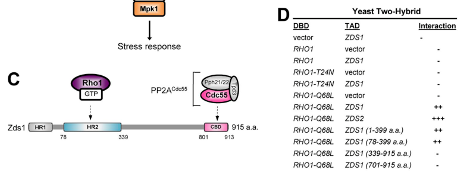

## Question

# Gene Research for Functional Annotation

## ⚠️ CRITICAL: Gene/Protein Identification Context

**BEFORE YOU BEGIN RESEARCH:** You MUST verify you are researching the CORRECT gene/protein. Gene symbols can be ambiguous, especially for less well-characterized genes from non-model organisms.

### Target Gene/Protein Identity (from UniProt):
- **UniProt Accession:** P54786
- **Protein Description:** RecName: Full=Protein ZDS2;
- **Gene Information:** Name=ZDS2; Synonyms=MCS1; OrderedLocusNames=YML109W; ORFNames=YM8339.10;
- **Organism (full):** Saccharomyces cerevisiae (strain ATCC 204508 / S288c) (Baker's yeast).
- **Protein Family:** To yeast ZDS1/NRC1/CES1. .
- **Key Domains:** Zds1/2. (IPR040206); ZDS1_C. (IPR013941); Zds_C (PF08632)

### MANDATORY VERIFICATION STEPS:

1. **Check if the gene symbol "ZDS2" matches the protein description above**
2. **Verify the organism is correct:** Saccharomyces cerevisiae (strain ATCC 204508 / S288c) (Baker's yeast).
3. **Check if protein family/domains align with what you find in literature**
4. **If you find literature for a DIFFERENT gene with the same or similar symbol, STOP**

### If Gene Symbol is Ambiguous or You Cannot Find Relevant Literature:

**DO NOT PROCEED WITH RESEARCH ON A DIFFERENT GENE.** Instead:
- State clearly: "The gene symbol 'ZDS2' is ambiguous or literature is limited for this specific protein"
- Explain what you found (e.g., "Found extensive literature on a different gene with the same symbol in a different organism")
- Describe the protein based ONLY on the UniProt information provided above
- Suggest that the protein function can be inferred from domain/family information

### Research Target:

Please provide a comprehensive research report on the gene **ZDS2** (gene ID: ZDS2, UniProt: P54786) in yeast.

The research report should be a detailed narrative explaining the function, biological processes, and localization of the gene product. Citations should be given for all claims.

You should prioritize authoritative reviews and primary scientific literature when conducting research. You can supplement
this with annotations you find in gene/protein databases, but these can be outdated or inaccurate.

We are specifically interested in the primary function of the gene - for enzymes, what reaction is catalyzed, and what is the substrate specificity? For transporters, what is the substrate? For structural proteins or adapters, what is the broader structural role? For signaling molecules, what is the role in the pathway.

We are interested in where in or outside the cell the gene product carries out its function.

We are also interested in the signaling or biochemical pathways in which the gene functions. We are less interested in broad pleiotropic effects, except where these elucidate the precise role.

Include evidence where possible. We are interested in both experimental evidence as well as inference from structure, evolution, or bioinformatic analysis. Precise studies should be prioritized over high-throughput, where available.

## Output

Question: You are an expert researcher providing comprehensive, well-cited information.

Provide detailed information focusing on:
1. Key concepts and definitions with current understanding
2. Recent developments and latest research (prioritize 2023-2024 sources)
3. Current applications and real-world implementations
4. Expert opinions and analysis from authoritative sources
5. Relevant statistics and data from recent studies

Format as a comprehensive research report with proper citations. Include URLs and publication dates where available.
Always prioritize recent, authoritative sources and provide specific citations for all major claims.

# Gene Research for Functional Annotation

## ⚠️ CRITICAL: Gene/Protein Identification Context

**BEFORE YOU BEGIN RESEARCH:** You MUST verify you are researching the CORRECT gene/protein. Gene symbols can be ambiguous, especially for less well-characterized genes from non-model organisms.

### Target Gene/Protein Identity (from UniProt):
- **UniProt Accession:** P54786
- **Protein Description:** RecName: Full=Protein ZDS2;
- **Gene Information:** Name=ZDS2; Synonyms=MCS1; OrderedLocusNames=YML109W; ORFNames=YM8339.10;
- **Organism (full):** Saccharomyces cerevisiae (strain ATCC 204508 / S288c) (Baker's yeast).
- **Protein Family:** To yeast ZDS1/NRC1/CES1. .
- **Key Domains:** Zds1/2. (IPR040206); ZDS1_C. (IPR013941); Zds_C (PF08632)

### MANDATORY VERIFICATION STEPS:

1. **Check if the gene symbol "ZDS2" matches the protein description above**
2. **Verify the organism is correct:** Saccharomyces cerevisiae (strain ATCC 204508 / S288c) (Baker's yeast).
3. **Check if protein family/domains align with what you find in literature**
4. **If you find literature for a DIFFERENT gene with the same or similar symbol, STOP**

### If Gene Symbol is Ambiguous or You Cannot Find Relevant Literature:

**DO NOT PROCEED WITH RESEARCH ON A DIFFERENT GENE.** Instead:
- State clearly: "The gene symbol 'ZDS2' is ambiguous or literature is limited for this specific protein"
- Explain what you found (e.g., "Found extensive literature on a different gene with the same symbol in a different organism")
- Describe the protein based ONLY on the UniProt information provided above
- Suggest that the protein function can be inferred from domain/family information

### Research Target:

Please provide a comprehensive research report on the gene **ZDS2** (gene ID: ZDS2, UniProt: P54786) in yeast.

The research report should be a detailed narrative explaining the function, biological processes, and localization of the gene product. Citations should be given for all claims.

You should prioritize authoritative reviews and primary scientific literature when conducting research. You can supplement
this with annotations you find in gene/protein databases, but these can be outdated or inaccurate.

We are specifically interested in the primary function of the gene - for enzymes, what reaction is catalyzed, and what is the substrate specificity? For transporters, what is the substrate? For structural proteins or adapters, what is the broader structural role? For signaling molecules, what is the role in the pathway.

We are interested in where in or outside the cell the gene product carries out its function.

We are also interested in the signaling or biochemical pathways in which the gene functions. We are less interested in broad pleiotropic effects, except where these elucidate the precise role.

Include evidence where possible. We are interested in both experimental evidence as well as inference from structure, evolution, or bioinformatic analysis. Precise studies should be prioritized over high-throughput, where available.

# Functional research report: yeast ZDS2 (YML109W; UniProt P54786)

## Identity and central annotation

**The target is the budding-yeast Zds2 protein, not a similarly named protein from another organism.** The supplied UniProt record identifies **P54786** as ZDS2, also called **MCS1**, in *Saccharomyces cerevisiae* S288c. Independently, a yeast genetic study identifies open reading frame **YML109W** as **ZDS2** and distinguishes it from the related **ZDS1** gene. The retrieved primary papers do not independently establish the P54786 accession or MCS1 synonym, so those two identifiers remain attributed to the supplied UniProt information. (heo1999thebuddingyeast pages 2-3)

**Best-supported molecular function:** Zds2 is a **non-catalytic, spatial and signaling regulator of protein phosphatase 2A containing the Cdc55 regulatory subunit (PP2A–Cdc55)**. It associates with Cdc55, helps position the phosphatase at sites of polarized growth, and—together with its paralogue Zds1—coordinates mitotic entry, early-anaphase Cdc14 activation, and the choice between cell-wall growth and stress signaling. There is **no established enzymatic reaction or substrate specificity for Zds2 itself**: phosphate removal is performed by the PP2A catalytic subunit, not by Zds2. (rossio2011spatialregulationof pages 1-2, queralt2008separasecooperateswith pages 1-2, jonasson2016zds1zds2–pp2acdc55complexspecifies pages 2-3, jonasson2016zds1zds2–pp2acdc55complexspecifies pages 1-2)

The supplied InterPro/Pfam assignments (**Zds1/2, IPR040206; ZDS1_C, IPR013941; Zds_C, PF08632**) agree with the literature’s conserved C-terminal Cdc55-binding region. Zds1 and Zds2 share approximately **37.5% sequence identity**, with prominent conservation toward that region. Zds2 co-immunoprecipitates with Cdc55 and the PP2A scaffold Tpd3; a separately reported *in-vitro* experiment found that its conserved C terminus binds Cdc55. Precise residue boundaries established for **Zds1** must not be assigned to Zds2 without a Zds2-specific sequence analysis. The 2016 study’s domain diagram and binding assays provide visual corroboration of the family/domain organization. (calabria2012zds1regulatespp2acdc55 pages 1-2, queralt2008separasecooperateswith pages 3-4, calabria2012zds1regulatespp2acdc55 pages 8-9, jonasson2016zds1zds2–pp2acdc55complexspecifies media 2d368676)

The following evidence matrix distinguishes observations on Zds2 itself from findings established mainly by combined **zds1Δ zds2Δ** mutants or Zds1-specific experiments. (rossio2011spatialregulationof pages 2-4, queralt2008separasecooperateswith pages 3-4, jonasson2016zds1zds2–pp2acdc55complexspecifies pages 2-3)

| Functional axis | Zds2-specific direct evidence | Shared Zds1/Zds2 or primarily Zds1 evidence | Interpretation / limitation | Key primary source (year) |
|---|---|---|---|---|
| Identity and domain | In *S. cerevisiae*, ORF **YML109W** was cloned as **ZDS2**; Zds2 co-immunoprecipitates with Cdc55 and Tpd3, and its conserved C-terminal region binds Cdc55 directly *in vitro*. (heo1999thebuddingyeast pages 2-3, queralt2008separasecooperateswith pages 3-4, calabria2012zds1regulatespp2acdc55 pages 8-9) | Zds1 and Zds2 are paralogues with **37.5% sequence identity** and strongest conservation toward the C terminus; detailed Zds_C functional mapping was performed mainly on Zds1. (calabria2012zds1regulatespp2acdc55 pages 1-2, queralt2008separasecooperateswith pages 3-4) | Confirms the target as budding-yeast ZDS2/YML109W and supports classification as a non-catalytic Cdc55-binding PP2A regulator. P54786 and MCS1 are curated UniProt identifiers supplied in the query; Zds1 residue coordinates should not be transferred to Zds2. | [Heo et al.](https://doi.org/10.1007/s002940050507) (1999); [Queralt & Uhlmann](https://doi.org/10.1083/jcb.200801054) (2008) |
| Localization and mitotic entry | Endogenous Zds2–GFP localizes to the **bud cortex** in small/medium-budded cells and the **bud neck** late in mitosis; it is cytoplasmic and largely excluded from the nucleus. (rossio2011spatialregulationof pages 2-4) | Double loss of ZDS1/ZDS2 drives Cdc55 into the nucleus, elevates inhibitory Cdc28-Y19 phosphorylation, and delays mitotic entry; cytoplasm-targeted Cdc55-NES and SWE1 deletion rescue these defects. (rossio2011spatialregulationof pages 4-6, rossio2011spatialregulationof pages 6-8) | Best-supported primary role is spatial organization of PP2A–Cdc55. Mih1 is a PP2A–Cdc55 substrate, but direct Zds2-mediated dephosphorylation of Mih1 or Swe1 has not been demonstrated. (yasutis2013cellcyclecheckpoint pages 4-5) | [Rossio & Yoshida](https://doi.org/10.1083/jcb.201101134) (2011) |
| Early-anaphase FEAR/Cdc14 | Zds2 associates with PP2A–Cdc55 throughout mitosis; ectopic Zds2 expression promotes nucleolar Cdc14 release, although less rapidly than Zds1. A zds2Δ single mutant releases Cdc14 at a spindle length of **~3 µm**, near wild type. (queralt2008separasecooperateswith pages 3-4) | Cdc14 half-release shifts to **~4–5 µm** in zds1Δ and generally **~6–7 µm or longer** in zds1Δ zds2Δ cells. Zds1 induction lowers immunopurified PP2A–Cdc55 activity to about half and enables Net1 phosphorylation. (queralt2008separasecooperateswith pages 3-4, queralt2008separasecooperateswith pages 7-8) | Zds2 is a weaker, partially redundant contributor than Zds1 in this assay. Evidence supports regulatory down-modulation or spatial control of PP2A–Cdc55—not catalytic activity by Zds2. | [Queralt & Uhlmann](https://doi.org/10.1083/jcb.200801054) (2008); [Calabria et al.](https://doi.org/10.1242/jcs.097865) (2012) |
| Rho1 and cell-wall output | Two-hybrid assays showed that Zds2 preferentially interacts with GTP-locked Rho1-Q68L rather than wild-type or nucleotide-free Rho1. (jonasson2016zds1zds2–pp2acdc55complexspecifies pages 2-3, jonasson2016zds1zds2–pp2acdc55complexspecifies media 2d368676) | Zds1/Zds2 bridge Rho1-GTP to cortical PP2A–Cdc55. Double deletion reduces β-1,3-glucan synthesis; complex-level evidence indicates inhibition of Lrg1 GAP activity and stabilization of Sac7, thereby favoring glucan synthesis over Pkc1–Mpk1 stress signaling. (jonasson2016zds1zds2–pp2acdc55complexspecifies pages 5-6, jonasson2016zds1zds2–pp2acdc55complexspecifies pages 1-2) | Direct pull-down and domain mapping were chiefly performed with Zds1, and purified Zds1–Rho1 direct binding was not recovered. No direct Zds2-dependent dephosphorylation of Lrg1 or Sac7 was shown. (jonasson2016zds1zds2–pp2acdc55complexspecifies pages 2-3, jonasson2016zds1zds2–pp2acdc55complexspecifies pages 5-6) | [Jonasson et al.](https://doi.org/10.1083/jcb.201508119) (2016) |
| Phosphorylation and substrate caveats | No evidence establishes Zds2 as an enzyme or as the kinase that phosphorylates Cdc55. | Cdk1–Clb2 directly phosphorylates a Cdc55 fragment at T174; T174 and S301 non-phosphorylatable mutants delay Cdc14 release by about **10 min**. Cdc55 phosphorylation is reduced in zds1Δ zds2Δ cells, but rescue experiments examined functional Zds1 constructs. (jativa2019cdc14activationrequires pages 1-2, jativa2019cdc14activationrequires pages 8-9, jativa2019cdc14activationrequires pages 11-12) | Zds proteins facilitate Cdc55 regulation, but **Cdk1–Clb2**, not Zds2, is the demonstrated kinase. Separase and Zds proteins act upstream; neither direct phosphorylation of Cdc55 by separase nor a Zds2-specific substrate reaction was shown. | [Játiva et al.](https://doi.org/10.1007/s00018-019-03086-5) (2019) |

*Table: Evidence matrix separating observations made directly for Zds2 from findings established for the redundant Zds1/Zds2 system or mainly for Zds1. It highlights the strongest mechanistic conclusions and prevents unsupported attribution of catalytic or phosphorylation activity to Zds2.*

## Site of action and mitotic-entry pathway

**Localization is experimentally established for Zds2.** An endogenously expressed Zds2–GFP fusion appeared at the **bud cortex** in small- to medium-budded cells and at the **bud neck** in late mitosis; diffuse protein was also observed in the **cytoplasm**. In this imaging study Zds2, unlike a fraction of Cdc55, was largely **excluded from the nucleus**. The plausible principal sites of Zds2 action are therefore the cytoplasm and polarized cell cortex, rather than an exclusively nucleolar compartment. (rossio2011spatialregulationof pages 2-4)

Zds1 and Zds2 support **cytoplasmic and cortical localization of Cdc55–PP2A**. Deleting both proteins eliminates much cortical/bud-neck Cdc55 and increases its nuclear accumulation. This matters for mitotic entry: in double-deletion cells inhibitory phosphorylation of **Cdc28/Cdk1 at Tyr19** rises, G2 progression is delayed, and buds elongate. **Swe1** supplies the inhibitory phosphorylation, whereas **Mih1/Cdc25** removes it. Deleting SWE1 or experimentally forcing Cdc55 into the cytoplasm with a nuclear-export signal markedly rescues the cell-shape and Cdc28-phosphorylation defects. These are localization and genetic-bypass experiments, not proof that Zds2 directly modifies Swe1. (rossio2011spatialregulationof pages 2-4, rossio2011spatialregulationof pages 4-6, rossio2011spatialregulationof pages 6-8)

Mih1 dephosphorylation depends on PP2A–Cdc55 and the Zds proteins *in vivo*, supporting a role for this complex in the mitotic-entry circuit. The precise contribution of Zds2 to Mih1 substrate recognition versus Cdc55 positioning has not been isolated conclusively; likewise, **direct Zds2-mediated dephosphorylation or degradation of Swe1 has not been demonstrated**. Zds2-specific work connects its Cdc55-interaction region to Swe1-dependent polarized growth, but many mechanistic readouts in later publications concern the two paralogues jointly. (yasutis2013cellcyclecheckpoint pages 4-5, rossio2011spatialregulationof pages 10-10, rossio2011spatialregulationof pages 4-6)

## Early anaphase: PP2A–Cdc55, Net1 and Cdc14

At anaphase onset, **Cdc14** must escape inhibitory sequestration by **Net1/Cfi1 in the nucleolus**. PP2A–Cdc55 opposes Net1 phosphorylation; separase-dependent reduction of that opposing activity permits Cdk-dependent Net1 phosphorylation and **early-anaphase Cdc14 release**, a component of the FEAR regulatory network. Zds1 and Zds2 associate with PP2A–Cdc55 throughout mitosis and contribute to this transition. Ectopically expressing **either** Zds protein promotes Cdc14 release in metaphase-arrested cells, although Zds1 acts more rapidly in that experiment. (queralt2008separasecooperateswith pages 1-2, queralt2008separasecooperateswith pages 3-4)

The **relative contributions are measurable**: half-maximal Cdc14 release occurred at an anaphase-spindle length of approximately **3 µm** in wild-type and **zds2Δ** cells, **4–5 µm** in **zds1Δ** cells, and generally **6–7 µm or longer** in the **zds1Δ zds2Δ** double mutant. Thus Zds2’s role is supported by physical association, gain-of-function and double-mutant evidence, but its single-deletion phenotype was weaker than Zds1’s under these assay conditions. Ectopic **Zds1**, specifically, reduced measured activity of isolated PP2A–Cdc55 to about **half** its starting value; that quantitative result should **not** be attributed to a direct Zds2 activity assay. (queralt2008separasecooperateswith pages 3-4, queralt2008separasecooperateswith pages 7-8)

Two mechanistic models require careful reconciliation. A 2011 study found that Zds proteins keep much Cdc55 outside the nucleus: forcing Cdc55 into the cytoplasm rescued the double mutant’s Cdc14-release defect, whereas forcing it into the nucleus impaired release. A 2012 study, using chromosome spreads and proximity ligation, instead detected a **nucleolar Zds1-associated pool** and found that Zds1’s C-terminal motif was needed for nucleolar Cdc55 enrichment. Crucially, the motif alone restored that enrichment **without** restoring timely Cdc14 release, showing that localization alone does not explain all PP2A regulation. These observations can reflect different phosphatase pools, assays or cell-cycle contexts; they do **not** establish nucleolar localization of Zds2 itself. (rossio2011spatialregulationof pages 4-6, rossio2011spatialregulationof pages 6-8, calabria2012zds1regulatespp2acdc55 pages 7-8, calabria2012zds1regulatespp2acdc55 pages 8-9)

A subsequent phosphorylation study provides an additional mechanism: **Cdk1–Clb2 phosphorylates Cdc55**, with direct *in-vitro* evidence for a fragment containing **T174**; mutations affecting **T174 or S301** delayed Cdc14 release by approximately **10 minutes**. Cdc55 phosphorylation was reduced in cells lacking both Zds proteins, but the domain-rescue experiments tested Zds1, not an isolated Zds2-dependent reaction. Neither **Zds2 nor separase** should be described as the demonstrated Cdc55 kinase. (jativa2019cdc14activationrequires pages 1-2, jativa2019cdc14activationrequires pages 8-9, jativa2019cdc14activationrequires pages 11-12)

## Rho1 signaling and cell-wall growth

The Zds proteins also link the phosphatase to **Rho1-dependent polarized growth at the bud cortex**. Yeast two-hybrid experiments detected interaction of **both Zds1 and Zds2** with GTP-locked **Rho1-Q68L**, rather than wild-type or nucleotide-free Rho1. In pull-down experiments Cdc55 association with activated Rho1 required Zds1/Zds2. A separate Zds1 pull-down and domain map strengthened the complex-level interpretation, but purified Zds1 and a Rho1-binding fragment did **not** yield a confirmed direct interaction; the two-hybrid result alone therefore does not prove direct, purified-protein binding of Zds2 to Rho1. (jonasson2016zds1zds2–pp2acdc55complexspecifies pages 2-3, jonasson2016zds1zds2–pp2acdc55complexspecifies media 2d368676)

Functionally, the cortical **Zds1/Zds2–PP2A–Cdc55** system favors **β-1,3-glucan synthesis** over the **Pkc1–Mpk1 cell-wall-integrity stress response**. Combined ZDS1/ZDS2 deletion impaired glucan production, particularly under **0.1% glucose** conditions. The phosphatase system restrains activity of the Rho1 GAP **Lrg1**—deleting *LRG1* largely rescued the glucan defect of **cdc55Δ**—and supports the stability of a different Rho1 GAP, **Sac7**, which restrains the Pkc1 branch. Upon cell-wall damage, cortical Zds1/Cdc55 declines while Pkc1 accumulates. **Direct PP2A dephosphorylation of either Lrg1 or Sac7 and Zds2’s individual quantitative contribution remain unestablished**. This mechanism is a research model of yeast growth-versus-stress signaling, not a demonstrated application of Zds2 as a drug target. (jonasson2016zds1zds2–pp2acdc55complexspecifies pages 2-3, jonasson2016zds1zds2–pp2acdc55complexspecifies pages 5-6, jonasson2016zds1zds2–pp2acdc55complexspecifies pages 1-2)

## Current interpretation, uses and recent literature

**Practical research use.** ZDS2 deletion or overexpression, especially alongside **ZDS1** manipulation, provides a yeast experimental system for testing PP2A–Cdc55 localization, the Swe1-dependent G2/M delay, early-anaphase Cdc14 release, and Rho1-dependent glucan production. For instance, a 1999 multicopy-suppressor screen recovered **YML109W/ZDS2** in a cohesin-mutant background; suppression establishes a **genetic interaction**, not direct cohesin catalysis or a primary chromosome-cohesion function for Zds2. These are laboratory implementations rather than established industrial or clinical uses. (heo1999thebuddingyeast pages 2-3, rossio2011spatialregulationof pages 4-6, queralt2008separasecooperateswith pages 3-4, jonasson2016zds1zds2–pp2acdc55complexspecifies pages 2-3)

**2023–2024 perspective.** A **2023 EMBO Journal review** places yeast Cdc14 and PP2A–Cdc55 in a broader, temporally coordinated mitotic-exit phosphatase network. A **2024 review** continues to place Zds1/Zds2 in the yeast FEAR–PP2A–Net1–Cdc14 pathway. These are valuable contemporary syntheses, **not new Zds2-specific binding or catalytic experiments**. The 2024 review’s condensed description of Cdc55 phosphorylation should be read alongside the primary kinase experiment, which identifies **Cdk1–Clb2**, rather than attributing phosphorylation directly to separase or Zds2. Across the retrieved research, the most precise Zds2-specific mechanism remains binding/positioning of Cdc55–PP2A, with several downstream effects resolved only at the paralogue-pair or Zds1 level. (partscht2023thedivergingrole pages 4-5, alonsoramos2024decodingthenucleolar pages 19-21, jativa2019cdc14activationrequires pages 1-2, jonasson2016zds1zds2–pp2acdc55complexspecifies pages 2-3)

### Selected dated sources and URLs

- Heo, Tatebayashi & Ikeda, **December 1999**, *Current Genetics*: [ZDS2/YML109W genetic identification](https://doi.org/10.1007/s002940050507). (heo1999thebuddingyeast pages 2-3)
- Queralt & Uhlmann, **1 September 2008**, *Journal of Cell Biology*: [Zds1/Zds2, PP2A–Cdc55 and early-anaphase Cdc14 release](https://doi.org/10.1083/jcb.200801054). (queralt2008separasecooperateswith pages 1-2, queralt2008separasecooperateswith pages 3-4)
- Rossio & Yoshida, **May 2011**, *Journal of Cell Biology*: [spatial regulation of Cdc55 during mitotic entry and exit](https://doi.org/10.1083/jcb.201101134). (rossio2011spatialregulationof pages 1-2, rossio2011spatialregulationof pages 4-6)
- Calabria *et al.*, **June 2012**, *Journal of Cell Science*: [Zds1 Zds_C domain and the limits of localization-only regulation](https://doi.org/10.1242/jcs.097865). (calabria2012zds1regulatespp2acdc55 pages 5-7, calabria2012zds1regulatespp2acdc55 pages 8-9)
- Jonasson *et al.*, **4 January 2016**, *Journal of Cell Biology*: [Rho1–Zds1/Zds2–PP2A signaling](https://doi.org/10.1083/jcb.201508119). (jonasson2016zds1zds2–pp2acdc55complexspecifies pages 2-3, jonasson2016zds1zds2–pp2acdc55complexspecifies pages 1-2)
- Játiva *et al.*, **2019**, *Cellular and Molecular Life Sciences*: [Cdk1-dependent Cdc55 phosphorylation](https://doi.org/10.1007/s00018-019-03086-5). (jativa2019cdc14activationrequires pages 1-2, jativa2019cdc14activationrequires pages 11-12)
- Partscht & Schiebel, **2023**, *EMBO Journal*, [mitotic-phosphatase review](https://doi.org/10.15252/embj.2023114364); Alonso-Ramos & Carballo, **November 2024**, *International Journal of Molecular Sciences*, [Cdc14/FEAR review](https://doi.org/10.3390/ijms252312861). (partscht2023thedivergingrole pages 4-5, alonsoramos2024decodingthenucleolar pages 19-21)

References

1. (heo1999thebuddingyeast pages 2-3): Seok-Jin Heo, Kazuo Tatebayashi, and Hideo Ikeda. The budding yeast cohesin gene scc1 / mcd1 / rhc21 genetically interacts with pka, cdk and apc. Current Genetics, 36:329-338, Dec 1999. URL: https://doi.org/10.1007/s002940050507, doi:10.1007/s002940050507. This article has 26 citations and is from a peer-reviewed journal.

2. (rossio2011spatialregulationof pages 1-2): Valentina Rossio and Satoshi Yoshida. Spatial regulation of cdc55–pp2a by zds1/zds2 controls mitotic entry and mitotic exit in budding yeast. The Journal of Cell Biology, 193:445-454, May 2011. URL: https://doi.org/10.1083/jcb.201101134, doi:10.1083/jcb.201101134. This article has 76 citations.

3. (queralt2008separasecooperateswith pages 1-2): Ethel Queralt and Frank Uhlmann. Separase cooperates with zds1 and zds2 to activate cdc14 phosphatase in early anaphase. The Journal of Cell Biology, 182:873-883, Sep 2008. URL: https://doi.org/10.1083/jcb.200801054, doi:10.1083/jcb.200801054. This article has 88 citations.

4. (jonasson2016zds1zds2–pp2acdc55complexspecifies pages 2-3): Erin M. Jonasson, Valentina Rossio, Riko Hatakeyama, Mitsuhiro Abe, Yoshikazu Ohya, and Satoshi Yoshida. Zds1/zds2–pp2acdc55 complex specifies signaling output from rho1 gtpase. The Journal of Cell Biology, 212:51-61, Jan 2016. URL: https://doi.org/10.1083/jcb.201508119, doi:10.1083/jcb.201508119. This article has 23 citations.

5. (jonasson2016zds1zds2–pp2acdc55complexspecifies pages 1-2): Erin M. Jonasson, Valentina Rossio, Riko Hatakeyama, Mitsuhiro Abe, Yoshikazu Ohya, and Satoshi Yoshida. Zds1/zds2–pp2acdc55 complex specifies signaling output from rho1 gtpase. The Journal of Cell Biology, 212:51-61, Jan 2016. URL: https://doi.org/10.1083/jcb.201508119, doi:10.1083/jcb.201508119. This article has 23 citations.

6. (calabria2012zds1regulatespp2acdc55 pages 1-2): Ines Calabria, Barbara Baro, Jose-Antonio Rodriguez-Rodriguez, Nuria Russiñol, and Ethel Queralt. Zds1 regulates pp2acdc55 activity and cdc14 activation during mitotic exit through its zds_c motif. Journal of Cell Science, 125:2875-2884, Jun 2012. URL: https://doi.org/10.1242/jcs.097865, doi:10.1242/jcs.097865. This article has 26 citations and is from a domain leading peer-reviewed journal.

7. (queralt2008separasecooperateswith pages 3-4): Ethel Queralt and Frank Uhlmann. Separase cooperates with zds1 and zds2 to activate cdc14 phosphatase in early anaphase. The Journal of Cell Biology, 182:873-883, Sep 2008. URL: https://doi.org/10.1083/jcb.200801054, doi:10.1083/jcb.200801054. This article has 88 citations.

8. (calabria2012zds1regulatespp2acdc55 pages 8-9): Ines Calabria, Barbara Baro, Jose-Antonio Rodriguez-Rodriguez, Nuria Russiñol, and Ethel Queralt. Zds1 regulates pp2acdc55 activity and cdc14 activation during mitotic exit through its zds_c motif. Journal of Cell Science, 125:2875-2884, Jun 2012. URL: https://doi.org/10.1242/jcs.097865, doi:10.1242/jcs.097865. This article has 26 citations and is from a domain leading peer-reviewed journal.

9. (jonasson2016zds1zds2–pp2acdc55complexspecifies media 2d368676): Erin M. Jonasson, Valentina Rossio, Riko Hatakeyama, Mitsuhiro Abe, Yoshikazu Ohya, and Satoshi Yoshida. Zds1/zds2–pp2acdc55 complex specifies signaling output from rho1 gtpase. The Journal of Cell Biology, 212:51-61, Jan 2016. URL: https://doi.org/10.1083/jcb.201508119, doi:10.1083/jcb.201508119. This article has 23 citations.

10. (rossio2011spatialregulationof pages 2-4): Valentina Rossio and Satoshi Yoshida. Spatial regulation of cdc55–pp2a by zds1/zds2 controls mitotic entry and mitotic exit in budding yeast. The Journal of Cell Biology, 193:445-454, May 2011. URL: https://doi.org/10.1083/jcb.201101134, doi:10.1083/jcb.201101134. This article has 76 citations.

11. (rossio2011spatialregulationof pages 4-6): Valentina Rossio and Satoshi Yoshida. Spatial regulation of cdc55–pp2a by zds1/zds2 controls mitotic entry and mitotic exit in budding yeast. The Journal of Cell Biology, 193:445-454, May 2011. URL: https://doi.org/10.1083/jcb.201101134, doi:10.1083/jcb.201101134. This article has 76 citations.

12. (rossio2011spatialregulationof pages 6-8): Valentina Rossio and Satoshi Yoshida. Spatial regulation of cdc55–pp2a by zds1/zds2 controls mitotic entry and mitotic exit in budding yeast. The Journal of Cell Biology, 193:445-454, May 2011. URL: https://doi.org/10.1083/jcb.201101134, doi:10.1083/jcb.201101134. This article has 76 citations.

13. (yasutis2013cellcyclecheckpoint pages 4-5): Kimberly Yasutis and Keith Kozminski. Cell cycle checkpoint regulators reach a zillion. Cell Cycle, 12:1501-1509, May 2013. URL: https://doi.org/10.4161/cc.24637, doi:10.4161/cc.24637. This article has 83 citations and is from a peer-reviewed journal.

14. (queralt2008separasecooperateswith pages 7-8): Ethel Queralt and Frank Uhlmann. Separase cooperates with zds1 and zds2 to activate cdc14 phosphatase in early anaphase. The Journal of Cell Biology, 182:873-883, Sep 2008. URL: https://doi.org/10.1083/jcb.200801054, doi:10.1083/jcb.200801054. This article has 88 citations.

15. (jonasson2016zds1zds2–pp2acdc55complexspecifies pages 5-6): Erin M. Jonasson, Valentina Rossio, Riko Hatakeyama, Mitsuhiro Abe, Yoshikazu Ohya, and Satoshi Yoshida. Zds1/zds2–pp2acdc55 complex specifies signaling output from rho1 gtpase. The Journal of Cell Biology, 212:51-61, Jan 2016. URL: https://doi.org/10.1083/jcb.201508119, doi:10.1083/jcb.201508119. This article has 23 citations.

16. (jativa2019cdc14activationrequires pages 1-2): Soraya Játiva, Ines Calabria, Yolanda Moyano-Rodriguez, Patricia Garcia, and Ethel Queralt. Cdc14 activation requires coordinated cdk1-dependent phosphorylation of net1 and pp2a–cdc55 at anaphase onset. Cellular and Molecular Life Sciences, 76:3601-3620, Mar 2019. URL: https://doi.org/10.1007/s00018-019-03086-5, doi:10.1007/s00018-019-03086-5. This article has 18 citations and is from a domain leading peer-reviewed journal.

17. (jativa2019cdc14activationrequires pages 8-9): Soraya Játiva, Ines Calabria, Yolanda Moyano-Rodriguez, Patricia Garcia, and Ethel Queralt. Cdc14 activation requires coordinated cdk1-dependent phosphorylation of net1 and pp2a–cdc55 at anaphase onset. Cellular and Molecular Life Sciences, 76:3601-3620, Mar 2019. URL: https://doi.org/10.1007/s00018-019-03086-5, doi:10.1007/s00018-019-03086-5. This article has 18 citations and is from a domain leading peer-reviewed journal.

18. (jativa2019cdc14activationrequires pages 11-12): Soraya Játiva, Ines Calabria, Yolanda Moyano-Rodriguez, Patricia Garcia, and Ethel Queralt. Cdc14 activation requires coordinated cdk1-dependent phosphorylation of net1 and pp2a–cdc55 at anaphase onset. Cellular and Molecular Life Sciences, 76:3601-3620, Mar 2019. URL: https://doi.org/10.1007/s00018-019-03086-5, doi:10.1007/s00018-019-03086-5. This article has 18 citations and is from a domain leading peer-reviewed journal.

19. (rossio2011spatialregulationof pages 10-10): Valentina Rossio and Satoshi Yoshida. Spatial regulation of cdc55–pp2a by zds1/zds2 controls mitotic entry and mitotic exit in budding yeast. The Journal of Cell Biology, 193:445-454, May 2011. URL: https://doi.org/10.1083/jcb.201101134, doi:10.1083/jcb.201101134. This article has 76 citations.

20. (calabria2012zds1regulatespp2acdc55 pages 7-8): Ines Calabria, Barbara Baro, Jose-Antonio Rodriguez-Rodriguez, Nuria Russiñol, and Ethel Queralt. Zds1 regulates pp2acdc55 activity and cdc14 activation during mitotic exit through its zds_c motif. Journal of Cell Science, 125:2875-2884, Jun 2012. URL: https://doi.org/10.1242/jcs.097865, doi:10.1242/jcs.097865. This article has 26 citations and is from a domain leading peer-reviewed journal.

21. (partscht2023thedivergingrole pages 4-5): Patrick Partscht and Elmar Schiebel. The diverging role of cdc14b: from mitotic exit in yeast to cell fate control in humans. The EMBO Journal, Jul 2023. URL: https://doi.org/10.15252/embj.2023114364, doi:10.15252/embj.2023114364. This article has 9 citations.

22. (alonsoramos2024decodingthenucleolar pages 19-21): Paula Alonso-Ramos and Jesús A. Carballo. Decoding the nucleolar role in meiotic recombination and cell cycle control: insights into cdc14 function. International Journal of Molecular Sciences, 25:12861, Nov 2024. URL: https://doi.org/10.3390/ijms252312861, doi:10.3390/ijms252312861. This article has 2 citations.

23. (calabria2012zds1regulatespp2acdc55 pages 5-7): Ines Calabria, Barbara Baro, Jose-Antonio Rodriguez-Rodriguez, Nuria Russiñol, and Ethel Queralt. Zds1 regulates pp2acdc55 activity and cdc14 activation during mitotic exit through its zds_c motif. Journal of Cell Science, 125:2875-2884, Jun 2012. URL: https://doi.org/10.1242/jcs.097865, doi:10.1242/jcs.097865. This article has 26 citations and is from a domain leading peer-reviewed journal.

## Artifacts

- [Edison artifact artifact-00](ZDS2-deep-research-falcon_artifacts/artifact-00.md)

## Citations

1. heo1999thebuddingyeast pages 2-3
2. rossio2011spatialregulationof pages 2-4
3. yasutis2013cellcyclecheckpoint pages 4-5
4. queralt2008separasecooperateswith pages 3-4
5. rossio2011spatialregulationof pages 1-2
6. queralt2008separasecooperateswith pages 1-2
7. rossio2011spatialregulationof pages 4-6
8. rossio2011spatialregulationof pages 6-8
9. queralt2008separasecooperateswith pages 7-8
10. rossio2011spatialregulationof pages 10-10
11. partscht2023thedivergingrole pages 4-5
12. alonsoramos2024decodingthenucleolar pages 19-21
13. Heo et al.
14. Queralt & Uhlmann
15. Rossio & Yoshida
16. Calabria et al.
17. Jonasson et al.
18. Játiva et al.
19. ZDS2/YML109W genetic identification
20. Zds1/Zds2, PP2A–Cdc55 and early-anaphase Cdc14 release
21. spatial regulation of Cdc55 during mitotic entry and exit
22. Zds1 Zds_C domain and the limits of localization-only regulation
23. Rho1–Zds1/Zds2–PP2A signaling
24. Cdk1-dependent Cdc55 phosphorylation
25. mitotic-phosphatase review
26. Cdc14/FEAR review
27. https://doi.org/10.1007/s002940050507
28. https://doi.org/10.1083/jcb.200801054
29. https://doi.org/10.1083/jcb.201101134
30. https://doi.org/10.1242/jcs.097865
31. https://doi.org/10.1083/jcb.201508119
32. https://doi.org/10.1007/s00018-019-03086-5
33. https://doi.org/10.15252/embj.2023114364
34. https://doi.org/10.3390/ijms252312861
35. https://doi.org/10.1007/s002940050507,
36. https://doi.org/10.1083/jcb.201101134,
37. https://doi.org/10.1083/jcb.200801054,
38. https://doi.org/10.1083/jcb.201508119,
39. https://doi.org/10.1242/jcs.097865,
40. https://doi.org/10.4161/cc.24637,
41. https://doi.org/10.1007/s00018-019-03086-5,
42. https://doi.org/10.15252/embj.2023114364,
43. https://doi.org/10.3390/ijms252312861,