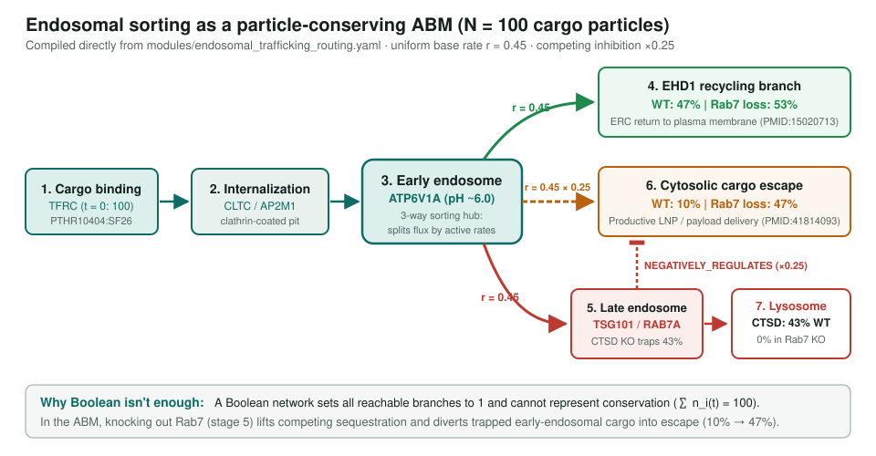
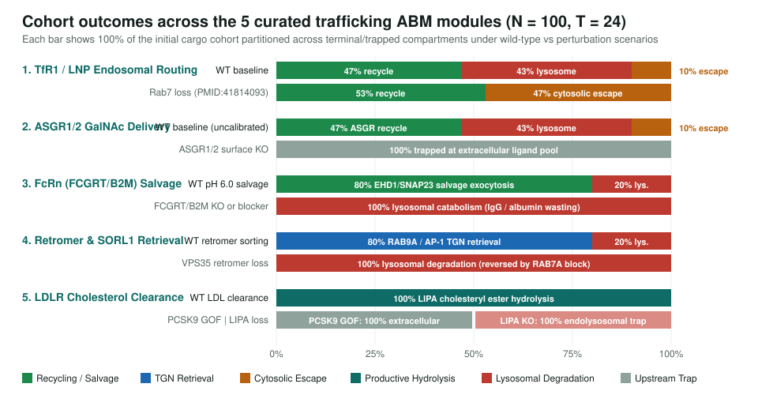

<!-- _class: lead -->

# Agent-Based Modeling of Intracellular Trafficking

Compiling curated pathway modules directly into particle-conserving cohort simulators (`model_type: AGENT_BASED`) for endosomal routing, receptor recycling, and payload delivery

AI Gene Review · projects/ABM_TRAFFICKING · Executable Models & Deliverome

---

<!-- _class: bluf -->

## Bottom line

- **Boolean networks (`ON`/`OFF`) cannot conserve cargo or split flux across competing branches.** Intracellular trafficking asks where a finite cohort of $N = 100$ cargo particles goes over time and where cargo accumulates when a transport or enzymatic step is blocked.
- **The module is the model (`derivation: DERIVED_FROM_MODULE`).** `module_to_abm()` compiles a `ModuleReview` YAML directly into a discrete-time, particle-conserving Agent-Based Model with no external rule files.
- **Five curated trafficking modules** (`endosomal_trafficking_routing`, `asgr_galnac_hepatocyte_delivery`, `fcrn_igg_albumin_salvage_transcytosis`, `retromer_endosome_to_tgn_retrieval`, `ldl_receptor_mediated_endocytosis`) and **27 perturbation scenarios** across **33 genes in 5 species** are regression-tested in CI.

---

## Why trafficking needs agents rather than Boolean states

| Biological phenomenon | Boolean network (`BOOLEAN`) | Agent-Based Trafficking (`AGENT_BASED`) |
|---|---|---|
| **Cargo conservation** | No conservation: all reachable branches can turn `ON` simultaneously | Strict particle conservation: $\sum_i n_i(t) = N_{\text{agents}}$ at every step $t$ |
| **Competing branch flux** (recycling vs. lysosome vs. cytosolic escape) | All reachable branches evaluate to `1` unless exclusive logic is hard-coded | Competing outflow transitions split the compartment pool proportionally to active rates |
| **Knockout of a dominant sink** (`Rab7` loss, PMID:41814093) | Sets `escrt_rab7_late_endosome = 0`; cannot quantify diverted flux | Relieves competitive sequestration ($0.25\times \to 1.0\times$), boosting cytosolic escape **$10\% \to 47\%$** |
| **Downstream enzymatic block** (`LIPA` in Wolman; `CTSD` in CLN10) | Sets terminal hydrolysis bit to `0`; upstream nodes stay `1` like wild type | Cargo physically accumulates in the upstream endolysosomal compartment |

projects/ABM_TRAFFICKING.md · projects/EXECUTABLE_MODELS.md · projects/BOOLEAN_MODELS.md

---

## How a module compiles into an Agent-Based Model

1. **Compartments & Pure Regulators (`ABMStage`)**
   - Leaf activities (`AtomicActivity`) and complexes (`ProteinComplex`) become stages.
   - Root flow stages receive $N = 100$ cargo particles at $t = 0$.
   - Regulatory-only nodes (`pcsk9_degradation`) compile with `is_flow_stage = False` and act as switches rather than cargo sinks.
2. **Flow Transitions (`ABMTransition`)**
   - `PROVIDES_INPUT_FOR`, `CAUSES`, and `HAS_INPUT` edges compile with uniform uncalibrated base rate $r_{\text{base}} = 0.45\text{ step}^{-1}$.

3. **Regulatory Coupling**
   - **Competing-pathway attenuation:** Active flow stage $A \dashv B$ scales transitions into $B$ by `0.25` (`COMPETING_INHIBITOR_FACTOR`); knocking out $A$ lifts inhibition.
   - **Pure regulator gating:** Active regulator $R \dashv T$ gates transitions into $T$ to `0`.
   - **Positive modulation:** Active $M \to T$ boosts inflow by `1.35×` (`POSITIVE_REGULATOR_BOOST`) and gates to `0` when inactive.
4. **Largest-Remainder Stepping**
   - Caps step outflow at $85\%$ and preserves exact integer counts ($\sum_i n_i(t) = 100$) in Python and browser JS.

src/ai_gene_review/module_abm.py · src/ai_gene_review/templates/executable_abm.html.j2

---

## Canonical endosomal routing & cytosolic cargo escape

`modules/endosomal_trafficking_routing.yaml` · `pages/models/endosomal_trafficking_abm.html` · PMID:41814093 (Rab7 LNP escape)

---

## Five curated trafficking ABM modules: cohort outcomes

Final cohort distributions ($N = 100, T = 24$) under uniform default rates (`r_base = 0.45`, inhibitor factor `0.25`)

---

## Therapeutic payload delivery & FcRn salvage

### ASGR1/ASGR2 GalNAc Delivery
- **Module:** `asgr_galnac_hepatocyte_delivery`
- Hepatocyte sinusoidal C-type lectin hetero-oligomer (`ASGR1`/`ASGR2`) internalizes trivalent GalNAc-siRNA/ASO via `CLTC`/`AP2M1`/`DNM2` (PMID:24970086).
- V-ATPase (`ATP6V1A`) acidification triggers $\text{Ca}^{2+}$-dependent GalNAc release; `EHD1` recycles receptors (**47%**), `TSG101`/`RAB7A`/`CTSD` route **43%** to lysosomes, and **10%** escapes to cytosol (`RAB7A` loss $\to$ **47%** in uncalibrated model; qualitative extrapolation from LNP delivery, PMID:29069408).

### FcRn IgG & Albumin Salvage
- **Module:** `fcrn_igg_albumin_salvage_transcytosis`
- Endothelial/epithelial `FCGRT`/`B2M` (FcRn) binds protonated histidine residues on IgG and `ALB` only in acidified early endosomes (pH ~6.0, PMID:28330995, PMID:36979511).
- Active FcRn capture inhibits `RAB7A` degradative routing, rescuing **80%** of cargo via `EHD1`/`SNAP23` exocytosis vs. **20%** `CTSD` catabolism.
- Blocking FcRn (`FCGRT`/`B2M` loss or efgartigimod) diverts **100%** of IgG/albumin to lysosomal catabolism.

pages/models/asgr_galnac_delivery_abm.html · pages/models/fcrn_salvage_transcytosis_abm.html · projects/DELIVEROME.md

---

## Retrograde retrieval & dual-model demonstration

### Retromer & SORL1 TGN Retrieval
- **Module:** `retromer_endosome_to_tgn_retrieval`
- Heterotrimeric retromer CSC (`VPS35`/`VPS26A`/`VPS29`) binds the cytoplasmic tail of `SORL1` (SorLA) and opposes `RAB7A` degradative maturation (PMID:15078902, PMID:32286230).
- Delivers **80%** of internalized receptors to the TGN via `RAB9A` and `AP-1` (`AP1B1`/`AP1G1`) vs. **20%** lysosomal proteolysis.
- `VPS35` loss routes **100%** to lysosomes; `RAB7A` reduction restores **100%** TGN retrieval.

### LDLR Dual-Model (`BOOLEAN` + `AGENT_BASED`)
- **Module:** `ldl_receptor_mediated_endocytosis`
- Exact same 4-stage module compiles into both `ldlr_endocytosis_boolean` and `ldlr_endocytosis_abm`.
- **Wild type:** **100%** of `apob_ligand` reaches `lipa_ce_hydrolysis`.
- **PCSK9 GoF / LDLR loss (FH):** Pure-regulator gating or receptor loss traps **100%** in extracellular `apob_ligand`.
- **LIPA loss (Wolman / CESD):** Internalizes normally (`apob_ligand = 0%`) but traps **100%** in endolysosomal `ldlr_endocytosis`.

pages/models/retromer_retrograde_sorting_abm.html · pages/models/ldlr_endocytosis_abm.html

---

## Scenario validation in CI & cross-species coverage

- **Automated CI verification (`just validate-modules`):** Every `AGENT_BASED` scenario in `src/ai_gene_review/validation/module_validator.py` is simulated and checked against:
  - `expected_active` & `expected_inactive`: stages that must be visited (`peak_counts > 0`) or remain unvisited/disabled (`peak_counts == 0`).
  - `expected_outcome_order`: strict descending order of final particle counts at $T = 24$ (e.g., `ehd1_recycling_branch > ctsd_lysosomal_degradation > cytosolic_cargo_escape` in WT vs. `ehd1_recycling_branch > cytosolic_cargo_escape > ctsd_lysosomal_degradation` in `Rab7` loss).
- **33 curated gene reviews across 5 species** anchoring PANTHER family specificity:
  - **Human (26):** `TFRC`, `CLTC`, `AP2M1`, `DNM2`, `ATP6V1A`, `EHD1`, `TSG101`, `RAB7A`, `CTSD`, `APOB`, `LDLR`, `PCSK9`, `LIPA`, `ASGR1`, `ASGR2`, `ALB`, `FCGRT`, `B2M`, `SNAP23`, `SORL1`, `VPS35`, `VPS26A`, `VPS29`, `RAB9A`, `AP1B1`, `AP1G1`
  - **Model organisms (7):** mouse `Rab7`, *Drosophila* `Vps35`/`Vps26`/`Vps29`, *S. pombe* `apl2`, *C. elegans* `apb-1`/`dpy-23`

src/ai_gene_review/validation/module_validator.py · tests/test_module_abm.py
