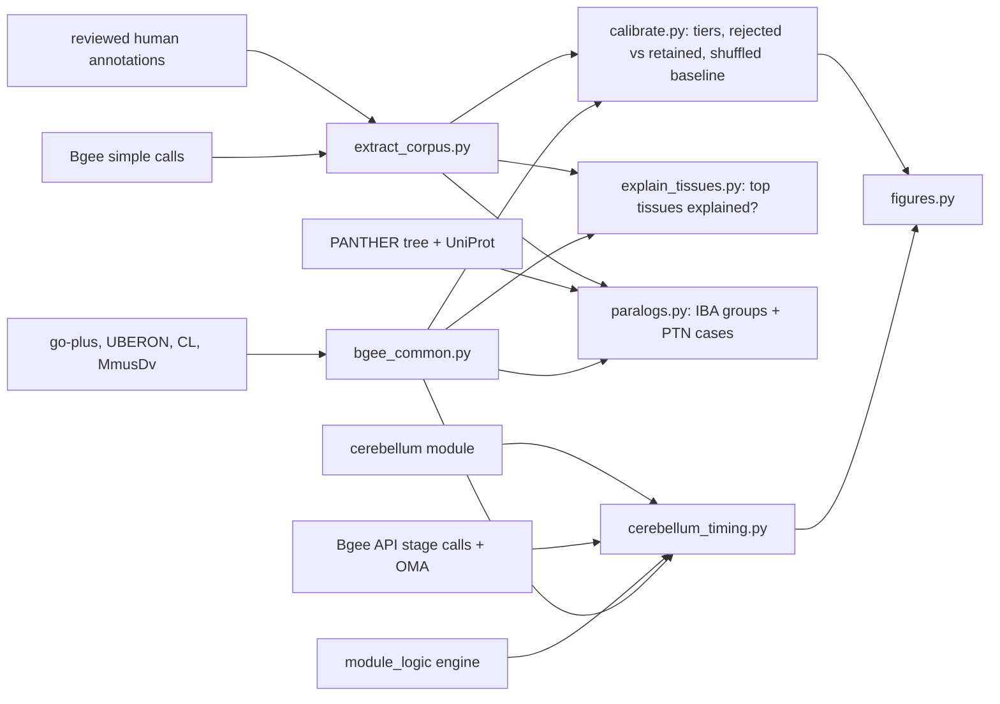

# Methods & reproduction

Companion to [Bgee expression as evidence](../BGEEDB_EXPRESSION.md). Every number and
figure on the main page is regenerated by the scripts below. None is typed by hand.

## Data sources and versions

| source | version | how it is used |
|---|---|---|
| Bgee per-species "simple" call files (`Homo_sapiens_expr_simple.tsv.gz`, `Mus_musculus_expr_simple.tsv.gz`) | Bgee 15.2 (`bgee.org/ftp/current`) | present and absent calls per anatomical entity, stages merged, with call quality, FDR and expression score |
| Bgee REST API (`page=gene&action=expression`, `cond_param=anat_entity,dev_stage`) | Bgee 15.2 | stage-resolved present calls for mouse (Pilot C) |
| Bgee REST API (`action=homologs`) | Bgee 15.2 (OMA) | human → mouse orthologs for module participants |
| go-plus (`go/extensions/go-plus.json`) | GO 2026-07-26 | logical definitions and existential axioms linking GO terms to UBERON/CL; GO graph for ancestor walks |
| UBERON basic, CL (full) | UBERON 2026-11-05; CL current | is_a / part_of / has-soma-location closure; develops_from |
| MmusDv | current | stage start/end in dpc, days, weeks or months post birth; UBERON stage xrefs |
| PANTHER treeinfo service | PANTHER 19 | tree topology, PTN ids, leaves (UniProt) below a PAINT node |
| UniProt REST (`xref_bgee`) | current | UniProt accession → Bgee (Ensembl) gene id |
| This repository | — | reviewed human annotations and actions (`genes/human/*/*-ai-review.yaml`), IBA WITH/FROM PTNs (`*-goa.tsv`), the cerebellum module |

The Bgee *expression score* is rank-based: the gene's rank among all genes
in that condition, scaled 0–100 and comparable across genes. The project uses
gold and silver calls; "present" and "absent" are Bgee's own calls.

## Pipeline



- `scripts/bgee_common.py` is the shared library:
  - the ontology bridge: GO → anatomy, the UBERON/CL closure,
    co-location and overlap;
  - Bgee readers and the API client with a JSON cache;
  - `classify_annotation`, which produces the tiers.
- `scripts/extract_corpus.py` collects reviewed human annotations and streams
  the human simple file once for their genes. It writes git-ignored caches
  under `.cache/bgee_expression/`.
- `scripts/calibrate.py` (Pilot A, corpus) does four things:
  - assigns tiers;
  - computes a shuffled baseline (each term paired with a random corpus gene,
    seed 20261108);
  - reports rejected-vs-retained ratios with Katz 95% intervals, before and
    after screening;
  - writes leads where a retained inference is strictly absent.
- `scripts/explain_tissues.py` (Pilot A, gene view): the top 10
  non-redundant gold present tissues per gene, explained or not by retained
  anatomy-bearing annotations, against another gene's annotations.
- `scripts/paralogs.py` (Pilot B) has two parts:
  - IBA groups (one PTN, one GO term) covering at least two reviewed human genes, with
    discordance flagged where one paralog is detected and another absent;
  - the named cases in `data/paralog_cases.yaml`, whose leaves are read from
    PANTHER, never typed by hand.
- `scripts/cerebellum_timing.py` (Pilot C) compiles the module with
  `ai_gene_review.module_logic`. It asks `unsatisfied_steps` per stage bin with a
  stage-specific predicate, in three variants: declared_strict, declared and
  territory.
- `scripts/figures.py` draws the two SVGs from the result YAMLs.

## Matching rules

A Bgee call on entity *E* and a GO anatomy target *t* relate as follows.
The first rule that holds is used.

1. **within**: *E* is_a/part_of* *t* (a lens call for *eye development*).
2. **precursor**: *E* develops (one step) into something within *t*.
3. **container**: *t* is within *E*. A whole-organ sample counts, but never
   whole-body samples (material anatomical entity, anatomical system,
   multicellular organism, embryo, craniocervical region).
4. **co-located** (CL targets only): the cell type's own location overlaps *E*.
   The location is its direct `part_of` or soma-location parents and their
   parents, never reached through is_a. Overlap means a part of *E* lies
   within the location, or one contains the other.

Near-root fillers (cell, organism, anatomical system) are dropped as
uninformative. A term without its own anatomy borrows its nearest ancestor's
(up to 4 steps over is_a, part_of and regulates). The classifier records
whether the anatomy was reached only through `regulates`.

## Tiers and screens

`classify_annotation` returns `CONSISTENT_*` (present, by one of the four
relations), `ABSENT`, `NO_DATA` or `NO_ANATOMY`. The calibration splits
`CONSISTENT_*` into `ENRICHED`, where the best matching call is in the gene's
own top 10%, and `CONSISTENT`. An absence is relabelled, and not counted
against the annotation, when one of these holds, checked in this order:

- **`ABSENT_QUIESCENT`**: every target is sperm, erythrocyte or platelet.
- **`ABSENT_DEVELOPMENTAL`**: the term is under *developmental process*
  (GO:0032502) and the calls are stage-merged.
- **`ABSENT_REGULATOR`**: the anatomy was reached only through `regulates`.
- **`ABSENT_NONAUTONOMOUS`**: the gene has a non-rejected annotation under
  *extracellular region* (excluding *extracellular vesicle*) or *receptor
  ligand activity*.

## Analysis parameters (choices, not results)

| parameter | value | where |
|---|---|---|
| enrichment percentile | 0.90 of the gene's own call scores | `calibrate.py` |
| top tissues per gene | 10 non-redundant gold present calls | `explain_tissues.py` |
| broad explanation | target with > 500 UBERON/CL descendants | `bgee_common.BROAD_TARGET` |
| co-location location size | ≤ 3,000 descendants (CNS passes) | `Anatomy.colocated` |
| mouse stage bins (dpc; birth = 19.5) | E8–E10.5, E10.5–E14, E14–birth, P0–P7, P7–P21, adult | `cerebellum_timing.BINS` |
| cerebellar territory | cerebellum, rhombic lip, rhombomere 1, midbrain-hindbrain boundary, metencephalon | `cerebellum_timing.TERRITORY` |
| gluconeogenic context | liver, cortex of kidney, small intestine (satisfiability engine's GTEx result) | `data/paralog_cases.yaml` |

A stage counts toward a bin only if its whole interval lies inside the bin.
So broad stages are not used, for example life cycle, organogenesis stage, or
infant stage (P4–P23). Bgee's `neonate stage` is MmusDv TS27 (P0–P3), resolved
through MmusDv's xref.

## Reproduce

```bash
# 1. corpus cache (downloads go-plus, UBERON, CL, MmusDv and the Bgee human file on first run)
uv run python projects/BGEEDB_EXPRESSION/scripts/extract_corpus.py
# 2. Pilot A
uv run python projects/BGEEDB_EXPRESSION/scripts/calibrate.py
uv run python projects/BGEEDB_EXPRESSION/scripts/explain_tissues.py
# 3. Pilot B (PANTHER treeinfo, UniProt REST; mouse simple file on first run)
uv run python projects/BGEEDB_EXPRESSION/scripts/paralogs.py
# 4. Pilot C (Bgee REST API, cached under .cache/bgee_expression/api)
uv run python projects/BGEEDB_EXPRESSION/scripts/cerebellum_timing.py
# 5. figures
uv run python projects/BGEEDB_EXPRESSION/scripts/figures.py
# doctests
uv run python -m doctest projects/BGEEDB_EXPRESSION/scripts/bgee_common.py projects/BGEEDB_EXPRESSION/scripts/calibrate.py
```

## Artifacts

- **Results:**
  - `results/corpus_calibration.yaml`
  - `results/corpus_leads.tsv`
  - `results/tissue_explanation.yaml` and
    [tissue_explanation_cases.md](results/tissue_explanation_cases.md)
  - `results/paralog_divergence.yaml` and `results/paralog_discordant_groups.tsv`
  - `results/cerebellum_timing.yaml` and
    [cerebellum_timing.md](results/cerebellum_timing.md)
- **Committed inputs, filtered so the case studies rerun offline:**
  - `data/case_study_calls_human.tsv`
  - `data/paralog_calls_{human,mouse}.tsv`
  - `data/cerebellum_stage_calls_mouse.tsv`
  - `data/panther_leaves.tsv`
  - `data/uniprot_bgee_map.tsv`
  - `data/paralog_cases.yaml`, authored
- **Not committed** (`.cache/bgee_expression/`): ontologies, the full Bgee call
  files, the corpus tables and the API cache. Regenerate with the steps above.
