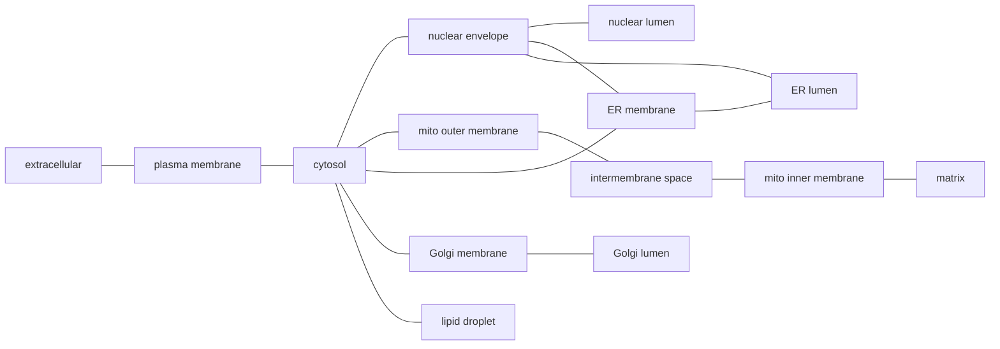

# GO-CAM compartments

**Bottom line:** a GO-CAM activity's `occurs_in` should place it in one distinct
compartment of the cell, and two activities joined by a causal edge should sit
in the same compartment or in compartments that share a boundary.
`just gocam-compartments` checks both against a small, explicit spatial model: a
disjoint set of compartments plus adjacency rules
([`gocam_compartments.yaml`](../src/ai_gene_review/data/gocam_compartments.yaml)).
Over all 2,036 cached production models, 338 models have at least one activity
whose location reaches no compartment (chromatin is the largest group, 293
activities in 104 models). The most common compartment jump, a plasma-membrane
receptor kinase or JAK directly activating a nuclear SMAD or STAT, is a GO-CAM
convention rather than an error: the steps in between (release, SMAD4 or STAT
pairing, nuclear import) are left out. **Modules now state those steps and are
linked to the GO-CAM activities, so they explain the jump**: 62 of the 76 direct
receptor → nucleus edges are explained by a module path through a nuclear
import step ([Explaining edges with modules](#explaining-edges-with-modules)).
What remains, 54 direct edges in 33 models, are review leads; most pass
material (a metabolite or protein) across a membrane with no transporter in the
model. Two QC flags, `UNRESOLVED_COMPARTMENT` and `NONADJACENT_COMPARTMENTS`,
record confirmed findings in GO-CAM reviews.

## The two motivating cases

**A location that cannot be traced to a compartment.** In
`600ced8500002343` (BMP9 signaling, human), the SMAD1 transcription factor
activity `occurs_in` `GO:0000785` chromatin. Any biologist reads that as
"nuclear", but the model does not say so: in GO, chromatin is `part_of`
chromosome, and chromosome is not `part_of` nucleus, because prokaryotes have
chromosomes too. No `is_a`/`part_of` path from chromatin reaches the nucleus, the
cytosol or any other compartment. The term that does say it is `GO:0000228`
nuclear chromosome (`part_of` nuclear lumen).

**A causal edge between compartments that do not touch.** In
`59cc772c00000000` (IL-1β signaling, human), CASP1 cysteine-type endopeptidase
activity in the cytosol *directly positively regulates* IL1B cytokine activity
in the extracellular region. CASP1 cleaves pro-IL-1β in the cytosol; the
cytokine reaches the extracellular region by a separate release step (through
gasdermin D pores or unconventional secretion) that the model does not show.
The edge crosses the plasma membrane without an activity that does so.

## The spatial model

### Disjoint compartments

The model is a set of pairwise-disjoint regions that together cover a cell
(eukaryote, plant, Gram-negative bacterium) and its surroundings. Each region is
a **membrane** or a **space**:

| Kind | Compartments |
|---|---|
| space | extracellular region, cytosol, nuclear lumen, mitochondrial intermembrane space, mitochondrial matrix, ER lumen, Golgi lumen, endosome lumen, lysosomal lumen, vacuolar lumen, peroxisomal matrix, cytoplasmic vesicle lumen, chloroplast stroma, thylakoid lumen, periplasm, lipid droplet |
| membrane | plasma membrane, nuclear envelope, mitochondrial outer and inner membranes, ER, Golgi, endosome, lysosomal, vacuolar, peroxisomal and vesicle membranes, chloroplast envelope, thylakoid membrane, cell outer membrane |

Each compartment has a GO anchor term. An `occurs_in` term **resolves** to a
compartment when the anchor is the term or one of its `is_a`/`part_of`
ancestors; where several anchors match, the most specific wins (lysosomal lumen
is a vacuolar lumen in GO, and resolves to lysosomal lumen).

A term can also be:

- **coarse**: it reaches a union of compartments but not one of them.
  `cytoplasm` (cytosol plus the organelles in it), `nucleus` (envelope plus
  lumen), `mitochondrion`, `endoplasmic reticulum`, `membrane`, `cell surface`.
- **ambiguous**: it reaches two unrelated anchors (endolysosome lumen is both an
  endosome lumen and a lysosomal lumen; the nuclear lamina is part of both the
  envelope and the nuclear periphery).
- **unresolved**: it reaches nothing. This is the `UNRESOLVED_COMPARTMENT` flag.

### Adjacency

Two compartments are adjacent when they share a boundary: a membrane and the
space on each side of it.



(The same pattern repeats for endosomes, lysosomes, vacuoles, peroxisomes,
vesicles and chloroplasts; the bacterial envelope runs plasma membrane →
periplasm → outer membrane → extracellular.) Two consequences follow:

- **Lumens are never adjacent to each other or to the cytosol.** Material
  crosses only by an activity in the membrane between them (a transporter, a
  channel, a translocon, a pore) or by vesicle traffic.
- **The cytosol is not adjacent to the nuclear lumen.** The envelope is between
  them; nuclear import and export are transport steps.

A causal edge is then classified by the distance between its two ends:

| Edge status | Meaning |
|---|---|
| `SAME` | both activities in one compartment |
| `ADJACENT` | they share a boundary |
| `BRIDGED` | two membranes bordering the same space, e.g. ER membrane → Golgi membrane or outer → inner mitochondrial membrane; plausible at a membrane contact site or on vesicle docking, so reported at lower priority |
| `EXPLAINED` | farther apart, but a module linked to both activities has a path between them through a transport step whose declared locations touch both ends (see below) |
| `RELOCATING` | farther apart, but the edge is a direct regulation and the downstream protein is known (from its gene folder) to occupy a compartment the regulator touches: the regulator acts on the protein there, and the protein then does its job elsewhere |
| `NONADJACENT` | anything else farther apart; a lead for the `NONADJACENT_COMPARTMENTS` flag |
| `INDETERMINATE` | one end is unresolved or missing |

For coarse locations the closest reading is used, so an edge is called
non-adjacent only when no reading of the coarse term makes it adjacent.

**Regulation and material flow are different.** "Directly regulates" in GO-CAM
means the two proteins physically interact; it does not mean the two
activities happen in the same place. JAK1 touches STAT3 at the membrane, and
STAT3's `occurs_in` nucleus says where STAT3 does its own job, later. So a
regulation edge can legitimately join distant compartments when the regulated
protein moves. A material-flow edge ("directly provides input for": a product of
one activity is the input of the next) is different: the molecule itself has to
cross every membrane in between, so a jump means a transporter is missing from
the model. `RELOCATING` therefore applies only to direct regulation edges, and
only when the downstream protein's own curated locations (GOA cellular-component
rows in its gene folder, minus any its review REMOVEs or marks as
over-annotated) include a compartment next to the regulator. Indirect edges
(transcriptional control and the like) reach their target through gene
expression and are never relocating.

### Context hints

The check does not guess. An unresolved term stays unresolved even when its
usual location is obvious, because the point is that the model does not say it.
The report attaches a **hint** instead: the usual compartment and, where one
exists, a term that would state it. Hints apply to a term and its descendants,
and the most specific wins.

| Unresolved term (and descendants) | Activities | Models | Hint |
|---|---|---|---|
| chromatin (heterochromatin, ...) | 293 | 104 | nuclear lumen; use `GO:0000228` nuclear chromosome |
| chromosome (site of DNA damage, replication fork, kinetochore, ...) | 204 | 62 | nuclear lumen; use `GO:0000228` nuclear chromosome |
| other organism part (host cell cytoplasm, symbiont cell surface, ...) | 132 | 61 | a location in another organism; edges into it cross organisms |
| cellular_component (root) | 67 | 41 | no location at all |
| cell junction (synapse, adherens junction, ...) | 44 | 28 | spans membrane, cytosol and outside; name the side |
| a cell type (CL term) used as `occurs_in` | 44 | 5 | says which cell, not where in it |
| organelle membrane contact site | 39 | 31 | name the membrane the activity is in |
| spindle pole body | 36 | 3 | nuclear envelope (fungal SPB is embedded in it) |
| cytoskeleton, actin cytoskeleton, centrosome, microtubule | 81 | 30 | cytosol |
| cell division site | 17 | 5 | a region of the cell periphery |
| (no hint) | 17 | 10 | |

## Explaining edges with modules

A GO-CAM model is a compressed account. A module can spell out what an edge
compresses, and a module element can name the GO-CAM activities that realize it
(`gocam_associations` with an `activity`). Put together, a module **explains** a
GO-CAM edge A → B when:

1. A is pinned to some module element and B to another;
2. the module's `connections` lead from A's element to B's element (lifting each
   to the nearest node that takes part in a connection; negative regulation
   does not carry the signal); and
3. the path goes through a `TRANSPORT_STEP` node; and
4. that step spans the edge: the GO locations declared at or below the transport
   node (its `context.cellular_components` and annoton `locations`), together
   with those of any module it includes by `module_ref`, touch or share a
   compartment at each end of the edge. A vesicle or mitochondrial transport
   step therefore cannot explain a plasma membrane → nucleus edge. When this
   condition fails, the edge stays `NONADJACENT` and the report keeps the
   explanation with `spans_edge: false`, so a reviewer can see what was
   offered and why it was refused.

The checker reports the path, any module included under the transport step by
`module_ref`, and the compartments the step was found to span. For the BMP4
model, for example:

```yaml
upstream_label: ACVR1 Hsap
downstream_label: SMAD1 Hsap
predicate_label: directly positively regulates
status: EXPLAINED
explanation:
  module: bmp_signaling
  path: [bmp_receptor_engagement, smad1_5_activation, smad_complex_nuclear_import,
    bmp_transcriptional_output]
  bridges: [smad_complex_nuclear_import]
  via_modules: [karyopherin_nuclear_protein_import]
  bridge_compartments: [CYTOSOL, NUCLEAR_ENVELOPE, NUCLEAR_LUMEN]
  spans_edge: true
```

`EXPLAINED` still rests on what the module declares: it shows that a curated
module path passes through a transport step located between the two ends, not
that the module's biology is right. That remains a module-review question.

The pins are curated, not inferred: nothing matches genes to modules
automatically, so an explanation is a curator's claim that this module is what
the GO-CAM edge stands for.

### What was curated

| Module | Change | GO-CAM edges explained |
|---|---|---|
| [`karyopherin_nuclear_protein_import`](../modules/karyopherin_nuclear_protein_import.yaml) | **New.** Cargo-neutral import cycle: cargo recognition (importin-alpha/beta1 route, or a direct importin-beta-family route), passage through the pore, RanGTP release (RAN, RCC1), carrier return (RANGAP1, NTF2), and importin-alpha re-export (CSE1L, optional) | (included by the three below) |
| [`jak_stat_signaling`](../modules/jak_stat_signaling.yaml) | The dimerization and import step is now two sub-steps: STAT release and dimerization (no other gene product), then STAT nuclear import by `module_ref`, citing importin-alpha5 for STAT1 and importin-alpha3 for STAT3 | 38 |
| [`bmp_signaling`](../modules/bmp_signaling.yaml) | **New step**: R-SMAD/SMAD4 complex formation (SMAD4 had been listed only at the output) and SMAD nuclear import by `module_ref` (importin-7/8; the SMAD1 basic NLS motif) | 19 |
| [`tgfb_smad_signaling`](../modules/tgfb_smad_signaling.yaml) | **New step**: SMAD2/3 nuclear import by `module_ref` (SMAD3 binds importin-beta1; both need importin-7/8) | 5 |

So the answer to "does this jump involve other genes?" is now written down
where it can be reused. Release and STAT dimerization are changes of state of
the transcription factor itself. SMAD4 is a pathway-specific partner, absent
from all 16 SMAD GO-CAMs in this set. Import uses shared machinery (importins
and the Ran system), which GO-CAMs reasonably leave out and the import module
supplies once.

Only human GO-CAM activities are pinned. Mouse and fly models with the same
pattern, and the activin and nodal receptor models (ACVR1B, ACVR1C → SMAD2/3),
are left for the corresponding modules.

## First corpus run

`just gocam-compartments -o projects/GOCAM_COMPARTMENTS/gocam-compartments-report.yaml`,
2,036 cached production models, GO from `sqlite:obo:go`, with module pins from
`modules/` and protein locations from `genes/`. The full report lists every
unresolved location and every non-adjacent, relocating or explained edge per
model:
[gocam-compartments-report.yaml](GOCAM_COMPARTMENTS/gocam-compartments-report.yaml).

| Activity location | Count |
|---|---|
| resolved to one compartment | 7,417 |
| coarse (a union) | 2,203 |
| ambiguous | 15 |
| unresolved | 974 |
| no `occurs_in` | 1,976 |

| Causal edge | Count |
|---|---|
| same compartment | 4,676 |
| adjacent | 1,207 |
| bridged (membrane–space–membrane) | 63 |
| explained by a module | 62 |
| relocating | 23 |
| non-adjacent | 179 (54 with a direct predicate: 33 material flow, 21 regulation) |
| indeterminate | 2,956 |

The largest groups of compartment jumps before modules and protein locations
were taken into account (upstream → downstream, all edges / direct edges):

| Upstream | Downstream | Edges | Direct | Usual missing step |
|---|---|---|---|---|
| plasma membrane | nucleus | 99 | 76 | the receptor or kinase acts on a cytosolic factor, which then enters the nucleus (JAK1 → STAT3 in `5f46c3b700002685`); 61 models. Of the 76 direct edges, 62 are now explained by modules and 11 (activin/nodal → SMAD2/3) are relocating |
| nucleus | extracellular region | 21 | 3 | gene expression → secreted product, normally an indirect edge |
| nucleus | plasma membrane | 16 | 0 | as above, for a membrane product |
| cytoplasmic vesicle (coarse) | ER (coarse) | 11 | 11 | all in one *S. pombe* model (`693b3c0900004859`): COPII cargo receptors acting on Sec24; placing both ends in their membranes would make these bridged |
| mitochondrial inner membrane | cytosol | 8 | 8 | export through the outer membrane (Slc25a10 → Mdh1 in `61e0e55600001225`) |
| extracellular region | cytoplasm | 8 | 0 | ligand → intracellular response without the receptor |
| mitochondrial outer membrane | mitochondrial matrix | 8 | 4 | import across the inner membrane (Tspo → Cyp11a1 in `68b0f0d000004550`) |
| cytosol | mitochondrial matrix | 5 | 2 | pyruvate import by MPC (pyk1 → pda1 in `663d668500002302`) |
| cytosol | extracellular region | 2 | 0 | (plus the CASP1 → IL1B direct edge above) |

Indirect edges across compartments can be deliberate summaries ("this
transcription factor indirectly increases secretion of X"), so the strong signal
is the direct ones.

## Review leads

The report is a list of leads for GO-CAM reviews. It does not write reviews or
fill in QC flags. A finding is a question about the model: a reviewer opens the
model, reads the evidence behind the edge or location, and decides whether there
is a real problem. Only that judgement goes into a review, as
`UNRESOLVED_COMPARTMENT` or `NONADJACENT_COMPARTMENTS` with the missing step
named. A finding the reviewer rejects (a deliberate summary edge, a location the
evidence really cannot resolve) goes in `notes`, so the next reader knows it was
checked.

Explained and relocating edges are not leads: a module or the protein's own
locations account for them. The leads are the 33 models with at least one
**direct** edge that is still non-adjacent (one already has a review). The
models with the most such edges:

| Model | Title | Direct non-adjacent edges | Example |
|---|---|---|---|
| `693b3c0900004859` | ER to Golgi vesicle-mediated transport (*S. pombe*, partial) | 13 | yip1 → erv29 |
| `62d0afa500000298` | Gluconeogenesis 3 (mouse) | 3 | Slc25a12 → Got1 (material flow) |
| `6796b94c00004996` | SARS-CoV-2 entry into host cell | 3 | ACAT1 → Spike protein S2 |
| `69729a3800007453` | protein import into mitochondrial matrix (*S. pombe*) | 3 | tom40 → tim50 (material flow) |
| `61e0e55600001225` | Gluconeogenesis 1 (mouse) | 2 | Slc25a10 → Mdh1 (material flow) |
| `65692e7e00001822` | RNF115 inhibition of TLR transport to cell surface (human) | 2 | RAB13 → TLR4 |
| `65bc474400000029` | ZDHHC4-mediated palmitoylation of MAVS via CPT1A (human) | 2 | ZDHHC4 → MAVS |
| `59cc772c00000000` | IL1beta-mediated signaling pathway (human) | 1 | CASP1 → IL1B |

Material-flow jumps are the strongest remaining leads: a mitochondrial carrier
in the inner membrane "directly provides input for" a cytosolic enzyme, with the
outer-membrane step (VDAC) not modelled. Several regulation jumps are trafficking
models whose subject is a protein moving between membranes, where a module for
the trafficking route would serve the same explanatory role the import module
does for STATs and SMADs.

### What the reviews found

Eleven of these models now have GO-CAM reviews (`gocams/<id>/<id>-review.yaml`):
the two motivating cases, two whose receptor → nucleus edges the modules
explain, and the seven leads above. Each flagged location or edge was checked
against the model's cited evidence. That makes the reviews a first test of how
well the check's leads hold up:

| Model | Flagged | Reviewer's judgement |
|---|---|---|
| `59cc772c00000000` IL-1β | CASP1 (cytosol) → IL1B (extracellular) | **Confirmed**: the release step is missing; the cited paper says the secretion mechanism is unknown |
| `600ced8500002343` BMP9 | SMAD1 in chromatin | **Confirmed** `UNRESOLVED_COMPARTMENT`; the cited paper shows nuclear accumulation (nuclear chromosome would state it) |
| `66e382fb00001232` BMP4, `5f46c3b700002685` IL-6 | receptor/JAK → nuclear SMAD/STAT | Explained by the modules; not flagged |
| `693b3c0900004859` ER-to-Golgi (*S. pombe*) | 16 edges | **1 confirmed finding** on 2 edges (luminal Ssp120 cannot touch cytosolic Sec24, an edge the model draws twice; the Emp43 hand-over is missing); 13 edges dismissed as coarse-location artefacts on the cytosolic face of the budding membranes; 1 legitimate (SNARE complex → Sec18) |
| `69729a3800007453` mitochondrial import (*S. pombe*) | 3 TOM → Tim50 edges | **Wrong location, not a missing step**: Tim50 is placed in the matrix instead of the inner membrane |
| `62d0afa500000298`, `61e0e55600001225` gluconeogenesis (mouse) | inner-membrane carrier → cytosolic enzyme | Dismissed as an acceptable simplification (the outer membrane is crossed passively through porins) |
| `6796b94c00004996` SARS-CoV-2 entry | 3 edges into the endosomal S2 node | **2 confirmed** (the model merges the TMPRSS2 surface route and the endosomal cathepsin route; the "ACAT1" node is a symbol collision for SOAT1); ACE2 → S2 dismissed as relocation |
| `65692e7e00001822` RNF115/TLR | GDI1 → RAB13, RAB13 → TLR4 | GDI1: **wrong location** (a cytosolic chaperone placed in the ER); RAB13 → TLR4: dismissed (TLR4 is the cargo) but flagged as wrongly direct |
| `65bc474400000029` ZDHHC4/MAVS | ER ↔ mitochondrial outer membrane | Dismissed: contact-site chemistry, which the cited paper reports |

Counting distinct findings rather than edges (an edge the model draws twice counts once), the leads
were useful but not self-evidently right: roughly a third of them pointed to a real problem, either a missing step or a wrong
location in the source model. The rest were coarse locations, contact-site
biology, or simplifications a curator could reasonably make. That is why a
finding needs a reviewer. The reviews also found problems unrelated to
compartments, recorded as `source_defects`. Examples: a GTPase activator drawn
as an inhibitor (Sec23 → Sar1); an activating edge where the paper shows
inhibition (TOLLIP → IRAK1); orthology references pointing to the wrong yeast
genes; and several references that appear to be copied from another model.

A recurring pattern across many models is better answered once in a module
than once per model in a review. The receptor → nuclear transcription factor
pattern turned out to be a convention with a well-defined set of missing steps;
writing them into modules settled it for 62 edges at once.

Unresolved locations are second priority, because the biology is usually
obvious. A review deals with them by noting the term that would state the
location (chromatin → `GO:0000228` nuclear chromosome).

## Limitations

- The model is topological, not geometric. A membrane protein is placed in its
  membrane without recording which face its active site is on, so a cytosolic
  kinase acting on the cytosolic tail of a receptor is correctly adjacent, but a
  luminal enzyme annotated only to "ER membrane" looks adjacent to the cytosol
  too.
- The `cell periphery` union includes the cytosol and the extracellular region,
  so any cell-periphery term that GO does not place more precisely (cell cortex,
  cell division site and their descendants) reads as possibly extracellular,
  and a cortical → extracellular edge comes out adjacent. This is deliberately
  permissive.
- `BRIDGED` accepts two membranes that border a common space whether or not a
  contact site or docking event is part of the biology.
- Topologically, the lumen of the secretory pathway is equivalent to the
  outside of the cell. The model does not use this equivalence: a Golgi lumen →
  extracellular edge is non-adjacent, which is what it should be, since a
  vesicle traffic step is needed.
- Multi-organism models (host–pathogen) place activities in another organism's
  cell. The model covers one cell, so these are left unresolved with a hint.
- 1,976 activities (about 16%) have no `occurs_in`, so 2,956 edges cannot be
  placed at all.

## Possible next steps

- Work through the review leads above, writing a GO-CAM review for each
  model taken up.
- Give `activin_receptor_signaling` and `nodal_signaling` the same SMAD2/3
  import step and pin their GO-CAM activities; that would explain the 11
  relocating ACVR1B/ACVR1C → SMAD2/3 edges.
- Write or extend modules for the material-flow jumps (mitochondrial metabolite
  export through the outer membrane; pyruvate import), and pin them.
- Report chromatin → nuclear chromosome upstream to the GO-CAM curators and to
  the Noctua form defaults; it is the single largest fixable group.
- Consider face-aware membrane locations (`cytoplasmic side of plasma membrane`,
  `lumenal side of ER membrane`) as a refinement of the membrane compartments.
- Apply the compartment check to module connections themselves, which have the
  same spatial semantics, so that a module cannot explain a jump with a path
  that jumps too.
